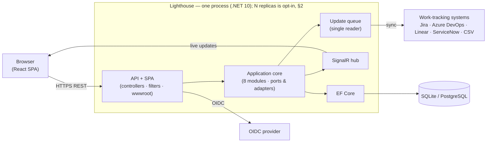
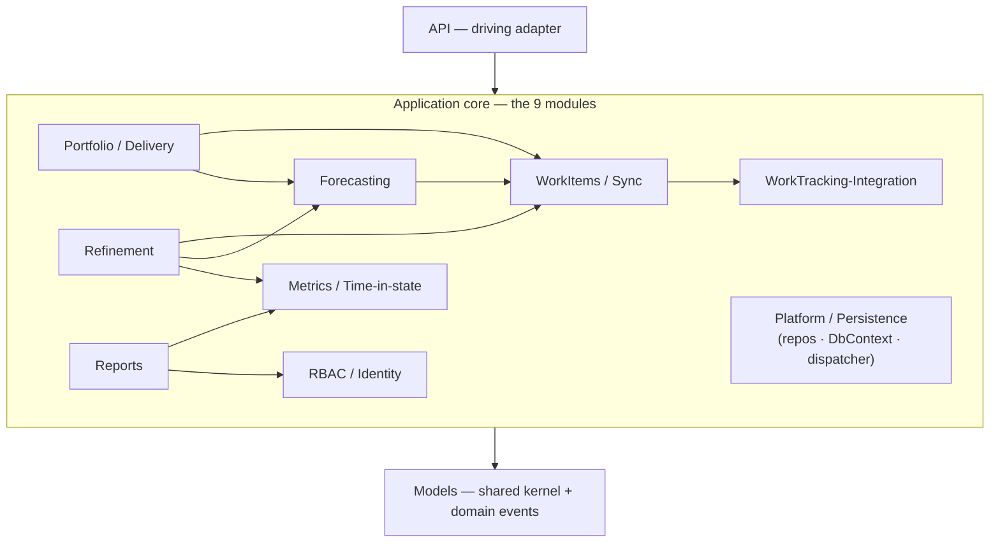
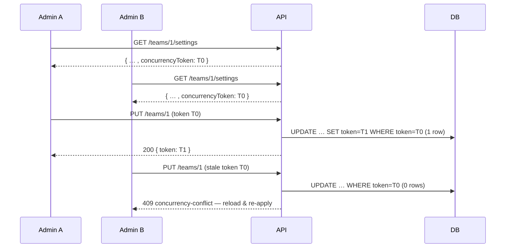

# Lighthouse — Architecture Overview

> **What this is.** A single, readable description of Lighthouse's **target architecture** and how the app is built — the shape you should have in your head before reading any feature delta or ADR. It is an *explanation* document: it links out to the detailed sources rather than restating them.
>
> **Where the detail lives** (all under [`docs/product/architecture/`](docs/product/architecture/)):
> - [ADR-027](docs/product/architecture/adr-027-target-architecture-modular-monolith-domain-events-cqrs-lite.md) — the accepted target-architecture decision this overview realises (D1–D8 + concurrency).
> - [`brief.md`](docs/product/architecture/brief.md) — the per-feature DESIGN deltas (component decompositions, driving/driven ports per feature). Accreted over time; consult per feature.
> - [`c4-diagrams.md`](docs/product/architecture/c4-diagrams.md) — C4 Context / Container / Component diagrams.
> - `adr-001 … adr-233` — point decisions (in that folder). The index at the end maps the load-bearing ones, and says which are designed but not built.
>
> **Status.** The dispatcher seam, the enforced module boundaries, optimistic-concurrency tokens, the config-gated cluster substrate (§2), the secret-encryption envelope and key custody (§9), and the embed surface (§11) described below are all **implemented**, not aspirational. Where something is deliberately *not* built, it says so.
>
> **Maintenance.** Keep this overview current with the **general concepts** — not feature-level detail. When an architectural concept changes (a module, a seam, a cross-cutting mechanism, a topology, a load-bearing constraint), update the affected section here in the same change. Per-feature specifics stay in `brief.md` / the ADRs, never here.

---

## 1. In one paragraph

Lighthouse is a software-delivery **forecasting** tool: it pulls work items from a work-tracking system (Jira, Azure DevOps, Linear, ServiceNow, or CSV), keeps a local projection, and runs Monte-Carlo forecasts plus flow metrics over them. It is a **single-writer modular monolith** — single-instance by default, optionally multi-replica behind a config-gated cluster substrate (§2) — built ports-and-adapters (hexagonal): an ASP.NET Core backend (OOP, C#) serving a React SPA from `wwwroot`, persisting through EF Core to a provider-switched store (SQLite by default, PostgreSQL for server deployments). Heavy work runs on an in-process background queue; clients get live updates over SignalR. The realistic load is **~20–150 users, rarely concurrent** — so the architecture optimises for correctness, simplicity, and a zero-dependency standalone binary over horizontal scale.



---

## 2. Architectural style & the load-bearing constraints

- **Modular monolith, ports-and-adapters (hexagonal).** Application/business logic depends only on *ports* (interfaces); concrete adapters (EF Core, HTTP controllers, connectors, SignalR) sit at the edges and depend inward. One deployable, one process.
- **Single-writer per entity is load-bearing; single-*instance* is the default, not the only shape.** Three seams assume one owner of the data: the **update queue** (`UpdateQueueService`, a single-reader `Channel<Func<Task>>`), the **maintenance gate** (`DatabaseMaintenanceGate`), and the **SignalR hub**. By default all three are in-process, and a standalone instance must keep working with **zero external dependencies** (ADR-027 D1). Two default-mode processes on one database are not a supported shape, and nothing locks the second one out. A process whose web host fails to start (typically because the port is taken) exits before its updaters run, but its startup migrations, seeding and orphaned-Feature cleanup have already written to the database by then.
- **The cluster branch is config-gated behind the same ports** (epic #5305, ADRs 075–078, which *amend* ADR-027 rather than replace it). When `ConnectionStrings:Redis` is present, SignalR gains a Redis backplane, the queue swaps `IUpdateStatusStore` / `IUpdateExecutionLock` / `IUpdateCompletionNotifier` from their in-process adapters to a Redis status store + a Postgres advisory lock + Redis pub/sub, the data-protection key ring moves to Redis, and boot-time `Database.Migrate()` runs under a Postgres advisory lock so one replica migrates while the rest wait. **Absent that connection string the code path is the single-instance one, unchanged** — a guard test pins this. What stays rejected is *unconditional* distribution: an always-on broker, microservices, a second store (ADR-027 D4).
- **Paradigm.** Backend is OOP C# (.NET 10). Frontend is React 19 + TypeScript, functional-leaning (hooks, pure components) but part of an overall OOP project.
- **One architecture serves every topology** (standalone single binary, docker + Postgres, k8s at one or many replicas, namespace-per-tenant hosting) **without forking** — via the provider-switched EF boundary and the substrate adapters above, not per-topology builds. §13 lists them.

---

## 3. Runtime shape (how a request and a refresh flow)

**Synchronous read/command (UI → API).** Browser → `https://…/api/{v1|latest}/…` → an MVC **controller** (driving adapter) → an application **service** (port) → a **repository** (driven adapter) → EF Core → DB. The controller maps the result to a DTO and returns it. Read endpoints (metrics, forecasts) are served from cached DTOs where hot.

**Background refresh (the write/sync path).** A scheduled `*Updater` (e.g. `PortfolioUpdater`, `TeamUpdater`) runs on the **single-reader update queue**: pull work items from the connector, reconcile the local projection, recompute deliveries/forecasts, write back. Because one reader drains the channel, operations on the same entity are serialised — this is the canonical "exclusive operation on entity X" primitive (use `IUpdateQueueService.EnqueueUpdate` / `EnqueueAndAwaitAsync`, never a parallel semaphore). Admission goes through `IUpdateStatusStore.TryAdmit` and execution through `IUpdateExecutionLock`, so in a multi-replica deployment "at most one active lifecycle per `UpdateKey`" is a *fleet-wide* invariant held by a Postgres advisory lock rather than a process-local one (ADR-076). A rejected admission parks a single coalesced follow-up and `Requeue`s the key, so the key never reads as idle during the handover. The sync reports its own scope back to the updater as a `SyncOutcome` (mode, records scanned, records fetched), sourced where the fetch happens rather than counted afterwards; the updater persists it on the `RefreshLog` row and emits one Information-level summary line per completed update. Everything the update *iterated over* is Debug (Epic #5687). How much a refresh downloads is decided per cycle by the pure `SyncModeResolver` (ADR-138): with a connector that answers `SupportsIncrementalSync(connection)` (ADR-139 — per connection, because Jira Cloud and Data Center are one class deciding deployment at runtime), the fetch runs in two phases — sweep the whole query for `(referenceId, changedAt)`, then download payloads only for the records whose stamp moved. Removal stays a set difference against the **swept** set, never against what was downloaded, so nothing about deletion changes with the mode. Anything ambiguous — connector cannot sweep, sweep failed, a stored record without a stamp — resolves to a full download; there is no partial mode. Time-driven derivations (staleness, rollup, extrapolation, forecasts) run over the *stored* set every cycle regardless of mode (ADR-141), because the record that stops being fetched is exactly the record that goes stale.

**Where a parent comes from is the Team's or Portfolio's to say; the connector only reads it.** Most trackers answer with their own parent field, or with a field whose value is a key. A Jira instance that records hierarchy as issue links — "caused by", "results in" — has no field to read at all, so the Parent Override Field may name a link type instead. Rather than teaching the reconciler about link types, the Jira connector works out whether the name is one of its fields or one of its link types (a field of that name always wins) and one pure `ParentSourceSelector` decides which source is read, so the shape of the answer is the same whichever source produced it. No connector declares a parent source as a capability: the port ADR-193 proposed for that was never built, and ADR-243 drops it (ADR-193 otherwise applies; distinct from ADR-157, which answers the adjacent question for a Portfolio's dependency references and deliberately does not share its type). Typing the type's name reads both ends, because Jira serves every link from both ends; typing the phrase one end reads as narrows the reading to that end. A record whose links match two or more candidates is not decided in the connector, which hands back every candidate with the date its link was made (read from the issue's history). The Work Item Service places it, because only it knows which candidates are Features Lighthouse holds: on a Team the candidates are first narrowed to stored Features, and an empty narrowing leaves the record unplaced; then the oldest link wins, then the earliest-created Feature, then the lowest key. A Portfolio's Features are never narrowed, so they are always placed. Every decision is logged as a Warning and counted on the `RefreshLog` row (ADR-238, superseding ADR-193's "no parent" rule).

**A Feature's dependencies come from exactly one of three sources.** One pure `DependencySourceSelector` decides which, for every tracker. A Portfolio naming no Dependency Field reads the tracker's own link (on Jira, "is blocked by"); naming an ordinary field reads the keys typed into it. On Jira the Dependency Field may also name a link type, by its name or by the phrase one of its ends reads as, matched case-insensitively against the instance's own, possibly renamed, phrases; the phrase typed says which end is the one waiting. Links of that one type replace "is blocked by" for that Portfolio rather than being added to it, so every edge has a single source, and they are stored as tracker links, because somebody drew them in the tracker. They arrive with the issue's other links, so naming one costs the instance no extra request. Field lookup runs first, so a real field carrying a link's name is still read as the field. On Azure DevOps the Dependency Field may name one end of a relation type by its reference name (`System.LinkTypes.Dependency-Forward`, or a server's own `-Forward`/`-Reverse` pair); relations of exactly that end replace Predecessor for that Portfolio. A base name without its end, or a type with no direction such as Related, reads nothing rather than guess a direction, and a named end no Feature carries says so once, listing the relation types seen. The relation-type listing is asked for at most once per Validate or fetch and handed down that call only, never kept on the connector, because one connector instance serves every Azure DevOps connection. Trackers with no fields of their own to name (Linear, CSV) keep reading their links whatever is set (ADR-157, ADR-243).

**One Jira connector, two Jiras.** Jira Cloud and Jira Server / Data Center are the same connector class, deciding the deployment at runtime from `serverInfo`, but they do not serve the same REST API: Data Center has no `rest/api/3` and no paged project search, lists projects as a bare array, and cannot filter a project's versions by status. Every route therefore lives in `JiraRestRoutes`, chosen per deployment, with one abstract member per capability that differs, so a new Jira call does not compile until it names its Data Center route as well as its Cloud one (Bug #6306, where the Release picker had been built against Cloud only). `JiraRouteLiteralsTest` refuses a route written anywhere else. A Jira that will not say which kind it is gets the routes both serve, and that answer is not cached, so a transient failure does not pin a Cloud site to the Data Center path.

**Settings an owner inherits from its connection.** A `WorkTrackingSystemConnection` holds one default per setting and per grain, Teams and Portfolios apart, for each setting that every Team (or every Portfolio) on it would otherwise repeat, starting with the Teams' Parent Override Field. Each owner stores its own value plus a source: it either follows the connection's default or owns its value, where owning nothing is a deliberate None rather than following. Every reader (connectors, selectors, the fetch fingerprint) asks the owner and gets the effective value, so no connector knows defaults exist. A default therefore reaches the fetch fingerprint only through the effective value of the owners that follow it, never through the connection's own share (ADR-241, ADR-242). The connection's API carries the defaults as one nested `defaults` member: a save that leaves it out keeps every default, a null inside it clears one. The connection list says, per default, how many owners follow it, and an owner's settings say where the value comes from and which field the default names. Saving a changed default queues only the owners whose fetch moved, and writes one log entry naming the default and the owners that follow it (§3).

**Live updates (API → UI).** Completed background work raises a SignalR `GlobalUpdateNotification`; the SPA refreshes the affected view. No polling.

**Forecasting (inside the refresh, and on demand).** A Monte-Carlo run is one set of trials over the whole forecastable set, not one run per Team combined afterwards. Every Team advances on a **single shared clock within a trial** (ADR-155), which is what lets a Feature delivered by one Team sit behind a Feature another Team has not finished; each Feature draws from its own addressable stream so a trial stays reproducible and a Feature's draws do not shift when the set around it changes (ADR-154). Within a trial a Feature is not eligible to be worked until everything it waits on has completed *in that trial* — and which recorded dependency counts is decided by one pure honour policy, the same function the on-screen warnings render from, so the column and the date can never disagree (ADR-158). A blocker that cannot be forecast at all is dropped from the wait rather than silently treated as absent, and the resulting date is reported as a floor (ADR-159). Joint likelihood over a set of Features still combines per-Feature distributions as ADR-110 describes — replacing that with a per-trial max was proposed and deferred (ADR-156). A licence gate sits at the honour policy, not inside the simulation, so an unlicensed instance runs the same engine over an empty dependency set. The same trials also record the day each Feature is first worked, per Team and for the Feature as a whole, into a collection of its own beside the completion forecasts (ADR-199, ADR-200). Whether a Feature's start is observed or forecast is answered once, on `Feature`: a Feature in progress or done reports the day it actually started (its creation day standing in when the tracker recorded none), and only one not yet started reads the forecast — the table, the Delivery timeline and write-back all take that one answer (ADR-201). The run forecasts the board exactly as configured and does not seed anything to make the result look tidier (ADR-202). A simulation runs its trials on at most half the cores the host reports (`ForecastSimulationLimits.MostRunsAtOnce`, never fewer than one), per simulation and whoever asked for it, so request threads stay free while forecasts run; the startup banner prints the bound (ADR-248). A background forecast hands its update's cancellation token down to the `Parallel.For`, which stops between trials; a stopped forecast persists nothing and stages no write-back, so the previous forecast stands and the run ends `Cancelled` (ADR-249). One trial simulates at most `ForecastHorizon.Days` — five years, 1,827 days, one constant the on-screen copy also reads (ADR-251). `TotalTrials` counts every trial, and a trial that has not finished by then is *beyond the horizon*: derived as `TotalTrials − Σ histogram` rather than stored, read through `ForecastPercentile` (a day, beyond the horizon, or no answer), counted as late by every likelihood, and carried through the multi-Team and Delivery combinators as one virtual last bucket that only the aggregate output strips (ADR-250). On the wire a beyond percentile is additive — `beyondHorizon: true` and `horizonYears` beside a kept stand-in `expectedDate` five years out, so a client that reads only the date still parses it. The web app shows "More than 5 years" and draws no bar or chart point for it, write-back resolves no value for it, and a forecast published to a Jira Release says it in words (ADR-252, ADR-254).

**An unchanged forecast is confirmed, not recomputed (ADR-256).** Between gathering a Portfolio's inputs and simulating, `ForecastService` reduces what the simulation is about to be handed (the instance day, the trial limits, the in-scope Features in forecast order, every row's remaining work, each Team's throughput as handed, chip status and Feature WIP, and what each Feature waits for) to one `ForecastInputFingerprint`, and compares it with the value stored on the Portfolio. A match answers `ConfirmedUnchanged` and writes nothing: `ForecastUpdater` stamps the Features' forecasts as confirmed at that round (set-based, never moving a time back), marks the `RefreshLog` row `Skipped`, and still stages write-back and publishes `PortfolioForecastsUpdated`, so only the simulation is saved. The stored value changes only by compare-and-set: a computed run swaps what it read for a `computing:` mark before it saves and swaps the mark for the fresh fingerprint at the end, so any failure, crash or forget in between leaves a value no round matches. The six user-started refresh and forecast endpoints write a new forget token before they queue, in the database rather than on the queue, so the bypass survives Redis admission on another replica, and every start of the app forgets every Portfolio's value through a seeder. Null, a token or a mark all mean compute.

**Stopping work.** A System Admin stops one piece of admitted work from its Task Manager row, or everything at once with Cancel all (`POST api/latest/update/tasks/cancel`). Removals are never stopped; both paths ask one `UpdateCancellationPolicy`. Cancel all publishes one message through the cancellation notifier port's own pair (`PublishCancelAllAsync` / `SubscribeToCancelAll`): a direct call in process, a Redis channel of its own when Redis is configured. Each replica applies it to its own state only — it drops its coalesced follow-ups and held forecasts and cancels every non-removal key it admitted — and delivery is at most once. Work admitted afterwards, scheduled refreshes included, runs as usual. A refresh round whose last work leaves without running still sends what its other work staged for write-back, and the `DatabaseMaintenanceGate` counts that owed write as background writing, so a backup, restore or clear cannot start between the key leaving the status store and the write (ADR-253).

**A forecast round runs on its own threads, and the pages read less than they show (ADR-257 – ADR-262).** A background round's frames run on a dedicated `ForecastLane` (as many threads as `ForecastSimulationLimits.MostRunsAtOnce`, built once at registration and read by the startup banner), so a round no longer takes threads from the pool that answers pages; the queue loop and the driver's continuations stay on the pool, and round code never uses `ConfigureAwait(false)` (ADR-257). Screens that need only names and counts read the **catalogue** shape of a Portfolio or Team, which leaves out the forecast histograms (ADR-258), and a round gathers its Features the same way and writes back from a fresh, no-tracking read taken after the save, only when the Portfolio has a write-back mapping (ADR-261). A Portfolio's or Team's Features tab asks one owner-keyed endpoint for its whole list (`FeatureDto`-named rows, completion histograms kept, per-Team start histograms dropped), which replaces the request that carried every id in its address and failed with HTTP 414 above roughly 600 Features; an unreadable or missing owner answers 404 (ADR-260). The licence count is one shared keyed query: while it is loading or failed, only the create entry points refuse, saying why, and edits behave as before (ADR-259). A Portfolio's size note is decided on the server: `PortfolioSize` holds the threshold of 100, `GET api/latest/portfolios/{id}/size` answers a `COUNT` of its stored Features, and `PortfolioUpdater` writes one Warning per successful update above the threshold (ADR-262).

**Reactions (publish/subscribe, in-process).** After a refresh, an updater **publishes a domain event** (§5) instead of hand-wiring reactions; subscribers (cache invalidation, cross-aggregate forecast triggers, future notifications) run as handlers. Transport only — see §5. A command can publish too: a connection save whose Additional Fields change what its Teams and Portfolios fetch compares the connection's share of the fetch fingerprint before and after the save and publishes `ConnectionFetchShapeChanged`, whose handler queues an update for each owner, so the fields fill in without waiting for the next scheduled run. The browser asks first and offers to save only (`?startUpdates=false`); the CLI and MCP clients send nothing and update now (ADR-239).

---

## 4. The nine modules

The codebase is one assembly organised into **nine logical modules** (namespace folders), with boundaries **enforced at test time** by `TngTech.ArchUnitNET` (ADO #5101). No physical assembly split — that would complicate the single-binary publish for enforcement the test rules already give (ADR-027 D5).

| # | Module | Responsibility | Anchor namespaces |
|---|---|---|---|
| 1 | **WorkTracking-Integration** | Connectors (Jira / ADO / Linear / CSV / ServiceNow), auth & OAuth strategies, issue hydration. Every connector dates started/finished work through the one shared `WorkItemCategoryCrossing` rule — an arrival counts only when it enters a state category from *outside* it, latest crossing wins — so `Resolved → Closed` re-dates nothing while `Done → Doing → Done` does (Bug #5621) | `Services.*.WorkTrackingConnectors`, `Factories` |
| 2 | **WorkItems / Sync** | `WorkItemService`, sync delta, state-transition capture, team-data service | `Services.*.WorkItems`, `.TeamData`, `.WorkItemRules` |
| 3 | **Forecasting** | Monte-Carlo simulation, forecast services, forecast-filter rule engine | `Services.*.Forecast` |
| 4 | **Portfolio / Delivery** | The `*Updater` pipelines, the update queue, delivery rules, write-back | `Services.Implementation.BackgroundServices`, `Services.Interfaces.Update` |
| 5 | **Metrics / Time-in-state** | Throughput, cycle-time, percentiles, cumulative-state-time, blackout, RAG (flat in `Services.Implementation`) | (type-set, e.g. `*MetricsService`, `Percentile/XmR/Baseline*`) |
| 6 | **RBAC / Identity** | Authorization, RBAC administration, licensing/premium gate | `Services.*.Auth`, `.Authorization`, `.Licensing` |
| 7 | **Platform / Persistence** | `LighthouseAppContext`, repositories, DB management, **domain-event dispatcher**, seeding, OAuth token store | `Data`, `Services.*.Repositories`, `.DatabaseManagement`, `.DomainEvents`, `.Seeding`, `.OAuth` |
| 8 | **Refinement** | The Team's Refinement tab: which Work Items are in refinement, how many more the Team needs to last one Refinement cycle, and the sizing votes cast on them. Its settings are one JSON value on the Team, saved through the Team settings write. It depends **down only** — on WorkItems, Forecasting, Metrics and the kernel, never on WorkTracking-Integration or Portfolio/Delivery — and **nothing but `API` depends on it**, so it can be removed without touching any other module. Built so far: the settings, the list of Work Items in refinement (`RefinementList`, read-only), the SLE yardstick, and casting a sizing vote, which appends to the sizing log (`SizingLogCommands`, the module's only write), and stages. Stages come only from two optional rules a Team may set, Ready and Being refined, matched by the shared Work Item rule engine (`StageRuleMatcher`) over the Work Items already in refinement and never beyond them; whatever neither matches is Waiting, Ready wins when both match, and a Team with no rule has no stages. The stage and the votes are two independent signals shown side by side: the ready count follows the votes for a Team without stage rules and the stage for a Team with them. The need number is derived on read, never stored: the Team's own manual How Many forecast over one Refinement cycle — the working days after the next Refinement (today, on a Refinement day) up to and including the Refinement after it, so whichever day of the week it is the number stays the same — read at (100 − p) for the band's two likelihoods (50% and 85% by default), and the ready count is judged Below, In (both ends included) or Above that range (`RefinementNeedCalculator`, `NeedBand`). The cycle is a calendar fact (`RefinementCadenceCalendar.CycleFrom`): a Refinement on a blackout day does not happen, so either end skips to the next one that does, and blackout days inside the cycle are not working days. The answer carries facts only, the cycle's first and last day among them; where no number can be given it says why (no cadence, too little Throughput history, no refinement states), and the browser places the "enough for" line. Votes make a Work Item Ready when enough Yes votes come from enough voters, unless one of two discussion rules sends it to discussion (by default 1 No, or 2 "Yes, if…"); a comment from somebody without a current vote is an open question until they vote; every reader sees every split and every comment. A reader votes, comments and takes a vote back under an account when sign-in is on, or under a random key their browser or client keeps and a name they give when it is off. The CLI and the MCP server read the same answer and cast the same votes through the same endpoints. Presenter mode (Epic #6137) and sizing calibration (Epic #6138) are not built | `Services.*.Refinement`, `API/Refinement*Controller` |
| 9 | **Reports** | Saved, owner-scoped reports on a Team's or a Portfolio's Reports tab. A report belongs to exactly one owner and goes when it goes (cascading foreign keys). The first type, Then & Now, freezes a window of the owner's metrics (Then) the moment it is created and compares it with the same metrics over a window ending today (Now), computed afresh on every read; windows are inclusive calendar days in the instance's zone, taken from `ILighthouseClock`. Each type is a strategy (`IReportTemplate`) and each metric a catalog entry (`IReportMetric`) that reads through `IReportMetricSeries`, whose Team adapter goes through the same metrics service the Metrics tab uses, so a report and the tab never disagree. Reads and writes are separate ports: `IReportQueries` reaches persistence only through `IReportReader`; `IReportCommands` also uses `IReportWriter`; one `ReportRepository` implements both and only the composition root names it. Every port operation takes a `ReportOwner`, never a user; the controllers apply the existing Team Read/Write guards. It depends **down only** — on Metrics, RBAC/licence and Platform — and nothing but `API` and the composition root depend on it. Built so far: a Team's Then & Now reports with Cycle Time | `Models.Reports`, `Services.*.Reports`, `API/TeamReportsController` |

Plus three non-module bands:
- **`Models` — the shared kernel** at the bottom. Entities, value objects, **and the DTOs that services return** (relocated out of `API.DTO` so the core never depends on the API layer — ADO #5101). Everything may depend downward on `Models`.
- **`API` — the driving adapter** at the top (controllers, filters, request/response DTOs that are *only* consumed by controllers). Depends down on the modules; nothing depends up on it.
- **The composition root & host band** — `Program.cs`, `Startup/`, `Configuration/`, `Health/`, `Standalone/`. Not a module and not under the boundary rules: it wires adapters to ports (including the in-process-vs-cluster adapter choice of §2) and owns the `/health/live`, `/health/ready` (drain-aware) and `/health/startup` endpoints plus graceful shutdown.



> Dependencies point **downward** (API → core → Models); the sideways arrows are the legal cross-module edges. The enforced hexagonal seam is that **no core module points back up to `API`**.

### Enforced dependency rules (ArchUnitNET, run in `dotnet test`)

- **`Services` (the whole application core) ↛ `API`** — the hexagonal seam. DTOs the core returns live in `Models.*`, never `API.DTO`. *(Green; the metrics/forecast/blackout/oauth-health DTOs were relocated to `Models.*` to make this hold.)*
- **`Models` (kernel) ↛ `API`** — the kernel never depends upward on the driving adapter.
- **WorkTracking-Integration is a leaf input adapter** — it must not depend on Forecasting, Portfolio/Delivery, or WorkItems/Sync.
- **The domain-event dispatcher and its handlers must not call `IServiceProvider.GetRequiredService`** — the seam must not re-introduce the service-locator it removes (§5).
- A handful of feature-specific seam rules (e.g. metrics read transitions only via repository ports; `WorkItemService` is the sole writer of transitions; every caller that orders Features goes through the one `FeatureOrdering` comparer rather than sorting for itself — ADR-132/134/187, with the choice itself stored as a row in the behaviour-settings table rather than as an `AppSetting` — see §10) live alongside.

> **Mechanism note.** Architecture tests use `TngTech.ArchUnitNET` (adopted in #5101). Two checks that ArchUnitNET cannot express — exact public-signature pinning (`DeliveryRuleServiceApiPreservationTest`) and the `RuleEvaluator` parameterless-ctor purity pin — remain hand-rolled reflection tests by design.

---

## 5. The in-process domain-event dispatcher (transport, **not** event sourcing)

A lightweight in-house seam (ADO #5098/#5099, ADR-027 D1–D3) that decouples "a thing happened" from "the reactions to it":

- **`IDomainEventDispatcher.PublishAsync<TEvent>(evt, ct)`** — a thin router. It resolves handlers via the **typed `IEnumerable<IDomainEventHandler<TEvent>>`** from a fresh DI scope (`GetServices`, **never** `GetRequiredService`), and invokes each. Event records are POCO `record`s under `Models/Events/` (kernel — below both API and Services).
- **After-commit by default.** Heavy work routes onto the existing update queue; the dispatcher does not open transactions.
- **Per-handler isolation.** Each handler runs in its own try/catch (log-and-continue). A throwing handler neither aborts its siblings nor loses the already-committed fact; **recovery is the next scheduled re-sync — there is no outbox** (an accepted trade, valid because facts are DB-derivable).
- **It is a transport, not a store, and not Event Sourcing (ADR-027 D7).** Persisting an event is a *separate, opt-in subscriber/sink* (#5017-class) with its own retention/PII rules — never an automatic write by the dispatcher. The `WorkItemStateTransition` history is a projection of the external changelog, not a system of record. Sync normally only adds to it; a record whose connector says it carries its whole, fully readable history (`TransitionsAreItsWholeHistory`, set by Jira) replaces the stored rows instead, so a corrected time leaves no stale twin. An added row that takes the place of a dropped one for the same move is a correction and raises no `WorkItemTransitioned`, and an empty reading never deletes.

```mermaid
sequenceDiagram
  participant U as PortfolioUpdater
  participant D as IDomainEventDispatcher
  participant H as Handlers (typed IEnumerable)
  participant Q as Update queue
  U->>U: refresh + commit
  U->>D: PublishAsync(PortfolioFeaturesRefreshed) — after-commit
  D->>D: CreateScope() + GetServices&lt;handler&gt;()
  loop each handler (isolated try/catch)
    D->>H: HandleAsync(event)
    H->>Q: EnqueueUpdate(heavy work)
  end
  Note over D,H: a throwing handler is logged & skipped;<br/>the committed fact survives and recovers on the next re-sync (no outbox)
```

**Event families** (where the seam pays off): A — refresh-completed pipelines (`PortfolioFeaturesRefreshed`, `TeamDataRefreshed`); B — lifecycle (`*Created`/`*Deleted`); C — cross-aggregate triggers (e.g. team-refresh → forecast trigger, now a `TeamDataRefreshed` handler instead of a cross-module call; likewise `FeatureRankChanged` / `FeatureOrderingPolicyChanged` → a coalesced forecast recompute, ADR-133; and `ConnectionFetchShapeChanged` → each owning Team and Portfolio queued for an update, ADR-239); D — work-item and feature state transitions (`WorkItemTransitioned`/`BecameStale`/`Blocked`/`Unblocked`, `FeatureBlocked`/`FeatureUnblocked` — the capture seam for blocked spells, ADR-068/104); E — connection/credential health; F — **history recorders**: handlers on the refresh events append the day's row to the day-keyed snapshot tables (§6).

**The connection save is its own service.** The PUT's controller only maps the request onto the connection; `IConnectionSaveService` opens the save (reading the connection and how it fetched, and the defaults it held), and commits it: it applies the client's concurrency token, saves, writes one Information log entry for a changed default naming the connection, the old and new field and the Teams that follow it in the order they were created (or that none do), and then publishes `ConnectionFetchShapeChanged` when the fetch shape moved. The event carries only the Teams and Portfolios whose fetch moved, so a changed default queues only the owners that follow it. The browser's question opens for that too: a changed default that Teams or Portfolios follow asks it, just as a changed Additional Field does. A save that was stored still answers 200 if the log entry or the publish fails afterwards (ADR-242).

> **Deliberately kept imperative.** `PortfolioUpdater.Update` is a strictly-ordered, single-scope pipeline (each step reads prior steps' results on the same tracked entity). Only genuinely *independent* reactions (e.g. metric-cache invalidation, the fire-and-forget forecast trigger) are peeled into handlers; the ordered core stays imperative because after-commit handlers run in fresh scopes (ADR-027 D2 reserves an in-transaction tier for true invariants only).

---

## 6. CQRS-lite (same store, separated paths)

Not full CQRS — **command/query separation on one store** (ADR-027 D6):

- **Write path** — `*Updater` services + repositories mutate aggregates.
- **Read path** — metrics services (`BaseMetricsService` and subclasses) compute and serve **cached DTOs**; cache invalidation is a *subscriber* to the relevant refresh event (structurally fixing the historical "scattered remembered invalidation" bug class), not a remembered imperative call.

A separate read store was rejected: there is no read-throughput bottleneck at this scale, and a second store would fight the no-fork / standalone goals.

### Over-time history is a recorded projection, not a query over the past

Most "how did this metric look last month?" questions cannot be answered by re-deriving from the work-item projection — the connector only ever gives us *now*, and a re-derivation would silently rewrite history whenever a rule, a mapping or a state definition changed. So each such metric gets its own **day-keyed snapshot table**, appended by a recording handler on the refresh event that produced it (§5 family F):

| Table | Records | ADRs |
|---|---|---|
| `DeliveryMetricSnapshot` | per-delivery progress, scope, epic count & size | 048 / 049 / 050 / 121 |
| `PercentilesOverTimeSnapshot` | cycle-time / age percentiles per owner per day | 106 / 107 / 108 / 207 / 208 |
| `BlockedCountSnapshot` | how many items were blocked that day | 069 / 099 |
| `ProcessBehaviorSnapshot` | XmR baselines & limits | 052 / 207 / 208 |

The rules that keep this honest: **write is idempotent on the day key** (a re-run overwrites the same row, never appends a second one), **a stored day is never rewritten from the past**, and the read path serves the series straight from the table. A percentile day with nothing to measure (all four percentiles zero) is left absent by the recorder and the filler alike, rather than stored as a zero.

**The one exception fills gaps, never overwrites.** For the percentile and process-behaviour tables only, a series read that finds missing days in its range always asks a filler of its own — not the update queue — to work those days out in the background, bounded per pass, from the stored work items and **the recorder's own computation**, and to write them **only if absent**. Days before the owner's first finished item or after its last observed sync are refused. A filled row carries no marker, so it reads as a recorded one: it is computed against *today's* configuration and item set. There is no setting to switch the fill off: the former `OverTimeHistoryFill` row and its one-time app-setting record are removed by the seeders at start-up ([ADR-207](docs/product/architecture/adr-207-read-triggered-reconstruction-on-its-own-filler.md), [ADR-208](docs/product/architecture/adr-208-a-past-day-is-computed-by-the-recorders-own-code.md)). The demo backfill handlers still write their synthetic rows; the filler steps over them.

### Some numbers are derived on read and never stored

Not everything time-dependent earns a snapshot table. The chance an open Work Item misses its Team's Service Level Expectation is a **pure conditional over that Team's closed cycle times**: of every item that was still open at this item's age, the share that went on to exceed the target (ADR-192). It takes the age from its caller rather than reading a clock, which keeps it a function of its three arguments; past the target the answer is 100% whatever the history holds.

It is **a number per item, produced by the read that asks for it** — not a background ladder on a schedule, and not a column on the work-item table (ADR-194). There is no way to express "no answer": an item nothing can be said about is left out of the collection by the caller instead of carrying a null every reader has to interpret. One derivation feeds the aging chart's zones, the dialog's column and the at-risk widget, so those three cannot disagree, and the figure is published alongside how much finished work it rests on — a fact about the history rather than about how the risk was derived, which is what lets one such number stay true beside every answer the calculation can give.

The **Forecast Reality Check** is the same idea at the size of a report (ADR-209). One request replays a Team's recent forecasts — four horizons ending today, each forecast from every sampling window on a fixed ladder plus the Team's own — and scores each at the 50th, 70th, 85th and 95th level against what was actually completed. Nothing is stored and nothing is written back: the answer is the response, and an ArchUnitNET rule keeps the whole feature away from repositories and the database, so it cannot grow a write path or a "recommended window". A level is scored as held or not, and is judged against holding as often as its own number (ADR-210). How close each forecast landed is graded in the browser from the forecast and actual counts the response already carries (ADR-211), so the server's contract stays facts rather than presentation.

### A closure pin is a record, not a series

Archiving a Delivery writes a different shape: **one row per Delivery** holding what it was showing at the moment it closed — the likelihood, the forecast dates and the Features that were in it (ADR-160). It is not day-keyed and it is never re-derived, because its whole point is to survive the live Features moving on underneath it. The archived read path is therefore **structurally unable to reach live Features** (ADR-161) rather than merely choosing not to, the aggregate refuses writes to an archived Delivery (ADR-164), and the active list excludes archived Deliveries through a narrowed port instead of a filter every caller has to remember (ADR-163).

### A sizing log is appended to, never edited

The Refinement tab's sizing votes are a third shape: **an append-only log keyed by voter**. Every vote, comment and taking-back of a vote is a new row naming who cast it, when and through which channel; nothing ever updates or deletes one. What a Work Item's votes currently add up to is worked out on read from the whole log, so a changed mind is a later entry rather than a rewrite, and the history of how the Team reached Ready stays intact. The voter is a key the server derives from the session or from a key the browser presents — never an identity field the caller fills in — so no request can write an entry in someone else's name. The repository port offers no update or remove member at all, which makes the invariant structural rather than a convention (ADR-216; built with the first vote).

---

## 7. Concurrency & consistency

- **The update queue** (§3) serialises sync-path writes per entity — the primary concurrency-correctness mechanism for the high-churn path.
- **Optimistic-concurrency tokens** (ADO #5100, ADR-027 concurrency section) close the one genuine human-vs-human gap: two admins editing the same **config aggregate** would otherwise silently last-writer-wins. The seven human-edited config roots — **Team, Portfolio, WorkTrackingSystemConnection, Delivery, and the RBAC trio (UserProfile, RbacGroupMapping, ApiKey)** — implement `IConcurrencyTokenEntity` (a provider-agnostic `Guid ConcurrencyToken`, `.IsConcurrencyToken()` on both providers — no `xmin`/rowversion fork).
  - The token is read on the config GET, echoed on save, and a stale save returns **HTTP 409** (`ConcurrencyConflictExceptionFilter` → ProblemDetails `code: "concurrency-conflict"`), distinct from the 403 authorization path so clients can offer "reload & re-apply".
  - **The token advances only on the human-edit path** (the controller/RBAC edit sets a fresh token + the client token as the EF `OriginalValue`), **not on every save** — because Team/Portfolio rows are also written by system/background/cascade operations, and advancing on those would churn the token and spuriously 409 a concurrent user edit. The FE chains the refreshed token across consecutive auto-saves and serialises in-flight saves.
  - The blanket `LighthouseAppContext.SaveWithRetry` reload-and-retry (last-writer-wins) is scoped to **bypass tokened-aggregate conflicts** so it can't silently swallow the 409; high-churn sync entities (`WorkItem`/`Feature`/`FeatureWork`/`WorkItemStateTransition`) are deliberately **never tokened** (a guard test pins this).


- **Consistency contract.** *Read-your-writes* for a user's own config edits; *eventual / "as-of last sync"* for sync-derived metrics and forecasts, labelled honestly in the UI.

---

## 8. Persistence

- **EF Core**, provider-switched in `DatabaseConfigurator`: `UseSqlite` (default; WAL mode) or `UseNpgsql` (server), chosen from the `Database:Provider` config string.
- **Two migration assemblies** — `Lighthouse.Migrations.Sqlite` and `Lighthouse.Migrations.Postgres`. Generate migrations only via the **`Create-Migration.ps1`** script (spins up an ephemeral Docker Postgres for the Postgres half) — never `dotnet ef migrations add` directly.
- `LighthouseAppContext` overrides `SaveChangesAsync` to `PreprocessDataBeforeSave` (encrypt secrets, stamp initial concurrency tokens on `Added`) then `SaveWithRetry` (§7). Which values are encrypted, under which key, and who owns that key is §9.
- **Stored reports** live in one `Reports` table for every report type: the common columns (exactly one of `TeamId` / `PortfolioId`, held by a check constraint and two cascading foreign keys; template key; name; created instant; shown metric keys; concurrency token) plus the type's own data as JSON text in `TemplatePayloadJson`, with a `PayloadSchemaVersion`. Payload members are only ever added and are all optional, so a member a report predates reads as not captured and members a later version wrote survive a read by an older one; nothing is converted by EF, so the text is kept as written. A new report type adds no column and no table.

---

## 9. Secret encryption & key custody

Credentials for the work tracking systems are the only data Lighthouse holds that is worth more to an attacker than the instance itself, so custody of the key that protects them is a load-bearing concern rather than a detail of persistence.

- **What is encrypted is a closed set**: the connection options a connector declares as secret, plus OAuth access and refresh tokens. Everything else — teams, portfolios, work-item history, forecasts — is stored as it is, because none of it is a secret. API keys and embed session secrets are *hashed* instead (PBKDF2-SHA256 per-key salted, SHA-256 respectively): nothing needs to read them back, so nothing can.
- **Stored secrets are envelopes**, not ciphertext blobs: version token, key id, nonce and ciphertext, with the version and key id bound as associated data. A value relabelled with another key's name fails its authentication tag rather than being read under it. `SecretStateClassifier` tells the four states apart — envelope, legacy CBC, never-encrypted plaintext, and unreadable — by inspecting the stored value, so what is left to do is written on the data itself.
- **A key ring, not a key.** Position is state: the first entry is what new secrets are written under, later entries only ever read older ones. The ring grows rather than shrinks during a rotation, which is what makes an interrupted pass survivable.
- **Custody is one ordered decision**, made once in `EncryptionKeyRingBootstrapper.Resolve`: a key in configuration, then a mounted keys file, then a key store beside the database, then one the instance mints for itself. That order holds at startup *and* after it — the mounted-file reload is registered only where the file is the source that answered.
- **Resolution happens at builder time into a singleton holder**, never through `IConfiguration`. Nothing that renders configuration can print key material, which is a flaw a neighbouring startup concern still has (`GetDebugView()`).
- **Three custody modes, and each can be asked for different things.** *Generated for this instance* — Lighthouse minted the key and keeps it in a store beside the database; it may mint again, so it may rotate. *Supplied by configuration* and *supplied by an external secret file* — the key is the operator's; Lighthouse reads it, never writes it, and may move secrets onto whatever is in force but may never mint. An instance with nowhere durable to keep a key of its own is the fourth state rather than a mode: the published key stays in force and the surface offers no action, because there is nothing to move to.
- **The key store sits beside the database, not beside the binary.** A key in a container's writable layer while the database is on a mounted volume is the failure this placement exists to prevent: the data survives a recreated container and the key does not, which is worse than losing both.
- **Two things walk every stored secret**: a read-only check that classifies each one and names the connection and field holding anything unreadable, and the re-encryption pass that moves what it can read onto the key in force. Neither ever overwrites a value it could not read — something nobody can decrypt is something nobody can re-encrypt, and writing over it would destroy the only copy.
- **Who owns the key decides what is offered.** Only an instance that minted its own key may rotate; an instance given a key can move secrets onto it but never make one, because a minted key would lose the argument on the next start and take every secret written under it with it.
- **A re-encryption pass is consistent about the keys it works against.** It takes the ring once — for the candidate filter, every write and the report label — and compares at the end. If the keys were replaced from outside while it ran, it walks once more against what is held now and reports that it must be run again, rather than claiming a rotation nobody finished.

**A key store belongs to one instance**, unless the key was supplied from outside it. Minting is the reason: an instance with no key of its own makes one and writes it to the store, and two instances sharing a store can both find no ring, both mint, and both write — the last `Move` wins and the loser holds a key the file no longer names, encrypting under it until it restarts. The read-back-and-compare in `GeneratedKeyRingStore.Write` narrows the window but does not close it; it is a race, not a guarantee. There is no lock file and deliberately so: the one supported multi-replica topology is the chart, which refuses to install without an operator-supplied key, so the minter is a refusal object there. Reaching the collision requires a shape the product does not claim to support — two containers on one bind mount or NFS share, or a Compose file scaled past one. Supply the key to every instance and nothing mints, so nothing collides.

---

## 10. Cross-cutting concerns

- **Authorization (RBAC).** All RBAC business logic flows through the single inbound port **`IRbacAdministrationService`**; controllers call only the interface. On the frontend, **all UI gating derives from the `useRbac()` hook** — no component fetches `/authorization/my-summary` directly. A permissive fallback (`isRbacEnabled:false, isSystemAdmin:true` on a failed summary call) guarantees an RBAC-infrastructure failure never locks users out. (ADR-001.)
- **Authentication — four schemes, one selector.** `SmartAuthSchemeSelector` forwards each request to the scheme its credential implies: the interactive **OIDC cookie** (browser); **`LighthouseApiKey`** (`X-Api-Key`, owner-resolved and per-key-scoped — CLI and stdio MCP); **`LighthouseJwtBearer`**, an IdP-issued JWT validated against the *same* OIDC authority, off unless an authority is configured — this is what lets the hosted MCP server pass the caller's own credential through instead of a shared baked key (ADR-079); and **`LighthouseEmbedCookie`** (§11). Group claims resolve to roles at read time. When no authority is configured the instance runs unauthenticated and the schemes are not registered at all, so the standalone build is unaffected. OAuth credentials for *connectors* are an unrelated concern with their own store and single-flight refresh (ADR-007/008/010).
- **Licensing / premium.** A license gate (`canUsePremiumFeatures`) flows through `IForecastFilterRuleService.GetEffectiveRuleSet`, not via a direct `ILicenseService` dependency on metrics services (enforced).
- **Behaviour settings.** Instance-wide switches are rows in one `OptionalFeature` table, keyed by name and surfaced under Settings as a single table. A switch whose consequence goes beyond its own value declares an `IOptionalFeatureApplier` for its key, resolved through `OptionalFeatureApplierRegistry`; every other key falls to `DefaultOptionalFeatureApplier`, which only writes the value. That is how flipping the Feature-ordering switch hands out the missing places and re-forecasts, in that order, before the value changes. A premium-gated switch is refused with a 403 rather than accepted and silently dropped (ADR-187, superseding ADR-134 on storage).
- **Usage data.** Events are **detected in a client and forwarded by the backend** — the frontend never reaches the collector, so the collector's address and key stay server-side and one consent decision governs the whole path (ADR-190). Events come from three sources — the browser, `lh` and an MCP server — and every forwarded event is **labelled by its source**: the backend attaches the source the client declares, treats a batch that declares none as the browser's, and refuses any other; the label is declared, not verified (ADR-225). A consenting browser is identified by a per-browser pseudonym it never sees and that never travels on the wire (ADR-191); the accepted wire format carries no field a customer's page, URL or record could ride in, enforced where the batch is admitted rather than at each call site. `UsageDataGate` decides what may leave — consent, the instance's own properties, a daily allowance — and `UsageDataEventQueue` holds a bounded backlog, so a collector that is down costs what it was down for rather than the rest of the day. The instance-wide control is a row in the behaviour-settings table above, and it is a **veto, not a permission**: a stored `true` means an administrator has stopped usage data for everybody, and an absent row reads as allowed, so an instance between a release landing and its seeder running behaves as it did the day before.
- **The reader-write rule.** Every write requires a write permission, with one deliberate exception: a Team reader may cast, comment on and take back **their own** sizing vote. It is gated by its own named requirement that evaluates exactly like Team read, and every action carrying it lives in one controller, so a second read-permission write cannot appear unnoticed. It is safe because it only ever appends an entry attributed to the caller, changes no Work Item, setting or tracker data, and is rate-limited per caller (ADR-217; built: the requirement, its one controller and the `RefinementContribution` rate limit).
- **A Jira Release sweep writes one cost line.** Every read of the Releases of every project a Jira connection can see writes one Information line from the connector: why it was asked (Picker, Preview, Save or Refresh), how long Jira took and how much it read, and nothing that names the customer (no host, connection, project or Release). A list served from the connector's five-minute cache writes none. The counts sit in a per-sweep tally updated as each becomes known, so a sweep that fails still says what it had read (ADR-264).
- **Time.** Production may not read the ambient clock: `BannedApiAnalyzers` with `BannedSymbols.txt` fails the build on `DateTime.Now/UtcNow/Today` and `DateTimeOffset.Now/UtcNow`. Instants come from the injected `TimeProvider`, calendar days from `ILighthouseClock` in the instance's time zone. The tests run with a host clock frozen at 23:30 UTC, where the UTC day and the instance day differ, so code that mixes the two fails on every run rather than only at night.
- **CORS fail-closed, rate limiting, security headers** at the API edge (ADR-005).

---

## 11. Embed sessions — Lighthouse inside someone else's page

The Jira Forge app (epic #5146) frames Lighthouse in a Jira issue panel. Framing an *authenticated* app is not a cookie tweak: every identity provider refuses to be framed, and the interactive session cookie is `SameSite=Lax`, so the login can never happen inside the frame. The shipped answer is **three hops and a second cookie scheme** (ADR-137, superseding ADR-129; ADR-130 and ADR-131 stand):

| Hop | Endpoint | Where it runs | Who is authenticated |
|---|---|---|---|
| 1 | `GET /embed/start?nonce=N` | Top-level tab, opened by the Forge app | Nobody yet — challenges OIDC unless the caller already holds the **interactive** cookie |
| 2 | `GET /api/v1/embed/handshake/{nonce}` | The Forge resolver, server-side | Nobody, by construction |
| 3 | `GET /embed/enter?token=…` | The nested frame | The viewer, under `LighthouseEmbedCookie` |

Hop 1 is the whole point: it happens at top level, against **whatever provider that Lighthouse instance is already configured with** — no per-customer manifest entry, no second OAuth client, nothing for a customer to move.

- **The session carries the viewer's identity, not the instance's.** The handshake outcome carries the same stable subject (`sub`, falling back to `oid`) that `UserProfile` stores — deliberately *not* a foreign key, because profiles are created lazily by two different writers. The cookie validator re-resolves subject → profile on every request (and never creates one), which is what makes deleting a profile end live frames. There is no API-key-minted embed session: only a principal on the interactive cookie scheme may start a handshake, so an embed cookie cannot mint its own successor and renew itself forever.
- **A refusal travels the same channel as a grant.** A viewer who signs in but resolves to no readable scope gets an explicit `refusalCode` — the decision is made in Lighthouse, where the permissions live, and merely rendered by the Forge app. Unknown, pending, expired and already-consumed are one indistinguishable response, structurally: no handshake row exists until an outcome does.
- **Single use is enforced by the database.** Both secrets — the handshake nonce and the session token — are consumed by a conditional `UPDATE` that must affect exactly one row (ADR-131). A read-then-write would pass every test and lose the race in production, and this is a surface that must survive two replicas (§2).
- **A second cookie scheme, not a relaxed global one** (ADR-130). The embed cookie is `SameSite=None; Secure` and scoped to the embed paths; the ordinary session cookie keeps its `Lax` posture, pinned by a test.
- **Off unless the instance opts in** (`Embed:Enabled`). An instance that frames nothing does not carry the three hops at all.

---

## 12. Frontend architecture

- React 19 + TypeScript (strict), MUI, React Router, Vite. Built into the backend's `wwwroot` and served by the same process (SPA fallback).
- **Schema-first at trust boundaries** (Zod) for API responses/forms; plain `type` for internal data.
- Reusable hooks own cross-cutting client state: **`useRbac`** (authorization gating), **`useModifySettings`** (the config auto-save state machine — debounced save, `idle/saving/saved/error/conflict` states, optimistic-concurrency-token chaining, in-flight serialisation; ADR-029/030), and **`useDebouncedRevisionRun`** (settle a burst of user steps and run the effect once, keyed by a revision counter rather than by the values it reads). The metrics time window is owned by a hook of its own rather than by the view that renders it, so the presets, the steppers and the date pickers all move it through one write path (ADR-189).
- **A dialog never shows a guess as the answer** (ADR-263). The Delivery dialog reads a Portfolio's delivery sources from the same keyed TanStack query as the Deliveries page, so opening it asks for nothing the page already knows, and asks again only when the page's last answer failed. Its own lists (the Jira Release list, the Manual Feature list, the rule fields) are queries keyed per Portfolio and per opening, so a late answer for a closed opening or another Portfolio lands on a key nobody reads, and closing and reopening the dialog is the one retry. A licence not known yet is unknown, never "not premium". Each body takes its status from data, not from fetching alone, so a query that has not started reads as loading rather than ready; it shows a loading look until it knows and a could-not-load notice when it failed.
- One **API service adapter per resource** (`TeamService`, `MetricsService`, …) over a `BaseApiService`; `ApiError` carries the HTTP status so callers can branch (e.g. 409 → reload-and-reapply).
- **A third-party UI component is confined to one adapter, and a test keeps it there.** The Delivery timeline is the first place this repo draws on a rendering library it does not own (`@svar-ui/react-gantt`, MIT). Exactly one component imports it; the component's props speak in this product's nouns — bars, days, a target date — and no type of the library's appears on its surface. Above that line nothing knows which library draws the chart, so replacing it is a rewrite of one file. The property decays silently, because a second import compiles and reads fine in review, so an enforcement test scans the source tree and fails naming any other importer. Two consequences worth knowing before adding the next such component: its markup is **not** asserted on anywhere (a test reaching into it goes red on their release rather than on our defect, so the component is stood in for and what is pinned is the contract handed to it), and the one test that does render it for real needs a canvas stub, because the library paints to a canvas and jsdom has none.
- **A shared dialog's optional columns travel with the population that owns them** (ADR-198). The work-item dialog is rendered from several payloads, and a column that describes the items — a pace band, a risk figure — is only meaningful for the population it was computed over. So where one function builds many payloads, the in-flight population and its descriptors are assembled once in a named base the payloads spread, three characters apart from each other; where a component owns exactly one population and has exactly one caller, the descriptor's inputs are a **required** prop, so omitting them is a compile error rather than a column that quietly disappears.
- **The app ships its own typeface** (ADR-246). Quicksand comes from the `@fontsource-variable/quicksand` package, imported once in `main.tsx`, and Vite bundles its font files with the app, so an offline or air-gapped instance and a printed report are set in the same letters as everywhere else; nothing loads from a font host. Every font stack that names the typeface names the bundled family, `Quicksand Variable`, first, because a stack naming plain `Quicksand` falls back to a machine font without a word. The font's licence ships word for word at `public/licenses/quicksand-OFL.txt`. An enforcement test checks all four.
- **A printed report is a page of its own, outside the app's shell** (ADR-245). `App` holds the header, footer, survey nudge and usage-data question in one layout route; `/print/teams/:id/reports/:reportId` and its Portfolio twin sit beside it, under the same auth guard and providers, so the page carries none of that chrome. The page reads the report afresh itself rather than taking values from the screen, and reaches the outside through two ports only. Its read port holds exactly `getReport`, `getTeam` and `getPortfolio` and nothing that writes; its terms arrive as `getTerm`, `isLoading` and `error` alone. Because a TypeScript `Pick` is erased at runtime, the routes module, the one module under `print/` that names `ApiServiceContext`, builds both as new object literals, and a runtime test checks their keys. Its effect port (opening the print dialog, hearing it close, loading the fonts and pictures, naming the document) has one production binding, `browserPrintEffects.ts`, the only file in the app that names `globalThis.print` or `document.fonts`, and it holds nothing of the router. The page itself never asks for the print dialog: it shows that it is preparing, that it failed, or the report, and says when its fresh answer is drawn on `data-render-ready`, which is what the end-to-end PDF check and a later server-side renderer of the same route wait for. Nothing in the app sends a reader there, so its one way on is a plain link to the owner's Reports list. Enforcement tests scan the source tree for each of these boundaries, so a second caller fails by name.
- **Export PDF prints from a hidden frame, not from the print route** (ADR-255). Firefox's print dialog does not block the page, so a return after printing cannot be relied on; the reader never leaves the report view or the Reports list, and no history entry is added, so the report's opening is still counted once for the entry the reader is on. The export starter counts the choice and mounts an off-screen, same-origin `srcdoc` frame laid out at A4 size; the running app draws the print page's content into it through a React portal, with the frame's own Emotion cache, the light theme, a baseline and a copy of the app's own style sheets, and prints the frame's window once the content is ready. Because the content runs under the app's providers, there is no second boot and the fresh read lands in the cache the report view reads, so the screen behind the dialog shows the answer the PDF printed. The effect port is made for a given window and cannot navigate; one module, `browserPrintEffects.ts`, names frames, printing, fonts and the document's title, and an enforcement test fails if anything under `print/` or the export starter takes hold of the router. Waiting shows on the control that started the export; failure in the app's error snackbar with Retry; a preparation still unfinished after 30 s fails. The frame is removed a moment after the dialog closes. The route stays for a pasted link, the E2E PDF check and the later renderer, and never prints.
- **A component never imports from a page, and a frozen list keeps today's exceptions from growing.** Pages are built from components, so a component that reaches back into a page makes the two depend on each other and turns shared code into something only one screen can safely change. Fallow checks the rule from `Lighthouse.Frontend/.fallowrc.json`, which names the source folders as layers and says which layers a component may import (context, hooks, models, services and utils, never pages). The twelve places where a component already reaches into a page are written down as named pairs of files, importing file then imported file, in the enforcement test `src/layerBoundaries.enforcement.test.ts`. A new reach fails the test naming both files, and the fix is to move the shared piece out of the page, not to add the pair to the list. A reach that has been fixed fails the test too until its pair is deleted, so the list only ever shrinks. Test files are not checked, and a check that cannot run (a missing config, say) fails the test with what Fallow printed rather than passing with no leaks.

---

## 13. Scale & deployment topologies

Vertically scaled first (sizing ≈ 30 QPS peak, 30–100× headroom over the real load). One provider-switched binary serves all topologies:

| Topology | Shape |
|---|---|
| **Standalone** | Single self-contained binary + SQLite file. Zero external dependencies (the standalone story forbids a mandatory broker). |
| **Docker + PostgreSQL** | Container image; Postgres connection string via env. |
| **Kubernetes, one replica** | The same image; the in-repo Helm `chart/` renders it. Startup/readiness/liveness probes hit `/health/startup`, `/health/ready` (drain-aware) and `/health/live`; credentials come from Secrets. No Redis needed. The optional bundled Postgres runs the official image (ADR-080); when a chart release moves its default to the next major, an init container runs `pg_upgrade --copy` into a sibling data folder before the database starts, keeping the previous major's copy and refusing a jump of two or more majors (ADR-213). |
| **Kubernetes, N replicas** | Adds the cluster substrate of §2: Postgres (advisory locks for the update queue and for boot migration) + Redis (SignalR backplane, update status store, data-protection key ring). Same image, same code path selection made from configuration. ADR-075/076/077. |
| **Hosted / multi-tenant** | Namespace-per-tenant over the chart above, driven by GitOps with externally-managed secrets (ADR-086/087/092), per-tenant CNPG backups (ADR-091) and an automated upgrade flow (ADR-093/094). The cluster manifests live in a separate private platform repo; the chart itself is public. |
| **MCP server** | Optional, orthogonal workload (`mcp.enabled`, ADR-085) running the lighthouse-clients `mcp-http` image against the in-cluster API. It is *not* backend code — Lighthouse only supplies the inbound-auth surface (§10). |

Rejected regardless of scale: microservices, full CQRS / a separate read store, Event Sourcing, MediatR (commercial licence + ROI). Horizontal scale-out is no longer rejected outright — it is **opt-in and must never become something the standalone build depends on** (ADR-027 D1/D4 as amended by ADR-075/076/077). See ADR-027 "Alternatives Considered".

---

## 14. Quality attributes & enforcement

- **Correctness** — single-writer queue + single RBAC port + permissive RBAC fallback + optimistic tokens on config edits.
- **Maintainability** — adding a reaction is "add a handler", not "edit a controller"; adding a guarded UI control touches only the component + `useRbac`.
- **Testability** — ports enable mock isolation; integration tests run on real SQLite (`TestWebApplicationFactory`); the InMemory provider is used only where token/relational enforcement isn't under test.
- **Enforcement is executable**: TngTech.ArchUnitNET module/seam rules (§4), the dispatcher gold test (publish → all handlers fire; a throwing handler doesn't lose the committed fact), the two-stale-writes 409 integration tests, the Testcontainers substrate suite (advisory-lock mutual exclusion and reclaim-on-death, cross-pod SignalR fan-out, and the guard that no-Redis takes the in-process path), the expand-only migration guard, and the SonarCloud `new_violations = 0` gate. CI parity gates (FE `pnpm test`/`pnpm build`/Biome; BE `dotnet build` zero-warning/`dotnet test`) are the local definition of done. Durable CI/Sonar lessons live in `docs/ci-learnings.md`.

---

## 15. How the app is built & run

**Build / run locally**
- Backend: `dotnet build` (zero warnings — `TreatWarningsAsErrors`), `dotnet test`.
- Frontend: `pnpm test`, `pnpm build` (`tsc -b` + Vite → `Lighthouse.Backend/Lighthouse.Backend/wwwroot`; Biome runs as the `prebuild` hook).
- Run the full app from source: `pnpm build` (FE → wwwroot) → `Lighthouse.Backend/Start-DevServer.ps1` (serves API + SPA on :5169, SQLite by default). It keeps the dev key ring outside the repo, where a `git clean` or a fresh worktree cannot destroy it — losing a ring is what leaves stored credentials unreadable. E2E: Playwright (Page Object Model) against the running app.
- EF migrations: `Create-Migration.ps1` (both providers).
- Toolchain versions: Node comes from `.nvmrc`, pnpm from `packageManager` (the same in both pnpm projects), for CI, the Docker image and a local version manager alike. `engines.node` is strict, so `pnpm install` refuses any other Node major. `.github/scripts/toolchain-pins.mjs` runs in `Verify Workflow Scripts` and fails CI when a version is written anywhere else.

**Test stack** — Backend: NUnit + Moq + `Microsoft.EntityFrameworkCore.InMemory` + `WebApplicationFactory`; net10.0. Frontend: Vitest + React Testing Library. E2E: Playwright. Architecture: TngTech.ArchUnitNET (+ a few reflection contract-pins).

**CI** — `Build And Deploy Lighthouse` (`ci.yml`) on `main` orchestrates a fan of reusable workflows: `ci_backend`, `ci_frontend`, build-from-source E2E (`ci_verifysqlite` / `ci_verifypostgres` / `ci_verifyauth` / `ci_verifywindows` / `ci_verifymacos`), `ci_chart` (Helm lint/test + publish), `ci_docker`, `ci_sonar_gates`, the signed standalone packaging jobs, and `ci_sbom`. Trunk-based: changes push directly to `main`.

**Dependency updates** — Renovate (`renovate.json`) is the only dependency bot. It proposes an update once a release is 7 days old (a security fix at once), and every update merges itself once the required checks of the `main` ruleset pass, except the Node/pnpm toolchain group, a .NET runtime image major and chart value updates, which wait for a maintainer. Dependabot *alerts* stay on as the vulnerability feed Renovate reads. Two guards in `Verify Workflow Scripts` keep this true: `action-pins.mjs` requires every `uses:` to be `@<sha> # <version>`, the only pinned form Renovate can update, and `dependency-bot.mjs` rejects a second bot's config, any `if:` that depends on who pushed or opened the change (a Renovate merge pushes as `renovate[bot]`, and such a guard would skip packaging and release), and a hold without a reason (ADR-212).

---

## 16. ADR index (load-bearing)

| ADR | Topic |
|---|---|
| **027** | **Target architecture: modular monolith + in-process domain-event dispatcher + CQRS-lite + concurrency (the basis for this overview)** |
| 001 | RBAC UI-gating strategy (`useRbac`, permissive fallback) |
| 005 | Rate-limiting middleware |
| 007 / 008 / 010 / 011 | OAuth provider registry, credential separation, single-flight refresh, popup flow |
| 012 / 013 | Rule-engine generalisation & match semantics (forecast filter) |
| 015 / 016 / 017 | Work-item state-transition placement, derivation, capture/dispatch |
| 026 / 070 / 240 | Cross-surface staleness derivation & blocked precedence (070 amends 026); the rule now lives once on the server, which judges each Work Item on the WIP reads (240) |
| 029 / 030 | Auto-save-on-valid mechanism + dependent-data reload split |
| 048 / 049 / 050 | Forward-only metric snapshots: store, recorder hook point, history endpoint (§6) |
| 067 / 068 / 102 – 104 | Rule-based blocked definition, transition capture, feature-level blocked spells |
| **075 / 076 / 077 / 078** | **The cluster substrate — SignalR Redis backplane, cluster-aware update queue, migration coordination, observability hooks. All *amend* ADR-027 (§2)** |
| 079 / 085 | IdP JWT bearer for non-browser callers (MCP OAuth pass-through) + the optional MCP workload |
| 080 – 084 / 086 – 098 | Helm chart, GitOps layout, secrets, substrate boundary, tenant lifecycle (hosted topology) |
| 106 / 107 / 108 | Percentiles-over-time snapshots + the series contract |
| 110 / 113 | Multi-team and delivery-grain joint completion probability (156 proposed replacing this with a per-trial max and was **deferred**; 110 stands unchanged) |
| 114 – 128 | ServiceNow connector: validation verdict ladder, record classes as work-item types, board picker |
| **130 / 131 / 137** | **Embed sessions: the embed-only cookie scheme, database-enforced single use, viewer identity (§11; 137 supersedes 129)** |
| 132 – 136 | Feature ordering: a derived total order (no ordering aggregate), rank-change domain event, ordering-policy setting (187 moved where that setting is stored) |
| **138 – 141** | **Two-phase incremental sync: sweep-then-download, the per-connection capability probe, the fetch fingerprint, time-driven derivations over the stored set (§ background refresh)** |
| 142 – 145 | Write-back: optimistic notification suppression with a 403 retry, per-item batching with an unbatched retry, the collection seam (145 superseded, never built) |
| **146 – 153** | **Secret encryption and key custody: the envelope wire format, stored-secret states classified by inspection, the key ring and its retired default, the key store beside the database, builder-time resolution, per-row compare-and-swap re-encryption, the custody-mode admin surface, operator-supplied custody on Kubernetes (§9)** |
| **154 – 159** | **Feature dependencies, read and forecast: the references a Feature waits on stored on the Feature with the graph derived on read, one pure honour policy shared by the warnings and the simulation, addressable draw streams, the joint trial clock that replaces per-team simulation, and the un-forecastable blocker that drops out with the date reading as a floor (§3). 156 is deferred — see the 110 row** |
| **160 – 165** | **Deliveries as durable records: the closure pin as one row per Delivery, an archived read path that cannot see live Features, write refusal in the aggregate, the narrowed port that excludes archived Deliveries from the active list, the export header block as a generic toolbar input, note authorship without a profile (§6)** |
| 166 – 172 / 178 – 180 | Deliveries bound to a tracker: the source-handler registry (not a connector port), the binding as nullable columns behind a paired mutator, inbound resync at the portfolio-updater seam, remote-owned fields refusing hand mutation, a broken source as a recorded verdict, Release membership by JQL reference ids; and outbound, version publishing as a connector capability, the emoji-delimited block that appends when its markers are gone, and the publish refusal recorded on the Delivery that was refused (amending 180) |
| **187 – 189** | **Behaviour settings hold the Feature-ordering choice, with a per-key applier carrying its consequence (§10, superseding 134 on storage); one pace-band ladder read by both the aging chart's zones and the dialog's band column; the metrics time window owned by a hook, debounced on a revision counter (§12)** |
| **190 / 191 / 225** | **Usage data: events detected in a client and forwarded by the backend so the collector's address and key stay server-side, an analytics identity that is a per-browser pseudonym the browser never sees and that never travels on the wire, and every forwarded event labelled with the source it declares — the browser, `lh` or an MCP server (225 amends 190 and 191) (§10)** |
| **192 / 194 / 198** | **SLE risk: a pure conditional over the Team's closed cycle-time population, a number per item produced by the read rather than a background ladder (§6), and a shared dialog's optional columns attached by the payload that owns the population (§12)** |
| **193** | **Parent source is a declared connector capability — a link type read where a field name goes, resolved by one pure selector (§3). Applies 071's pattern; distinct from 157. Its "several candidates take no parent" rule is superseded by 238. Its connector-capability port was never built, and 243 drops it** |
| 195 – 197 | Update-queue lanes, the write-back round's concurrency contract and an in-process wall-time deadline. **Accepted in DESIGN, built, then reverted before release** — overlapping refreshes lost Feature-to-Team ownership. Nothing in the code implements them; the queue is still the single-reader channel of §3 |
| **199 – 202** | **Forecasted start dates: the start day observed inside each trial at two grains, stored in its own collection, an observed start superseding the forecast as a rule on `Feature`, and a run that forecasts the board as configured (§3)** |
| 203 – 205 | The Delivery timeline: a dependency line is drawn only where the forecast honoured the edge and both ends have a bar, one switch splits a Delivery into Team rows without moving its summary bar (its control superseded by 205), and the chart answers one question at a time, with each end of a bar saying for itself whether it crossed the target date. 206 (the lane holder is a piece of work, not a name) is *Proposed* |
| **207 / 208** | **Over-time history fill: a series read that finds missing days asks a filler of its own, off the update queue, always on (its former switch removed); a past day is computed by the recorder's own code, written only if absent (§6)** |
| **209 – 211** | **The Forecast Reality Check: a report is a response, not a stored record; a forecast level either holds or does not, and should hold as often as the level says; the grade is read in the browser from facts the server already sends (§6). 209's deferral of a stored Report is superseded by 219; the Reality Check itself is unchanged** |
| 213 | The chart's bundled Postgres crosses a major in an init container, `pg_upgrade --copy` into a sibling folder with binaries only from official images, the old copy kept for rollback (§13) |
| 212 | Renovate is the one dependency bot across the LetPeopleWork repositories, and a green update merges itself, bar three exceptions that wait for a maintainer (§15) |
| 214 – 218 | The Refinement tab and sizing votes: settings are one JSON value on the Team saved through the Team settings write, in a module of their own; the need band is the manual How Many over one Refinement cycle read at (100 − p); an append-only sizing log keyed by a server-derived voter key; a vote is a write gated by Team read through a named requirement; stage and readiness are one pure resolution on read, and every reader sees how the votes split and what was said — nothing is hidden until you vote. All five are built and released (Epics #6136, #5881, #5510): 214 for every setting (amended: a state that leaves To Do / Doing is removed on save; stages come only from rules), 215 over one Refinement cycle (amended: a Refinement on a blackout day is skipped), 216 and 217 for votes, comments and take-backs from the web and the clients, 218 as amended (no hidden split; two discussion rules). Only presenter mode and sizing calibration, Epics #6137 and #6138, remain designed and not built. §4, §6 and §10 describe it |
| 219 – 222 | Reports (Epic 5878 "Then & Now", the foundation for 5882 and 5935): a Report is a row owned by one Team or Portfolio, deleted with it, with a template-specific payload and delivery kept outside it; a server-side metric catalog captures values while one frontend panel per metric owns the direction of good; Then is frozen as captured values from its own series, never the PBC Baseline (the unrounded limits were dropped by an amendment to 221 on 2026-10-14: no report counts anything beyond limits); windows are inclusive instance-zone days and the Now length is stored on the report; the read path reaches persistence through a port with no write member, and owner scoping sits in the application ports while authorisation stays in the controllers. All four *Accepted* (2026-10-13) but not built; §4 and §6 gain their concepts when slice 01 ships |
| **233** | **Every dashboard widget shows when its data is on the way or could not be loaded: each metrics read is a query keyed by everything it asks for (owner, the owner's last update, window, choices), so an answer for a window the reader has left never lands and a finished update is asked again; the shared widget frame dims under a spinner while there is something to dim and says when it could not load** |
| **238** | **Several link candidates are placed in the Work Item Service, not refused in the connector: narrowed to stored Features on a Team, then the oldest link, the earliest-created Feature and the lowest key; each decision is a Warning and a `RefreshLog` count (§3). Supersedes part of 193** |
| **239** | **A connection save that changes what its Teams and Portfolios fetch starts their updates by default (the browser asks first, with a Save-only choice): the connection PUT compares the connection's share of the fetch fingerprint before and after the save and publishes a domain event whose handler queues each owner, so the CLI and MCP clients get the same behaviour as the browser (narrows 030, amends 140's passive fan-out). *Accepted* (story 6307, 2026-10-16); described in §3 and §5** |
| **241** | **An inherited setting is the owner's own value plus a source: it follows the connection's default or owns its value, and the owner always answers with the effective value that every reader uses. Accepted (2026-10-16); described in §3** |
| **242** | **A connection save queues only the owners whose own fetch fingerprint moved, and logs a changed default with the owners that follow it, in the same save. Accepted (2026-10-16); described in §3 and §5** |
| **243** | **A Dependency Field may name a link type, read as a third source of the one pure `DependencySourceSelector` and stored as tracker links. On Jira by its name or one end's phrase, matched case-insensitively, the phrase setting the direction; on Azure DevOps by one relation end's reference name, the relation-type lookup staying inside the adapter. A real field of that name wins, and the links of that one type replace the tracker's own for the Portfolio (§3)** |
| **244** | **Refresh findings ride on the records the connector returns, collapse by kind and setting on a Full refresh in the Work Item Service, and land on the `RefreshLog` row, where Refresh History words them; a Portfolio that ignores dependencies drops its Dependency Field findings, and a kind the browser does not know reads as nothing** |
| 245 | A printed report is its own chrome-less route per owner kind, outside the shell's layout route: it reads the report afresh through a read-only port of three reads, reaches the browser through an effect port with one binding, prints once its fresh answer is drawn, says when it is ready, and is the page a later server renderer loads (§12). *Accepted*; built with Epic #6298, released in v26.10.25.1. Its navigation, print flag and return are superseded by 255 |
| 246 | Everything a report draws ships with the app: its change marks are drawn icons rather than characters a typeface may lack, and the Quicksand typeface is bundled from `@fontsource-variable/quicksand` for the whole app, its SIL Open Font License shipped beside it, so no page reaches out to a font host (§12). *Accepted*; built with Epic #6298, released in v26.10.25.1 |
| 247 | Reports are read through the clients as four read-only MCP tools and an `lh report` group that return the report's raw values, the presentation rules living in a skill; creating, editing and deleting stay web-only. *Accepted*; its code lands in the lighthouse-clients repository, and nothing in this repository changes for it |
| **248 – 254** | **Responsive during updates: a simulation runs on at most half the cores, whoever asked for it; a cancelled background forecast stops between trials on the token its updater hands down; `TotalTrials` counts every trial and one that does not finish is beyond the horizon; the horizon is five years held in one constant; a beyond percentile travels as an additive flag beside a kept stand-in date; Cancel all is one broadcast each replica applies to its own work, follow-ups and holds; a published Jira Release forecast says "More than 5 years" (§3)** |
| 255 | Export PDF prints from a hidden, same-origin frame the running app draws the print page's content into, through the frame's own window, so the reader never leaves the report view or the Reports list and no history entry is added; waiting shows on the control, failure in the error snackbar with Retry, a 30-second budget ends a stalled preparation (§12). Supersedes 245's navigation and return. *Accepted*; built with Epic #6298, released in v26.10.25.1 |
| 256 | An unchanged Portfolio forecast is confirmed, not recomputed, unless a person asked: a fingerprint of what the simulation is handed, compared before simulating and stored on the Portfolio only by compare-and-set (a `computing:` mark before the save, the fingerprint at the end); a skip stamps the Features' forecasts as confirmed, marks its `RefreshLog` row skipped and still publishes; every user-started refresh and every app start forgets the stored value (§3). *Accepted*; built with Story #6354, released in v26.10.25.1 |
| 257 – 262 | Fast with many Features: a background forecast round runs on a dedicated lane of threads; catalogue readers leave out forecast histograms; the licence count is one shared query that refuses only create actions while unknown; one owner-keyed Features-list endpoint per Portfolio and Team; a round writes back from its own fresh read; a Portfolio's size note is decided on the server from its stored Features (§3). *Accepted*; built with Epic #6400, not yet released |
| 263 – 264 | The Delivery dialog never shows a guess: it reads its sources from the page's shared keyed query and its Release list, Feature list and rule fields from queries per Portfolio and per opening, reading an unknown licence as unknown; and every Jira Release sweep writes one Information line of counts and time that names no customer (§10, §12). *Accepted*; built with Story #6398, released in v26.10.25.1 |

The full set (001–264 — 173–177, 181–186, 195–197, 206, 219–222, 240 and 247 are *Proposed*, reverted or not yet built: designed, but not what the code does; 223, 224 and 226–232 decide the separate lighthouse-clients repository — the CLI, the MCP server and the skills — and are not indexed here), the per-feature DESIGN deltas ([`brief.md`](docs/product/architecture/brief.md)), and the diagrams ([`c4-diagrams.md`](docs/product/architecture/c4-diagrams.md)) all live under [`docs/product/architecture/`](docs/product/architecture/).
