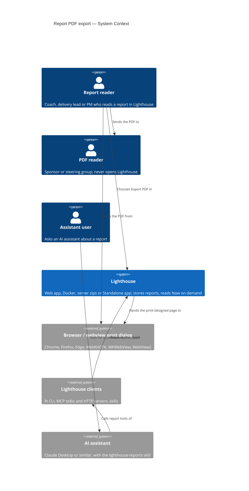
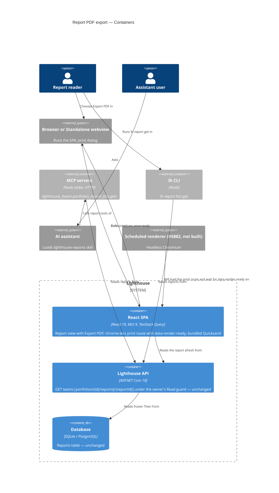

# Feature Delta — epic-6298-report-pdf-export

**ADO**: Epic #6298 *Report PDF Export* (tag `Premium`, state Planned). Predecessors on the board: #1822 *Project
Reports* (2025-03-02, Removed) and #4753 *Export to PDF* (2026-04-08, Premium, Removed 2026-08-21 as superseded by
Reports). Related: Epic #5878 *Then & Now* (Released), #6299 Custom Metric Reports, #5935 Signals, #5882 Scheduled
Report Delivery, Spike #6052 (Closed).

**Waves**: DISCOVER (2026-10-17). A deliberately light round, at the maintainer's request: one maintainer interview
about the past behaviour of their users, two removed backlog items the maintainer wrote (#1822, #4753), the Epic 5878 discovery and the #6052 spike.
Lighthouse ran no direct customer interviews this round.

**One line**: any report can leave Lighthouse as a PDF, so the numbers reach people who will not or cannot open
Lighthouse. The PDF is a capability of a report, not a report type. The first payload is Then & Now.

**Density**: `lean`, Tier-1 `[REF]` only. `evidence_standard: past_behavior`. Each claim is graded as
**observed behaviour**, **second-hand report** (of past behaviour), **stated intent**, or **desk/codebase fact**.

---

## Wave: DISCOVER / [REF] Persona IDs

| Persona | Role here |
|---|---|
| `flow-coach` | **Primary, per engagement.** Captures numbers for a client hand-over or sponsor update. The same persona that froze a Then & Now (Epic 5878). |
| `delivery-lead-rte`, `product-owner` | **Primary, recurring.** Team lead or PM who takes numbers out on a regular cadence (status update, steering slide). |
| *(any of the above)* | **Ad hoc.** One-off captures. The maintainer reported all three cadences on 2026-10-17: coach/consultant per engagement, team lead/PM on a recurring cadence, and ad-hoc one-offs. |
| *(candidate)* `report-reader` | **Not created.** The person the PDF is for: either *could* open Lighthouse but will not (does not know the tool, unsure how to use it), or *cannot* (no connection; the data lives in a Standalone install). Split out in DISCUSS only if the reader's needs shape the PDF beyond "readable without Lighthouse". |

---

## Wave: DISCOVER / [REF] Opportunity statement

The outcome: the numbers someone already reads in Lighthouse reach a reader outside it, in a form that reads well
without the tool and says when it was taken, with less effort than a screenshot or a rebuilt spreadsheet.

| # | Opportunity (customer-outcome form) | Source | Grade |
|---|---|---|---|
| O1 | Minimise the time it takes to get Lighthouse numbers into a slide or document for someone who will not open Lighthouse | #1822 ("reference customers ... manually export screenshots"); maintainer 2026-10-17 (screenshots into slides) | second-hand report of past behaviour; one informant (the maintainer) across a backlog record and the interview |
| O2 | Minimise the likelihood that a reader without access (Standalone, no connection) sees no numbers at all | maintainer 2026-10-17 | second-hand report |
| O3 | Minimise the effort of rebuilding the same numbers elsewhere (CSV into a spreadsheet, MCP into an AI-made dashboard) | #1822 (CSV of forecasts); maintainer 2026-10-17 | second-hand report of past behaviour |
| O4 | Minimise the likelihood that a shared number is read as current when it is not | project rule (no value the reader cannot tell is stale) | desk |
| O5 | Minimise the effort of handing data over for a Flow Analysis, optionally without names | #4753 | stated intent |

The opportunity algorithm cannot be applied: there are no importance or satisfaction ratings (see G2).

**Key gap, not resolved here.** What people capture today is **metrics charts and forecasts/Deliveries**. The
first planned payload, **Then & Now**, has **no charts** and is not captured by anyone yet (it is new). So the
first slice may not serve the job that was observed. DIVERGE decides (Open question 3).

**Competing alternative.** Workaround (3), the MCP connection plus an AI that generates a dashboard, is a live
substitute for a PDF, not just a workaround to replace. It already lets a user compose what they want to show.

---

## Wave: DISCOVER / [REF] Validated assumptions

| # | Assumption | Evidence | Confidence |
|---|---|---|---|
| V1 | Numbers leave Lighthouse today through workarounds that cost effort. | One informant, the maintainer: two dated backlog records the maintainer wrote and the interview. #1822 (2025-03) relays reference customers exporting screenshots by hand, the only customer-originated signal. #4753 (2026-04) names people sharing charts in reports or slides. Interview 2026-10-17: last real cases were screenshots into slides, CSV export rebuilt elsewhere, MCP plus AI dashboard. | **Low-Medium**. Past behaviour, but one informant; frequency and effort not measured. |
| V2 | Many readers are outside Lighthouse, by choice or by necessity. | Maintainer 2026-10-17: mixed. Some could open it but will not; others have no connection (Standalone). Epic 5878 discovery: the audience is management sponsors. | **Medium** |
| V3 | Capture happens on three cadences (per engagement, recurring, ad hoc). | Maintainer 2026-10-17. | **Low-Medium**. No split by frequency. |
| V4 | A PDF can be produced in every distribution. | `docs/feature/story-6052-server-side-chart-rendering/spike/findings.md`: headless Chromium works on server and Docker with caveats; Tauri print-to-PDF costs ≈0 in Standalone. Probe 2 in `.../spike/wave-decisions.md` supersedes the findings table's row C "DOESN'T WORK": in-process Jint + HarfBuzz rendering came out near-identical. | **Medium-High** for feasibility. **None** for which mechanism (not decided). |
| V5 | Then & Now is the cheapest first payload. | Its values are frozen and it carries no charts (Epic 5878 journey: "no charts"), so no chart rendering is needed. | **High** for cost. Says nothing about value (see X2). |

---

## Wave: DISCOVER / [REF] Invalidated assumptions

| # | Assumption (as stated or implied) | Evidence against |
|---|---|---|
| X1 | "A PDF is what people want when numbers leave Lighthouse." | **Challenged, not disproven.** Only one of three observed workarounds (screenshots) is a static picture. CSV means the user wants the data to rebuild; MCP plus AI means they want to compose their own view. A PDF serves the first, not obviously the other two. |
| X2 | "The first payload (Then & Now) serves the observed job." | **Challenged.** Captured today: metrics charts and forecasts/Deliveries (maintainer 2026-10-17). Then & Now is new and nobody captures it yet. |
| X3 | "Print the whole page so all metrics export cleanly" (#4753 shape). | The spike found the interactive page was not designed for print and splits across pages (`docs/feature/story-6052-server-side-chart-rendering/spike/findings.md`). Dropping the shape is a decision (D9), not evidence. |
| X4 | "Rendering charts identically outside the browser is cheap." | Spike #6052: five chart components derive their data in `useEffect` and render empty server-side; a bundled browser adds 99–120 MB to Standalone and ≈480 MB on disk to Docker; Helm's 1 GiB limit has no headroom for Chromium. Irrelevant for Then & Now, decisive once charts arrive. |
| X5 | "PDF can start Premium and become free later at no cost." | **Challenged, on an assumption.** We have no record of moving a capability from Community to Premium; we assume it would read as a take-away. If so, starting Premium keeps the option, but the later flip is effectively one-way: once free, it stays free. Also, the Epic 5878 DIVERGE dissent: gating the management-facing PDF works against land-and-expand, since the PDF is what reaches the sponsor. |

---

## Wave: DISCOVER / [REF] Dropped options

| Option | Why dropped |
|---|---|
| Print the interactive page as is (#4753) | A decision the maintainer confirmed on 2026-10-17: #4753 was removed as "superseded by Reports" (D9). The spike also found the interactive page splits badly across pages. |
| PDF as its own report type | A PDF is a capability of any report, built once (Epic #6298 description, 2026-10-14). |
| Bundling a headless browser in Standalone | +99–120 MB per OS plus notarising a second engine (spike #6052). |
| Redrawing charts in .NET (ScottPlot / SkiaSharp) | Only "visually equivalent"; every chart drawn twice (spike #6052). |
| browserless sidecar | SSPL / commercial licence (spike #6052). |

Not dropped, only out of this Epic: CSV export of forecasts (#1822), and anonymising for sharing (#4753, see Open
questions 7 and 9).

---

## Wave: DISCOVER / [REF] Decision gate

| Gate | Status | Why |
|---|---|---|
| G1 Problem | **FAIL on threshold** | No direct customer interviews (threshold: 5, >60% confirming). The evidence is one informant, the maintainer: two dated backlog records the maintainer wrote (#1822, #4753) and the 2026-10-17 interview. The only customer-originated signal is the reference-customer observation #1822 relays second-hand (screenshots exported by hand). |
| G2 Opportunity | **FAIL** | Five opportunities (O1–O5), no importance or satisfaction ratings, so no score above 8 can be shown. The gap between captured content and first payload (X2) is open. |
| G3 Solution | **FAIL** | Nothing tested with users. The spike tested feasibility, not value or usability. |
| G4 Viability | **NOT EVALUATED** | Light DISCOVER; no Lean Canvas exists. Partial signals, as notes only: feasibility amber-to-green (V4) with the mechanism open; licence a decision-in-principle with a planned later flip (D4); a free substitute exists (MCP plus AI); no usage event yet (DEVOPS). |

**Proceeding is a maintainer-accepted risk**, as with Epic 5878. The maintainer asked for a light DISCOVER and
answered the interview on 2026-10-17. This wave is a learning investment, not a validated build case. The
cheapest evidence to gather alongside DIVERGE: ask 3–5 users "the last time you showed Lighthouse numbers to
someone else, what did you send?" and ask to see the artefact. Then count how many were charts, forecasts, tables
or Then & Now.

---

## Wave: DISCOVER / [REF] Constraints established

| # | Constraint | Evidence source |
|---|---|---|
| C1 | One delivery mechanism for every report type (Then & Now, Custom Metric Reports, Signals). | Epic #6298 description |
| C2 | Server zips and Docker are hard targets (scheduled jobs, no UI). Standalone needs in-app view plus PDF export at near-zero size cost; Tauri kills the backend when the app exits. | `docs/feature/story-6052-server-side-chart-rendering/spike/findings.md` |
| C3 | Helm's 1 GiB memory limit has no headroom for an in-process browser; headless Chromium as non-root needs `--no-sandbox` with requests restricted to Lighthouse's own origin. | `docs/feature/story-6052-server-side-chart-rendering/spike/findings.md` |
| C4 | Once charts are in a PDF, they look like the frontend's charts. | `docs/feature/story-6052-server-side-chart-rendering/spike/findings.md` (maintainer narrowing, 2026-09-24) |
| C5 | Fonts must ship with the app: Quicksand loads from Google Fonts at runtime today, so offline and air-gapped PDFs would fall back. | `docs/feature/story-6052-server-side-chart-rendering/spike/wave-decisions.md` |
| C6 | A PDF is a snapshot. It must say when it was produced and which windows it covers, so nobody reads it as current. | Project rule (no value the reader cannot tell is stale) |
| C7 | The PDF renders the instance's configured terms (Feature, Work Item, Team, Portfolio, Delivery, …). | `TerminologySeeder.cs`; project rule |
| C8 | Who may export is decided through RBAC (`useRbac()`), not ad hoc. | Project architecture rule |
| C9 | DEVOPS designs the usage event; it never carries report content or names. | Project rules; usage data never personal |
| C10 | The report must show the same values in the PDF as on screen (Then & Now's Then is frozen; Now is computed at export time). | Epic 5878 journey |

---

## Wave: DISCOVER / [REF] Key decisions

- [D1] One workspace, `epic-6298-report-pdf-export` (see: maintainer dispatch 2026-10-17).
- [D2] Light DISCOVER: the maintainer interview stands in for customer interviews; G1–G3 recorded as failing, G4 not evaluated (see: maintainer request 2026-10-17; Decision gate).
- [D3] The PDF is a capability of a report, built once; Then & Now is the planned first payload, charts follow with Custom Metric Reports (see: Epic #6298 description 2026-10-14). The fit of that first payload is an open question (X2).
- [D4] Licence, decision-in-principle: Premium while there are no extras; free PDF with Premium extras later. The later flip is assumed one-way: we have no record of moving a capability from Community to Premium, and we assume it would read as a take-away (X5) (see: maintainer 2026-10-17).
- [D5] MCP plus AI dashboards recorded as a competing alternative, not a workaround to displace (see: maintainer 2026-10-17).
- [D6] Product direction, graded **stated intent**: reports are for sharing, the interactive charts for exploring. The maintainer verbatim: "the idea of reports is exactly to make this 'shareable', so later on we want reporting for different types like metrics charts optimized for sharing and not for 'playing around'" (see: maintainer 2026-10-17).
- [D7] Mechanism not chosen here; DIVERGE owns it (see: `docs/feature/story-6052-server-side-chart-rendering/spike/wave-decisions.md`, maintainer 2026-09-24).
- [D8] No ICE change: no new direct evidence; the interview consolidates what the maintainer's own #1822 and #4753 already said (see: wave-decisions.md D8).
- [D9] #4753's "print the page" shape is dropped. A decision the maintainer confirmed on 2026-10-17 (#4753 removed as "superseded by Reports"), not evidence (see: maintainer 2026-10-17).

---

## Wave: DISCOVER / [REF] Pre-requisites

- Reports tab and the Then & Now type (Epic 5878, Released).
- A way to render a report statically (print route or equivalent) without the interactive controls.
- For chart-bearing payloads: Custom Metric Reports (#6299), and for non-browser mechanisms the five effect-driven chart components refactored (spike #6052).
- Fonts shipped with the app (C5) if the mechanism renders outside the user's browser.

---

## Wave: DISCOVER / [REF] Open questions for DIVERGE

1. **Mechanism**: browser print with a print stylesheet, headless Chromium (PuppeteerSharp), in-process Jint + HarfBuzz + Skia, or a Gotenberg sidecar, given C2–C5. Does the first slice need a server-side mechanism at all, or is a browser/Tauri print enough until #5882 needs unattended rendering?
2. **PDF vs other share forms**: a slide-ready image per panel, a shareable read-only link, CSV, or making reports reachable through MCP so AI dashboards use them. Which form serves O1–O3 best, given the observed workarounds (X1, D5)?
3. **First payload**: Then & Now (cheapest, not captured today) or a chart-bearing report closer to what people capture (metrics charts, forecasts/Deliveries) (X2).
4. **Licence gate timing**: Premium now with a planned flip, or free from the start (5878 dissent: gating hurts land-and-expand). What are the "extras" that would justify Premium later (branding, scheduled email, anonymising)?
5. **Downloaded vs stored**: generate on demand and download, or store server-side (the spike assumed stored, for #5882 email). Storage brings retention, RBAC on stored files and a migration.
6. **Snapshot honesty**: how a PDF shows its generation time and windows (C6), and whether Now is recomputed or taken as on screen.
7. **Anonymising** (#4753): in or out of scope, and which names it would cover (Teams, Work Items, people).
8. **Who exports**: any reader of the report, or editors only (C8).
9. **What leaves Lighthouse**: what may a PDF carry out of Lighthouse (Work Item titles, Team and person names, or aggregates only), and how is a file outside the access model marked as confidential? Linked to #4753's "Option: Anonymise so it can be shared?" and question 7.

---

## Wave: DIVERGE / [REF] Recommendation

Full text: `recommendation.md` · artifacts: `diverge/` · decisions DV-1..DV-9: `wave-decisions.md`.

- **Job**: `job-share-numbers-outside-lighthouse` (added to `docs/product/jobs.yaml`). Under-served outcomes, as
  desk estimates: a shared number read as current (OS3), time into the reader's slide or email (OS1), and a figure
  misread because its meaning is explained only inside Lighthouse (OS6).
- **Direction**: Option 4, **"Browser-printed PDF"** (4.40 of 5, tied with the dissent "Slide image" and chosen
  by the stated tie-break, higher Desirability + Viability; third "Server-rendered chart report" 4.00). **Export
  PDF** opens a print-designed report with a header carrying the Team or
  Portfolio, "produced {date}", the Then and Now windows and a "how to read this" line. The file is saved through
  the browser's or the Standalone webview's print. This costs about 0 MB in every distribution (Standalone
  desk-checked; probe before DESIGN), with no server renderer; a server renderer loads the same view later for
  #5882. The mechanism is DESIGN's.
- **Dissent trigger**: if users mostly share single charts pasted into slides, add "Copy as image" with the same
  dated caption to report panels as a follow-up. Do not swap directions.
- **Q3 first payload**: Then & Now (the X2 gap is accepted knowingly; #6299's charts print through the same route
  later).
- **Q4 licence (maintainer decides)**: Community PDF with a "Made with Lighthouse" footer; Premium removes it or
  adds own branding, on top of the existing 2-reports-per-owner cap. This would replace D4's "Premium until extras
  exist".
- **Deployment scope (maintainer input 2026-10-17, DISCUSS confirms)**: Standalone may be left out if that makes
  the feature cheaper. The recommended option does not need to leave it out. If a later step does, hidden vs
  disabled-with-reason is DISCUSS's or DESIGN's call.
- **Q5–Q9**: downloaded, not stored; Now as computed at export; anonymising out of v1; exporters are report
  readers via RBAC; Then & Now carries aggregates and the Team or Portfolio name only.

---

## Wave: DISCUSS / [REF] Prior-Wave Reading Confirmation

**Agent**: Luna (`nw-product-owner`) · **Date**: 2026-10-17 · **Mode**: autonomous subagent; the maintainer was not
reachable from the session, so decisions that are the maintainer's carry a proposed default marked **PROPOSED —
maintainer confirms** and are listed under "Questions for the maintainer". Config: user-facing, walking skeleton
"depends" (brownfield, evaluated below), research depth lightweight, JTBD reused from DIVERGE (refined, not re-run),
density lean. Per-wave peer review skipped by instruction (the consolidated review runs at the end of DISTILL).

| Read | Status |
|---|---|
| `feature-delta.md` DISCOVER + DIVERGE sections | ✓ |
| `wave-decisions.md` (DV-1..DV-9, maintainer decisions on the recommendation, Linux print probe) | ✓ — locked inputs |
| `recommendation.md` | ✓ |
| `discover/wave-decisions.md` (D1–D9, "Adjacent opportunity" now moved into scope) | ✓ |
| `diverge/job-analysis.md` | ✓ (job reused) |
| `diverge/competitive-research.md`, `options-raw.md`, `taste-evaluation.md`, `review.yaml` | ⊘ not read; the recommendation and the decision log were enough |
| `docs/product/jobs.yaml` (`job-share-numbers-outside-lighthouse`, tail of file) | ✓ |
| `docs/product/journeys/epic-6298-report-pdf-export.yaml` | ✓ (refined this wave) |
| Precedent: `docs/feature/epic-5878-baseline/feature-delta.md` DISCUSS sections, `slices/slice-01-*.md`, `discuss/wave-decisions.md` | ✓ |
| Brownfield code: frontend `pages/Common/Reports/*`, backend `TeamReportsController`, `ReportReadModels`, `UsageDataEventName`, `index.html` | ✓ (targeted, below) |
| `lighthouse-clients`: `skills/README.md`, `skills/lighthouse/SKILL.md`, MCP tool list, `docs/release-model.md` | ✓ |
| `docs/feature/story-6217-lighthouse-skills/feature-delta.md` (how skills are built and shipped) | ✓ (targeted) |

---

## Wave: DISCUSS / [REF] Current-State Surface Inventory (brownfield)

| # | What exists | Where | Consequence |
|---|---|---|---|
| S1 | One report view serves Team and Portfolio reports (owner passed in); breadcrumb "Reports › {name}" with Edit report and Delete for editors; body in `WidgetBody` with loading, could-not-load (Retry) and "no longer exists" looks; data from a keyed TanStack query | `Lighthouse.Frontend/src/pages/Common/Reports/ReportView.tsx`, `ThenAndNowHeader.tsx` | Export PDF lands once and serves both owners: no separate Portfolio slice. The existing loading and failure looks already decide when an export is possible. |
| S2 | Summary marks ✔ Improved, ✘ Got worse, ± Mixed and the no-change mark are **text characters**, coloured; the probe also saw ▲ in the panels | `ThenAndNowSummary.tsx`, `panels/*` | These fell back to system fonts in the probe; they must not depend on the machine (slice 02). |
| S3 | Report reads: `GET …/teams/{id}/reports`, `…/reports/{reportId}` (and Portfolio twins) under `TeamRead` / `PortfolioRead`; the read carries name, created date, both windows and every metric's Then and Now values, Now computed on read | `TeamReportsController.cs`, `PortfolioReportsController.cs`, `ReportReadModels.cs` | The PDF needs no new endpoint (DESIGN confirms). The clients slice can read the same endpoints. |
| S4 | No print stylesheet and no `window.print` anywhere in the frontend | search of `Lighthouse.Frontend/src` | The print layout is new; nothing to unpick. |
| S5 | The Quicksand typeface loads from `fonts.googleapis.com` at runtime | `Lighthouse.Frontend/index.html`, theme in `main.tsx` | The probe embedded Quicksand only because the machine was online; an offline or air-gapped instance prints in a fallback face (DISCOVER C5). |
| S6 | Usage data: `ReportCreated = 16`, `ReportOpened = 17`, `ReportDeleted = 18`; last on this checkout `WorkTrackingSystemFieldsChanged = 19` | `UsageDataEventName.cs` | A new export event appends after the last integer on `main` (DEVOPS checks). |
| S7 | Clients: 49 MCP tools and the `lh` commands; **none reads reports**; the client package already reads the instance's terminology | `lighthouse-clients/packages/mcp-core/src/index.ts`, `packages/client/src` | Epic 5878 excluded reports from CLI/MCP (its D15). An assistant cannot fetch a report today (Q1). |
| S8 | Skills: one folder per skill, one zip per skill packed by `scripts/pack-skills.sh` in CI; a drift test fails when the `lighthouse` skill does not name every MCP tool and `lh` command; skill-only changes need no changeset; package changes need one and a manual `pnpm release:version` before the release | `lighthouse-clients/skills/README.md`, `docs/release-model.md` | A new skill is cheap to ship; new client tools also touch the `lighthouse` skill text. |
| S9 | Standalone release builds wire no print shortcut or menu; `window.print()` from the frontend prints in Tauri 2 on Linux (probe) | `wave-decisions.md`, probe 2026-10-17 | The Export action calls print itself. macOS unprobed. |
| S10 | Docs: `docs/reports/reports.md`, `docs/reports/thenandnow.md`; skill zips listed in `docs/aiintegration.md` | `docs/` | Finalize targets. |

---

## Wave: DISCUSS / [REF] Persona IDs

| Persona | Role here |
|---|---|
| `flow-coach` (consulting) | **Primary.** Elena Kovacs, external flow coach with Team Lightspeed since 1 Aug 2026, Team Admin. Exports the Then & Now report for the client's sponsor. |
| `delivery-lead-rte` | **Primary, recurring.** Martin Achterberg, Head of Delivery, Viewer on Team Lightspeed and on Portfolio Ocean Explorer. Exports a report every month for the steering group. |
| `flow-coach` (internal, Standalone) | **Primary, cannot-share case.** Priya Raman, coach of Team Gravity, runs the Lighthouse app (Standalone) on a Linux laptop; nobody else can reach her data. |
| *(candidate)* `report-reader` | **Not created.** Sabine Roth, the client's sponsor: reads the PDF weeks later without Lighthouse. Her needs (dated, self-explaining, readable in black and white) are outcomes of the sender's job; no separate entry. |

## Wave: DISCUSS / [REF] JTBD One-Liner

- `job-share-numbers-outside-lighthouse` (DIVERGE, reused): when someone who will not or cannot open Lighthouse needs
  to know where flow stands, hand them the numbers already read in Lighthouse in a form that explains itself and says
  when it was taken. Every story carries this `job_id`. The skill slices serve the same job through another carrier
  (the assistant's dashboard, the third observed workaround).
- `job-flow-coach-show-whether-flow-changed` is carried, not served anew: the PDF and the dashboard take a Then & Now
  result to its audience.

---

## Wave: DISCUSS / [REF] Changed Assumptions

DISCOVER and DIVERGE documents are not edited; these supersede them for DESIGN onward.

| Was (source) | Now | Why |
|---|---|---|
| Licence: Premium until extras exist (DISCOVER D4); Community with a footer that Premium removes (DV-6) | **Community, branded with LetPeopleWork and Lighthouse; no removal or own branding in v1** (D10) | Maintainer 2026-10-17. The ADO Epic still carries the `Premium` tag. |
| "Export unavailable on this licence" and "rendering unavailable on this host" failure modes (DISCOVER journey) | Removed | Community (D10); no server rendering in this Epic (D16). |
| Standalone needs PDF export (DISCOVER C2), relaxed by DV-2 | Covered anyway by browser print; Linux proven by probe; macOS checked in slice 01 with a fallback (D12, Q2) | Probe 2026-10-17. |
| AI-dashboard skill out of scope (DISCOVER "Adjacent opportunity", DV-9) | **In scope**, as slices 04–05, each shippable on its own (D18) | Maintainer 2026-10-17. |
| Reports are not reachable through CLI/MCP (Epic 5878 D15) | Reading reports through the clients is proposed (slice 04, Q1); creating, editing and deleting stay web-only | Without it the skill has nothing to read (S7). |
| The PDF embeds the Lighthouse typeface (probe result) | Only when the machine is online (S5) | The probe ran online. |

---

## Wave: DISCUSS / [REF] Locked Decisions

Numbering continues after DISCOVER's D1–D9 (DIVERGE used DV-1..DV-9). D10–D18 restate the maintainer's decisions of
2026-10-17 (locked). D19 onward are this wave's; those marked **PROPOSED — maintainer confirms** wait for an answer
under "Questions for the maintainer".

- [D10] **Licence**: the PDF is Community and carries LetPeopleWork and Lighthouse branding. Removing or replacing the
  branding is a later Premium extra, not in v1. Supersedes D4 and the Premium half of DV-6. (Maintainer, locked.)
- [D11] **First payload: Then & Now**, knowing it is not what people capture today (X2). (Locked.)
- [D12] **Deployment scope**: Standalone may be left out where that saves cost. Browser print covers it at no size
  cost; Linux works with no Rust code (probe). macOS is checked in slice 01; if it fails, see D28. (Locked + D28.)
- [D13] **Content**: aggregates plus the {Team} or {Portfolio} name and the report's name; no {Work Item} titles,
  no person names. The header as recommended (owner, report, Then and Now windows, produced, "how to read this").
  No confidentiality line in v1 — the recommendation left it optional and the maintainer found the header "good
  enough". (Locked; the confidentiality part PROPOSED.)
- [D14] **Who may export**: anyone who can read the report. Exporting is reading what is already shown; no new RBAC
  requirement. (Locked.)
- [D15] **Delivery**: made on demand, downloaded through the print dialog, never stored. Anonymising deferred.
  Nothing is persisted, so no migration. (Locked.)
- [D16] **Fidelity**: our own print layout; small differences between browsers are acceptable. **Requirement
  recorded for Scheduled Report Delivery (#5882), not built here**: a later server render of a report must be
  pixel-comparable to the Chromium print of the same view. So the print-designed report must be a view a renderer
  can load on its own, not something assembled only inside the click. (Locked; the "own view" consequence for DESIGN.)
- [D17] **Print layout** (from the probe): the light theme always; no app chrome (navigation, tabs, Edit report,
  Delete, app footer); our own header and a branding footer; ✔ ✘ ▲ ± and the no-change mark must not depend on system
  fonts (DESIGN decides how); no stray near-empty last page. The Export action calls print itself, because release
  Standalone builds wire no print shortcut. (Locked.)
- [D18] **The report skill is in scope** as its own slice, shippable alone; it describes how to show each report
  type as a dashboard or document, starting with Then & Now. (Locked.) This wave splits it into the client read
  (slice 04) and the skill (slice 05), so each ships alone (Q1).
- [D19] **Produced = when the printed values were read.** Export reads the report afresh before printing, so Now
  ends on the export day and the screen shows the same values as the PDF. The header shows date and time in the
  viewer's local time. (PROPOSED — DISCUSS default; DESIGN chooses the mechanism.)
- [D20] **Export PDF sits on the report view only**, for every reader, beside Edit report and Delete for editors;
  not on the Reports list in v1. Exact place and label are sketched at the start of DISTILL. (PROPOSED.)
- [D21] **"How to read this"** (part of the recommended header) ships as its own thin slice (03), so slice 01
  stays a one-day walking skeleton.
- [D22] **Fonts ship with the app** instead of loading from Google Fonts at runtime, so an offline instance prints
  in the Lighthouse typeface. (PROPOSED — maintainer confirms, Q4.)
- [D23] **Reports become readable through the clients**: list an owner's reports and read one, for Teams and
  Portfolios, in MCP (all transports) and `lh`; read-only. (PROPOSED — maintainer confirms, Q1.)
- [D24] **Skill name `lighthouse-reports`**, release asset `lighthouse-reports-skill.zip`. (PROPOSED, Q6.)
- [D25] **Skill rules**: quote the report's values exactly; never rebuild Then from today's metrics; a dash stays a
  dash with its reason; the instance's terms; a dated header with both windows and the day the report was read; an
  attribution line naming Lighthouse by LetPeopleWork; any comment of the assistant's own kept visibly apart from
  the report's numbers and labelled as such. (PROPOSED, Q3.)
- [D26] **Order**: PDF slices 01 → 02 → 03, then 04 → 05. (PROPOSED, Q5.)
- [D27] **Usage data is wanted**: one event when Export PDF is chosen (DEVOPS designs; it counts the intent, since
  nothing tells us whether the dialog saved a file). Client reads may count through the clients' existing practice
  of reporting the web's event for a mapped command; DEVOPS decides. Never names or values.
- [D28] **If printing does not work in the macOS Standalone app**, Export PDF stays visible but disabled there, with
  a one-line reason. (PROPOSED, Q2.)

---

## Wave: DISCUSS / [REF] Scope Assessment

**PASS — 5 stories, 2 code bases (Lighthouse frontend; `lighthouse-clients`), ~4 days.** No oversize signal: under
10 stories, no new bounded context (export is a capability of the existing Reports module; the client read and the
skill sit in the existing clients and skills), the walking skeleton touches 2 integration points (report view →
system print), under 2 weeks. Two user outcomes (PDF; assistant dashboard) that could ship separately — the
maintainer chose to keep both in this Epic (D18); they are ordered, not interleaved, and the skill pair builds only on
finished slices.

---

## Wave: DISCUSS / [REF] Journey

SSOT: `docs/product/journeys/epic-6298-report-pdf-export.yaml` (refined this wave). Two journeys.

```
PDF:  [Open report] ──> [Export PDF] ──> [print dialog: Save as PDF] ──> [attach / hand over] ──> [Sabine reads it]
      Burdened           Ready            Relieved                        Relieved                  Sceptical → Oriented
      report_values      + generated_at   (nothing stored)                generated_at              header: produced, windows
      owner_name                          light theme, no chrome                                    "how to read this", branding

Skill: [Ask: which reports?] ──> [Assistant reads the report] ──> [Dashboard / document per the skill]
       Wary                       Engaged                           Confident
       owner_name, report_name    report_values, read_at            same values, dated, own comments apart
```

Emotional arc: **burdened → relieved → confident** (sender); **sceptical → oriented** (reader); **wary → confident**
(assistant user). Shared artifacts and their single sources are in the YAML (`report_values`, `report_windows`,
`owner_name`, `report_name`, `generated_at`, `read_at`, `branding`). Integration checkpoint: the PDF and the
assistant show the values the report view shows, and the PDF's produced date is the day its Now window ends.

---

## Wave: DISCUSS / [REF] Story Map & Slices

**Backbone**: *open a report* → *export it* → *it reads the same anywhere* → *it explains itself* → *an assistant
reads it* → *an assistant shows it*.

| Open report | Export | Reads the same anywhere | Explains itself | Assistant reads | Assistant shows |
|---|---|---|---|---|---|
| (exists, Epic 5878) | **01 Export PDF, print layout, header, footer** | 02 own marks, shipped fonts, page breaks | 03 "how to read this" | 04 list + read reports via MCP and `lh` | 05 `lighthouse-reports` skill |

**Walking skeleton = slice 01** (brownfield): the existing report view gains Export PDF; the print dialog produces a
branded, dated PDF in a browser and in the Linux Standalone app. It touches every PDF activity thinly.

| # | Slice | Est. | Ships alone | Learning hypothesis — disproves … if it fails |
|---|---|---|---|---|
| 01 | Export PDF on a Then & Now report (Team and Portfolio): fresh read, print layout (light, no chrome), header with owner, report, windows, produced; branding footer; usage event | 1d | Yes | "Browser print of a print-designed view is good enough to hand over" — if the maintainer would not send the PDF of the dev instance's busiest Team's report to a sponsor without editing it (cut panels, leftover chrome, wrong date), the route needs more than a print layout |
| 02 | The PDF reads the same everywhere: marks drawn, not borrowed from system fonts; the Lighthouse typeface shipped with the app; no panel split across pages, no near-empty last page, on A4 and Letter | 1d | Yes | "Own marks and shipped fonts make PDFs alike" — if the same report printed from Chrome on Windows, Firefox on Linux and the Linux Standalone app differs in more than spacing |
| 03 | "How to read this": one line saying which side is frozen and since when, what Now covers, what the colours and "—" mean, in the instance's terms | ½d | Yes | "One line explains the report to a cold reader" — if someone who has never opened Lighthouse, handed the PDF, cannot say which side is frozen and whether {Cycle Time} got better |
| 04 | Reports readable through the clients: list an owner's reports and read one, MCP and `lh`, Team and Portfolio; the `lighthouse` skill names the new tools | 1d | Yes | "Reading the report is enough for an assistant to answer about it" — if, in the eval, the assistant still calls the metric tools to rebuild Then |
| 05 | `lighthouse-reports` skill: how to show a Then & Now as a dashboard or document; evals; its own zip | ½d | Yes (builds on finished 04) | "A skill makes assistant dashboards faithful" — if in 3 eval runs a dashboard misquotes a value, drops the dates, or mixes the assistant's comment into the numbers |

Briefs: `slices/slice-NN-*.md`.

### Priority Rationale

- **01** is the walking skeleton and the Epic's core value (value 5, urgency 4, effort 2).
- **02** next: riskiest assumption — the probe showed font-dependent marks and a fallback typeface offline; a PDF
  that looks broken on the sponsor's machine undoes 01's value.
- **03** completes the recommended header (OS6, misread without explanation); cheapest slice.
- **04 → 05** last, by D26: independent of the PDF, the maintainer's "low effort, give it a try"; 05 needs 04's read
  (one-direction dependency on a finished slice). If the maintainer picks option (c) in Q1, 04 drops and 05 stands
  alone.

### Slice taste tests

| Test | Verdict |
|---|---|
| 4+ new components in one slice? | Borderline in 01 (Export action, print layout, print header, branding footer, event). Each is thin; the header and footer are one print frame. Kept as the walking skeleton. |
| Every slice depends on a new abstraction? | Pass — the print frame is born in 01 and is the seam #6299's chart reports and #5882's server render reuse (D16). |
| Disproves a pre-commitment? | Pass — 01 tests DV-3/DV-7 (browser print is enough), 02 tests D17/D22, 03 tests OS6, 04 tests D23, 05 tests D18/D25. |
| Synthetic-data-only slices? | Pass — 01–03 are dogfooded on the dev instance (`:5169`, real history) and the Linux Standalone app with the maintainer's data copy; 04–05 against the dev instance. Demo data covers E2E and screenshots only. |
| Two slices alike except scale? | Pass. |

---

## Wave: DISCUSS / [REF] User Stories

<!-- markdownlint-disable MD024 -->

System constraints (all stories): Community, no licence check (D10) · RBAC: exporting and reading through the clients
need only the owner's Read; UI gating via `useRbac()` only, never fetching `/api/latest/authorization/my-summary` ·
works with auth off · nothing stored, no migration (D15) · the PDF shows exactly the values the report view shows,
read at export (D19) · every label through Terminology (seeded defaults {Team}, {Portfolio}, {Work Item},
{Cycle Time}, …) · meaning never by colour alone · no {Work Item} titles or person names leave Lighthouse (D13) · no
server-side rendering (D16) · no verdicts or generated text in the report itself (Epic 5878 D39).

### US-01 — Export a Then & Now report as a PDF (slice 01, walking skeleton)

`job_id: job-share-numbers-outside-lighthouse` · persona `flow-coach` (Elena Kovacs) and `delivery-lead-rte`
(Martin Achterberg)

**Problem**: Elena wants the client's sponsor, Sabine Roth, to see the Then & Now report for Team Lightspeed. Sabine
will not open Lighthouse. Today Elena screenshots the report, crops it into a slide and types the date beside it;
the screenshot carries the app's navigation and nothing says when it was taken. *(The workaround is second-hand,
from the maintainer; DISCOVER G1 failed, maintainer-accepted risk D2.)*

#### Elevator Pitch

Before: a report can only be read inside Lighthouse; getting it to Sabine means screenshots and a hand-typed date.
After: Team Lightspeed → Reports → "Then & Now — 90 days to 2 Oct 2026" → **Export PDF** → Save as PDF → sees a light
page headed "Team Lightspeed · Then & Now — 90 days to 2 Oct 2026", "Then 5 Jul – 2 Oct 2026 · Now 1 Aug – 30 Oct
2026", "Produced 30 Oct 2026, 09:15", the summary and the {Cycle Time} panel (85th 21 → 12 days, −9 days, −43%),
and a Lighthouse · LetPeopleWork footer — no navigation, tabs or buttons.
Decision enabled: whether to send this file to the sponsor as it is, instead of building a slide.

**Examples**: (1) Elena exports on 30 Oct 2026 in Chrome; the PDF shows the values on her screen and "Produced 30 Oct
2026, 09:15". (2) Martin, a Viewer, uses the dark theme; he exports the Portfolio Ocean Explorer report on 2 Nov
2026 for the steering group; the PDF is light and headed with "Portfolio Ocean Explorer". (3) Elena opened the report
on 29 Oct and left the tab open; she exports on 30 Oct; the PDF shows Now ending 30 Oct, not 29 Oct. (4) Priya Raman
exports from the Lighthouse app on her Linux laptop; the system print dialog opens. (5) The report cannot be loaded
for Martin on 2 Nov; no Export PDF is offered.

```gherkin
Scenario: A coach hands a sponsor a dated Then & Now report as a PDF
  Given Team Lightspeed has the report "Then & Now — 90 days to 2 Oct 2026"
  And on 30 Oct 2026 its Cycle Time panel shows 85th percentile 21 days Then and 12 days Now
  When Elena chooses Export PDF and saves the file from the print dialog
  Then the PDF is headed "Team Lightspeed" and "Then & Now — 90 days to 2 Oct 2026"
  And it shows "Then 5 Jul – 2 Oct 2026", "Now 1 Aug – 30 Oct 2026" and "Produced 30 Oct 2026"
  And its Cycle Time panel shows 21 days, 12 days, "−9 days" and "−43%"
  And it ends with the Lighthouse and LetPeopleWork branding
  And it shows no navigation, tabs, Edit report or Delete

Scenario: A Viewer in the dark theme gets a light PDF of a Portfolio report
  Given Martin is a Viewer on Portfolio Ocean Explorer and uses the dark theme
  When Martin exports the Portfolio's Then & Now report on 2 Nov 2026
  Then the PDF has a light page headed "Portfolio Ocean Explorer"

Scenario: A report left open overnight is exported with today's Now
  Given Elena opened the report on 29 Oct 2026 and left it open
  When Elena chooses Export PDF on 30 Oct 2026
  Then the PDF shows "Now 1 Aug – 30 Oct 2026" and "Produced 30 Oct 2026"
  And the report on screen shows the same values as the PDF

Scenario: No PDF of a report that could not be loaded
  Given the report cannot be loaded for Martin on 2 Nov 2026
  When Martin looks at the report page
  Then he sees "This report couldn't be loaded. Reload to try again." with Retry
  And Export PDF is not offered

Scenario: The Lighthouse app on Linux opens the print dialog
  Given Priya runs the Lighthouse app on Linux with Team Gravity's report open
  When Priya chooses Export PDF
  Then the system print dialog opens on the print-designed report

Scenario: Configured terms head the PDF
  Given the instance calls a Team a "Squad" and Cycle Time "Lead Time"
  When Elena exports Team Lightspeed's report
  Then the PDF is headed "Squad Lightspeed" and its panel reads "Lead Time: Then & Now"
```

**AC**: AC-1.1 Export PDF on the report view for anyone who can read the report (D14, D20), for Team and Portfolio
reports. AC-1.2 Export reads the report afresh, then asks the browser or the Standalone webview to print (D17, D19).
AC-1.3 The printed page is light whatever the theme, and shows none of the app's navigation, tabs, Edit report,
Delete or app footer (D17). AC-1.4 Header: owner kind and name in the instance's terms, report name, Then window,
Now window, "Produced {date}, {time}" in the viewer's local time (D13, D19). AC-1.5 Body: the summary and every
shown panel with exactly the values on screen. AC-1.6 Footer: Lighthouse and LetPeopleWork branding (D10; copy and
logo sketched at DISTILL). AC-1.7 While the report loads, Export PDF is unavailable; when it could not be loaded or
no longer exists, Export PDF is not offered and no PDF is produced. AC-1.8 Cancelling the dialog leaves the page as
it was; nothing is stored (D15). AC-1.9 The usage event of D27 fires when Export PDF is chosen and is listed in
`docs/settings/usagedata.md`. AC-1.10 macOS Standalone checked during DELIVER; if print does nothing there, D28
applies (Q2).
**KPI**: K1, K2. **Tech**: reuse `ReportView`'s query and `WidgetBody` states; no new endpoint expected; the print
view must be loadable on its own (D16); DESIGN answers the export's own loading and failure look (the fresh read).

### US-02 — The PDF reads the same on every machine (slice 02)

`job_id: job-share-numbers-outside-lighthouse` · persona `flow-coach` (Elena; Priya)

**Problem**: in the Linux probe the change marks came out in LiberationSans and DejaVuSans, picked by the machine; on
another OS, or a server with no such fonts, they differ or vanish. The probe's PDF also had a near-empty second page.
An instance with no internet prints without the Lighthouse typeface at all (S5). Sabine sees a page that looks
broken, and Elena looks careless.

#### Elevator Pitch

Before: the same report printed on two machines shows different or missing ✔ ✘ marks, a different typeface offline,
and a near-empty last page.
After: Export PDF on "Then & Now — 90 days to 2 Oct 2026" from Chrome on Windows and from the Lighthouse app on Linux
→ both PDFs show the same drawn ✔ Improved / ✘ Got worse marks, the Lighthouse typeface, every panel whole on its page
and no page holding only the footer.
Decision enabled: whether the PDF can go to any reader without checking it first on their kind of machine.

**Examples**: (1) Elena prints from Chrome on Windows, Priya from the Lighthouse app on Linux; the marks look the
same. (2) An air-gapped instance with no internet: the PDF still uses the Lighthouse typeface. (3) A report with all
four panels on A4: no panel is cut between pages, no near-empty last page. (4) The same report on US Letter: same.

```gherkin
Scenario: Change marks look the same whichever machine printed them
  Given the summary of Team Lightspeed's report shows "✔ Improved: Cycle Time" and "✘ Got worse: WIP"
  When Elena exports it from Chrome on Windows and Priya from the Lighthouse app on Linux
  Then both PDFs show the same improved and got-worse marks

Scenario: An instance without internet prints in the Lighthouse typeface
  Given a Lighthouse instance that cannot reach the internet
  When Elena exports Team Lightspeed's report
  Then the PDF uses the Lighthouse typeface

Scenario: No panel is cut between pages
  Given Team Lightspeed's report shows all four panels
  When Elena exports it on A4 and on US Letter
  Then every panel sits whole on one page

Scenario: No page carries only the footer
  Given Team Lightspeed's report shows all four panels
  When Elena exports it on A4
  Then no page holds only the branding footer
```

**AC**: AC-2.1 Marks (✔ ✘ ±, the no-change mark, ▲) in the print do not depend on fonts installed on the machine
(D17; DESIGN decides how). AC-2.2 The Lighthouse typeface reaches the PDF without internet (D22, Q4). AC-2.3 No
panel or summary splits across pages; no trailing page holds only the footer; A4 and US Letter portrait. AC-2.4 The
screen keeps looking as it does today (the marks' meaning, colours and words unchanged).
**KPI**: guardrail G3. **Tech**: if D22 bundles the typeface for the whole app, the Standalone and Docker sizes grow
by the font files only (≤ 1 MB, G4); DESIGN confirms.

### US-03 — The PDF explains itself to someone who never opened Lighthouse (slice 03)

`job_id: job-share-numbers-outside-lighthouse` · persona `flow-coach` (Elena), reader Sabine Roth

**Problem**: Sabine receives the PDF three weeks later. She does not know that Then is frozen and Now is the latest
window, or what green, red and "—" mean; inside Lighthouse that is explained by the tool around the report.

#### Elevator Pitch

Before: the PDF shows Then, Now and coloured changes, but only a Lighthouse user knows how to read them.
After: Export PDF on Team Lightspeed's report → sees under the header one line in the instance's terms, e.g. "How
to read this: Then is frozen — the 90 days to 2 Oct 2026, as captured then. Now is the 90 days up to the produced
date. Green is better, red is worse; — means no data in that window." (copy sketched at DISTILL).
Decision enabled: whether the PDF can go out without a covering note explaining it.

**Examples**: (1) Sabine reads the line and says Cycle Time got better. (2) An instance that calls Cycle Time "Lead
Time" and Work Items "Tickets" gets those words in the line. (3) Martin prints the PDF in black and white for the
steering meeting; the line refers to the signs and words, not only to colours.

```gherkin
Scenario: A sponsor learns which side is frozen
  Given Elena exported Team Lightspeed's report on 30 Oct 2026
  When Sabine reads the PDF on 20 Nov 2026
  Then a line under the header says Then is frozen as the 90 days to 2 Oct 2026
  And that Now is the 90 days up to the produced date

Scenario: The explanation uses the instance's terms
  Given the instance calls Cycle Time "Lead Time" and Work Items "Tickets"
  When Elena exports the report
  Then the explanation line says "Lead Time" and "Tickets"

Scenario: A black-and-white print still reads
  Given Martin prints the PDF in black and white
  When the steering group reads it
  Then every change shows its sign and its word, and the explanation names both
```

**AC**: AC-3.1 One "how to read this" line under the header (D13, D21): which side is frozen and its window, what
Now covers, what the colours, signs and "—" mean. AC-3.2 Instance terms throughout. AC-3.3 Shown in the PDF only, not
on the screen (screen unchanged). AC-3.4 Copy confirmed with the maintainer at the start of DISTILL.
**KPI**: K3 (the cold-reader check). **Tech**: none beyond the print frame of 01.

### US-04 — An assistant can read a report through the Lighthouse clients (slice 04)

`job_id: job-share-numbers-outside-lighthouse` · persona `flow-coach` (Elena, Claude Desktop with MCP stdio) and
`delivery-lead-rte` (Martin, `lh` in a terminal)

**Problem**: Elena already asks her assistant, over the Lighthouse MCP connection, to build dashboards. It cannot
see her Then & Now report — no tool reads reports (S7) — so it rebuilds numbers from today's metrics, and Then comes
out different from what was frozen.

#### Elevator Pitch

Before: the MCP tools and `lh` read metrics and forecasts, but no report; an assistant asked about a Then & Now report
has nothing to read.
After: with the Lighthouse MCP connected, Elena asks "What does Team Lightspeed's Then & Now report say?" → the
assistant reads the report and answers "Then 5 Jul – 2 Oct 2026, Now 1 Aug – 30 Oct 2026; Cycle Time 85th 21 → 12
days (−43%)"; Martin runs the `lh` read command DESIGN names (e.g. `lh report get`) and sees the same values.
Decision enabled: whether to let the assistant build the sponsor's dashboard from the report itself.

**Examples**: (1) Elena asks which reports Team Lightspeed has; the assistant names "Then & Now — 90 days to 2 Oct
2026" and "Then & Now — WIP limit 14 Sep", with their created dates. (2) Martin reads Portfolio Ocean Explorer's
report with `lh` and sees the same numbers as the Reports tab. (3) Jonas Weber's API key has no read on Team
Lightspeed; the assistant says he has no access to that Team's reports. (4) A Lighthouse older than Reports: the
assistant says to upgrade Lighthouse.

```gherkin
Scenario: An assistant lists a Team's reports
  Given Team Lightspeed has the reports "Then & Now — 90 days to 2 Oct 2026" and "Then & Now — WIP limit 14 Sep"
  When Elena asks her assistant which reports Team Lightspeed has
  Then it names both reports with the dates they were created

Scenario: An assistant reads a report with the values the Reports tab shows
  Given the Reports tab shows Cycle Time 85th percentile 21 days Then and 12 days Now on 30 Oct 2026
  When Elena's assistant reads "Then & Now — 90 days to 2 Oct 2026"
  Then it reports 21 days Then and 12 days Now, with both windows

Scenario: The command line reads a Portfolio report
  Given Portfolio Ocean Explorer has a Then & Now report
  When Martin reads it with lh
  Then he sees its windows and every shown metric's Then and Now values

Scenario: No access is said plainly
  Given Jonas's key has no read on Team Lightspeed
  When Jonas asks his assistant for Team Lightspeed's reports
  Then he is told he has no access to that Team's reports

Scenario: An older Lighthouse is named as the reason
  Given a Lighthouse instance released before Reports existed
  When Elena's assistant asks for Team Lightspeed's reports
  Then she is told to upgrade Lighthouse
```

**AC**: AC-4.1 List an owner's reports and read one, for Teams and Portfolios, through MCP (stdio and HTTP) and `lh`
(D23); read-only. AC-4.2 Values, windows and dashes exactly as the backend answers them; no recomputation. AC-4.3 A
refused read is relayed as no access; a missing endpoint as "upgrade Lighthouse"; a report made by a newer version as
"can't be shown here". AC-4.4 The `lighthouse` skill names the new tools and command (drift test green). AC-4.5
Changesets for the touched packages; released with the next clients release.
**KPI**: K4. **Tech**: reuses the existing GET endpoints (S3); tool and command names are DESIGN's, following the
existing `lighthouse_{owner}_{noun}_{verb}` pattern; terminology from the existing client read.

### US-05 — An assistant shows a Then & Now report as a faithful dashboard (slice 05)

`job_id: job-share-numbers-outside-lighthouse` · persona `flow-coach` (Elena)

**Problem**: when Elena asks her assistant for a one-page dashboard for Sabine, each run lays it out differently,
sometimes rounds a value, drops the windows, turns a "—" into 0 or adds "great improvement!" as if the report said
so. Elena has to check every number by hand.

#### Elevator Pitch

Before: an assistant can read the report (slice 04) but improvises how to show it.
After: with `lighthouse-reports-skill.zip` installed, Elena asks "Make a one-page dashboard of Team Lightspeed's Then &
Now report for our sponsor" → gets a dashboard headed with Team Lightspeed, both windows and the read date, the summary
groups, one block per metric with Then, Now, change and % change exactly as in Lighthouse, any comment of the
assistant's set apart and labelled, and "Data from Lighthouse by LetPeopleWork".
Decision enabled: whether to send the assistant's dashboard as it is, without re-checking each number.

**Examples**: (1) Elena's dashboard shows Cycle Time 21 → 12 days, −43%, as in Lighthouse. (2) Team Nova's report
shows "—" with "No finished Work Items in Then"; the dashboard shows the same dash and reason. (3) Elena asks "and add
your take"; the assistant's view appears under its own heading, apart from the numbers. (4) The instance calls Work
Items "Tickets"; the dashboard says Tickets.

```gherkin
Scenario: The dashboard carries the report's own numbers and dates
  Given Team Lightspeed's report reads Cycle Time 85th 21 days Then and 12 days Now on 30 Oct 2026
  When Elena asks for a one-page dashboard of the report
  Then the dashboard names Team Lightspeed, both windows and 30 Oct 2026 as the day it was read
  And it shows 21 days, 12 days and −43%

Scenario: Then is never rebuilt from today's metrics
  Given Elena's assistant has the report skill and the Lighthouse connection
  When Elena asks for the dashboard
  Then the assistant reads the report and does not call the metric tools for Then

Scenario: A dash stays a dash
  Given Team Nova's report shows "—" with "No finished Work Items in Then"
  When Priya asks for a dashboard of it
  Then the dashboard shows "—" with that reason and never 0

Scenario: The assistant's own view is kept apart
  Given Elena asks for the dashboard "with your take on it"
  When the assistant answers
  Then its comment sits under its own heading, labelled as the assistant's, apart from the report's numbers
```

**AC**: AC-5.1 The skill describes the Then & Now layout: dated header, summary, one block per shown metric (D25).
AC-5.2 Guardrails: exact values, dashes with reasons, instance terms, no rebuild of Then, attribution line, own
comments apart (Q3). AC-5.3 Eval cases (3 runs each; guardrail cases 3 of 3) recorded under
`docs/feature/story-6217-lighthouse-skills/evals/`. AC-5.4 Its own zip in the clients release; listed in
`docs/aiintegration.md`. AC-5.5 The skill is written so a later report type adds a section, not a new skill.
**KPI**: K4, K5. **Tech**: skill-only change, no changeset (S8); the direction of good per metric is written in the
skill — a second copy of a fact that lives in the frontend panels, so the skill's eval checks it (shared artifact
risk, MEDIUM).

---

## Wave: DISCUSS / [REF] Outcome KPIs

Objective: people who read a report in Lighthouse send it to readers outside the tool as a dated file instead of a
screenshot. **North star: K1.** Targets are first guesses without a baseline (nothing to measure before release);
DEVOPS turns each "Measured by" into a usage-data design.

| # | Who | Does what | Target | Baseline | Measured by | Type |
|---|---|---|---|---|---|---|
| K1 | Opted-in instances that opened ≥ 1 report in the 90 days after release | use Export PDF at least once | ≥ 20% | 0 | export event ÷ instances with `ReportOpened` | Leading (north star) |
| K2 | Instances that exported | export in ≥ 2 different calendar weeks within 90 days | ≥ 30% | 0 | export event per instance (per browser, as Epic 5878's proxies) | Leading (recurring cadence) |
| K3 | People who never opened Lighthouse, handed a PDF by the maintainer | say which side is frozen and whether {Cycle Time} improved | ≥ 2 of 3 | — | maintainer's conversation log (slice 03 dogfood) | Qualitative |
| K4 | Instances using the clients | read a report through MCP or `lh` within 90 days of the clients release | ≥ 5 instances | 0 | the web's `ReportOpened` reported by the clients with their source, if DEVOPS maps it (D27); else K5 only | Leading |
| K5 | Skill eval runs | produce a dashboard with no misquoted value, dates present, comments apart | 3 of 3 per guardrail case, ≥ 90% others | — | eval record (AC-5.3) | Quality gate |

Guardrails: G1 no PDF value differs from the screen at export (acceptance test); G2 opening a report stays ≤ 2 s and
Export opens the dialog ≤ 2 s after the click on a loaded report; G3 marks and typeface identical across Chrome,
Firefox and Linux Standalone (slice 02 check); G4 Standalone installer and Docker image grow by ≤ 1 MB.

Measurement caveat: the export event counts the choice, not a saved file — a cancelled dialog counts too.
Learning to feed the dissent trigger (DV-4): the maintainer's 3–5 user question ("the last time you showed
Lighthouse numbers to someone else, what did you send?") — ≥ 3 answers before Custom Metric Reports (#6299) starts
DISCUSS.

Hypothesis: we believe a one-click, dated, branded PDF of a report will replace screenshots for readers outside
Lighthouse. We will know when ≥ 20% of instances that open reports export one (K1) and ≥ 30% of those do it again in
another week (K2).

---

## Wave: DISCUSS / [REF] Definition of Done

1. Every UAT scenario of the story passes as an automated acceptance test (the print layout via print-media
   emulation; the dialog itself is not automatable — checked by hand, item 7).
2. Unit and component tests green; frontend `pnpm test`, backend `dotnet test` (filtered per CLAUDE.md) if touched;
   clients `pnpm ci` for 04–05.
3. `pnpm build` and, if touched, `dotnet build` with zero warnings; Biome clean; no new SonarCloud issues.
4. RBAC: Export and client reads need only the owner's Read; UI gating via `useRbac()` only.
5. Copy through Terminology; no "Epic", "Story", "Initiative" for product concepts; no verdicts in the report.
6. One E2E walking skeleton (Page Object, demo Team Lightspeed): create a report, Export PDF, the print view shows
   the header and no app chrome. No more E2E than that.
7. A PDF of the dev instance's busiest Team's report printed from Chrome, Firefox and the Linux Standalone app is
   attached to the slice's evidence (slices 01–03); macOS Standalone checked by the maintainer (Q2).
8. Mutation testing ≥ 80% on the feature's code, run last on frozen code (Stryker, both stacks if the backend is
   touched).
9. At feature finalization: docs, screenshots, website, usage-data entry and clients release per the Checklist.

---

## Wave: DISCUSS / [REF] Out of Scope (v1)

Server-side rendering and unattended PDFs (#5882; D16 records its fidelity requirement) · stored PDFs, PDF history,
email or schedule (D15) · removing or replacing the branding, own logo (later Premium extra, D10) · anonymising (D15)
· a confidentiality line (D13) · charts in the PDF (Custom Metric Reports #6299 prints through the same route later)
· "Copy as image" (the DV-4 trigger) · export from the Reports list, several reports at once, CSV · printing the
interactive Metrics page (#4753 shape, D9) · creating, editing or deleting reports through the clients · skill
sections for report types other than Then & Now (none exist yet) · a native print call in the Standalone app (only if
Q2 says so, as a follow-up).

---

## Wave: DISCUSS / [REF] WS Strategy, Driving Ports, Pre-requisites

**Walking skeleton**: brownfield, slice 01. Existing report view → Export PDF → fresh read → print dialog → PDF, on
demo Team Lightspeed (E2E) and the dev instance's busiest Team (dogfood), in Chrome and the Linux Standalone app.

**Driving ports (user-invocable entry points)**: Export PDF on the report view (Team and Portfolio); the browser's or
Standalone webview's print dialog; the existing report read endpoints (S3), unchanged; for slice 04 the MCP tools and
the `lh` command DESIGN names; for slice 05 the skill an assistant loads.

**DESIGN must answer** (project rule, slow connection): Export PDF's look while the fresh read is on its way, and
when it fails (no print, no stale numbers, a could-not-load message); the existing `WidgetBody` states are the
reuse candidate. Also: how the print view is reachable on its own (D16), how marks are drawn (D17), how fonts ship
(D22), the Standalone macOS check (D28).

**DISTILL must sketch with the maintainer first**: Export PDF's place and label on the report view (with and without
Edit report / Delete); the printed page (header lines, produced format, summary, panels, footer copy and logo);
the "how to read this" copy; the macOS disabled-with-reason copy if Q2 needs it; the skill's reference dashboard
layout.

**Pre-requisites**: Reports and Then & Now (Epic 5878, released). For slice 04: the report read endpoints (exist).
For slice 05: slice 04 (or Q1 option c). A macOS machine with the Standalone app for the D28 check (maintainer).
None block slice 01.

**NFRs**: Export opens the dialog ≤ 2 s after the click on a loaded report; keyboard-operable action; PDF text stays
selectable (vector, as the probe showed); meaning never by colour alone (black-and-white print); A4 and US Letter
portrait; Standalone and Docker growth ≤ 1 MB.

---

## Wave: DISCUSS / [REF] Project DISCUSS Checklist

No silent N/A — every item answered.

| Item | Answer |
|---|---|
| **RBAC impact** | **No new requirement, no new guard.** Export is reading: anyone with `TeamRead` / `PortfolioRead` sees Export PDF, Viewers included (D14). No new endpoint, so nothing new server-side. Client reads (slice 04) call the existing GET endpoints under the same guards with the caller's own credential; a refusal is relayed as no access. UI gating via `useRbac()` only. Auth off or RBAC off: everyone may export. `docs/settings/rbac.md` gains "Export PDF: anyone who can read the report" at finalize. |
| **Lighthouse-Clients CLI/MCP** | **Slices 01–03: N/A, because** no API changes. **Slice 04 (if Q1 = a): applies** — new read-only tools and an `lh` read command; changesets for `lighthouse-client`, `lighthouse-mcp-core` and `lighthouse-cli` (minor: new capability), the stdio and HTTP adapters pick up the new core by their dependency bump; manual `pnpm release:version`, commit and push before the release; the `lighthouse` skill names the new tools (drift test). This reopens Epic 5878's D15 for reading only. **Slice 05: skill-only, no changeset**; new release asset `lighthouse-reports-skill.zip` packed by the existing script. If Q1 = b or c: no package change, skill zip only. |
| **Website / marketing surface** | **Owed at finalize**: features list entry "Export any report as a branded PDF (Community)" and the reports skill on the AI integration page. The website hot-links `docs/assets` from `@main`, so new screenshots go live on push. Copy confirmed with the maintainer before editing. |
| **Docs + screenshots** | **Owed at finalize, not batched**: `docs/reports/reports.md` (Export PDF: how, what the PDF holds, produced date, nothing stored, Standalone incl. macOS status, a tip to turn off the browser's own headers and footers) and `docs/reports/thenandnow.md` (reading the PDF); `docs/aiintegration.md` (report tools, the new zip); `docs/settings/rbac.md`; `docs/settings/usagedata.md` (event, in slice 01). `@screenshot`: one per theme of the report view showing Export PDF, and one image of the printed page (always light). Docs wait for the maintainer's confirmation. |
| **Demo data** | **No change planned.** No pre-seeded report (as in Epic 5878); the E2E creates one on Team Lightspeed (≈100 days) and exports it. Checked at finalize that the printed page's screenshot shows an Improved and a Got worse group. |
| **Terminology** | **No new key.** "Export PDF", "Produced", "How to read this" are product words. Header, panels and the explanation use {Team}, {Portfolio}, {Work Item(s)}, {Cycle Time}, {Throughput}, {WIP}, {Work Item Age}. The skill tells the assistant to use the instance's terms, which the clients already read. |
| **Usage-data event** | **Wanted (D27), designed in DEVOPS.** One event when Export PDF is chosen; proposed shape like `ReportCreated` / `ReportOpened` (closed enum `report_template` {ThenAndNow}), appended after the last integer on `main` (19 on this checkout), never renumbered; emitted in slice 01 and listed in `docs/settings/usagedata.md` there. It counts the choice, not a saved file. Client reads: DEVOPS decides whether the clients report the web's `ReportOpened` with their source (K4). The skill itself: N/A, because it is text an assistant reads; nothing of ours runs to emit. Never report names or values. |
| **EF migrations** | **N/A, because** nothing is stored (D15) and no endpoint changes; DESIGN confirms. |
| **Premium gating** | **None.** Community (D10); export does not count against the 2-reports cap. Removing or replacing the branding is a later Premium extra, not built. The ADO Epic's `Premium` tag no longer matches — the maintainer's call. |
| **ADO** | Epic #6298 is Active with no child Stories. Proposed, one Story per slice: 01 "Export a Then & Now report as a PDF", 02 "The report PDF reads the same on every machine", 03 "The report PDF explains itself", 04 "Read reports through the Lighthouse clients", 05 "Lighthouse reports skill". Creating them and retagging the Epic is the maintainer's call; not touched by this wave. |
| **Release notes** | The maintainer's. Proposed lead: the pain (screenshots with a hand-typed date) then the win (one dated, branded PDF anyone can read). Clients CHANGELOG through changesets for slice 04. |

---

## Wave: DISCUSS / [REF] DoR Validation

| # | DoR item | Status | Evidence |
|---|---|---|---|
| 1 | Problem clear, domain language | WAIVED — clear, not validated | Each story opens with Elena's, Martin's, Priya's or Sabine's situation. DISCOVER G1 failed (one informant); the maintainer accepted the risk (D2). |
| 2 | Persona specific | PASS | Elena (consulting coach, Team Admin, Lightspeed), Martin (Viewer, Head of Delivery, monthly steering), Priya (Standalone on Linux), Sabine (sponsor, never opens Lighthouse), Jonas (no read). |
| 3 | 3+ domain examples, real data | PASS | Each story lists 3–5 examples with owner names, dates (29–30 Oct, 2 Nov, 20 Nov 2026) and values (21 → 12 days, −43%). |
| 4 | UAT G/W/T, 3–7 | PASS | US-01: 6, US-02: 4, US-03: 3, US-04: 5, US-05: 4. Each has an error or boundary path (could not load, stale tab, offline, no access, older Lighthouse, dash). |
| 5 | AC from UAT | PASS | AC-n.m per story trace to scenarios and D-decisions. |
| 6 | Right-sized | PASS, one at the edge | 01: 1d with 5 thin parts (taste test borderline); others ½–1d. |
| 7 | Technical notes | PASS | Inventory S1–S10; NFRs; DESIGN questions (export loading/failure look, own view, marks, fonts, macOS). |
| 8 | Dependencies tracked | PASS | 02, 03 on 01; 05 on 04 (or Q1 c); 04 independent of 01–03. Six PROPOSED decisions tracked as Q1–Q6; none blocks slice 01 except the label/place sketch at DISTILL. |
| 9 | Outcome KPIs | PASS | K1–K5 with targets, baselines, measurement; guardrails G1–G4; measurement caveat stated. |

Elevator Pitch check: all five stories carry Before / After (a UI action, an MCP question or an `lh` command, with the
observed output) / Decision enabled; no `@infrastructure` story. Every story has a `job_id`.

**DoR status: PASSED, with item 1 waived** (maintainer-accepted risk D2). PROPOSED decisions D13 (confidentiality
part), D19, D20, D22–D26, D28 wait for the maintainer; slice 01 can start DESIGN on the defaults.

---

## Wave: DISCUSS / [REF] Questions for the maintainer

1. **Q1 — How does the skill get a report's data?** Today no client reads reports (Epic 5878 excluded them).
   (a) Read-only tools in MCP and `lh` — list an owner's reports, read one — as slice 04 (~1 day, a clients release).
   (b) The skill tells the assistant to call the REST API directly — no client change, but it fails in web assistants
   and over MCP HTTP, bypasses the clients' sign-in and version handling, and the drift test cannot guard it.
   (c) The skill works from what the user supplies (the PDF from slice 01, or pasted values) — no client change, no
   live read. **Recommendation: (a)**, with the skill also accepting (c) as a fallback.
2. **Q2 — If printing does nothing in the macOS Standalone app** (unprobed): (a) Export PDF visible but disabled there
   with a one-line reason; (b) hidden there; (c) add a small native print call to the Standalone app (a further
   slice). **Recommendation: check in slice 01; if it fails, (a) now and (c) only when a macOS Standalone user asks.**
3. **Q3 — May the assistant add its own view to a report dashboard?** (a) No, the dashboard reproduces the report
   only; (b) yes, under its own labelled heading, apart from the numbers; (c) no rule. **Recommendation: (b)** — the
   report itself stays verdict-free (Epic 5878), and people ask assistants for a take anyway.
4. **Q4 — Ship the Lighthouse typeface with the app?** (a) For the whole app (also fixes the offline screen);
   (b) only for printing; (c) accept a fallback typeface offline. **Recommendation: (a)** in slice 02 (≤ 1 MB).
5. **Q5 — Slice order.** (a) PDF 01 → 02 → 03, then 04 → 05; (b) 04 → 05 first, as the cheap experiment; (c) 01, then
   04 → 05, then 02 → 03. **Recommendation: (a)** — the walking skeleton and the riskiest PDF assumption first.
6. **Q6 — Skill name.** `lighthouse-reports` (zip `lighthouse-reports-skill.zip`) or `lighthouse-report-dashboards`.
   Zip names become permanent once docs and the website link them. **Recommendation: `lighthouse-reports`** — it
   grows with each report type.

Non-blocking: the 3–5 user question from DISCOVER still stands (it feeds the DV-4 trigger and adds informants).

---

## Wave: DISCUSS / [REF] Handoff

To DESIGN (`nw-solution-architect`): this section, `slices/`, `discuss/wave-decisions.md`, the journey SSOT. Open
for DESIGN: the print view as a view of its own (D16) and how Export reaches it; the fresh read and its loading and
failure look (D19); forcing the light theme and hiding chrome (D17); marks independent of system fonts (D17); fonts
shipped (D22, after Q4); page-break rules for A4 and Letter; the Standalone macOS check and fallback (D28); for slice
04 the tool and command names and the clients' error relays; the usage event to DEVOPS.

## Wave: DISCUSS / [REF] Maintainer answers (2026-10-17)

These settle the questions above. Every PROPOSED default they touch is now decided.

| Q | Answer |
|---|---|
| Q1 How the skill gets a report's data | **(a) Read-only client tools in slice 04** (MCP and `lh`, Teams and Portfolios). The skill falls back to values the user pastes in. This reopens Epic 5878's "no reports in the clients" decision, for reading only. |
| Q2 macOS Standalone | **Assume printing works there and confirm it in production.** Only released macOS builds exist, with no devtools (a release Tauri webview is not inspectable), so there is no way to test before slice 01 ships the button. If it fails, the button is disabled or changed in a follow-up. The maintainer checks it once 01 is released. |
| Q3 The assistant's own reading | **Yes, kept apart.** It goes under its own labelled heading; the report's numbers stay exactly as Lighthouse shows them. |
| Q4 Lighthouse font | **Bundle Quicksand for the whole app** (slice 02, under 1 MB), with this condition: Quicksand is under the SIL Open Font License 1.1 (Google Fonts keeps it under `ofl/quicksand`). The licence allows bundling and redistributing it with software, commercial use included, as long as the licence text (`OFL.txt`) ships with the font, the font is not sold on its own, and it is not modified under its reserved name. DESIGN confirms the licence against the actual font files, and slice 02 ships `OFL.txt`. |
| Q5 Slice order | **01 → 02 → 03 → 04 → 05.** |
| Q6 Skill name | **`lighthouse-reports`**, so the zip is `lighthouse-reports-skill.zip`. |
| ADO `Premium` tag on Epic #6298 | **The maintainer changes it.** Epic fields and states are never touched from a session. |

---

## Wave: DESIGN / [REF] Prior-Wave Reading Confirmation

**Agent**: Morgan (`nw-solution-architect`) · **Date**: 2026-10-17 · **Mode**: PROPOSE, autonomous subagent. Engineering
choices are decided and recorded; the three choices a reader would notice went to the maintainer, who answered them
on 2026-10-17 ("Questions for the maintainer", now answered). Per-wave peer review skipped by instruction
(consolidated review at the end of DISTILL).

| Read | Status |
|---|---|
| This file, DISCUSS sections incl. "Maintainer answers (2026-10-17)" (locked) | ✓ |
| `wave-decisions.md` (DIVERGE, maintainer decisions, Linux print probe), `discuss/wave-decisions.md`, `slices/slice-01..05` | ✓ |
| `recommendation.md`, `diverge/*`, `discover/wave-decisions.md` | ⊘ — summarised in this file's DISCOVER/DIVERGE sections; nothing there the DESIGN questions need |
| Spike `story-6052-server-side-chart-rendering/spike/findings.md` (recommendation, render route, ready flag, Standalone print) | ✓ (targeted) |
| `docs/product/architecture/brief.md` (structure; tail sections), ADR-219, ADR-224, ADR-233; ADR-220–223, 229–231 by title | ✓ |
| `docs/product/journeys/epic-6298-report-pdf-export.yaml` | ⊘ — the journey summary in this file was enough; no DESIGN change to it |
| `docs/ci-learnings.md` (ledger checks, preflight rules, frontend/E2E sections) | ✓ — pre-applied below |
| `ARCHITECTURE.md` §4, §12 | ✓ — needs an update at DELIVER (see Handoff) |
| Frontend: `ReportView`, `ThenAndNowHeader`, `ThenAndNowSummary`, `panels/ThenNowLineParts`, `panels/thenNowComparison`, `useReportOpenedReporter`, `App.tsx`, `main.tsx`, `index.html`, `WidgetShell` (`WidgetBody`), `usageDataRouteKeys`, `package.json`, `tauri.conf.json`, `public/` | ✓ |
| Backend: `TeamReportsController` (and Portfolio twin by search), `ReportReadModels`, `UsageDataEventName` (last = 19) | ✓ |
| Clients (read only): `mcp-core` tool list, `cli` group help, `client` version gate, `skills/README.md`, `lighthouse-daily-flow-review` layout | ✓ |
| `story-6217-lighthouse-skills/feature-delta.md` | ⊘ — `skills/README.md` and ADR-229/230/231 carry the packaging rules |
| Quicksand licence and package facts | ✓ — primary sources fetched 2026-10-17 (ADR-246 "Licence verification") |

## Wave: DESIGN / [REF] What DESIGN found in the code (beyond DISCUSS S1–S10)

| # | Fact | Where | Consequence |
|---|---|---|---|
| F1 | The app shell (`Header`, `Footer`, `SurveyNudge`, `UsageDataAsk`) wraps every route in `App.tsx` | `App.tsx` | A chrome-less page needs a layout route split, not CSS. |
| F2 | Both themes are built inside `main.tsx`; neither is importable | `main.tsx` | The light theme moves to its own module so the print page can force it. |
| F3 | The marks in use are ✔ ✘ ± (summary), – as the no-change mark, ▲ ▼ (panels); — and − are value text | `ThenAndNowSummary.tsx`, `thenNowComparison.ts` | Five marks plus the no-change mark become drawn icons; the dash and minus stay text and are proven by the PDF font check (ADR-246). |
| F4 | Panels already draw line icons with `@mui/icons-material` | `DailySpreadPanel`, `ThroughputPanel`, `CycleTimePanel` | Drawn marks follow the house pattern; no new dependency. |
| F5 | `ReportRead` carries the owner's kind and id, not the owner's name | `ReportReadModels.cs` | The print page reads the name through the owner's existing read; no backend change. |
| F6 | `ReportOpened` is reported once per mount of the report view; returning from another route remounts it | `useReportOpenedReporter.ts` | A round trip through the print page would count a second opening; the return carries a "back from print" marker the reporter honours. |
| F7 | The page-opening detector matches `/teams/:id/:tab?` and its Portfolio twin only | `usageDataRouteKeys.ts` | A `/print/…` route counts no page opening. |
| F8 | No CSP is set anywhere (`tauri.conf.json` `csp: null`; backend sends none) | | Bundled fonts need no policy change. |
| F9 | The app is React 19 + MUI 9 (`package.json`), not React 18 as CLAUDE.md says | | Recorded; `CLAUDE.md` is not edited by this wave. |
| F10 | The Standalone SPA boots once behind a `backend-ready` event and a five-second splash | `App.tsx` | Rules out printing from a second copy of the SPA (frame or new window). |
| F11 | Browsers offer `document.title` as the PDF file name | | The print page sets a title naming the report and owner. |

## Wave: DESIGN / [REF] Architecture in one paragraph

Export PDF is a frontend capability over the existing report read. The report view gains the action; it counts the
click and navigates, in the same window, to a print route that sits outside the app shell. The print page reads the
report afresh with the report view's own query key, reads the owner's name and the instance's terms, waits for the
fonts, and only then marks itself `data-render-ready="true"` and — when it was opened by the action — calls the
browser's print once and goes back on `afterprint`. It is light, chrome-less, and styled for A4 and Letter. Marks are
drawn icons and Quicksand ships with the app, so the page needs no system font. The same route is what a later
server renderer (#5882) loads. In `lighthouse-clients`, four read-only tools and `lh report list|get` read the same
endpoints and return the report's raw values unchanged; the `lighthouse-reports` skill carries the web's rules for
showing them (rounding, units, change and percent change, which way is better, dashes) and its evals hold it to the
web. The backend does not change.

## Wave: DESIGN / [REF] Decisions (DDD-n)

| # | Decision | Status | ADR |
|---|---|---|---|
| DDD-1 | **The print-designed report is its own route** per owner kind, `/print/teams/:id/reports/:reportId` and `/print/portfolios/:id/reports/:reportId`, outside a new app-shell layout route, inside the auth guard and providers | Decided | 245 |
| DDD-2 | **Export navigates in the same window** with a one-shot "print when ready" flag in router state (never in the URL); the page prints once, then returns on `afterprint`; a screen-only Back control is always shown | **Decided by the maintainer 2026-10-17 (MQ-1 = a)** | 245 |
| DDD-3 | **Fresh read** (D19): the print page reads with the report view's query key, forced fresh on mount; the report view shows the same answer on return. "Produced" = the moment that answer arrived (`dataUpdatedAt`), in the viewer's local date and time | Decided | 245 |
| DDD-4 | **Ready predicate** written as `data-render-ready`: report answer fetched after mount ∧ owner name ∧ terminology answered ∧ `document.fonts.ready`; any failure → never ready, never prints | Decided | 245 |
| DDD-5 | **Light theme forced** by wrapping the print page in the light MUI theme, moved from `main.tsx` into an importable module | Decided | 245 |
| DDD-6 | **Print stylesheet**: `@page { margin: 12mm }`, no fixed paper size; fixed content width fitting A4 and Letter; `break-inside: avoid` on summary and panels; header kept with what follows; branding footer in flow, kept with the last panel (never alone on a page); `print-color-adjust: exact`; no animations | Decided | 245 |
| DDD-7 | **Document title** = report name and owner name (default file name in the dialog); exact form pinned at DISTILL | Decided | 245 |
| DDD-8 | **Body reuse**: the print document renders the existing `ThenAndNowSummary` and the panel registry's panels — the same components as the screen — inside a new print frame (header, then "how to read this" from slice 03, body, footer) | Decided | — |
| DDD-9 | **Marks are drawn SVG icons** from a mark kind (improved, worse, mixed, up, down, none); comparison code returns the kind, the view draws it; icons `aria-hidden`, the words carry meaning | Decided | 246 |
| DDD-10 | **Same icons on screen and in print**: the drawn marks replace the characters everywhere (slice 02 scope: summary and panels on screen and in print) | **Decided by the maintainer 2026-10-17 (MQ-2 = a)** | 246 |
| DDD-11 | **Quicksand bundled for the whole app** via `@fontsource-variable/quicksand` 5.3.0 (OFL-1.1, published 2026-07-19 — past pnpm 12's 24-hour minimum release age); Google Fonts lines removed from `index.html`; headings declare 700 to keep today's rendered weight | Decided (scope locked by maintainer, Q4) | 246 |
| DDD-12 | **`OFL.txt` ships** as `Lighthouse.Frontend/public/licenses/quicksand-OFL.txt` (reaches `wwwroot` → server zips, Docker `dist`, Standalone bundle), guarded byte-equal to the package's `LICENSE` | Decided | 246 |
| DDD-13 | **Usage event emitted on the click** of Export PDF in the report view, before navigating; the print route emits nothing (DEVOPS designs the event — name, integer after the last on `main`, closed `report_template`) | Decided (placement); event = DEVOPS | 245 |
| DDD-14 | **A return from print is not a new opening**: the navigation back carries a marker in router state and `useReportOpenedReporter` reports nothing for that mount | Decided | — |
| DDD-15 | **Export PDF availability** follows the report view's existing status: loading → shown, not operable; could not load / no longer exists / newer version → not offered; loaded → operable (AC-1.7). Gated by nothing else: anyone who can read the report reads the print page through the same Read guard (D14). `useRbac()` is not consulted; there is nothing new to gate | Decided | — |
| DDD-16 | **The print route's chunk is prefetched** when the report view mounts, so the dialog opens within 2 s of the click on a loaded report (G2) | Decided | — |
| DDD-17 | **Clients: four read-only MCP tools** `lighthouse_{team,portfolio}_report_{list,get}` (inputs `{id}` / `{id, reportId}`), **`lh report list|get (--team-id|--portfolio-id) [--id]`**, client methods `get{Team,Portfolio}Report{s}`, gated by a `reports` entry in `FEATURE_REQUIRES_SERVER_NEWER_THAN` | Decided | 247 |
| DDD-18 | **The client read returns the report's raw values**: the facts are the server's answer unchanged (header, and per shown metric each member's Then and Now value or its absence reason); nothing is rounded, signed, compared or judged in the clients. The `summary` (MCP field, `lh` pretty) names the report, owner and both windows, or for a list counts the reports; it phrases no metric line. No shared phrasing fixture. Tool descriptions point to the `lighthouse-reports` skill for how Lighthouse shows the values | **Decided by the maintainer 2026-10-17 (MQ-3 = b)** | 247 |
| DDD-19 | **Refusal relays**: 403 → no access to that {Team}/{Portfolio}; version gate → upgrade Lighthouse; 422 `template-not-supported` → made by a newer version, can't be shown here; 404 → no such report | Decided | 247 |
| DDD-20 | **Skill `lighthouse-reports`**: `SKILL.md` (when to use, reading procedure, guardrails, fallback) + `references/then-and-now.md` (the layout for this report type **and the web's presentation rules**, copied from the named frontend sources — see "Skill shape"); a later type adds a reference file, not a skill; `evals/` with fixtures served by `scripts/eval-fixture.mjs`; zipped by `pack-skills.sh` as `lighthouse-reports-skill.zip` | Decided (name locked, Q6) | 229–231 (existing), 247 |
| DDD-21 | **No backend change**: no endpoint, DTO, migration or RBAC guard is added; `UsageDataEventName` gains one member (DEVOPS) | Decided | — |
| DDD-22 | **No server rendering, no render token, no Rust print call** in this Epic; the route and its ready signal are the seam #5882 builds on | Decided | 245 |
| DDD-23 | **The skill's presentation rules are held to the web by its evals**: eval fixtures are real report answers from the dev instance, each paired with the lines the Reports tab shows for it at the same moment; a dashboard that rounds, signs, judges or dashes differently from the web fails. Any DELIVER change to the named frontend sources, or a new Then & Now metric, updates `references/then-and-now.md` and re-runs the evals (DELIVER checklist line). Drift between web and skill is an accepted risk under MQ-3 = b | Decided | 247 |

## Wave: DESIGN / [REF] Component decomposition

**Frontend (`Lighthouse.Frontend/src`)** — ports-and-adapters as today: components read through the existing
`IReportService` / owner services from `ApiServiceContext`; no component calls `fetch` directly.

| Component | Kind | Responsibility | Slice |
|---|---|---|---|
| `App` | EXTEND | Splits the shell (`Header`, `Footer`, `SurveyNudge`, `UsageDataAsk`) into a layout route; adds the two `/print/…` routes beside it, lazy-loaded | 01 |
| Light theme module (moved from `main.tsx`) | EXTEND (refactor) | One importable light and dark theme; `main.tsx` keeps choosing by mode | 01 |
| `ReportView` / `ThenAndNowHeader` | EXTEND | Export PDF action beside Edit report / Delete (place sketched at DISTILL); emits the export event; navigates with the print flag; prefetches the print chunk | 01 |
| `useReportOpenedReporter` | EXTEND | Skips a mount that is a return from print | 01 |
| `ReportPrintPage` | CREATE NEW | Route component: reads report, owner name, terms; drives the ready predicate; loading / failure / ready looks; light theme; print stylesheet; document title; print-once-then-return | 01 |
| `ReportPrintDocument` | CREATE NEW | The print frame: header (owner kind and name, report name, Then and Now windows, Produced), body (existing summary and panels), branding footer; later the "how to read this" line | 01, 03 |
| Ready / print-once hook | CREATE NEW | The ready predicate and the one-shot print with `afterprint` return, as one testable unit | 01 |
| `ChangeMarkIcon` | CREATE NEW | Draws a mark kind as an SVG icon in its verdict colour | 02 |
| `thenNowComparison` / `ThenNowLineParts` / `ThenAndNowSummary` | EXTEND | Mark becomes a kind; the view draws it with `ChangeMarkIcon` | 02 |
| `main.tsx` + `index.html` | EXTEND | Import the bundled font; drop Google Fonts and the preconnect | 02 |
| `public/licenses/quicksand-OFL.txt` | CREATE NEW | The font's licence text, shipped in every build output | 02 |
| `UsageDataEventName` (frontend mirror) + backend enum | EXTEND | One export event (DEVOPS) | 01 |

**Clients (`lighthouse-clients`, read only for this wave)**

| Component | Kind | Responsibility | Slice |
|---|---|---|---|
| `client`: `get{Team,Portfolio}Reports`, `get{Team,Portfolio}Report`, `reports` gate | EXTEND | Calls the `/v1` report routes; maps refusals | 04 |
| `client`: report reader + header summary | CREATE NEW | Narrow reader of the report answer (ADR-223) and the header-only summary text (report, owner, windows; list count) — no metric phrasing (DDD-18) | 04 |
| `mcp-core`: four tool definitions + handlers | EXTEND | Object answers with a `summary` field (ADR-224 rule 1) | 04 |
| `cli`: `report` group (`list`, `get`) | CREATE NEW (group) | Pretty = summary; `--json` / `--toon` = facts | 04 |
| `skills/lighthouse/` | EXTEND | Names the four tools and `lh report list|get` (drift test) | 04 |
| `skills/lighthouse-reports/` | CREATE NEW | `SKILL.md`, `references/then-and-now.md` (layout + the web's presentation rules), `evals/` with web-paired fixtures (DDD-23) | 05 |

**Backend**: unchanged except the usage-data enum member (DEVOPS). The report endpoints are the driven dependency of
both the print page and the clients.

## Wave: DESIGN / [REF] Driving and driven ports

**Driving (user-invocable entry points)**

| Port | Who | Slice |
|---|---|---|
| Export PDF on the report view (Team, Portfolio) | Any reader of the report | 01 |
| `/print/{teams|portfolios}/:id/reports/:reportId` loaded directly | A later server renderer (#5882), the E2E walking skeleton; a person with a pasted link (never prints) | 01 |
| The browser's / webview's print dialog | The reader | 01 |
| MCP tools `lighthouse_{team,portfolio}_report_{list,get}` (stdio and HTTP) | An assistant | 04 |
| `lh report list|get` | A person in a terminal | 04 |
| The `lighthouse-reports` skill | An assistant that loads it | 05 |

**Driven (outbound, all existing)**

| Port | Adapter | Contract shape |
|---|---|---|
| Report read (`GET …/reports`, `GET …/reports/{reportId}`) | `ReportService` (frontend), client package methods (clients) | Pure read; the backend's `IReportReader` is read-only by type (ADR-219) |
| Owner read (name) | Existing Team / Portfolio services | Pure read |
| Terminology read | `TerminologyContext` / the clients' existing terminology read | Pure read |
| Usage-data reporter | `useUsageDataReporter` | Bounded change: one event per click, never on the print route |
| Print | `globalThis.print()` in the browser or webview | Effect at the thin shell: called by one hook, only when ready and flagged |
| Fonts | `document.fonts.ready` over the bundled files | Read; part of the ready predicate |

Effect isolation: the print page's read path writes nothing (it only reads through read-only ports); the only effects
are the print call and the navigation back, both inside one hook that a unit test drives with a fake `print` and a
fake `afterprint`.

## Wave: DESIGN / [REF] Export states — layout sketches (copy pinned at DISTILL)

Report view (screen, the user's theme). Place and label of the action are sketched with the maintainer at DISTILL.

```
LOADED — action operable                     LOADING — action shown, not operable      COULD NOT LOAD / GONE / NEWER VERSION
┌──────────────────────────────────────────┐ ┌──────────────────────────────────────┐ ┌──────────────────────────────────────┐
│ Reports › Then & Now — 90 days to 2 Oct   │ │ Reports                               │ │ Reports                               │
│        [Export PDF] [Edit report] [Delete]│ │                  [Export PDF] (dimmed)│ │                                       │
│ ┌ Summary ─────────────────────────────┐  │ │ ┌──────────────────────────────────┐ │ │  ⚠ This report couldn't be loaded.   │
│ │ Then … │ Now … │ Change …            │  │ │ │        ◌  Loading report…        │ │ │    Reload to try again.   [Retry]    │
│ └──────────────────────────────────────┘  │ │ └──────────────────────────────────┘ │ │  (no Export PDF)                      │
│ ┌ Cycle Time: Then & Now ──────────────┐  │ │                                      │ │                                       │
└──────────────────────────────────────────┘ └──────────────────────────────────────┘ └──────────────────────────────────────┘
```

Print page (always light; it stands behind the dialog — maintainer, MQ-1 = a). Loading and failure reuse `WidgetBody`
(lone spinner when nothing to dim; the could-not-load message with Retry). The Back control is screen-only.

```
PREPARING (fresh read, owner, terms, fonts)  FAILED — nothing printed                  READY — dialog opens once
┌──────────────────────────────────────────┐ ┌──────────────────────────────────────┐ ┌──────────────────────────────────────┐
│ ‹ Back to report                          │ │ ‹ Back to report                      │ │ ‹ Back to report      (screen only)  │
│                                           │ │                                       │ │ Team Lightspeed                      │
│              ◌                            │ │  ⚠ This report couldn't be loaded,    │ │ Then & Now — 90 days to 2 Oct 2026   │
│      Preparing the PDF…                   │ │    so no PDF was made.     [Retry]    │ │ Then 5 Jul – 2 Oct 2026 · Now 1 Aug – │
│                                           │ │                                       │ │ 30 Oct 2026 · Produced 30 Oct, 09:15 │
│  data-render-ready="false"                │ │  data-render-ready="false"            │ │ [How to read this — slice 03]        │
└──────────────────────────────────────────┘ └──────────────────────────────────────┘ │ ┌ Summary ┐ ┌ Panels … (whole) ┐  │
                                                                                         │ Lighthouse · LetPeopleWork (footer)  │
                                                                                         │  data-render-ready="true"            │
                                                                                         └──────────────────────────────────────┘
```

Never shown: the previous answer as if current (the page has no answer until the fresh one arrives — nothing to dim),
an empty page that reads as "no data", or a print of anything but the ready state.

## Wave: DESIGN / [REF] Technology choices

| Choice | Version / licence | Why | Rejected |
|---|---|---|---|
| Browser / webview print of an SPA route | — | ≈0 MB in every distribution; Linux Standalone proven by probe; the same route serves #5882 | Server PDF now (+100–480 MB, render token, browser lifecycle); Rust print plugin (no need shown) |
| `@fontsource-variable/quicksand` | 5.3.0, OFL-1.1, published 2026-07-19 | One variable file per subset (latin 28 KB, latin-ext 27 KB, vietnamese 9 KB); Renovate keeps it current; ships its `LICENSE` | `@fontsource/quicksand` static (more files); hand-copied woff2 (no updates, licence untied); Google Fonts at runtime (offline fallback, third-party request) |
| `@mui/icons-material` (installed) + `createSvgIcon` | MUI 9, MIT | House pattern for symbols; no new dependency | A symbol font (another file and licence) |
| TanStack Query (installed) | 5.x, MIT | Shared key gives the report view the fresh answer; `dataUpdatedAt` is the Produced instant | A one-off fetch outside the cache (screen and PDF could disagree) |

## Wave: DESIGN / [REF] Reuse Analysis

| # | Existing | Verdict | How it is used |
|---|---|---|---|
| R1 | `ReportView` | EXTEND | Export PDF action, event, navigation, chunk prefetch |
| R2 | `ThenAndNowHeader` | EXTEND | A third action beside Edit report / Delete |
| R3 | `reportQueryKeyOf`, `reportService.getReport` | REUSE | The print page reads with the same key |
| R4 | `WidgetBody` status looks | REUSE | Print page loading and failure looks |
| R5 | `ThenAndNowSummary`, panel registry, panels | REUSE | The print body is the screen's components |
| R6 | `thenNowComparison` (mark), `ThenNowLineParts` (`ChangeMark`), `CHANGE_KIND_LOOK` | EXTEND | Mark kind instead of glyph; icon drawn by the view |
| R7 | `App.tsx` routing | EXTEND | Shell layout route + print routes |
| R8 | Themes in `main.tsx` | EXTEND | Moved to an importable module |
| R9 | `index.html` font links | EXTEND | Removed in favour of the bundled font |
| R10 | `useUsageDataReporter`, `UsageDataEventName` | EXTEND | One export event (DEVOPS) |
| R11 | `useReportOpenedReporter` | EXTEND | Ignores a return from print |
| R12 | Team / Portfolio owner reads | REUSE | Owner name on the print header |
| R13 | `TerminologyContext` | REUSE | Terms on the print page |
| R14 | Backend report endpoints and guards | REUSE | Unchanged, for the print page and the clients |
| R15 | E2E `tests/models/reports/ReportPage.ts` | EXTEND | Export PDF action on the report POM |
| R16 | `ReportPrintPage` | CREATE NEW | No chrome-less page exists, and a renderer needs a page of its own (D16); the shell cannot be hidden reliably by CSS (F1) |
| R17 | `ReportPrintDocument` (print frame) | CREATE NEW | Nothing prints today (S4); header, footer and page rules have no home |
| R18 | Ready / print-once hook | CREATE NEW | No render-ready signal exists anywhere; the print effect must sit in one testable place |
| R19 | `ChangeMarkIcon` | CREATE NEW | No drawn mark exists; ± has no MUI icon |
| R20 | `@fontsource-variable/quicksand` + `public/licenses/quicksand-OFL.txt` | CREATE NEW | The font is loaded from a third party today; the licence must travel with the files |
| R21 | E2E print-page POM | CREATE NEW | A new page; its own ready wait (`data-render-ready`) |
| R22 | Clients: report methods + `reports` gate | EXTEND | `createLighthouseClient`, `FEATURE_REQUIRES_SERVER_NEWER_THAN` |
| R23 | Clients: `mcp-core` tool list | EXTEND | Four definitions and handlers |
| R24 | Clients: `skills/lighthouse` | EXTEND | Names the new tools and commands |
| R25 | Clients: `pack-skills.sh`, drift test, `eval-fixture.mjs`, `skills.evals.test.ts` | REUSE | Unchanged |
| R26 | Clients: report reader + header summary | CREATE NEW | No reader for reports exists in the clients; the summary names report, owner and windows only |
| R27 | Clients: `lh report` group | CREATE NEW | No reports group exists; same parser and output formats |
| R28 | ~~Clients: `test-support/reportContract/`~~ | DROPPED | The clients phrase no metric line (MQ-3 = b), so there is no phrasing contract to pin; the skill's web-paired evals take its place (DDD-23) |
| R29 | Clients: `skills/lighthouse-reports/` | CREATE NEW | One skill per job (ADR-229); name locked (Q6) |

**Totals: EXTEND 12 · REUSE 7 · CREATE NEW 9 (R28 dropped after MQ-3) · no backend component created.**

## Wave: DESIGN / [REF] Quality attributes

| Attribute | Strategy | Check |
|---|---|---|
| Correctness (G1: PDF = screen at export) | One query key for screen and print; ready requires an answer fetched after mount; print only in the ready state | Unit tests of the predicate; AT over the print route with a stale cache entry seeded |
| Freshness honesty (C6, D19) | Produced = `dataUpdatedAt` in local time; Now window from the answer | AT: a tab left open overnight prints today's Now |
| Fidelity (D16, G3) | No system font needed (drawn marks, bundled typeface); one route for browser and later server | E2E `page.pdf` font check (slice 02); by-hand three-environment comparison |
| Performance (G2: dialog ≤ 2 s) | Prefetched print chunk; one report read, one owner read; fonts already cached by the screen | Dogfood timing on the dev instance's busiest Team |
| Size (G4: ≤ 1 MB) | ≈64 KB of woff2 + 4 KB licence | Build output size compared before and after |
| Accessibility | Keyboard-operable action; icons `aria-hidden`, words carry meaning; selectable vector text | Component tests; black-and-white print by hand |
| Privacy | No runtime font request to Google; PDF carries aggregates and owner/report names only (D13); usage event carries no names | Structural guard on `index.html`; DEVOPS event review |
| Maintainability | Print page reuses screen components; the clients pass raw values through; the web's presentation rules are restated once, in the skill's reference file, naming their frontend sources | Skill evals against web-rendered lines (DDD-23); DELIVER checklist line on any change to those sources |

## Wave: DESIGN / [REF] Architectural enforcement

Style: ports-and-adapters on the backend (unchanged), component + hook layering on the frontend. Tools: Vitest
structural tests (the frontend's established way, cf. the third-party-adapter scan in ARCHITECTURE.md §12), Biome,
ArchUnitNET unchanged.

- The print route's module tree imports none of `Header`, `Footer`, `SurveyNudge`, `UsageDataAsk` (Vitest import scan).
- `globalThis.print` is called from exactly one module, the print-once hook (Vitest source scan).
- The print page never calls the usage-data reporter (Vitest source scan + a behavioural test).
- `index.html` names no external font host; `public/licenses/quicksand-OFL.txt` equals the package's `LICENSE`.
- No report mark character (✔ ✘ ± ▲ ▼ and the no-change mark) remains as text in `src/pages/Common/Reports` outside
  tests (Vitest source scan) — the glyph-free guarantee of ADR-246 is a check, not a convention.
- Clients: the drift test (ADR-230); a pass-through test that the report facts equal the recorded server answer
  (ADR-247); the skill's evals scored against the lines the web shows for the same answers (DDD-23).

Pre-applied from `docs/ci-learnings.md`: `globalThis.print()`, not `window.print()` (S7764); `dataset.renderReady`
when reading or writing the attribute (S7761); no `!==`-led ternaries (S7735); no nested ternary in template
literals (S3358); locators target `data-change-kind` / `data-change` / `data-render-ready`, never icons (MUI strips
`data-testid` from icons in production); grep `Lighthouse.EndToEndTests/` for every mark character and accessible
name changed; module constants for user-visible copy pinned against literals (Stryker does not mutate JSX text);
Playwright specs run live before commit.

## Wave: DESIGN / [REF] C4

System Context (L1)



Container (L2)



No L3: the new frontend components number four, each thin; the table above is the component view.

## Wave: DESIGN / [REF] Skill shape (slice 05)

- **Folder** `lighthouse-clients/skills/lighthouse-reports/`: `SKILL.md` (frontmatter `name: lighthouse-reports`, a
  `description` saying: use when asked to show, summarise or turn a Lighthouse report into a dashboard or document;
  points to the `lighthouse` skill for connecting), `references/then-and-now.md`, `evals/cases.json` +
  `evals/fixtures/*.json`. Packed by the existing `pack-skills.sh` into `lighthouse-reports-skill.zip`; listed in
  `skills/README.md` and, at finalize, `docs/aiintegration.md`.
- **`SKILL.md`**: (1) find the report — `lighthouse_{team,portfolio}_report_list` or `lh report list`; (2) read it —
  `…_report_get` / `lh report get`; (3) open the reference file for its type (`templateKey`); unknown type → say this
  skill version cannot lay it out, name the values as the report holds them, and say they are unrounded; (4)
  guardrails: present every value as Lighthouse shows it, following the reference file's rules exactly — at its line's
  decimals and never more (no invented precision), the change and percent change derived only as the reference file
  says; never call metric tools to rebuild Then or Now; a missing value stays "—" with its reason, never 0; the
  instance's terms; a dated header (owner, report, Then window, Now
  window, the day it was read); the line "Data from Lighthouse by LetPeopleWork"; (5) **the assistant's own reading**
  goes only under a separate heading labelled as the assistant's view, after the report's content, and never changes,
  re-colours or re-orders the report's numbers; (6) **fallback**: with no connection, work from values the user pastes
  or a report PDF they supply, and say in the header where the numbers came from; ask for what is missing rather than
  filling it.
- **`references/then-and-now.md`** carries the layout **and the web's presentation rules** (the client read returns
  raw values — maintainer, MQ-3 = b). DELIVER copies each rule from its source in
  `Lighthouse.Frontend/src/pages/Common/Reports/` and names the source in the file:

  | Rule | Source (file → symbol) |
  |---|---|
  | Metric order and titles (Cycle Time, Throughput, WIP, "Total" Work Item Age; instance terms) | `panels/reportPanelRegistry.ts` → `METRIC_CATALOG`, `reportPanelRegistry[*].titleOf`, `inCatalogOrder` |
  | Which way is better: Cycle Time lower, Throughput higher, WIP lower, Total Work Item Age lower | `panels/reportPanelRegistry.ts` → `reportPanelRegistry[*].directionOfGood` |
  | Lines and decimals: Cycle Time p95/p85/p70/p50, days, 0 decimals, all four compared; Throughput total (0 decimals, not compared) and per day (2 decimals, the one compared line); WIP and Total Work Item Age average/median/min/max, 0 decimals, all compared | `panels/CycleTimePanel.tsx` → `PERCENTILES`; `panels/ThroughputPanel.tsx` → `CHANGE_LINES`, `TOTAL_DECIMALS`, `PER_DAY_DECIMALS`; `panels/DailySpreadPanel.tsx` → `SPREAD_LINES` |
  | Units: "N day(s)" (Cycle Time, Work Item Age), "N.NN per day" (Throughput), a plain number (WIP) | `panels/thenNowComparison.ts` → `daysText`; `ThroughputPanel.tsx` → `perDayText`; `WipPanel.tsx` → `plainNumber` |
  | Rounding: halves away from zero, at the line's decimals | `panels/thenNowComparison.ts` → `roundForDisplay`, `shownValue` |
  | Change: rounded Now minus rounded Then, rounded again; percent = change ÷ rounded Then × 100, whole number, signed; "Then was 0" when rounded Then is 0; "No change" when the change is 0; the minus sign − for a fall; no change at all when either side is a dash | `panels/thenNowComparison.ts` → `compareThenNow`, `changeText`, `signed`, `lineComparisonsOf` |
  | Better / worse per line from the change and the direction of good; an unchanged line is neutral | `panels/thenNowComparison.ts` → `verdictOf` |
  | Summary groups: per metric, Mixed if any line better and any worse, else Improved / Got worse, else Unchanged; a metric with no comparable line sits in no group; groups in that order | `panels/changeSummary.ts` → `summariseChange`; `ThenAndNowSummary.tsx` → `CHANGE_KIND_LOOK` |
  | Absence reasons: "No finished {Work Items} in Then/Now", "Not captured for this report", "Can't be shown in this version of Lighthouse" | `panels/thenNowComparison.ts` → `reasonTexts`, `absenceTextOf` |
  | Window line: dates and length in days; "{n} {Work Items} closed" from Throughput total, else the Cycle Time sample size | `ThenAndNowSummary.tsx` → `windowLineOf`, `closedCountOf` |

  The skill never invents precision: a value appears only at its line's decimals.
- **Evals** (ADR-231), held to the web (DDD-23): fixtures are real report answers from the dev instance, each paired
  with the lines the Reports tab shows for it (copied text or a screenshot taken at the same moment); each case scores
  the dashboard against those lines. Cases: every value as the web shows it (rounding and units); change and percent
  change incl. "No change" and "Then was 0"; summary groups incl. Mixed; dates and windows present; a dash with its
  reason; the assistant's view apart; no metric tool called; renamed terms; an older Lighthouse ("upgrade"); no
  access. 3 runs each; guardrail cases 3 of 3.
- **Drift risk (accepted, MQ-3 = b)**: the rules now live in the web and in the skill's prose. Mitigation: the
  web-paired evals above; a DELIVER checklist line — any change to a source file named in the table, or a new Then &
  Now metric, updates `references/then-and-now.md` and re-runs the skill's evals; the reference file names its sources
  so either side leads to the other.

## Wave: DESIGN / [REF] Usage data (placement only; DEVOPS designs the event)

Emitted by the Export PDF click handler in `ReportView`, through `useUsageDataReporter`, before navigating — so it
counts the choice (D27), including a cancelled dialog, and never a page a renderer or test opens. The print route
emits nothing, and the return from print emits no `ReportOpened` (DDD-14). Client reads (K4): DEVOPS decides whether
the clients report the web's `ReportOpened` with their source. The skill: N/A, because nothing of ours runs.

## Wave: DESIGN / [REF] Changed Assumptions

| Was (source) | Now | Why |
|---|---|---|
| Cancelling the dialog "leaves the page as it was" (AC-1.8) | Cancelling returns the reader to the report, which now shows the fresh values the print page read; nothing is stored | The fresh read shares the screen's query key (D19 asks for screen = PDF); "as it was" would mean the older values |
| "The PDF's produced date is the day its Now window ends" (journey integration checkpoint) | True in the instance's time zone. "Produced" is the viewer's local date and time; Now ends on the instance's day. A viewer in another zone near midnight can see them a day apart | Instants are shown in local time, days are the instance's (ADR-222, Bug #5567 rule) |
| Export opens the dialog on the report page | It opens over the print page (maintainer, MQ-1 = a) | A renderer-loadable route (D16) |
| AC-4.2 "values, windows and dashes exactly as the backend answers them; no recomputation" | Unchanged for the clients (raw values, MQ-3 = b); the presentation rules move into the skill (US-05) | Maintainer, 2026-10-17 |
| Slice 05: "the direction of good per metric is written in the skill" | Plus every presentation rule (rounding, units, change, percent, dashes, summary groups), with named web sources and web-paired evals | The client read carries raw values only |
| Headings use weight 600 | They declare 700, which is what rendered before (600 was not loaded) | The variable font would otherwise render a true 600 and change every heading |
| Story wording "React 18" (CLAUDE.md) | React 19, MUI 9 | `package.json` |
| DoD 6 E2E: "the print view shows the header and no app chrome" | Plus, from slice 02, the Chromium PDF of that view embeds only Quicksand | The cheapest automated proof of AC-2.1 / AC-2.2 (ADR-246) |

Story and AC wording changes are listed in `design/upstream-changes.md` for the product owner.

## Wave: DESIGN / [REF] Open questions (not the maintainer's; resolved downstream)

- The `reports` version-gate baseline: the last Lighthouse release without the report endpoints — DELIVER reads it
  from the release history (slice 04).
- The export event's name, integer and property — DEVOPS.
- macOS Standalone print: assumed to work; the maintainer checks after slice 01 ships (Q2 answer).
- Whether `afterprint` fires on WKWebView: unknown until the macOS check; the Back control covers it.

## Wave: DESIGN / [REF] Questions for the maintainer

**All three answered by the maintainer on 2026-10-17** and locked in this design (DDD-2, DDD-10, DDD-18; ADR-245,
246, 247). The options as they were put are kept below for the record.

| Q | Answer (2026-10-17) |
|---|---|
| MQ-1 | **(a) The print page itself** — as recommended. |
| MQ-2 | **(a) Drawn icons everywhere, on screen too** — as recommended. |
| MQ-3 | **(b) Raw values only** — against the recommendation. The client read returns the report's values; the `lighthouse-reports` skill carries the web's presentation rules (DDD-20, DDD-23). Slice 04 stays about one day; no shared phrasing fixture. |

1. **MQ-1 — What stands behind the print dialog?** (a) **The print page itself**: Export switches the window to the
   light, chrome-less page, the dialog opens over it, and the window returns to the report afterwards. One page for the
   browser, the app and the later server render — the strongest guarantee for the "server render looks like the
   browser print" requirement. Costs: a visible swap to a light page for dark-theme users; the report view reloads
   its surroundings on return; returning relies on the browser's after-print signal (a Back link covers engines that
   do not send it). (b) **The report stays on screen**: the same print document is rendered invisibly into the page
   and only the printer sees it; the separate route still exists for the server render. No swap, no reload; but the
   browser prints the document inside the app's page while the server renders the route, so the two can drift in
   ways only a side-by-side check catches. (c) **A new tab** with the print page. Avoids the swap but leaves a tab
   behind, may be blocked as a pop-up, and is unproven in the Standalone app. **Recommendation: (a).** **Answered: (a).**
2. **MQ-2 — Drawn marks on screen too?** (a) **Yes**, the same icons on screen and in print — one look, and the
   screen stops depending on system fonts as well; the shapes change slightly, meaning, colours and words do not.
   (b) Print only — the screen keeps today's characters; two renderings of one meaning to keep in step.
   **Recommendation: (a).** **Answered: (a).**
3. **MQ-3 — What does a client's report read say?** (a) **The lines as the web shows them** — each value rounded and
   unit-labelled as its panel shows it, the change with sign and percentage, dashes with reasons, the summary groups;
   the skill quotes them. Adds a copy of the panels' rules to the clients, held to the web by a shared fixture (slice
   04 nearer 1½ days than 1). (b) **The header only**; the assistant gets raw values and the skill teaches rounding
   and which way is better. Smaller slice 04, but arithmetic moves into prose an assistant follows loosely, and the
   skill's evals must catch every slip. **Recommendation: (a).** **Answered: (b).**

## Wave: DESIGN / [REF] Handoff

- **To DEVOPS**: the export event (name, next integer after the last on `main`, closed `report_template`); whether the
  clients report `ReportOpened` for client reads; the frontend SBOM gains an OFL-1.1 component; build output size
  before/after slice 02 (G4); the E2E `page.pdf` font check runs in the existing verify workflows. No external
  integration is added; the clients' calls are to Lighthouse itself, covered by recorded-answer pass-through tests
  (ADR-247) rather than Pact.
- **To DISTILL**: sketch with the maintainer first (Export PDF place and label; the printed page; the preparing and
  failed looks; the "how to read this" copy; the skill's reference layout). Pin: the ready predicate's four inputs;
  print once, only flagged and ready; nothing printed after a failure; return without a second `ReportOpened`; light
  page under the dark theme; no chrome; marks by kind; the E2E waits for `data-render-ready="true"`.
- **To DELIVER**: `ARCHITECTURE.md` §12 gains the shell layout route and the print routes (a page outside the shell
  for printing and for a later renderer) and the bundled typeface; §16 gains ADR-245–247. `docs/settings/rbac.md`,
  `docs/settings/usagedata.md`, `docs/reports/*.md`, `docs/aiintegration.md` per the DISCUSS checklist. DELIVER
  checklist line (DDD-23): a change to any web source named under "Skill shape", or a new Then & Now metric, updates
  the skill's `references/then-and-now.md` and re-runs its evals.
- **ADRs**: ADR-245 (print route), ADR-246 (marks and typeface), ADR-247 (client reads, raw values). All Accepted
  2026-10-17.

---

## Wave: DEVOPS / [REF] Scope and Prior-Wave Reading

**Agent**: Apex (`nw-platform-architect`) · **Date**: 2026-10-17 · **Mode**: autonomous subagent, documents only. Kept
light, as the maintainer expected ("i assume it's light"). Per-wave review skipped by instruction. **No new
infrastructure, no new service, no new Lighthouse workflow.**

| # | Decision | Answer for this feature | Source |
|---|---|---|---|
| 1 | Deployment target | What Lighthouse already ships: server zips (win-x64, linux-x64, frontend in `wwwroot`), the Docker image (amd64 + arm64) and Helm chart, the Standalone Tauri app (Linux, Windows, macOS) | `ci.yml` package / docker / chart jobs |
| 2 | Orchestration | Docker / Helm for those who use it; none otherwise. **No chart change**: no value, port, volume or secret | — |
| 3 | CI/CD | Existing GitHub Actions (`ci.yml` and its callees; E2E in `ci_verifysqlite` / `ci_verifypostgres`); the clients repo's own `ci.yml` | `.github/workflows/` |
| 4 | Existing infra | All reused; extend, never add a workflow | — |
| 5 | Observability | Opt-in usage data (browser or client detects, backend forwards to PostHog) plus existing logs; nothing else | `docs/settings/usagedata.md` |
| 6 | Deployment | Signed calver GitHub release of Lighthouse (`/release`); clients released separately (changesets, manual `pnpm release:version` + commit before the release) | project memory |
| 7 | Continuous learning | N/A, because the catalogue grows by one event and one client mapping (below); no flag, no A/B | — |
| 8 | Branching | Trunk-based, push to `main` | `CLAUDE.md` |
| 9 | Mutation | `per-feature`, ≥ 80% kill. `CLAUDE.md` already says so and was not edited | `CLAUDE.md` |

| Read | Status |
|---|---|
| This file: DISCUSS Locked Decisions D10–D28, Outcome KPIs K1–K5 / G1–G4, DoD, Project DISCUSS Checklist (usage-data, clients rows), Maintainer answers; DESIGN DDD-1..23, components, ports, technology, enforcement, Skill shape, Usage data, Changed Assumptions, Open questions, Handoff | ✓ |
| `design/wave-decisions.md`, `design/upstream-changes.md`, `discuss/wave-decisions.md` (D27), `slices/slice-01..05` (usage-data sections) | ✓ |
| Precedent `epic-5878-baseline`: DEVOPS sections, `environments.yaml`, `devops/wave-decisions.md` | ✓ |
| `UsageDataEventName.cs` on this checkout: **last `WorkTrackingSystemFieldsChanged = 19`**; `UsageDataReportTemplate` {`ThenAndNow = 0`}; `UsageDataEventShapes.cs` (plain events carry nothing; `ReportCreated` / `ReportOpened` require `report_template`) | ✓ |
| Frontend mirror `services/Api/UsageDataService.ts`: **string values** (`ReportOpened: "ReportOpened"`), not numbers, so the "strings out, ints in" trap does not apply to a new member; `useReportOpenedReporter.ts`; `usageDataReporter.ts` (`reportTemplateWeDisclose`, `"then-and-now"` → `ThenAndNow`) | ✓ |
| `docs/settings/usagedata.md` event table and field table ("On the other N events" counts) | ✓ |
| `docs/product/kpi-contracts.yaml` (exists, append-only; `measurement_scope` vocabulary) | ✓ |
| Clients (read only): `packages/client/src/usageData.ts` (client event unions), `packages/cli/src/commandResult.ts` (`REPORTED_COMMANDS`), `mcp-core/src/usageDataPort.ts`, `FEATURE_REQUIRES_SERVER_NEWER_THAN`, `scripts/pack-skills.sh`, `.github/workflows/ci.yml` (pack dry run, release job), `.changeset/` (pending `story-6247-stale-work-items.md`), `skills/README.md`, `skills.drift.test.ts` | ✓ |
| `story-6193-usage-data-from-clients` (pattern: a client reports the web's event with source `Cli` / `Mcp`) | ✓ (from the clients' code) |
| Packaging: `Dockerfile`, `vite.config` (`outDir` → `wwwroot`), `package.json` scripts (`build`, `build-docker`), `src-tauri/tauri.conf.json`, `ci_package-linux-standalone.yml`, `.github/actions/package-app` and `build-frontend`, `ci_sbom.yml`, `Program.cs` static files and SPA fallback, `NOTICE`, `public/` | ✓ |
| `docs/ci-learnings.md` (searched: print, font, usage data, test-time budget, pnpm) | ✓ (targeted) |
| `Lighthouse.EndToEndTests/playwright.config.ts` (one project, `chromium`, headless) | ✓ |
| Git tags: `f722a16e3` (first Reports endpoint) is in `v26.10.16.6`, not in `v26.10.10.1` | ✓ |

**Contradictions with DESIGN**: two small ones, both listed in `devops/upstream-changes.md` (a third, a name-only
export event, was withdrawn when the maintainer answered on 2026-10-17: the event carries `report_template` as DDD-13
said). The clients report `ReportOpened` for a report read (DESIGN left this
open). The clients' CI pack dry run has a hard-coded skill list that slice 05 must extend (R25 said "unchanged").

---

## Wave: DEVOPS / [REF] Usage-Data Event Design

**Answered, not "N/A"** (CLAUDE.md DEVOPS rule). One new web event, plus one existing event that the clients now
report as well.

### New: `ReportPdfExportStarted`, provisional **20**

| Field | Value |
|---|---|
| Name | `ReportPdfExportStarted`. "Started" because it counts the choice: a cancelled print dialog counts too, and nothing tells Lighthouse whether a file was saved (D27, measurement caveat) |
| Integer | **20** on this checkout. The last member is `WorkTrackingSystemFieldsChanged = 19`, so the 19 that DISCUSS and DESIGN wrote is taken. Provisional: **DELIVER slice 01's first step re-reads `UsageDataEventName.cs` on `main` and takes the next integer then**. Tests pin the name, never the integer |
| Property | **`report_template`**: the closed enum `UsageDataReportTemplate`, today `ThenAndNow` only, extended as report types arrive. It uses the same property, wire values and backend mechanism as `ReportCreated` / `ReportOpened`, so the three events read alike in PostHog. **Answered by the maintainer 2026-10-17**: "would have taken the property, so we can see which reports get printed (I'd be curious about this)". This is an explicit exception to the project's name-only-first rule, the same kind as Then & Now's (5878 DVO-2). It serves `OUT-6298-K6-exported-report-types`. No owner kind: no KPI splits Team from Portfolio |
| Unknown type | The click handler maps `report.templateKey` through `usageDataReportTemplateOf` (the exhaustive `reportTemplateWeDisclose` record), as `useReportOpenedReporter` does. A type this version does not know maps to `undefined`, and then **nothing is reported**: no event and never free text. In practice it cannot happen, because Export PDF is not offered on a report of a newer type (DDD-15). A new type fails to compile in the record until somebody decides what it discloses |
| Emitted by | The Export PDF click handler in `ReportView`, through `useUsageDataReporter`, before navigating (DDD-13). Only when the action is operable (report loaded, DDD-15). The print route never emits; the return from print emits no `ReportOpened` (DDD-14) |
| Frequency | Once per click. No dwell (it is an act, not a look) |
| Backend shape | **Not a plain event.** `UsageDataEventShapes.EventsThatSayWhichTypeOfReport` gains `ReportPdfExportStarted` beside `ReportCreated` and `ReportOpened`, so the server refuses it without `report_template` and refuses `report_template` on any other event. `PostHogUsageDataPublisher` already writes `report_template` and needs no change. Mirror member `ReportPdfExportStarted: "ReportPdfExportStarted"` in `UsageDataService.ts` (string value); the event is sent with `reportTemplate` |
| Slice | **01**, the slice that makes the feature usable. The same step adds the `docs/settings/usagedata.md` row |

**Privacy check** (memory: usage data is never personal). What travels: the name, plus the facts every event
already carries (source `Browser`, the server-held identifier, version, deployment mode, licence tier,
authentication, timestamp), and the report's **type** as one word from a closed list that the product defines
(`ThenAndNow`). That word names a kind of report Lighthouse ships, not anything a user wrote or chose to call it.
What never travels: the report's name or id, the Team or Portfolio (name or id), the windows, any value, the paper
size, the file name, whether a file was saved, the browser's locale or time zone. None of these has a field it could
travel in: the only property is an enum, the server refuses any other value, and an unknown type sends nothing.

**Row DELIVER adds to `docs/settings/usagedata.md`** (event table, after "A report was deleted"):

| Event | When it is sent | What travels with it |
|---|---|---|
| A report was exported as a PDF | Somebody chose **Export PDF** on a report. Counted when chosen, before the print dialog opens, so it also counts a dialog that was then cancelled. **Never counted when the print page is opened any other way** | Sent with: the report's type (closed list), today only `ThenAndNow`, for *Then & Now*. **Never its name, never which Team or Portfolio it belongs to, never its dates or its numbers, and never whether a file was saved** |

The same step updates the field table. The "Which type of report" row becomes "Only on a report being created,
opened or exported as a PDF", and its "On the other eighteen events" stays eighteen (21 events, 3 carry it). Every
other row's "On the other N events" count goes up by one (the disclosure test counts rows). The frontend usage-data tests and the backend name→integer pin (cf. `["ReportDeleted"] = 18` in
`WorkTrackingSystemFieldsChangedUsageEventTests`) gain the member.

### Existing `ReportOpened`, now also from the clients (slice 04), for K4

**Decided: yes.** `lh report get` and the MCP tools `lighthouse_team_report_get` / `lighthouse_portfolio_report_get`
report the web's `ReportOpened` with `report_template`, source `Cli` / `Mcp`. They use the clients' existing
usage-data path (the story 6193 pattern: `REPORTED_COMMANDS` for `lh`, the MCP usage-data port), and only after
consent.

- **Only on a successful read of a report whose type the client can disclose.** The client maps the server's
  `templateKey` through an exhaustive record (`"then-and-now"` → `ThenAndNow`, the same pattern as the web's
  `reportTemplateWeDisclose`). An unknown type (a 422 `template-not-supported`, or a key the client does not know)
  reports nothing. A 403, a 404 or a version-gate refusal reports nothing.
- **`… report list` reports nothing**: listing is not reading a report.
- Once per run or tool call, with no dwell.
- The clients' `UsageDataEventName` union gains `ReportOpened` as a new occurrence kind that carries `reportTemplate`
  (closed: `"ThenAndNow"`). No backend change: `ReportOpened` with `report_template` exists since `v26.10.16.6`, and
  the `reports` version gate already keeps the read (and so the event) away from older servers. DELIVER pins
  acceptance with one recorded-answer test per client source.
- Privacy: the same as the web's `ReportOpened`, the type word only. Never the report, the owner, an id or a value.
- In slice 04's finalize (the Lighthouse docs, not the clients repo), the "A report was opened" row in
  `docs/settings/usagedata.md` gains: "…, or read one with `lh report get` or the MCP tools
  `lighthouse_team_report_get` / `lighthouse_portfolio_report_get`. Counted once per run there, with no wait".

**The skill (slice 05): N/A, because** it is text an assistant reads. Its reads go through slice 04's tools, which
report as described above.

---

## Wave: DEVOPS / [REF] Environment Matrix

Machine artifact: `environments.yaml` (target environments, `scenario_axes` per slice, coexistence, assumptions).

| Environment | Why it exists here |
|---|---|
| `clean` | SQLite, auth off, Community, demo data (Team Lightspeed). The E2E creates the report |
| `browser-chromium` / `browser-firefox` / `browser-webkit-safari` | Each browser has its own print engine. Chromium is tested automatically (the Playwright project); Firefox and Safari are checked by hand (G3) |
| `standalone-linux-webkitgtk` | **Verified** by the DIVERGE probe. PDF checked by hand for DoD 7 |
| `standalone-windows-webview2` | Chromium-based, so expected to behave like Chrome. Not probed yet; checked by hand once |
| `standalone-macos-wkwebview` | **Not verified.** The maintainer checks it after the first release that carries slice 01 (Q2). `afterprint` may not fire there; the Back control covers that case |
| `server-zip` / `docker` | The bundled font and `licenses/quicksand-OFL.txt` must be in the shipped `wwwroot` (see the packaging verdicts below) |
| `offline-instance` | No outbound internet: the PDF still prints in Quicksand (D22), and nothing requests Google Fonts |
| `theme-light` / `theme-dark` | The print page is light under either theme (DDD-5). The screen's drawn marks show in both (DDD-10) |
| `paper-a4` / `paper-letter` | No panel split across pages, no near-empty last page (DDD-6) |
| `renamed-terminology` | Header, panels and "how to read this" use the instance's terms |
| `auth-on-rbac-on` (Viewer) | A Viewer sees and uses Export PDF (D14). No new guard; one Vitest/AT case, no `@auth` E2E |
| `usage-data-consented` / not consented | The only place `ReportPdfExportStarted` (and the clients' `ReportOpened`) leaves the instance |
| `clients-vs-older-lighthouse` | Server `v26.10.10.1` or older: the `reports` gate refuses with "upgrade Lighthouse" and reports no event |

**Left out**: Postgres as an axis (nothing is stored, no migration; the E2E still runs on Postgres through
`ci_verifypostgres`); the kind of work tracking system (only stored reports are read); a hosted tenant (torn down).

---

## Wave: DEVOPS / [REF] CI/CD Pipeline Outline

**Lighthouse: no workflow change.** **Clients: one line in an existing workflow** (slice 05).

| Stage | Workflow | What it does for this feature |
|---|---|---|
| Change detection | `ci_changes.yml` | Frontend in 01–03. Backend only for the enum member (01), not `Program.cs`, so no forced live-connector run |
| Frontend | `ci_frontend.yml` | Vitest: ready predicate; print-once hook with a fake `print` / `afterprint`; DESIGN's structural scans; `quicksand-OFL.txt` byte-equal to the package `LICENSE`; `index.html` names no font host; usage event consented / not consented. `pnpm build` (Biome `--write` in prebuild). The frontend test-time budget guard (story 6302, `docs/ci-learnings.md`) runs last, so keep new tests fast |
| Backend | `ci_backend.yml` | The enum member and its name→integer pin; nothing else |
| E2E | `ci_verifysqlite.yml`, `ci_verifypostgres.yml` | One walking skeleton through POMs (below) |
| SBOM | `ci_sbom.yml` | `cdxgen` picks up `@fontsource-variable/quicksand` (OFL-1.1) from the lockfile automatically, with no change |
| Package / Docker / Chart / Standalone | existing jobs | Unchanged: `public/` reaches every output (see the packaging section) |
| Sonar | `ci_sonar_gates.yml` | No new issue. DESIGN's pre-applied rules (`globalThis.print`, `dataset.renderReady`, …) |
| Release | `ci_release.yml` via `/release` | Calver. `waiting` on main means deploy approval, which the maintainer gives |
| Clients CI | `lighthouse-clients/.github/workflows/ci.yml` | `pnpm ci` (drift test, eval fixture test). **The "Pack skills (dry run)" step has a hard-coded `expected=(lighthouse lighthouse-refinement lighthouse-daily-flow-review)`. Slice 05 appends `lighthouse-reports`**; otherwise the dry run passes without proving the new zip exists. The release job packs `release-assets/*-skill.zip` by glob and stays unchanged |

**E2E: what is specific to printing** (Playwright: one `chromium` project, headless; it runs twice in CI):

- **Walking skeleton (slice 01)**: on Lightspeed, create a report, choose Export PDF through the report POM, land on
  the print page POM, wait for `data-render-ready="true"` (never mere visibility), and see the header and no app
  chrome.
- **Stub print instead of relying on it**: `page.addInitScript` replaces `window.print` with a recorder that dispatches
  `afterprint`. The spec then proves "printed once, returned to the report" deterministically. Headless Chromium opens
  no dialog, and when it fires `afterprint` is not something to depend on. The stub lives in the print POM
  (`stubPrint()`), never inline in the spec.
- **`page.emulateMedia({ media: 'print' })`** before asserting print-only styles (for example, the screen-only Back
  control is hidden). The page has no chrome because of its route, not because of a media query.
- **Font check (slice 02, DESIGN U-4)**: `page.pdf()` works only in headless Chromium, which is the single project.
  Read the embedded font names (`/BaseFont /XXXXXX+Name`) straight from the PDF bytes, with no new dependency, if Skia
  leaves them uncompressed. DELIVER confirms this on the first run and adds a PDF parser only if the names cannot be
  read.
- **Produced** depends on the runner's locale and time zone, so assert its format and presence, not a wall-clock
  value.
- Run the spec live before committing (memory). In slice 02, grep `Lighthouse.EndToEndTests/` for every mark
  character that is replaced.

**Local gates**: `pnpm test` and `pnpm build`; backend `dotnet build` plus the filtered `dotnet test` in slice 01
only. Clients: `pnpm ci` and the pre-commit changeset check.

---

## Wave: DEVOPS / [REF] Monitoring Contracts (KPI → instrument)

The pipe carries no instance, owner or report identity. So, as in Epic 5878, per-instance KPIs are measured per
browser (or per `lh` install, or per MCP server identifier). The contracts are appended to
`docs/product/kpi-contracts.yaml` as `OUT-6298-*`.

| KPI | Instrument | Derivation | Scope | Contract |
|---|---|---|---|---|
| **K1** (north star) ≥ 20% use Export PDF | `ReportPdfExportStarted` ÷ `ReportOpened` (source `Browser`) | Distinct browsers with ≥ 1 export ÷ distinct browsers with ≥ 1 `ReportOpened`, over the 90 days after the release that carries slice 01 | opt-in | `OUT-6298-K1-pdf-export-used` |
| **K2** ≥ 30% export in ≥ 2 calendar weeks | `ReportPdfExportStarted` per browser | Of K1's exporters, those with events in ≥ 2 distinct ISO weeks within 90 days | opt-in | `OUT-6298-K2-pdf-export-recurs` |
| **K3** ≥ 2 of 3 cold readers understand the PDF | Not measurable automatically. The maintainer's conversation log (slice 03 dogfood) | How many readers can say which side is frozen and whether {Cycle Time} improved | manual | none (qualitative, like 5878's K5) |
| **K4** ≥ 5 instances read a report through the clients | `ReportOpened` with source `Cli` / `Mcp` (new in slice 04) | Distinct client identifiers within 90 days of the clients release; a lower-bound proxy for instances | opt-in | `OUT-6298-K4-reports-read-by-clients` |
| **K5** skill evals: 3/3 on guardrail cases, ≥ 90% on the rest | Eval record (ADR-231, AC-5.3), run by the maintainer | Per case, 3 runs | vendor | none (a quality gate, recorded with slice 05) |
| **K6** (maintainer, 2026-10-17) which report types get exported | `report_template` on `ReportPdfExportStarted` | Share of exports per type, and per type exports ÷ `ReportOpened` (source `Browser`) of that type. Meaningful once a second type exists; until then it is 100% `ThenAndNow` | opt-in | `OUT-6298-K6-exported-report-types` |
| **G1** PDF value = screen value | Acceptance test (shared query key, fresh read) | — | CI | `OUT-6298-G-pdf-matches-screen` |
| **G2** dialog opens ≤ 2 s after the click | Timed by hand while dogfooding on the dev instance's busiest Team, as slice 01 evidence. No timing goes into usage data (durations are never sent) | — | manual | none |
| **G3** marks and typeface the same everywhere | E2E `page.pdf` font check (Chromium) plus PDFs made by hand in Chrome, Firefox and Linux Standalone (DoD 7) | — | CI + manual | part of `OUT-6298-G-pdf-matches-screen` |
| **G4** Standalone and Docker grow ≤ 1 MB | `du -sb` of the built `wwwroot` (and `dist`) before and after slice 02, recorded in slice 02's evidence. Expected growth ≈ 64 KB of woff2 + 4 KB of licence | — | manual | none |

Caveats carried into the contracts: the export counts the choice, cancelled dialogs included. K1's denominator
leaves out the clients' `ReportOpened` (filter on source `Browser`). K2 per browser is a lower bound: a person who
uses two browsers counts twice in the denominator and never as one recurring exporter.

---

## Wave: DEVOPS / [REF] Packaging: bundled font and OFL.txt (DDD-11/12)

**No build or packaging config change is needed.** Vite copies `public/**` unchanged to the build root. It emits the
`@fontsource-variable/quicksand` woff2 files (9–28 KB each, above Vite's 4 KB inline limit) as hashed files under
`assets/`.

| Output | How `public/licenses/quicksand-OFL.txt` and the fonts get there | Verdict |
|---|---|---|
| (a) `wwwroot` / server zips | `pnpm run build` = `vite build --outDir ../Lighthouse.Backend/Lighthouse.Backend/wwwroot` (`build-frontend` action), then `dotnet publish` (`build-backend`, `package-app`) zips `wwwroot` | ✓ included |
| (b) Docker image | The `node-builder` stage runs `pnpm run build-docker` into `/node/dist`, which is copied into `wwwroot` before `dotnet publish` | ✓ included |
| (c) Tauri bundle | `beforeBuildCommand: pnpm build-docker` with `frontendDist: ../dist` (the webview's embedded assets), **and** the sidecar's published `wwwroot` copied into `resources/` (`ci_package-linux-standalone.yml`; Windows and macOS do the same) | ✓ included, twice |

- **Serving**: `UseStaticFiles` serves `/licenses/quicksand-OFL.txt` (text/plain) and the woff2 files. No
  `Cache-Control` is set for assets other than `index.html`. That is fine for content-hashed fonts, and because
  `index.html` stays `no-store`, a new release never points at a stale hash. A missing `.woff2` would fall through to
  the SPA shell (`ShouldNotFallBackToSpaShell` excludes only `.js`, `.css`, `.json` and a few others). That is
  harmless and not worth a `Program.cs` change, which would force the full live-connector suite.
- **CSP**: none is set anywhere (F8: `tauri.conf.json` has `csp: null`, and the backend sends none). An operator's own
  reverse-proxy CSP now needs only `font-src 'self'`, and the Google Fonts hosts can be dropped. No docs change: N/A,
  because Lighthouse does not document a CSP today.
- **Offline**: the runtime request to Google Fonts goes away. Offline instances render and print in Quicksand.
- **pnpm 12 minimum release age (24 h)**: `@fontsource-variable/quicksand` 5.3.0 was published 2026-07-19, far
  past the limit. DELIVER pins that version (or any version at least 24 h old at install time) in `package.json`
  dependencies, not in the `pnpm-workspace.yaml` overrides.
- **Licence**: the SBOM lists the package as OFL-1.1 automatically (OSS Attribution page). `NOTICE` defers to the
  SBOM and needs no change. The OFL text travels as `licenses/quicksand-OFL.txt` (DDD-12) in all three outputs.

---

## Wave: DEVOPS / [REF] Deployment and Release Strategy

**Rollback first.** Nothing is stored, and there is no migration, endpoint or chart value. Rolling back means
installing the previous release. The only trace left behind is past `ReportPdfExportStarted` events in PostHog,
which are harmless. The SPA and the backend ship together (same server, `index.html` not cached), so no browser can
send event 20 to a server that lacks it. The clients roll back by installing the previous npm or binary version; the
server is untouched.

**Lighthouse** (slices 01–03): each slice lands green on trunk and can be released alone. The maintainer cuts the
release with `/release` (calver). After the first release that carries slice 01, the maintainer checks Export PDF in
the released macOS Standalone app (Q2). If it fails, that becomes a follow-up (D28).

**Clients** (slices 04–05), in `lighthouse-clients`:

1. Slice 04 adds one changeset with a **minor** bump for `@letpeoplework/lighthouse-client`, `-cli`, `-mcp-core`,
   `-mcp-stdio` and `-mcp-http`. It is a new capability, and these are the same five packages as in the `story-6247`
   precedent, because the stdio and HTTP servers expose the new tools. The pre-commit `check-changeset.mjs` enforces
   the changeset.
2. **`FEATURE_REQUIRES_SERVER_NEWER_THAN.reports = "v26.10.10.1"`**, the last release without the report endpoints
   (`f722a16e3` is in `v26.10.16.6` but not in `v26.10.10.1`). At landing, DELIVER re-checks that every response field
   the client reads existed in `v26.10.16.6`. If the client reads a field that came later, the gate names the release
   just before that field instead. **Consequence: the clients release does not wait for a Lighthouse release**,
   because the endpoints are already out.
3. Slice 05 adds the skill folder (skill-only, so no changeset) and the `expected=(…)` entry in the clients' CI dry
   run.
4. **Before the release**: run `pnpm release:version`, commit and push (manual; see memory). The release job runs only
   when a package version is not yet published, so **a skill-only change never triggers a release on its own**. Slice
   05 therefore ships in the release that slice 04's changeset triggers: **one clients release carries slices 04 and
   05 together (answered by the maintainer 2026-10-17, locked)**. Land 05 before running `release:version`.
5. The pending `story-6247` changeset goes out in the same release.
6. The release gate's smoke test runs against the latest Lighthouse. The demo image has no seeded report, so the
   report smoke test (slice 04 brief) either creates one first or stays out of the gating leg.

---

## Wave: DEVOPS / [REF] Observability

**No log line, metric or dashboard is added.** The print page reads through existing endpoints with their existing
logging. That includes 5878's `report-read-slow` Warning above 2 s, which also covers the print page's fresh read and
serves as G2's signal from real instances. The browser logs nothing new. Usage data is as described above.

---

## Wave: DEVOPS / [REF] Mutation Testing Strategy

`per-feature`, ≥ 80%, unchanged; `CLAUDE.md` not edited. Each code base is mutated last, on frozen code. Results go
in `docs/feature/epic-6298-report-pdf-export/mutation/`, with the excluded files and the JSX-text gap listed beside
each score.

| Slice(s) | Tool | Scope |
|---|---|---|
| 01–03 (one run after 03) | StrykerJS (frontend) | `ReportPrintPage`, `ReportPrintDocument`, the ready / print-once hook, the `ReportView` export handler, the change to `useReportOpenedReporter`, `ChangeMarkIcon`, the mark-kind changes in `thenNowComparison` / `ThenNowLineParts` / `ThenAndNowSummary`, and the "how to read this" component. **Excluded**: the moved theme module (moved, not newly written), `main.tsx`, `index.html` and `App.tsx` routing (bootstrap code, covered by the E2E and the import scans). Copy is pinned by literal assertions |
| 01 | Stryker.NET | **N/A, because** the backend gains only one enum member and one entry in `EventsThatSayWhichTypeOfReport`: declarations with no logic to mutate. The entry is pinned by the backend `Fits` test |
| 04 | StrykerJS in the clients (like `story-6193`'s `stryker.6193.clients.json`) | The report reader and summary, the four tool handlers, the `lh report` group, the `reports` gate entry, and the `ReportOpened` occurrence with its template map |
| 05 | — | **N/A, because** the skill is prose. Its evals (K5) are its gate |

---

## Wave: DEVOPS / [REF] Branching Strategy

Trunk-based on `main` in both repositories. One focused commit per step; push only when green; no autonomous rebase.

---

## Wave: DEVOPS / [REF] Coexistence Matrix

| Must not break | Why it is at risk |
|---|---|
| Every page's chrome (header, footer, survey nudge, usage-data ask) | `App.tsx` moves the shell into a layout route (F1) |
| Theme switching on screen | The themes move out of `main.tsx` (DDD-5) |
| Typography on every screen | Google Fonts are replaced by bundled Quicksand; headings declare 700 (DESIGN Changed Assumptions) |
| `ReportOpened` counts | Returning from print must not count as a second opening (DDD-14) |
| The usage-data disclosure test and the event-table counts | New row; every "other N events" count goes up by 1 |
| Route-key matcher | `/print/…` maps to no key (F7) |
| E2E specs and POMs that read ✔ ✘ ± ▲ ▼ | The marks become icons (slice 02) |
| The clients' existing tools, skills and drift test | Four tools are added, and the `lighthouse` skill must name them |
| Clients release gating | The pending 6247 changeset; the skill zip list in the dry run |

---

## Wave: DEVOPS / [REF] Pre-requisites from DESIGN

| DESIGN item | Platform answer |
|---|---|
| DDD-13 event placement | `ReportPdfExportStarted` with closed `report_template` (as DDD-13 said), provisional 20 |
| DDD-11/12 font + OFL | Reaches all three outputs with no config change; the SBOM entry is automatic |
| DDD-17 `reports` gate baseline (open question) | `v26.10.10.1` |
| DDD-20 skill zip | The existing `pack-skills.sh` and release glob; one more name in the clients' CI dry-run list |
| DDD-21 no backend change | Confirmed: one enum member, no `Program.cs` change |
| U-4 E2E font check | `page.pdf` in the existing chromium project, inside `ci_verify*` |
| Handoff: "the frontend SBOM gains an OFL component" | Automatic through `cdxgen` |

---

## Wave: DEVOPS / [REF] Handoff to DISTILL

To `nw-acceptance-designer`: `environments.yaml` (`scenario_axes` per slice) and the event design above.

- Vitest: with consent, a click reports exactly `ReportPdfExportStarted` with `reportTemplate: ThenAndNow`, once per
  click; a type the version does not know reports nothing; without consent it reports nothing; the print route
  reports nothing; the return from print reports no `ReportOpened`.
- Backend: pin the name→integer; `Fits` refuses `ReportPdfExportStarted` without `report_template`, and still
  refuses `report_template` on every event outside the three report events.
- Clients (slice 04): after consent, `lh report get` / `…_report_get` report `ReportOpened` with `ThenAndNow` and
  source `Cli` / `Mcp`. List, refusals and unknown types report nothing.
- E2E: one walking skeleton with the print stub and the `data-render-ready` wait. Slice 02 adds the font check.
- Tags: `@kpi-OUT-6298-*`.

---

## Wave: DEVOPS / [REF] Changed Assumptions

| Was (source) | Now | Why |
|---|---|---|
| The export event carries a closed `report_template` (Checklist, DDD-13) | Kept: `ReportPdfExportStarted` with `report_template` (DEVOPS first proposed name-only; the maintainer chose the property on 2026-10-17) | "so we can see which reports get printed" (K6); an explicit exception to name-only-first |
| Clients release timing open | One clients release for 04 and 05 (maintainer, 2026-10-17, locked) | A skill-only change triggers no release |
| "Next integer 19" (Checklist, DESIGN reads) | Provisional **20** | `WorkTrackingSystemFieldsChanged = 19` is already on this checkout |
| The clients' `ReportOpened` for K4: "if DEVOPS maps it" | Mapped: `report get` only, source `Cli` / `Mcp` | K4 has no other instrument |
| R25 "pack-skills.sh … unchanged", no CI change | The clients' CI dry-run `expected=(…)` list gains `lighthouse-reports` | The list is hard-coded |
| The `reports` gate baseline would be "read at release" | `v26.10.10.1` now, re-checked at landing | Tags on this checkout |
