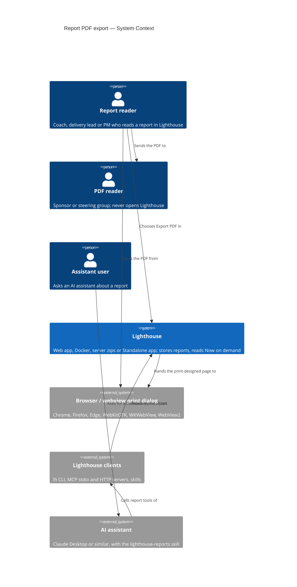
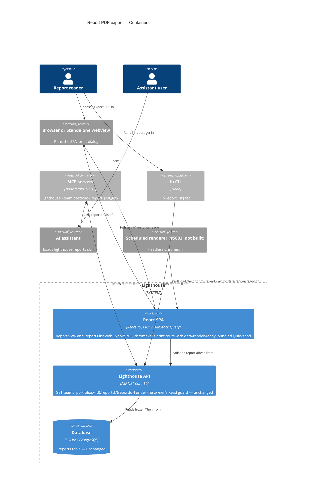
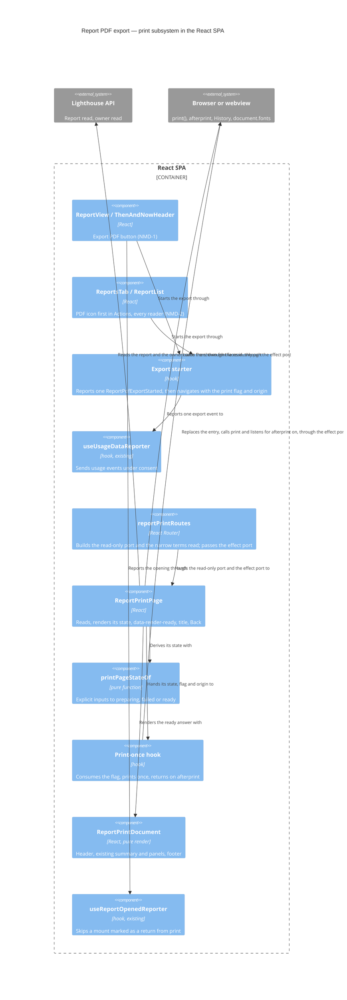
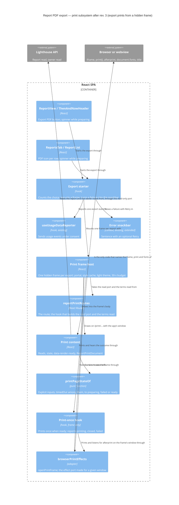

# Feature Delta — epic-6298-report-pdf-export

**ADO**: Epic #6298 *Report PDF Export* (tag `Premium`, state Planned). Predecessors on the board: #1822 *Project
Reports* (2025-03-02, Removed) and #4753 *Export to PDF* (2026-04-08, Premium, Removed 2026-08-21 as superseded by
Reports). Related: Epic #5878 *Then & Now* (Released), #6299 Custom Metric Reports, #5935 Signals, #5882 Scheduled
Report Delivery, Spike #6052 (Closed).

**Waves**: DISCOVER (2026-10-17). A deliberately light round, at the maintainer's request: one maintainer interview
about the past behaviour of their users, two removed backlog items the maintainer wrote (#1822, #4753), the Epic 5878 discovery and the #6052 spike.
Lighthouse ran no direct customer interviews this round.

**One line**: any report can leave Lighthouse as a PDF, so the numbers reach people who will not or cannot open
Lighthouse. The PDF is a capability of a report, not a report type. The first payload is Then & Now.

**Density**: `lean`, Tier-1 `[REF]` only. `evidence_standard: past_behavior`. Each claim is graded as
**observed behaviour**, **second-hand report** (of past behaviour), **stated intent**, or **desk/codebase fact**.

---

## Wave: DISCOVER / [REF] Persona IDs

| Persona | Role here |
|---|---|
| `flow-coach` | **Primary, per engagement.** Captures numbers for a client hand-over or sponsor update. The same persona that froze a Then & Now (Epic 5878). |
| `delivery-lead-rte`, `product-owner` | **Primary, recurring.** Team lead or PM who takes numbers out on a regular cadence (status update, steering slide). |
| *(any of the above)* | **Ad hoc.** One-off captures. The maintainer reported all three cadences on 2026-10-17: coach/consultant per engagement, team lead/PM on a recurring cadence, and ad-hoc one-offs. |
| *(candidate)* `report-reader` | **Not created.** The person the PDF is for: either *could* open Lighthouse but will not (does not know the tool, unsure how to use it), or *cannot* (no connection; the data lives in a Standalone install). Split out in DISCUSS only if the reader's needs shape the PDF beyond "readable without Lighthouse". |

---

## Wave: DISCOVER / [REF] Opportunity statement

The outcome: the numbers someone already reads in Lighthouse reach a reader outside it, in a form that reads well
without the tool and says when it was taken, with less effort than a screenshot or a rebuilt spreadsheet.

| # | Opportunity (customer-outcome form) | Source | Grade |
|---|---|---|---|
| O1 | Minimise the time it takes to get Lighthouse numbers into a slide or document for someone who will not open Lighthouse | #1822 ("reference customers ... manually export screenshots"); maintainer 2026-10-17 (screenshots into slides) | second-hand report of past behaviour; one informant (the maintainer) across a backlog record and the interview |
| O2 | Minimise the likelihood that a reader without access (Standalone, no connection) sees no numbers at all | maintainer 2026-10-17 | second-hand report |
| O3 | Minimise the effort of rebuilding the same numbers elsewhere (CSV into a spreadsheet, MCP into an AI-made dashboard) | #1822 (CSV of forecasts); maintainer 2026-10-17 | second-hand report of past behaviour |
| O4 | Minimise the likelihood that a shared number is read as current when it is not | project rule (no value the reader cannot tell is stale) | desk |
| O5 | Minimise the effort of handing data over for a Flow Analysis, optionally without names | #4753 | stated intent |

The opportunity algorithm cannot be applied: there are no importance or satisfaction ratings (see G2).

**Key gap, not resolved here.** What people capture today is **metrics charts and forecasts/Deliveries**. The
first planned payload, **Then & Now**, has **no charts** and is not captured by anyone yet (it is new). So the
first slice may not serve the job that was observed. DIVERGE decides (Open question 3).

**Competing alternative.** Workaround (3), the MCP connection plus an AI that generates a dashboard, is a live
substitute for a PDF, not just a workaround to replace. It already lets a user compose what they want to show.

---

## Wave: DISCOVER / [REF] Validated assumptions

| # | Assumption | Evidence | Confidence |
|---|---|---|---|
| V1 | Numbers leave Lighthouse today through workarounds that cost effort. | One informant, the maintainer: two dated backlog records the maintainer wrote and the interview. #1822 (2025-03) relays reference customers exporting screenshots by hand, the only customer-originated signal. #4753 (2026-04) names people sharing charts in reports or slides. Interview 2026-10-17: last real cases were screenshots into slides, CSV export rebuilt elsewhere, MCP plus AI dashboard. | **Low-Medium**. Past behaviour, but one informant; frequency and effort not measured. |
| V2 | Many readers are outside Lighthouse, by choice or by necessity. | Maintainer 2026-10-17: mixed. Some could open it but will not; others have no connection (Standalone). Epic 5878 discovery: the audience is management sponsors. | **Medium** |
| V3 | Capture happens on three cadences (per engagement, recurring, ad hoc). | Maintainer 2026-10-17. | **Low-Medium**. No split by frequency. |
| V4 | A PDF can be produced in every distribution. | `docs/feature/story-6052-server-side-chart-rendering/spike/findings.md`: headless Chromium works on server and Docker with caveats; Tauri print-to-PDF costs ≈0 in Standalone. Probe 2 in `.../spike/wave-decisions.md` supersedes the findings table's row C "DOESN'T WORK": in-process Jint + HarfBuzz rendering came out near-identical. | **Medium-High** for feasibility. **None** for which mechanism (not decided). |
| V5 | Then & Now is the cheapest first payload. | Its values are frozen and it carries no charts (Epic 5878 journey: "no charts"), so no chart rendering is needed. | **High** for cost. Says nothing about value (see X2). |

---

## Wave: DISCOVER / [REF] Invalidated assumptions

| # | Assumption (as stated or implied) | Evidence against |
|---|---|---|
| X1 | "A PDF is what people want when numbers leave Lighthouse." | **Challenged, not disproven.** Only one of three observed workarounds (screenshots) is a static picture. CSV means the user wants the data to rebuild; MCP plus AI means they want to compose their own view. A PDF serves the first, not obviously the other two. |
| X2 | "The first payload (Then & Now) serves the observed job." | **Challenged.** Captured today: metrics charts and forecasts/Deliveries (maintainer 2026-10-17). Then & Now is new and nobody captures it yet. |
| X3 | "Print the whole page so all metrics export cleanly" (#4753 shape). | The spike found the interactive page was not designed for print and splits across pages (`docs/feature/story-6052-server-side-chart-rendering/spike/findings.md`). Dropping the shape is a decision (D9), not evidence. |
| X4 | "Rendering charts identically outside the browser is cheap." | Spike #6052: five chart components derive their data in `useEffect` and render empty server-side; a bundled browser adds 99–120 MB to Standalone and ≈480 MB on disk to Docker; Helm's 1 GiB limit has no headroom for Chromium. Irrelevant for Then & Now, decisive once charts arrive. |
| X5 | "PDF can start Premium and become free later at no cost." | **Challenged, on an assumption.** We have no record of moving a capability from Community to Premium; we assume it would read as a take-away. If so, starting Premium keeps the option, but the later flip is effectively one-way: once free, it stays free. Also, the Epic 5878 DIVERGE dissent: gating the management-facing PDF works against land-and-expand, since the PDF is what reaches the sponsor. |

---

## Wave: DISCOVER / [REF] Dropped options

| Option | Why dropped |
|---|---|
| Print the interactive page as is (#4753) | A decision the maintainer confirmed on 2026-10-17: #4753 was removed as "superseded by Reports" (D9). The spike also found the interactive page splits badly across pages. |
| PDF as its own report type | A PDF is a capability of any report, built once (Epic #6298 description, 2026-10-14). |
| Bundling a headless browser in Standalone | +99–120 MB per OS plus notarising a second engine (spike #6052). |
| Redrawing charts in .NET (ScottPlot / SkiaSharp) | Only "visually equivalent"; every chart drawn twice (spike #6052). |
| browserless sidecar | SSPL / commercial licence (spike #6052). |

Not dropped, only out of this Epic: CSV export of forecasts (#1822), and anonymising for sharing (#4753, see Open
questions 7 and 9).

---

## Wave: DISCOVER / [REF] Decision gate

| Gate | Status | Why |
|---|---|---|
| G1 Problem | **FAIL on threshold** | No direct customer interviews (threshold: 5, >60% confirming). The evidence is one informant, the maintainer: two dated backlog records the maintainer wrote (#1822, #4753) and the 2026-10-17 interview. The only customer-originated signal is the reference-customer observation #1822 relays second-hand (screenshots exported by hand). |
| G2 Opportunity | **FAIL** | Five opportunities (O1–O5), no importance or satisfaction ratings, so no score above 8 can be shown. The gap between captured content and first payload (X2) is open. |
| G3 Solution | **FAIL** | Nothing tested with users. The spike tested feasibility, not value or usability. |
| G4 Viability | **NOT EVALUATED** | Light DISCOVER; no Lean Canvas exists. Partial signals, as notes only: feasibility amber-to-green (V4) with the mechanism open; licence a decision-in-principle with a planned later flip (D4); a free substitute exists (MCP plus AI); no usage event yet (DEVOPS). |

**Proceeding is a maintainer-accepted risk**, as with Epic 5878. The maintainer asked for a light DISCOVER and
answered the interview on 2026-10-17. This wave is a learning investment, not a validated build case. The
cheapest evidence to gather alongside DIVERGE: ask 3–5 users "the last time you showed Lighthouse numbers to
someone else, what did you send?" and ask to see the artefact. Then count how many were charts, forecasts, tables
or Then & Now.

---

## Wave: DISCOVER / [REF] Constraints established

| # | Constraint | Evidence source |
|---|---|---|
| C1 | One delivery mechanism for every report type (Then & Now, Custom Metric Reports, Signals). | Epic #6298 description |
| C2 | Server zips and Docker are hard targets (scheduled jobs, no UI). Standalone needs in-app view plus PDF export at near-zero size cost; Tauri kills the backend when the app exits. | `docs/feature/story-6052-server-side-chart-rendering/spike/findings.md` |
| C3 | Helm's 1 GiB memory limit has no headroom for an in-process browser; headless Chromium as non-root needs `--no-sandbox` with requests restricted to Lighthouse's own origin. | `docs/feature/story-6052-server-side-chart-rendering/spike/findings.md` |
| C4 | Once charts are in a PDF, they look like the frontend's charts. | `docs/feature/story-6052-server-side-chart-rendering/spike/findings.md` (maintainer narrowing, 2026-09-24) |
| C5 | Fonts must ship with the app: Quicksand loads from Google Fonts at runtime today, so offline and air-gapped PDFs would fall back. | `docs/feature/story-6052-server-side-chart-rendering/spike/wave-decisions.md` |
| C6 | A PDF is a snapshot. It must say when it was produced and which windows it covers, so nobody reads it as current. | Project rule (no value the reader cannot tell is stale) |
| C7 | The PDF renders the instance's configured terms (Feature, Work Item, Team, Portfolio, Delivery, …). | `TerminologySeeder.cs`; project rule |
| C8 | Who may export is decided through RBAC (`useRbac()`), not ad hoc. | Project architecture rule |
| C9 | DEVOPS designs the usage event; it never carries report content or names. | Project rules; usage data never personal |
| C10 | The report must show the same values in the PDF as on screen (Then & Now's Then is frozen; Now is computed at export time). | Epic 5878 journey |

---

## Wave: DISCOVER / [REF] Key decisions

- [D1] One workspace, `epic-6298-report-pdf-export` (see: maintainer dispatch 2026-10-17).
- [D2] Light DISCOVER: the maintainer interview stands in for customer interviews; G1–G3 recorded as failing, G4 not evaluated (see: maintainer request 2026-10-17; Decision gate).
- [D3] The PDF is a capability of a report, built once; Then & Now is the planned first payload, charts follow with Custom Metric Reports (see: Epic #6298 description 2026-10-14). The fit of that first payload is an open question (X2).
- [D4] Licence, decision-in-principle: Premium while there are no extras; free PDF with Premium extras later. The later flip is assumed one-way: we have no record of moving a capability from Community to Premium, and we assume it would read as a take-away (X5) (see: maintainer 2026-10-17).
- [D5] MCP plus AI dashboards recorded as a competing alternative, not a workaround to displace (see: maintainer 2026-10-17).
- [D6] Product direction, graded **stated intent**: reports are for sharing, the interactive charts for exploring. The maintainer verbatim: "the idea of reports is exactly to make this 'shareable', so later on we want reporting for different types like metrics charts optimized for sharing and not for 'playing around'" (see: maintainer 2026-10-17).
- [D7] Mechanism not chosen here; DIVERGE owns it (see: `docs/feature/story-6052-server-side-chart-rendering/spike/wave-decisions.md`, maintainer 2026-09-24).
- [D8] No ICE change: no new direct evidence; the interview consolidates what the maintainer's own #1822 and #4753 already said (see: wave-decisions.md D8).
- [D9] #4753's "print the page" shape is dropped. A decision the maintainer confirmed on 2026-10-17 (#4753 removed as "superseded by Reports"), not evidence (see: maintainer 2026-10-17).

---

## Wave: DISCOVER / [REF] Pre-requisites

- Reports tab and the Then & Now type (Epic 5878, Released).
- A way to render a report statically (print route or equivalent) without the interactive controls.
- For chart-bearing payloads: Custom Metric Reports (#6299), and for non-browser mechanisms the five effect-driven chart components refactored (spike #6052).
- Fonts shipped with the app (C5) if the mechanism renders outside the user's browser.

---

## Wave: DISCOVER / [REF] Open questions for DIVERGE

1. **Mechanism**: browser print with a print stylesheet, headless Chromium (PuppeteerSharp), in-process Jint + HarfBuzz + Skia, or a Gotenberg sidecar, given C2–C5. Does the first slice need a server-side mechanism at all, or is a browser/Tauri print enough until #5882 needs unattended rendering?
2. **PDF vs other share forms**: a slide-ready image per panel, a shareable read-only link, CSV, or making reports reachable through MCP so AI dashboards use them. Which form serves O1–O3 best, given the observed workarounds (X1, D5)?
3. **First payload**: Then & Now (cheapest, not captured today) or a chart-bearing report closer to what people capture (metrics charts, forecasts/Deliveries) (X2).
4. **Licence gate timing**: Premium now with a planned flip, or free from the start (5878 dissent: gating hurts land-and-expand). What are the "extras" that would justify Premium later (branding, scheduled email, anonymising)?
5. **Downloaded vs stored**: generate on demand and download, or store server-side (the spike assumed stored, for #5882 email). Storage brings retention, RBAC on stored files and a migration.
6. **Snapshot honesty**: how a PDF shows its generation time and windows (C6), and whether Now is recomputed or taken as on screen.
7. **Anonymising** (#4753): in or out of scope, and which names it would cover (Teams, Work Items, people).
8. **Who exports**: any reader of the report, or editors only (C8).
9. **What leaves Lighthouse**: what may a PDF carry out of Lighthouse (Work Item titles, Team and person names, or aggregates only), and how is a file outside the access model marked as confidential? Linked to #4753's "Option: Anonymise so it can be shared?" and question 7.

---

## Wave: DIVERGE / [REF] Recommendation

Full text: `recommendation.md` · artifacts: `diverge/` · decisions DV-1..DV-9: `wave-decisions.md`.

- **Job**: `job-share-numbers-outside-lighthouse` (added to `docs/product/jobs.yaml`). Under-served outcomes, as
  desk estimates: a shared number read as current (OS3), time into the reader's slide or email (OS1), and a figure
  misread because its meaning is explained only inside Lighthouse (OS6).
- **Direction**: Option 4, **"Browser-printed PDF"** (4.40 of 5, tied with the dissent "Slide image" and chosen
  by the stated tie-break, higher Desirability + Viability; third "Server-rendered chart report" 4.00). **Export
  PDF** opens a print-designed report with a header carrying the Team or
  Portfolio, "produced {date}", the Then and Now windows and a "how to read this" line. The file is saved through
  the browser's or the Standalone webview's print. This costs about 0 MB in every distribution (Standalone
  desk-checked; probe before DESIGN), with no server renderer; a server renderer loads the same view later for
  #5882. The mechanism is DESIGN's.
- **Dissent trigger**: if users mostly share single charts pasted into slides, add "Copy as image" with the same
  dated caption to report panels as a follow-up. Do not swap directions.
- **Q3 first payload**: Then & Now (the X2 gap is accepted knowingly; #6299's charts print through the same route
  later).
- **Q4 licence (maintainer decides)**: Community PDF with a "Made with Lighthouse" footer; Premium removes it or
  adds own branding, on top of the existing 2-reports-per-owner cap. This would replace D4's "Premium until extras
  exist".
- **Deployment scope (maintainer input 2026-10-17, DISCUSS confirms)**: Standalone may be left out if that makes
  the feature cheaper. The recommended option does not need to leave it out. If a later step does, hidden vs
  disabled-with-reason is DISCUSS's or DESIGN's call.
- **Q5–Q9**: downloaded, not stored; Now as computed at export; anonymising out of v1; exporters are report
  readers via RBAC; Then & Now carries aggregates and the Team or Portfolio name only.

---

## Wave: DISCUSS / [REF] Prior-Wave Reading Confirmation

> **Revised after review 2026-10-19.** The final review gate and the DISTILL UI walk-through (NMD-1..7, locked)
> changed these DISCUSS sections:
>
> - The example Now window is **"Now 2 Aug – 30 Oct 2026"** (90 days; "1 Aug" made it 91), here, in the slices and in
>   the journey.
> - DESIGN's upstream changes U-1..U-16 are applied to the stories, ACs, journey and slices.
> - The Reports list's PDF icon (NMD-2) is in slice 01 by the maintainer's choice; D20 is superseded, slice 01 is
>   re-estimated at ~1.5d, and "export from the Reports list" left Out of Scope.
> - US-01 follows NMD-1 (disabled while loading) and NMD-3 (two-line header, footer copy, file name); it gains the
>   export-time failure with Retry (AC-1.11) and the Back destinations (AC-1.12); its renamed panel reads "Lead Time".
> - AC-1.10 and D28 follow the Q2 answer and NMD-7: no disabled state in slice 01; the maintainer checks macOS after
>   slice 01 is released, and a follow-up handles a failure.
> - AC-2.4: the marks become drawn icons on screen too; meaning, colours and words unchanged.
> - US-03 follows NMD-5's three lines.
> - US-04 shows the client read's raw values and reports `ReportOpened` from the clients after consent; US-05 carries
>   the web's presentation rules (risk HIGH, ~1d).
> - DoD 1 names the manual evidence and its automated proxies; the KPI table records per-browser and per-client
>   measurement and K6; the DoR tally is restated.
>
> Defaults chosen while the maintainer was away (PD-1..PD-6) were confirmed by the maintainer on 2026-10-20.

**Agent**: Luna (`nw-product-owner`) · **Date**: 2026-10-17 · **Mode**: autonomous subagent; the maintainer was not
reachable from the session, so decisions that are the maintainer's carry a proposed default marked **PROPOSED —
maintainer confirms** and are listed under "Questions for the maintainer". Config: user-facing, walking skeleton
"depends" (brownfield, evaluated below), research depth lightweight, JTBD reused from DIVERGE (refined, not re-run),
density lean. Per-wave peer review skipped by instruction (the consolidated review runs at the end of DISTILL).

| Read | Status |
|---|---|
| `feature-delta.md` DISCOVER + DIVERGE sections | ✓ |
| `wave-decisions.md` (DV-1..DV-9, maintainer decisions on the recommendation, Linux print probe) | ✓ — locked inputs |
| `recommendation.md` | ✓ |
| `discover/wave-decisions.md` (D1–D9, "Adjacent opportunity" now moved into scope) | ✓ |
| `diverge/job-analysis.md` | ✓ (job reused) |
| `diverge/competitive-research.md`, `options-raw.md`, `taste-evaluation.md`, `review.yaml` | ⊘ not read; the recommendation and the decision log were enough |
| `docs/product/jobs.yaml` (`job-share-numbers-outside-lighthouse`, tail of file) | ✓ |
| `docs/product/journeys/epic-6298-report-pdf-export.yaml` | ✓ (refined this wave) |
| Precedent: `docs/feature/epic-5878-baseline/feature-delta.md` DISCUSS sections, `slices/slice-01-*.md`, `discuss/wave-decisions.md` | ✓ |
| Brownfield code: frontend `pages/Common/Reports/*`, backend `TeamReportsController`, `ReportReadModels`, `UsageDataEventName`, `index.html` | ✓ (targeted, below) |
| `lighthouse-clients`: `skills/README.md`, `skills/lighthouse/SKILL.md`, MCP tool list, `docs/release-model.md` | ✓ |
| `docs/feature/story-6217-lighthouse-skills/feature-delta.md` (how skills are built and shipped) | ✓ (targeted) |

---

## Wave: DISCUSS / [REF] Current-State Surface Inventory (brownfield)

| # | What exists | Where | Consequence |
|---|---|---|---|
| S1 | One report view serves Team and Portfolio reports (owner passed in); breadcrumb "Reports › {name}" with Edit report and Delete for editors; body in `WidgetBody` with loading, could-not-load (Retry) and "no longer exists" looks; data from a keyed TanStack query | `Lighthouse.Frontend/src/pages/Common/Reports/ReportView.tsx`, `ThenAndNowHeader.tsx` | Export PDF lands once and serves both owners: no separate Portfolio slice. The existing loading and failure looks already decide when an export is possible. |
| S2 | Summary marks ✔ Improved, ✘ Got worse, ± Mixed and the no-change mark are **text characters**, coloured; the probe also saw ▲ in the panels | `ThenAndNowSummary.tsx`, `panels/*` | These fell back to system fonts in the probe; they must not depend on the machine (slice 02). |
| S3 | Report reads: `GET …/teams/{id}/reports`, `…/reports/{reportId}` (and Portfolio twins) under `TeamRead` / `PortfolioRead`; the read carries name, created date, both windows and every metric's Then and Now values, Now computed on read | `TeamReportsController.cs`, `PortfolioReportsController.cs`, `ReportReadModels.cs` | The PDF needs no new endpoint (DESIGN confirms). The clients slice can read the same endpoints. |
| S4 | No print stylesheet and no `window.print` anywhere in the frontend | search of `Lighthouse.Frontend/src` | The print layout is new; nothing to unpick. |
| S5 | The Quicksand typeface loads from `fonts.googleapis.com` at runtime | `Lighthouse.Frontend/index.html`, theme in `main.tsx` | The probe embedded Quicksand only because the machine was online; an offline or air-gapped instance prints in a fallback face (DISCOVER C5). |
| S6 | Usage data: `ReportCreated = 16`, `ReportOpened = 17`, `ReportDeleted = 18`; last on this checkout `WorkTrackingSystemFieldsChanged = 19` | `UsageDataEventName.cs` | A new export event appends after the last integer on `main` (DEVOPS checks). |
| S7 | Clients: 49 MCP tools and the `lh` commands; **none reads reports**; the client package already reads the instance's terminology | `lighthouse-clients/packages/mcp-core/src/index.ts`, `packages/client/src` | Epic 5878 excluded reports from CLI/MCP (its D15). An assistant cannot fetch a report today (Q1). |
| S8 | Skills: one folder per skill, one zip per skill packed by `scripts/pack-skills.sh` in CI; a drift test fails when the `lighthouse` skill does not name every MCP tool and `lh` command; skill-only changes need no changeset; package changes need one and a manual `pnpm release:version` before the release | `lighthouse-clients/skills/README.md`, `docs/release-model.md` | A new skill is cheap to ship; new client tools also touch the `lighthouse` skill text. |
| S9 | Standalone release builds wire no print shortcut or menu; `window.print()` from the frontend prints in Tauri 2 on Linux (probe) | `wave-decisions.md`, probe 2026-10-17 | The Export action calls print itself. macOS unprobed. |
| S10 | Docs: `docs/reports/reports.md`, `docs/reports/thenandnow.md`; skill zips listed in `docs/aiintegration.md` | `docs/` | Finalize targets. |

---

## Wave: DISCUSS / [REF] Persona IDs

| Persona | Role here |
|---|---|
| `flow-coach` (consulting) | **Primary.** Elena Kovacs, external flow coach with Team Lightspeed since 1 Aug 2026, Team Admin. Exports the Then & Now report for the client's sponsor. |
| `delivery-lead-rte` | **Primary, recurring.** Martin Achterberg, Head of Delivery, Viewer on Team Lightspeed and on Portfolio Ocean Explorer. Exports a report every month for the steering group. |
| `flow-coach` (internal, Standalone) | **Primary, cannot-share case.** Priya Raman, coach of Team Gravity, runs the Lighthouse app (Standalone) on a Linux laptop; nobody else can reach her data. |
| *(candidate)* `report-reader` | **Not created.** Sabine Roth, the client's sponsor: reads the PDF weeks later without Lighthouse. Her needs (dated, self-explaining, readable in black and white) are outcomes of the sender's job; no separate entry. |

## Wave: DISCUSS / [REF] JTBD One-Liner

- `job-share-numbers-outside-lighthouse` (DIVERGE, reused): when someone who will not or cannot open Lighthouse needs
  to know where flow stands, hand them the numbers already read in Lighthouse in a form that explains itself and says
  when it was taken. Every story carries this `job_id`. The skill slices serve the same job through another carrier
  (the assistant's dashboard, the third observed workaround).
- `job-flow-coach-show-whether-flow-changed` is carried, not served anew: the PDF and the dashboard take a Then & Now
  result to its audience.

---

## Wave: DISCUSS / [REF] Changed Assumptions

DISCOVER and DIVERGE documents are not edited; these supersede them for DESIGN onward.

| Was (source) | Now | Why |
|---|---|---|
| Licence: Premium until extras exist (DISCOVER D4); Community with a footer that Premium removes (DV-6) | **Community, branded with LetPeopleWork and Lighthouse; no removal or own branding in v1** (D10) | Maintainer 2026-10-17. The ADO Epic still carries the `Premium` tag. |
| "Export unavailable on this licence" and "rendering unavailable on this host" failure modes (DISCOVER journey) | Removed | Community (D10); no server rendering in this Epic (D16). |
| Standalone needs PDF export (DISCOVER C2), relaxed by DV-2 | Covered anyway by browser print; Linux proven by probe; macOS assumed to work and checked by the maintainer after slice 01 is released; a follow-up if it fails (D12, Q2 answer, NMD-7) | Probe 2026-10-17; maintainer 2026-10-17 and 2026-10-19. |
| AI-dashboard skill out of scope (DISCOVER "Adjacent opportunity", DV-9) | **In scope**, as slices 04–05, each shippable on its own (D18) | Maintainer 2026-10-17. |
| Reports are not reachable through CLI/MCP (Epic 5878 D15) | Reading reports through the clients (slice 04; Q1 answered (a)), returning the report's raw values; creating, editing and deleting stay web-only | Without it the skill has nothing to read (S7). Raw values: maintainer, 2026-10-17. |
| The PDF embeds the Lighthouse typeface (probe result) | Only when the machine is online (S5) | The probe ran online. |

---

## Wave: DISCUSS / [REF] Locked Decisions

Numbering continues after DISCOVER's D1–D9 (DIVERGE used DV-1..DV-9). D10–D18 restate the maintainer's decisions of
2026-10-17 (locked). D19 onward are this wave's; those marked **PROPOSED — maintainer confirms** wait for an answer
under "Questions for the maintainer".

- [D10] **Licence**: the PDF is Community and carries LetPeopleWork and Lighthouse branding. Removing or replacing the
  branding is a later Premium extra, not in v1. Supersedes D4 and the Premium half of DV-6. (Maintainer, locked.)
- [D11] **First payload: Then & Now**, knowing it is not what people capture today (X2). (Locked.)
- [D12] **Deployment scope**: Standalone may be left out where that saves cost. Browser print covers it at no size
  cost; Linux works with no Rust code (probe). macOS is assumed to work and checked by the maintainer after slice 01
  is released; if it fails, a follow-up handles it (Q2 answer, NMD-7). (Locked; rev. 2026-10-19.)
- [D13] **Content**: aggregates plus the {Team} or {Portfolio} name and the report's name; no {Work Item} titles,
  no person names. The header as recommended (owner, report, Then and Now windows, produced, "how to read this").
  No confidentiality line in v1 — the recommendation left it optional and the maintainer found the header "good
  enough". (Locked; no confidentiality line, decided 2026-10-17.)
- [D14] **Who may export**: anyone who can read the report. Exporting is reading what is already shown; no new RBAC
  requirement. (Locked.)
- [D15] **Delivery**: made on demand, downloaded through the print dialog, never stored. Anonymising deferred.
  Nothing is persisted, so no migration. (Locked.)
- [D16] **Fidelity**: our own print layout; small differences between browsers are acceptable. **Requirement
  recorded for Scheduled Report Delivery (#5882), not built here**: a later server render of a report must be
  pixel-comparable to the Chromium print of the same view. So the print-designed report must be a view a renderer
  can load on its own, not something assembled only inside the click. (Locked; the "own view" consequence for DESIGN.)
- [D17] **Print layout** (from the probe): the light theme always; no app chrome (navigation, tabs, Edit report,
  Delete, app footer); our own header and a branding footer; ✔ ✘ ▲ ± and the no-change mark must not depend on system
  fonts (DESIGN decides how); no stray near-empty last page. The Export action calls print itself, because release
  Standalone builds wire no print shortcut. (Locked.)
- [D18] **The report skill is in scope** as its own slice, shippable alone; it describes how to show each report
  type as a dashboard or document, starting with Then & Now. (Locked.) This wave splits it into the client read
  (slice 04) and the skill (slice 05), so each ships alone (Q1).
- [D19] **Produced = when the printed values were read.** Export reads the report afresh before printing, so Now
  ends on the export day and the screen shows the same values as the PDF. The header shows date and time in the
  viewer's local time. (Decided: DESIGN DDD-3 chose the mechanism; the maintainer's 2026-10-19 sketch NMD-3 shows "Produced {date}, {time}".)
- [D20] **Export PDF sits on the report view**, for every reader, first before Edit report and Delete for editors
  (NMD-1). ~~Not on the Reports list in v1~~ — **superseded by NMD-2** (maintainer, 2026-10-19): a PDF icon also goes
  first in the Reports list's Actions column, for every reader, in slice 01.
- [D21] **"How to read this"** (part of the recommended header) ships as its own thin slice (03), so slice 01
  stays a thin walking skeleton (~1.5d since NMD-2 added the Reports list icon).
- [D22] **Fonts ship with the app** instead of loading from Google Fonts at runtime, so an offline instance prints
  in the Lighthouse typeface. (Decided, Q4, 2026-10-17.)
- [D23] **Reports become readable through the clients**: list an owner's reports and read one, for Teams and
  Portfolios, in MCP (all transports) and `lh`; read-only. (Decided, Q1, 2026-10-17.)
- [D24] **Skill name `lighthouse-reports`**, release asset `lighthouse-reports-skill.zip`. (Decided, Q6, 2026-10-17.)
- [D25] **Skill rules**: quote the report's values exactly; never rebuild Then from today's metrics; a dash stays a
  dash with its reason; the instance's terms; a dated header with both windows and the day the report was read; an
  attribution line naming Lighthouse by LetPeopleWork; any comment of the assistant's own kept visibly apart from
  the report's numbers and labelled as such. (Decided, Q3, 2026-10-17.)
- [D26] **Order**: PDF slices 01 → 02 → 03, then 04 → 05. (Decided, Q5, 2026-10-17.)
- [D27] **Usage data is wanted**: one event when Export PDF is chosen (DEVOPS designs; it counts the intent, since
  nothing tells us whether the dialog saved a file). Client reads may count through the clients' existing practice
  of reporting the web's event for a mapped command; DEVOPS decides. Never names or values.
- [D28] ~~If printing does not work in the macOS Standalone app, Export PDF stays visible but disabled there, with a
  one-line reason.~~ **Superseded by the Q2 answer and NMD-7**: slice 01 has no disabled state; the maintainer checks
  macOS after slice 01 is released, and if print fails there a follow-up sketches and builds the fallback.

---

## Wave: DISCUSS / [REF] Scope Assessment

**PASS — 5 stories, 2 code bases (Lighthouse frontend; `lighthouse-clients`), ~5 days** (rev. 2026-10-19: was ~4;
slice 01 +½d for the Reports list icon, slice 05 +½d for the presentation rules). No oversize signal: under
10 stories, no new bounded context (export is a capability of the existing Reports module; the client read and the
skill sit in the existing clients and skills), the walking skeleton touches 2 integration points (report view →
system print), under 2 weeks. Two user outcomes (PDF; assistant dashboard) that could ship separately — the
maintainer chose to keep both in this Epic (D18); they are ordered, not interleaved, and the skill pair builds only on
finished slices.

---

## Wave: DISCUSS / [REF] Journey

SSOT: `docs/product/journeys/epic-6298-report-pdf-export.yaml` (refined this wave). Two journeys.

```
PDF:  [Open report] ──> [Export PDF] ──> [print dialog: Save as PDF] ──> [attach / hand over] ──> [Sabine reads it]
      Burdened           Ready            Relieved                        Relieved                  Sceptical → Oriented
      report_values      + generated_at   (nothing stored)                generated_at              header: produced, windows
      owner_name         (report view     light theme, no chrome;                                   "how to read this", branding
                          button or       back to where Export started
                          Reports list icon)

Skill: [Ask: which reports?] ──> [Assistant reads the report] ──> [Dashboard / document per the skill]
       Wary                       Engaged                           Confident
       owner_name, report_name    report_values, read_at            same values, dated, own comments apart
```

Emotional arc: **burdened → relieved → confident** (sender); **sceptical → oriented** (reader); **wary → confident**
(assistant user). Shared artifacts and their single sources are in the YAML (`report_values`, `report_windows`,
`owner_name`, `report_name`, `generated_at`, `read_at`, `branding`). Integration checkpoint: the PDF and the
assistant show the values the report view shows, and the PDF's produced date is the day its Now window ends in the
instance's time zone; Produced is shown in the viewer's local date and time, so a viewer in another zone near
midnight can see the two a day apart (U-2).

---

## Wave: DISCUSS / [REF] Story Map & Slices

**Backbone**: *open a report* → *export it* → *it reads the same anywhere* → *it explains itself* → *an assistant
reads it* → *an assistant shows it*.

| Open report | Export | Reads the same anywhere | Explains itself | Assistant reads | Assistant shows |
|---|---|---|---|---|---|
| (exists, Epic 5878) | **01 Export PDF (report view and Reports list), print layout, header, footer** | 02 own marks, shipped fonts, page breaks | 03 "how to read this" | 04 list + read reports via MCP and `lh` | 05 `lighthouse-reports` skill |

**Walking skeleton = slice 01** (brownfield): the existing report view gains Export PDF and the Reports list a PDF
icon (NMD-2); the print dialog produces a
branded, dated PDF in a browser and in the Linux Standalone app. It touches every PDF activity thinly.

| # | Slice | Est. | Ships alone | Learning hypothesis — disproves … if it fails |
|---|---|---|---|---|
| 01 | Export PDF on a Then & Now report (Team and Portfolio), from the report view and as an icon in the Reports list (NMD-2): fresh read, print layout (light, no chrome), two-line header with owner, report, windows, produced; branding footer; the print page's preparing and failed looks with Retry; Back to where Export started; usage event | ~1.5d (rev. 2026-10-19, was 1d) | Yes | "Browser print of a print-designed view is good enough to hand over" — if the maintainer would not send the PDF of the dev instance's busiest Team's report to a sponsor without editing it (cut panels, leftover chrome, wrong date), the route needs more than a print layout |
| 02 | The PDF reads the same everywhere: marks drawn, not borrowed from system fonts; the Lighthouse typeface shipped with the app; no panel split across pages, no near-empty last page, on A4 and Letter | 1d | Yes | "Own marks and shipped fonts make PDFs alike" — if the same report printed from Chrome on Windows, Firefox on Linux and the Linux Standalone app differs in more than spacing |
| 03 | "How to read this": three short lines (NMD-5) saying which side is frozen and since when, what Now covers, what the marks, colours and "—" mean | ½d | Yes | "Three lines explain the report to a cold reader" — if someone who has never opened Lighthouse, handed the PDF, cannot say which side is frozen and whether {Cycle Time} got better |
| 04 | Reports readable through the clients: list an owner's reports and read one (raw values), MCP and `lh`, Team and Portfolio; a read reports `ReportOpened` after consent; the `lighthouse` skill names the new tools | ~1d | Yes | "Reading the report is enough for an assistant to answer about it" — if, in the eval, the assistant still calls the metric tools to rebuild Then |
| 05 | `lighthouse-reports` skill: how to show a Then & Now as a dashboard or document, carrying the web's presentation rules (rounding, units, change, percent, dashes, summary groups); evals scored against the Reports tab; its own zip | ~1d (rev. 2026-10-19, was ½d; risk HIGH) | Yes (builds on finished 04) | "A skill makes assistant dashboards faithful" — if in 3 eval runs a dashboard misquotes a value, drops the dates, or mixes the assistant's comment into the numbers |

Briefs: `slices/slice-NN-*.md`.

### Priority Rationale

- **01** is the walking skeleton and the Epic's core value (value 5, urgency 4, effort 2).
- **02** next: riskiest assumption — the probe showed font-dependent marks and a fallback typeface offline; a PDF
  that looks broken on the sponsor's machine undoes 01's value.
- **03** completes the recommended header (OS6, misread without explanation); cheapest slice.
- **04 → 05** last, by D26: independent of the PDF, the maintainer's "low effort, give it a try"; 05 needs 04's read
  (one-direction dependency on a finished slice). Q1 was answered (a), so 04 stays; the skill also accepts values the
  user pastes in.

### Slice taste tests

| Test | Verdict |
|---|---|
| 4+ new components in one slice? | Borderline in 01 (Export action, Reports list icon, print layout, print header, branding footer, event). Each is thin; the header and footer are one print frame, and the list icon reuses the same print page and event. Kept as the walking skeleton at ~1.5d by the maintainer's choice (NMD-2). |
| Every slice depends on a new abstraction? | Pass — the print frame is born in 01 and is the seam #6299's chart reports and #5882's server render reuse (D16). |
| Disproves a pre-commitment? | Pass — 01 tests DV-3/DV-7 (browser print is enough), 02 tests D17/D22, 03 tests OS6, 04 tests D23, 05 tests D18/D25. |
| Synthetic-data-only slices? | Pass — 01–03 are dogfooded on the dev instance (`:5169`, real history) and the Linux Standalone app with the maintainer's data copy; 04–05 against the dev instance. Demo data covers E2E and screenshots only. |
| Two slices alike except scale? | Pass. |

---

## Wave: DISCUSS / [REF] User Stories

<!-- markdownlint-disable MD024 -->

System constraints (all stories): Community, no licence check (D10) · RBAC: exporting and reading through the clients
need only the owner's Read; UI gating via `useRbac()` only, never fetching `/api/latest/authorization/my-summary` ·
works with auth off · nothing stored, no migration (D15) · the PDF shows exactly the values the report view shows,
read at export (D19) · every label through Terminology (seeded defaults {Team}, {Portfolio}, {Work Item},
{Cycle Time}, …) · meaning never by colour alone · no {Work Item} titles or person names leave Lighthouse (D13) · no
server-side rendering (D16) · no verdicts or generated text in the report itself (Epic 5878 D39).

### US-01 — Export a Then & Now report as a PDF (slice 01, walking skeleton)

`job_id: job-share-numbers-outside-lighthouse` · persona `flow-coach` (Elena Kovacs) and `delivery-lead-rte`
(Martin Achterberg)

**Problem**: Elena wants the client's sponsor, Sabine Roth, to see the Then & Now report for Team Lightspeed. Sabine
will not open Lighthouse. Today Elena screenshots the report, crops it into a slide and types the date beside it;
the screenshot carries the app's navigation and nothing says when it was taken. *(The workaround is second-hand,
from the maintainer; DISCOVER G1 failed, maintainer-accepted risk D2.)*

#### Elevator Pitch

Before: a report can only be read inside Lighthouse; getting it to Sabine means screenshots and a hand-typed date.
After: Team Lightspeed → Reports → "Then & Now — 90 days to 2 Oct 2026" → **Export PDF** (or the PDF icon on that
row of the Reports list) → Save as PDF → sees a light page headed "Team Lightspeed" over the title "Then & Now — 90
days to 2 Oct 2026", then "Then 5 Jul – 2 Oct 2026 · Now 2 Aug – 30 Oct 2026" and "Produced 30 Oct 2026, 09:15"
(NMD-3), the summary and the {Cycle Time} panel (85th 21 → 12 days, ▼ 9 days (−43 %)), and the Lighthouse logo with
"Made with Lighthouse by LetPeopleWork · letpeople.work" — no navigation, tabs or buttons.
Decision enabled: whether to send this file to the sponsor as it is, instead of building a slide.

**Examples**: (1) Elena exports on 30 Oct 2026 in Chrome; the PDF shows the values on her screen and "Produced 30 Oct
2026, 09:15". (2) Martin, a Viewer, uses the dark theme; on 2 Nov 2026 he clicks the PDF icon on Portfolio Ocean
Explorer's report in the Reports list, for the steering group; the PDF is light and headed with "Portfolio Ocean
Explorer", and "‹ Back to Reports" returns him to the list. (3) Elena opened the report
on 29 Oct and left the tab open; she exports on 30 Oct; the PDF shows Now ending 30 Oct, not 29 Oct. (4) Priya Raman
exports from the Lighthouse app on her Linux laptop; the system print dialog opens. (5) The report cannot be loaded
for Martin on 2 Nov; no Export PDF is offered. (6) Elena chooses Export PDF on 30 Oct and the export's own read
fails on a dropped connection; the page says "This report couldn't be loaded, so no PDF was made." with Retry; she
chooses Retry, the read succeeds and the print dialog opens once (PD-1, **confirmed by the maintainer on 2026-10-20**).

```gherkin
Scenario: A coach hands a sponsor a dated Then & Now report as a PDF
  Given Team Lightspeed has the report "Then & Now — 90 days to 2 Oct 2026"
  And on 30 Oct 2026 its Cycle Time panel shows 85th percentile 21 days Then and 12 days Now
  When Elena chooses Export PDF and saves the file from the print dialog
  Then the PDF is headed "Team Lightspeed" above the title "Then & Now — 90 days to 2 Oct 2026"
  And it shows "Then 5 Jul – 2 Oct 2026 · Now 2 Aug – 30 Oct 2026" and "Produced 30 Oct 2026"
  And its Cycle Time panel shows 21 days, 12 days and "9 days (−43 %)" beside the improved mark
  And it ends with the Lighthouse logo and "Made with Lighthouse by LetPeopleWork · letpeople.work"
  And it shows no navigation, tabs, Edit report or Delete

Scenario: A Viewer in the dark theme exports a Portfolio report from the Reports list
  Given Martin is a Viewer on Portfolio Ocean Explorer and uses the dark theme
  When Martin chooses the PDF icon on the Portfolio's Then & Now report in the Reports list on 2 Nov 2026
  Then the PDF has a light page headed "Portfolio Ocean Explorer"
  And "‹ Back to Reports" returns him to the Reports list

Scenario: A report left open overnight is exported with today's Now
  Given Elena opened the report on 29 Oct 2026 and left it open
  When Elena chooses Export PDF on 30 Oct 2026
  Then the PDF shows "Now 2 Aug – 30 Oct 2026" and "Produced 30 Oct 2026"
  And the report on screen shows the same values as the PDF

Scenario: No PDF of a report that could not be loaded
  Given the report cannot be loaded for Martin on 2 Nov 2026
  When Martin looks at the report page
  Then he sees "This report couldn't be loaded. Reload to try again." with Retry
  And Export PDF is not offered

Scenario: The Lighthouse app on Linux opens the print dialog
  Given Priya runs the Lighthouse app on Linux with Team Gravity's report open
  When Priya chooses Export PDF
  Then the system print dialog opens on the print-designed report
  And Priya is back on the report when the dialog closes

# PD-2 — confirmed by the maintainer on 2026-10-20: the panel title is the term alone, as on screen
Scenario: Configured terms head the PDF
  Given the instance calls a Team a "Squad" and Cycle Time "Lead Time"
  When Elena exports Team Lightspeed's report
  Then the PDF is headed "Squad Lightspeed" and its panel reads "Lead Time"

# PD-1 — confirmed by the maintainer on 2026-10-20: a successful Retry continues the export
Scenario: A failed export makes no PDF, and a successful Retry prints once
  Given Elena chose Export PDF on Team Lightspeed's report on 30 Oct 2026
  When the export cannot read the report
  Then she sees "This report couldn't be loaded, so no PDF was made." with Retry
  And no print dialog opens
  And once she chooses Retry and the report is read, the print dialog opens once
```

**AC**: AC-1.1 Export PDF on the report view (first in its action row, NMD-1), and as a PDF icon first in the Reports
list's Actions column (tooltip "Export PDF"), for anyone who can read the report (D14, NMD-2), for Team and Portfolio
reports. Viewers, who had no Actions column, get one holding only this icon. A row whose type this version cannot
show gets no icon. Both count the same usage event. AC-1.2 Export reads the report afresh, then asks the browser or the Standalone webview to print (D17, D19).
AC-1.3 The printed page is light whatever the theme, and shows none of the app's navigation, tabs, Edit report,
Delete or app footer (D17). AC-1.4 Header in two lines (NMD-3): the owner kind and name in the instance's terms above the
report name as the title; then one line with both windows; then "Produced {date}, {time}" in the viewer's local time
(dates `d MMM yyyy`, time `HH:mm`); a rule under the header (D13, D19). AC-1.5 Body: the summary and every shown
panel with exactly the values on screen. AC-1.6 Footer, in flow and kept with the last panel: the Lighthouse logo and
"Made with Lighthouse by LetPeopleWork · letpeople.work" (D10, NMD-3); the default file name is "{report name} —
{owner kind} {owner name}". AC-1.7 While the report loads, Export PDF is shown disabled (NMD-1); when it could not be
loaded, no longer exists, was made by a newer version, or has a type this version cannot show (**confirmed by the maintainer on
2026-10-20**, PD-3), Export PDF is not offered and no PDF is produced. In the Reports list the icon depends
on the row's type only (**confirmed by the maintainer on 2026-10-20**, PD-4); loading and failure are shown by the print
page. AC-1.8 Cancelling the dialog returns the reader to where the export started (AC-1.12); a report view returned
to shows the values that were about to be printed; nothing is stored (D15, U-1). AC-1.9 The usage event of D27 fires when Export PDF is
chosen, from the report view or the Reports list, exactly once per choice; the print page itself reports nothing; the
event is listed in `docs/settings/usagedata.md`. AC-1.10 The maintainer checks Export PDF in the macOS Standalone app
once slice 01 is released (Q2 answer); slice 01 has no disabled state for it, and if print does nothing there, a
follow-up sketches and builds the fallback (NMD-7). AC-1.11 When the export's fresh read fails, no PDF is made and no
dialog opens: the print page says "This report couldn't be loaded, so no PDF was made." with Retry (NMD-4). A
successful Retry continues the export and the print dialog opens once (**confirmed by the maintainer on 2026-10-20**, PD-1).
When the report itself was read but the owner's name, the terms or the fonts could not be loaded, the page reads "Part of
the page couldn't be loaded, so no PDF was made." with Retry, which behaves the same (**confirmed by the maintainer on 2026-10-20**, PD-6, U-16).
A report that no longer exists or was made by a newer version shows the report view's own sentence, offers no Retry
and leads back to the Reports list. AC-1.12 The print page's screen-only Back, and the return when the dialog closes,
lead to where the export started: the report ("‹ Back to report") or the Reports list ("‹ Back to Reports"). After a
final failure, and on a print page opened from its address (**confirmed by the maintainer on 2026-10-20**, PD-5), Back leads
to the Reports list.
**KPI**: K1, K2, K6. **Tech**: reuse `ReportView`'s query and `WidgetBody` states; no new endpoint; the print view is
loadable on its own (D16); its preparing ("Preparing the PDF…") and failed looks are NMD-4's.

### US-02 — The PDF reads the same on every machine (slice 02)

`job_id: job-share-numbers-outside-lighthouse` · persona `flow-coach` (Elena; Priya)

**Problem**: in the Linux probe the change marks came out in LiberationSans and DejaVuSans, picked by the machine; on
another OS, or a server with no such fonts, they differ or vanish. The probe's PDF also had a near-empty second page.
An instance with no internet prints without the Lighthouse typeface at all (S5). Sabine sees a page that looks
broken, and Elena looks careless.

#### Elevator Pitch

Before: the same report printed on two machines shows different or missing ✔ ✘ marks, a different typeface offline,
and a near-empty last page.
After: Export PDF on "Then & Now — 90 days to 2 Oct 2026" from Chrome on Windows and from the Lighthouse app on Linux
→ both PDFs show the same drawn ✔ Improved / ✘ Got worse marks, the Lighthouse typeface, every panel whole on its page
and no page holding only the footer.
Decision enabled: whether the PDF can go to any reader without checking it first on their kind of machine.

**Examples**: (1) Elena prints from Chrome on Windows, Priya from the Lighthouse app on Linux; the marks look the
same. (2) An air-gapped instance with no internet: the PDF still uses the Lighthouse typeface. (3) A report with all
four panels on A4: no panel is cut between pages, no near-empty last page. (4) The same report on US Letter: same.

```gherkin
Scenario: Change marks look the same whichever machine printed them
  Given the summary of Team Lightspeed's report shows "✔ Improved: Cycle Time" and "✘ Got worse: WIP"
  When Elena exports it from Chrome on Windows and Priya from the Lighthouse app on Linux
  Then both PDFs show the same improved and got-worse marks

Scenario: An instance without internet prints in the Lighthouse typeface
  Given a Lighthouse instance that cannot reach the internet
  When Elena exports Team Lightspeed's report
  Then the PDF uses the Lighthouse typeface

Scenario: No panel is cut between pages
  Given Team Lightspeed's report shows all four panels
  When Elena exports it on A4 and on US Letter
  Then every panel sits whole on one page

Scenario: No page carries only the footer
  Given Team Lightspeed's report shows all four panels
  When Elena exports it on A4
  Then no page holds only the branding footer
```

**AC**: AC-2.1 Marks (✔ ✘ ±, the no-change mark, ▲) in the print do not depend on fonts installed on the machine
(D17; DESIGN decides how). AC-2.2 The Lighthouse typeface reaches the PDF without internet (D22, Q4). AC-2.3 No
panel or summary splits across pages; no trailing page holds only the footer; A4 and US Letter portrait. AC-2.4 On
screen the marks become the same drawn icons as in the PDF (maintainer, 2026-10-17); their meaning, colours and words
are unchanged (U-13). Scenarios 1, 3 and 4 above (cross-machine marks, page breaks) cannot be automated; they are
manual evidence under DoD 7, with automated proxies named in DoD 1.
**KPI**: guardrail G3. **Tech**: if D22 bundles the typeface for the whole app, the Standalone and Docker sizes grow
by the font files only (≤ 1 MB, G4); DESIGN confirms.

### US-03 — The PDF explains itself to someone who never opened Lighthouse (slice 03)

`job_id: job-share-numbers-outside-lighthouse` · persona `flow-coach` (Elena), reader Sabine Roth

**Problem**: Sabine receives the PDF three weeks later. She does not know that Then is frozen and Now is the latest
window, or what green, red and "—" mean; inside Lighthouse that is explained by the tool around the report.

#### Elevator Pitch

Before: the PDF shows Then, Now and coloured changes, but only a Lighthouse user knows how to read them.
After: Export PDF on Team Lightspeed's report → sees under the header, below a "How to read this" label, three short
lines (NMD-5): "Then is frozen: the 90 days to 2 Oct 2026, exactly as captured on that day." · "Now is the 90 days up
to 30 Oct 2026, read when this PDF was produced." · "Each line compares Now with Then. ✔ Improved and ✘ Got worse say
which way it moved (green better, red worse); — means there is no value, and the reason is printed beside it."
Decision enabled: whether the PDF can go out without a covering note explaining it.

**Examples**: (1) Sabine reads the lines and says Cycle Time got better. (2) An instance that calls Cycle Time "Lead
Time" and Work Items "Tickets": the three lines name no renamable term, so they read true there, and the panels below
them say "Lead Time". (3) Martin prints the PDF in black and white for the steering meeting; the lines refer to the
marks' words, not only to colours.

```gherkin
Scenario: A sponsor learns which side is frozen
  Given Elena exported Team Lightspeed's report on 30 Oct 2026
  When Sabine reads the PDF on 20 Nov 2026
  Then the lines under the header say Then is frozen as the 90 days to 2 Oct 2026, exactly as captured on that day
  And that Now is the 90 days up to 30 Oct 2026, read when the PDF was produced

Scenario: The explanation reads true whatever the instance calls things
  Given the instance calls Cycle Time "Lead Time" and Work Items "Tickets"
  When Elena exports the report
  Then the "How to read this" lines name no term the instance renamed
  And the panels below them say "Lead Time"

Scenario: A black-and-white print still reads
  Given Martin prints the PDF in black and white
  When the steering group reads it
  Then every change shows its sign and its word, and the explanation names both
```

**AC**: AC-3.1 Three short lines under a "How to read this" label below the header (D13, D21, NMD-5): Then is frozen,
with its window, exactly as captured; Now's window up to the produced date; each line compares Now with Then, the
marks' words say which way it moved (green better, red worse), and "—" means no value, with the reason printed beside
it. Window lengths and dates come from the report. AC-3.2 The lines name no renamable term; everything around them
uses the instance's terms. AC-3.3 Shown in the PDF only, not on the screen (screen unchanged). AC-3.4 Copy as locked
by the maintainer in NMD-5.
**KPI**: K3 (the cold-reader check). **Tech**: none beyond the print frame of 01.

### US-04 — An assistant can read a report through the Lighthouse clients (slice 04)

`job_id: job-share-numbers-outside-lighthouse` · persona `flow-coach` (Elena, Claude Desktop with MCP stdio) and
`delivery-lead-rte` (Martin, `lh` in a terminal)

**Problem**: Elena already asks her assistant, over the Lighthouse MCP connection, to build dashboards. It cannot
see her Then & Now report — no tool reads reports (S7) — so it rebuilds numbers from today's metrics, and Then comes
out different from what was frozen.

#### Elevator Pitch

Before: the MCP tools and `lh` read metrics and forecasts, but no report; an assistant asked about a Then & Now report
has nothing to read.
After: with the Lighthouse MCP connected, Elena asks "What does Team Lightspeed's Then & Now report say?" → the
assistant reads the report and answers with its raw values: "Then 5 Jul – 2 Oct 2026, Now 2 Aug – 30 Oct 2026;
Cycle Time 85th percentile: Then 21 days, Now 12 days"; Martin runs `lh report get` and sees the same values. The
client read is unrounded and uncompared: the change and the percent change (▼ 9 days, −43 %) and the Reports tab's
presentation come from the skill in slice 05.
Decision enabled: whether to let the assistant build the sponsor's dashboard from the report itself.

**Examples**: (1) Elena asks which reports Team Lightspeed has; the assistant names "Then & Now — 90 days to 2 Oct
2026" and "Then & Now — WIP limit 14 Sep", with their created dates. (2) Martin reads Portfolio Ocean Explorer's
report with `lh report get` and sees its windows and each metric's Then and Now values as the report answers them,
unrounded and with no change column. (3) Jonas Weber's API key has no read on Team
Lightspeed; the assistant says he has no access to that Team's reports. (4) A Lighthouse older than Reports: the
assistant says to upgrade Lighthouse.

```gherkin
Scenario: An assistant lists a Team's reports
  Given Team Lightspeed has the reports "Then & Now — 90 days to 2 Oct 2026" and "Then & Now — WIP limit 14 Sep"
  When Elena asks her assistant which reports Team Lightspeed has
  Then it names both reports with the dates they were created

Scenario: An assistant reads the report's own values, not rebuilt ones
  Given on 30 Oct 2026 the report answers Cycle Time 85th percentile 21 days Then and 12 days Now
  When Elena's assistant reads "Then & Now — 90 days to 2 Oct 2026"
  Then it reports 21 days Then and 12 days Now, with both windows, as the report answers them

Scenario: The command line reads a Portfolio report
  Given Portfolio Ocean Explorer has a Then & Now report
  When Martin reads it with lh
  Then he sees its windows and every shown metric's Then and Now values

Scenario: No access is said plainly
  Given Jonas's key has no read on Team Lightspeed
  When Jonas asks his assistant for Team Lightspeed's reports
  Then he is told he has no access to that Team's reports

Scenario: An older Lighthouse is named as the reason
  Given a Lighthouse instance released before Reports existed
  When Elena's assistant asks for Team Lightspeed's reports
  Then she is told to upgrade Lighthouse

Scenario: Reading a report through the clients is counted only with consent
  Given Martin has agreed to share usage data from lh
  When Martin reads Team Lightspeed's Then & Now report with lh report get
  Then one "report opened" of type Then & Now is counted from the command line
  And listing reports, a refused read, or a user who has not agreed counts nothing
```

**AC**: AC-4.1 List an owner's reports and read one, for Teams and Portfolios, through MCP (stdio and HTTP) and `lh`
(D23); read-only. AC-4.2 Values, windows and dashes exactly as the backend answers them; no recomputation, rounding or comparison
(maintainer, 2026-10-17: raw values). The summary names the report, its owner and both windows; it phrases no metric
line (U-5). AC-4.3 A
refused read is relayed as no access; a missing endpoint as "upgrade Lighthouse"; a report made by a newer version as
"can't be shown here". AC-4.4 The `lighthouse` skill names the new tools and command (drift test green). AC-4.5
Changesets for the touched packages; released with the next clients release. AC-4.6 A successful `get` of a report
whose type the client can name reports the web's `ReportOpened` with the type and its source (`Cli` for `lh`, `Mcp` for the MCP server), once per
run or tool call, only after the user's usage-data consent; `list`, a refused read, an older Lighthouse and an
unknown type report nothing; never a name, id or value (DEVOPS).
**KPI**: K4. **Tech**: reuses the existing GET endpoints (S3); `lh report get` / `list` and the MCP tools
`lighthouse_team_report_get` / `lighthouse_portfolio_report_get` (and their `list` twins), following the existing
`lighthouse_{owner}_{noun}_{verb}` pattern; terminology from the existing client read; usage reporting through the
clients' existing usage-data path. **Estimate ~1d holds** (U-6): no phrasing in the clients, and the usage report
reuses the existing consent-gated path with one type mapping and one recorded-answer test per source — at the upper
edge of the day.

### US-05 — An assistant shows a Then & Now report as a faithful dashboard (slice 05)

`job_id: job-share-numbers-outside-lighthouse` · persona `flow-coach` (Elena)

**Problem**: when Elena asks her assistant for a one-page dashboard for Sabine, each run lays it out differently,
sometimes rounds a value, drops the windows, turns a "—" into 0 or adds "great improvement!" as if the report said
so. Elena has to check every number by hand.

#### Elevator Pitch

Before: an assistant can read the report (slice 04) but improvises how to show it.
After: with `lighthouse-reports-skill.zip` installed, Elena asks "Make a one-page dashboard of Team Lightspeed's Then &
Now report for our sponsor" → gets a dashboard headed with Team Lightspeed, both windows and the read date, the summary
groups, one block per metric with Then, Now, change and % change exactly as in Lighthouse, any comment of the
assistant's set apart and labelled, and "Data from Lighthouse by LetPeopleWork".
Decision enabled: whether to send the assistant's dashboard as it is, without re-checking each number.

**Examples**: (1) Elena's dashboard shows Cycle Time 21 → 12 days, ▼ 9 days, −43 %, as in Lighthouse. (2) Team Nova's report
shows "—" with "No finished Work Items in Then"; the dashboard shows the same dash and reason. (3) Elena asks "and add
your take"; the assistant's view appears under its own heading, apart from the numbers. (4) The instance calls Work
Items "Tickets"; the dashboard says Tickets.

```gherkin
Scenario: The dashboard carries the report's own numbers and dates
  Given Team Lightspeed's report reads Cycle Time 85th 21 days Then and 12 days Now on 30 Oct 2026
  When Elena asks for a one-page dashboard of the report
  Then the dashboard names Team Lightspeed, both windows and 30 Oct 2026 as the day it was read
  And it shows 21 days, 12 days, ▼ 9 days and −43 %

Scenario: Then is never rebuilt from today's metrics
  Given Elena's assistant has the report skill and the Lighthouse connection
  When Elena asks for the dashboard
  Then the assistant reads the report and does not call the metric tools for Then

Scenario: A dash stays a dash
  Given Team Nova's report shows "—" with "No finished Work Items in Then"
  When Priya asks for a dashboard of it
  Then the dashboard shows "—" with that reason and never 0

Scenario: The assistant's own view is kept apart
  Given Elena asks for the dashboard "with your take on it"
  When the assistant answers
  Then its comment sits under its own heading, labelled as the assistant's, apart from the report's numbers
```

**AC**: AC-5.1 The skill describes the Then & Now layout, mirroring the PDF (NMD-6): a dated header (owner, report, both
windows, "Read from Lighthouse on {day}"), the summary groups, one block per shown metric with its lines as Then | Now |
Change | %, the assistant's view only when asked, and "Data from Lighthouse by LetPeopleWork" (D25). AC-5.2 The skill
carries the web's presentation rules for the report type — metric order, which way is better, lines and decimals,
units, rounding, change and percent change (including "No change" and "Then was 0"), dashes with reasons, summary
groups — each naming its source in the web app, and never shows more precision than the web (U-7). Guardrails: values
as the Reports tab shows them, dashes with reasons, instance terms, no rebuild of Then, attribution line, own comments
apart (Q3). Its evals score dashboards against the lines the Reports tab shows for the same real report answers. AC-5.3 Eval cases (3 runs each; guardrail cases 3 of 3) recorded under
`docs/feature/story-6217-lighthouse-skills/evals/`. AC-5.4 Its own zip in the clients release; listed in
`docs/aiintegration.md`. AC-5.5 The skill is written so a later report type adds a section, not a new skill.
**KPI**: K4, K5. **Tech**: skill-only change, no changeset (S8). The client read carries raw values only, so every
presentation rule the web encodes is a second copy in the skill (shared artifact risk **HIGH**, raised from MEDIUM by
U-7), mitigated by the web-paired evals and a DELIVER checklist line: a change to any named web source, or a new Then &
Now metric, updates the skill and re-runs its evals. **Estimate ~1d** (was ½d).

---

## Wave: DISCUSS / [REF] Outcome KPIs

Objective: people who read a report in Lighthouse send it to readers outside the tool as a dated file instead of a
screenshot. **North star: K1.** Targets are first guesses without a baseline (nothing to measure before release);
DEVOPS turns each "Measured by" into a usage-data design.

(rev. 2026-10-19) DEVOPS found that the usage-data pipe carries no instance identity, so per-instance KPIs are
measured per browser (K1, K2, K6) or per client identifier (K4) — per-browser and per-client **proxies** for
instances. Targets are unchanged. K6 was added by the maintainer at DEVOPS. Exports from the report view's button and
from the Reports list's icon (NMD-2) count the same event, one per choice.

| # | Who | Does what | Target | Baseline | Measured by | Type |
|---|---|---|---|---|---|---|
| K1 | Opted-in instances that opened ≥ 1 report in the 90 days after release | use Export PDF at least once | ≥ 20% | 0 | per-browser proxy (DEVOPS): browsers with ≥ 1 `ReportPdfExportStarted` **and** ≥ 1 `ReportOpened` (source `Browser`) in the 90 days ÷ browsers with ≥ 1 `ReportOpened` (source `Browser`); exports from the report view and the Reports list icon both count | Leading (north star) |
| K2 | Instances that exported | export in ≥ 2 different calendar weeks within 90 days | ≥ 30% | 0 | `ReportPdfExportStarted` per browser, of K1's exporters (per-browser proxy, a lower bound) | Leading (recurring cadence) |
| K3 | People who never opened Lighthouse, handed a PDF by the maintainer | say which side is frozen and whether {Cycle Time} improved | ≥ 2 of 3 | — | maintainer's conversation log (slice 03 dogfood) | Qualitative |
| K4 | Instances using the clients | read a report through MCP or `lh` within 90 days of the clients release | ≥ 5 instances | 0 | per-client proxy (DEVOPS): the web's `ReportOpened` reported by the clients with source `Cli` or `Mcp` (AC-4.6), distinct client identifiers within 90 days — a lower bound for instances | Leading |
| K5 | Skill eval runs | produce a dashboard with no misquoted value, dates present, comments apart | 3 of 3 per guardrail case, ≥ 90% others | — | eval record (AC-5.3) | Quality gate |
| K6 | Opted-in exports (added by the maintainer at DEVOPS) | which report types get exported | none — descriptive; meaningful once a second report type exists | 100% Then & Now | the report type on `ReportPdfExportStarted`; per type, exports ÷ `ReportOpened` (source `Browser`) of that type | Descriptive |

Guardrails: G1 no PDF value differs from the screen at export (acceptance test); G2 opening a report stays ≤ 2 s and
Export opens the dialog ≤ 2 s after the click on a loaded report; G3 marks and typeface identical across Chrome,
Firefox and Linux Standalone (slice 02 check); G4 Standalone installer and Docker image grow by ≤ 1 MB.

Measurement caveat: the export event counts the choice, not a saved file — a cancelled dialog counts too.
Learning to feed the dissent trigger (DV-4): the maintainer's 3–5 user question ("the last time you showed
Lighthouse numbers to someone else, what did you send?") — ≥ 3 answers before Custom Metric Reports (#6299) starts
DISCUSS.

Hypothesis: we believe a one-click, dated, branded PDF of a report will replace screenshots for readers outside
Lighthouse. We will know when ≥ 20% of instances that open reports export one (K1) and ≥ 30% of those do it again in
another week (K2).

---

## Wave: DISCUSS / [REF] Definition of Done

1. Every UAT scenario of the story passes as an automated acceptance test (the print layout via print-media
   emulation; the dialog itself is not automatable — checked by hand, item 7). **Exceptions (rev. 2026-10-19)**: three
   US-02 scenarios cannot be automated — "Change marks look the same whichever machine printed them" (cross-machine
   marks), "No panel is cut between pages" and "No page carries only the footer" (page breaks). They are manual
   evidence, checked under item 7. Their automated proxies: the Chromium PDF of the print view embeds no font but the
   Lighthouse typeface (item 6), and no mark characters are left in the rendered output (the marks are drawn icons).
2. Unit and component tests green; frontend `pnpm test`, backend `dotnet test` (filtered per CLAUDE.md) if touched;
   clients `pnpm ci` for 04–05.
3. `pnpm build` and, if touched, `dotnet build` with zero warnings; Biome clean; no new SonarCloud issues.
4. RBAC: Export and client reads need only the owner's Read; UI gating via `useRbac()` only.
5. Copy through Terminology; no "Epic", "Story", "Initiative" for product concepts; no verdicts in the report.
6. One E2E walking skeleton (Page Object, demo Team Lightspeed): create a report, Export PDF, the print view shows
   the header and no app chrome; from slice 02, the Chromium PDF of the print view embeds no font but the Lighthouse
   typeface (U-4). No more E2E than that.
7. A PDF of the dev instance's busiest Team's report printed from Chrome, Firefox and the Linux Standalone app is
   attached to the slice's evidence (slices 01–03); from slice 02 the evidence also shows the same marks across those
   three and, on A4 and US Letter, no panel cut between pages and no footer-only page (the manual US-02 scenarios of
   item 1). macOS Standalone checked by the maintainer once slice 01 is released (Q2 answer); NMD-7 applies if it
   fails.
8. Mutation testing ≥ 80% on the feature's code, run last on frozen code (Stryker, both stacks if the backend is
   touched).
9. At feature finalization: docs, screenshots, website, usage-data entry and clients release per the Checklist.

---

## Wave: DISCUSS / [REF] Out of Scope (v1)

Server-side rendering and unattended PDFs (#5882; D16 records its fidelity requirement) · stored PDFs, PDF history,
email or schedule (D15) · removing or replacing the branding, own logo (later Premium extra, D10) · anonymising (D15)
· a confidentiality line (D13) · charts in the PDF (Custom Metric Reports #6299 prints through the same route later)
· "Copy as image" (the DV-4 trigger) · several reports at once, CSV · printing the
interactive Metrics page (#4753 shape, D9) · creating, editing or deleting reports through the clients · skill
sections for report types other than Then & Now (none exist yet) · a native print call or a disabled state in the
Standalone app (a follow-up only if the maintainer's macOS check after slice 01's release fails, NMD-7). (Export from
the Reports list left this list on 2026-10-19: it is in slice 01, NMD-2.)

---

## Wave: DISCUSS / [REF] WS Strategy, Driving Ports, Pre-requisites

**Walking skeleton**: brownfield, slice 01. Existing report view (or Reports list icon) → Export PDF → fresh read →
print dialog → PDF → back to where it started, on
demo Team Lightspeed (E2E) and the dev instance's busiest Team (dogfood), in Chrome and the Linux Standalone app.

**Driving ports (user-invocable entry points)**: Export PDF on the report view and the PDF icon in the Reports list
(Team and Portfolio); the browser's or
Standalone webview's print dialog; the existing report read endpoints (S3), unchanged; for slice 04 the MCP tools and
the `lh` command DESIGN names; for slice 05 the skill an assistant loads.

**DESIGN must answer** (project rule, slow connection): Export PDF's look while the fresh read is on its way, and
when it fails (no print, no stale numbers, a could-not-load message); the existing `WidgetBody` states are the
reuse candidate. Also: how the print view is reachable on its own (D16), how marks are drawn (D17), how fonts ship
(D22), the Standalone macOS check (D28). *(Answered by DESIGN, 2026-10-17/19: the print page with NMD-4's states,
drawn icons, the bundled typeface; macOS per the Q2 answer and NMD-7.)*

**DISTILL must sketch with the maintainer first**: Export PDF's place and label on the report view (with and without
Edit report / Delete); the printed page (header lines, produced format, summary, panels, footer copy and logo);
the "how to read this" copy; the skill's reference dashboard layout. *(Done 2026-10-19: NMD-1..6; the macOS
disabled copy is N/A by NMD-7.)*

**Pre-requisites**: Reports and Then & Now (Epic 5878, released). For slice 04: the report read endpoints (exist).
For slice 05: slice 04 (Q1 answered (a)). The maintainer's macOS Standalone check after slice 01's release (Q2).
None block slice 01.

**NFRs**: Export opens the dialog ≤ 2 s after the click on a loaded report; keyboard-operable action; PDF text stays
selectable (vector, as the probe showed); meaning never by colour alone (black-and-white print); A4 and US Letter
portrait; Standalone and Docker growth ≤ 1 MB.

---

## Wave: DISCUSS / [REF] Project DISCUSS Checklist

No silent N/A — every item answered.

| Item | Answer |
|---|---|
| **RBAC impact** | **No new requirement, no new guard.** Export is reading: anyone with `TeamRead` / `PortfolioRead` sees Export PDF, Viewers included (D14). No new endpoint, so nothing new server-side. Client reads (slice 04) call the existing GET endpoints under the same guards with the caller's own credential; a refusal is relayed as no access. UI gating via `useRbac()` only. Auth off or RBAC off: everyone may export. `docs/settings/rbac.md` gains "Export PDF: anyone who can read the report" at finalize. |
| **Lighthouse-Clients CLI/MCP** | **Slices 01–03: N/A, because** no API changes. **Slice 04 (Q1 answered (a)): applies** — new read-only tools and an `lh` read command returning raw values, which report `ReportOpened` after consent (AC-4.6); changesets for `lighthouse-client`, `lighthouse-mcp-core` and `lighthouse-cli` (minor: new capability), the stdio and HTTP adapters pick up the new core by their dependency bump; manual `pnpm release:version`, commit and push before the release; the `lighthouse` skill names the new tools (drift test). This reopens Epic 5878's D15 for reading only. **Slice 05: skill-only, no changeset**; new release asset `lighthouse-reports-skill.zip` packed by the existing script. |
| **Website / marketing surface** | **Owed at finalize**: features list entry "Export any report as a branded PDF (Community)" and the reports skill on the AI integration page. The website hot-links `docs/assets` from `@main`, so new screenshots go live on push. Copy confirmed with the maintainer before editing. |
| **Docs + screenshots** | **Owed at finalize, not batched**: `docs/reports/reports.md` (Export PDF: how, what the PDF holds, produced date, nothing stored, Standalone incl. macOS status, a tip to turn off the browser's own headers and footers) and `docs/reports/thenandnow.md` (reading the PDF); `docs/aiintegration.md` (report tools, the new zip); `docs/settings/rbac.md`; `docs/settings/usagedata.md` (event, in slice 01). `@screenshot`: one per theme of the report view showing Export PDF, one of the Reports list with the PDF icon (NMD-2), and one image of the printed page (always light). Docs wait for the maintainer's confirmation. |
| **Demo data** | **No change planned.** No pre-seeded report (as in Epic 5878); the E2E creates one on Team Lightspeed (≈100 days) and exports it. Checked at finalize that the printed page's screenshot shows an Improved and a Got worse group. |
| **Terminology** | **No new key.** "Export PDF", "Produced", "How to read this" are product words. Header and panels use {Team}, {Portfolio}, {Work Item(s)}, {Cycle Time}, {Throughput}, {WIP}, {Work Item Age}; the "How to read this" lines name no renamable term (NMD-5). The skill tells the assistant to use the instance's terms, which the clients already read. |
| **Usage-data event** | **Wanted (D27), designed in DEVOPS.** `ReportPdfExportStarted` (closed `report_template` {ThenAndNow}; integer per DEVOPS), never renumbered; emitted in slice 01 from both entry points, the report view's button and the Reports list's icon, once per choice, and listed in `docs/settings/usagedata.md` there. It counts the choice, not a saved file. Client reads: the clients report the web's `ReportOpened` with their source after consent (slice 04, AC-4.6, K4). The skill itself: N/A, because it is text an assistant reads; nothing of ours runs to emit. Never report names or values. |
| **EF migrations** | **N/A, because** nothing is stored (D15) and no endpoint changes; DESIGN confirms. |
| **Premium gating** | **None.** Community (D10); export does not count against the 2-reports cap. Removing or replacing the branding is a later Premium extra, not built. The ADO Epic's `Premium` tag no longer matches — the maintainer's call. |
| **ADO** | Epic #6298 is Active with no child Stories. Proposed, one Story per slice: 01 "Export a Then & Now report as a PDF", 02 "The report PDF reads the same on every machine", 03 "The report PDF explains itself", 04 "Read reports through the Lighthouse clients", 05 "Lighthouse reports skill". Creating them and retagging the Epic is the maintainer's call; not touched by this wave. |
| **Release notes** | The maintainer's. Proposed lead: the pain (screenshots with a hand-typed date) then the win (one dated, branded PDF anyone can read). Clients CHANGELOG through changesets for slice 04. |

---

## Wave: DISCUSS / [REF] DoR Validation

| # | DoR item | Status | Evidence |
|---|---|---|---|
| 1 | Problem clear, domain language | PASS by maintainer override (D2) — clear, not validated | Each story opens with Elena's, Martin's, Priya's or Sabine's situation. DISCOVER G1 failed (one informant); the maintainer accepted the risk (D2). |
| 2 | Persona specific | PASS | Elena (consulting coach, Team Admin, Lightspeed), Martin (Viewer, Head of Delivery, monthly steering), Priya (Standalone on Linux), Sabine (sponsor, never opens Lighthouse), Jonas (no read). |
| 3 | 3+ domain examples, real data | PASS | Each story lists 3–5 examples with owner names, dates (29–30 Oct, 2 Nov, 20 Nov 2026) and values (21 → 12 days, −43 %). |
| 4 | UAT G/W/T, 3–7 | PASS | (rev. 2026-10-19) US-01: 7, US-02: 4, US-03: 3, US-04: 6, US-05: 4. Each has an error or boundary path (could not load, failed export with Retry, stale tab, offline, no access, older Lighthouse, no consent, dash). |
| 5 | AC from UAT | PASS | AC-n.m per story trace to scenarios and D-decisions. |
| 6 | Right-sized | PASS, one at the edge | (re-run 2026-10-19) US-01: ~1.5d, 7 scenarios (the cap), 6 thin parts — the Reports list icon (NMD-2, the maintainer's explicit choice for slice 01) adds one icon on the existing Actions column that reuses the same print page and event, plus the print page's failed look with Retry and the Back destinations; within 1–3 days and demonstrable in one session. US-02 1d, US-03 ½d, US-04 ~1d (6 scenarios), US-05 ~1d. |
| 7 | Technical notes | PASS | Inventory S1–S10; NFRs; DESIGN questions (export loading/failure look, own view, marks, fonts, macOS). |
| 8 | Dependencies tracked | PASS | 02, 03 on 01; 05 on 04; 04 independent of 01–03. Q1–Q6 answered 2026-10-17; UI sketched 2026-10-19 (NMD-1..7); PD-1..PD-6 confirmed by the maintainer 2026-10-20. |
| 9 | Outcome KPIs | PASS | K1–K6 with targets (K6 descriptive), baselines, measurement as per-browser / per-client proxies; guardrails G1–G4; measurement caveat stated. |

Elevator Pitch check: all five stories carry Before / After (a UI action, an MCP question or an `lh` command, with the
observed output) / Decision enabled; no `@infrastructure` story. Every story has a `job_id`.

**DoR status (rev. 2026-10-19): 8 of 8 PASS on the eight-item gate, item 1 by the maintainer's explicit override** (D2: the maintainer chose on 2026-10-17 to proceed on one informant and no customer interviews, so item 1
is "clear, not validated" by their decision); the project's ninth item, outcome KPIs, also passes. The 2026-10-17 PROPOSED decisions were settled by the
maintainer's answers (D20 and D28 superseded by NMD-2 and NMD-7); PD-1..PD-6 stay **confirmed by the maintainer on 2026-10-20**.

---

## Wave: DISCUSS / [REF] Questions for the maintainer

*All six answered on 2026-10-17 — see "Maintainer answers" below; the options are kept for the record.*

1. **Q1 — How does the skill get a report's data?** Today no client reads reports (Epic 5878 excluded them).
   (a) Read-only tools in MCP and `lh` — list an owner's reports, read one — as slice 04 (~1 day, a clients release).
   (b) The skill tells the assistant to call the REST API directly — no client change, but it fails in web assistants
   and over MCP HTTP, bypasses the clients' sign-in and version handling, and the drift test cannot guard it.
   (c) The skill works from what the user supplies (the PDF from slice 01, or pasted values) — no client change, no
   live read. **Recommendation: (a)**, with the skill also accepting (c) as a fallback.
2. **Q2 — If printing does nothing in the macOS Standalone app** (unprobed): (a) Export PDF visible but disabled there
   with a one-line reason; (b) hidden there; (c) add a small native print call to the Standalone app (a further
   slice). **Recommendation: check in slice 01; if it fails, (a) now and (c) only when a macOS Standalone user asks.**
3. **Q3 — May the assistant add its own view to a report dashboard?** (a) No, the dashboard reproduces the report
   only; (b) yes, under its own labelled heading, apart from the numbers; (c) no rule. **Recommendation: (b)** — the
   report itself stays verdict-free (Epic 5878), and people ask assistants for a take anyway.
4. **Q4 — Ship the Lighthouse typeface with the app?** (a) For the whole app (also fixes the offline screen);
   (b) only for printing; (c) accept a fallback typeface offline. **Recommendation: (a)** in slice 02 (≤ 1 MB).
5. **Q5 — Slice order.** (a) PDF 01 → 02 → 03, then 04 → 05; (b) 04 → 05 first, as the cheap experiment; (c) 01, then
   04 → 05, then 02 → 03. **Recommendation: (a)** — the walking skeleton and the riskiest PDF assumption first.
6. **Q6 — Skill name.** `lighthouse-reports` (zip `lighthouse-reports-skill.zip`) or `lighthouse-report-dashboards`.
   Zip names become permanent once docs and the website link them. **Recommendation: `lighthouse-reports`** — it
   grows with each report type.

Non-blocking: the 3–5 user question from DISCOVER still stands (it feeds the DV-4 trigger and adds informants).

---

## Wave: DISCUSS / [REF] Handoff

To DESIGN (`nw-solution-architect`): this section, `slices/`, `discuss/wave-decisions.md`, the journey SSOT. Open
for DESIGN: the print view as a view of its own (D16) and how Export reaches it; the fresh read and its loading and
failure look (D19); forcing the light theme and hiding chrome (D17); marks independent of system fonts (D17); fonts
shipped (D22, after Q4); page-break rules for A4 and Letter; the Standalone macOS check and fallback (D28); for slice
04 the tool and command names and the clients' error relays; the usage event to DEVOPS.

## Wave: DISCUSS / [REF] Maintainer answers (2026-10-17)

These settle the questions above. Every PROPOSED default they touch is now decided.

| Q | Answer |
|---|---|
| Q1 How the skill gets a report's data | **(a) Read-only client tools in slice 04** (MCP and `lh`, Teams and Portfolios). The skill falls back to values the user pastes in. This reopens Epic 5878's "no reports in the clients" decision, for reading only. |
| Q2 macOS Standalone | **Assume printing works there and confirm it in production.** Only released macOS builds exist, with no devtools (a release Tauri webview is not inspectable), so there is no way to test before slice 01 ships the button. If it fails, the button is disabled or changed in a follow-up. The maintainer checks it once 01 is released. |
| Q3 The assistant's own reading | **Yes, kept apart.** It goes under its own labelled heading; the report's numbers stay exactly as Lighthouse shows them. |
| Q4 Lighthouse font | **Bundle Quicksand for the whole app** (slice 02, under 1 MB), with this condition: Quicksand is under the SIL Open Font License 1.1 (Google Fonts keeps it under `ofl/quicksand`). The licence allows bundling and redistributing it with software, commercial use included, as long as the licence text (`OFL.txt`) ships with the font, the font is not sold on its own, and it is not modified under its reserved name. DESIGN confirms the licence against the actual font files, and slice 02 ships `OFL.txt`. |
| Q5 Slice order | **01 → 02 → 03 → 04 → 05.** |
| Q6 Skill name | **`lighthouse-reports`**, so the zip is `lighthouse-reports-skill.zip`. |
| ADO `Premium` tag on Epic #6298 | **The maintainer changes it.** Epic fields and states are never touched from a session. |

---

## Wave: DESIGN / [REF] Prior-Wave Reading Confirmation

**Agent**: Morgan (`nw-solution-architect`) · **Date**: 2026-10-17 · **Mode**: PROPOSE, autonomous subagent. Engineering
choices are decided and recorded; the three choices a reader would notice went to the maintainer, who answered them
on 2026-10-17 ("Questions for the maintainer", now answered). Per-wave peer review skipped by instruction
(consolidated review at the end of DISTILL).

**Revised after review 2026-10-19** (Morgan, autonomous; the maintainer was away and was not asked). The consolidated
review gate (findings F-01..F-14) and the DISTILL UI walk-through (NMD-1..7, locked) changed this design. Changed
or added decisions, rows and paragraphs are marked "(rev. 2026-10-19)"; the five defaults applied without the maintainer are marked
**confirmed by the maintainer on 2026-10-20** and listed under "Questions for the maintainer" (PD-1..PD-5). Additionally read
for the revision: NMD-1..7 and the DISTILL sections of this file; `App.tsx` (query-client defaults, shell), `main.tsx`
(`StrictMode`, `CssBaseline`), `services/Api/ReportService.ts`, `TeamService.ts`, `PortfolioService.ts`,
`ReportView.tsx`, `ReportList.tsx`, `ReportsTab.tsx`, `useReportOpenedReporter.ts`, `usageDataEvents.ts`,
`usageDataRouteKeys.ts`, `TerminologyContext.tsx`.

Second revision 2026-10-19: N1–N8, PD-6. (Re-review of the first revision, plus one provisional default raised by the
DISTILL review; changed text is marked "(rev. 2, 2026-10-19)". Also read: `ApiError.ts`, `ReportView.tsx`'s
`retriesUnlessFinal`, `panels/thenNowComparison.ts`'s `changeText`.)

| Finding | Closed by |
|---|---|
| N1 font loading is an effect | DDD-25, DDD-28: `loadFonts(faces) → outcome` on the effect port; ports table; R16, R34; effect-isolation paragraph |
| N2 afterprint listener lifetime | DDD-25, R18b: one subscription per mount, independent of flag and state |
| N3 the read port at runtime | DDD-24, R33, R35: an object literal of exactly the three reads; runtime key test |
| N4 Cancel returns to the origin | Changed Assumptions (AC-1.8); `design/upstream-changes.md` U-1 |
| N5 brief.md header | brief.md epic-6298 section |
| N6 `reportPrintRoutes` contract; report error type | R35 (bounded change); DDD-4 (`ApiError`, status 404 / 422 final) |
| N7 retry and timing | DDD-3 (retry as `retriesUnlessFinal`; G2 budget); Quality attributes |
| N8 narrow terms read | DDD-24, R13, ports table: `{ getTerm, isLoading, error }` only |
| PD-6 part-failure copy | DDD-4, PD table, export-state sketches, `design/upstream-changes.md` U-16 |
| F-01 read-only port; effects injected | DDD-24, DDD-25; ports table; R33, R34; `expectTypeOf` guard |
| F-02 contract shapes | Contract-shape column in the component table and Reuse Analysis, with universe, delta and assertion |
| F-03 fresh-read mechanism | DDD-3 (`refetchOnMount: "always"`, `dataUpdatedAt ≥ mountedAt`); F12 |
| F-04 NMD-2, list surface | DDD-13, DDD-16, DDD-32; R30–R32; ports table; PD-4 |
| F-05 origin and Back | DDD-27; ADR-245 decision 4; PD-5 |
| F-06 flag consumed | DDD-26; F15, F17 |
| F-07 pure state, effect hook | DDD-4 (`printPageStateOf`), DDD-25 |
| F-08 fonts after render | DDD-28 |
| F-09 Retry | DDD-31 (PD-1) |
| F-10 tab-opening recount | DDD-29 (accepted, with reason) |
| F-11 light ground | DDD-30 |
| F-12 pass-through ≠ wire compatibility | ADR-247 earned trust; enforcement; Handoff (dev-instance capture) |
| F-13 "every CI run" | ADR-245 and ADR-246 earned trust ("once slice 01 / 02 has shipped") |
| F-14 subset coverage of — − – · … | ADR-246 decision 2 (checked in slice 02) |
| DISCUSS review: AC-2.4 vs DDD-10 | Changed Assumptions; U-13 |
| Example window 91 days | "Now 2 Aug – 30 Oct 2026" in these sections and the ADRs; U-12 for the rest |

| Read | Status |
|---|---|
| This file, DISCUSS sections incl. "Maintainer answers (2026-10-17)" (locked) | ✓ |
| `wave-decisions.md` (DIVERGE, maintainer decisions, Linux print probe), `discuss/wave-decisions.md`, `slices/slice-01..05` | ✓ |
| `recommendation.md`, `diverge/*`, `discover/wave-decisions.md` | ⊘ — summarised in this file's DISCOVER/DIVERGE sections; nothing there the DESIGN questions need |
| Spike `story-6052-server-side-chart-rendering/spike/findings.md` (recommendation, render route, ready flag, Standalone print) | ✓ (targeted) |
| `docs/product/architecture/brief.md` (structure; tail sections), ADR-219, ADR-224, ADR-233; ADR-220–223, 229–231 by title | ✓ |
| `docs/product/journeys/epic-6298-report-pdf-export.yaml` | ⊘ — the journey summary in this file was enough; no DESIGN change to it |
| `docs/ci-learnings.md` (ledger checks, preflight rules, frontend/E2E sections) | ✓ — pre-applied below |
| `ARCHITECTURE.md` §4, §12 | ✓ — needs an update at DELIVER (see Handoff) |
| Frontend: `ReportView`, `ThenAndNowHeader`, `ThenAndNowSummary`, `panels/ThenNowLineParts`, `panels/thenNowComparison`, `useReportOpenedReporter`, `App.tsx`, `main.tsx`, `index.html`, `WidgetShell` (`WidgetBody`), `usageDataRouteKeys`, `package.json`, `tauri.conf.json`, `public/` | ✓ |
| Backend: `TeamReportsController` (and Portfolio twin by search), `ReportReadModels`, `UsageDataEventName` (last = 19) | ✓ |
| Clients (read only): `mcp-core` tool list, `cli` group help, `client` version gate, `skills/README.md`, `lighthouse-daily-flow-review` layout | ✓ |
| `story-6217-lighthouse-skills/feature-delta.md` | ⊘ — `skills/README.md` and ADR-229/230/231 carry the packaging rules |
| Quicksand licence and package facts | ✓ — primary sources fetched 2026-10-17 (ADR-246 "Licence verification") |

## Wave: DESIGN / [REF] What DESIGN found in the code (beyond DISCUSS S1–S10)

| # | Fact | Where | Consequence |
|---|---|---|---|
| F1 | The app shell (`Header`, `Footer`, `SurveyNudge`, `UsageDataAsk`) wraps every route in `App.tsx` | `App.tsx` | A chrome-less page needs a layout route split, not CSS. |
| F2 | Both themes are built inside `main.tsx`; neither is importable | `main.tsx` | The light theme moves to its own module so the print page can force it. |
| F3 | The marks in use are ✔ ✘ ± (summary), – as the no-change mark, ▲ ▼ (panels); — and − are value text | `ThenAndNowSummary.tsx`, `thenNowComparison.ts` | Five marks plus the no-change mark become drawn icons; the dash and minus stay text and are proven by the PDF font check (ADR-246). |
| F4 | Panels already draw line icons with `@mui/icons-material` | `DailySpreadPanel`, `ThroughputPanel`, `CycleTimePanel` | Drawn marks follow the house pattern; no new dependency. |
| F5 | `ReportRead` carries the owner's kind and id, not the owner's name | `ReportReadModels.cs` | The print page reads the name through the owner's existing read; no backend change. |
| F6 | `ReportOpened` is reported once per mount of the report view; returning from another route remounts it | `useReportOpenedReporter.ts` | A round trip through the print page would count a second opening; the return carries a "back from print" marker the reporter honours. |
| F7 | The page-opening detector matches `/teams/:id/:tab?` and its Portfolio twin only | `usageDataRouteKeys.ts` | A `/print/…` route counts no page opening. |
| F8 | No CSP is set anywhere (`tauri.conf.json` `csp: null`; backend sends none) | | Bundled fonts need no policy change. |
| F9 | The app is React 19 + MUI 9 (`package.json`), not React 18 as CLAUDE.md says | | Recorded; `CLAUDE.md` is not edited by this wave. |
| F10 | The Standalone SPA boots once behind a `backend-ready` event and a five-second splash | `App.tsx` | Rules out printing from a second copy of the SPA (frame or new window). |
| F11 | Browsers offer `document.title` as the PDF file name | | The print page sets a title naming the report and owner. |
| F12 | (rev. 2026-10-19) The app's `QueryClient` defaults are `staleTime` 5 min, `refetchOnMount: true` (reads again only when stale), `retry: 2` | `App.tsx` | An observer with the defaults serves a cached answer under 5 min old without reading; the print observer asks `refetchOnMount: "always"` (DDD-3). |
| F13 | (rev. 2026-10-19) `IReportService` carries `createReport`, `editReport`, `deleteReport` beside `getReport`; `ITeamService` / `IPortfolioService` carry update and delete methods beside `getTeam` / `getPortfolio` | `ReportService.ts`, `TeamService.ts`, `PortfolioService.ts` | The print page gets a read-only port, not the services (DDD-24). |
| F14 | (rev. 2026-10-19) `ReportList` shows its Actions column only when given `actions`; `ReportListActions` requires `onEdit` and `onDelete`; `ReportsTab` passes `actions` to editors only | `ReportList.tsx`, `ReportsTab.tsx` | NMD-2 changes that contract: export for every reader, edit and delete still editor-only (DDD-32). |
| F15 | (rev. 2026-10-19) `main.tsx` renders under `React.StrictMode` and puts a `CssBaseline` (body painted from the user's theme) above `App`; `App`'s container `Box` paints the user's background around every route | `main.tsx`, `App.tsx` | Effects run twice in development (DDD-26); a nested light theme does not repaint `body` (DDD-30). |
| F16 | (rev. 2026-10-19) The page-opening detector counts a tab path (e.g. `/teams/:id/reports`) after a 5 s dwell each time it is entered and does not match `/teams/:id/reports/:reportId` | `usageDataEvents.ts`, `usageDataRouteKeys.ts` | A return to the report view counts no tab opening; a return to the list counts one (DDD-29). |
| F17 | (rev. 2026-10-19) Router state lives in `history.state`, which survives a reload and comes back with Back and Forward | browser History API | A flag left in the entry would print again; it is consumed before print (DDD-26). |

## Wave: DESIGN / [REF] Architecture in one paragraph

(rev. 2026-10-19) Export PDF is a frontend capability over the existing report read. Two surfaces start it — the
report view's Export PDF button and, per NMD-2, a PDF icon in the Reports list's Actions column for every reader —
and both go through one export starter, which counts the click and then navigates, in the same window, to a print
route outside the app shell, carrying a one-shot print flag and the origin (report or list) in router state. The print
page reaches the outside only through two ports: a **read port** with no write method (the report, the owner's name)
and an **effect port** (print, after-print, navigation and — rev. 2 — font loading); its terms come through a narrow
read of three members. It reads the report afresh with the report view's query key
through its own observer (`refetchOnMount: "always"`, because the app's 5-minute `staleTime` would otherwise serve a
cached answer), reads the owner's name and the instance's terms, renders the document and then asks for its fonts. A
pure function turns those inputs into the page's state; `data-render-ready="true"` only when it is `ready`. When the
page is ready and flagged, the print-once hook replaces the history entry with the flag cleared, calls print once, and
on `afterprint` returns to the origin. It is light (its own light ground), chrome-less, and styled for A4 and Letter.
Marks are drawn icons and Quicksand ships with the app, so the page needs no system font. The same route is what a
later server renderer (#5882) loads. In `lighthouse-clients`, four read-only tools and `lh report list|get` read the
same endpoints and return the report's raw values unchanged; the `lighthouse-reports` skill carries the web's rules
for showing them (rounding, units, change and percent change, which way is better, dashes) and its evals hold it to
the web. The backend does not change.

(rev. 3, 2026-10-20, NMD-15/16) **The navigation part above is superseded** (ADR-255). Export PDF no longer
navigates. The export starter counts the choice and mounts a **hidden print frame** on the page the reader is on: an
off-screen, same-origin `<iframe>` (a `srcdoc` skeleton, laid out at A4 size, `aria-hidden`) into which the app
itself draws the print page's content through a React portal, with the frame's own style cache, the light theme, its
own baseline and a copy of the app's own style sheets (the bundled typeface among them). The content reads exactly as
the route does — the fresh read through the app's one query cache, so the report view behind it shows the same answer
the PDF prints; the owner's name, the terms, every face and subset of the typeface (loaded into the frame's own font
set) and the Lighthouse mark — and once ready the **frame's own window** is asked to print, so only the frame's
document goes to the dialog, light and chrome-less. The frame goes a turn after its window's `afterprint`, on any
failure, when a new export starts, or when the surface unmounts. While it prepares, the surface's own control shows
the waiting spinner; a failure, or a preparation still unfinished after 30 s, shows the app's error snackbar with the
page's sentence and Retry. No history entry, no router state, no return. The `/print/…` route stays as a page for a
pasted link, the E2E PDF check and the later renderer; it never prints by itself.

## Wave: DESIGN / [REF] Decisions (DDD-n)

| # | Decision | Status | ADR |
|---|---|---|---|
| DDD-1 | **The print-designed report is its own route** per owner kind, `/print/teams/:id/reports/:reportId` and `/print/portfolios/:id/reports/:reportId`, outside a new app-shell layout route, inside the auth guard and providers | Decided | 245 |
| DDD-2 | **Export navigates in the same window** with a one-shot "print when ready" flag in router state (never in the URL); the page prints once, then returns on `afterprint`; a screen-only Back control is always shown. (rev. 2026-10-19) The flag travels with the origin (DDD-27), is consumed before print (DDD-26), and print / `afterprint` / navigation are an injected effect port (DDD-25). (rev. 3, 2026-10-20, NMD-15/16) **Superseded by DDD-33**: Export does not navigate; it prints from a hidden frame drawn on the page the reader is on. No flag, no router state, no return, no Back after an export; Save or Cancel leaves the reader on the same address with the same history | **Decided by the maintainer 2026-10-17 (MQ-1 = a)**; superseded 2026-10-20 (NMD-15) by DDD-33 | 245, 255 |
| DDD-3 | **Fresh read** (D19): the print page reads with the report view's query key; the report view shows the same answer on return. "Produced" = the moment that answer arrived (`dataUpdatedAt`), in the viewer's local date and time. (rev. 2026-10-19, review F-03) **Mechanism**: the app's `QueryClient` has `staleTime` 5 min and `refetchOnMount: true`, which reads again only when the cached answer is stale — so the print page's own `useQuery` observer sets `refetchOnMount: "always"` (the report view's options are not changed). The page records `mountedAt` and treats an answer as fresh only when `dataUpdatedAt ≥ mountedAt`; a cached answer from before mount is held but never rendered as the print. A read the report view started just before the click and that lands after mount is shared (TanStack dedupes it) and counts as fresh — it was asked for at the click and arrived after it. (rev. 2, 2026-10-19, N7) **Retry**: the print observer retries as the report view does (`retriesUnlessFinal` over the app default): never for a 404 or 422 answer, which will not change; otherwise the app's default `retry: 2`. The owner read and the terms keep their existing retry. **Timing budget**: the fresh read, the owner read, the terms and the fonts together stay inside G2 — the dialog opens within 2 s of the click on a loaded report on the dev instance's busiest Team, from both surfaces, checked by hand (Quality attributes); a retried read may exceed it and that is accepted. (rev. 3, 2026-10-20, NMD-15/16) **No return any more, the same answer still**: the frame's content observes the same key in the app's one query cache, so a report view still on screen receives the fresh answer as it lands (its body dims under the existing `WidgetBody` spinner while the read is on its way) and the PDF prints that same answer (G1). A failed fresh read is also the report view's answer: its body shows its own could-not-load look while the snackbar says no PDF was made — accepted, because the screen must not keep showing an answer the export just failed to confirm. The Reports list observes no report key and does not change | Decided | 245, 255 |
| DDD-4 | **Ready** written as `data-render-ready`. (rev. 2026-10-19, review F-07) The page's state is a **pure function** `printPageStateOf({ fetchedAt, mountedAt, reportError, ownerName, ownerError, termsLoading, termsError, fonts })` → `preparing` \| `failedRetryable` \| `failedPart` \| `failedFinal` \| `ready`. (rev. 2, 2026-10-19, N6, PD-6) The report error is an `ApiError` (`services/Api/ApiError.ts`) read through its HTTP status (`code`), as `ReportView` reads it; anything that is not an `ApiError` counts as a retryable report failure. In order: a report error with status 404 or 422 → `failedFinal` ("‹ Back to Reports", no Retry; NMD-4); any other report error → `failedRetryable`, copy "This report couldn't be loaded, so no PDF was made." with Retry (NMD-4); no report error but an owner-read error, a terms error or `fonts = failed` → `failedPart`, copy "Part of the page couldn't be loaded, so no PDF was made." with Retry (**PD-6 — confirmed by the maintainer on 2026-10-20**); else `ready` only when `fetchedAt ≥ mountedAt` ∧ owner name present ∧ terms answered ∧ `fonts = loaded`; otherwise `preparing`. Both retryable states behave alike apart from the sentence: Retry asks again for what failed, and a successful Retry continues the export (DDD-31). `data-render-ready="true"` iff `ready`. Never prints outside `ready`. (rev. 3, 2026-10-20, NMD-16) **One more input, `timedOut`** (the frame's 30-second budget, DDD-37; always false on the route): a page still `preparing` when the budget runs out becomes `failedRetryable` when no fresh answer has arrived, else `failedPart`. A failure already decided (404 / 422, a failed read, a failed part) wins over the budget. (rev. 3, review) The code's full input list, which DISTILL's table must cover: `fetchedAt`, `mountedAt`, `reportError`, `reportFetching` (a failure a read in flight may mend is not shown meanwhile), `ownerName`, `ownerError`, `termsLoading`, `termsError`, `fonts`, `mark` (the Lighthouse mark gates `ready` like the fonts, and a mark that cannot load is `failedPart`), and now `timedOut` | Decided (PD-6 confirmed 2026-10-20) | 245, 255 |
| DDD-5 | **Light theme forced** by wrapping the print page in the light MUI theme, moved from `main.tsx` into an importable module; the page also paints its own light ground (DDD-30) | Decided | 245 |
| DDD-6 | **Print stylesheet**: `@page { margin: 12mm }`, no fixed paper size; fixed content width fitting A4 and Letter; `break-inside: avoid` on summary and panels; header kept with what follows; branding footer in flow, kept with the last panel (never alone on a page); `print-color-adjust: exact`; no animations | Decided | 245 |
| DDD-7 | **Document title** = report name and owner name (default file name in the dialog); exact form pinned at DISTILL (NMD-3: "{report name} — {owner kind} {owner name}") | Decided | 245 |
| DDD-8 | **Body reuse**: the print document renders the existing `ThenAndNowSummary` and the panel registry's panels — the same components as the screen — inside a new print frame (header, then "how to read this" from slice 03, body, footer). (rev. 2026-10-19) So a panel's title is the screen's `titleOf` — the term alone ("Lead Time" when renamed), **PD-2 — confirmed by the maintainer on 2026-10-20** | Decided | — |
| DDD-9 | **Marks are drawn SVG icons** from a mark kind (improved, worse, mixed, up, down, none); comparison code returns the kind, the view draws it; icons `aria-hidden`, the words carry meaning | Decided | 246 |
| DDD-10 | **Same icons on screen and in print**: the drawn marks replace the characters everywhere (slice 02 scope: summary and panels on screen and in print). (rev. 2026-10-19) This changes the screen's marks' shapes, which AC-2.4 ("the screen keeps looking as it does today") did not foresee; meaning, colours and words stay — Changed Assumptions, U-13 | **Decided by the maintainer 2026-10-17 (MQ-2 = a)** | 246 |
| DDD-11 | **Quicksand bundled for the whole app** via `@fontsource-variable/quicksand` 5.3.0 (OFL-1.1, published 2026-07-19 — past pnpm 12's 24-hour minimum release age); Google Fonts lines removed from `index.html`; headings declare 700 to keep today's rendered weight | Decided (scope locked by maintainer, Q4) | 246 |
| DDD-12 | **`OFL.txt` ships** as `Lighthouse.Frontend/public/licenses/quicksand-OFL.txt` (reaches `wwwroot` → server zips, Docker `dist`, Standalone bundle), guarded byte-equal to the package's `LICENSE` | Decided | 246 |
| DDD-13 | **Usage event emitted on the click, by the surface that starts the export, before navigating** — (rev. 2026-10-19, NMD-2) the report view's button and the Reports list's icon, both through one export starter (DDD-32). Exactly one `ReportPdfExportStarted` per Export click from either surface; the print route emits none (DEVOPS designs the event — name, integer after the last on `main`, closed `report_template`). (rev. 3, 2026-10-20, NMD-15/16) Still one event per choice, emitted by the starter **before it mounts the frame** (no navigation follows); a Retry from the snackbar mounts a fresh frame and counts nothing | Decided (placement); event = DEVOPS | 245, 255 |
| DDD-14 | **A return from print is not a new opening**: the navigation back (Back or `afterprint`) carries a marker in router state and `useReportOpenedReporter` reports nothing for that mount. (rev. 2026-10-19) Tab openings on a return to the list: DDD-29. (rev. 3, 2026-10-20, slice 01 review) **One `ReportOpened` per history entry**, remembered by the router's location key, replaces the marker check: an export inside the 5-second dwell no longer loses the opening (it counts once the reader stays on the report after returning), and coming back to an entry already counted — after printing, or by the browser's Back — counts nothing. (rev. 3, 2026-10-20, NMD-15/16) **The return-from-print marker is gone**: nothing navigates, so `RETURNED_FROM_PRINT` and the Back-with-marker are deleted. `useReportOpenedReporter` keeps its per-history-entry count unchanged (it never read the marker since the slice 01 review, and it still covers an edit's re-read and the browser's Back); its comment's "after printing" clause goes when DELIVER next touches the file. An export from the report view adds no history entry, so it can neither add nor lose an opening | Decided | 255 |
| DDD-15 | **Export PDF availability** follows the report view's existing status: loading → shown, not operable; could not load / no longer exists / newer version → not offered; loaded → operable (AC-1.7). (rev. 2026-10-19) Also not offered for a loaded report whose type this version cannot show (**PD-3 — confirmed by the maintainer on 2026-10-20**). On the Reports list the icon follows the row's type only (**PD-4 — confirmed by the maintainer on 2026-10-20**); the print page owns loading and failure. Gated by nothing else: anyone who can read the report reads the print page through the same Read guard (D14). `useRbac()` is not consulted; there is nothing new to gate. (rev. 3, 2026-10-20, NMD-16) Plus a fourth state of the control: **preparing** — shown with the waiting spinner and the disabled look while an export prepares (DDD-36). On the list the export's waiting and failure now belong to the row's icon and the snackbar; PD-4's "the print page owns loading and failure" is superseded in that clause only | Decided | 255 |
| DDD-16 | **The print route's chunk is prefetched** when the report view mounts — (rev. 2026-10-19) and when the Reports list mounts — so the dialog opens within 2 s of the click on a loaded report (G2). (rev. 3, 2026-10-20) Still applies: the frame draws the same lazily loaded print content | Decided | — |
| DDD-17 | **Clients: four read-only MCP tools** `lighthouse_{team,portfolio}_report_{list,get}` (inputs `{id}` / `{id, reportId}`), **`lh report list|get (--team-id|--portfolio-id) [--id]`**, client methods `get{Team,Portfolio}Report{s}`, gated by a `reports` entry in `FEATURE_REQUIRES_SERVER_NEWER_THAN` | Decided | 247 |
| DDD-18 | **The client read returns the report's raw values**: the facts are the server's answer unchanged (header, and per shown metric each member's Then and Now value or its absence reason); nothing is rounded, signed, compared or judged in the clients. The `summary` (MCP field, `lh` pretty) names the report, owner and both windows, or for a list counts the reports; it phrases no metric line. No shared phrasing fixture. Tool descriptions point to the `lighthouse-reports` skill for how Lighthouse shows the values | **Decided by the maintainer 2026-10-17 (MQ-3 = b)** | 247 |
| DDD-19 | **Refusal relays**: 403 → no access to that {Team}/{Portfolio}; version gate → upgrade Lighthouse; 422 `template-not-supported` → made by a newer version, can't be shown here; 404 → no such report | Decided | 247 |
| DDD-20 | **Skill `lighthouse-reports`**: `SKILL.md` (when to use, reading procedure, guardrails, fallback) + `references/then-and-now.md` (the layout for this report type **and the web's presentation rules**, copied from the named frontend sources — see "Skill shape"); a later type adds a reference file, not a skill; `evals/` with fixtures served by `scripts/eval-fixture.mjs`; zipped by `pack-skills.sh` as `lighthouse-reports-skill.zip` | Decided (name locked, Q6) | 229–231 (existing), 247 |
| DDD-21 | **No backend change**: no endpoint, DTO, migration or RBAC guard is added; `UsageDataEventName` gains one member (DEVOPS) | Decided | — |
| DDD-22 | **No server rendering, no render token, no Rust print call** in this Epic; the route and its ready signal are the seam #5882 builds on | Decided | 245 |
| DDD-23 | **The skill's presentation rules are held to the web by its evals**: eval fixtures are real report answers from the dev instance, each paired with the lines the Reports tab shows for it at the same moment; a dashboard that rounds, signs, judges or dashes differently from the web fails. Any DELIVER change to the named frontend sources, or a new Then & Now metric, updates `references/then-and-now.md` and re-runs the evals (DELIVER checklist line). Drift between web and skill is an accepted risk under MQ-3 = b | Decided | 247 |
| DDD-24 | (rev. 2026-10-19, review F-01) **The print page reads through a read-only port**: a narrow interface holding only `getReport` (`Pick<IReportService, "getReport">`) and the owner-name read (`Pick<ITeamService, "getTeam">` / `Pick<IPortfolioService, "getPortfolio">`), built by `reportPrintRoutes` from `ApiServiceContext` and passed to the page as a prop. The read surface has no write method; an `expectTypeOf` test pins its members, and a source scan keeps `ApiServiceContext` out of the page's own modules. (rev. 2, 2026-10-19, N3) `Pick<>` is erased at runtime, so the type alone would still let the whole service object through: `reportPrintRoutes` builds the port as a **new object literal of exactly the three reads** — `getReport`, `getTeam`, `getPortfolio` — each bound to its service, never the service objects themselves; a runtime test asserts the port's own keys are exactly those three. (rev. 2, N8) **Terms through a narrow read** too: the page gets `{ getTerm, isLoading, error }` as a prop, an object literal built by `reportPrintRoutes` from `useTerminology()`; it never sees the whole `TerminologyContext` or `refetchTerminology`, and the same runtime key test covers it. (rev. 3, 2026-10-20, slice 01 review) The narrow terms read gains `refetch`, so the page's Retry can read the terms again when they were the part that failed; still no other member of the context. (rev. 3, 2026-10-20, NMD-15/16) The two literal builders become one hook exported by `reportPrintRoutes.tsx`, used by the route and by the frame host alike, so `ApiServiceContext` and `useTerminology` are still named under `print/` in that one module and the frame's content gets exactly the same three reads and four terms members | Decided | 245, 255 |
| DDD-25 | (rev. 2026-10-19, review F-01, F-07) **Print, after-print and navigation are an injected effect port** of the print-once hook (`print`, `onAfterPrint(subscribe → unsubscribe)`, `navigate` with replace). The production binding is the only module naming `globalThis.print`; tests pass a fake. The hook takes the page state, the flag, the origin and the port as parameters and reads nothing else. (rev. 2, 2026-10-19, N2) **The after-print listener lives as long as the mount**: the hook subscribes through `onAfterPrint` once when it mounts and calls the returned unsubscribe when it unmounts — independent of the flag and the page state. Clearing the flag re-renders the hook with `printWhenReady: false`; that re-render must not drop or re-create the subscription (StrictMode's mount–unmount–mount leaves exactly one live subscription). On `afterprint` the listener navigates back only when this mount actually printed (the per-mount record of DDD-26), so a dialog opened some other way leads nowhere. (rev. 2, N1) **Font loading is on the same port**: `loadFonts(faces) → Promise<"loaded" \| "failed">`, called by the page (not the print-once hook) after the document rendered (DDD-28). The production binding is the only module naming `document.fonts`; tests pass a fake that resolves when the test says. So the port is the page's whole reach into the browser: `print`, `onAfterPrint`, `navigate`, `loadFonts`. (rev. 3, 2026-10-20, NMD-15/16) **Reshaped**: the port **loses `navigate`** (nothing navigates) and **gains `setTitle(title) → restore`**, because in the frame the global `document` is the app's, not the frame's, so the page can no longer write `document.title` itself. The production binding is made **for a given window**, `browserPrintEffects(target)`: the route passes the app's own window (it loads the fonts and the mark and sets the title; it never prints), the frame host passes the frame's window, so `print`, `afterprint`, `fonts.load` / `fonts.ready`, the mark's `Image` and the title all reach the frame's document. The frame binding's `setTitle` names the frame's document **and** the app's (the app's restored when the frame goes), because engines differ on which title they offer as the file name (probed by hand, DDD-38). Whole port now: `print`, `onAfterPrint`, `loadFonts`, `loadPicture`, `setTitle` | Decided | 245, 246, 255 |
| DDD-26 | (rev. 2026-10-19, review F-06) **The print flag is consumed**: when the page is ready and flagged, the hook first replaces the current history entry with the same path and the flag cleared (origin kept), then calls `print` once. A per-mount record that the print happened guards React StrictMode's second effect run. A reload, a Forward to the entry, or a remount therefore finds no flag and never prints a second time. A flag not yet consumed (a reload while still preparing, or a failure before Retry) still prints once when the page becomes ready — the flag is consumed only by an actual print (PD-1). (rev. 3, 2026-10-20, NMD-15/16) **Superseded**: there is no flag. The reshaped print-once hook runs **only in the frame** and prints once per frame mount when the state is `ready` (the per-mount record still guards StrictMode's second effect run); the route holds no print hook at all, so a reload, a Forward or a remount of `/print/…` cannot print | Superseded (rev. 3) by DDD-35 | 245, 255 |
| DDD-27 | (rev. 2026-10-19, review F-05; NMD-4) **The origin travels with the flag**: router state `{ printWhenReady: true, from: "report" \| "list" }`. Back's label and target and the `afterprint` return follow it: `report` → the report view, "‹ Back to report"; `list` → the Reports list, "‹ Back to Reports". A final failure always goes to the Reports list (NMD-4). No origin (a direct load) → the Reports list, **PD-5 — confirmed by the maintainer on 2026-10-20**. Returns use replace and carry the return-from-print marker. (rev. 3, 2026-10-20, slice 01 review) **With an origin, the return steps one entry back** (`navigate(-1)`), on `afterprint` and on Back alike, and only once; replacing left the origin in the history twice, so the browser's Back re-opened the same report. Only a page with no origin and a final failure still replace their entry with the Reports list, carrying the marker. (rev. 3, 2026-10-20, NMD-15) **Superseded except PD-5**: no origin, no router state, no step back, no marker, no "‹ Back to report". The route opened from its address keeps one screen-only control, **"‹ Back to Reports"**, a plain link to the Reports list (push, no state), in every state of the page | PD-5 kept; the rest superseded (rev. 3) | 245, 255 |
| DDD-28 | (rev. 2026-10-19, review F-08) **Fonts are asked for after the content renders**: once the fresh answer, owner name and terms are in, the page renders the document, then asks the effect port's `loadFonts` for each Quicksand face and weight shown (regular text and the 700 headings; the family the theme names first — "Quicksand" in slice 01, "Quicksand Variable" from slice 02). (rev. 2, 2026-10-19, N1) Loading a face is an effect on the document's font set, not a read, so it goes through the port (DDD-25): the production binding calls `document.fonts.load` per face and then awaits `document.fonts.ready`, resolving `loaded` when every load resolved with a face and `failed` on a rejection or a load that resolved with no face. Contract shape of `loadFonts`: bounded change · universe = the document's `FontFaceSet` · delta = the named faces move to loaded, nothing else in the document changes. The fonts input is `pending` until the port answers; `failed` is the `failedPart` state (DDD-4, PD-6), and Retry asks the port again. (rev. 3, 2026-10-20) In the frame, the faces load into the **frame's** `FontFaceSet` (every subset, as `A_LETTER_FROM_EVERY_PART` asks today); a Retry from the snackbar is a fresh frame, so a fresh font set | Decided | 245, 246, 255 |
| DDD-29 | (rev. 2026-10-19, review F-10) **A return to the Reports list may count one tab opening — accepted, not suppressed.** The page-opening detector counts a Reports tab path after a 5-second dwell every time it is entered (Back from another route included) and never matches the report view's path, so only the list origin is affected. Suppressing it would make the detector read router state beside the path, which its design keeps to the path alone; `TeamTabOpened` / `PortfolioTabOpened` count arrivals on a tab the reader stays on, and a return from print is such an arrival. `ReportOpened`, which promises one per opening, keeps its marker (DDD-14). (rev. 3, 2026-10-20) **Moot**: nothing returns to the list any more, so there is no recount to accept | Moot (rev. 3) | — |
| DDD-30 | (rev. 2026-10-19, review F-11) **The print page paints its own light ground**: its root sets full height, the light theme's background and text colour and `color-scheme: light`, and its print stylesheet paints `html` and `body` white, because `main.tsx`'s `CssBaseline` paints `body` from the user's theme and a nested light theme does not repaint it. The container `Box` with the user's background moves into the shell layout route with the rest of the shell. Rejected: moving `CssBaseline` into the shell layout route (it would leave the login, splash and blocked pages, rendered outside the router, without a baseline) | Decided | 245 |
| DDD-31 | (rev. 2026-10-19, review F-09) **Retry continues the export**: after a retryable failure, a successful Retry makes the page ready, and a page opened by Export prints once (DDD-26). **PD-1 — confirmed by the maintainer on 2026-10-20**. (rev. 3, 2026-10-20, NMD-16) Retry now sits in the snackbar: it mounts a **fresh frame** for the same report (DDD-35) and counts nothing; a successful one prints once. PD-1 holds | Decided | 245, 255 |
| DDD-32 | (rev. 2026-10-19, review F-04; NMD-2) **Two export surfaces, one starter**: the report view's button and the Reports list's icon both call one export starter (report the event, then navigate with flag and origin). `ReportListActions` changes from editor-only (`onEdit`, `onDelete` required) to an export action every reader gets plus an optional editor group; `ReportsTab` passes the export action to viewers, who see an Actions column with the icon alone. The list prefetches the print chunk on mount too. A list row shows the icon whenever its type is one this version can show (**PD-4 — confirmed by the maintainer on 2026-10-20**). (rev. 3, 2026-10-20, NMD-15/16) The starter reports the event and **mounts the frame; it never navigates**. It hands the surface, in the house shape of `useReportEditing` (`readingId`, `element`), the report whose export is preparing (`preparingId`) and the frame element the surface renders; it takes no origin any more | Decided (NMD-2; PD-4 confirmed 2026-10-20) | 245, 255 |
| DDD-33 | (rev. 3, 2026-10-20, NMD-15/16) **Export prints from a hidden frame the app draws into**: an off-screen, same-origin `<iframe>` with a `srcdoc` skeleton (a doctype, so standards mode, and the app's `lang`), into whose body the surface's own React tree draws the print content through a portal, under the app's providers (one query cache, one auth, one terminology, one Standalone backend address). The frame window's `print()` sends only the frame's document to the dialog. Rejected: **a frame that loads `/print/…`** with an "embedded" flag (the recommended starting point) — it boots a second copy of the app inside the frame: the auth guard again, the Standalone app's wait for a `backend-ready` event already spent, its own query cache (the PDF's fresh answer would never reach the report view on screen, breaking G1), and a `postMessage` protocol to carry ready / failed / printed across — exactly why ADR-245 rejected a hidden frame; **print-in-place** (a print-only portal in the app's own document, `@media print` hiding the app) — the printout would share the app's document, its baseline painted from a dark theme and every present and future overlay, the fidelity risk MQ-1 b was rejected for; **`window.open`** — pop-up blockers and a new view the reader sees, unproven in the Standalone webviews | Decided | 255 |
| DDD-34 | (rev. 3) **The frame lays out like paper, unseen**: fixed position outside the viewport — never `display: none` or zero size, because the frame must lay out at paper size and stay printable in every engine's print path (font loading itself does not depend on it) — at 210 mm × 297 mm, with `aria-hidden="true"`, `tabindex="-1"` and `title="Report PDF"`; it holds no control (nothing in it is clickable or focusable). Its head receives a copy of **the app's own style sheets** — every `link[rel=stylesheet]`, each awaited until loaded, and every `style` element not written by Emotion (so the bundled typeface's `@font-face` rules exist in the frame, and the app's dark baseline does not) — and the frame gets **its own Emotion cache** whose container is the frame's head, so MUI writes the print content's styles there. The content is wrapped in the light theme with its own `CssBaseline`, so the frame's body is the route's light page. Drawn only after the frame's `load` event (an engine may replace an early `about:blank` document). A style sheet that fails to load is a part that could not be loaded (`failedPart`) | Decided | 255 |
| DDD-35 | (rev. 3) **One frame per surface, gone on every exit**: the frame host mounts one frame per export and removes it **a turn after** the frame window's `afterprint` (never inside the event: Chrome fires it inside `print()`, Firefox when its dialog closes), on any failure, when a new export starts, and when the surface unmounts (the reader left: nothing prints, nothing is said). The control's waiting ends when `print()` has been called — the dialog is then the reader's feedback — not on `afterprint`, so an engine that never fires `afterprint` cannot leave the control stuck; its frame stays hidden until the next export or until the surface goes. Retry mounts a fresh frame: the report read afresh, the owner's name asked again if it failed, the terms asked again on mount if they had failed, the fonts and the mark loaded into a new document | Decided | 255 |
| DDD-36 | (rev. 3, NMD-16) **The waiting and failure looks belong to the surface**: the report view's Export PDF keeps its label and shows the small `CircularProgress` that the list's Edit already shows while it reads, with the disabled look; the list row's PDF icon turns into that spinner, and every row's PDF icon is disabled while one export prepares (as every Edit is while one report is read). The waiting control **stays focusable** (`aria-disabled`, `aria-busy`), so keyboard focus is not thrown to the page, and a click on it does nothing. A failure shows the app's error snackbar (`useErrorSnackbar`, already around both surfaces in `TeamDetail` / `PortfolioDetail`) with the print page's sentence: "This report couldn't be loaded, so no PDF was made." or "Part of the page couldn't be loaded, so no PDF was made.", each with **Retry**; a final failure (404, 422) shows the report view's own sentence ("This report no longer exists." or the newer-version sentence) with no Retry. The snackbar gains an **optional action** and a **dismiss handle** (additive; every string-only caller behaves as today); a message carrying an action does not hide itself after 6 s, so a reader has time to reach Retry; the starter dismisses its own message when its surface unmounts, so a Retry never outlives the surface it restarts on. Rejected: an inline alert under the header (offered and declined, NMD-16); a snackbar of the export's own (a second look for one meaning) | Decided | 255 |
| DDD-37 | (rev. 3, NMD-16) **A 30-second budget** from frame mount to print: a content that has neither printed nor failed by then fails (`timedOut`, DDD-4) with Retry, the sentence following what is missing. Retry starts a new budget. Only the frame has one: the route is visible, and a later renderer sets its own deadline. Why: the frame is invisible, so a stalled font, picture or read would otherwise leave the spinner turning with no word; 30 s leaves room for the read's two retries on a slow connection while still ending | Decided | 255 |
| DDD-38 | (rev. 3, NMD-15) **The route stays, quieter, and the engines are probed**: `/print/…` opened from its address shows its preparing / failed / ready looks as today, sets `data-render-ready`, never prints, and offers only "‹ Back to Reports". No screen-only Print button: the browser's own Print works there, nothing sends a reader there, and the Standalone app has no address bar to paste into (YAGNI). **By hand, before the export rework closes**: Chrome, Firefox and the Linux Standalone app, from the report view and the list — the dialog previews only the report (light, no app chrome, the running line and footer on every page), Save and Cancel each leave the reader on the same address with the same `history.length`, and the offered file name is the report's. If an engine prints the app's page instead of the frame, or nothing, DELIVER stops and asks the maintainer — no silent fallback. macOS stays DVO-10. (rev. 3, review) **The probe is a gate, not a closing check** (DDD-39) | Decided | 255 |
| DDD-39 | (rev. 3, review 2026-10-20) **Gaps the design review closed**: (a) **A spike gates DELIVER**: the rework's first step is a thin frame host and binding (one frame, the real content, a real print) probed by hand in Chrome, Firefox and the Linux Standalone app — subframe `print()` previews only the report, `afterprint` reaches the frame's own window, which title each engine offers — with a go / no-go recorded in this delta before any other rework step. If an engine fails, the maintainer chooses between two pre-decided options: **(i) Export PDF not offered in that engine** (recommended; the DVO-10 pattern) or (ii) print-in-place in that engine only. (b) **A render error in the printed content** is caught by an error boundary of the frame host's own, around the portal, never by the surface's `SnackbarErrorHandler` boundary: it becomes "Part of the page couldn't be loaded, so no PDF was made." with Retry, and the frame is removed. (c) **`print()` throwing or missing** on the frame's window is the same outcome: the part sentence with Retry, the frame removed, the control back to idle. A `print()` that silently does nothing cannot be seen from code; the gate (a) is what catches it. (d) **Waiting ends at the call**: the control leaves its waiting look and the 30-s budget stops just before `print()` is called (in Chrome the call returns only when the dialog closes). (e) **Recovery on the report view**: both Retries ask the same shared key, so either recovers the view — the snackbar's Retry starts a fresh frame whose read is also the view's; when it lands the view leaves its could-not-load look and Export PDF is offered again. (f) **Leaving while a dialog is open** (possible only where the dialog does not block the page) ends the export: the frame goes with the surface and the engine may close or blank its preview; accepted, the reader left. (g) **A frame that never hears `afterprint`** stays hidden until the next export or the surface unmounts; accepted, no timer. (h) **One snackbar slot**: a newer message replaces the export's failure and its Retry; accepted, Export PDF is still there. (i) **Accessibility**: no extra announcement while preparing (the control's `aria-busy`; the dialog is the result); focus stays on the control and does not jump to the snackbar, whose alert is announced. (j) **What jsdom can prove**: jsdom loads no `srcdoc` document or style sheet, has no `document.fonts` and no `print`, so the binding tests use stand-ins for each and prove only wiring (which window, which element, which attributes, which sheets copied); real printing, sheet loading and font loading are proved by the gate (a), the E2E check through the frame's real window and the by-hand probe | Decided | 255 |

### (rev. 3) Spike gate DDD-39 (a) — go / no-go record

**Automated probe (DISTILL, 2026-10-20).** A throwaway static page (Playwright, not in the repository) made an
off-screen `srcdoc` frame (doctype, `lang`, 210 mm × 297 mm, `aria-hidden`), drew a heading and a title into it from the
parent once it had loaded, and called `frame.contentWindow.print()`. **Chromium 156 (headless shell):** the frame loads
in standards mode with its `lang`; the frame's `WindowProxy` is the same object before and after `load` but its document
is not (the initial blank document is replaced, so draw only after `load`); the real `print()` returned at once and only
the frame's window then received `beforeprint` and `afterprint` — the app's window received neither — and `afterprint`
reached the listener the parent had registered on `frame.contentWindow`, both one added before and one added after
`load`; the frame was still in the page a turn later. With a Playwright init-script stand-in for `print`, the stand-in
was installed in the `srcdoc` frame and counted the frame (not the app) as the window asked, which is what the E2E
walking skeleton relies on. **WebKit and Firefox could not be probed here**: the installed WebKit build (2311) does not
match Playwright 1.64 and the matching one lacks system libraries on this host (libicu74, libxml2, libflite1);
Firefox is not installed. Headless engines open no dialog, so the probe cannot see what a preview shows.
**Owed by the maintainer, by hand, before 06-05**: in Chrome, Firefox and the Linux Standalone app, from the report
view (and from the list before the rework closes), does the real dialog preview only the report (light, no app chrome,
the running line and footer on every page), do Save and Cancel leave the reader on the same address with the same
`history.length`, and which title does each engine offer as the file name.

**Go / no-go: go on the automated Chromium probe** (orchestrator decision, 2026-10-20, with the maintainer AFK and asking
to carry on and check at the end). The step order stays: 06-01 (the snackbar's action) does not depend on the frame and
stays first, and 06-02 and 06-03 reshape the binding and the hook the frame host needs, so 06-04 is not the first rework
step that DDD-39 (a) asks the spike to be. The maintainer's by-hand real-dialog check in Chrome, Firefox and the Linux
Standalone app is owed at the AFK hold; if an engine fails it, the recommended default stands (Export PDF not offered in
that engine), which is additive and undoes nothing of 06-01..06-09. The roadmap records this as a deviation.

## Wave: DESIGN / [REF] Component decomposition

**Frontend (`Lighthouse.Frontend/src`)** — ports-and-adapters as today: components read through the existing
`IReportService` / owner services from `ApiServiceContext`; no component calls `fetch` directly. (rev. 2026-10-19)
The print page tightens the rule: its own modules under `print/` do not read `ApiServiceContext` (only the route
wiring does); the page gets a read port with no write method and an effect port (see "Driving and driven ports"). Contract shapes as in "Reuse Analysis".

| Component | Kind | Responsibility | Contract shape | Slice |
|---|---|---|---|---|
| `App` | EXTEND | Splits the shell (the container `Box`, `Header`, `Footer`, `SurveyNudge`, `UsageDataAsk`) into a layout route; adds the two `/print/…` routes beside it, lazy-loaded. The page-opening detector stays mounted above both (it names no `/print/` page) | Unbounded preservation | 01 |
| Light theme module (moved from `main.tsx`) | EXTEND (refactor) | One importable light and dark theme; `main.tsx` keeps choosing by mode | Pure (values) | 01 |
| `ReportView` / `ThenAndNowHeader` | EXTEND | Export PDF first in the header's action row (NMD-1); disabled while loading; not offered when the report could not be loaded, no longer exists, was made by a newer version, or has a type this version cannot show (PD-3); the click goes through the export starter with `from: "report"`; prefetches the print chunk on mount. (rev. 3, 2026-10-20, NMD-15/16) No origin any more; while its export prepares, Export PDF shows the waiting spinner with the disabled look, stays focusable and ignores clicks (DDD-36); renders the starter's frame element | Bounded change | 01, rev. 3 |
| (rev. 2026-10-19) `ReportsTab` / `ReportList` | EXTEND | PDF icon first in the Actions column for every reader (NMD-2); `ReportListActions` splits into an export action for everyone and the editor's optional group; `ReportsTab` passes the export action to viewers too (today it passes none); a row this version cannot show gets no icon (PD-4); the click goes through the export starter with `from: "list"`; prefetches the print chunk on mount. (rev. 3, 2026-10-20, NMD-15/16) `ReportListActions` gains `preparingId`: that row's icon becomes the waiting spinner and every row's PDF icon is disabled meanwhile, as Edit does with `readingId` (DDD-36); `ReportsTab` renders the starter's frame element | Pure render (`ReportList`); bounded change (`ReportsTab`) | 01, rev. 3 |
| (rev. 2026-10-19) Export starter | CREATE NEW | The one rule for both surfaces: report `ReportPdfExportStarted` with the report's type, then navigate (push) to the print path with `{ printWhenReady: true, from }` in router state. (rev. 3, 2026-10-20, NMD-15/16) **Reshaped**: report the event, then mount the print frame for that report through the frame host; never navigate. Hands the surface `{ exportPdf(owner, report), preparingId, frame }`; on a failure the host's outcome becomes the snackbar's sentence with Retry (a fresh frame, no event) or without it (final); dismisses its own message on unmount | Bounded change: one event, then one frame, per choice; one frame and no event per Retry; no navigation, no history entry | 01, rev. 3 |
| `useReportOpenedReporter` | EXTEND | Skips a mount whose router state carries the return-from-print marker; (rev. 3, 2026-10-20, slice 01 review) counts once per history entry (location key). (rev. 3, 2026-10-20) Behaviour unchanged; the marker it once skipped no longer exists (DDD-14) | Bounded change | 01 |
| `reportPrintRoutes` (DISTILL scaffold) | CREATE NEW | The two print routes; builds the print read port (an object literal of exactly `getReport`, `getTeam`, `getPortfolio`, bound) and the narrow terms read (`getTerm`, `isLoading`, `error`) and takes the effect port's browser binding, and hands all three to the page | (rev. 2, 2026-10-19, N6) Bounded change · universe = the port literals it builds and the browser binding it passes · delta = per render, new literals holding exactly the named members; nothing else created, nothing written (R35). (rev. 3, 2026-10-20) The literal builders become one exported hook the frame host also uses (DDD-24); the route's effect binding is made for the app's own window and holds no `navigate` | 01, rev. 3 |
| `ReportPrintPage` | CREATE NEW | Route component: reads report (own observer, `refetchOnMount: "always"`), owner name, terms (narrow read); asks the effect port to load the fonts after the document renders; derives its state with `printPageStateOf`; preparing / failure (report or part, PD-6) / ready looks; its own full-height light background and `color-scheme: light`; print stylesheet; document title; Back from origin. (rev. 3, 2026-10-20, NMD-15/16) **Split in two**: the *print content* (owner and report id as props; reads, `printPageStateOf`, fonts and mark through the effect port, the title through the port's `setTitle`, `WidgetBody` looks, `ReportPrintDocument`), drawn by the route and by the frame alike; and the *route component* (`useParams`, `PrintSheet` with the one "‹ Back to Reports" link, never prints) | Bounded change (its own attribute, one cache entry; fonts, mark and title through the effect port) | 01, rev. 3 |
| `ReportPrintDocument` | CREATE NEW | The print frame: header (owner kind and name, report name, Then and Now windows, Produced), body (existing summary and panels), branding footer; later the "how to read this" line | Pure render | 01, 03 |
| `printPageStateOf` (rev. 2026-10-19, split from the hook) | CREATE NEW | `preparing` · `failedRetryable` · `failedPart` (rev. 2, PD-6) · `failedFinal` · `ready` from explicit inputs (DDD-4) | Pure function | 01 |
| Print-once hook | CREATE NEW | Given the page state, the print flag, the origin and the effect port: consumes the flag (entry replaced without it), prints once, returns to the origin on `afterprint`; one after-print subscription per mount, independent of flag and state (DDD-25, DDD-26). (rev. 3, 2026-10-20, NMD-15/16) **Reshaped, frame only**: given the content's state, its failure look and the frame's effect port, it prints once per mount when `ready` and tells the host `printing` (print called), `closed` (the frame window's `afterprint`) or `failed` (sentence, whether Retry is offered); no history, no origin, no navigation | Bounded change | 01, rev. 3 |
| `ChangeMarkIcon` | CREATE NEW | Draws a mark kind as an SVG icon in its verdict colour | Pure render | 02 |
| `thenNowComparison` / `ThenNowLineParts` / `ThenAndNowSummary` | EXTEND | Mark becomes a kind; the view draws it with `ChangeMarkIcon` | Pure, preserving words | 02 |
| `main.tsx` + `index.html` (+ `AuthPageLayout`, `LighthouseLogo`, `LighthouseVersion`, which name "Quicksand, sans-serif" today) | EXTEND | Import the bundled font; drop Google Fonts and the preconnect; every Quicksand stack names the bundled family first | Unbounded preservation (rendered typeface) | 02 |
| `public/licenses/quicksand-OFL.txt` | CREATE NEW | The font's licence text, shipped in every build output | Static | 02 |
| `UsageDataEventName` (frontend mirror) + backend enum | EXTEND | One export event (DEVOPS), appended | Bounded change (append-only) | 01 |
| (rev. 3) Print frame host (`print/`) | CREATE NEW | Mounts one frame per export through the frame port; gives it its own Emotion cache, the light theme and a baseline; draws the print content into the frame's body through a portal, with the ports from the shared builder hook and the effect binding made for the frame's window; runs the 30-s budget; turns the print-once hook's outcome into the starter's callbacks; removes the frame on every exit (DDD-33..37) | Bounded change · universe {one `iframe` under `document.body`, that frame's document, the app's title while the frame lives} · delta: at most one frame per surface, gone a turn after `afterprint`, on failure, on a new export, on unmount | rev. 3 |
| (rev. 3) Print frame port + its browser binding (in `browserPrintEffects.ts`) | CREATE NEW | `openPrintFrame() → Promise<{ window, head, body, close }>`: creates the off-screen `srcdoc` frame (DDD-34), awaits its `load`, copies the app's own style sheets and awaits them, rejects when one fails; `close()` removes the frame and gives the app its title back | Effect at the thin shell | rev. 3 |
| (rev. 3) `SnackbarErrorHandler` / `useErrorSnackbar` | EXTEND | `showError(message, { action?: { label, onClick } })` returns a dismiss function; a message with an action does not hide itself after 6 s; string-only calls unchanged (DDD-36) | Unbounded preservation for every existing caller; bounded change for the new option | rev. 3 |
| (rev. 3) `PrintSheet` | EXTEND | The Back control becomes optional and is only ever a plain link ("‹ Back to Reports", push, no state); the frame draws the sheet with no Back; `RETURNED_FROM_PRINT` and the step-back variant go | Pure render | rev. 3 |
| (rev. 3) `printRequest.ts`, `RETURNED_FROM_PRINT`, `PrintOrigin`, `stepBackFromThePrintPage` | DELETE | Nothing carries a wish to print, an origin or a return any more | — | rev. 3 |
| (rev. 3) `package.json` | EXTEND | `@emotion/cache` becomes a direct dependency (MIT; already installed under `@emotion/react`, same version) | Static | rev. 3 |

**Clients (`lighthouse-clients`, read only for this wave)**

| Component | Kind | Responsibility | Slice |
|---|---|---|---|
| `client`: `get{Team,Portfolio}Reports`, `get{Team,Portfolio}Report`, `reports` gate | EXTEND | Calls the `/v1` report routes; maps refusals | 04 |
| `client`: report reader + header summary | CREATE NEW | Narrow reader of the report answer (ADR-223) and the header-only summary text (report, owner, windows; list count) — no metric phrasing (DDD-18) | 04 |
| `mcp-core`: four tool definitions + handlers | EXTEND | Object answers with a `summary` field (ADR-224 rule 1) | 04 |
| `cli`: `report` group (`list`, `get`) | CREATE NEW (group) | Pretty = summary; `--json` / `--toon` = facts | 04 |
| `skills/lighthouse/` | EXTEND | Names the four tools and `lh report list|get` (drift test) | 04 |
| `skills/lighthouse-reports/` | CREATE NEW | `SKILL.md`, `references/then-and-now.md` (layout + the web's presentation rules), `evals/` with web-paired fixtures (DDD-23) | 05 |

**Backend**: unchanged except the usage-data enum member (DEVOPS). The report endpoints are the driven dependency of
both the print page and the clients.

## Wave: DESIGN / [REF] Driving and driven ports

**Driving (user-invocable entry points)**

| Port | Who | Slice |
|---|---|---|
| Export PDF on the report view (Team, Portfolio) — (rev. 3, 2026-10-20, NMD-15/16) prints from a hidden frame on this page; no navigation | Any reader of the report | 01, rev. 3 |
| (rev. 2026-10-19) PDF icon in the Reports list's Actions column (Team, Portfolio; NMD-2) | Any reader of the list, for a row whose type this version can show (PD-4) | 01 |
| `/print/{teams|portfolios}/:id/reports/:reportId` loaded directly | A later server renderer (#5882), the E2E walking skeleton; a person with a pasted link (never prints; Back goes to the Reports list, PD-5). (rev. 3) Nothing in the app sends a reader here any more; its only control is the "‹ Back to Reports" link | 01 |
| The browser's / webview's print dialog | The reader | 01 |
| MCP tools `lighthouse_{team,portfolio}_report_{list,get}` (stdio and HTTP) | An assistant | 04 |
| `lh report list|get` | A person in a terminal | 04 |
| The `lighthouse-reports` skill | An assistant that loads it | 05 |

**Driven (outbound, all existing)** — (rev. 2026-10-19) the print page holds two ports and nothing else that reaches
outside it: a read port with no write method, and an effect port the print-once hook is given.

| Port | Adapter | Contract shape |
|---|---|---|
| **Print read port** (DDD-24): the report read and the owner-name read, nothing else | Built in `reportPrintRoutes` from `ApiServiceContext` as a narrow interface: `Pick<IReportService, "getReport">` plus `Pick<ITeamService, "getTeam">` / `Pick<IPortfolioService, "getPortfolio">` for the owner's name; (rev. 2, 2026-10-19, N3) at runtime a new object literal of exactly `getReport`, `getTeam`, `getPortfolio`, each bound to its service; handed to the page as a prop | Pure read. The type has no write member — `IReportService`'s `createReport` / `editReport` / `deleteReport` and the owner services' update and delete methods are not reachable from the page; an `expectTypeOf` test pins the member list, and a runtime test pins the literal's own keys (a `Pick` is erased at runtime) |
| Report read (`GET …/reports`, `GET …/reports/{reportId}`) | `ReportService` (frontend), client package methods (clients) | Pure read; the backend's `IReportReader` is read-only by type (ADR-219) |
| Owner read (name) | Existing Team / Portfolio services, through the print read port | Pure read |
| Terminology read | (rev. 2, 2026-10-19, N8) For the print page, a narrow read `{ getTerm, isLoading, error }` built by `reportPrintRoutes` from `useTerminology()` and passed as a prop — never the whole `TerminologyContext`; (rev. 3, 2026-10-20, slice 01 review) plus `refetch` for Retry; the clients' existing terminology read | Read plus a re-read; a runtime key test pins the four members |
| Usage-data reporter | `useUsageDataReporter`, called only by the export starter | Bounded change: exactly one `ReportPdfExportStarted` per Export click from either surface; none from the print route |
| **Print effect port** (DDD-25): `print()`, a subscription to `afterprint`, the router's `navigate` (incl. replace), and (rev. 2, 2026-10-19, N1) `loadFonts(faces) → "loaded" \| "failed"` | Production binding in `print/`: `globalThis.print`, `addEventListener("afterprint")`, React Router's `navigate`, `document.fonts.load` per face then `document.fonts.ready`; tests pass a fake | Effect at the thin shell. Universe {print calls, the current history entry, navigation, the document's `FontFaceSet`}; delta per print flag: one replace (flag cleared), then at most one print, only when flagged and ready; one replace-navigation to the origin on `afterprint` (one subscription per mount); per fonts request the named faces loaded, nothing else. (rev. 3, 2026-10-20, NMD-15/16) **Reshaped** (DDD-25): `navigate` removed, `setTitle(title) → restore` added; the binding is made for a given window — the app's for the route (fonts, mark, title; never prints), the frame's for an export (all five). Universe per frame: {that frame window's print dialog and `afterprint`, its document's `FontFaceSet`, its document's title and, while the frame lives, the app's title}; delta: at most one print per frame mount, only when `ready`; the named faces and the mark loaded; the titles set and the app's restored when the frame goes |
| (rev. 3) **Print frame port**: `openPrintFrame() → { window, head, body, close }` — the parent side of an export | Production binding in `browserPrintEffects.ts`, beside the effect binding: the off-screen `srcdoc` frame of DDD-34 appended to `document.body`, its `load` awaited, the app's own style sheets copied and awaited; tests pass a fake that hands over a detached document's head and body and a stand-in window | Effect at the thin shell. Universe {one `iframe` element under the app's `document.body` and its document}; delta per call: one frame created, style sheets copied into it, nothing else in the app's document touched; `close()` removes exactly that frame |
| (rev. 3) **Error snackbar** (`useErrorSnackbar`, extended) | The existing `SnackbarErrorHandler` around `TeamDetail` and `PortfolioDetail`; tests render inside it or pass a recorder | Bounded change: per failed export one message (with Retry when retryable), dismissed by the starter when its surface unmounts |

Effect isolation (rev. 2, 2026-10-19): the page's state is `printPageStateOf(inputs)`, a pure function of explicit
inputs (DDD-4); the page's reads go through the read port and the narrow terms read, neither of which has a write
member. Apart from the page's own declared changes in R16 (`document.title`, restored on unmount; its own root's
`data-render-ready`; the one query-cache entry under the report's key), the only effects — the print call, the history
entry replace, the after-print subscription, the navigation back and the font loading — go through the effect port.
The print-once hook calls `print`, `onAfterPrint` and `navigate`; the page calls `loadFonts`; unit tests drive both
with a fake port, and a source scan finds `globalThis.print` and `document.fonts` in the production binding only.

(rev. 3, 2026-10-20, NMD-15/16) The same holds for the export, with the parent side made explicit. The export starter
reaches the outside through the usage-data reporter, the frame host and the error snackbar, and nothing else; it never
navigates. The frame host reaches the browser only through the print frame port (to make and remove the frame) and the
effect binding it makes for the frame's window (to print, hear the dialog close, load the faces and the mark, set the
titles). The print content is the same component in the route and in the frame and cannot tell them apart: it gets
its reads, terms and effects as props, so a page test with fakes covers both. One module, `browserPrintEffects.ts`,
names the browser's printing, frames and fonts; a source scan keeps it so. The pure decisions stay pure:
`printPageStateOf` (now with `timedOut`) and the failure look's sentence-and-Retry choice.

## Wave: DESIGN / [REF] Export states — layout sketches (copy pinned at DISTILL)

Report view (screen, the user's theme). Place and label of the action are sketched with the maintainer at DISTILL.

```
LOADED — action operable                     LOADING — action shown, not operable      COULD NOT LOAD / GONE / NEWER VERSION
┌──────────────────────────────────────────┐ ┌──────────────────────────────────────┐ ┌──────────────────────────────────────┐
│ Reports › Then & Now — 90 days to 2 Oct   │ │ Reports                               │ │ Reports                               │
│        [Export PDF] [Edit report] [Delete]│ │                  [Export PDF] (dimmed)│ │                                       │
│ ┌ Summary ─────────────────────────────┐  │ │ ┌──────────────────────────────────┐ │ │  ⚠ This report couldn't be loaded.   │
│ │ Then … │ Now … │ Change …            │  │ │ │        ◌  Loading report…        │ │ │    Reload to try again.   [Retry]    │
│ └──────────────────────────────────────┘  │ │ └──────────────────────────────────┘ │ │  (no Export PDF)                      │
│ ┌ Cycle Time ──────────────────────────┐  │ │                                      │ │                                       │
└──────────────────────────────────────────┘ └──────────────────────────────────────┘ └──────────────────────────────────────┘
```

Print page (always light; it stands behind the dialog — maintainer, MQ-1 = a). Loading and failure reuse `WidgetBody`
(lone spinner when nothing to dim; the could-not-load message with Retry). The Back control is screen-only.

```
PREPARING (fresh read, owner, terms, fonts)  FAILED — nothing printed                  READY — dialog opens once
┌──────────────────────────────────────────┐ ┌──────────────────────────────────────┐ ┌──────────────────────────────────────┐
│ ‹ Back to report                          │ │ ‹ Back to report                      │ │ ‹ Back to report      (screen only)  │
│                                           │ │                                       │ │ Team Lightspeed                      │
│              ◌                            │ │  ⚠ This report couldn't be loaded,    │ │ Then & Now — 90 days to 2 Oct 2026   │
│      Preparing the PDF…                   │ │    so no PDF was made.     [Retry]    │ │ Then 5 Jul – 2 Oct 2026 · Now 2 Aug – │
│                                           │ │                                       │ │ 30 Oct 2026 · Produced 30 Oct, 09:15 │
│  data-render-ready="false"                │ │  data-render-ready="false"            │ │ [How to read this — slice 03]        │
└──────────────────────────────────────────┘ └──────────────────────────────────────┘ │ ┌ Summary ┐ ┌ Panels … (whole) ┐  │
                                                                                         │ Lighthouse · LetPeopleWork (footer)  │
                                                                                         │  data-render-ready="true"            │
                                                                                         └──────────────────────────────────────┘
```

Never shown: the previous answer as if current (the page holds no answer it may show until one with
`dataUpdatedAt ≥ mountedAt` arrives — a cached answer from before mount stays behind the Preparing look, so there is
nothing to dim), an empty page that reads as "no data", or a print of anything but the ready state.

(rev. 2026-10-19) What the sketches above leave to NMD-1..4, which are locked and win where they differ:

- **Back label and target follow the origin** carried in router state (NMD-4, DDD-27): "‹ Back to report" when Export
  started on the report view, "‹ Back to Reports" when it started in the list; a final failure always shows "‹ Back
  to Reports"; a directly loaded page (no origin) shows "‹ Back to Reports" and goes to the list (PD-5
  **confirmed by the maintainer on 2026-10-20**).
- **The Reports list** (NMD-2): a PDF icon first in the Actions column for every reader whose row this version can
  show (PD-4 **confirmed by the maintainer on 2026-10-20**); the list has no loading or failure look of its own for the
  export — the print page's Preparing and Failed looks above are the export's looks from either surface.
- **Retry** (PD-1 **confirmed by the maintainer on 2026-10-20**): a successful Retry after a retryable failure goes to READY
  and the dialog opens once, when the page was opened by Export.
- **Panel titles** read the term alone ("Cycle Time", "Lead Time" when renamed), as on screen (PD-2 **confirmed by the maintainer on
   2026-10-20**).
- **Ready** includes the fonts asked for after the document rendered (DDD-28), so the document may be visible a moment
  before `data-render-ready` turns `"true"`; it is the fresh answer, never an older one.
- (rev. 2, 2026-10-19) **Two retryable failure sentences** (DDD-4): when the report read failed, the FAILED look above
  ("This report couldn't be loaded, so no PDF was made." with Retry, NMD-4); when the report read did not fail but the
  owner's name, the terms or the fonts could not be loaded, the same look reads "Part of the page couldn't be loaded,
  so no PDF was made." with Retry (PD-6 **confirmed by the maintainer on 2026-10-20**). A 404 or 422 is final: no Retry,
  "‹ Back to Reports".

### (rev. 3, 2026-10-20, NMD-15/16) Export states with the hidden frame — report view and Reports list

The reader never sees the print page. The looks below replace the print page's Preparing and Failed looks **as the
export's looks** (the route keeps them for a pasted link). Every look reuses something that exists: the button and
icon as they are, the list Edit's `CircularProgress size={20}` waiting look, the report view's own `WidgetBody`
dimming, and the app's error snackbar (top centre, `Alert severity="error"`, which a screen reader announces).

Report view (the user's theme):

```
IDLE — loaded                                  PREPARING — the frame is reading and loading (≤ 30 s)
┌──────────────────────────────────────────┐  ┌───────────────────────────────────────────────┐
│ Reports › Q2 Baseline                     │  │ Reports › Q2 Baseline                          │
│       [Export PDF] [Edit report] [Delete] │  │  [◌ Export PDF] [Edit report] [Delete]         │
│ ┌ Summary ─────────────────────────────┐ │  │   (disabled look, aria-disabled, aria-busy,    │
│ │ Then … │ Now … │ Change …            │ │  │    keeps focus; a click does nothing)          │
│ └──────────────────────────────────────┘ │  │ ┌ Summary (dimmed, ◌) ─────────────────────┐    │
└──────────────────────────────────────────┘  │ │ the fresh read is on its way (WidgetBody) │    │
                                              │ └───────────────────────────────────────────┘    │
                                              └───────────────────────────────────────────────┘
READY — the browser's print dialog opens over this page, previewing only the report.
Save or Cancel → the same page, the same address, the same history; the button is back to IDLE
(it left PREPARING when print() was called). The summary and panels show the fresh answer the PDF printed.

FAILED, retryable (report view and list alike) — the error snackbar, top centre, stays until closed or Retry:
   ┌───────────────────────────────────────────────────────────────────────┐
   │ ⚠ This report couldn't be loaded, so no PDF was made.        [Retry] [×] │
   └──────────────────────────────────────────────────────────────────────┘
   │ ⚠ Part of the page couldn't be loaded, so no PDF was made.   [Retry] [×] │   (owner, terms, fonts,
                                                                                    mark, a style sheet, or
                                                                                    30 s with the report in)
   On the report view a failed fresh read also shows in the view's own body (its could-not-load look),
   because the view shares the answer; the button returns as soon as either Retry's read lands (DDD-39 e).
   Retry → PREPARING again with a fresh frame; no second usage event.

FAILED, final (404 / 422) — the report view's own sentence, no Retry:
   │ ⚠ This report no longer exists.                                      [×] │
```

Reports list (the row's icon; Edit's waiting look reused):

```
IDLE:       Then & Now — 90 days to 2 Oct 2026   Then & Now  02/10/2026  [⎙] [✎] [🗑]
            Q2 Baseline                         Then & Now  20/10/2026  [⎙] [✎] [🗑]
PREPARING:  Then & Now — 90 days to 2 Oct 2026   Then & Now  02/10/2026  [◌] [✎] [🗑]   ← this row's export
            Q2 Baseline                         Then & Now  20/10/2026  [⎙] [✎] [🗑]   ← disabled look
READY / FAILED: as on the report view (the dialog over the list; or the snackbar). The list itself does not change.
```

Never shown: a print view, a flash of the light page, the previous answer printed as current (the content still waits
for an answer read after the frame mounted), or a spinner with no end (the 30-s budget turns it into the failure
snackbar).

## Wave: DESIGN / [REF] Technology choices

| Choice | Version / licence | Why | Rejected |
|---|---|---|---|
| Browser / webview print of an SPA route | — | ≈0 MB in every distribution; Linux Standalone proven by probe; the same route serves #5882 | Server PDF now (+100–480 MB, render token, browser lifecycle); Rust print plugin (no need shown) |
| `@fontsource-variable/quicksand` | 5.3.0, OFL-1.1, published 2026-07-19 | One variable file per subset (latin 28 KB, latin-ext 27 KB, vietnamese 9 KB); Renovate keeps it current; ships its `LICENSE` | `@fontsource/quicksand` static (more files); hand-copied woff2 (no updates, licence untied); Google Fonts at runtime (offline fallback, third-party request) |
| `@mui/icons-material` (installed) + `createSvgIcon` | MUI 9, MIT | House pattern for symbols; no new dependency | A symbol font (another file and licence) |
| TanStack Query (installed) | 5.x, MIT | Shared key gives the report view the fresh answer; `dataUpdatedAt` is the Produced instant | A one-off fetch outside the cache (screen and PDF could disagree) |
| (rev. 3) A same-origin `srcdoc` `<iframe>` drawn by a React portal, printed through its own window | Web platform; React 19 `createPortal` (MIT) | Only the frame's document prints; the app's providers, cache and auth are shared; no second boot; no message protocol | A frame loading `/print/…` (second boot, second cache); print-in-place; `window.open` (DDD-33) |
| (rev. 3) `@emotion/cache` as a direct dependency | 11.x, MIT; already installed under `@emotion/react` 11.14 | MUI writes styles through Emotion; a cache whose container is the frame's head is how MUI styles land in another document | Copying the app's Emotion style elements into the frame (would carry the app's dark baseline and miss styles written after the copy) |

## Wave: DESIGN / [REF] Reuse Analysis

(rev. 2026-10-19) Every row now names its **contract shape** — *pure function* (returns or renders only, writes
nothing), *bounded change* (a declared set of effects over a named universe, nothing else), *unbounded preservation*
(a refactor or extension where everything outside the named addition must stay exactly as it was) — with the
universe, the delta and the assertion the crafter uses.

| # | Existing | Verdict | How it is used | Contract shape · universe · delta · assertion |
|---|---|---|---|---|
| R1 | `ReportView` | EXTEND | Export PDF button through the export starter (R32); chunk prefetch on mount; no button for a report this version cannot show (PD-3) | Bounded change · {usage events, router, chunk loader} · per Export click one starter call; per mount one prefetch; all else preserved · `ReportView.exportPdf*.test.tsx`, existing `ReportView.test.tsx` |
| R2 | `ThenAndNowHeader` | EXTEND | Export PDF first in the action row (NMD-1), disabled while loading | Pure function (render from props) · — · — · component test |
| R3 | `reportQueryKeyOf`, `reportService.getReport` | REUSE | The print page observes the same key with its own `refetchOnMount: "always"`; the report view's options are untouched | Pure function (key) / pure read · — · — · existing key tests; "reads again right after the report view did" |
| R4 | `WidgetBody` status looks | REUSE | Print page preparing and failure looks | Pure function (render) · — · — · existing |
| R5 | `ThenAndNowSummary`, panel registry, panels | REUSE | The print body is the screen's components | Pure function (render) · — · — · "prints the same summary and panels as the screen" |
| R6 | `thenNowComparison` (mark), `ThenNowLineParts` (`ChangeMark`), `CHANGE_KIND_LOOK` | EXTEND | Mark kind instead of glyph; icon drawn by the view | Pure function, unbounded preservation of words, values and colours · — · the glyph becomes a kind · `ReportMarks.drawn.test.tsx`, rewritten `ReportView.test.tsx` readings |
| R7 | `App.tsx` routing | EXTEND | Shell layout route (with the container `Box`) + print routes beside it | Unbounded preservation · every existing route path · renders the same element in the same shell; two `/print/…` routes added outside it · existing E2E suite; import scan |
| R8 | Themes in `main.tsx` | EXTEND | Moved to an importable module | Pure function (values), unbounded preservation · both themes · identical objects · existing theme tests |
| R9 | `index.html` font links | EXTEND | Removed in favour of the bundled font | Unbounded preservation (rendered typeface) · — · font links removed · `bundledTypeface.enforcement.test.ts` |
| R10 | `useUsageDataReporter`, `UsageDataEventName` | REUSE / EXTEND | Reporter unchanged; the enum gains one member, appended (DEVOPS) | Bounded change · enum · one member appended, no renumbering · backend `ReportPdfExportUsageEventTests` |
| R11 | `useReportOpenedReporter` | EXTEND | Ignores a mount whose router state carries the return-from-print marker | Bounded change · `ReportOpened` events · zero for a marked mount; otherwise at most one per mount as today · "no second `ReportOpened` after the return". (rev. 3, 2026-10-20) No marker and no return any more: behaviour as now (one per history entry); the "after the return" scenario is obsolete, an "export adds no history entry and no `ReportOpened`" scenario replaces it |
| R12 | Team / Portfolio owner reads (`getTeam`, `getPortfolio`) | REUSE | Owner name on the print header, through the read-only port (R33) | Pure read · — · — · type test on the port |
| R13 | `TerminologyContext` | REUSE | `getTerm`, `isLoading`, `error` as the terms input. (rev. 2, 2026-10-19, N8) The print page gets only those three, as a narrow read built by `reportPrintRoutes` (R35); it never holds the context; (rev. 3, 2026-10-20, slice 01 review) plus `refetch` (`refetchTerminology`) for Retry | Pure read · — · — · "renamed terms" scenarios; runtime key test on the narrow read |
| R14 | Backend report endpoints and guards | REUSE | Unchanged, for the print page and the clients | Pure read (ADR-219: `IReportReader` read-only by type) · — · — · existing |
| R15 | E2E `tests/models/reports/ReportPage.ts` | EXTEND | Export PDF action on the report POM | Test code · — · — · — |
| R16 | `ReportPrintPage` | CREATE NEW | No chrome-less page exists, and a renderer needs a page of its own (D16); the shell cannot be hidden reliably by CSS (F1) | Bounded change · {`document.title`, its own root's `data-render-ready`, the query-cache entry under the report's key} · title set while mounted and restored on unmount; the attribute; the one cache entry refreshed by the fresh read, no other key written; no server write (read-only port). (rev. 2, 2026-10-19, N1) Font loading is not in this universe: the page asks the effect port's `loadFonts` (R34) and never names `document.fonts` · `ReportPrintPage.test.tsx` with a fake effect port, type test. (rev. 3, 2026-10-20, NMD-15/16) Split into the print content (drawn by route and frame) and the route component; `document.title` leaves its universe for the effect port's `setTitle`; the route never prints and its only control is "‹ Back to Reports" |
| R17 | `ReportPrintDocument` (print frame) | CREATE NEW | Nothing prints today (S4); header, footer and page rules have no home | Pure function (render from a ready answer, owner name, terms) · — · — · header-order and branding scenarios |
| R18a | `printPageStateOf` | CREATE NEW | No render-ready signal exists anywhere; the decision must be a plain function of explicit inputs (DDD-4) | Pure function · — · — · table test over every input combination |
| R18b | Print-once hook | CREATE NEW | The print effect must sit in one testable place, behind an injected effect port (DDD-25) | Bounded change · {print calls, the current history entry, navigation} · at most one print per print flag, only when flagged and ready; one replace of the entry (flag cleared) just before it; one replace-navigation to the origin on `afterprint`; nothing for a direct load. (rev. 2, 2026-10-19, N2) Exactly one live `afterprint` subscription per mount, made on mount and released on unmount, independent of the flag and the state — clearing the flag re-renders the hook and keeps the listener · hook tests with a fake effect port: reload, Forward and a StrictMode double effect print zero more times; after the flag is cleared, `afterprint` still returns to the origin; after unmount, the fake holds no listener. (rev. 3, 2026-10-20, NMD-15/16) **Reshaped, frame only** · {the frame's print calls, the frame window's `afterprint`, the host's outcome callbacks} · at most one print per mount, only when `ready`; `printing` once when print is called; `closed` once per `afterprint` after its own print; `failed` with the sentence and whether Retry is offered; no history, no navigation · hook tests with a fake port: StrictMode prints once; never prints while preparing or failed (×4); a dialog it did not open reports nothing; one listener per mount, none after unmount |
| R19 | `ChangeMarkIcon` | CREATE NEW | No drawn mark exists; ± has no MUI icon | Pure function (render) · — · — · `ReportMarks.drawn.test.tsx` |
| R20 | `@fontsource-variable/quicksand` + `public/licenses/quicksand-OFL.txt` | CREATE NEW | The font is loaded from a third party today; the licence must travel with the files | Static assets · — · — · licence byte-equal guard; PDF font check |
| R21 | E2E print-page POM | CREATE NEW | A new page; its own ready wait (`data-render-ready`) | Test code · — · — · — |
| R22 | Clients: report methods + `reports` gate | EXTEND | `createLighthouseClient`, `FEATURE_REQUIRES_SERVER_NEWER_THAN` | Pure read (GET only) · — · — · "only ever GETs" |
| R23 | Clients: `mcp-core` tool list | EXTEND | Four definitions and handlers | Pure read (`readOnlyHint`), pass-through · — · — · `reports.test.ts` |
| R24 | Clients: `skills/lighthouse` | EXTEND | Names the new tools and commands | Text · — · — · drift test |
| R25 | Clients: `pack-skills.sh`, drift test, `eval-fixture.mjs`, `skills.evals.test.ts` | REUSE | Unchanged | — |
| R26 | Clients: report reader + header summary | CREATE NEW | No reader for reports exists in the clients; the summary names report, owner and windows only | Pure function · — · — · `reportView.test.ts` |
| R27 | Clients: `lh report` group | CREATE NEW | No reports group exists; same parser and output formats | Pure read, output only · — · — · `reportView.test.ts` |
| R28 | ~~Clients: `test-support/reportContract/`~~ | DROPPED | The clients phrase no metric line (MQ-3 = b), so there is no phrasing contract to pin; the skill's web-paired evals take its place (DDD-23) | — |
| R29 | Clients: `skills/lighthouse-reports/` | CREATE NEW | One skill per job (ADR-229); name locked (Q6) | Text + evals · — · — · skill test, evals |
| R30 | `ReportList` | EXTEND | (rev. 2026-10-19, NMD-2) PDF icon first in the Actions column; the column shows whenever any action exists. **Contract change**: `ReportListActions` today requires `onEdit` and `onDelete` (editor-only); it becomes an export action every reader gets plus the editor's group (`onEdit`, `onDelete`, `readingId`), optional as a whole. A row this version cannot show gets no icon, as Edit today (PD-4) | Pure function (render), unbounded preservation of the editor's Edit/Delete · — · — · `ReportsTab.exportPdf.test.tsx`, existing `ReportsTab.test.tsx` (reader column count updated) |
| R31 | `ReportsTab` | EXTEND | (rev. 2026-10-19) Passes the export action to every reader — today it passes `actions` to editors only and nothing to viewers (F14); prefetches the print chunk on mount | Bounded change · {usage events, router, chunk loader} · per icon click one starter call; per mount one prefetch · `ReportsTab.exportPdf.test.tsx`. (rev. 3, 2026-10-20) Plus the starter's frame element and `preparingId` handed to `ReportList` · universe gains {one frame, the snackbar}, loses the router |
| R32 | Export starter | CREATE NEW | (rev. 2026-10-19) Two surfaces must count and navigate by one rule (NMD-2); no existing helper does either | Bounded change · {usage events, router} · exactly one `ReportPdfExportStarted` with the report's type per call, then one push navigation to the print path with `{ printWhenReady: true, from }` · exportPdf tests on both surfaces, source scan. (rev. 3, 2026-10-20, NMD-15/16) **Reshaped** · {usage events, the frame host, the error snackbar} · per choice one `ReportPdfExportStarted` then one frame; per Retry one frame and no event; per failure one snackbar message, dismissed on unmount; **no navigation and no history entry** (asserted: the location and `history.length` are unchanged after Save and after Cancel) · exportPdf tests on both surfaces with a fake frame port, source scan |
| R33 | Print read port + its adapter in `reportPrintRoutes` | CREATE NEW | (rev. 2026-10-19) The services in `ApiServiceContext` carry write methods beside their reads (F13); the print page must not be able to reach them | Pure read · — · — · `expectTypeOf` test: only the named reads; (rev. 2, N3) runtime test: the port's own keys are exactly `getReport`, `getTeam`, `getPortfolio` |
| R34 | Print effect port + its browser binding | CREATE NEW | (rev. 2026-10-19) `print`, `afterprint` and navigation must be fakeable and named in one place; (rev. 2, N1) so must font loading | Effect at the thin shell · {print dialog, `afterprint`, router, the document's `FontFaceSet`} · only what R18b asks, plus the named faces loaded per `loadFonts` call · source scan: `globalThis.print` and `document.fonts` in the binding only. (rev. 3, 2026-10-20, NMD-15/16) Made for a given window; loses `navigate`, gains `setTitle` · binding tests: bound to a stand-in window, it calls that window's `print`, hears that window's `afterprint`, loads into that document's fonts and sets that document's title (and the app's, restored on close) |
| R35 | `reportPrintRoutes` (the print page's composition root) | CREATE NEW | (rev. 2, 2026-10-19, N6) Something has to turn the app's god-objects (`ApiServiceContext`, `TerminologyContext`) into the page's narrow inputs; no existing route does that | Bounded change · universe = the port literals it builds (read port, terms read) and the effect port's browser binding it passes · delta = per render, literals holding exactly the named members (three reads; three terms members), the binding passed unchanged; it writes nothing and calls no read itself · runtime key tests on both literals; source scan: `ApiServiceContext` under `print/` only here. (rev. 3, 2026-10-20) The builders become one exported hook the frame host uses too; the scan is unchanged (still this one module) |
| R36 | (rev. 3) Print frame host | CREATE NEW | No component draws a page into another document today; the export must print without leaving the page (NMD-15) | Bounded change · {one `iframe` under `document.body`, that frame's document, the app's title while the frame lives, the starter's callbacks} · one frame per export; removed a turn after `afterprint`, on failure, on a new export, on unmount; the 30-s budget · host tests with a fake frame port and a fake effect port: a frame per export, gone after close, after failure, after unmount and when a second export starts; `timedOut` after 30 s (fake timers) |
| R37 | (rev. 3) Print frame port + binding (`openPrintFrame`, in `browserPrintEffects.ts`) | CREATE NEW | No existing code makes a frame; making it, copying the style sheets and removing it must be fakeable and named in one place | Effect at the thin shell · {one `iframe` and its document} · one frame per call, the app's own style sheets copied and awaited, rejected when one fails; `close` removes exactly it · binding tests in jsdom (frame attributes: `aria-hidden`, `tabindex=-1`, `title`, off-screen A4 size, never `display:none`; copies `link` and non-Emotion `style`, not Emotion's); the by-hand engine probe of DDD-38 |
| R38 | (rev. 3) `SnackbarErrorHandler` / `useErrorSnackbar` | EXTEND | The app's one error snackbar (NMD-16: "the app's error snackbar"); it takes a string only today | Unbounded preservation for its string-only callers (`useDeliveryManagement`, `RefinementView`, `useRefinement`, `TeamForecastView`: same 6-s message) · bounded change: an optional action shown as a button, a returned dismiss, no auto-hide while an action is shown · existing `SnackbarErrorHandler.test.tsx` green unchanged; new action and dismiss scenarios |
| R39 | (rev. 3) `ReportList` `EditButton`'s waiting look (`CircularProgress size={20}`, all disabled while one reads) | REUSE | The row icon's preparing look (DDD-36) | Pure render · — · — · component test |
| R40 | (rev. 3) `WidgetBody` dimming on the report view | REUSE | The report view's body while the export's fresh read is on its way (shared key) | Pure render · — · — · "the report view shows the fresh answer the PDF printed" |
| R41 | (rev. 3) `printRequest.ts`, `RETURNED_FROM_PRINT`, `stepBackFromThePrintPage`, `PrintOrigin` | DELETE | Nothing carries a wish to print, an origin or a return | — · their tests deleted with them (see "Rev. 3 — tests made obsolete") |
| R42 | (rev. 3) `@emotion/cache` | EXTEND (`package.json`: direct dependency) | Needed to point MUI's styles at the frame's head; already installed transitively, so no new code is downloaded | Static · — · — · build |

**Totals (rev. 2, 2026-10-19): EXTEND 14 · REUSE 7 (R10 counted as EXTEND) · CREATE NEW 14 (R28 dropped after MQ-3;
R35 added) · no backend component created.**

**Totals (rev. 3, 2026-10-20): EXTEND 16 (R38, R42 added) · REUSE 9 (R39, R40 added) · CREATE NEW 16 (R36, R37 added)
· DELETE 1 (R41) · reshaped in place: R11, R16, R18b, R31, R32, R34, R35 · still no backend component.**

## Wave: DESIGN / [REF] Quality attributes

| Attribute | Strategy | Check |
|---|---|---|
| Correctness (G1: PDF = screen at export) | One query key for screen and print; the print observer reads again on mount whatever the cache's age (`refetchOnMount: "always"`); ready requires `dataUpdatedAt ≥ mountedAt`; a cached answer from before mount is never rendered as the print; print only in the ready state. (rev. 3) The frame shares the app's query cache, so the report view on screen shows the very answer the PDF prints | Table test of `printPageStateOf`; AT over the print route with a cache entry seeded **younger than the app's 5-minute `staleTime`** (an older one would be re-read anyway and prove nothing) |
| Freshness honesty (C6, D19) | Produced = `dataUpdatedAt` in local time; Now window from the answer | AT: a tab left open overnight prints today's Now |
| Fidelity (D16, G3) | No system font needed (drawn marks, bundled typeface); one route for browser and later server; fonts asked for after the document renders (the effect port's `loadFonts` per face shown, DDD-28) | E2E `page.pdf` font check (slice 02); by-hand three-environment comparison |
| Performance (G2: dialog ≤ 2 s) | Print chunk prefetched when the report view **or the Reports list** mounts; one report read, one owner read; fonts already cached by the screen. (rev. 2, 2026-10-19, N7) Budget: the fresh read, the owner read, the terms and the fonts together, from click to dialog, within 2 s on a loaded report; no retry for a 404 / 422, the app default otherwise (DDD-3) — a retried read may exceed the budget, accepted | Checked by hand on the dev instance's busiest Team, from both surfaces, before slice 01 closes (dialog within 2 s). (rev. 3, 2026-10-20) The frame adds no app boot (it is drawn by the running app); its only extra cost is copying the app's style sheets, already cached. Re-checked by hand with the export rework, in Chrome and Firefox |
| Effect isolation (rev. 2026-10-19) | Reads through a read-only port and a narrow terms read; the page's state is a pure function; print, after-print, navigation and (rev. 2) font loading sit behind one injected effect port; the flag is consumed before print | Type test and runtime key test on the ports; table test on the state function; hook tests with a fake effect port (reload, Forward, StrictMode double effect each print zero more times; one after-print listener per mount). (rev. 3) Plus a fake frame port for the host and the starter; source scans keep frames, printing, fonts and titles in the one binding module and navigation out of `print/` and the starter |
| Size (G4: ≤ 1 MB) | ≈64 KB of woff2 + 4 KB licence | Build output size compared before and after |
| Accessibility | Keyboard-operable action; icons `aria-hidden`, words carry meaning; selectable vector text. (rev. 3, 2026-10-20) The frame is `aria-hidden`, out of the tab order and titled; the waiting control keeps focus (`aria-disabled`, `aria-busy`); a failure is announced by the snackbar's alert and its Retry is a real button that does not time out | Component tests; black-and-white print by hand; (rev. 3) keyboard-only export by hand |
| (rev. 3) Reach (engines) | Only the frame's window prints; nothing depends on `afterprint` to leave the control usable | By hand (DDD-38): Chrome, Firefox, Linux Standalone, from both surfaces; macOS is DVO-10 |
| Privacy | No runtime font request to Google; PDF carries aggregates and owner/report names only (D13); usage event carries no names | Structural guard on `index.html`; DEVOPS event review |
| Maintainability | Print page reuses screen components; the clients pass raw values through; the web's presentation rules are restated once, in the skill's reference file, naming their frontend sources | Skill evals against web-rendered lines (DDD-23); DELIVER checklist line on any change to those sources |

## Wave: DESIGN / [REF] Architectural enforcement

Style: ports-and-adapters on the backend (unchanged), component + hook layering on the frontend. Tools: Vitest
structural tests (the frontend's established way, cf. the third-party-adapter scan in ARCHITECTURE.md §12), Biome,
ArchUnitNET unchanged.

- The print route's module tree imports none of `Header`, `Footer`, `SurveyNudge`, `UsageDataAsk` (Vitest import scan).
- `globalThis.print` is named in exactly one production module, the production binding of the print-once hook's effect
  port in `print/` (Vitest source scan); the hook itself calls only the port it is given.
- The print page never calls the usage-data reporter (Vitest source scan + a behavioural test).
- (rev. 2026-10-19) **Read-only by type, not by convention** (DDD-24): the print page's read port is a `Pick` of the
  existing service interfaces holding only `getReport` and the owner reads; a Vitest `expectTypeOf` test fails the
  build if the port gains any member other than those reads (so `createReport`, `editReport`, `deleteReport`,
  `updateTeam` … cannot appear). A source scan allows `ApiServiceContext` under `print/` in `reportPrintRoutes.tsx`
  only, where the port is built.
- (rev. 2, 2026-10-19) **Read-only at runtime too** (N3, N8): a `Pick` is erased at runtime, so a Vitest test calls
  `reportPrintRoutes`' port builders and asserts `Object.keys` of the read port is exactly `getReport`, `getTeam`,
  `getPortfolio`, and of the terms read exactly `getTerm`, `isLoading`, `error`.
- (rev. 2, 2026-10-19) `document.fonts` is named in the effect port's production binding only (Vitest source scan,
  beside the `globalThis.print` scan) — font loading cannot slip back into the page (N1).
- (rev. 2026-10-19) `printPageStateOf` imports nothing from React, the router or the query library and is exercised as
  a plain table test (DDD-4); a source scan pins that its module has no such import.
- (rev. 2026-10-19) Both export surfaces go through the one export starter: a source scan finds
  `ReportPdfExportStarted` named in the starter's module only (and the enum), so a third surface cannot count
  differently.
- `index.html` names no external font host; `public/licenses/quicksand-OFL.txt` equals the package's `LICENSE`.
- No report mark character (✔ ✘ ± ▲ ▼ and the no-change mark) remains as text in `src/pages/Common/Reports` outside
  tests (Vitest source scan) — the glyph-free guarantee of ADR-246 is a check, not a convention.
- Clients: the drift test (ADR-230); a pass-through test that the report facts equal the recorded server answer
  (ADR-247 — it proves pass-through, not wire compatibility, until DELIVER replaces the hand-written answers with a
  dev-instance capture); the skill's evals scored against the lines the web shows for the same answers (DDD-23).
- (rev. 3, 2026-10-20, NMD-15/16) **Scans that change with the hidden frame** (all in `reportPrint.enforcement.test.ts`):
  - "exactly one production module asks `globalThis.print`" becomes: exactly one production module calls a window's
    `print(` or names `"afterprint"` — `browserPrintEffects.ts` — and none names `window.print`.
  - "exactly one production module names `document.fonts`" becomes: exactly one names `.fonts.load` or `.fonts.ready`,
    the same module.
  - New: `iframe`, `srcdoc`, `contentWindow` and `contentDocument` are named in that same module only, so a second
    way of making a frame fails by name.
  - New: nothing under `print/` writes `document.title` outside that module (the title goes through `setTitle`).
  - New: nothing under `print/` names `useNavigate`, and the export starter's module names neither `useNavigate` nor
    `navigate(` — the export cannot slip back into navigating.
  - New: `@emotion/cache` is imported by the frame host only.
  - Kept: the print modules' tree reaches none of `Header`, `Footer`, `SurveyNudge`, `UsageDataAsk`, the usage-data
    reporter or `useReportOpenedReporter` — now walked from the frame host too, since it draws the same content;
    `ApiServiceContext` under `print/` in `reportPrintRoutes.tsx` only; `ReportPdfExportStarted` in the starter only;
    `printPageStateOf`'s module imports nothing from React, the router or the query library.
  - Deleted with their subjects: nothing scans for `RETURNED_FROM_PRINT` or the print request; the names are gone.

Pre-applied from `docs/ci-learnings.md`: `globalThis.print()`, not `window.print()` (S7764); `dataset.renderReady`
when reading or writing the attribute (S7761); no `!==`-led ternaries (S7735); no nested ternary in template
literals (S3358); locators target `data-change-kind` / `data-change` / `data-render-ready`, never icons (MUI strips
`data-testid` from icons in production); grep `Lighthouse.EndToEndTests/` for every mark character and accessible
name changed; module constants for user-visible copy pinned against literals (Stryker does not mutate JSX text);
Playwright specs run live before commit.

## Wave: DESIGN / [REF] C4

System Context (L1)



Container (L2)



Component (L3), print subsystem only — added in the 2026-10-19 revision, because the export now has two starting
surfaces, a pure state function, an effect port and a read-only port, and the boundaries between them are what the
review asked to see.



(rev. 3, 2026-10-20, NMD-15/16) **Component (L3) after the hidden frame** — replaces the diagram above for the export;
the route keeps the content, the read port and the effect binding, and loses the print-once hook.



## Wave: DESIGN / [REF] Skill shape (slice 05)

- **Folder** `lighthouse-clients/skills/lighthouse-reports/`: `SKILL.md` (frontmatter `name: lighthouse-reports`, a
  `description` saying: use when asked to show, summarise or turn a Lighthouse report into a dashboard or document;
  points to the `lighthouse` skill for connecting), `references/then-and-now.md`, `evals/cases.json` +
  `evals/fixtures/*.json`. Packed by the existing `pack-skills.sh` into `lighthouse-reports-skill.zip`; listed in
  `skills/README.md` and, at finalize, `docs/aiintegration.md`.
- **`SKILL.md`**: (1) find the report — `lighthouse_{team,portfolio}_report_list` or `lh report list`; (2) read it —
  `…_report_get` / `lh report get`; (3) open the reference file for its type (`templateKey`); unknown type → say this
  skill version cannot lay it out, name the values as the report holds them, and say they are unrounded; (4)
  guardrails: present every value as Lighthouse shows it, following the reference file's rules exactly — at its line's
  decimals and never more (no invented precision), the change and percent change derived only as the reference file
  says; never call metric tools to rebuild Then or Now; a missing value stays "—" with its reason, never 0; the
  instance's terms; a dated header (owner, report, Then window, Now
  window, the day it was read); the line "Data from Lighthouse by LetPeopleWork"; (5) **the assistant's own reading**
  goes only under a separate heading labelled as the assistant's view, after the report's content, and never changes,
  re-colours or re-orders the report's numbers; (6) **fallback**: with no connection, work from values the user pastes
  or a report PDF they supply, and say in the header where the numbers came from; ask for what is missing rather than
  filling it.
- **`references/then-and-now.md`** carries the layout **and the web's presentation rules** (the client read returns
  raw values — maintainer, MQ-3 = b). DELIVER copies each rule from its source in
  `Lighthouse.Frontend/src/pages/Common/Reports/` and names the source in the file:

  | Rule | Source (file → symbol) |
  |---|---|
  | Metric order and titles (Cycle Time, Throughput, WIP, "Total" Work Item Age; instance terms) | `panels/reportPanelRegistry.ts` → `METRIC_CATALOG`, `reportPanelRegistry[*].titleOf`, `inCatalogOrder` |
  | Which way is better: Cycle Time lower, Throughput higher, WIP lower, Total Work Item Age lower | `panels/reportPanelRegistry.ts` → `reportPanelRegistry[*].directionOfGood` |
  | Lines and decimals: Cycle Time p95/p85/p70/p50, days, 0 decimals, all four compared; Throughput total (0 decimals, not compared) and per day (2 decimals, the one compared line); WIP and Total Work Item Age average/median/min/max, 0 decimals, all compared | `panels/CycleTimePanel.tsx` → `PERCENTILES`; `panels/ThroughputPanel.tsx` → `CHANGE_LINES`, `TOTAL_DECIMALS`, `PER_DAY_DECIMALS`; `panels/DailySpreadPanel.tsx` → `SPREAD_LINES` |
  | Units: "N day(s)" (Cycle Time, Work Item Age), "N.NN per day" (Throughput), a plain number (WIP) | `panels/thenNowComparison.ts` → `daysText`; `ThroughputPanel.tsx` → `perDayText`; `WipPanel.tsx` → `plainNumber` |
  | Rounding: halves away from zero, at the line's decimals | `panels/thenNowComparison.ts` → `roundForDisplay`, `shownValue` |
  | Change: rounded Now minus rounded Then, rounded again; percent = change ÷ rounded Then × 100, whole number, signed, written with a space before the percent sign ("−43 %", rev. 2); "Then was 0" when rounded Then is 0; "No change" when the change is 0; the minus sign − for a fall; no change at all when either side is a dash | `panels/thenNowComparison.ts` → `compareThenNow`, `changeText`, `signed`, `lineComparisonsOf` |
  | Better / worse per line from the change and the direction of good; an unchanged line is neutral | `panels/thenNowComparison.ts` → `verdictOf` |
  | Summary groups: per metric, Mixed if any line better and any worse, else Improved / Got worse, else Unchanged; a metric with no comparable line sits in no group; groups in that order | `panels/changeSummary.ts` → `summariseChange`; `ThenAndNowSummary.tsx` → `CHANGE_KIND_LOOK` |
  | Absence reasons: "No finished {Work Items} in Then/Now", "Not captured for this report", "Can't be shown in this version of Lighthouse" | `panels/thenNowComparison.ts` → `reasonTexts`, `absenceTextOf` |
  | Window line: dates and length in days; "{n} {Work Items} closed" from Throughput total, else the Cycle Time sample size | `ThenAndNowSummary.tsx` → `windowLineOf`, `closedCountOf` |

  The skill never invents precision: a value appears only at its line's decimals.
- **Evals** (ADR-231), held to the web (DDD-23): fixtures are real report answers from the dev instance, each paired
  with the lines the Reports tab shows for it (copied text or a screenshot taken at the same moment); each case scores
  the dashboard against those lines. Cases: every value as the web shows it (rounding and units); change and percent
  change incl. "No change" and "Then was 0"; summary groups incl. Mixed; dates and windows present; a dash with its
  reason; the assistant's view apart; no metric tool called; renamed terms; an older Lighthouse ("upgrade"); no
  access. 3 runs each; guardrail cases 3 of 3.
- **Drift risk (accepted, MQ-3 = b)**: the rules now live in the web and in the skill's prose. Mitigation: the
  web-paired evals above; a DELIVER checklist line — any change to a source file named in the table, or a new Then &
  Now metric, updates `references/then-and-now.md` and re-runs the skill's evals; the reference file names its sources
  so either side leads to the other.

## Wave: DESIGN / [REF] Usage data (placement only; DEVOPS designs the event)

(rev. 2026-10-19) **One rule: the surface that starts the export emits, before it navigates.** There are two such
surfaces (NMD-2): the Export PDF button on the report view and the PDF icon in the Reports list's Actions column. Both
call one export starter (DDD-13), which reports `ReportPdfExportStarted` with the report's type through
`useUsageDataReporter` and then navigates — so it counts the choice (D27), including a cancelled dialog, and never a
page a renderer or test opens. Universe and delta: exactly one `ReportPdfExportStarted` per Export click from either
surface; zero from the print route (no reporter in its module tree, Vitest scan); zero `ReportOpened` for a return
from print (DDD-14). A return to the Reports list may count one `TeamTabOpened` / `PortfolioTabOpened` after the
usual 5-second dwell — accepted, DDD-29. Client reads (K4): DEVOPS decides whether the clients report the web's
`ReportOpened` with their source. The skill: N/A, because nothing of ours runs.

(rev. 3, 2026-10-20, NMD-15/16) **Event design unchanged.** The starter still emits one `ReportPdfExportStarted` per
choice, before it mounts the frame (it navigated before; now nothing navigates). A Retry from the snackbar mounts a
fresh frame and emits nothing, as the print page's Retry did. The frame emits nothing (no reporter in its tree, the same
scan). `ReportOpened`: an export adds no history entry, so nothing can be counted twice; the return marker is deleted.
DDD-29's accepted recount on a return to the list no longer happens.

## Wave: DESIGN / [REF] Changed Assumptions

| Was (source) | Now | Why |
|---|---|---|
| Cancelling the dialog "leaves the page as it was" (AC-1.8) | (rev. 2, 2026-10-19, N4) Cancelling returns the reader to where the export started (the report or the Reports list); a report view returned to shows the fresh values the print page read; nothing is stored | The fresh read shares the screen's query key (D19 asks for screen = PDF); "as it was" would mean the older values; the origin travels with the flag (DDD-27, NMD-4) |
| "The PDF's produced date is the day its Now window ends" (journey integration checkpoint) | True in the instance's time zone. "Produced" is the viewer's local date and time; Now ends on the instance's day. A viewer in another zone near midnight can see them a day apart | Instants are shown in local time, days are the instance's (ADR-222, Bug #5567 rule) |
| Export opens the dialog on the report page | It opens over the print page (maintainer, MQ-1 = a) | A renderer-loadable route (D16) |
| AC-4.2 "values, windows and dashes exactly as the backend answers them; no recomputation" | Unchanged for the clients (raw values, MQ-3 = b); the presentation rules move into the skill (US-05) | Maintainer, 2026-10-17 |
| Slice 05: "the direction of good per metric is written in the skill" | Plus every presentation rule (rounding, units, change, percent, dashes, summary groups), with named web sources and web-paired evals | The client read carries raw values only |
| Headings use weight 600 | They declare 700, which is what rendered before (600 was not loaded) | The variable font would otherwise render a true 600 and change every heading |
| Story wording "React 18" (CLAUDE.md) | React 19, MUI 9 | `package.json` |
| DoD 6 E2E: "the print view shows the header and no app chrome" | Plus, from slice 02, the Chromium PDF of that view embeds only Quicksand | The cheapest automated proof of AC-2.1 / AC-2.2 (ADR-246) |
| AC-2.4 "The screen keeps looking as it does today (the marks' meaning, colours and words unchanged)" | (rev. 2026-10-19) The screen's marks change shape too: they become the same drawn icons as the print (DDD-10, maintainer MQ-2 = a). Meaning, colours and words stay as today | The maintainer chose one look on screen and in print; AC-2.4's "looking as it does today" holds for meaning, colour and words only (U-13) |
| D20 "Export PDF not on the Reports list in v1"; DESIGN placed the action on the report view only | (rev. 2026-10-19) Two surfaces start an export: the report view's button and an icon first in the Reports list's Actions column, for every reader (NMD-2). The surface that starts it emits the event before navigating | Maintainer, NMD-2 (2026-10-19) |
| "Forced fresh on mount" (DDD-3) read as the app's `refetchOnMount: true` | (rev. 2026-10-19) The print observer asks `refetchOnMount: "always"`; readiness requires `dataUpdatedAt ≥ mountedAt` | The app's `staleTime` is 5 min, so `true` would serve a cached answer under 5 min old without reading (review F-03) |
| The print-once hook calls `globalThis.print` and listens to `afterprint` itself | (rev. 2026-10-19) Print, after-print and navigation are an injected effect port of the hook; the page state is a pure function of explicit inputs | Effect isolation: the effects sit behind one port a test fakes, the decision is a plain function (review F-01, F-07) |
| The one-shot flag "is read once" | (rev. 2026-10-19) The flag is consumed: the entry is replaced with the flag cleared before print is called | Router state survives a reload and returns with Forward; React StrictMode runs effects twice (review F-06) |
| Back "to the report" | (rev. 2026-10-19) Back and the after-print return go to the origin carried in router state (`report` or `list`); a direct load and a final failure go to the Reports list | NMD-4; PD-5 **confirmed by the maintainer on 2026-10-20** |
| After a retryable failure the reader chooses Export PDF again (DISTILL upstream issue 2, recommended) | (rev. 2026-10-19) A successful Retry prints once | PD-1 **confirmed by the maintainer on 2026-10-20** |
| A renamed panel reads "Lead Time: Then & Now" (US-01) | (rev. 2026-10-19) "Lead Time", the term alone, as on screen | PD-2 **confirmed by the maintainer on 2026-10-20** |
| Every retryable failure reads "This report couldn't be loaded, so no PDF was made." (AC-1.11, NMD-4) | (rev. 2, 2026-10-19) Only a failed report read does. When the report read did not fail but the owner's name, the terms or the fonts could not be loaded: "Part of the page couldn't be loaded, so no PDF was made." with Retry | PD-6 **confirmed by the maintainer on 2026-10-20**; the first sentence would blame a report that loaded (U-16) |
| Fonts are a read, one input of the page's state | (rev. 2, 2026-10-19) Font loading is an effect on the document's font set, through the effect port's `loadFonts` | N1: the page's only effects outside its declared set go through one fakeable port |
| Example Now window "1 Aug – 30 Oct 2026" | "2 Aug – 30 Oct 2026" | 1 Aug – 30 Oct is 91 days counted inclusively; a 90-day Now ending 30 Oct starts 2 Aug (fixed here and in the ADRs; U-12 for the other sections) |
| Cancelling returns the reader to where the export started (rev. 2, N4); Export opens the dialog over the print page (MQ-1 = a) | (rev. 3, 2026-10-20, NMD-15) The dialog opens over the page the reader is on; Save or Cancel leaves them there, with no new history entry. A report view shows the fresh values the PDF printed | Firefox's dialog does not block the page, so the step back after it never took effect and the next Back went two entries back (maintainer's screencast). AC-1.8's "leaves the page as it was" now holds for place and history; the values are the fresh ones (D19) |
| The print page owns the export's loading and failure looks (NMD-4, PD-4) | (rev. 3, NMD-16) The control's waiting spinner and the app's error snackbar with the same sentences and Retry; the route keeps its looks for a pasted link | The reader never sees the print page |
| A hidden frame was rejected (ADR-245: a second app boot) | (rev. 3) A hidden frame the running app draws into is chosen; a frame that loads `/print/…` stays rejected | The rejection was of the boot, which a drawn-into frame does not have (DDD-33) |

Story and AC wording changes are listed in `design/upstream-changes.md` for the product owner.

## Wave: DESIGN / [REF] Open questions (not the maintainer's; resolved downstream)

- The `reports` version-gate baseline: the last Lighthouse release without the report endpoints — DELIVER reads it
  from the release history (slice 04).
- The export event's name, integer and property — DEVOPS.
- macOS Standalone print: assumed to work; the maintainer checks after slice 01 ships (Q2 answer).
- Whether `afterprint` fires on WKWebView: unknown until the macOS check; the Back control covers it. (rev. 3,
  2026-10-20) No Back after an export any more: the control leaves its waiting look when `print()` is called, so a
  missing `afterprint` only leaves a hidden frame until the next export (DDD-35). Whether a subframe's `print()` works
  in each webview is probed by hand (DDD-38).
- (rev. 3, 2026-10-20) Which document's title an engine offers as the PDF's file name when a frame prints: unknown
  per engine, so both titles are set (DDD-25); the by-hand probe records which one each engine uses.
- ~~(rev. 2026-10-19) A rejected font load shows the retryable copy NMD-4 pinned, which names the report rather than
  the typeface.~~ (rev. 2, 2026-10-19) Superseded by PD-6: a font, owner-name or terms failure reads "Part of the page
  couldn't be loaded, so no PDF was made." with Retry.
- (rev. 2026-10-19) A reload of the report view right after a return from print keeps the return marker in its
  history entry, so that reload reports no `ReportOpened`. Accepted: an undercount of one reload, never a double
  count. (rev. 3, 2026-10-20, slice 01 review) Superseded: openings are counted per history entry, so a reload of an entry not yet counted counts.
- (rev. 3, 2026-10-20, slice 01 review) Leaving the app shell for the print route and coming back remounts the shell (header, footer, the shell's
  own effects). Accepted: the shell holds no state the reader would lose, and the remount is what keeps the print page
  chrome-less. (rev. 3, 2026-10-20) Moot: an export no longer leaves the shell.
- (rev. 3, 2026-10-20, slice 01 review) Until slice 02 bundles Quicksand, the PDF cannot be made where Google Fonts is out of reach (an offline or
  locked-down Standalone) — the font check fails and the page offers Retry. Covered by DVO-9: nothing of this Epic is
  released before slices 01–05 have all landed.

## Wave: DESIGN / [REF] Questions for the maintainer

**All three answered by the maintainer on 2026-10-17** and locked in this design (DDD-2, DDD-10, DDD-18; ADR-245,
246, 247). The options as they were put are kept below for the record.

| Q | Answer (2026-10-17) |
|---|---|
| MQ-1 | **(a) The print page itself** — as recommended. |
| MQ-2 | **(a) Drawn icons everywhere, on screen too** — as recommended. |
| MQ-3 | **(b) Raw values only** — against the recommendation. The client read returns the report's values; the `lighthouse-reports` skill carries the web's presentation rules (DDD-20, DDD-23). Slice 04 stays about one day; no shared phrasing fixture. |

1. **MQ-1 — What stands behind the print dialog?** (a) **The print page itself**: Export switches the window to the
   light, chrome-less page, the dialog opens over it, and the window returns to the report afterwards. One page for the
   browser, the app and the later server render — the strongest guarantee for the "server render looks like the
   browser print" requirement. Costs: a visible swap to a light page for dark-theme users; the report view reloads
   its surroundings on return; returning relies on the browser's after-print signal (a Back link covers engines that
   do not send it). (b) **The report stays on screen**: the same print document is rendered invisibly into the page
   and only the printer sees it; the separate route still exists for the server render. No swap, no reload; but the
   browser prints the document inside the app's page while the server renders the route, so the two can drift in
   ways only a side-by-side check catches. (c) **A new tab** with the print page. Avoids the swap but leaves a tab
   behind, may be blocked as a pop-up, and is unproven in the Standalone app. **Recommendation: (a).** **Answered: (a).**
2. **MQ-2 — Drawn marks on screen too?** (a) **Yes**, the same icons on screen and in print — one look, and the
   screen stops depending on system fonts as well; the shapes change slightly, meaning, colours and words do not.
   (b) Print only — the screen keeps today's characters; two renderings of one meaning to keep in step.
   **Recommendation: (a).** **Answered: (a).**
3. **MQ-3 — What does a client's report read say?** (a) **The lines as the web shows them** — each value rounded and
   unit-labelled as its panel shows it, the change with sign and percentage, dashes with reasons, the summary groups;
   the skill quotes them. Adds a copy of the panels' rules to the clients, held to the web by a shared fixture (slice
   04 nearer 1½ days than 1). (b) **The header only**; the assistant gets raw values and the skill teaches rounding
   and which way is better. Smaller slice 04, but arithmetic moves into prose an assistant follows loosely, and the
   skill's evals must catch every slip. **Recommendation: (a).** **Answered: (b).**

**Provisional defaults (revision 2026-10-19).** The review gate raised five questions while the maintainer was away;
(rev. 2) the DISTILL review raised a sixth (PD-6).
Each is applied in this design as the default below; the maintainer confirmed all six on 2026-10-20.

| PD | Default applied | Why | Where |
|---|---|---|---|
| PD-1 | **confirmed by the maintainer on 2026-10-20.** Retry after a failed fresh read continues the export: a successful Retry makes the page ready and it prints once. The print flag is consumed only by an actual print. | The reader asked for a PDF, and the Standalone app has no print shortcut of its own to fall back on. | DDD-31, ADR-245 |
| PD-2 | **confirmed by the maintainer on 2026-10-20.** A renamed panel's title is the term alone ("Lead Time"), as on screen (`reportPanelRegistry` `titleOf`). US-01's "Lead Time: Then & Now" is corrected. | The print body is the screen's panels (DDD-8); a different title would be a second rendering of one panel. | DDD-8, U-10 |
| PD-3 | **confirmed by the maintainer on 2026-10-20.** The report view offers no Export PDF for a report this version cannot show (unknown type or 422 `template-not-supported`). | Consistent with the list, where such a row gets no icon (NMD-2); the print page could not draw it either. | DDD-15 |
| PD-4 | **confirmed by the maintainer on 2026-10-20.** The list's icon is offered for every row whose type this version can show, with no per-row read first; the print page owns the loading and failure looks. | The list holds no report answer; reading every row to gate an icon would cost a read per row for a choice the print page already handles. | DDD-15, DDD-32 |
| PD-5 | **confirmed by the maintainer on 2026-10-20.** Back on a directly loaded print page (no origin in router state) returns to the Reports list. | The list exists for every report; a report view may not (the report may be gone), and NMD-4 already sends a final failure there. | DDD-27, ADR-245 |
| PD-6 | **confirmed by the maintainer on 2026-10-20.** (rev. 2, 2026-10-19) When the report read did not fail but the owner's name, the terms or the fonts could not be loaded, the retryable failure reads "Part of the page couldn't be loaded, so no PDF was made." with Retry. A failed report read keeps NMD-4's "This report couldn't be loaded, so no PDF was made." | NMD-4's sentence blames the report, which in this case loaded; the reader's action (Retry) is the same, so only the sentence differs. | DDD-4, DDD-28, ADR-245, U-16 |

## Wave: DESIGN / [REF] Rev. 3 (2026-10-20, NMD-15/16) — tests made obsolete, for DISTILL

DISTILL reconciles these before DELIVER builds the rework. File paths are under `Lighthouse.Frontend/src/` unless
noted. "Obsolete" = delete; "moves" = the behaviour stays, the place that proves it changes; "kept" = still true.

| File | Scenario(s) | Disposition |
|---|---|---|
| `pages/Common/Reports/ReportView.exportPdf.test.tsx` | goes to `/print/teams/1/reports/42` with an empty search, the entry carrying `{printWhenReady: true, from: "report"}`; the Portfolio's print path | **Obsolete.** Replaced by: Export PDF stays on the report view (same location, same `history.length`), mounts one hidden frame for that report, shows the waiting spinner while preparing and ignores a second click |
| `…/ReportsTab.exportPdf.test.tsx` | click counts the export and goes to the print page, the entry carrying `{printWhenReady: true, from: "list"}` | **Obsolete.** Replaced by the same on the list: the row's icon is the spinner, the other rows' icons disabled, no navigation |
| `…/print/ReportPrintPage.test.tsx` | **WS** prints exactly once when ready after Export PDF, Back present; once under StrictMode | **Moves** to the frame host / starter: the walking skeleton becomes "the reader on the report view chooses Export PDF and the frame asks for the dialog exactly once when its inputs are in; the reader is still on the report" |
| same | once printed the entry keeps `{from}` without the wish; a reload or Forward onto that entry never prints and still reads "‹ Back to report"; "‹ Back to report", hidden in print; back on the report when the dialog closes; from the list: "‹ Back to Reports" and the after-print return to the list; 404 after coming from the report still leads to Reports; the "Back to report" part of the retryable-failure scenario | **Obsolete** (no wish, no origin, no return) |
| same | Retry after that failure prints once (PD-1) | **Moves** to the starter: Retry in the snackbar prints once, with no second event |
| same | retryable failure (report sentence), part failure (owner, terms, fonts ×2, mark), 404 / 422 final copy | **Kept** on the content for the route's looks; each also gains a frame-side twin: the same sentence in the snackbar, with Retry when retryable, the frame removed |
| same | after the dialog closes the report view shows the fresh value | **Reworded**: while the export prepares and after it, the report view shows the fresh value the PDF printed (shared cache) |
| same | no second `ReportOpened` after the return | **Obsolete**; replaced by "an export adds no history entry and no `ReportOpened`" |
| same | a page opened from its address is shown and never prints; Retry on a direct load reads again and never prints; a direct load's Back leads to the list (PD-5) | **Kept** (Back is now a plain link carrying no state) |
| same | `document.title` "{report} — Team Lightspeed" | **Kept**, through the effect port's `setTitle` |
| `…/print/ReportPrintPage.lighthouseMark.test.tsx` | "ready and prints once when it arrives"; "Retry asks for the mark again and prints once" | **Moves** to the frame: the route never prints; on the route keep "not ready while the mark is on its way" and the part failure |
| `…/print/usePrintOnce.test.tsx` | replaces the entry (keeping `from`, dropping the wish) and then prints; never prints without the wish; no second print when the page draws again before the cleared entry arrives; the three replacing returns carrying `RETURNED_FROM_PRINT`; still returns to the report after the cleared-wish re-render | **Obsolete** |
| same | never prints while preparing / failed (×4); once under StrictMode; once after failed → Retry → ready; one subscription per mount; one live listener under StrictMode; a dialog it did not open leads nowhere; stops listening once unmounted | **Kept, reshaped**: the hook reports `printing` / `closed` / `failed` to its host instead of navigating |
| `…/print/browserPrintEffects.test.tsx` | a return replaces the print page's entry and carries the marker (real router); wired to the print-once hook: returns while mounted | **Obsolete** / **reworded** ("reports the close while mounted"); new: the binding made for a stand-in window prints that window, hears its `afterprint`, loads into its fonts, sets its title and the app's; `openPrintFrame` makes the frame of DDD-34 and copies the right style sheets |
| `…/print/reportPrint.enforcement.test.ts` | one module asks `globalThis.print`; one names `document.fonts` | **Reworded** per "Architectural enforcement" (rev. 3), plus the new frame, title and navigation scans |
| `services/UsageData/usageDataRouteKeys.print.test.ts` | a return to `/teams/7/reports` or `/portfolios/7/reports` counts as the Reports tab opening (the accepted recount) | **Kept or dropped at DISTILL's choice**: still true of the detector, but no export returns there any more, so the scenario no longer guards this feature |
| `components/Common/SnackbarErrorHandler/SnackbarErrorHandler.test.tsx` | all | **Kept unchanged** (string-only calls); new scenarios for the action, the dismiss and no auto-hide with an action |
| E2E `Lighthouse.EndToEndTests/tests/specs/teams/ReportPdfExport.spec.ts` | **WS** "Export PDF from a Team's report: owner, title, prints once, closing returns to the report" | **Reworded**: Export PDF on the report view asks the dialog once (the stand-in must reach the frame's window, not only the page's) and the reader is still on the report's address with the same history length. The `page.pdf` font check keeps opening `/print/…` directly |
| E2E `models/reports/ReportPrintPage.ts` | the page object for the route | **Kept** for the font check; the report page object's `exportPdf()` no longer waits for the print page |

## Wave: DESIGN / [REF] Handoff

- **To DEVOPS**: the export event (name, next integer after the last on `main`, closed `report_template`); whether the
  clients report `ReportOpened` for client reads; the frontend SBOM gains an OFL-1.1 component; build output size
  before/after slice 02 (G4); the E2E `page.pdf` font check runs in the existing verify workflows once slice 01 has
  shipped (the font half from slice 02). No external integration is added; the clients' calls are to Lighthouse
  itself, covered by recorded-answer pass-through tests (ADR-247) rather than Pact. (rev. 2026-10-19) The event now
  has two emitting surfaces, the report view's button and the Reports list's icon (NMD-2, DDD-13); the event design
  is unchanged.
- **To DISTILL**: sketch with the maintainer first (Export PDF place and label; the printed page; the preparing and
  failed looks; the "how to read this" copy; the skill's reference layout). Pin: the ready predicate's four inputs;
  print once, only flagged and ready; nothing printed after a failure; return without a second `ReportOpened`; light
  page under the dark theme; no chrome; marks by kind; the E2E waits for `data-render-ready="true"`. **(rev.
  2026-10-19, DISTILL already ran — these go to DELIVER as scenario additions, see below.)**
- **To DELIVER — scenario additions from the 2026-10-19 revision** (each one scenario in the existing files unless
  noted; DISTILL's pinned copy is untouched):
  - `printPageStateOf` as a table over its explicit inputs (DDD-4): an answer with `fetchedAt < mountedAt` is
    preparing even with data present; any report error wins over cached data; fonts pending or failed is never ready.
  - A cached answer under five minutes old is never printed: the print observer reads again (`refetchOnMount:
    "always"`, DDD-3) — the existing "never prints an older cached answer" scenario must seed an entry younger than the
    app's 5-minute `staleTime`, or it proves nothing.
  - The flag is consumed (DDD-26): after the print call the current entry's state has no flag; a reload, Forward, and
    a StrictMode double effect each print zero more times.
  - PD-1: after a retryable failure, a successful Retry prints once (replaces DISTILL upstream issue 2's
    "recommended no").
  - PD-5: a directly loaded page's Back goes to the Reports list.
  - Fonts (DDD-28): the fonts input is asked after the document rendered, (rev. 2) through the effect port's
    `loadFonts` per face shown (the production binding calls `document.fonts.load`, then awaits `document.fonts.ready`);
    a failed load is the `failedPart` state (PD-6). The test kit's font helpers fake the port's `loadFonts`, or the
    binding when a test renders through `reportPrintRoutes`.
  - Read-only port (DDD-24): a type-level test that the print page's read port has no write member; (rev. 2) a runtime
    test that the read port's own keys are exactly `getReport`, `getTeam`, `getPortfolio` and the terms read's
    exactly `getTerm`, `isLoading`, `error`.
  - (rev. 2) After-print listener (DDD-25): one subscription per mount; after the flag is cleared, `afterprint` still
    returns to the origin; after unmount the fake port holds no listener.
  - (rev. 2) PD-6: an owner-name, terms or font failure with the report loaded reads "Part of the page couldn't be
    loaded, so no PDF was made." with Retry; a report-read failure keeps NMD-4's sentence. `PrintPageState` gains
    `failedPart` (the DISTILL scaffold has four states).
  - (rev. 2) The print observer does not retry a 404 / 422 (`retriesUnlessFinal`, DDD-3).
  - List export (NMD-2, DDD-13): one `ReportPdfExportStarted` per icon click, the navigation carries `from: "list"`.
- **To DELIVER**: `ARCHITECTURE.md` §12 gains the shell layout route and the print routes (a page outside the shell
  for printing and for a later renderer) and the bundled typeface; §16 gains ADR-245–247. `docs/settings/rbac.md`,
  `docs/settings/usagedata.md`, `docs/reports/*.md`, `docs/aiintegration.md` per the DISCUSS checklist. DELIVER
  checklist line (DDD-23): a change to any web source named under "Skill shape", or a new Then & Now metric, updates
  the skill's `references/then-and-now.md` and re-runs its evals. Slice 04: replace the hand-written recorded report
  answers in the clients with a capture from the dev instance (no customer data) before the pass-through test counts
  as evidence (ADR-247, review F-12). Slice 02: the three components still asking for "Quicksand, sans-serif"
  (`AuthPageLayout`, `LighthouseLogo`, `LighthouseVersion`; DISTILL upstream issue 5) move to the bundled family.
- **ADRs**: ADR-245 (print route), ADR-246 (marks and typeface), ADR-247 (client reads, raw values). All Accepted
  2026-10-17; revised after review 2026-10-19 (each carries a "Revised after review 2026-10-19" section).
- (rev. 3, 2026-10-20, NMD-15/16) **ADR-255** (Export PDF prints from a hidden frame the app draws into) supersedes
  ADR-245's navigation, return and print-flag parts (decision 4 and the return clauses of decision 6); ADR-245's
  route, read port, ready predicate, stylesheet and light ground stand. **To DISTILL**: reconcile the table "Rev. 3 —
  tests made obsolete" and pin DDD-33..38 (no navigation and no history entry; the waiting spinner; the snackbar
  sentences with and without Retry; Retry prints once with no second event; the 30-s budget; the frame's attributes).
  No new UI sketch is owed: the maintainer approved NMD-16's sketch; the list's preparing look reuses Edit's.
  **To DELIVER**: the spike gate of DDD-39 (a) as the rework's first step, with its go / no-go recorded here, the by-hand engine probe of DDD-38 again before the rework closes, and `ARCHITECTURE.md` §12 restated
  once it is built. **To DEVOPS**: nothing changes (event, pipeline, environments).

---

## Wave: DEVOPS / [REF] Scope and Prior-Wave Reading

> **Revised after review 2026-10-19** (final review gate; documents only, no workflow or code change). Folds in
> DESIGN's 2026-10-19 revision (DDD-13 one-surface-emits rule, DDD-16 prefetch on the list too, DDD-24..32,
> PD-1..PD-5) and the maintainer's DISTILL walk-through (NMD-1..7; NMD-2 puts the Export PDF icon in the Reports list
> for every reader). What changed: K1, K2 and K6 count only exporting browsers that also report `ReportOpened` (F1);
> both export surfaces are named in the event design, the tests, the planned docs row and `environments.yaml` (F2);
> the list icon joins the StrykerJS scope (F3); a scoped Stryker.NET run replaces "N/A" (F4); the release cut and the
> macOS check are recorded as maintainer calls, OPEN with a recommended default (F5, F6); the "twenty-one" count in
> `docs/settings/usagedata.md` (F7); the backend pin wording (F8); Epic 6311's `beyondHorizon` is N/A for Then & Now
> (F9).

**Agent**: Apex (`nw-platform-architect`) · **Date**: 2026-10-17 · **Mode**: autonomous subagent, documents only. Kept
light, as the maintainer expected ("i assume it's light"). Per-wave review skipped by instruction. **No new
infrastructure, no new service, no new Lighthouse workflow.**

| # | Decision | Answer for this feature | Source |
|---|---|---|---|
| 1 | Deployment target | What Lighthouse already ships: server zips (win-x64, linux-x64, frontend in `wwwroot`), the Docker image (amd64 + arm64) and Helm chart, the Standalone Tauri app (Linux, Windows, macOS) | `ci.yml` package / docker / chart jobs |
| 2 | Orchestration | Docker / Helm for those who use it; none otherwise. **No chart change**: no value, port, volume or secret | — |
| 3 | CI/CD | Existing GitHub Actions (`ci.yml` and its callees; E2E in `ci_verifysqlite` / `ci_verifypostgres`); the clients repo's own `ci.yml` | `.github/workflows/` |
| 4 | Existing infra | All reused; extend, never add a workflow | — |
| 5 | Observability | Opt-in usage data (browser or client detects, backend forwards to PostHog) plus existing logs; nothing else | `docs/settings/usagedata.md` |
| 6 | Deployment | Signed calver GitHub release of Lighthouse (`/release`); clients released separately (changesets, manual `pnpm release:version` + commit before the release) | project memory |
| 7 | Continuous learning | N/A, because the catalogue grows by one event and one client mapping (below); no flag, no A/B | — |
| 8 | Branching | Trunk-based, push to `main` | `CLAUDE.md` |
| 9 | Mutation | `per-feature`, ≥ 80% kill, on both stacks: StrykerJS, and a scoped Stryker.NET run on the backend change (rev. 2026-10-19). `CLAUDE.md` already says so and was not edited | `CLAUDE.md` |

| Read | Status |
|---|---|
| This file: DISCUSS Locked Decisions D10–D28, Outcome KPIs K1–K5 / G1–G4, DoD, Project DISCUSS Checklist (usage-data, clients rows), Maintainer answers; DESIGN DDD-1..23, components, ports, technology, enforcement, Skill shape, Usage data, Changed Assumptions, Open questions, Handoff | ✓ |
| `design/wave-decisions.md`, `design/upstream-changes.md`, `discuss/wave-decisions.md` (D27), `slices/slice-01..05` (usage-data sections) | ✓ |
| Precedent `epic-5878-baseline`: DEVOPS sections, `environments.yaml`, `devops/wave-decisions.md` | ✓ |
| `UsageDataEventName.cs` on this checkout: **last `WorkTrackingSystemFieldsChanged = 19`**; `UsageDataReportTemplate` {`ThenAndNow = 0`}; `UsageDataEventShapes.cs` (plain events carry nothing; `ReportCreated` / `ReportOpened` require `report_template`) | ✓ |
| Frontend mirror `services/Api/UsageDataService.ts`: **string values** (`ReportOpened: "ReportOpened"`), not numbers, so the "strings out, ints in" trap does not apply to a new member; `useReportOpenedReporter.ts`; `usageDataReporter.ts` (`reportTemplateWeDisclose`, `"then-and-now"` → `ThenAndNow`) | ✓ |
| `docs/settings/usagedata.md` event table and field table ("On the other N events" counts) | ✓ |
| `docs/product/kpi-contracts.yaml` (exists, append-only; `measurement_scope` vocabulary) | ✓ |
| Clients (read only): `packages/client/src/usageData.ts` (client event unions), `packages/cli/src/commandResult.ts` (`REPORTED_COMMANDS`), `mcp-core/src/usageDataPort.ts`, `FEATURE_REQUIRES_SERVER_NEWER_THAN`, `scripts/pack-skills.sh`, `.github/workflows/ci.yml` (pack dry run, release job), `.changeset/` (pending `story-6247-stale-work-items.md`), `skills/README.md`, `skills.drift.test.ts` | ✓ |
| `story-6193-usage-data-from-clients` (pattern: a client reports the web's event with source `Cli` / `Mcp`) | ✓ (from the clients' code) |
| Packaging: `Dockerfile`, `vite.config` (`outDir` → `wwwroot`), `package.json` scripts (`build`, `build-docker`), `src-tauri/tauri.conf.json`, `ci_package-linux-standalone.yml`, `.github/actions/package-app` and `build-frontend`, `ci_sbom.yml`, `Program.cs` static files and SPA fallback, `NOTICE`, `public/` | ✓ |
| `docs/ci-learnings.md` (searched: print, font, usage data, test-time budget, pnpm) | ✓ (targeted) |
| `Lighthouse.EndToEndTests/playwright.config.ts` (one project, `chromium`, headless) | ✓ |
| Git tags: `f722a16e3` (first Reports endpoint) is in `v26.10.16.6`, not in `v26.10.10.1` | ✓ |

**Contradictions with DESIGN**: two small ones, both listed in `devops/upstream-changes.md` (a third, a name-only
export event, was withdrawn when the maintainer answered on 2026-10-17: the event carries `report_template` as DDD-13
said). The clients report `ReportOpened` for a report read (DESIGN left this
open). The clients' CI pack dry run has a hard-coded skill list that slice 05 must extend (R25 said "unchanged").

---

## Wave: DEVOPS / [REF] Usage-Data Event Design

**Answered, not "N/A"** (CLAUDE.md DEVOPS rule). One new web event, plus one existing event that the clients now
report as well.

### New: `ReportPdfExportStarted`, provisional **20**

| Field | Value |
|---|---|
| Name | `ReportPdfExportStarted`. "Started" because it counts the choice: a cancelled print dialog counts too, and nothing tells Lighthouse whether a file was saved (D27, measurement caveat) |
| Integer | **20** on this checkout. The last member is `WorkTrackingSystemFieldsChanged = 19`, so the 19 that DISCUSS and DESIGN wrote is taken. Provisional: **DELIVER slice 01's first step re-reads `UsageDataEventName.cs` on `main` and takes the next integer then**. The tests pin the name **and its append order**: it comes after `WorkTrackingSystemFieldsChanged = 19`, and every member 0..19 keeps its number (as DISTILL wrote `ReportPdfExportUsageEventTests`). They never pin the integer itself |
| Property | **`report_template`**: the closed enum `UsageDataReportTemplate`, today `ThenAndNow` only, extended as report types arrive. It uses the same property, wire values and backend mechanism as `ReportCreated` / `ReportOpened`, so the three events read alike in PostHog. **Answered by the maintainer 2026-10-17**: "would have taken the property, so we can see which reports get printed (I'd be curious about this)". This is an explicit exception to the project's name-only-first rule, the same kind as Then & Now's (5878 DVO-2). It serves `OUT-6298-K6-exported-report-types`. No owner kind: no KPI splits Team from Portfolio |
| Unknown type | The click handler maps `report.templateKey` through `usageDataReportTemplateOf` (the exhaustive `reportTemplateWeDisclose` record), as `useReportOpenedReporter` does. A type this version does not know maps to `undefined`, and then **nothing is reported**: no event and never free text. In practice it cannot happen: the report view offers no Export PDF on a report of a type it cannot show (DDD-15, PD-3), and a Reports list row of such a type shows no icon (NMD-2, PD-4). A new type fails to compile in the record until somebody decides what it discloses |
| Emitted by | (rev. 2026-10-19) **Both export surfaces**, through the one export starter (DDD-13, DDD-32) and `useUsageDataReporter`, on the click and before navigating: (1) the **Export PDF button in `ReportView`**, only when the action is operable (report loaded, DDD-15); (2) the **Export PDF icon in the Reports list** (NMD-2), with the row's own type, only on rows that show the icon. A row whose type this version cannot show has no icon, so it reports nothing. Exactly one event per click from either surface. The print route never emits; the return from print emits no `ReportOpened` (DDD-14); a return to the list may count one tab opening (DDD-29, accepted) |
| Frequency | Once per click. No dwell (it is an act, not a look) |
| Backend shape | **Not a plain event.** `UsageDataEventShapes.EventsThatSayWhichTypeOfReport` gains `ReportPdfExportStarted` beside `ReportCreated` and `ReportOpened`, so the server refuses it without `report_template` and refuses `report_template` on any other event. `PostHogUsageDataPublisher` already writes `report_template` and needs no change. Mirror member `ReportPdfExportStarted: "ReportPdfExportStarted"` in `UsageDataService.ts` (string value); the event is sent with `reportTemplate` |
| Slice | **01**, the slice that makes the feature usable. The same step adds the `docs/settings/usagedata.md` row |

**Privacy check** (memory: usage data is never personal). What travels: the name, plus the facts every event
already carries (source `Browser`, the server-held identifier, version, deployment mode, licence tier,
authentication, timestamp), and the report's **type** as one word from a closed list that the product defines
(`ThenAndNow`). That word names a kind of report Lighthouse ships, not anything a user wrote or chose to call it.
What never travels: the report's name or id, the Team or Portfolio (name or id), the windows, any value, the paper
size, the file name, whether a file was saved, the browser's locale or time zone. None of these has a field it could
travel in: the only property is an enum, the server refuses any other value, and an unknown type sends nothing.

**Row DELIVER adds to `docs/settings/usagedata.md`** (event table, after "A report was deleted"):

| Event | When it is sent | What travels with it |
|---|---|---|
| A report was exported as a PDF | Somebody chose **Export PDF** on a report, or its icon in the Reports list. Counted when chosen, before the print dialog opens, so it also counts a dialog that was then cancelled. **Never counted when the print page is opened any other way** | Sent with: the report's type (closed list), today only `ThenAndNow`, for *Then & Now*. **Never its name, never which Team or Portfolio it belongs to, never its dates or its numbers, and never whether a file was saved** |

The same step updates the field table. The "Which type of report" row becomes "Only on a report being created,
opened or exported as a PDF", and its "On the other eighteen events" stays eighteen (21 events, 3 carry it). Every
other row's "On the other N events" count goes up by one (the disclosure test counts rows). The sentence under the
event table (`docs/settings/usagedata.md` line 67, verified 2026-10-19) changes from "**Ten of the twenty** carry
nothing but the fact that they happened" to "**Ten of the twenty-one** carry nothing …": the new event carries the
type, so the plain events stay ten. DELIVER writes the doc in slice 01; the wording above is what it writes. The
frontend usage-data tests and the backend pins gain the member: its name, and its append order after
`WorkTrackingSystemFieldsChanged = 19` with 0..19 kept fixed (cf. `["ReportDeleted"] = 18` in
`WorkTrackingSystemFieldsChangedUsageEventTests`).

### Existing `ReportOpened`, now also from the clients (slice 04), for K4

**Decided: yes.** `lh report get` and the MCP tools `lighthouse_team_report_get` / `lighthouse_portfolio_report_get`
report the web's `ReportOpened` with `report_template`, source `Cli` / `Mcp`. They use the clients' existing
usage-data path (the story 6193 pattern: `REPORTED_COMMANDS` for `lh`, the MCP usage-data port), and only after
consent.

- **Only on a successful read of a report whose type the client can disclose.** The client maps the server's
  `templateKey` through an exhaustive record (`"then-and-now"` → `ThenAndNow`, the same pattern as the web's
  `reportTemplateWeDisclose`). An unknown type (a 422 `template-not-supported`, or a key the client does not know)
  reports nothing. A 403, a 404 or a version-gate refusal reports nothing.
- **`… report list` reports nothing**: listing is not reading a report.
- Once per run or tool call, with no dwell.
- The clients' `UsageDataEventName` union gains `ReportOpened` as a new occurrence kind that carries `reportTemplate`
  (closed: `"ThenAndNow"`). No backend change: `ReportOpened` with `report_template` exists since `v26.10.16.6`, and
  the `reports` version gate already keeps the read (and so the event) away from older servers. DELIVER pins
  acceptance with one recorded-answer test per client source.
- Privacy: the same as the web's `ReportOpened`, the type word only. Never the report, the owner, an id or a value.
- In slice 04's finalize (the Lighthouse docs, not the clients repo), the "A report was opened" row in
  `docs/settings/usagedata.md` gains: "…, or read one with `lh report get` or the MCP tools
  `lighthouse_team_report_get` / `lighthouse_portfolio_report_get`. Counted once per run there, with no wait".

**The skill (slice 05): N/A, because** it is text an assistant reads. Its reads go through slice 04's tools, which
report as described above.

---

## Wave: DEVOPS / [REF] Environment Matrix

Machine artifact: `environments.yaml` (target environments, `scenario_axes` per slice, coexistence, assumptions).

| Environment | Why it exists here |
|---|---|
| `clean` | SQLite, auth off, Community, demo data (Team Lightspeed). The E2E creates the report |
| `browser-chromium` / `browser-firefox` / `browser-webkit-safari` | Each browser has its own print engine. Chromium is tested automatically (the Playwright project); Firefox and Safari are checked by hand (G3) |
| `standalone-linux-webkitgtk` | **Verified** by the DIVERGE probe. PDF checked by hand for DoD 7 |
| `standalone-windows-webview2` | Chromium-based, so expected to behave like Chrome. Not probed yet; checked by hand once |
| `standalone-macos-wkwebview` | **Not verified.** The maintainer checks it after the first release that carries the PDF (Q2); the trigger is an OPEN maintainer call with a recommended default (Deployment and Release Strategy, F6). `afterprint` may not fire there; the Back control covers that case |
| `server-zip` / `docker` | The bundled font and `licenses/quicksand-OFL.txt` must be in the shipped `wwwroot` (see the packaging verdicts below) |
| `offline-instance` | No outbound internet: the PDF still prints in Quicksand (D22), and nothing requests Google Fonts |
| `theme-light` / `theme-dark` | The print page is light under either theme (DDD-5). The screen's drawn marks show in both (DDD-10) |
| `paper-a4` / `paper-letter` | No panel split across pages, no near-empty last page (DDD-6) |
| `renamed-terminology` | Header, panels and "how to read this" use the instance's terms |
| `auth-on-rbac-on` (Viewer) | A Viewer sees and uses Export PDF (D14), on the report view and, in the Reports list, in an Actions column that holds only the Export PDF icon (NMD-2; a Viewer has no Actions column today). No new guard; Vitest/AT cases, no `@auth` E2E |
| `usage-data-consented` / not consented | The only place `ReportPdfExportStarted` (and the clients' `ReportOpened`) leaves the instance |
| `clients-vs-older-lighthouse` | Server `v26.10.10.1` or older: the `reports` gate refuses with "upgrade Lighthouse" and reports no event |

**Entry point** (rev. 2026-10-19, NMD-2): slice 01's export runs from two places, `entry_point: [report-view,
reports-list]` in `environments.yaml`. Both count one `ReportPdfExportStarted` with the report's type, land on the
same print page, and Back returns to where the export started (DDD-27).

**Left out**: Postgres as an axis (nothing is stored, no migration; the E2E still runs on Postgres through
`ci_verifypostgres`); the kind of work tracking system (only stored reports are read); a hosted tenant (torn down).
**Deferred**: forecasts beyond the horizon (Epic 6311 `beyondHorizon`), N/A for Then & Now, which prints no forecast;
the first forecast report type pins `forecastPercentileText` in its own DISTILL (NMD-7).

---

## Wave: DEVOPS / [REF] CI/CD Pipeline Outline

**Lighthouse: no workflow change.** **Clients: one line in an existing workflow** (slice 05).

| Stage | Workflow | What it does for this feature |
|---|---|---|
| Change detection | `ci_changes.yml` | Frontend in 01–03. Backend only for the enum member (01), not `Program.cs`, so no forced live-connector run |
| Frontend | `ci_frontend.yml` | Vitest: ready predicate; print-once hook with a fake `print` / `afterprint`; DESIGN's structural scans; `quicksand-OFL.txt` byte-equal to the package `LICENSE`; `index.html` names no font host; usage event consented / not consented, from the report view's button and from the Reports list's icon. `pnpm build` (Biome `--write` in prebuild). The frontend test-time budget guard (story 6302, `docs/ci-learnings.md`) runs last, so keep new tests fast |
| Backend | `ci_backend.yml` | The enum member, its entry in the report-type shape set, and the pins on its name and append order; nothing else |
| E2E | `ci_verifysqlite.yml`, `ci_verifypostgres.yml` | One walking skeleton through POMs (below) |
| SBOM | `ci_sbom.yml` | `cdxgen` picks up `@fontsource-variable/quicksand` (OFL-1.1) from the lockfile automatically, with no change |
| Package / Docker / Chart / Standalone | existing jobs | Unchanged: `public/` reaches every output (see the packaging section) |
| Sonar | `ci_sonar_gates.yml` | No new issue. DESIGN's pre-applied rules (`globalThis.print`, `dataset.renderReady`, …) |
| Release | `ci_release.yml` via `/release` | Calver. `waiting` on main means deploy approval, which the maintainer gives |
| Clients CI | `lighthouse-clients/.github/workflows/ci.yml` | `pnpm ci` (drift test, eval fixture test). **The "Pack skills (dry run)" step has a hard-coded `expected=(lighthouse lighthouse-refinement lighthouse-daily-flow-review)`. Slice 05 appends `lighthouse-reports`**; otherwise the dry run passes without proving the new zip exists. The release job packs `release-assets/*-skill.zip` by glob and stays unchanged |

**E2E: what is specific to printing** (Playwright: one `chromium` project, headless; it runs twice in CI):

- **Walking skeleton (slice 01)**: on Lightspeed, create a report, choose Export PDF through the report POM, land on
  the print page POM, wait for `data-render-ready="true"` (never mere visibility), and see the header and no app
  chrome.
- **Stub print instead of relying on it**: `page.addInitScript` replaces `window.print` with a recorder that dispatches
  `afterprint`. The spec then proves "printed once, returned to the report" deterministically. Headless Chromium opens
  no dialog, and when it fires `afterprint` is not something to depend on. The stub lives in the print POM
  (`stubPrint()`), never inline in the spec.
- **`page.emulateMedia({ media: 'print' })`** before asserting print-only styles (for example, the screen-only Back
  control is hidden). The page has no chrome because of its route, not because of a media query.
- **Font check (slice 02, DESIGN U-4)**: `page.pdf()` works only in headless Chromium, which is the single project.
  Read the embedded font names (`/BaseFont /XXXXXX+Name`) straight from the PDF bytes, with no new dependency, if Skia
  leaves them uncompressed. DELIVER confirms this on the first run and adds a PDF parser only if the names cannot be
  read.
- **Produced** depends on the runner's locale and time zone, so assert its format and presence, not a wall-clock
  value.
- Run the spec live before committing (memory). In slice 02, grep `Lighthouse.EndToEndTests/` for every mark
  character that is replaced.

**Local gates**: `pnpm test` and `pnpm build`; backend `dotnet build` plus the filtered `dotnet test` in slice 01
only. Clients: `pnpm ci` and the pre-commit changeset check.

---

## Wave: DEVOPS / [REF] Monitoring Contracts (KPI → instrument)

The pipe carries no instance, owner or report identity. So, as in Epic 5878, per-instance KPIs are measured per
browser (or per `lh` install, or per MCP server identifier). The contracts are appended to
`docs/product/kpi-contracts.yaml` as `OUT-6298-*`.

| KPI | Instrument | Derivation | Scope | Contract |
|---|---|---|---|---|
| **K1** (north star) ≥ 20% use Export PDF | `ReportPdfExportStarted` ÷ `ReportOpened` (source `Browser`) | (rev. 2026-10-19, F1 Option A) Numerator: distinct browsers with >= 1 ReportPdfExportStarted AND >= 1 ReportOpened (source Browser) in the 90-day window. Denominator: distinct browsers with >= 1 ReportOpened (source Browser) in the same window. Window: the 90 days from the release carrying slice 01. | opt-in | `OUT-6298-K1-pdf-export-used` |
| **K2** ≥ 30% export in ≥ 2 calendar weeks | `ReportPdfExportStarted` per browser | (rev. 2026-10-19) Of K1's numerator browsers, the share that report ReportPdfExportStarted in >= 2 distinct ISO weeks within the same 90-day window. | opt-in | `OUT-6298-K2-pdf-export-recurs` |
| **K3** ≥ 2 of 3 cold readers understand the PDF | Not measurable automatically. The maintainer's conversation log (slice 03 dogfood) | How many readers can say which side is frozen and whether {Cycle Time} improved | manual | none (qualitative, like 5878's K5) |
| **K4** ≥ 5 instances read a report through the clients | `ReportOpened` with source `Cli` / `Mcp` (new in slice 04) | Distinct client identifiers within 90 days of the clients release; a lower-bound proxy for instances | opt-in | `OUT-6298-K4-reports-read-by-clients` |
| **K5** skill evals: 3/3 on guardrail cases, ≥ 90% on the rest | Eval record (ADR-231, AC-5.3), run by the maintainer | Per case, 3 runs | vendor | none (a quality gate, recorded with slice 05) |
| **K6** (maintainer, 2026-10-17) which report types get exported | `report_template` on `ReportPdfExportStarted` | (rev. 2026-10-19) Share: exports grouped by report_template / all exports. Per type T: distinct browsers with >= 1 ReportPdfExportStarted of type T AND >= 1 ReportOpened (source Browser) of type T / distinct browsers with >= 1 ReportOpened (source Browser) of type T, in the same 90-day window. Meaningful once a second type exists; until then it is 100% `ThenAndNow` | opt-in | `OUT-6298-K6-exported-report-types` |
| **G1** PDF value = screen value | Acceptance test (shared query key, fresh read) | — | CI | `OUT-6298-G-pdf-matches-screen` |
| **G2** dialog opens ≤ 2 s after the click | Timed by hand while dogfooding on the dev instance's busiest Team, as slice 01 evidence. No timing goes into usage data (durations are never sent) | — | manual | none |
| **G3** marks and typeface the same everywhere | E2E `page.pdf` font check (Chromium) plus PDFs made by hand in Chrome, Firefox and Linux Standalone (DoD 7) | — | CI + manual | part of `OUT-6298-G-pdf-matches-screen` |
| **G4** Standalone and Docker grow ≤ 1 MB | `du -sb` of the built `wwwroot` (and `dist`) before and after slice 02, recorded in slice 02's evidence. Expected growth ≈ 64 KB of woff2 + 4 KB of licence | — | manual | none |

Caveats carried into the contracts: the export counts the choice, cancelled dialogs included. K1's denominator
leaves out the clients' `ReportOpened` (filter on source `Browser`). **Why the numerator also needs `ReportOpened`
(F1, Option A)**: the target reads "of the browsers that read reports, how many export one", so a browser outside the
denominator must not count in the numerator, or the ratio could pass 100%. The same rule holds for K2 (its cohort is
K1's numerator) and for K6's per-type rate. Exports from the Reports list icon count like any other, but a browser counts in the numerator only when it also reported ReportOpened (source Browser) in the window; a browser that only ever exports from the list without staying 5 s on a report counts in neither numerator nor denominator, so K1 is a lower bound for list-only exporters. K2 per browser is a lower bound: a person who
uses two browsers counts twice in the denominator and never as one recurring exporter.

---

## Wave: DEVOPS / [REF] Packaging: bundled font and OFL.txt (DDD-11/12)

**No build or packaging config change is needed.** Vite copies `public/**` unchanged to the build root. It emits the
`@fontsource-variable/quicksand` woff2 files (9–28 KB each, above Vite's 4 KB inline limit) as hashed files under
`assets/`.

| Output | How `public/licenses/quicksand-OFL.txt` and the fonts get there | Verdict |
|---|---|---|
| (a) `wwwroot` / server zips | `pnpm run build` = `vite build --outDir ../Lighthouse.Backend/Lighthouse.Backend/wwwroot` (`build-frontend` action), then `dotnet publish` (`build-backend`, `package-app`) zips `wwwroot` | ✓ included |
| (b) Docker image | The `node-builder` stage runs `pnpm run build-docker` into `/node/dist`, which is copied into `wwwroot` before `dotnet publish` | ✓ included |
| (c) Tauri bundle | `beforeBuildCommand: pnpm build-docker` with `frontendDist: ../dist` (the webview's embedded assets), **and** the sidecar's published `wwwroot` copied into `resources/` (`ci_package-linux-standalone.yml`; Windows and macOS do the same) | ✓ included, twice |

- **Serving**: `UseStaticFiles` serves `/licenses/quicksand-OFL.txt` (text/plain) and the woff2 files. No
  `Cache-Control` is set for assets other than `index.html`. That is fine for content-hashed fonts, and because
  `index.html` stays `no-store`, a new release never points at a stale hash. A missing `.woff2` would fall through to
  the SPA shell (`ShouldNotFallBackToSpaShell` excludes only `.js`, `.css`, `.json` and a few others). That is
  harmless and not worth a `Program.cs` change, which would force the full live-connector suite.
- **CSP**: none is set anywhere (F8: `tauri.conf.json` has `csp: null`, and the backend sends none). An operator's own
  reverse-proxy CSP now needs only `font-src 'self'`, and the Google Fonts hosts can be dropped. No docs change: N/A,
  because Lighthouse does not document a CSP today.
- **Offline**: the runtime request to Google Fonts goes away. Offline instances render and print in Quicksand.
- **pnpm 12 minimum release age (24 h)**: `@fontsource-variable/quicksand` 5.3.0 was published 2026-07-19, far
  past the limit. DELIVER pins that version (or any version at least 24 h old at install time) in `package.json`
  dependencies, not in the `pnpm-workspace.yaml` overrides.
- **Licence**: the SBOM lists the package as OFL-1.1 automatically (OSS Attribution page). `NOTICE` defers to the
  SBOM and needs no change. The OFL text travels as `licenses/quicksand-OFL.txt` (DDD-12) in all three outputs.

---

## Wave: DEVOPS / [REF] Deployment and Release Strategy

**Rollback first.** Nothing is stored, and there is no migration, endpoint or chart value. Rolling back means
installing the previous release. The only trace left behind is past `ReportPdfExportStarted` events in PostHog,
which are harmless. The SPA and the backend ship together (same server, `index.html` not cached), so no browser can
send event 20 to a server that lacks it. The clients roll back by installing the previous npm or binary version; the
server is untouched.

**Lighthouse** (slices 01–03): each slice lands green on trunk; the release cut is the maintainer's choice; G3 is
evaluated on the cut release. The maintainer cuts it with `/release` (calver).

- **The release cut (F5), decided by the maintainer 2026-10-20: once the whole Epic is done.** No release carrying
  the PDF is cut until slices 01–05 have all landed; DELIVER asks for no release in between. The typeface gate (G3:
  bundled Quicksand, the `page.pdf` font check, the drawn marks) therefore holds on the first PDF anybody receives.
- **The macOS post-release check (F6, Q2, D28), confirmed by the maintainer 2026-10-20:** within the first
  week after the release that carries the PDF, the maintainer exports once in the released macOS Standalone app. If
  no print dialog opens, or there is no way back to Lighthouse, a follow-up disables Export PDF there (a hotfix if a
  user reports it first). The release note does not claim macOS until the check passes.

**Clients** (slices 04–05), in `lighthouse-clients`:

1. Slice 04 adds one changeset with a **minor** bump for `@letpeoplework/lighthouse-client`, `-cli`, `-mcp-core`,
   `-mcp-stdio` and `-mcp-http`. It is a new capability, and these are the same five packages as in the `story-6247`
   precedent, because the stdio and HTTP servers expose the new tools. The pre-commit `check-changeset.mjs` enforces
   the changeset.
2. **`FEATURE_REQUIRES_SERVER_NEWER_THAN.reports = "v26.10.10.1"`**, the last release without the report endpoints
   (`f722a16e3` is in `v26.10.16.6` but not in `v26.10.10.1`). At landing, DELIVER re-checks that every response field
   the client reads existed in `v26.10.16.6`. If the client reads a field that came later, the gate names the release
   just before that field instead. **Consequence: the clients release does not wait for a Lighthouse release**,
   because the endpoints are already out.
3. Slice 05 adds the skill folder (skill-only, so no changeset) and the `expected=(…)` entry in the clients' CI dry
   run.
4. **Before the release**: run `pnpm release:version`, commit and push (manual; see memory). The release job runs only
   when a package version is not yet published, so **a skill-only change never triggers a release on its own**. Slice
   05 therefore ships in the release that slice 04's changeset triggers: **one clients release carries slices 04 and
   05 together (answered by the maintainer 2026-10-17, locked)**. Land 05 before running `release:version`.
5. The pending `story-6247` changeset goes out in the same release.
6. The release gate's smoke test runs against the latest Lighthouse. The demo image has no seeded report, so the
   report smoke test (slice 04 brief) either creates one first or stays out of the gating leg.

---

## Wave: DEVOPS / [REF] Observability

**No log line, metric or dashboard is added.** The print page reads through existing endpoints with their existing
logging. That includes 5878's `report-read-slow` Warning above 2 s, which also covers the print page's fresh read and
serves as G2's signal from real instances. The browser logs nothing new. Usage data is as described above.

---

## Wave: DEVOPS / [REF] Mutation Testing Strategy

`per-feature`, ≥ 80%, on both stacks as `CLAUDE.md` says (not edited). Each code base is mutated last, on frozen code. Results go
in `docs/feature/epic-6298-report-pdf-export/mutation/`, with the excluded files and the JSX-text gap listed beside
each score.

| Slice(s) | Tool | Scope |
|---|---|---|
| 01–03 (one run after 03) | StrykerJS (frontend) | `ReportPrintPage`, `ReportPrintDocument`, the ready / print-once hook, the `ReportView` export handler, the shared export starter, (rev. 2026-10-19) the Reports list's export icon handler and its row-type gating (`ReportList` / `ReportsTab`, NMD-2), the change to `useReportOpenedReporter`, `ChangeMarkIcon`, the mark-kind changes in `thenNowComparison` / `ThenNowLineParts` / `ThenAndNowSummary`, and the "how to read this" component. **Excluded**: the moved theme module (moved, not newly written), `main.tsx`, `index.html` and `App.tsx` routing (bootstrap code, covered by the E2E and the import scans). Copy is pinned by literal assertions |
| 01 | Stryker.NET | (rev. 2026-10-19) The project rule is per-feature Stryker.NET, so DELIVER runs a **scoped** Stryker.NET on `UsageDataEventShapes` (the `EventsThatSayWhichTypeOfReport` set and the `Fits` check that reads it) and the `UsageDataEventName` enum, with the acceptance suite excluded: minutes, not the full run. Few mutants are expected; the `Fits` tests and the name and order pins should kill them. Read the per-file table, not only the total |
| 04 | StrykerJS in the clients (like `story-6193`'s `stryker.6193.clients.json`) | The report reader and summary, the four tool handlers, the `lh report` group, the `reports` gate entry, and the `ReportOpened` occurrence with its template map |
| 05 | — | **N/A, because** the skill is prose. Its evals (K5) are its gate |

---

## Wave: DEVOPS / [REF] Branching Strategy

Trunk-based on `main` in both repositories. One focused commit per step; push only when green; no autonomous rebase.

---

## Wave: DEVOPS / [REF] Coexistence Matrix

| Must not break | Why it is at risk |
|---|---|
| Every page's chrome (header, footer, survey nudge, usage-data ask) | `App.tsx` moves the shell into a layout route (F1) |
| Theme switching on screen | The themes move out of `main.tsx` (DDD-5) |
| Typography on every screen | Google Fonts are replaced by bundled Quicksand; headings declare 700 (DESIGN Changed Assumptions) |
| `ReportOpened` counts | Returning from print must not count as a second opening (DDD-14) |
| The usage-data disclosure test and the event-table counts | New row; every "other N events" count goes up by 1 |
| Route-key matcher | `/print/…` maps to no key (F7) |
| E2E specs and POMs that read ✔ ✘ ± ▲ ▼ | The marks become icons (slice 02) |
| The Reports list's Edit and Delete for editors | (rev. 2026-10-19) `ReportListActions` changes from editor-only to an export action for every reader plus an optional editor group; Viewers gain an Actions column (NMD-2, DDD-32) |
| The clients' existing tools, skills and drift test | Four tools are added, and the `lighthouse` skill must name them |
| Clients release gating | The pending 6247 changeset; the skill zip list in the dry run |

---

## Wave: DEVOPS / [REF] Pre-requisites from DESIGN

| DESIGN item | Platform answer |
|---|---|
| DDD-13 event placement | `ReportPdfExportStarted` with closed `report_template` (as DDD-13 said), provisional 20; (rev. 2026-10-19) emitted by whichever surface starts the export, the report view's button or the Reports list's icon (DDD-32) |
| DDD-11/12 font + OFL | Reaches all three outputs with no config change; the SBOM entry is automatic |
| DDD-17 `reports` gate baseline (open question) | `v26.10.10.1` |
| DDD-20 skill zip | The existing `pack-skills.sh` and release glob; one more name in the clients' CI dry-run list |
| DDD-21 no backend change | (rev. 2026-10-19) No `Program.cs` or endpoint change; one enum member and one shape-set entry |
| DDD-16 prefetch on the list too | No platform effect: the print chunk is already a separate lazy chunk in every output |
| U-4 E2E font check | `page.pdf` in the existing chromium project, inside `ci_verify*` |
| Handoff: "the frontend SBOM gains an OFL component" | Automatic through `cdxgen` |

---

## Wave: DEVOPS / [REF] Handoff to DISTILL

To `nw-acceptance-designer`: `environments.yaml` (`scenario_axes` per slice) and the event design above.

- Vitest: with consent, a click reports exactly `ReportPdfExportStarted` with `reportTemplate: ThenAndNow`, once per
  click; a type the version does not know reports nothing; without consent it reports nothing; the print route
  reports nothing; the return from print reports no `ReportOpened`.
- Vitest, the Reports list icon (rev. 2026-10-19, NMD-2): with consent, one `ReportPdfExportStarted` with
  `reportTemplate: ThenAndNow` per click on a Then & Now row's icon; a row of an unknown type shows no icon and so
  reports nothing; a Viewer gets the icon in an Actions column of its own.
- Backend: pin the name and its append order after `WorkTrackingSystemFieldsChanged = 19`, with 0..19 kept fixed; `Fits` refuses `ReportPdfExportStarted` without `report_template`, and still
  refuses `report_template` on every event outside the three report events.
- Clients (slice 04): after consent, `lh report get` / `…_report_get` report `ReportOpened` with `ThenAndNow` and
  source `Cli` / `Mcp`. List, refusals and unknown types report nothing.
- E2E: one walking skeleton with the print stub and the `data-render-ready` wait. Slice 02 adds the font check.
- Tags: `@kpi-OUT-6298-*`.

---

## Wave: DEVOPS / [REF] Changed Assumptions

| Was (source) | Now | Why |
|---|---|---|
| The export event carries a closed `report_template` (Checklist, DDD-13) | Kept: `ReportPdfExportStarted` with `report_template` (DEVOPS first proposed name-only; the maintainer chose the property on 2026-10-17) | "so we can see which reports get printed" (K6); an explicit exception to name-only-first |
| Clients release timing open | One clients release for 04 and 05 (maintainer, 2026-10-17, locked) | A skill-only change triggers no release |
| "Next integer 19" (Checklist, DESIGN reads) | Provisional **20** | `WorkTrackingSystemFieldsChanged = 19` is already on this checkout |
| The clients' `ReportOpened` for K4: "if DEVOPS maps it" | Mapped: `report get` only, source `Cli` / `Mcp` | K4 has no other instrument |
| R25 "pack-skills.sh … unchanged", no CI change | The clients' CI dry-run `expected=(…)` list gains `lighthouse-reports` | The list is hard-coded |
| The `reports` gate baseline would be "read at release" | `v26.10.10.1` now, re-checked at landing | Tags on this checkout |
| (rev. 2026-10-19) Export only from the report view (D20) | Also from the Reports list icon, for every reader; same event, one per click | NMD-2 |
| (rev. 2026-10-19) K1 numerator: every exporting browser | Only exporting browsers that also report `ReportOpened` (source `Browser`) in the window; the same for K2 and K6 | Otherwise the numerator is not a subset of the denominator (F1) |
| (rev. 2026-10-19) Stryker.NET N/A | Scoped Stryker.NET on `UsageDataEventShapes` and the enum | The project rule is per-feature on both stacks (F4) |
| (rev. 2026-10-19) Each slice "can be released alone" | Lands green on trunk; the cut waits for the whole Epic (maintainer, 2026-10-20) | So the typeface gate holds on the first shipped PDF (F5) |

## Carried in from Epic #6311 (2026-10-19) — input for DISTILL

Epic #6311 shipped percentiles that lie beyond the five-year simulation horizon. Every forecast
percentile on the wire may now carry `beyondHorizon: true` with `horizonYears` (5 today) beside a
stand-in `expectedDate` that is **not** a real date. The web app reads such a percentile as
**"More than 5 years"** (the number from `horizonYears`, never a literal 5), draws no timeline bar and
no predictability point for it, and the Delivery export table writes the same words. The PDF must do
the same wherever it prints a forecast date or likelihood, reusing the web app's shared wording
(`forecastPercentileText`) rather than printing the stand-in date. DISTILL should pin it with one
scenario per surface the PDF prints.

---

## Maintainer decisions — 2026-10-19, DISTILL UI walk-through

The walk-through settled UI-1 to UI-5 one decision at a time. Each took the recommended option, except for one
addition the maintainer asked for (UI-1b). DELIVER re-sketches nothing that is settled here.

### NMD-1 — UI-1, Export PDF on the report view

An outlined button labelled **"Export PDF"**, the **first** in the header's action row, before Edit report and
Delete, in the same `ThenAndNowHeader` row and the same outlined style. Viewers see it alone. While the report loads
it is shown disabled. When the report could not be loaded, no longer exists or was made by a newer version, it is
not offered.

```
Reports › Then & Now — 90 days to 2 Oct 2026
                 [Export PDF] [Edit report] [Delete]
Viewer:                                [Export PDF]
Loading:  Reports                      [Export PDF] (disabled)
Failed:   Reports                      (no button)
```

### NMD-2 — UI-1b, Export PDF in the Reports list too (supersedes D20's "not on the Reports list in v1")

The maintainer asked for it ("will we also have the icon in the report overview actions?") and chose **yes, for
everyone, in slice 01**. A PDF icon button goes **first** in the list's Actions column, with tooltip "Export PDF" and
aria-label "Export {report name} as PDF". Viewers, who see no Actions column today, now get one that holds only this
icon. A row whose type this version cannot show gets no icon, like Edit today. The icon counts the same usage event
as the button (`ReportPdfExportStarted` with the report's type) and goes to the same print page. The print page's Back
control then returns to the Reports list.

```
Editor:  Name                                Type        Created     Actions
         Then & Now — 90 days to 2 Oct 2026  Then & Now  02/10/2026  [⎙] [✎] [🗑]
Viewer:  Name                                Type        Created     Actions
         Then & Now — 90 days to 2 Oct 2026  Then & Now  02/10/2026  [⎙]
```

### NMD-3 — UI-2, the printed page

A two-line header. The owner's kind and name ("Team Lightspeed", in the instance's terms) sit above the report name,
which is the title. Below them comes one line with both windows, then a "Produced" line, and a rule under the header.
Dates use the app's `d MMM yyyy` form; Produced adds the viewer's local time as `HH:mm`. The branding footer is in
flow and is kept with the last panel: the **Lighthouse logo** and **"Made with Lighthouse by LetPeopleWork ·
letpeople.work"**. Default file name (`document.title`): **"{report name} — {owner kind} {owner name}"**.

```
Team Lightspeed
Then & Now — 90 days to 2 Oct 2026
Then 5 Jul – 2 Oct 2026 · Now 2 Aug – 30 Oct 2026
Produced 30 Oct 2026, 09:15
────────────────────────────────────────────────
[how to read this — slice 03]
[summary and panels, as on screen, each whole]
────────────────────────────────────────────────
[Lighthouse logo] Made with Lighthouse by LetPeopleWork · letpeople.work
File name: "Then & Now — 90 days to 2 Oct 2026 — Team Lightspeed"
```

### NMD-4 — UI-3, the print page's own states

The states reuse `WidgetBody`: a lone spinner, and the could-not-load message with Retry. The Back control is
screen-only, so it never prints. Its label follows where Export started: **"‹ Back to report"** from the report view
and **"‹ Back to Reports"** from the list. A final failure always shows "‹ Back to Reports".

- Preparing: **"Preparing the PDF…"**
- Failed, retryable: **"This report couldn't be loaded, so no PDF was made."** with Retry
- Failed, final: the report view's own sentences, `NO_LONGER_EXISTS` ("This report no longer exists.") or "This report
  was made by a newer version of Lighthouse and can't be shown here.", with no Retry
- Ready: the dialog opens once; Back stays on screen

### NMD-5 — UI-4, "How to read this" (slice 03, print only)

There are three short lines under a "How to read this" label; they supersede US-03's "one line". The braces mark values taken from the report (window lengths and dates); the lines name no renamable term, since the dash wording no longer needs {Work Items}. The
dash line is worded so it holds for every absence reason, since each reason is printed beside its dash. The marks
are the drawn icons once slice 02 ships; the words carry the meaning.

```
How to read this
· Then is frozen: the {90} days to {2 Oct 2026}, exactly as captured on that day.
· Now is the {90} days up to {30 Oct 2026}, read when this PDF was produced.
· Each line compares Now with Then. ✔ Improved and ✘ Got worse say which way it moved
  (green better, red worse); — means there is no value, and the reason is printed beside it.
```

### NMD-6 — UI-5, the skill's Then & Now layout (`references/then-and-now.md`)

The layout **mirrors the PDF**: a dated header (owner, report, both windows, "Read from Lighthouse on {day}"), then
the summary groups, then one block per shown metric with its lines as Then | Now | Change | %. The assistant's view
comes next, only when asked for, under its own labelled heading. The page ends with "Data from Lighthouse by
LetPeopleWork". The same shape serves a dashboard (cards) and a document (tables).

```
Team Lightspeed — Then & Now — 90 days to 2 Oct 2026
Then 5 Jul – 2 Oct 2026 · Now 2 Aug – 30 Oct 2026
Read from Lighthouse on 30 Oct 2026

Summary   Improved: Cycle Time   Got worse: WIP
Cycle Time                Then     Now      Change    %
  85th percentile         21 days  12 days  ▼ 9 days  −43 %
…
Assistant's view (only if asked)
…
Data from Lighthouse by LetPeopleWork
```

### NMD-7 — not sketched, with reasons

- **macOS disabled-state copy: N/A.** The Q2 answer was to assume print works on macOS and confirm it in
  production, so slice 01 has no disabled state. If the check fails, a follow-up sketches the disabled state.
- **Forecasts beyond the horizon (carried in from Epic #6311): N/A for v1.** A Then & Now report prints Cycle Time,
  Throughput, WIP and Work Item Age, and none of them is a forecast date or likelihood. The first report type that
  prints a forecast (for example #6299) pins "More than {horizonYears} years" through `forecastPercentileText` in
  its own DISTILL.

---

## Maintainer decisions — 2026-10-20, open defaults settled

The maintainer answered every question DISTILL left open. Each PD default was taken as proposed; the release cut
was not.

| # | Decision |
|---|---|
| PD-1 | A successful Retry after a failed fresh read continues the export: the print dialog opens once. |
| PD-2 | A renamed panel's title in the PDF is the term alone ("Lead Time"), as on screen. |
| PD-3 | No Export PDF on the report view for a loaded report whose type this version cannot show. |
| PD-4 | The Reports list shows the Export PDF icon on every row whose type this version can show; loading and failure belong to the print page. |
| PD-5 | Back on a print page opened from its address goes to the Reports list ("‹ Back to Reports"). |
| PD-6 | Owner name, terms or fonts not loaded, report read fine: "Part of the page couldn't be loaded, so no PDF was made." with Retry. |
| Skill copy | The skill writes a change as the web does: "▼ 9 days", "−43 %" (true minus, space before the percent sign). |
| DVO-9 | **Release once the whole Epic is done**, not after slice 02 as recommended. Slices land green on trunk as they go; no release carrying the PDF is cut until slices 01–05 have all landed. G3 is evaluated on that release. |
| DVO-10 | Within the first week after that release, the maintainer exports once in the released macOS app. If no dialog opens or there is no way back, a follow-up disables Export PDF there; the release note does not claim macOS until the check passes. |

No scenario changes: DISTILL already pins PD-1..PD-6 as stated.

---

## Maintainer decisions — 2026-10-20, slice 01 hands-on review of the printed PDF

The maintainer printed real reports (A4 portrait and landscape) after step 01-17 and asked for the following. All of it
lands in **slice 02** ("the PDF reads the same everywhere"), which already owns page breaks and margins; slice 01 ships
unchanged. DISTILL's slice-02 scenarios are reconciled first (the acceptance designer), then DELIVER builds them.

| # | Decision |
|---|---|
| NMD-8 | **A4 portrait is the target.** Landscape may look better today, but the layout is optimised for A4 portrait (Letter follows). |
| NMD-9 | **Every panel keeps its three columns in print — Then \| Now \| Change — whatever the paper width.** The screen collapses them below its breakpoint; the print page does not. The Change rows stay aligned with the Then and Now rows, so "– No change" needs no name. Stacked Then/Now with a separate named Change block was offered and declined. |
| NMD-10 | **A panel is never split across pages** (already slice 02's page-break scenarios). |
| NMD-11 | **A running header at the top of every page:** one line — owner kind and name, report name, "Then 3 Jun – 31 Aug 2026 · Now 23 Jul – 20 Oct 2026", "Produced 20 Oct 2026, 12:21" — in the app's date format (dd.mm.yyyy offered and declined). Page 1 also keeps the big report title below it. Replaces NMD-3's header block on page 1, apart from the title. |
| NMD-12 | **The footer sits at the bottom of every page** (the Lighthouse mark and "Made with Lighthouse by LetPeopleWork · letpeople.work"), with no page numbers (Chromium-only "Page n of m" offered and declined). Replaces "the footer kept with the last panel only". |
| NMD-13 | **No empty trailing page.** The print stylesheet drops the screen's full-height rule so nothing spills onto a blank last page. |

Sketch the maintainer approved (A4 portrait):

```
Team New Team   Q2 Baseline   Then 3 Jun – 31 Aug 2026 · Now 23 Jul – 20 Oct 2026   Produced 20 Oct 2026, 12:21
──────────────────────────────────────────────────────────────────────────────  (every page)
Q2 Baseline                                                                      (page 1 only)
[summary]
┌ Cycle Time ─────────────────────────────────────────────┐
│ THEN            │ NOW             │ CHANGE              │
│ ● 95th 2 days   │ ● 95th 2 days   │ – No change         │
│ ◐ 85th 2 days   │ ◐ 85th 2 days   │ – No change         │
└─────────────────────────────────────────────────────────┘  (never split across pages)
…
──────────────────────────────────────────────────────────────────────────────  (every page)
[Lighthouse]  Made with Lighthouse by LetPeopleWork · letpeople.work
```

"The rest looks good" (maintainer). The marks and typeface in the screenshots are still slice 01's; slice 02 replaces them.

---

## Maintainer decisions — 2026-10-20, hands-on review after slices 02 and 03

The maintainer exported reports in Firefox and in Chrome after slice 03 (a screencast in Firefox showed every case).

| # | Decision |
|---|---|
| NMD-14 | **2 A4 pages for a four-panel report is fine.** The text prints at full size; the fourth panel moves to page 2 under the repeated line, with the footer repeated. Tightening print to fit one page was offered and declined. |
| NMD-15 | **The reader never sees a print view.** Export PDF prints from the page the reader is on (the report view or the Reports list); whether the dialog is saved or cancelled, the reader is exactly where they were, and no history entry is added. Found: in Firefox the print dialog does not block the page, the step back after the dialog never took effect, so the reader stayed on `/print/…` and the next Back went two entries back (to the Overview from a report). Supersedes DDD-2's "navigates in the same window", the origin-and-return part of DDD-27 and the return-from-print marker of DDD-14. The `/print/…` address stays as a page for a pasted link and for the E2E PDF checks; nothing sends a reader there. |
| NMD-16 | **While the PDF is prepared**, Export PDF (or the list row's PDF icon) shows its existing waiting spinner and is disabled. **When it cannot be made**, the app's error snackbar shows today's sentence ("Part of the page couldn't be loaded, so no PDF was made." or "This report couldn't be loaded, so no PDF was made.") with Retry where the print page offered Retry. An inline alert under the header was offered and declined. |
| NMD-17 | **The "How to read this" block is dropped** — more noise than value. Slice 03 is removed from the roadmap, its code (f7c6679cb) reverted, and ADO Story 6318 set to Removed. |

Sketch the maintainer approved (report view; the Reports list behaves the same on the row's PDF icon):

```
  Q2 Baseline          [o Export PDF] [Edit report] [Delete]
                        (disabled, spinner)
...the browser's print dialog opens over this page.
Save or Cancel -> still here, nothing changed, no new history entry.

Failure (snackbar):
  | Part of the page couldn't be loaded, so no PDF was made.   [Retry] |
```

---

## Wave: DISTILL / [REF] Scope and reconciliation

Slices 01–05 (US-01..US-05). Read: this delta (DISCUSS, DESIGN with ADR-245..247, DEVOPS, the maintainer decisions
NMD-1..7), the five slice briefs, `environments.yaml`, `docs/architecture/atdd-infrastructure-policy.md`,
`docs/product/kpi-contracts.yaml`, `docs/ci-learnings.md`. `[lang-mode] csharp + typescript` · `[policy-mode]
inherit` (four rows appended) · `[port-mode] n/a`. Reconciliation: **0 contradictions**; the supersessions already
settled upstream (D20 → NMD-2, AC-1.8 → U-1, D28 / AC-1.10 → Q2 / NMD-7, US-03 one line → NMD-5, DEVOPS name over
integer) are pinned in their later form. UI copy and layout are NMD-1..6, pinned verbatim. NMD-7: macOS disabled copy
and forecasts beyond the horizon are N/A for v1, so no scenario pins them. Decisions DS-1..19 are in
`distill/wave-decisions.md`.

**Revised after review 2026-10-19.** Re-read the revised DESIGN (DDD-24..32, PD-1..PD-6), DISCUSS (U-8..U-16, the
revised ACs) and DEVOPS; reconciliation still **0 contradictions**. Added scenarios for the read-only port, the
always-fresh read, the pure page-state table, the print-once hook, the used-up print wish, the carried origin, fonts
loaded after drawing, the light ground, the one export starter and the accepted list recount; fixed every reviewer
finding (H1–H4, M5–M9, L10–L17). **PD-1..PD-6 were confirmed by the maintainer on 2026-10-20**: the scenarios pin
them as DESIGN states them. The clients changeset written in the
first pass was removed: a changeset belongs to DELIVER with the code.

**Reconciled 2026-10-20 with NMD-8..13 and review F11.** The maintainer's slice-01 print review lands in slice 02 and
contradicts no earlier decision; it supersedes two pinned behaviours, now replaced: "the footer kept with the last panel
only" (pending, slice 02) becomes the footer on every page, and the slice-01 header-order scenario (active) is removed in
favour of slice 02's running line, the big title moving under it. The page-break file now pins all of NMD-8/9/10/13
(4 pending), a new running-header file pins NMD-11/12 (5 pending), and a new mark file pins F11 (3 pending): 12
pending scenarios replace the 3 earlier ones (+9), and one slice-01 scenario is gone. **F11**: the mark stays the PNG it is (the repository has no
vector source of the logo, and 02-02 changes only its typeface), so the page waits for it through the effect port's new
`loadPicture`, as it waits for the fonts; the kit stands it in and defaults to a mark that loads. **Mechanism**: jsdom
cannot paginate and applies no `@media` rule, so the tests read the print rules off the style sheets (the kit's
`whatPrintAsksOf`, `elementsPrintedAs`) and pin the structure that repeats the line and footer: both `position: fixed`
in print, with repeated `table-header-group` / `table-footer-group` spacers of the same height keeping room on every
page. No PDF check is added to the E2E spec: per-page text needs a PDF parser and the demo report's page count is not
fixed, so the per-page layout stays the maintainer's DoD 7 hand check. Roadmap phase 02 is now 02-01, 02-02, 02-03
(page layout), 02-05 (running line and footer), 02-06 (the mark), 02-04 (E2E, last).

**Second revision 2026-10-19.** Re-read DESIGN's second revision (N1–N8, PD-6: DDD-4, DDD-24, DDD-25, DDD-28, R33–R35)
and DISCUSS U-16 (AC-1.11's second sentence); reconciliation still **0 contradictions**. Folded in: the fifth page
state `failedPart` and its sentence, "Part of the page couldn't be loaded, so no PDF was made.", with Retry, for a
report that was read when the owner's name, the terms or the fonts were not (PD-6, **confirmed 2026-10-20**); a failed report
read keeps "This report couldn't be loaded, so no PDF was made.". Fonts go through the effect port's `loadFonts`, so
the page scenarios drive a stand-in handed to `reportPrintRoutes` instead of a faked `document.fonts`; the browser
binding gets its own pending unit tests, stubbing only the browser's print and fonts. Added: a runtime key test on what
`reportPrintRoutes` hands the page (the three reads, the three terms members), the after-print listener's lifetime
(one per mount, kept across the cleared-wish re-render, none after unmount, nothing for a dialog the page did not
open), the return's `RETURNED_FROM_PRINT` marker asserted instead of `expect.anything()`, a source scan for
`document.fonts`, the skill evals' percent strings in the web's form ("−43 %"), an Environments table, and the gaps
below. `isHiddenInPrint` now matches a class name only whole (`.back` no longer matches `.back-link`).

**Reconciled 2026-10-20 with DESIGN rev. 3** (NMD-14..17, DDD-2..39 as revised, ADR-255, the "tests made obsolete"
table). Reconciliation **0 contradictions**: NMD-15/16 supersede DDD-2's navigation, DDD-27's origin and return and
DDD-14's marker, and DESIGN already records each supersession; NMD-17 removed slice 03, whose test file is gone with
its code. No new sketch is owed (NMD-16's sketch is approved; the list reuses Edit's spinner), and no copy beyond it is
pinned: the snackbar sentences are the print page's, Retry is the label the app already uses, and the frame's title is
DDD-34's "Report PDF". Every test that asserted the navigation, the wish to print, the origin or the return is deleted or
rewritten; the route's own looks stay active, opened from the address. The new behaviour is 67 pending Vitest cases and
one pending E2E walking skeleton, listed in "Scenarios (rev. 3)" below, with roadmap phase 06 (06-01..06-09). The
slice-03 "How to read this" row is struck from the slice table above, since its tests went with its code. Phases 04 and
05 (the clients) are already delivered, so 04-01's old wait on 03-01 is moot; phase 06 waits on 02-04 only.
**Mechanism**: the surface scenarios run the real frame port on jsdom's own `<iframe>` (jsdom ignores `srcdoc` but
fires the frame's `load` and gives it a window of its own), and the kit stands in only for what jsdom lacks, on every
frame the app makes: the frame window's `print`, its document's `fonts`, picture decoding and the loading of copied style
sheets (`aPrintFrameBrowser`). The kit now wraps the scene in the app's `SnackbarErrorHandler`, as `TeamDetail` and
`PortfolioDetail` do, and counts history entries by location key, so "nothing added to the history" is observable.

## Wave: DISTILL / [REF] Scenarios

Pending markers: backend `[Ignore(PendingEpic6298.Slice01)]`, frontend and clients `it.skip` / `it.skip.each` with a
reason naming the epic and slice, Playwright `testWithDemo.fixme`. "active" = runs green today as a guard. Frontend
paths are under `Lighthouse.Frontend/src/`, clients paths under `lighthouse-clients/`.

| Slice | File (tests) | Scenarios | Tags | ACs / NMD |
|---|---|---|---|---|
| 01 | `pages/Common/Reports/ReportView.exportPdf.test.tsx` | editor sees [Export PDF, Edit report, Delete], outlined and enabled · reader sees Export PDF alone · shown but disabled while the report is on its way · **active** ×3: no Export PDF for a report that could not be loaded, no longer exists or was made by a newer version · goes to `/print/teams/1/reports/42` with an empty search, the entry carrying `{printWhenReady: true, from: "report"}` · the Portfolio's print path · two exports report two `ReportPdfExportStarted` with `ThenAndNow` · **active**: a report of a Type this version cannot show offers no Export PDF and reports nothing (PD-3) | driving_port, kpi-K1, kpi-K6, error ×5 | AC-1.1, NMD-1, DDD-13, DDD-15, DDD-27, PD-3 |
| 01 | `…/ReportView.exportPdf.consent.test.tsx` | real reporter + consent, waiting for the browser's answer to settle: counted from a browser that agreed · nothing from one that said no, token or not | driving_port, kpi-K1, error | DDD-13, DEVOPS |
| 01 | `…/ReportsTab.exportPdf.test.tsx` | list icon leads [Export {name} as PDF, Edit, Delete] · a reader gets an Actions column with only the icon · the tooltip reads exactly "Export PDF" · a later-type row has no icon, the others keep theirs (PD-4) · click counts the export and goes to the print page, the entry carrying `{printWhenReady: true, from: "list"}` | driving_port, kpi-K1, kpi-K6, error | NMD-2, DDD-27, PD-4 |
| 01 | `…/print/ReportPrintPage.test.tsx` | "Preparing the PDF…" under a progressbar with `data-render-ready="false"` · not ready while each of report / owner name / terms / fonts is held (×4) · **WS** prints exactly once when ready after Export PDF, Back present · once under StrictMode · a page opened from its address is shown and never prints · waits for the fonts · asks the fonts stand-in (the effect port's `loadFonts`) for Quicksand faces, weight 700 included, only after the report is drawn · fonts not found, or the request failing outright: "Part of the page couldn't be loaded, so no PDF was made.", not the report sentence, Retry, never prints (×2, PD-6) · once printed the entry keeps `{from}` without the wish · a reload or Forward onto that entry never prints and still reads "‹ Back to report" · "‹ Back to report", hidden in print · back on the report when the dialog closes · from the list: "‹ Back to Reports" and the after-print return to the list · a direct load's Back leads to the list (PD-5) · retryable failure on the export's read: "This report couldn't be loaded, so no PDF was made.", not the part sentence, Retry, never ready, never prints, Back to report · Retry after that failure prints once (PD-1) · Retry on a direct load reads again and never prints · 404 / 422 final copy, no Retry, Back to Reports (×2) · 404 after coming from the report still leads to Reports · an unreadable owner name: the part sentence, Retry, never prints (PD-6) · ~~header order: "Team Lightspeed", the title (h1), the windows line, "Produced 2 Oct 2026, 09:15", a rule~~ (removed 2026-10-20: superseded by slice 02's running line, NMD-11) · no Edit report, Delete, tabs or navigation · branding with the Lighthouse mark after the last panel · `document.title` "{report} — Team Lightspeed" · "Portfolio Apollo" · renamed terms ("Squad Lightspeed", panel "Lead Time", PD-2) · dark ink on a white ground, full height, `color-scheme: light`, under a dark reader's theme · a cached answer a minute old is never printed, the report is read afresh · reads again right after the report view did · after the dialog closes the report view shows the fresh value · prints the same summary and panels as the screen · reports nothing of its own for 10 s · no second `ReportOpened` after the return | walking_skeleton, driving_port, kpi-K1, kpi-G, error + edge 26 of 39 | AC-1.2..1.12, NMD-3, NMD-4, DDD-5, DDD-14, DDD-16, DDD-25..28, DDD-30, DDD-31, PD-1, PD-2, PD-5, PD-6 |
| 01 | `…/print/usePrintOnce.test.tsx` | with a stand-in browser port: replaces the entry (keeping `from`, dropping the wish) and then prints, in that order · never prints, nor touches history, while preparing, failed-retryable, failed-part or failed-final (×4) · never prints without the wish · once under StrictMode · no second print when the page draws again before the cleared entry arrives · once after failed → Retry → ready · after the dialog, a replacing return carrying `RETURNED_FROM_PRINT` to the report, the list, or the list when the origin is unknown (×3) · still returns to the report when the dialog closes after the cleared-wish re-render · subscribes once per mount whatever it draws meanwhile · one live listener under StrictMode · a dialog it did not open leads nowhere · stops listening once unmounted | error + edge 12 of 17 | DDD-14, DDD-25, DDD-26, DDD-27, PD-1, PD-5 |
| 01 | `…/print/browserPrintEffects.test.tsx` (scaffold `browserPrintEffects.ts`) | the production binding, stubbing only the browser's print and `document.fonts`: one `globalThis.print` per print · hears `afterprint` until unsubscribed · a return replaces the print page's entry and carries the marker (real router) · wired to the print-once hook: returns while mounted, hears nothing once unmounted · loads every face and answers `loaded` only after `document.fonts.ready` · answers `failed` for a refused load or one finding no face (×2) | driving_port, error ×3 | DDD-25, DDD-28, R34 |
| 01 | `…/print/reportPrintRoutes.test.tsx` | what the routes hand the page at runtime (page module stood in by `vi.mock`, inputs found by value): the read port's own keys are exactly `getReport`, `getTeam`, `getPortfolio`, the terms read's exactly `getTerm`, `isLoading`, `error` | error | DDD-24, R33, R35 |
| 01 | `…/print/printPageState.test.ts` | `printPageStateOf` as a 16-row table (ready; an answer as old as the mount; none; only an older one; owner, terms, fonts pending; a font failed → `failedPart`; a refused or failed read with an answer held → `failedRetryable`; owner or terms unreadable → `failedPart`; a failed read and a failed font → `failedRetryable`; 404 / 422 win; 404 with a font failure) · ready exactly when all four inputs are in, over the 32-combination grid · **active**: the module imports nothing from React, the router or the query library | edge | DDD-4, DDD-25, DDD-28, PD-6 |
| 01 | `…/print/printReadPort.test.ts` | **active**: `PrintReadPort` holds exactly `getReport`, `getTeam`, `getPortfolio` (`expectTypeOf`) | error | DDD-24 |
| 01 | `…/print/reportPrint.enforcement.test.ts` | the print pages reach `ThenAndNowSummary` and the panel registry · never reach Header, Footer, SurveyNudge, UsageDataAsk, the usage-data reporter or `useReportOpenedReporter` (×6; each first requires `ReportPrintPage.tsx` to be reached, following `import("./…")` too, so the scan cannot pass on the scaffold) · exactly one production module asks `globalThis.print`, under `print/`, and none `window.print` · exactly one production module names `document.fonts`, under `print/` · the print page names `PrintReadPort` and no `print/` module but `reportPrintRoutes.tsx` names `ApiServiceContext` · one export starter names `ReportPdfExportStarted`, under `pages/Common/Reports/` (the event list and the test kits aside) | error ×10 | DDD-8, DDD-13, DDD-24, DDD-25, DDD-28, DDD-32 |
| 01 | `services/UsageData/usageDataRouteKeys.print.test.ts` | **active** ×2: `/print/teams/7/reports/42` and its Portfolio twin name no page · **active** ×2: a return to `/teams/7/reports` or `/portfolios/7/reports` counts as the Reports tab opening like any arrival (the accepted recount) | error, edge, kpi-K1 | DDD-13, DDD-29 |
| 01 | Backend `Integration/UsageData/ReportPdfExportUsageEventTests.cs` | the export travels with its type and nothing else · refused without a type, with a bad type, with a route, a verdict or an `updates` (×6) · **active** ×3: `ReportDeleted`, `TeamCreated`, `WorkTrackingSystemFieldsChanged` still refuse a type · appended after `WorkTrackingSystemFieldsChanged` · **active**: every earlier name keeps its number, 0–19 · the usage page has a row "A report was exported as a PDF" naming `ThenAndNow` · the "Which type of report" row says exported · **active**: the page publishes no `/print/` address | driving_port, real-io, kpi, error ×10 | DEVOPS event, DDD-13 |
| 01 | E2E `specs/teams/ReportPdfExport.spec.ts` + `models/reports/ReportPrintPage.ts` | **WS** (fixme) Export PDF from a Team's report: owner, title, prints once, closing returns to the report | walking_skeleton, driving_port, kpi-K1 | DoD 6 |
| 02 | `pages/Common/Reports/ReportMarks.drawn.test.tsx` | on the report and in the print (×2 each): every summary and line mark is one aria-hidden drawing, no mark typed · the words beside them unchanged ("Improved: Cycle Time, Throughput, WIP", "15 days (−44 %)" …) · better and worse drawn apart, green and red · a rise and a fall drawn differently · the no-change mark drawn, words kept · **active**: the minus and the dash of a missing value stay text · no ✔ ✘ ± ▲ ▼ left in Reports' production code. The example changes are asserted to have taken | driving_port, error, edge ×3 | AC-2.1, AC-2.4, DDD-10 |
| 02 | `utils/theme/bundledTypeface.enforcement.test.ts` | `index.html` names no font host · one module imports `@fontsource-variable/quicksand` or one of its files · every Quicksand font stack names "Quicksand Variable" first · `public/licenses/quicksand-OFL.txt` byte-equal to the package's `LICENSE` | driving_port, error ×2, edge | AC-2.2, DDD-11, DDD-12 |
| 02 | `…/print/ReportPrintPage.pageBreaks.test.tsx` | summary and all four panels `break-inside: avoid` in print · every panel keeps Then \| Now \| Change side by side in print (`repeat(3, …)` under `@media print`), whatever the paper's width · `@page` margin 12mm and no `size` · no empty page after the report: the print sheet asks no min-height in print and no print rule names a viewport height | edge ×2, error | AC-2.3, NMD-8, NMD-9, NMD-10, NMD-13 |
| 02 | `…/print/ReportPrintPage.runningHeader.test.tsx` | one line heads the page, part by part: "Team Lightspeed" \| report name \| "Then 3 May – 31 Jul 2026 · Now 5 Jul – 2 Oct 2026" \| "Produced 2 Oct 2026, 09:15", no heading in it, a rule under it (×2: Team, "Portfolio Apollo") · the report name is the one h1, under the line, not repeated · the line is `position: fixed` at the top in print with a declared height, and one `table-header-group` keeps that room on every page around the summary and panels · the footer (mark + credit, once in the page) `position: fixed` at the bottom with one `table-footer-group` keeping its room · no page numbers | driving_port, edge ×3 | NMD-11, NMD-12 |
| 02 | `…/print/ReportPrintPage.lighthouseMark.test.tsx` | not ready and no print dialog while the Lighthouse mark is on its way, the page having asked for exactly the address its footer shows; ready and prints once when it arrives · a mark that cannot load: "Part of the page couldn't be loaded, so no PDF was made.", Retry, never prints · Retry asks for the mark again and prints once | driving_port, error ×2 | review F11, PD-6 |
| 02 | E2E `specs/teams/ReportPdfExport.spec.ts` | (fixme) the Chromium PDF embeds only Quicksand | real-io, kpi-G | AC-2.2, G3 |
| 04 | clients `packages/cli/src/reportView.test.ts` | `lh report get` (Team) holds the server's answer unchanged in `--json` · the Portfolio's report with its dashes and reasons · `lh report list` for both owners (×2) · summary names report, "Team Lightspeed" and both windows, each date matched whole ("3 May" never inside "13 May") · list summary "2 reports" · only ever GETs · 403 no access + Team · 422 newer version, can't be shown here · 404 no such report · upgrade, nothing asked, for list and get (×2) · **active** ×3: no owner, both owners, no `--id` refused with nothing asked · `FEATURE_REQUIRES_SERVER_NEWER_THAN.reports` = v26.10.10.1 | walking_skeleton, driving_port, real-io, error ×9, edge | AC-4.1..4.3, DDD-17..19 |
| 04 | clients `packages/cli/src/reportUsageData.test.ts` | `ReportOpened` + `ThenAndNow`, source Cli, for a Team's and a Portfolio's read (×2) · the same for `--json`, which prints the same with usage data off · **active** ×8: nothing for a list, an unknown type, 403, 404, a too-old Lighthouse, a reader who said no, one never asked, one who said yes and set DO_NOT_TRACK | driving_port, real-io, kpi-K4, error ×9 | AC-4.6, DEVOPS K4 |
| 04 | clients `packages/mcp-stdio/src/reports.test.ts` | the four tools are offered, each `readOnlyHint` · **WS** a Team's report as Lighthouse sent it, with a summary naming it, its owner and windows (dates matched whole) · the Portfolio's with dashes · both lists with counts (×2) · refusals as errors: no access, newer version, no such report (×3) · upgrade, nothing asked · `ReportOpened` source Mcp, still exactly one after the send budget has passed · **active**: nothing for a list or an unknown type | walking_skeleton, driving_port, real-io, kpi-K4, error ×5, edge | AC-4.1..4.3, AC-4.6, DDD-17..19 |
| 04 | clients `packages/mcp-http/src/reports.e2e.test.ts` | the shared server hands a Team's report over unchanged, with its summary | driving_port, real-io | AC-4.1 |
| 05 | clients `skills/lighthouseReports.skill.test.ts` | SKILL.md named lighthouse-reports + `references/then-and-now.md` · the reference names every web source of its rules · the reference lays a report out in NMD-6's order ("Read from Lighthouse on" < "Then \| Now \| Change \| %" < "Assistant's view" < "Data from Lighthouse by LetPeopleWork") with the credit as its last line · cases run from the skill's folder with fixtures, the pending file gone · CI dry run and README list it · the general skill's catalogue names the four tools and both `lh report` commands | driving_port, error ×2 | AC-4.4, US-05, NMD-6, DDD-20, DDD-23 |
| 05 | clients `test-support/pending-skill-evals/lighthouse-reports/cases.awaiting-fixtures.json` | 12 eval cases: dashboard as the web shows it (mcp and lh) · No change and Then was 0 · Mixed · a dash with its reason (guardrail) · the assistant's view apart / absent unless asked (guardrail) · no metric tool to rebuild Then (guardrail) · renamed terms · an older Lighthouse · no access (guardrail) · a Cycle Time question is not a report (negative). Percent strings are in the web's form, a space before the sign ("−43 %", must-not "+0 %"), as `changeText` writes them | — | US-05 evals (DESIGN list), NMD-6, DDD-23 |

**Counts (second revision): 200 scenarios: 171 pending, 29 active.** By code base: frontend 138 (126 pending, 12
active; Vitest reports 126 skipped across the suite, all of them this epic's), backend 15 (10 pending, 5 active), E2E 2
(fixme), clients 45 (33 pending, 12 active), plus 12 eval cases waiting for their fixtures. The 15 added this round:
the binding (7), the routes' runtime keys (1), the hook (+5: `failedPart` row and four on the listener's lifetime),
the page-state table (+1 row), the `document.fonts` scan (+1). Error and edge scenarios: 115 of 200 (58 %). Every scenario carries a `@contract-shape` tag; reads
through a real process or socket are tagged `unbounded-preservation`, not `pure-function`. Walking skeletons: 4 (print page, E2E, `lh report get` by JSON
pass-through, MCP stdio).

### Scenarios (rev. 3, 2026-10-20) — Export PDF prints from a hidden frame

Pending marker: `it.skip` / `it.skip.each` / `testWithDemo.fixme` whose name ends with the reason
`pendingFramePrint = "Pending: Export PDF prints from a frame (epic 6298)"`. Where this table and the rows above differ,
this table wins; rows above that name the navigation, the wish to print, the origin or the return describe tests that
no longer exist.

| Step | File (tests) | Scenarios (rev. 3) | Tags | DDD / NMD |
|---|---|---|---|---|
| 06-01 | `components/Common/SnackbarErrorHandler/SnackbarErrorHandler.test.tsx` | the action shown beside the message, choosing it runs it once and closes the message · a message with an action stays past 6 s until closed · `showError` hands back a way to take its message away · taking an older message back leaves a newer one, still shown once the older one has had time to fade · a message alone after one with Retry shows no action (green today) · **active**: a message alone still hides after 6 s | driving_port, error ×2 | DDD-36, DDD-39 h |
| 06-02 | `…/print/browserPrintEffects.test.tsx` | made for the frame's window: the frame's `print`, never the app's, and that window's `afterprint` · faces into the frame document's fonts, the mark decoded by the frame · `setTitle` names the frame's and the app's document and gives the app its name back · `openPrintFrame`: one off-screen frame, `aria-hidden`, `tabindex=-1`, title "Report PDF", fixed 210 mm × 297 mm with a left or top offset carrying a whole sheet past the screen's edge (a frame fixed at the corner fails), never `display: none`, `srcdoc` with doctype and `lang`, answers after load · copies the app's `link` and non-Emotion `style` sheets, not Emotion's, and answers only once each loaded · rejects when a sheet fails · `close()` removes exactly its frame · **active** ×7: the app's own window's print, `afterprint`, fonts (×4) and picture (×2) scenarios, through `browserPrintEffects(window)` | driving_port, error | DDD-25, DDD-28, DDD-34, DDD-39 j |
| 06-03 | `…/print/usePrintOnce.test.tsx` (rewritten) | tells the host `printing`, then prints once when ready · never prints while preparing / failed ×3 (×4, green today) · once under StrictMode and on a re-render · tells `failed` with the sentence and Retry or not (×3) · `print()` throwing → the part sentence with Retry · tells `closed` once, only after it printed · one listener per mount, nothing for a dialog it did not open, none once gone (green today) | driving_port, error, edge | DDD-25, DDD-26, DDD-35, DDD-39 c |
| 06-04 | `pages/Common/Reports/ReportView.exportPdf.test.tsx` | **WS** the report's own frame asks for the dialog once, one event, the reader still on the report with the same history entries, the app's window never asked · the waiting spinner inside Export PDF, `aria-disabled`, `aria-busy`, focus kept, a second choice does nothing, idle once print was asked · a Portfolio's report drawn in the frame's body (heading, "Portfolio Apollo", branding), none on the view, the app's sheets copied, a white sheet under a dark theme · the frame's and the app's titles carry "{report} — Team Lightspeed" while the frame lives, the app's back after · the fresh read is the view's answer too · one `ReportOpened`, export or not · StrictMode: one frame, one dialog · **active** ×7: header order, reader alone, disabled while loading, no Export PDF for three failures, none for an unknown type | walking_skeleton, driving_port, kpi-K1, kpi-K6, kpi-G, edge | DDD-3, DDD-13, DDD-14, DDD-15, DDD-33, DDD-34, DDD-36, NMD-15, NMD-16 |
| 06-05 | `…/ReportsTab.exportPdf.test.tsx` + `ReportView.exportPdf.test.tsx` | list icon prints from a frame, one event with the Type, the reader still on the list · the row's icon is the spinner, every other row's PDF icon held back, a click there does nothing · a new export replaces a frame that never heard the dialog close · leaving the list while preparing removes the frame, nothing prints · the frame goes a moment after the dialog closes and every choice counts once · `afterprint` inside `print()` (Chrome): the frame is still there when `print()` returns, gone after · **active** ×4: icon order, reader's column, tooltip, no icon on an unknown type | driving_port, kpi-K1, kpi-K6, edge, error | DDD-32, DDD-35, DDD-36, DDD-39 g |
| 06-06 | `…/ReportView.exportPdf.failures.test.tsx` (new) + `…/ReportsTab.exportPdf.test.tsx` + `…/print/ReportPrintPage.lighthouseMark.test.tsx` | the snackbar says no PDF was made when the report could not be read (Retry), no longer exists or was made by a newer version (no Retry) (×3) · the part sentence with Retry for the owner's name, the terms, the fonts, the mark, a style sheet (×5), Export PDF idle again · Retry prints once from a fresh frame, no second event · the message goes when the reader leaves the report · from the list: the row's report could not be read → the snackbar with Retry, and Retry prints it from a fresh frame, one export counted, the reader still on the list · Retry after a failed mark asks for it again in a fresh frame and prints once | error, kpi-K1 | DDD-4, DDD-31, DDD-35, DDD-36, NMD-16, PD-1, PD-6 |
| 06-07 | `…/ReportView.exportPdf.failures.test.tsx` + `…/print/printPageState.test.ts` | the 30-s budget (fake timers): nothing at 29 s, at 30 s the report sentence (no fresh answer) or the part sentence (fonts held), Retry, no print (×2) · a render error in the printed copy: the part sentence with Retry, the view untouched · the frame's `print` throwing or missing: the part sentence with Retry (×2) · `printPageStateOf` with `timedOut`, 7 rows (2 green today: a decided 404 and "everything in" stay) | error | DDD-4, DDD-37, DDD-39 b, DDD-39 c |
| 06-08 | `…/print/ReportPrintPage.test.tsx` + `…/print/reportPrint.enforcement.test.ts` | the route never prints, even with an older export's wish in its entry · it offers only "‹ Back to Reports", a plain link carrying no state · nothing under `print/` names `useNavigate` · the starter names neither `useNavigate` nor `navigate(` · only the binding writes a document's title under `print/` · one module, under `print/`, imports `@emotion/cache`, and its tree reaches the summary and panels and none of the chrome · **active** (reworded): no module but the binding asks a window for `print`, none names `window.print`; only the binding names `"afterprint"` and `.fonts.load` / `.fonts.ready`; no module but the binding names `iframe`, `srcdoc`, `contentWindow`, `contentDocument` | error | DDD-14, DDD-24, DDD-26, DDD-27, DDD-38, R16 |
| 06-09 | E2E `specs/teams/ReportPdfExport.spec.ts` + `models/reports/ReportPage.ts`, `ReportPrintPage.ts` | **WS** (fixme) Export PDF on a Team's report: the frame's own window asks for the dialog once, the page's never, the frame goes when the dialog closes, the address and `history.length` unchanged · **active** (new): the print page opened by its address names the report and its owner, fits A4 and never asks for the dialog · **active**: the Chromium PDF embeds only Quicksand, the Central European letters, the divider colour — each now opening `/print/…` by its address | walking_skeleton, driving_port, kpi-K1, real-io | DDD-38, NMD-15, ADR-255 |

Kept active on the route, now opened from its address (the page a pasted link and the E2E PDF check open): the
preparing look and the four held inputs, fonts asked after drawing, the part sentence for unloadable fonts (×2), the
report sentence with Retry, Retry on a direct load, 404 / 422 final copy, the owner-name and owner-gone part failures,
the terms failure whose Retry gets the page ready, the preparing look while Retry reads, the 422 with no sentence of its
own, everything under "What the print page prints", the stale-answer and same-panels scenarios, "reports nothing of its
own", the direct load's Back to the list (PD-5), the mark's three route scenarios, and the running-header, page-break
and drawn-mark files unchanged.

**Retired** (the DESIGN table's "obsolete"): in `ReportView.exportPdf.test.tsx` the two print-path scenarios; in
`ReportsTab.exportPdf.test.tsx` the print-page scenario; in `ReportPrintPage.test.tsx` the export-driven WS and
StrictMode scenarios (moved to 06-04), both "wish used up" scenarios, the seven "way back" scenarios but the direct load's
(the history-once trio included), Retry-prints-once and 404-after-the-report (moved to 06-06 / deleted), "reads again
right after the report view" and "the report view shows the printed values after the dialog" (moved to 06-04), the
three `ReportOpened`-after-return scenarios (replaced by "one opening, export or not"); in `usePrintOnce.test.tsx` all
17 (the kept ones reshaped into the 12 pending of 06-03); in `browserPrintEffects.test.tsx` the replacing return and the
wiring-to-the-hook scenario; in `usageDataRouteKeys.print.test.ts` the accepted list recount (×2), which no longer guards
this feature. `ReportView.exportPdf.consent.test.tsx` no longer waits for a print page. Kit: the print-page stand-in,
"Leave the print page", `pressTheBrowsersBack` and `isHiddenInPrint` are gone; `aPrintFrameBrowser`, `thePrintFrame(s)`,
`theFramesPage`, `theFramesHavePrinted`, `everyPrintFrameIsGone`, `theReadersHistory`, `theErrorSnackbar` are new.

**RED (rev. 3).** Every pending case was un-marked in a scratch copy and run: 59 failed, 8 passed (the
never-prints-while ×4 and listener-lifetime guards of the hook, the snackbar's no-action-after-Retry, and two
`timedOut` rows that a decided state already satisfies; DELIVER proves those by sabotage before un-skipping). All 59
failures are MISSING_FUNCTIONALITY:

| Group | Failure seen |
|---|---|
| Snackbar | `Unable to find … role "button" and name "Retry"`; `the message hid itself`; `showError hands back no way to take its message away: expected 'undefined' to be 'function'` |
| Binding | the frame's `print` called 0 times (the app's `globalThis.print` was asked); `expected 'failed' to be 'loaded'` (the app's fonts were asked); `the binding sets no title`; `the binding makes no print frame` (×4) |
| Print-once hook | `expected [] to deeply equal [ 'printing', 'print' ]`; StrictMode `expected +0 to be 1`; `expected [] to deeply equal [ { kind: 'failed', … } ]` (×4); `[ 'printing', 'print', 'closed' ]` |
| Report view / list | `theFramesHavePrinted`: `expected +0 to be 1` (the export navigated to the print page); the waiting look: `Unable to find role="button" and name "Export PDF"` (the reader left the report); the list's waiting look: no label "Export … as PDF" (left the list); leaving while preparing: `expected [] to have a length of 1` (no frame was made) |
| Failures | `the error snackbar says nothing` (×13, the list's included); the 30-s budget: `expected [] to have a length of 1` (no frame); the broken drawing: the snackbar shows the thrown error from the surface's own boundary, not the part sentence |
| Page state | `timedOut` ignored: `preparing` where `failedRetryable` / `failedPart` is expected (×5) |
| Route | prints once with the old wish in its entry (`expected 1 to be +0`); shows "‹ Back to report" |
| Scans | `print/reportPrintRoutes.tsx` names `useNavigate`; the starter matches `useNavigate`; `ReportPrintPage.tsx` writes `document.title`; no module imports `@emotion/cache` |
| E2E (live, un-marked once) | `expect.poll(timesThePrintFrameAskedForTheDialog)`: expected 1, received 0 (the page itself printed after navigating) |

**Sabotage proofs (DISTILL review, 2026-10-20).** Three assertions were checked against a stand-in production
change, then the production file was restored. "Leaves a newer message standing": with a dismiss that closes whatever
message is current, it fails (`toHaveTextContent` on no alert once the fade has passed); with a dismiss that closes only
its own message, it passes. The frame's off-screen offset: a frame with every other attribute right but fixed at
`left: 0px; top: 0px` fails ("the frame sits on the page at left 0px, top 0px"); the same frame at `left: -10000px`
passes.

**Counts (rev. 3).** Pending: 67 Vitest cases (59 red, 8 green guards) across 9 files, and 1 E2E fixme. Active added
or reworded: the snackbar's 6-s pin, three binding scans (dialog askers, `afterprint`, frames) and the fonts scan, the
route-by-address E2E test. Error and edge cases among the pending: 42 of 67 (63 %). Walking skeletons: the Vitest WS of
06-04 and the E2E WS of 06-09. Every scenario carries a `@contract-shape` tag and `@rev-3`.

## Wave: DISTILL / [REF] Walking-skeleton strategy

(rev. 3) The export's skeleton is now: the reader on the real report view chooses Export PDF and the report's own
hidden frame asks its window for the dialog once, while the reader stays on the report with the same history (Vitest,
06-04); and the same through the real browser with the print dialog stood in on every frame (Playwright, 06-09). The
paragraph below is the slice-01 history.

Slice 01's skeleton is two-layered, both pending at hand-off. In Vitest, the reader on the real report view chooses
Export PDF and the print page, mounted beside the app's routes, asks for the print dialog exactly once when its four
inputs are in. In Playwright (demo scenario 11, Team Lightspeed), the same journey runs against the real app with the
dialog stood in, and is the one E2E the DEVOPS plan names; it checks the owner, the title, one print and the
return, and leaves the rest to Vitest. Slices 02 and 03 add no skeleton: they change what the
same page draws. Slice 04's skeletons are `lh report get --json` and `lighthouse_team_report_get` over MCP stdio,
both against a fake Lighthouse on a real socket. Slice 05 is skill text and evals and has no skeleton of its own.

## Wave: DISTILL / [REF] Adapter and driving-port coverage

| Port / adapter | Real or double | Covered by |
|---|---|---|
| Export PDF on the report view, PDF icon in the list (driving, **new**) | real components through real routes | `ReportView.exportPdf*`, `ReportsTab.exportPdf` |
| `/print/{teams,portfolios}/:id/reports/:reportId` (driving, **new**) | real route, mounted by `reportPrintRoutes()` | `print/*.test.tsx`, E2E |
| `PrintReadPort` (driven, **new**, read-only) | the same doubles, handed in by `reportPrintRoutes.tsx` | `printReadPort.test.ts`, enforcement scan |
| The browser's print, `afterprint`, history and fonts (`PrintEffectPort`, **new**) | stand-in port for the hook; for the page, the real binding with `globalThis.print` stubbed and `loadFonts` stood in through `reportPrintRoutes({ loadFonts })`; the binding itself with only `globalThis.print` and `document.fonts` stubbed | `usePrintOnce.test.tsx`, `print/*.test.tsx`, `browserPrintEffects.test.tsx` |
| What `reportPrintRoutes` hands the page (read port, terms read; R35) | real routes, the page module stood in | `reportPrintRoutes.test.tsx` |
| Report read endpoints (driven, existing) | `aReportService` (frontend), recorded answers via `aFakeLighthouse` (clients), the real app (E2E) | all |
| Team / Portfolio name, terminology | `createMockTeamService` / `createMockPortfolioService` and the real `TerminologyProvider` over a stubbed `ITerminologyService` | print page |
| Print dialog, the document's fonts | stand-ins (policy rows appended): `globalThis.print` stubbed; fonts through the `loadFonts` stand-in (page) or a stubbed `document.fonts` (binding only) | print page, binding, E2E |
| Chromium PDF engine | real (`page.pdf`) | E2E font check |
| Usage data: browser reporter | recorder; real reporter + consent for two scenarios | exportPdf tests, consent test |
| Usage data: `POST /api/latest/usagedata/events` (driving, existing) | real host (`UsageDataCollectorObservationTest`, SQLite), collector captured | `ReportPdfExportUsageEventTests` |
| `docs/settings/usagedata.md` | real file | backend page-row tests |
| `lh report list\|get` (driving, **new**) | real `lh` session against `aFakeLighthouse` | `reportView.test.ts`, `reportUsageData.test.ts` |
| MCP tools `lighthouse_{team,portfolio}_report_{list,get}` (driving, **new**) | real local server over `InMemoryTransport`; real shared server over HTTP | `reports.test.ts`, `reports.e2e.test.ts` |
| The `lighthouse-reports` skill | real files, CI workflow text | `lighthouseReports.skill.test.ts` |

Policy rows appended: the print dialog, `document.fonts.ready`, the Chromium PDF engine, the usage-data reporter as
a page sees it. The Reports endpoints, Playwright POM, `lh` / MCP harness, skill drift and evals and `aFakeLighthouse`
reuse their existing rows.

## Wave: DISTILL / [REF] Scaffolds (RED-ready, zero warnings)

- Frontend `pages/Common/Reports/print/reportPrintRoutes.tsx`: `reportPrintRoutes()` throws `SCAFFOLD: the report
  print pages are not built yet`.
- Frontend `print/printPageState.ts`: the `PrintPageState` / `PrintPageInputs` types; `printPageStateOf` throws
  `SCAFFOLD: the print page's state is not decided yet`.
- Frontend `print/usePrintOnce.ts`: `PrintOrigin`, `PrintEffectPort` (with `loadFonts(faces) → "loaded" | "failed"`),
  `PrintFontsOutcome`, `PrintOnceInputs`, and the `RETURNED_FROM_PRINT` marker (`{ returnedFromPrint: true }`, a real
  value: `useReportOpenedReporter` reads it in DELIVER); `usePrintOnce` throws `SCAFFOLD: printing once is not built
  yet`. `PrintPageState` gains `failedPart`.
- Frontend `print/browserPrintEffects.ts` (second revision): `browserPrintEffects(navigate)` throws `SCAFFOLD: the
  browser's print effects are not bound yet`; used by its test only.
- Frontend `print/reportPrintRoutes.tsx`: takes optional `PrintPageStandIns` (`loadFonts` only); the app passes
  nothing.
- Frontend `print/printReadPort.ts`: the `PrintReadPort` type (a `Pick` of the three services; a type only).
- Test kits: `src/tests/ReportPrintTestKit.tsx` (new); `summaryFor` exported from `src/tests/ReportsTestKit.tsx`.
- Backend `Integration/UsageData/PendingEpic6298.cs`.
- E2E `models/reports/ReportPrintPage.ts` (new page object); `ReportPage.exportPdf()`.
- Clients `test-support/reportAnswers.ts` and `test-support/reportAnswers/*.json` (excluded from Biome so they stay
  byte-identical). No changeset: it is written in DELIVER with the code (AC-4.5).

Not scaffolded, left to DELIVER (absence is the RED): the Export PDF button and list icon, the print page itself, the
`ReportPdfExportStarted` member (frontend mirror and backend enum) and its `EventsThatSayWhichTypeOfReport` entry, the
usage page rows, the drawn-mark component, the bundled typeface and licence file, the "How to read this" block, the
clients' `reports` gate entry, client methods, `lh report` group, the four tools, the clients' `ReportOpened`
occurrence, and the `lighthouse-reports` skill folder.

## Wave: DISTILL / [REF] RED classification

Every pending test was un-marked once, run, and re-marked (re-run for every new or changed test after review, and
again in the second revision for all six changed `print/` files: 92 un-marked, all 92 failed as below; the one active
guard among them stayed green). **Every failure is MISSING_FUNCTIONALITY; none is
BROKEN.** Scenarios that passed when un-marked were made active guards (DS-7) rather than left pending.

| Group | Failure seen | Class |
|---|---|---|
| FE Export PDF on the view, consent | `Unable to find role="button" and name "Export PDF"` | MISSING_FUNCTIONALITY |
| FE list icon | actions `[Edit, Delete]` (editor) / `[]` (reader); no label "Export … as PDF" | MISSING_FUNCTIONALITY |
| FE print page, page breaks, how to read, marks in print | `SCAFFOLD: the report print pages are not built yet` | MISSING_FUNCTIONALITY |
| FE page-state table, print-once hook | `SCAFFOLD: the print page's state is not decided yet`; `SCAFFOLD: printing once is not built yet` | MISSING_FUNCTIONALITY |
| FE browser binding (second revision, 7) | `SCAFFOLD: the browser's print effects are not bound yet` | MISSING_FUNCTIONALITY |
| FE routes' runtime keys (second revision) | `SCAFFOLD: the report print pages are not built yet` | MISSING_FUNCTIONALITY |
| FE `document.fonts` scan (second revision) | `expected [] to have a length of 1` (no module loads fonts yet) | MISSING_FUNCTIONALITY |
| FE never-reach scans (second revision) | `expected [ …(3) ] to include 'pages/Common/Reports/print/ReportPrintPage.tsx'` | MISSING_FUNCTIONALITY |
| FE read-port and export-starter scans | `there is no print page module`; no module names `ReportPdfExportStarted` | MISSING_FUNCTIONALITY |
| FE import-tree / print-caller scan | the scaffold reaches no summary or panels; no module asks for the print dialog | MISSING_FUNCTIONALITY |
| FE marks on screen | `"✔ Improved: …" carries no single drawn mark`; `'– No change'` not `'No change'`; `ThenAndNowSummary.tsx` and one more file still type marks | MISSING_FUNCTIONALITY |
| FE typeface | `index.html` names fonts.googleapis.com; no module imports the package; `AuthPageLayout.tsx` asks for "Quicksand, sans-serif"; the package is not installed | MISSING_FUNCTIONALITY |
| Backend event | `Expected: NoContent But was: BadRequest` (the event is refused as unknown); `ReportPdfExportStarted` not on the list; no page row; "Which type of report" says created or opened only | MISSING_FUNCTIONALITY |
| Clients `lh report` | exit code 1 with lh's usage text (no `report` group); `reports` gate entry undefined | MISSING_FUNCTIONALITY |
| Clients MCP | no report tools listed; `MCP error -32602: Tool lighthouse_team_report_get …` (unknown tool) | MISSING_FUNCTIONALITY |
| Clients usage | nothing handed in after a read | MISSING_FUNCTIONALITY |
| Clients skill | no SKILL.md, reference file or evals folder; CI dry run lists three skills; catalogue names no report tool | MISSING_FUNCTIONALITY |
| E2E | not run (needs a running instance with demo data); `--list` shows both tests | — |

## Wave: DISTILL / [REF] Existing-test disposition (for DELIVER)

- **Slice 02 breaks `ReportView.test.tsx` on purpose**: the CHANGE-side readings (`/^CHANGE ✔ Improved: … ✘ Got
  worse: …$/`, `"✔ Improved: Throughput"`), the line readings (`"▼ 15 days (−44 %)"`, `"▲ 1 day (+20 %)"`, `"– No
  change"`), `colourOfTheMark(group, "✔")`, and the assertion that ▲ and ▼ are **not** `aria-hidden` (≈ lines
  662–1112). Rewrite them to the drawn marks (`svg` inside `[data-change-kind]` / `[data-change]`, words without
  marks) in the slice-02 step, not before. `panels/changeSummary.enforcement.test.ts` stays valid.
- `ReportsTab.test.tsx`'s "a reader has nothing to create or delete" and its Actions-column layout test stay valid
  in meaning; the reader's Actions column now exists (NMD-2), so a layout assertion that counts columns for a
  reader is updated in slice 01.
- The frontend mirror `UsageDataEventName` in `services/Api/UsageDataService.ts` gains the member by hand; no test
  compares it with the backend enum, so the backend test above is the only pin on the name.
- Clients `skills/skills.evals.test.ts`: when the cases move into `skills/lighthouse-reports/evals/`, add `6298` to
  `STORIES`, add `lighthouse-reports` to the "all three skills" list (which becomes four), and capture the fixtures
  the cases name. `skills.drift.test.ts` turns red as soon as the tools exist until the general skill names them;
  land both in the same step.
- The clients' `ReportOpened` occurrence widens the clients' usage-data name union; `usageData.enforcement.test.ts`
  and the source-mapping tests in the clients follow it.

## Wave: DISTILL / [REF] Pre-requisites and run notes

- Frontend: `pnpm vitest run src/pages/Common/Reports src/utils/theme/bundledTypeface.enforcement.test.ts
  src/services/UsageData/usageDataRouteKeys.print.test.ts` (the `test` script sets `TZ=Europe/Zurich`, which the
  Produced line relies on).
- Backend: `dotnet test --filter "FullyQualifiedName~Integration.UsageData&TestCategory!=Integration&…"` (the standard
  exclusions). The class is a SQLite host, no Docker.
- E2E: demo scenario 11 and a premium licence, as `Reports.spec.ts`. The font check needs headless Chromium.
- Clients: `pnpm run ci` (`pnpm ci` is pnpm's own command in pnpm 12 and runs an install instead). Tests that read
  reports must name a server version newer than v26.10.10.1; `aFakeLighthouse` defaults to v26.10.8.1, which the gate
  refuses.

## Wave: DISTILL / [REF] Known gaps (for DELIVER)

1. The recorded report answers in the clients are written by hand to the wire shape. Replace them with a capture
   from the dev instance (no customer names) when slice 04 lands; the eval fixtures for slice 05 must be captures,
   each paired with the lines the Reports tab shows.
2. Where the pages actually break on paper, and whether the footer lands alone on a page, is the browser's decision;
   the Vitest pins what the page asks for (`break-inside`, `@page`). A4 and US Letter are checked by hand (DoD 7).
3. Prefetching the print chunk (DDD-16) is not observable in a test.
4. ~~The report view showing the fresh values on return~~: resolved, "shows the report view the values it just
   printed once the dialog closes" pins it.
5. Back hidden in print is pinned through the page's `@media print` rules in jsdom; that the browser honours them is
   checked by hand with the PDF (DoD 7).
6. AC-4.5 (changesets for the touched packages): N/A in DISTILL, because a changeset is written with the code in
   DELIVER. AC-5.5 (a later report type adds a section, not a skill) is about how the skill is written; accepted as
   a gap, checked by review in DELIVER.
7. A return to the Reports list after printing counts one more Reports-tab opening (DDD-29): accepted, not
   suppressed, and pinned as such.
8. (Second revision, accepted, informational) Sizing: slice 01 carries 131 scenarios (the export surfaces, the print
   page, the hook, the binding, the scans, the event and its E2E), slice 02 18, slice 03 6, slice 04 39 and slice 05
   6 plus 12 eval cases. The counts follow the behaviour each slice adds, not a split target; DELIVER may cut a
   slice into several steps along the files of the Scenarios table.
9. (Second revision, accepted) Prefetching the print chunk (DDD-16, item 3) stays without a test: no observable
   outcome separates a prefetched chunk from one loaded on the click; G2 (dialog within 2 s) is checked by hand on the
   dev instance's busiest Team.
10. (Second revision, accepted) The read counts the print-page scenarios assert ("reads again right after the report
    view did", two reads on a direct-load Retry) are the requirement itself, the always-fresh read (DDD-3), not an
    implementation detail; a change that read less would print a stale report.
11. (Second revision, accepted) The light ground, ink colour and `color-scheme` are read through jsdom's
    `getComputedStyle`, which resolves MUI's emotion styles but not every cascade a browser applies. On un-skipping,
    DELIVER verifies each such assertion fails against a page that paints the reader's dark ground; if jsdom cannot
    tell the two apart, the scenario moves to the Playwright spec and the Vitest one is deleted, not weakened.
12. (Second revision, accepted) The enforcement scans read relative imports only (static, re-exports and
    `import("./…")`); an alias or a package path is not followed, and the frontend uses none for its own modules
    today. The `ReportPdfExportStarted` scan allows exactly the event list (`services/Api/UsageDataService.ts`) and the
    test kits beside the one export starter.
13. (Second revision, accepted) `aMomentLater` lets five microtask turns pass, enough for promise-driven effects; a
    negative that depends on a timer (a debounce, a delayed retry) needs fake timers advanced past that timer instead,
    and the "reports nothing for 10 s" scenario already does so. A DELIVER step that adds a timer to the print page
    revisits the negatives that use `aMomentLater`.
14. (Second revision) The test kit's report window, Then 3 May – 31 Jul 2026 · Now 5 Jul – 2 Oct 2026, Produced
    2 Oct 2026, 09:15, is a fixture choice made so the dates are distinct and match-whole checks bite; it is not the
    documented example (NMD-5 and NMD-6 use 90-day windows to 2 Oct and 30 Oct 2026), and neither should be read as
    the other.

## Wave: DISTILL / [REF] Environments

Every environment in `environments.yaml`, and what covers it. None is left without an answer.

| Environment | Covered by |
|---|---|
| `clean` | Every Vitest scenario's default scene (seeded terms, no licence, auth off), and the E2E walking skeleton on demo data |
| `browser-chromium` | E2E `ReportPdfExport.spec.ts`: the walking skeleton (print stubbed) and the font check through `page.pdf` |
| `browser-firefox` | N/A at automated level, because Playwright runs Chromium only (DEVOPS); by-hand PDF of the busiest Team's report, DoD 7 |
| `browser-webkit-safari` | N/A at automated level, because Playwright runs Chromium only; by-hand PDF, DoD 7 (small spacing differences accepted, D16) |
| `standalone-linux-webkitgtk` | N/A at automated level, because no test harness drives the Tauri webview; the DIVERGE probe (WebKitGTK 4.1 over the SPA proxy) and a by-hand PDF, DoD 7 |
| `standalone-windows-webview2` | N/A at automated level, for the same reason; checked by hand once, DoD 7 |
| `standalone-macos-wkwebview` | N/A at automated level, because only released, non-inspectable builds exist; the maintainer's post-release check (one export in the macOS app in the first week, Q2); the screen-only Back is pinned in Vitest for a webview where `afterprint` never fires |
| `server-zip` | N/A as its own scenario, because it serves the same SPA with no environment-specific behaviour; the bundled-typeface guard pins the licence file and font import that reach `wwwroot` |
| `docker` | N/A as its own scenario, for the same reason as `server-zip` |
| `offline-instance` | `bundledTypeface.enforcement.test.ts` (no font host in `index.html`, the package imported, the bundled family first, the licence byte-equal) and the E2E font check (only Quicksand embedded) |
| `theme-light` | Every print-page scenario's default scene |
| `theme-dark` | "dark ink on a white ground … under a dark reader's theme" (print page); `ReportMarks.drawn.test.tsx` draws the marks on screen (slice 02) |
| `paper-a4`, `paper-letter` | `ReportPrintPage.pageBreaks.test.tsx` pins what the page asks for (`break-inside`, `@page` 12mm); where pages actually break is checked by hand on both papers, DoD 7 |
| `renamed-terminology` | "renamed terms" (print header and panel, PD-2) and the how-to-read scenarios (none of the seeded words) |
| `auth-on-rbac-on` | The reader (Viewer) scenarios: Export PDF alone on the report view, the Actions column holding only the icon on the list |
| `usage-data-consented` | `ReportView.exportPdf.consent.test.tsx` (agreed and refused), backend `ReportPdfExportUsageEventTests`, clients `reportUsageData.test.ts` and the MCP `ReportOpened` scenarios (yes, no, never asked, DO_NOT_TRACK) |
| `clients-vs-older-lighthouse` | Clients "upgrade, nothing asked" for `lh report list` / `get` and the MCP tools, and the gate value v26.10.10.1 |

## Wave: DISTILL / [REF] Upstream issues

1. ~~US-01's "Lead Time: Then & Now"~~: resolved by PD-2 (**confirmed 2026-10-20**): a renamed panel reads the term alone,
   "Lead Time".
2. ~~Should a successful Retry print?~~: resolved by PD-1 (**confirmed 2026-10-20**, AC-1.11): it prints once; pinned in the
   print page and the print-once hook.
3. NMD-5 says "the words in braces are the instance's terms", but its braces hold numbers and dates; the three lines
   contain no configurable term. The scenarios pin that none of the seeded words appear.
4. The clients' refusal sentences are not maintainer-pinned (DDD-19 gives the meaning only); pinned by fragment.
5. Three components ask for "Quicksand, sans-serif" (`AuthPageLayout`, `LighthouseLogo`, `LighthouseVersion`); once
   the bundled family is named "Quicksand Variable" they fall back to a machine font unless changed. DESIGN's file
   list does not name them; the typeface guard does.
6. NMD-5 holds no singular form ("the 1 day to …"); the minimum length is 14 days, so it is unreachable today.
7. ~~(Second revision) NMD-6's sketch writes the percentage as "−43%" and the change as "−9 days"; the web writes
   "−43 %" and an unsigned "9 days" beside a drawn mark. The eval cases now pin the web's percent form (DDD-23 holds
   the skill to the web). "−9 days" is kept because NMD-6 pins a signed Change column for a text table, which has no
   drawn mark to carry the direction; whether that counts as "signing differently from the web" (DDD-23) is the
   maintainer's call. Open, not blocking.~~ Resolved by the orchestrator under DDD-23 (the skill follows the web): the sketch and the eval cases now read "▼ 9 days" and "−43 %"; a text table carries the direction with the same ▼ / ▲ character the web draws. The maintainer may overturn it.

## Wave: DISTILL / [REF] Handoff to DELIVER

- Order: slice 01 → 02 → 03 in Lighthouse, then 04 → 05 in `lighthouse-clients` (04 and 05 are independent of
  01–03). Un-mark one scenario at a time, starting with each slice's walking skeleton, then its focused scenarios.
- Before slice 01's UI: none of NMD-1..6 needs a re-sketch.
- PD-1..PD-6 were confirmed by the maintainer on 2026-10-20; the scenarios stand as written.
- Gates at hand-off (2026-10-19, nothing committed in either repository):
  - Frontend `pnpm test` (second revision): 514 files (505 passed, 9 skipped), 8,164 tests, 8,038 passed, 126
    skipped, 0 failed. `pnpm build` clean (Biome "No fixes applied", `tsc -b`, Vite), no warnings. No `*/docs`
    symlinks were present.
  - Backend `dotnet build`: 0 warnings, 0 errors. `Integration.UsageData` classes with the standard exclusions:
    300 total, 290 passed, 10 skipped, 0 failed.
  - E2E: `npx playwright test --list` lists both tests of `ReportPdfExport.spec.ts`; `tsc --noEmit` and Biome clean.
  - Clients `pnpm run ci` (lint, test, typecheck, build, typecheck:tests), second revision: exit 0; 108 files, 2,307
    tests, 2,274 passed, 33 skipped, 0 failed.
  - Backend and E2E were not touched in the second revision and not re-run.
