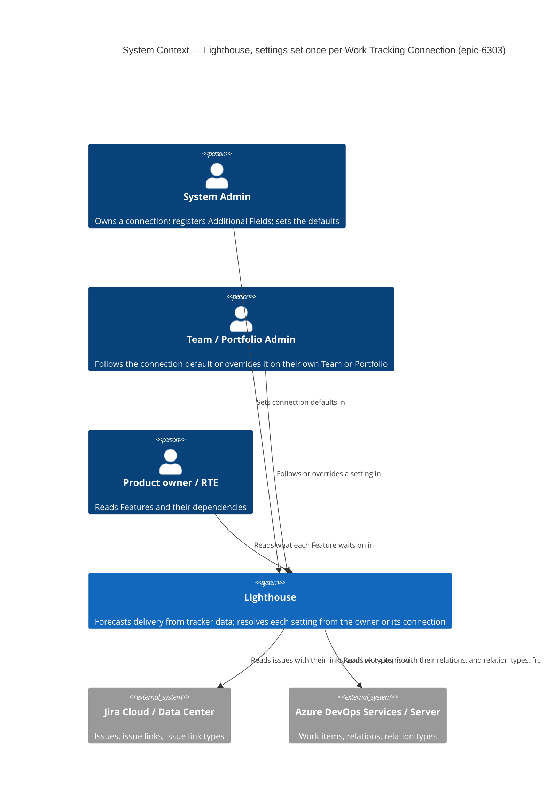
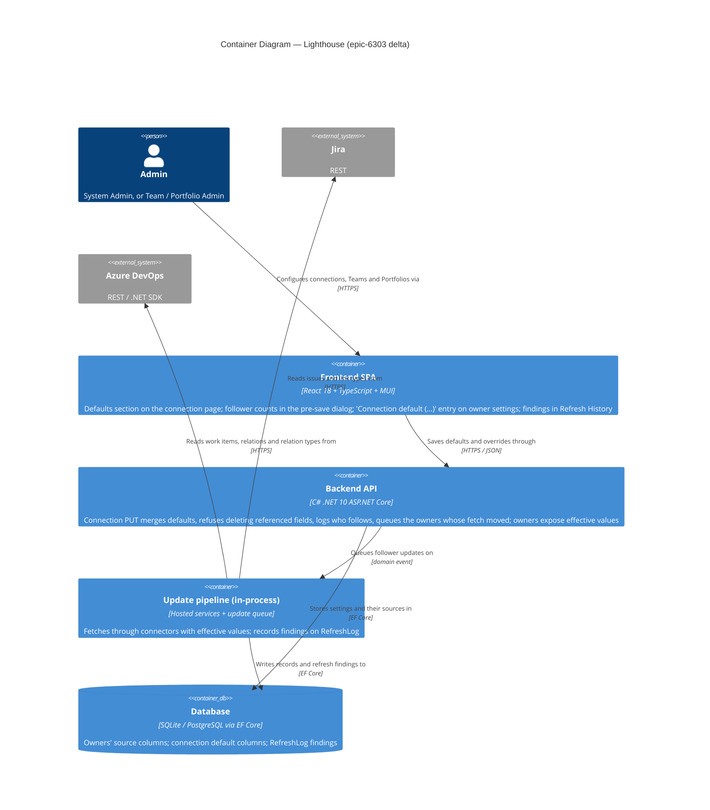
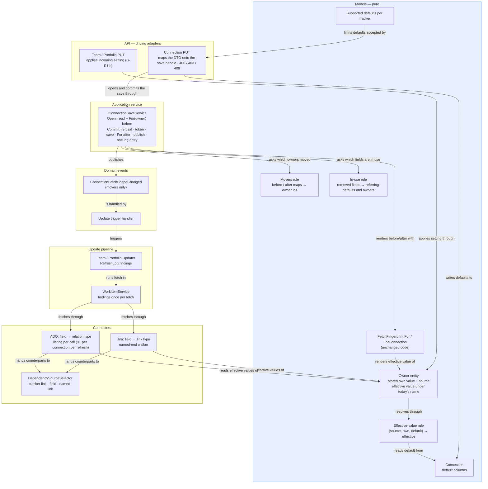

# Feature Delta — epic-6303-configure-once-per-connection

**Feature**: Configure once per Work Tracking Connection. Settings that point at a connection's own Additional
Fields, and are in practice the same for every Team and Portfolio on it, are set once on the connection and
followed, with a per-owner override. The Portfolio's Dependency Field may name a link type as well as a field.
**ADO**: Epic #6303 (reported by Steve Pereira — a credited community contributor, named in release notes —
follow-up to Epic #6028). Four Stories, all in Next, in this order, each shipping on its own and each later one
building only on finished earlier ones (D19):

| ADO Story | Title | Slices | Est. |
|---|---|---|---|
| #6300 | Read dependencies from a configurable Jira link type | 01, 02 | ~1.5d |
| #6312 | Read dependencies from a configurable Azure DevOps relation type | 03, 04 | ~1.5d |
| #6304 | Work Tracking Connection defaults that Teams and Portfolios inherit and can override (the mechanism + the Teams' Parent Override Field) | 05a, 05b, 06 (07 dropped, UI-4) | ~2d |
| #6313 | More Team and Portfolio settings set once on the Work Tracking Connection | 08, 09, 10, 11, 12 | ~3d (ADO says ~2.5d; see Scope Assessment) |

**Feature type**: cross-cutting (Jira and Azure DevOps connectors, configuration aggregates, settings UI, sync
fingerprint).
**Waves present**: DISCUSS, DESIGN, DEVOPS and DISTILL. DISCOVER and DIVERGE skipped by explicit maintainer
decision.
**State of `main` read**: `897950cb9` (2026-10-16). DISCUSS ran in three passes (draft, the maintainer's decisions,
the Story regrouping and the product-owner review); its Definition of Ready is READY after DESIGN (see Definition
of Ready).

---

## Wave: DISCUSS / [REF] Prior Wave Consultation

```
⊘ DISCOVER artifacts         (skipped by maintainer decision)
⊘ DIVERGE artifacts          (skipped by maintainer decision)
✓ docs/product/jobs.yaml
✓ docs/product/personas/config-admin.yaml
✓ docs/product/journeys/parent-from-issue-links.yaml       (D1-D7)
✓ docs/product/journeys/epic-4365-dependencies.yaml        (D4, D15)
✓ docs/product/journeys/story-6307-connection-field-change-takes-effect.yaml
✓ docs/product/architecture/adr-193-parent-source-is-a-declared-connector-capability.md
⊘ docs/product/architecture/brief.md                       (too large for the search tooling; ADR-193 read instead)
✓ docs/feature/parent-from-issue-links/feature-delta.md    (DISCUSS; structure copied)
✓ docs/feature/story-6307-refresh-on-additional-fields-change/feature-delta.md
✓ docs/feature/story-6301-only-features-as-parent-candidates/feature-delta.md (house checklist; Refresh History)
✓ docs/ci-learnings.md
✓ /storage/repos/lighthouse-clients (client, cli, mcp-core)
✓ /storage/repos/website (checked; see the DISCUSS checklist)
✓ Lighthouse.Backend/…/Seeding/TerminologySeeder.cs        (no seeded term for the level above a Feature)
```

---

## Wave: DISCUSS / [REF] Persona IDs

| Persona | Role here |
|---|---|
| `config-admin` (as System Admin) | **Primary.** Owns the connection; registers the link as an Additional Field; sets defaults once; knows, before saving, how many follow; finds their names in the log. |
| `config-admin` (as Team / Portfolio admin) | **Primary, second hat.** Has `TeamWrite` / `PortfolioWrite`, often not `SystemAdmin`. Picks the Dependency Field; sees what the owner follows and from where; overrides where it really differs. |
| `product-owner`, `delivery-lead-rte` | Read the consequence of #6300 / #6312 in Features → Dependencies. Never open the settings. |

---

## Wave: DISCUSS / [REF] JTBD One-Liners

All three new jobs are in `docs/product/jobs.yaml` (2026-10-16).

- **`job-config-admin-name-the-link-our-dependencies-live-in`** (NEW; #6300, #6312) — When our teams record that
  one Feature waits on another with a link type other than the one Lighthouse reads by default, I want to tell
  Lighthouse which link that is, in the place I already name our dependency field, so Features → Dependencies
  shows the waits we already maintain.
- **`job-po-see-what-a-feature-is-waiting-on`** (existing) — the consequence of #6300 / #6312.
- **`job-config-admin-set-a-connection-setting-once`** (NEW; #6304, #6313) — When every Team and Portfolio on one
  connection reads the same field for the same purpose, I want to set it once on the connection and have each
  follow it unless I say otherwise, so adding a Team is not a checklist.
- **`job-config-admin-see-which-owners-differ-from-the-connection`** (NEW; **deferred** — slice 07 dropped, UI-4) —
  When a forecast on one Team looks off, I want to see who follows the connection's setting and who carries its own,
  so I find the odd one out without opening each of them. What this feature now gives instead: the admin knows,
  before saving, how many follow; finds their names in the log.

Journeys: `docs/product/journeys/epic-6303-configure-once-per-connection.yaml` (new);
`epic-4365-dependencies.yaml` D4 and `parent-from-issue-links.yaml` D7 carry REVISION notes.

---

## Wave: DISCUSS / [REF] Current-State Surface Inventory

Read on 2026-10-16 at `897950cb9`. Paths relative to `Lighthouse.Backend/Lighthouse.Backend/` and
`Lighthouse.Frontend/src/`.

### Dependencies today (#6300, #6312)

| # | Surface | What is actually there |
|---|---|---|
| S1 | `…/Jira/IssueExtensions.cs:13` | `BlockedByLinkName = "is blocked by"` — the only Jira dependency link. |
| S2 | `…/Jira/IssueExtensions.cs:66-85` | `ExtractDependencyReferences` keeps links whose inward phrase equals the const and takes the `inwardIssue` key — one end only, so no wait is recorded twice. |
| S3 | `…/AzureDevOps/WorkItemExtensions.cs:8`, `:54-78` | ADO: `relation.Rel == "System.LinkTypes.Dependency-Reverse"` (Predecessor), matched on the reference name because the display word is localised and renameable. The default when nothing is named — unchanged. |
| S4 | `…/Dependencies/DependencySourceSelector.cs:30-50`, `:60` | The shared dependency source selection: no Dependency Field → tracker link; a field → split its value and **replace** link reading (epic-4365 D15). Linear and CSV opt out via `TheTrackersOwnLinksOnly`. |
| S5 | `Models/Portfolio.cs:21-27`; `components/Common/ProjectSettings/Advanced/DependenciesComponent.tsx:20-21` | Dependency Field and Ignore Dependencies are Portfolio only; Features are fetched per Portfolio. |
| S6 | `…/Jira/JiraWorkTrackingConnector.cs:1725-1736` | **The silent trap, Jira only today.** A reference that resolved to a link type stores `""` (`:1733`). The Dependency Field dropdown lists every Additional Field (`DependenciesComponent.tsx:42-45`), so a Jira link-type field (registered for 6028's parent override) is selectable, reads `""`, and replaces `is blocked by` — zero dependencies. On ADO it cannot happen today: references resolve against fields alone (S11). Linear and CSV never read it (S4). Slice 03 makes ADO link-type references possible and, until slice 04 reads them, warns instead of staying silent (AC-3.9). |
| S7 | `…/Jira/JiraWorkTrackingConnector.cs:1275-1309`, `:1282` | The "none of your links is called `is blocked by`, here is what I saw" warning is switched off as soon as a Dependency Field is set — silent twice over. |
| S8 | `…/Jira/JiraWorkTrackingConnector.cs:1993-2019`, `:2058-2070`; `IssueExtensions.cs:106-120`, `:190-212` | Epic 6028's Jira resolver: field first, then link type by name / inward / outward phrase, case-insensitive; the **typed phrase sets direction**; a type name or a phrase both ends share yields `Both`. This is how Parent Override Field resolves on Jira. |
| S9 | `…/Jira/JiraWorkTrackingConnector.cs:426`, `:1738-1739` | Validate resolves references against `rest/api/latest/issueLinkType`; refresh asks only about references an admin typed. `issuelinks` already arrives with `*all` — no extra fetch request. |
| S9a | `docs/settings/systeminfo.md`; Story 6301 | **Refresh History** (Settings → System Info) is the existing surface where a refresh's per-owner findings are shown to an admin, not only logged (6301's placed / not-placed counts). |

### Azure DevOps reference resolution today (#6312)

| # | Surface | What is actually there |
|---|---|---|
| S10 | `…/AzureDevOps/AzureDevOpsWorkTrackingConnector.cs:1241-1252` | **Parent Override Field on ADO reads only a field value** (`GetParentReference`); an empty value falls back to the native parent. There is no ADO link-type path to reuse — only the field-first lookup shape. |
| S11 | `…/AzureDevOps/AzureDevOpsWorkTrackingConnector.cs:690-698`, `:714-736` | Validation and refresh resolve every Additional Field reference against the organisation's **field list** (`GetWorkItemFieldsAsync`, by reference name or display name). An unresolved reference fails Validate, and at refresh maps to `""` with a warning on every refresh (`:727-729`). |
| S12 | `Services/Interfaces/WorkTrackingConnectors/IWorkTrackingConnector.cs` | ADR-193 §1's link-type port was never added. No relation-type lookup exists anywhere in the backend. |
| S13 | `…/AzureDevOps/AzureDevOpsWorkTrackingConnector.cs:1159-1182` | Relations are fetched with `WorkItemExpand.Relations`: **every** relation type already arrives. Reading a different `Rel` costs no request. |
| S14 | `…/AzureDevOps/AzureDevOpsWorkTrackingConnector.cs:1142-1145`, `:648-649` | **Trap, in scope.** The relations fetch is skipped when a Parent Override is set and dependencies "do not come from relations" (`ReadsTheTrackersOwnLink`, i.e. "no Dependency Field"). A Dependency Field that resolves to a link type must count as coming from relations — slice 04. |

### Settings that are per connection in practice (#6304, #6313)

| # | Setting | Where | Grain | Read when | In fetch fingerprint |
|---|---|---|---|---|---|
| C1 | Parent Override Field | `Models/WorkTrackingSystemOptionsOwner.cs:76`; `pages/Common/AdvancedInputs/AdvancedInputs.tsx:28-52` | Team and Portfolio (separate defaults) | fetch | yes (`FetchFingerprint.cs:47`, `:91`) |
| C2 | Dependency Field | `Portfolio.cs:25`; `DependenciesComponent.tsx:33-49` | Portfolio | fetch | yes (`:52`, `:94`) |
| C3 | Size Estimate Field | `Portfolio.cs:23`; `FeatureSizeComponent.tsx:178`; read `JiraWorkTrackingConnector.cs:1311-1316`, `AzureDevOpsWorkTrackingConnector.cs:1207-1218` | Portfolio | fetch | yes (`:51`, `:93`) |
| C4 | Feature Owner Field | `Portfolio.cs:21`; `OwnershipComponent.tsx:34-48`; read `JiraWorkTrackingConnector.cs:1245-1250`, `AzureDevOpsWorkTrackingConnector.cs:1200-1205` | Portfolio | fetch | yes (`:50`, `:92`) |
| C5 | Estimation: field, unit, non-numeric flag, categories | `WorkTrackingSystemOptionsOwner.cs:68-74`; `EstimationFieldComponent.tsx` at `ModifyTeamSettings.tsx:293`, `ModifyProjectSettings.tsx:301` | Team and Portfolio | **read time** (`EstimateNormalizer.cs:71-90`) | **no** — takes effect without an update |
| — | States, work item types, state mappings, cutoff; blocked rules, wait states | `WorkTrackingSystemOptionsOwner.cs` | Team and Portfolio | fetch / read | out of scope |

C1–C5 are foreign keys to an `AdditionalFieldDefinition`, which belongs to exactly one connection.

### Which connection types honour which setting (m7)

Searched `Services/Implementation/WorkTrackingConnectors/{Linear,Csv,ServiceNow}` for reads of C1–C4 and of
Additional Field values. The defaults group (D21) offers exactly the settings a tracker honours today.

| Connection | C1 Parent Override | C2 Dependency Field | C3 Size Estimate | C4 Feature Owner | C5 Estimation |
|---|---|---|---|---|---|
| Jira (Cloud, DC) | ✓ | ✓ | ✓ | ✓ | ✓ |
| Azure DevOps | ✓ | ✓ | ✓ | ✓ | ✓ |
| CSV | N/A — never consulted (6028 S4; no read in the CSV connector) | N/A — dependencies are a column; opts out (S4) | N/A — no read in the CSV connector | ✓ — the extrapolation reads the Feature Owner Field from the Additional Field values CSV fills (`WorkItemService.cs:756-772`); the owning Team shown on a Feature stays Jira / ADO only (P-14) | ✓ — CSV reads Additional Field values (`CsvWorkTrackingConnector.cs:244-254`), and estimation reads them at page load |
| Linear | N/A — no read in the Linear connector | N/A — one relation type; opts out (S4) | N/A | N/A | N/A — the Linear connector reads no Additional Field values, so there is nothing to point at |
| ServiceNow | N/A — no Portfolio fetch, no Additional Field values read (`ServiceNowWorkTrackingConnector.cs:758-775`; verified at DESIGN) | N/A | N/A | N/A | N/A |

So the group shows five settings on Jira and Azure DevOps, Feature Owner and Estimation on CSV, nothing on Linear or
ServiceNow (the group is hidden).

### Connection, refresh, permissions, clients

| # | Surface | What is actually there |
|---|---|---|
| S15 | `Models/WorkTrackingSystemConnection.cs` | No setting addressed to the Teams and Portfolios on it. |
| S16 | `components/Common/Connection/ModifyConnectionSettings.tsx:793-818` | Additional Fields editor, Write-Back mappings, Options — where a "Defaults for Teams and Portfolios" group goes. |
| S17 | `Services/Implementation/WorkItems/FetchFingerprint.cs:24-30`, `:78-98`, `:112-116` | Renders the owner's **own** ids. Following a default must render the **effective** value; with no default yet, an inheriting owner's effective value is `null`, which renders exactly as today — so every stored fingerprint survives the upgrade. |
| S18 | `API/WorkTrackingSystemConnectionController.cs:92`, `:157-193` | Story 6307: a connection save that moves `ForConnection` publishes `ConnectionFetchShapeChanged` for every owner; `ConnectionFetchShapeChangedUpdateTriggerHandler` queues them. |
| S19 | `API/TeamController.cs:186-190` | `WorkItemRelatedSettingsChanged` decides whether stored work items are discarded at save — must read the effective value too. |
| S20 | RBAC | Connection PUT `SystemAdmin` (`WorkTrackingSystemConnectionController.cs:81`); Team PUT `TeamWrite` (`TeamController.cs:123`); Portfolio PUT `PortfolioWrite` (`PortfolioController.cs:94`). |
| S21 | `hooks/useModifySettings.ts:60-70` | `null` on these ids means None today — following must not reuse `null`. |
| S22 | `components/Common/FormSelectField/FormSelectField.tsx` | Dropdown with `allowNone` / `noneLabel`; "Connection default (value)" is one more option. |
| S23 | `/storage/repos/lighthouse-clients/packages/client/src/index.ts:2303-2390`, `:2494-2510`; `packages/cli/src/index.ts:1863`, `:2003`; `packages/mcp-core/src/index.ts:2565` | Payloads pass through untyped (`LighthouseWritePayload`); `team update` / `portfolio update` send a caller-supplied payload. MCP reads Team settings only for cycle-time names. No client names C1–C5. |

---

## Wave: DISCUSS / [REF] Locked Decisions

Maintainer decisions of 2026-10-16 (OD-n refers to pass 1's open decision), plus what code and house rules force.

### Dependencies (#6300, #6312)

- **D1 — One setting: the Dependency Field accepts any Additional Field, resolved per tracker as Parent Override
  is on Jira (OD-1 A, maintainer amendment).** If it resolves to a link type, dependencies are read from those
  links; otherwise the field's value is read as the referenced item(s), exactly as today. Field lookup runs first
  and wins on a collision. No new control, no migration.
  - **Jira** (#6300): link type by type name or inward / outward phrase (S8).
  - **Azure DevOps** (#6312): a relation type **reference name with its end** (`System.LinkTypes.Dependency-Forward`,
    `Contoso.DependsOn-Reverse`), checked against the organisation's relation types at Validate and matched
    against the relations that already arrive with the fetch (S13). Display names are not matched (S3).
- **D2 — One-way only (OD-2 A).** The named end sets the direction. A Jira type name or a phrase both ends share,
  an ADO reference name without its end, or a non-directional ADO relation type (`System.LinkTypes.Related`, CA-6)
  reads no dependencies and warns once per refresh naming both phrases / ends, or that the type has no direction.
- **D3 — One link type, replacing the default (OD-3 A, OD-4 A).** The epic-4365 D15 posture is kept.
- **D4 — Portfolio only (OD-5).** Features, and so dependencies, are fetched per Portfolio (S5).
- **D5 — No match warns, never falls back (OD-7 A).** No dependencies, and one warning per refresh naming what was
  looked for and the link phrases (Jira) or `Rel` values (ADO) seen.
- **D5a — Findings surface: Refresh History (B2).** The D2 / D5 warnings, and slice 03's "not read yet" warning,
  appear on the Portfolio's row in **Refresh History** (Settings → System Info), the existing surface Story 6301
  uses; detail also goes to the log as one aggregated line. The shape within the row (a message, a count) is
  DESIGN's, the surface is fixed here.
- **D6 — Azure DevOps is its own Story, #6312 (maintainer).** Two slices: 03 validation, 04 read. The S14 trap
  is closed in slice 04.

### Connection defaults (#6304, #6313)

- **D7 — Five settings follow a connection default, one slice each (OD-8, changed).** #6304 builds the mechanism
  with the Teams' Parent Override Field (C1); #6313 adds the Portfolios' Parent Override Field, Dependency Field
  (C2), Size Estimate Field (C3), Feature Owner Field (C4) and Estimation (C5). States, types and state mappings
  stay out.
- **D8 — Parent Override has separate defaults for Teams and for Portfolios (OD-9 B).** They name different links
  (6028 D7).
- **D9 — Mode beside value (OD-11 A).** Each inheritable setting on an owner stores *Connection default* or *Own*;
  *Own* with nothing selected is a deliberate None. `null` keeps meaning None (S21).
- **D10 — At the upgrade, empty becomes *Connection default*; a value naming one of the connection's Additional
  Fields stays *Own*; a value naming a field the connection no longer has is treated as empty and becomes
  *Connection default* (maintainer, DESIGN pass 2).**
  - No default exists on release day. Owners with an empty value read exactly what they read before.
  - Owners whose setting pointed at a deleted field go back to the tracker's own value: its own parent, its default
    dependency link, or no size / owner / estimate. That is a deliberate fix, called out in the release notes. Each
    of them downloads everything once, at its next scheduled update; no update is started by the upgrade itself.
  - Accepted consequence: an owner that was deliberately None follows a default once one is set. D12 makes that
    visible.
- **D11 — New Teams and Portfolios start on *Connection default* (OD-13 A).**
- **D12 — A default save says, before it completes, how many owners follow the changed default; the save records
  them by name in the log.** When at least one Team or Portfolio follows a default that this save sets or changes,
  the connection's save dialog (Story 6307's) opens and says how many Teams and Portfolios follow it; names are not
  shown there. When nobody follows, no dialog appears and the save works as today. After the save the page navigates
  to the Overview as it does today, with no notice. Every save that sets or changes a default writes one log entry
  naming the followers (or saying none follow), readable by a System Admin in Settings → System Info. The updates it
  starts appear in Task Manager → Activity. AC-F below. (Amended at DESIGN pass 2, maintainer 2026-10-16.)
- **D13 — A changed default updates exactly the followers whose fetched data it changes (OD-14 A).** Reuses Story
  6307's event and queue. Estimation queues nothing (read-time).
- **D14 — Permissions unchanged (OD-15).** Defaults `SystemAdmin`; overrides `TeamWrite` / `PortfolioWrite`; the
  followed value's name is carried on the owner's own settings, so an owner admin sees it without connection
  rights. No new permission.
- **D15 — Shown as the first dropdown entry "Connection default (value)" (OD-10 A).** Copy approved (UI-2): helper
  text "Set on the <tracker> connection."; picking any other entry, None included, makes the value *Own*.
- **D16 — Estimation follows as one bundle (OD-16 A).** Field, unit, non-numeric flag and categories together.
- **D17 — A referenced Additional Field cannot be deleted (OD-17 A).** Refused while a default or an owner points
  at it, naming the default and the owners that use it as their own (UI-6). **Lands in slice 05b** (M4).
- **D18 — A PUT without the mode keeps the stored mode (OD-18, amended by G-R1 (b), maintainer 2026-10-16).**
  Unless the payload sends a present, non-empty value that differs from the effective one — then *Own* with that
  value; an empty or absent value changes nothing. Replaces pass 2's "absent mode = *Own*". No client release.
- **D19 — Four Stories in Next, in order #6300 → #6312 → #6304 → #6313 (maintainer, 2026-10-16).** Each ships on
  its own; later ones build only on finished earlier ones. Resolves review finding B5.
- **D20 — Steve Pereira stays named (maintainer, 2026-10-16).** A public, credited community contributor in the
  release notes. Review finding m6 declined.
- **D21 — The defaults group offers only the settings the connection's tracker honours (m7).** Per the table
  above: five on Jira and Azure DevOps, Feature Owner and Estimation on CSV; hidden on Linear and ServiceNow.
- **D22 — Slice 05 splits into 05a and 05b now (M4).** 05a: the mechanism end to end for the Teams' Parent
  Override Field, with the log entry; a changed default saves with no dialog, exactly as today, and the save
  dialog's follower count arrives with slice 06. 05b: D17's delete refusal and the
  older-payload round trip (G-R1 (b)).

### Gates — G-R1 decided, G-07 moot (maintainer, 2026-10-16)

- **G-R1 — What an absent mode means on a PUT. DECIDED: option (b).** A Team / Portfolio PUT without the mode keeps
  the stored mode, unless the payload sends a value for that setting that is **present and non-empty** and differs
  from the effective one; then the owner becomes *Own* with that value. No mode with an empty or absent value
  changes nothing. Option (a) (absent = *Own*) was rejected: it would let a client that drops unknown properties
  silently turn followers into a deliberate None. Amends D18; AC-4.9, AC-4.10; slices 05b and 08.
- **G-07 — Whether slice 07's bulk follow needs a per-owner check. Moot — slice 07 dropped** (maintainer, UI-4).

### Forced by code and house rules

- **L1 — Defaults unchanged for everyone who names nothing.** `is blocked by` on Jira, Predecessor on ADO.
- **L2 — Expand-only migrations** via `CreateMigration`; new columns only, the mode back-filled from whether the
  value is empty (D10). Each slice adds the column its setting needs. #6300 and #6312 need none.
- **L3 — One resolver for the effective value**, read by both connectors, `FetchFingerprint.For` and
  `WorkItemRelatedSettingsChanged` (S17, S19) — so the read and the fingerprint cannot drift.
- **L4 — Linear, CSV, ServiceNow not applicable to #6300 / #6312** (S4; epic-4365 D13).
- **L5 — Lighthouse never authors a link or a dependency** (epic-4365 D4).
- **L6 — Our words, their values.** Configurable terms in copy; there is no seeded term for the level above a
  Feature, so copy says "the item its parent link names". Tracker values (`is blocked by`, `Parent Link`,
  `Epic Link`, `System.LinkTypes.Dependency-Reverse`) stay literal.
- **L7 — Free.** No licence gate (epic-4365 D9, 6028 D5).
- **L8 — Every slice leaves `main` releasable; a Story's release point is its last slice.** A slice may land
  without the next one shipping, and no slice introduces a silent failure (slice 03's AC-3.9 is why).

### The save dialog and the log entry — acceptance criteria (D12; the log entry from slice 05a, the dialog from slice 06; amended after DESIGN and review)

- **AC-F.1** From slice 06 on, when a System Admin saves a connection on which a default was set for the first time
  or changed, and at least one owner follows it, the save dialog shows, before the save completes, how many Teams and Portfolios follow
  it (for example "Update 3 Teams and 0 Portfolios?"). Every owner in *Connection default* mode counts, including
  those that follow because their setting was empty at the upgrade. The same save writes one log entry naming them;
  the log entry is written from slice 05a, before the dialog exists.
- **AC-F.2** The dialog never asks to confirm the default itself. Cancel leaves the connection unsaved, as it does
  today. Whether to start updates is asked only when the save would start any (AC-F.5).
- **AC-F.3** When no owner follows the changed default, no dialog appears and the save works as today; the log entry
  says none follow. When no default changed, no log entry is written, and the dialog appears only if an Additional
  Field changed, as today.
- **AC-F.4** Counts in the dialog and names in the log entry use the configurable Team / Portfolio terms. One dialog
  and one log entry per save, covering every default that changed in it.
- **AC-F.5** From slice 06 on, when a changed default is read at fetch time and has followers, the dialog asks Save
  only or Save and update, with the follower count. That is the same question Story 6307 asks for a field change,
  asked once. When only an Estimation default with followers changed, nothing needs updating and the dialog offers
  only Save ("Change the Estimation default?"); that plain-Save variant needs the Estimation default, so it is built
  in slice 12 on top of slice 06's dialog. Before slice 06 a changed default opens no dialog: the save works exactly
  as today (a dialog appears only for an Additional Field change, as today) and still writes the log entry. No
  dialog copy the maintainer has not approved is ever built, and #6304 releases only after slice 06.
- After the save the page navigates to the Overview as today, with no notice; the updates appear in Task Manager →
  Activity. Copy approved by the maintainer (UI-3); polish allowed in DELIVER without changing meaning.

---

## Wave: DISCUSS / [REF] Scope Assessment

**PASS.** 12 live slices (07 dropped, UI-4), ~8 days, 3 contexts (connectors; configuration aggregates; sync
fingerprint + queue), in four ADO Stories that each ship alone (D19) — which resolves the review's story-size finding
(B5): no Story exceeds ~3 days or 7 scenarios per user story.

| Story | User stories | Slices | Est. |
|---|---|---|---|
| #6300 | US-01, US-02 | 01, 02 | ~1.5d |
| #6312 | US-03 | 03, 04 | ~1.5d |
| #6304 | US-04, US-05 | 05a, 05b, 06 | ~2d |
| #6313 | US-07 … US-11 | 08, 09, 10, 11, 12 | ~3d |

**One estimate mismatch, stated rather than rounded:** the ADO Story #6313 says ~2.5d; the slice briefs sum to
~3d (four half-day settings plus Estimation at ~1d, because its bundle and form are the most UI). Either slice 12
comes in at half a day once 05a's form work is reused, or the ADO estimate moves.

---

## Wave: DISCUSS / [REF] User Stories

### Story #6300 — Read dependencies from a configurable Jira link type

#### US-01 — A Jira Portfolio reads dependencies from the link phrase it names

`job_id: job-config-admin-name-the-link-our-dependencies-live-in` · **ADO Story #6300** · slice 01

**Problem.** Priya Raman administers a Jira Data Center instance for the "Payments Platform" Portfolio. Her teams
record waits with Jira's "Dependency" link (`depends on` / `is depended on by`). Features → Dependencies is empty,
and picking the link as Dependency Field today makes it emptier and quieter (S6, S7).
**Who.** config-admin with Portfolio write rights; Jira DC or Cloud; has registered Additional Fields before.

##### Elevator Pitch
Before: Features → Dependencies is empty for every Feature in "Payments Platform", although PAY-112 `depends on`
PAY-98 in Jira; picking a "Depends on" Additional Field as Dependency Field changes nothing and says nothing.
After: in **Portfolio settings → Dependency Settings → Dependency Field** pick the Additional Field whose Reference
is `depends on`, save, let the update finish, open **Features → Dependencies** → sees PAY-112 waiting on PAY-98.
Decision enabled: whether the Portfolio's view of what each Feature waits on can be trusted in planning, or
whether Ignore Dependencies is the honest setting for now.

**Domain examples**
1. Priya names `depends on`; PAY-112 carries an outward `depends on` link to PAY-98 → PAY-112 waits on PAY-98;
   PAY-98 waits on nothing.
2. Kenji Watanabe's instance renamed Blocks' inward phrase to `waits for`; PAY-140 `waits for` PAY-77. He names
   `Waits For` → **PAY-140 waits on PAY-77**, and PAY-77 waits on nothing — the same result `is blocked by` gives
   on a stock instance.
3. Ana Souza names `Dependency` (the type name) → no dependencies, and the warning names `depends on` and
   `is depended on by`.
4. Lukas Brandt's Dependency Field names the ordinary text field "Blocked By Keys" → its value is split and read
   exactly as today.

**UAT scenarios**
```gherkin
Scenario: A Feature waits on what its named one-way link points at
  Given the "Payments Platform" Portfolio names "depends on" as its Dependency Field
  And PAY-112 "depends on" PAY-98 in Jira
  When the Portfolio's update finishes
  Then Features → Dependencies shows PAY-112 waiting on PAY-98
  And PAY-98 shows no dependency

Scenario: The other end's phrase reads the other direction
  Given the Portfolio names "is depended on by"
  When the update finishes
  Then PAY-98 is shown waiting on PAY-112

Scenario: A field that is not a link type is read as before
  Given the "Card Issuing" Portfolio names the field "Blocked By Keys"
  When its update finishes
  Then its dependencies are the keys in that field, exactly as before this change

Scenario: A name that points both ways reads nothing and says why
  Given the Portfolio names "Dependency", the type's name
  When the update finishes
  Then no dependencies are recorded for the Portfolio
  And Refresh History shows one warning naming "depends on" and "is depended on by" to choose from
```

**Acceptance criteria**
- [ ] AC-1.1 A Portfolio naming a Jira link phrase shows, after its update, each Feature waiting on the issue its
  link of that type points at from the named end.
- [ ] AC-1.2 Matching is case-insensitive on name, inward and outward phrase; a real field with the same name is
  read as a field.
- [ ] AC-1.3 A type name or a shared phrase records no dependency; Refresh History shows one warning per refresh
  naming both phrases.
- [ ] AC-1.4 Naming a link replaces `is blocked by` for that Portfolio.
- [ ] AC-1.5 No Dependency Field, or one naming an ordinary field, behaves exactly as today.
- [ ] AC-1.6 Naming a link costs the admin nothing extra: a Portfolio's update with a named link puts no more load
  on the Jira instance, and takes no longer, than the same update naming nothing.
- [ ] AC-1.7 (production data) On the dev instance's slice-01 Portfolio, `OUT-6303-dependencies-recovered` meets
  its target; numbers in the slice brief.

**Technical notes** — reuse `JiraIssueLinkType.DirectionReadFrom` and the `IssueExtensions` link walker; the choice
stays in `DependencySourceSelector` (S4), which gains "a link type the Portfolio named" as a source so no tracker
decides alone. `issuelinks` already arrives with `*all` (S9), so AC-1.6 is asserted as a Jira request count equal
to the pre-change baseline. Brief: `slices/slice-01-6300-jira-dependencies-from-a-named-link-phrase.md`.

**Release point (m3).** Slice 01 alone leaves `main` releasable but is **not** #6300's release point: until slice 02
ships, a mistyped phrase reads nothing and says nothing, which is the S6/S7 failure this Story exists to end. #6300
releases after slice 02.

---

#### US-02 — A named link that matched nothing says so (Jira)

`job_id: job-config-admin-name-the-link-our-dependencies-live-in` · **ADO Story #6300** · slice 02

**Who.** The same config-admin as US-01, setting up the Dependency Field and checking that it took.

##### Elevator Pitch
Before: Priya names `depends on`, the update finishes, Dependencies is empty, and nothing says whether the phrase
was wrong or there are no such links (S7).
After: open **Settings → System Info → Refresh History**, the row for Payments Platform's latest update → sees that
no Feature in Payments Platform has a `depends on` link, and that `is blocked by` and `relates to` were seen.
Decision enabled: retype the phrase, or accept that this Portfolio records no such waits.

**Domain examples** — 1. `depends on` named, Features carry only `relates to` → one warning listing it. 2. PAY-112
`depends on` PAY-98 → no warning. 3. No Feature in "Card Issuing" carries any link → no warning (ordinary, as today).

**UAT scenarios**
```gherkin
Scenario: Nothing matched the named link, and other links exist
  Given the Portfolio names "depends on" and its Features carry only "relates to" links
  When the update finishes
  Then Refresh History shows one warning naming "depends on" and listing "relates to" as seen

Scenario: Something matched
  Given PAY-112 "depends on" PAY-98
  When the update finishes
  Then Refresh History shows no such warning

Scenario: No links at all
  Given no Feature in the Portfolio carries any link
  When the update finishes
  Then Refresh History shows no such warning
```

**Acceptance criteria**
- [ ] AC-2.1 One warning per refresh of the whole query, never one per Feature.
- [ ] AC-2.2 It appears on the Portfolio's row in Refresh History (D5a), and in the log as one line. Approved copy
  (UI-6): "The Dependency Field names "depends on", and no Feature carries that link. Links seen: is blocked by,
  relates to."; for a two-way name: "The Dependency Field names "Blocks", which points both ways. Name one end:
  "blocks" or "is blocked by"."
- [ ] AC-2.3 A Dependency Field naming an ordinary field stays silent, as today.
- [ ] AC-2.4 Docs: `docs/portfolios/edit.md` and `docs/concepts/worktrackingsystems/jira.md` describe naming a link;
  Linear and CSV are stated as not configurable.

**Technical notes** — generalise `ReportLinksThatMeantNothingHere` (`JiraWorkTrackingConnector.cs:1275-1309`) and lift
its early return at `:1282` for a link-type Dependency Field (S7); the expected name is the named phrase, else
`is blocked by`. The finding reaches Refresh History through the per-owner refresh findings Story 6301 added (S9a,
D5a). Whole-query fetch only, as today. Brief: `slices/slice-02-6300-a-named-link-that-matched-nothing-says-so.md`.

---

### Story #6312 — Read dependencies from a configurable Azure DevOps relation type

#### US-03 — An Azure DevOps Portfolio reads dependencies from the relation type it names

`job_id: job-config-admin-name-the-link-our-dependencies-live-in` · **ADO Story #6312** · slices 03, 04

**Problem.** Tomás Ortega runs Lighthouse against Azure DevOps Server 2022, where the PMO records waits with a
custom relation type `Contoso.DependsOn`. Lighthouse reads Predecessor only, so his Features show no dependencies;
an Additional Field referencing the relation type fails Validate as a missing field (S11).
**Who.** config-admin on an ADO connection (Services or Server), Portfolio write rights.

##### Elevator Pitch
Before: adding an Additional Field with Reference `Contoso.DependsOn-Forward` makes **Validate** report
"Some additional fields could not be found", so there is no way to name it.
After: in **Settings → Connections → Additional Fields** add Reference `Contoso.DependsOn-Forward`, press
**Validate** → sees the connection validate; pick it as the Portfolio's **Dependency Field**, let the update finish
→ **Features → Dependencies** shows 4711 waiting on 4702.
Decision enabled: which relation type in their process really carries "waits on", checked against the tracker
before any plan relies on it.

**Domain examples**
1. `Contoso.DependsOn-Forward` on 4711 pointing at 4702 → 4711 waits on 4702.
2. `System.LinkTypes.Related` named by a Services team that records waits as Related → no dependencies, and the
   warning says Related has no direction, so it cannot say who waits on whom.
2b. `System.LinkTypes.Dependency-Forward` (Successor) named → each Feature waits on its successors, the reverse of the
   default.
3. `Contoso.DependsOn` without an end → no dependencies; the warning names `-Forward` and `-Reverse`.
4. `Contoso.DependsOnn-Forward` (typo) → Validate names it as not found and lists the organisation's relation types.
5. The Portfolio also names a Parent Override Field → 4711 is still shown waiting on 4702.

**UAT scenarios**
```gherkin
Scenario: A relation type reference validates where a field name goes
  Given an Azure DevOps connection with an Additional Field referencing "Contoso.DependsOn-Forward"
  When the admin validates the connection
  Then the connection validates successfully

Scenario: A typo still fails and names what exists
  Given an Additional Field referencing "Contoso.DependsOnn-Forward"
  When the admin validates the connection
  Then validation names the reference as not found and lists the organisation's relation types

Scenario: A Feature waits on what its named relation end points at
  Given the "Retail Rollout" Portfolio names "Contoso.DependsOn-Forward" as its Dependency Field
  And work item 4711 has that relation to 4702
  When the update finishes
  Then Features → Dependencies shows 4711 waiting on 4702

Scenario: Naming a parent override does not hide a named relation
  Given the Portfolio also names a Parent Override Field
  When the update finishes
  Then 4711 is still shown waiting on 4702

Scenario: A reference without its end reads nothing and says why
  Given the Portfolio names "Contoso.DependsOn"
  When the update finishes
  Then no dependencies are recorded and Refresh History shows one warning naming the Forward and Reverse ends
```

**Acceptance criteria**
- [ ] AC-3.1 Validate accepts a reference matching a relation type reference name with its `-Forward` /
  `-Reverse` end, case-insensitively; a real field of the same name is read as a field.
- [ ] AC-3.2 An unmatched reference still fails Validate, listing the relation types available.
- [ ] AC-3.3 After a refresh, neither the log nor Refresh History reports a relation-type reference as "no field is
  called …".
- [ ] AC-3.4 A Portfolio naming a relation end shows, after its update, each Feature waiting on the work item at
  the other end of its relations of exactly that end; it replaces Predecessor for that Portfolio.
- [ ] AC-3.5 That holds when the Portfolio also names a Parent Override Field.
- [ ] AC-3.6 A reference without an end, or a non-directional relation type such as `System.LinkTypes.Related`,
  reads nothing and warns (for Related: that it has no direction); nothing matching anywhere warns once, listing the
  relation types seen — both on Refresh History (D2, CA-6).
- [ ] AC-3.7 Naming a relation type costs the admin nothing extra: Validate and a Portfolio's update put no more
  load on the Azure DevOps organisation than before, beyond one look-up of its relation types per connection, and
  a Portfolio with many Features takes no longer to update than the same Portfolio naming nothing.
- [ ] AC-3.8 Docs: `docs/concepts/worktrackingsystems/azuredevops.md` (:101-114, :203-207).
- [ ] AC-3.9 (slice 03 alone, M3) Until slice 04 ships, a Dependency Field that resolves to a relation type reads no
  dependencies **and** Refresh History shows one warning per refresh that the relation type is not yet read for
  dependencies. Chosen over refusing it, because refusing would need a tracker round trip in the Portfolio save
  path that does not exist, while the warning reuses slice 02's surface; slice 04 replaces the warning by reading.
  *Amended in DELIVER:* the interim finding is log-only. It is stored on the refresh row and written as a warning,
  but the Refresh History screen has no sentence for it and shows nothing. That is safe because slices 03 and 04
  ship together: 03's commits stay local and are pushed only after 04's, so `main` is never released in between.
- [ ] AC-3.10 A relation-type Additional Field named by any setting other than the Dependency Field (Parent
  Override, Size Estimate, Feature Owner, Estimation) is never silent: the setting reads as if nothing were
  named (for Parent Override the native parent stands), and Refresh History shows, for the owner, one warning per
  refresh naming the setting and the relation type, saying a relation type cannot be read there (approved copy, UI-6:
  "The Parent Override Field points at an Azure DevOps relation type, which only the Dependency Field reads."). ADO parent from a
  relation stays out of scope.

**Technical notes** — new relation-type lookup (S12); the SDK's relation-types call is the candidate, confirmed at
DESIGN; ADR-193 §1's unbuilt port is a natural home. `ExtractDependencyReferences` takes the `Rel` to match. The S14
early return must treat a link-type Dependency Field as "from relations". Relations already arrive (S13), so AC-3.7
is asserted as a request count against the pre-change baseline: at most one relation-type listing per connection
per Validate and per refresh, and no request per work item. AC-3.10's warning uses the same Refresh History path
as AC-3.9 (D5a).

**Release point.** #6312 releases after slice 04; slice 03 alone is safe by AC-3.9.

---

### Story #6304 — Connection defaults that Teams and Portfolios inherit and can override

#### US-04 — Set the Teams' Parent Override Field once on the connection

`job_id: job-config-admin-set-a-connection-setting-once` · **ADO Story #6304** · slices 05a, 05b

**Problem.** The reported installation runs 14 Teams on one Jira DC connection, each reading its parent from the
`is caused by` link. Each new Team is another chance to forget the Parent Override Field; a forgotten one shows
every Work Item unparented with nothing pointing at the cause.
**Who.** config-admin as System Admin (sets the default) and as Team admin (follows or overrides).

##### Elevator Pitch
Before: the Parent Override Field is set Team by Team; "Fraud Signals" was created without it and its Work Items
hang under no Feature.
After: in **Settings → Connections → (connection) → Defaults for Teams and Portfolios** set **Parent Override
Field for Teams** to "Caused by", save (no dialog in slice 05a; from slice 06 the dialog first says 3 Teams follow
it, US-05) → **Team settings → Advanced** on Fraud Signals shows "Connection default (Caused by)", and **Settings →
System Info → Logs** names Fraud Signals, Ops Tooling and Mobile Wallet.
Decision enabled: whether a new Team can be onboarded without the parent checklist — and, from the log entry,
whether a Team that was empty on purpose must be set back to None.

**Domain examples**
1. "Fraud Signals", empty at the upgrade → follows; named in the log entry (and, from slice 06, counted in the save
   dialog).
2. "Ledger", with its own "Caused by" → stays *Own*, unaffected.
3. "Mobile Wallet", empty at the upgrade but meant as None → follows and is named in the log entry; its admin picks
   **None** → *Own* + empty, no longer follows.
4. A Team created afterwards → starts on *Connection default*.
5. Maria tries to remove the "Caused by" Additional Field → refused, naming the default and Ledger, which uses it as
   its own (05b).

**UAT scenarios**
```gherkin
Scenario: Saving the default saves as today, and the log names who follows it
  Given Fraud Signals, Ops Tooling and Mobile Wallet had no Parent Override Field at the upgrade
  And Ledger has "Caused by" as its own value
  When Maria Santos sets Parent Override Field for Teams to "Caused by" and saves the connection
  Then the save completes with no dialog, as today
  And the log entry names Fraud Signals, Ops Tooling and Mobile Wallet and not Ledger

Scenario: A follower reads the default as its own
  Given Fraud Signals follows the connection default "Caused by"
  When its update finishes
  Then its Work Items hang under the Features their "is caused by" links name
  And its settings show "Connection default (Caused by)"

Scenario: A deliberate None stops following
  Given Mobile Wallet follows the default
  When its Team admin picks None and saves
  Then Mobile Wallet reads no parent override, whatever the connection says

Scenario: A new Team starts on the default
  When a Team is created on the connection
  Then it shows "Connection default (Caused by)"

Scenario: The upgrade changes nothing on its own, except settings that pointed at nothing
  Given no connection has a default
  And Ops Tooling's Parent Override Field pointed at an Additional Field that had been deleted
  When the release is installed
  Then every other Team reads exactly what it read before, and its next update is not a full download caused by the upgrade
  And Ops Tooling follows the connection default, reads its parents from the tracker's own parent again, and its next scheduled update downloads everything

Scenario: A field a default points at cannot be removed
  Given the Teams' default is "Caused by" and Ledger uses "Caused by" as its own
  When Maria removes the "Caused by" Additional Field and saves the connection
  Then the save is refused with: "Caused by" cannot be removed. It is the Teams' Parent Override Field default, and Ledger uses it as its own. Nothing was saved.

Scenario: An older client's round trip changes nothing
  Given Mobile Wallet follows the default and Ledger owns "Caused by"
  When a script GETs each Team's settings and PUTs them back unchanged, dropping properties it does not know
  Then no Team's mode or effective Parent Override Field has changed
```

**Acceptance criteria** (05a: AC-4.1 – 4.7 and the log-entry part of AC-F.1 – F.4, with no dialog for a changed
default; 05b: AC-4.8 – 4.10; the dialog part of AC-F arrives with slice 06, US-05)
- [ ] AC-4.1 The connection holds an optional Parent Override default for Teams among its own Additional Fields;
  only a System Admin can set it.
- [ ] AC-4.2 A Team on *Connection default* behaves exactly as if it owned the default: after its update its Work
  Items hang under the Features the default names, and its settings show "Connection default (value)".
- [ ] AC-4.3 A Team with *Own* and nothing selected reads no parent override, whatever the default says.
- [ ] AC-4.4 After the upgrade, Teams that had no Parent Override Field follow the connection default, which is
  empty on release day, so nothing changes for them. Teams that had one own it. No Team reads anything different or
  downloads everything again because of the upgrade, except Teams whose Parent Override Field pointed at an
  Additional Field that had been deleted: those follow the default too, read the tracker's own parent again, and
  download everything once at their next scheduled update.
- [ ] AC-4.5 New Teams start on *Connection default*.
- [ ] AC-4.6 A Team admin without connection rights sees the followed field's name on the Team's settings: the
  dropdown's first entry reads "Connection default (Caused by)" with the helper text "Set on the <tracker>
  connection."; picking any other entry, None included, makes the value the Team's own (UI-2).
- [ ] AC-4.7 The connection page has a "Defaults for Teams and Portfolios" section below Additional Fields, with
  *Teams* and *Portfolios* sub-headings and one row per setting the tracker honours; it is hidden on Linear and
  ServiceNow, and shows no follower count (D21, UI-1).
- [ ] AC-4.8 Removing an Additional Field referenced by a default or by any owner is refused, naming the default and
  the Teams that use it as their own; nothing is saved (D17, UI-6).
- [ ] AC-4.9 When a Team's settings are saved by a client that does not send the mode: if it sends no Parent
  Override Field or an empty one, the Team keeps following or owning exactly as before; if it sends a different
  field, the Team owns that field from then on (G-R1 (b)).
- [ ] AC-4.10 A scripted GET-then-PUT of every Team's settings, unchanged — in the shape that echoes every property
  and in the shape that drops properties it does not know — changes no Team's mode or effective value; both shapes
  pass.

**Technical notes** — expand-only migration: a nullable default FK on the connection; a mode column on Team,
back-filled from emptiness (D10); a value naming a field the connection no longer has becomes *Connection default*
and is cleared (D10 as amended). One resolver (L3) used by both connectors, `FetchFingerprint.For` and
`WorkItemRelatedSettingsChanged`; with no default an empty follower's effective value is `null`, so stored
fingerprints are byte-identical across the upgrade, except for the repaired deleted-field owners. The followed
display name travels on the Team settings DTO. One Information log entry per save names the followers. From slice
06 the save dialog's follower counts come from the connection list read.
PUT without the mode (D18 as amended, G-R1 (b)): keep the stored mode unless the payload's value is present, non-empty
and differs from the effective value, then *Own* with that value. Briefs: `slices/slice-05a-6304-team-parent-override-default.md`,
`slices/slice-05b-6304-referenced-fields-and-older-payloads.md`.

---

#### US-05 — A changed default updates exactly the followers

`job_id: job-config-admin-set-a-connection-setting-once` · **ADO Story #6304** · slice 06

**Who.** config-admin as System Admin, changing a default and wanting to check the result now.

##### Elevator Pitch
Before: (after US-04 alone) a changed default saves with no dialog and reaches each follower at its next scheduled
update, possibly hours later, with nothing on screen saying so.
After: save the connection with "Parent Link" as the new default → the dialog says 9 Teams follow it and will
update; choose **Save and update** → 9 rows in **Task Manager → Activity**.
Decision enabled: check the result now, or come back later.

**Domain examples** — 1. 9 follow, 5 own → the dialog says 9 will update; Save and update → 9 updating. 2. Nobody
follows → no dialog, nothing updating, the log entry says none follow. 3. Estimation default changed (built in slice 12,
on top of this slice's dialog) with 4 followers → the plain dialog "Change the Estimation default?" offers only Save;
nothing updates.

**UAT scenarios**
```gherkin
Scenario: Only the followers are updated
  Given 9 Teams follow the Parent Override default and 5 carry their own
  When the System Admin changes the default and saves with Save and update
  Then the Task Manager shows an update for exactly the 9 followers
  And the save dialog said 9 Teams follow the default

Scenario: Nobody follows
  Given every Team carries its own value
  When the default changes and the System Admin saves
  Then no dialog appears, the save completes as today, no update starts, and the log entry says no Team follows the default

Scenario: Saving without updating
  Given 9 Teams follow the Parent Override default
  When the admin changes the default and chooses Save only
  Then no update starts and the log entry still names the followers
```

**Acceptance criteria**
- [ ] AC-5.1 After Save and update, the Task Manager shows an update for every follower whose fetched data the change
  affects, and for no owner that owns its value.
- [ ] AC-5.2 Save only starts no update.
- [ ] AC-5.3 Before the save, the dialog says how many followers will update — 9 in the first scenario. When nobody
  follows, as in the second scenario, no dialog appears and the save completes as today (AC-F.3). After *Save only*
  none update, and they pick the change up at their next scheduled update (AC-F.5).
- [ ] AC-5.4 This slice brings the save dialog for a changed default, in the maintainer-approved UI-3 form: the
  follower count (AC-F.1) and the update question (AC-F.5). Before it, a changed default saves with no dialog.

**Technical notes** — followers whose `FetchFingerprint.For` moved are queued through `ConnectionFetchShapeChanged`
(S18); `startUpdates=false` is the existing switch.

---

#### ~~US-06 — Owners whose own value equals the default follow it in one step~~ — DROPPED (maintainer, 2026-10-16, UI-4)

**DROPPED.** No who-follows / who-differs list, no bulk follow, no follower count on the connection page; slice 07 is
not delivered. An owner hand-set to the default's value stays *Own*; its admin switches it to *Connection default* on
its own settings page. Its job, `job-config-admin-see-which-owners-differ-from-the-connection`, is deferred in
`jobs.yaml`. The text below is kept, struck, for the record.

~~`job_id: job-config-admin-see-which-owners-differ-from-the-connection` · ADO Story #6304 · slice 07~~

~~**Who.** config-admin as System Admin on a connection configured by hand before the upgrade.~~

~~**Why it still earns its place after D10.** D10 moves only *empty* owners onto the default. An installation already
configured by hand — Steve's customer, whose 14 Teams all carry "Caused by" — keeps every Team on *Own*. Without
this, the default helps only new Teams there, and the next change of the default must still be made on 14 Teams.~~

~~Elevator Pitch. Before: 14 Teams carry "Caused by" as their own value; changing it later means 14 edits. After: on
the connection's Defaults for Teams and Portfolios → sees "Parent Override Field for Teams: Caused by — 3 follow; 11
own the same value; Ledger Ops owns Epic Link" and chooses Follow the default for the 11. Decision enabled: which
Teams genuinely differ, and whether to bring the rest under one setting.~~

~~Domain examples — 1. 11 own-and-equal → offered; moved; nothing updates. 2. Ledger Ops (`Epic Link`) listed, not
offered. 3. An owner edited by another admin meanwhile → named, not overwritten.~~

~~UAT scenarios (dropped): "The connection lists who follows and who differs"; "Matching owners follow in one step
without an update"; "A concurrent edit is not overwritten".~~

~~Acceptance criteria (dropped):~~
- ~~AC-6.1 Per default: the count of followers; own-value owners named with their value; configurable terms.~~
- ~~AC-6.2 Only owners whose own value equals the default are offered; after following, they read exactly what
  they read before and no update starts.~~
- ~~AC-6.3 If another admin changed an owner since the list was loaded, that owner is named as changed by someone
  else and keeps its value; the others follow.~~
- ~~AC-6.4 The list has a loading look and a could-not-load look (defined at DESIGN).~~
- ~~AC-6.5 Each #6313 setting appears in this list when its slice lands, with no new UI.~~
- ~~AC-6.6 The action is offered to every System Admin and to no one else (G-07).~~

---

### Story #6313 — More Team and Portfolio settings set once on the Work Tracking Connection

Each builds on finished #6304 (05a – 06): same resolver, save dialog count and log entry (AC-F.1 – F.5) and update
queue; each adds one default row in the "Defaults for Teams and Portfolios" section (UI-1), one mode column with the
D10 back-fill (as amended: a value pointing at a deleted field becomes *Connection default*), D11 for new owners, the
"Connection default (value)" dropdown entry (UI-2), and the followed name on the owner's settings. Each slice ships
alone, and each AC list includes AC-4.4 at Portfolio grain for its setting.

#### US-07 — Set the Portfolios' Parent Override Field once

`job_id: job-config-admin-set-a-connection-setting-once` · **ADO Story #6313** · slice 08

**Who.** config-admin as System Admin with several Portfolios on one Jira connection, each reading its Features'
parents from the same link; config-admin as Portfolio admin who may own a different one.

##### Elevator Pitch
Before: each of the 4 Portfolios on "Jira DC – Payments" names "Parent Link" in its own Parent Override Field, and a
new Portfolio starts without it, so its Features hang under nothing.
After: in **Defaults for Teams and Portfolios** set **Parent Override Field for Portfolios** to "Parent Link", save →
the dialog says how many follow it; a new Portfolio "Q3 Roadmap" shows "Connection default (Parent Link)" and, after
its update, each Feature hangs under the item its `Parent Link` names.
Decision enabled: whether a new Portfolio needs anything but its query.

**Domain examples**
1. "Q3 Roadmap", created after the default → follows; its Features hang under their `Parent Link` items.
2. "Card Issuing" owns "Initiative Link" → unaffected, stays *Own*.
3. "Merchant Onboarding" had no Parent Override Field at the upgrade → follows, counted in the dialog and named in the
   log entry; the Teams' default does not touch it.

**UAT scenarios**
```gherkin
Scenario: Saving the Portfolios' default counts the Portfolios that follow it
  Given "Merchant Onboarding" had no Parent Override Field at the upgrade and "Card Issuing" owns "Initiative Link"
  When Maria sets Parent Override Field for Portfolios to "Parent Link" and saves
  Then the save dialog counts "Merchant Onboarding" among the followers and the log entry names it, not "Card Issuing"

Scenario: A following Portfolio reads its parents from the default
  Given "Q3 Roadmap" follows "Parent Link"
  When its update finishes
  Then each Feature hangs under the item its "Parent Link" names

Scenario: The Teams' default never reaches a Portfolio
  Given the Teams' default is "Caused by" and no Portfolios' default is set
  When "Merchant Onboarding" updates
  Then it reads no parent override
```

**Acceptance criteria**
- [ ] AC-7.1 Saving the Portfolios' default shows, before the save completes, how many Portfolios follow it, and the
  log entry names them.
- [ ] AC-7.2 A following Portfolio's Features hang under the items the default names, after its update.
- [ ] AC-7.3 The Teams' default never applies to a Portfolio, nor the reverse (D8).
- [ ] AC-7.4 An owning Portfolio is unaffected and no update starts for it.
- [ ] AC-7.5 AC-4.4 at Portfolio grain for the Parent Override Field.

**Technical notes** — C1 at Portfolio grain: a second, separate default FK on the connection (D8) and a Portfolio mode
column with the D10 back-fill as amended (expand-only, L2); the resolver (L3), dialog count, log entry, delete refusal
and queue from #6304 reused; the Portfolio PUT gets the G-R1 (b) rule and AC-4.10's round trip. `AdvancedInputs.tsx:28-52` on
the Portfolio form gains the entry. Jira and ADO only (D21). Brief: `slices/slice-08-6313-portfolio-parent-override-default.md`.

---

#### US-08 — Set the Portfolios' Dependency Field once

`job_id: job-config-admin-set-a-connection-setting-once` · **ADO Story #6313** · slice 09

**Who.** config-admin as System Admin whose Portfolios all record waits the same way — a field or, after
#6300 / #6312, a link.

##### Elevator Pitch
Before: every Portfolio on the connection picks "Depends on" as its Dependency Field one by one, and a new
Portfolio shows an empty Dependencies view until someone remembers.
After: set **Dependency Field for Portfolios** to "Depends on", save → the dialog says how many follow it; after its
update, a follower's **Features → Dependencies** shows PAY-112 waiting on PAY-98.
Decision enabled: whether a new Portfolio forecasts with its dependencies from day one.

**Domain examples**
1. "Payments Platform" had no Dependency Field → follows "Depends on"; PAY-112 waits on PAY-98 after its update.
2. "Card Issuing" owns "Blocked By Keys" → unaffected.
3. "Merchant Onboarding" follows and has Ignore Dependencies switched on → the switch stays its own and still applies.

**UAT scenarios**
```gherkin
Scenario: A following Portfolio reads dependencies from the default
  Given "Payments Platform" follows the Dependency Field default "Depends on"
  When its update finishes
  Then Features → Dependencies shows PAY-112 waiting on PAY-98

Scenario: An owning Portfolio is unaffected
  Given "Card Issuing" owns "Blocked By Keys"
  When the default changes
  Then "Card Issuing" reads "Blocked By Keys" and no update starts for it

Scenario: Ignore Dependencies stays the Portfolio's own
  Given "Merchant Onboarding" follows the default and has Ignore Dependencies on
  When its update finishes
  Then its dependencies are still ignored
```

**Acceptance criteria**
- [ ] AC-8.1 A follower's dependencies after its update are those the default names (field or link, per #6300 /
  #6312).
- [ ] AC-8.2 An owning Portfolio is unaffected and no update starts for it.
- [ ] AC-8.3 Ignore Dependencies is never inherited.
- [ ] AC-8.4 The save dialog counts the followers and the log entry names them (AC-F.1 – F.5).
- [ ] AC-8.5 AC-4.4 at Portfolio grain for the Dependency Field.

**Technical notes** — C2: `Portfolio.cs:25`; `DependencySourceSelector` (S4) reads the effective value from the
resolver (L3), so a followed field or link reads exactly as an owned one; in the fingerprint (`FetchFingerprint.cs:52`,
`:94`). `DependenciesComponent.tsx:33-49` gains the entry; Ignore Dependencies untouched. Jira and ADO only (D21).
Brief: `slices/slice-09-6313-dependency-field-default.md`.

---

#### US-09 — Set the Portfolios' Size Estimate Field once

`job_id: job-config-admin-set-a-connection-setting-once` · **ADO Story #6313** · slice 10

**Who.** config-admin as System Admin whose Portfolios size Features from one estimate field (e.g. "T-Shirt Size").

##### Elevator Pitch
Before: a new Portfolio starts without a Size Estimate Field, so its not-yet-broken-down Features fall back to the
Portfolio default size although the estimate is in the tracker.
After: set **Size Estimate Field for Portfolios** to "T-Shirt Size", save → the dialog says how many follow it; after its update a
follower's not-yet-broken-down Feature PAY-201 shows its estimated size from "T-Shirt Size".
Decision enabled: whether forecasts for early Features rest on the teams' estimate or on one typed default.

**Domain examples**
1. "Q3 Roadmap" follows; PAY-201 estimated 8 in "T-Shirt Size" → its estimated size is 8.
2. "Card Issuing" owns "Story Points Sum" → unaffected.
3. "Merchant Onboarding" follows while "T-Shirt Size" is empty on MO-14 → MO-14 uses the Portfolio default size, as
   an empty own field does today.

**UAT scenarios**
```gherkin
Scenario: A following Portfolio sizes Features from the default field
  Given "Q3 Roadmap" follows "T-Shirt Size" and PAY-201 has 8 in it
  When its update finishes
  Then PAY-201's estimated size is 8

Scenario: An owning Portfolio is unaffected
  Given "Card Issuing" owns "Story Points Sum"
  When the default changes
  Then "Card Issuing" sizes from "Story Points Sum" and no update starts for it

Scenario: An empty value falls back as today
  Given "Merchant Onboarding" follows and MO-14 has no "T-Shirt Size"
  When its update finishes
  Then MO-14 uses the Portfolio's default size
```

**Acceptance criteria**
- [ ] AC-9.1 A follower's Features carry the estimated size the default field holds, after its update.
- [ ] AC-9.2 An owning Portfolio is unaffected and no update starts for it.
- [ ] AC-9.3 An empty value behaves as an empty own field does today.
- [ ] AC-9.4 The save dialog counts the followers and the log entry names them (AC-F.1 – F.5).
- [ ] AC-9.5 AC-4.4 at Portfolio grain for the Size Estimate Field.

**Technical notes** — C3: `Portfolio.cs:23`, read at fetch time (`JiraWorkTrackingConnector.cs:1311-1316`,
`AzureDevOpsWorkTrackingConnector.cs:1207-1218`) through the resolver (L3); in the fingerprint (`FetchFingerprint.cs:51`,
`:93`). `FeatureSizeComponent.tsx:178` gains the entry. Jira and ADO only (D21). Brief:
`slices/slice-10-6313-size-estimate-field-default.md`.

---

#### US-10 — Set the Portfolios' Feature Owner Field once

`job_id: job-config-admin-set-a-connection-setting-once` · **ADO Story #6313** · slice 11

**Who.** config-admin as System Admin whose Portfolios record each Feature's owning Team in one field
(e.g. "Owning Team").

##### Elevator Pitch
Before: each Portfolio names "Owning Team" as its Feature Owner Field separately; on a new Portfolio every Feature
shows no owning Team.
After: set **Feature Owner Field for Portfolios** to "Owning Team", save → the dialog says how many follow it; after its update a
follower's Feature PAY-112 shows "Ledger" as its owning Team.
Decision enabled: which Team to ask about a Feature, without opening the tracker.

**Domain examples**
1. "Payments Platform" follows; PAY-112 has "Ledger" in "Owning Team" → owning Team "Ledger".
2. "Card Issuing" owns "Delivery Team" → unaffected.
3. "Q3 Roadmap" follows; PAY-230 has no value → no owning Team, as an empty own field gives today.

**UAT scenarios**
```gherkin
Scenario: A following Portfolio reads owning Teams from the default field
  Given "Payments Platform" follows "Owning Team" and PAY-112 has "Ledger" in it
  When its update finishes
  Then PAY-112 shows "Ledger" as its owning Team

Scenario: An owning Portfolio is unaffected
  Given "Card Issuing" owns "Delivery Team"
  When the default changes
  Then "Card Issuing" reads "Delivery Team" and no update starts for it

Scenario: An empty value gives no owner
  Given "Q3 Roadmap" follows and PAY-230 has no "Owning Team"
  When its update finishes
  Then PAY-230 shows no owning Team
```

**Acceptance criteria**
- [ ] AC-10.1 A follower's Features show the owning Team the default field holds, after its update.
- [ ] AC-10.2 An owning Portfolio is unaffected and no update starts for it.
- [ ] AC-10.3 An empty value behaves as an empty own field does today.
- [ ] AC-10.4 The save dialog counts the followers and the log entry names them (AC-F.1 – F.5). The Portfolio's own
  Owning Team setting is not inherited.
- [ ] AC-10.5 AC-4.4 at Portfolio grain for the Feature Owner Field.

**Technical notes** — C4: `Portfolio.cs:21`, read at fetch time (`JiraWorkTrackingConnector.cs:1245-1250`,
`AzureDevOpsWorkTrackingConnector.cs:1200-1205`) through the resolver (L3); in the fingerprint (`FetchFingerprint.cs:50`,
`:92`). `OwnershipComponent.tsx:34-48` gains the entry; `OwningTeamId` stays the Portfolio's own. Shown on Jira, Azure
DevOps and CSV connections (D21; on CSV the extrapolation reads the Feature Owner Field from the Additional Field
values CSV fills, `WorkItemService.cs:756-772`). Brief: `slices/slice-11-6313-feature-owner-field-default.md`.

---

#### US-11 — Set the Estimation once

`job_id: job-config-admin-set-a-connection-setting-once` · **ADO Story #6313** · slice 12

**Who.** config-admin as System Admin whose Teams all estimate in Story Points; Team admins with their own scale.

##### Elevator Pitch
Before: Story Points is picked as Estimation Field on each Team and Portfolio, with "Points" typed as unit each time.
After: set **Estimation for Teams** to Story Points / "Points", save → the dialog says how many follow it and that
nothing needs updating; a follower's estimation views use Story Points with "Points" on the next page load.
Decision enabled: whether estimation views can be compared across Teams because they read the same field.

**Domain examples**
1. "Fraud Signals" follows → its estimation chart reads Story Points labelled "Points".
2. "Design Studio" owns T-shirt categories XS–XL → unaffected.
3. The default is cleared → "Fraud Signals" shows no estimation, as an unset own field does today.

**UAT scenarios**
```gherkin
Scenario: A following Team uses the default estimation at once
  Given "Fraud Signals" follows the Estimation default Story Points / "Points"
  When its estimation view is next opened
  Then it reads Story Points labelled "Points", and no update was started

Scenario: An owning Team keeps its scale
  Given "Design Studio" owns T-shirt categories XS to XL
  When the default changes
  Then "Design Studio" keeps its categories

Scenario: Clearing the default
  Given "Fraud Signals" follows
  When the System Admin clears the Estimation default
  Then "Fraud Signals" shows no estimation
```

**Acceptance criteria**
- [ ] AC-11.1 Field, unit, non-numeric flag and categories follow or are owned as one bundle (D16).
- [ ] AC-11.2 A change shows on the next page load and starts no update.
- [ ] AC-11.3 Clearing the default leaves followers with no estimation.
- [ ] AC-11.4 When owners follow it, the save dialog counts the followers and says no update is needed (plain
  Save, "Change the Estimation default?", built in this slice on top of slice 06's dialog); the log entry names them.
- [ ] AC-11.5 On the connection page the Estimation default reuses the owner's Estimation editor inline (field, unit,
  non-numeric flag, and categories when non-numeric), collapsed until a field is chosen, once for Teams and once for
  Portfolios; a following owner's page shows "Connection default (Story Points, Points)" (UI-5).
- [ ] AC-11.6 AC-4.4 at Team and Portfolio grain for the Estimation bundle: an Estimation Field pointing at a deleted
  Additional Field becomes *Connection default* at the upgrade.

**Technical notes** — C5: `WorkTrackingSystemOptionsOwner.cs:68-74`, read at read time by `EstimateNormalizer.cs:71-90`,
not in the fetch fingerprint, so slice 06's queue does nothing by construction (D13). One mode column per owner for
the bundle; defaults per grain (Teams, Portfolios), confirmed at DESIGN. `EstimationFieldComponent.tsx`
(`ModifyTeamSettings.tsx:293`, `ModifyProjectSettings.tsx:301`) is reused inline on the connection page (UI-5).
Offered on Jira, ADO and CSV (D21).
Brief: `slices/slice-12-6313-estimation-default.md`.

---

## Wave: DISCUSS / [REF] Story Map and Slices

**Backbone**: name the link (Jira) → say when it matched nothing → the same on Azure DevOps → set a default once →
reach the followers' data → the next settings. ("Bring hand-configured owners along" was dropped with slice 07, UI-4.)

| Slice | ADO Story | User story | Goal | Est. | Brief |
|---|---|---|---|---|---|
| 01 | #6300 | US-01 | Jira Portfolio reads dependencies from a named one-way phrase | ~1d | `slices/slice-01-6300-jira-dependencies-from-a-named-link-phrase.md` |
| 02 | #6300 | US-02 | A named Jira link that matched nothing says so on Refresh History | ~0.5d | `slices/slice-02-6300-a-named-link-that-matched-nothing-says-so.md` |
| 03 | #6312 | US-03 | ADO relation type accepted where a field name goes; warns until read | ~0.5d | `slices/slice-03-6312-ado-relation-type-accepted-as-a-reference.md` |
| 04 | #6312 | US-03 | ADO Portfolio reads dependencies from the named relation end | ~1d | `slices/slice-04-6312-ado-dependencies-from-a-named-relation-type.md` |
| 05a | #6304 | US-04 | Teams' Parent Override default, end to end, with the log entry (no save dialog until 06) | ~1d | `slices/slice-05a-6304-team-parent-override-default.md` |
| 05b | #6304 | US-04 | Referenced fields cannot be deleted; older payloads change nothing | ~0.5d | `slices/slice-05b-6304-referenced-fields-and-older-payloads.md` |
| 06 | #6304 | US-05 | A changed default updates exactly the followers; the save dialog (UI-3, both variants) arrives | ~0.5d | `slices/slice-06-6304-default-change-updates-the-followers.md` |
| ~~07~~ | ~~#6304~~ | ~~US-06~~ | ~~Owners matching a default follow it in one step~~ — **dropped (UI-4)** | — | `slices/slice-07-6304-matching-owners-follow-the-default.md` (marked DROPPED) |
| 08 | #6313 | US-07 | Portfolios' Parent Override default | ~0.5d | `slices/slice-08-6313-portfolio-parent-override-default.md` |
| 09 | #6313 | US-08 | Dependency Field default | ~0.5d | `slices/slice-09-6313-dependency-field-default.md` |
| 10 | #6313 | US-09 | Size Estimate Field default | ~0.5d | `slices/slice-10-6313-size-estimate-field-default.md` |
| 11 | #6313 | US-10 | Feature Owner Field default | ~0.5d | `slices/slice-11-6313-feature-owner-field-default.md` |
| 12 | #6313 | US-11 | Estimation bundle default | ~1d | `slices/slice-12-6313-estimation-default.md` |

**Release points (L8):** #6300 after 02 (not after 01 — see US-01); #6312 after 04 (03 alone is safe by AC-3.9);
#6304 after 06 — 05a and 05b each leave `main` releasable, and D17 and the G-R1 (b) PUT rule land in 05b; #6313
after 12, its last slice — each of 08–11 is a complete setting and leaves `main` releasable, but the Story is
released only when 12 has landed.

### Carpaccio taste tests

| Test | Verdict |
|---|---|
| 4+ new components in one slice is not thin | Resolved by the 05a / 05b split (D22). 05a still carries migration, resolver, connection section, dropdown entry and the log entry — the minimum for one setting to be followed end to end (the save dialog's count waits for 06, so no unapproved dialog copy is built); nothing in it is removable without leaving the mechanism unusable. |
| A new abstraction ships first | Pass. ADO's relation-type lookup arrives in 03 as user-visible validation; the resolver, log entry and defaults section in 05a; the dialog count in 06; later slices reuse them. |
| No slice disproves a pre-commitment → decoration | Pass — each brief names its hypothesis (01 one-way phrase reads direction; 03 relation types reachable with `vso.work`; 04 no extra request; 05a fingerprints survive the upgrade, except deleted-field repairs; 05b an older client round trip is harmless; ~~07 hand-configured owners want to follow~~ (dropped, UI-4); 08–12 each setting really is per connection). |
| Synthetic data only → plumbing | 01–04 dogfood on the dev instance's real Jira and ADO (P2, P8). 05a–12 on the dev instance's real connections (`:5169`) plus demo data for E2E and screenshots. |
| 2+ slices identical except for scale → merge | 08–11 look alike but each ships a different setting alone, at the maintainer's request (D7). 03 and 04 stay apart because 03 alone can end #6312 cheaply if the relation-type list is unreachable. |

### Prioritisation

1. **#6300 (01, 02)** — the reported instance is Jira; 02 at once, because until it ships 01's failure is silent.
2. **#6312 (03, 04)** — 03 first because it can disprove reachability cheaply; 04 closes the S14 trap in the slice
   that makes a relation readable.
3. **#6304 (05a, 05b, 06)** — 05a is the mechanism and where D10's consequence becomes visible (AC-F); 05b
   before anything depends on the PUT contract (G-R1 (b)); 06 at once, otherwise a changed default is invisible for
   hours. On a hand-configured installation the default reaches existing owners only when their admins switch them
   to *Connection default*, one by one.
4. **#6313 (08 → 12)** — 08 (the Portfolios' Parent Override Field default, the same mechanism on the second grain), 09 (builds on #6300 / #6312), 10, 11, then 12 (no
   refetch, lowest risk).

---

## Wave: DISCUSS / [REF] Out of Scope

| Not built | Why |
|---|---|
| Matching ADO relation types by display name ("Predecessor", "Related") | Localised and renameable — the reason ADO's default already keys on the reference name (S3). |
| ADO Parent Override from a relation type (6028's ADO half) | Not asked; ADO's Parent Override stays field-only (S10); AC-3.10 states what a relation-type field does there. |
| Following states, work item types, state mappings, cutoff, blocked rules, wait states | Maintainer decision (D7); they legitimately vary per Team and shape the query. |
| Several dependency link types per Portfolio; union with the default | D3. |
| A Team-level dependency link type | D4. |
| Linear / CSV / ServiceNow link types | L4. |
| Defaults on Linear and ServiceNow, and the C1–C3 defaults on CSV | D21 — those trackers do not honour the settings. |
| Distinguishing, in the dialog or log entry, owners that follow because they were empty at the upgrade from owners an admin set to follow | Not asked; would need a stored marker. *Still Open* Q1. |
| A who-follows / who-differs view, a follower count on the connection page, and moving several owners onto a default at once (slice 07) | **Dropped** by the maintainer (UI-4, 2026-10-16). An owner hand-set to the default's value stays *Own*; its admin switches it on its own settings page. |
| Instance-wide defaults across connections | A default points at one connection's own Additional Fields. |
| Inheriting Ignore Dependencies, or a Portfolio's own Owning Team setting | Planning choices, not tracker facts (AC-8.3, AC-10.4). |

---

## Wave: DISCUSS / [REF] Walking Skeleton Strategy

**Brownfield — extend existing paths; no greenfield skeleton** (maintainer: "Depends").

- #6300 / #6312: Additional Fields → Validate (Jira: Epic 6028 resolver; ADO: field lookup, then relation types
  from slice 03) → `DependencySourceSelector` → `Feature.DependsOnReferences` → Features → Dependencies; findings on
  Refresh History. Slice 01 is the skeleton; 04 extends it to ADO.
- #6304: connection edit page (S16) → connection PUT → resolver → `FetchFingerprint.For` → connectors → stored
  records; the save writes one log entry naming the followers; → `ConnectionFetchShapeChanged` → queue → Task
  Manager → Activity. Slice 05a is the skeleton (no save dialog for a changed default); 06 adds the save dialog with
  follower counts (Story 6307's, UI-3) and joins the queue.

E2E: one walking skeleton, landing with slice 12, on the seeded CSV demo connection: set the Teams' Estimation
default, then see a Team follow it. CSV is the demo tracker, and of the defaults CSV honours (D21) the Estimation
default is the one a Team reads. Slices 05a–11 are covered below E2E. #6300 / #6312 are covered below E2E unless
demo data can carry a named link.

---

## Wave: DISCUSS / [REF] Driving Ports

| Surface | Port | Guard |
|---|---|---|
| Name the link | existing Additional Fields editor + Validate | `SystemAdmin` (unchanged) |
| Select it | existing Dependency Field dropdown | `PortfolioWrite` (unchanged) |
| Read the result / warning | existing Features → Dependencies; existing Refresh History (D5a) | unchanged |
| Set a default; see the follower count | new "Defaults for Teams and Portfolios" section on the connection page (UI-1), existing connection PUT, Story 6307's save dialog (UI-3, from slice 06); names in Settings → System Info → Logs | `SystemAdmin` |
| Follow / override | existing dropdowns on Team / Portfolio settings, one new entry "Connection default (value)" (S22, UI-2) | `TeamWrite` / `PortfolioWrite` |
| Clients | `PUT /v1/teams/{id}`, `/v1/portfolios/{id}`, `/v1/worktrackingsystemconnections/{id}` | additive fields only; no mode on an owner PUT keeps the stored mode (G-R1 (b)); the connection PUT carries the defaults as one nested `defaults` member: absent keeps every stored default, present is authoritative, and a null inside it clears that default and is logged |

---

## Wave: DISCUSS / [REF] Outcome KPIs

Self-hosted: every KPI is `per_instance` or `vendor_demo_only`. Whether a usage-data event should report any of them
is the DEVOPS wave's question (house rule) — see the checklist.

| KPI | Who / does what | Target | Measured by | Baseline |
|---|---|---|---|---|
| `OUT-6303-dependencies-recovered` | Portfolios that model waits with a non-default link show them | **100%** of Features whose named link points at a Feature Lighthouse stores show that dependency after the update (allowing only counterparts outside every Portfolio, which epic-4365 already reports) | On the dev instance (`:5169`): count Features in the slice-01 Jira Portfolio and the slice-04 ADO Portfolio carrying ≥ 1 link of the named type to a stored Feature, against Features with ≥ 1 dependency, before and after; recorded in slices 01 and 04. The reporting customer (n = 1): same count | **0%** — no such Feature shows a dependency today (Jira silently, S6/S7) |
| `OUT-6303-set-once` | System Admin configures a setting for N owners | 1 connection save instead of N owner saves; 0 per new owner | Saves counted in the slice-05a dogfood script | N |
| ~~`OUT-6303-followers-share`~~ | **Dropped** (OQ-7, 2026-10-16, CA-D7) | — | Slice 07 was the lever and there is no usage-data event; the remaining claim (new owners start on *Connection default*) is guaranteed by D11 and pinned by AC-4.5, so a KPI adds nothing | — |
| `OUT-6303-no-change-on-upgrade` | Owners whose effective setting changed through the upgrade | **0**, except owners whose setting pointed at a deleted Additional Field (repaired by D10, named in the release notes) | Upgrade test (AC-4.4) | — |
| `OUT-6303-no-surprise` | Admin learns how many owners a default affects before the save completes, and who, after | From slice 06, 100% of default saves with followers show the follower count before the save completes; from slice 05a, 100% of default saves write the log entry naming the followers (or saying none follow) | AC-F test coverage; dogfood | no count, no entry |
| `OUT-6303-no-extra-requests` | Tracker requests per refresh | Jira unchanged; ADO ≤ +1 relation-type listing per connection per Validate and per refresh | Request count vs baseline (AC-1.6, AC-3.7) | — |

---

## Wave: DISCUSS / [REF] Pre-requisites

| # | Pre-requisite | State |
|---|---|---|
| P1 | Maintainer decisions | **Done** (2026-10-16, incl. the ADO amendment and the Story regrouping). |
| P2 | A Jira project (dev instance or the test Cloud site) with a non-Blocks link between Features | Check before slice 01's dogfood; creating a "Dependency" link on a few Features is an admin step. |
| P3 | Jira link-type endpoint on Data Center | Shipped since 6028; DC verification still owed per ADR-193. Not blocking. |
| P4 | DESIGN: loading and could-not-load looks for the connection's defaults group | Done at DESIGN (UI States). |
| P5 | DESIGN: what deleting an owner-referenced Additional Field does today (for D17 in 05b) | Answered at DESIGN (F1): today it leaves a dangling id, with no FK and nothing to clear it. On Jira every Work Item then silently loses its parent, and a dangling Dependency Field reads zero dependencies. D17 closes it going forward; DDD-21 repairs it at the upgrade. |
| P6 | `docs/ci-learnings.md` pre-applied: zod `.nullable()` for nullable DTO fields; S107 constructor width on the connection controller; CA1859/CA1861; `CreateMigration`, migration DLL build order, `HistoricalSchemaPatch` if a patched table gains columns | DELIVER. |
| P7 | Each Story finished before the next starts (D19) | Ordering rule. |
| P8 | ADO: relation-type listing reachable with the PAT scope customers grant (`vso.work`); an ADO project on the dev organisation with a non-Predecessor relation between Features | Slice 03's hypothesis; the list returned is recorded in its brief. |
| P9 | **Gates G-R1 and G-07** answered by the maintainer | **Done** (2026-10-16): G-R1 option (b); G-07 moot (slice 07 dropped). |
| P10 | ServiceNow row of the D21 table | **Done** at DESIGN: hidden. |

---

## Wave: DISCUSS / [REF] Risks

- **R1 — Older payloads and D10 — mitigated (G-R1 decided, option (b)).** Under the original D18 (absent mode =
  *Own*), a client that drops unknown properties and PUTs back an empty Parent Override would have turned a
  following owner into a deliberate None, silently. The maintainer chose instead: *a PUT without the mode keeps the
  stored mode, unless the payload sends a value for that setting — present and non-empty — that differs from the
  effective one, which makes the owner Own with that value; no mode with an empty or absent value changes nothing*.
  AC-4.10 pins it: a scripted GET-then-PUT round trip changes no owner's mode or effective value, for echoing and
  property-dropping clients alike. Residual: a client that deliberately sends a different value without a mode
  makes the owner *Own* — which is what that request means.
- **R2 — D10's accepted consequence.** An owner that was None on purpose follows the first default. The log entry
  naming the followers (from slice 05a) and the save dialog's follower count (from slice 06) are the mitigation; slice 05a's dogfood counts how many
  owners on the dev instance are empty today.
- **R3 — #6312's value on Services.** If Services exposes only system relation types, #6312 serves teams that
  record waits with Successor / Predecessor the other way round, and on-premises Server users with custom types;
  Related is non-directional and reads nothing (CA-D5). Slice 03 records what the dev organisation offers; #6312
  ships either way.

---

## Wave: DISCUSS / [REF] DISCUSS Checklist (no silent N/A)

- **RBAC impact — yes, no new permission (D14).** Defaults through the connection PUT (`SystemAdmin`); overrides
  through Team / Portfolio PUT (`TeamWrite` / `PortfolioWrite`). The followed value's name travels on the owner's
  own settings DTO. (Slice 07's bulk follow, which raised G-07, was dropped — UI-4.) #6300 / #6312 add no route or
  guard. UI gating via `useRbac()` only.
- **Lighthouse-Clients CLI/MCP versioning — none (D18 as amended by G-R1).** Payloads pass through untyped (S23);
  new properties are additive; MCP reads Team settings only for cycle-time names. #6300 / #6312 change no payload.
  No client release: a PUT without the mode keeps the stored mode, and a connection PUT without the nested
  `defaults` member keeps every stored default (a client that drops unknown properties sends none); when `defaults`
  is present it is authoritative, and a null inside it clears that default and is logged. **Under R1:** a scripted GET-then-PUT round trip
  of Team and Portfolio settings through the CLI (`lh team update` / `lh portfolio update` with the payload a GET
  returned) changes no owner's mode or effective value (AC-4.10); DISTILL runs it in both the echoing and the
  property-dropping shape, and both must pass.
- **Website marketing surface — checked in DISCUSS (2026-10-16).** `/storage/repos/website` names dependencies in
  the feature comparison (`src/pages/Lighthouse.tsx:820`, "Blockers from Jira, Azure DevOps and Linear links …
  No setup.") and in the dated v26.8.31.7 What's New entry (`src/components/LighthouseWhatsNew.tsx:92-97`,
  "Predecessor links in Azure DevOps, blocked-by links in Jira"). Both stay true: the defaults do not change, so
  "No setup" holds, and the What's New entry is history. At finalize: optionally add "or the link type you name"
  to the comparison tooltip, and decide whether "set once per connection" earns its own What's New entry. Nothing
  on the site mentions Parent Override, connection defaults or estimation.
- **Docs pages needing prose at finalization**: `docs/portfolios/edit.md` (§Parent Override Field :235, §Dependency
  Field :301-312, Feature size, ownership, estimation); `docs/teams/edit.md` (§Parent Override Field :363-373,
  estimation); `docs/settings/worktrackingsystems.md` (§Additional Fields :45 — link and relation types as
  references — plus new "Defaults for Teams and Portfolios", which connection types show which defaults (D21), the
  save dialog's follower counts and the log entry, deletion refusal); `docs/settings/systeminfo.md` (Refresh
  History: the dependency warnings; Logs: the default-save entry); `docs/concepts/worktrackingsystems/jira.md` (:162-175, :266-271);
  `docs/concepts/worktrackingsystems/azuredevops.md` (:101-114, :203-207); `docs/features/features.md:89`;
  `docs/concepts/howlighthouseforecasts.md:322`; release notes vNext (crediting Steve Pereira, D20; and, per slice
  that repairs values pointing at a deleted field, the D10 sentence from `design/upstream-changes.md`); @screenshots
  of the connection page and the Team / Portfolio sections, one per theme.
- **Usage data** — answered at DEVOPS by the maintainer: **none**, because a connection default is set once at setup
  and an event would count configuration saves, not whether the feature helps anyone. `UsageDataEventName` unchanged.
- **Terminology** — L6.
- **UI sketches** — shown and approved by the maintainer before AFK (UI-1 … UI-6 in
  `design/maintainer-decisions-2026-10-16.md`): the "Defaults for Teams and Portfolios" section, the owner dropdown
  entry, the save dialog's variants — with and without the update question — and the log entry's wording, the
  Estimation editor reused inline, and the Refresh History / refusal copy. DISTILL copies them into its
  maintainer-decision block. #6300 / #6312 add no UI beyond copy under the Dependency Field and the Refresh History
  message.

---

## Wave: DISCUSS / [REF] Definition of Ready

| # | Item | Status | Evidence |
|---|---|---|---|
| 1 | Problem in domain language | PASS | Every live user story opens from a named admin's pain or carries its own Before line (US-01 … US-05, US-07 … US-11; US-06 dropped) |
| 2 | Persona specific | PASS | A "Who" line on every live user story |
| 3 | ≥ 3 domain examples with real data | PASS | US-01 4, US-02 3, US-03 6, US-04 5, US-05 3, US-07 … US-11 3 each |
| 4 | UAT G/W/T, 3–7 | PASS | US-01 4, US-02 3, US-03 5, US-04 7, US-05 3, US-07 … US-11 3 each |
| 5 | AC from UAT | PASS | Each AC list restates its scenarios as observable outcomes; code references moved to Technical notes (M5); AC-F and AC-4.4 rewritten after DESIGN |
| 6 | Right-sized | PASS | Four ADO Stories of ~1.5–3d (D19; #6304 now ~2d); 12 live slices ≤ 1 day; 05 split decided (D22) |
| 7 | Technical notes | PASS | Feature-wide: S1–S23, C1–C5, L1–L8, D21 table. Per story: a **Technical notes** paragraph on every live user story, naming the code refs, the resolver (L3) and its slice brief |
| 8 | Dependencies tracked | PASS | P1–P10 all done or owned; G-R1 decided; G-07 moot; ServiceNow resolved at DESIGN |
| 9 | Outcome KPIs | PASS | Five KPIs, each with a numeric target and baseline (`OUT-6303-followers-share` dropped, CA-D7) |

Every live user story carries a literal `job_id`; none uses the infrastructure escape. Every live user story has its
own Elevator Pitch (Before / After / Decision enabled). G-R1 is decided; G-07 is moot.
**Verdict: READY** (re-confirmed after the DESIGN back-propagation).

---

## Wave: DISCUSS / [REF] Definition of Done

1. All slices shipped, a focused commit each, hypothesis answered in its brief.
2. Backend `dotnet build` zero warnings; `dotnet test` green with live-connector categories excluded; the
   `JiraIntegration` and `AdoIntegration` categories run deliberately for slices 01–04.
3. Frontend `pnpm test`, `pnpm build` zero warnings, Biome clean.
4. SonarQube Cloud: no new issues.
5. Stryker both stacks ≥ 80%, under `docs/feature/epic-6303-configure-once-per-connection/mutation/`.
6. Migrations expand-only via `CreateMigration`; an upgrade test proves AC-4.4.
7. Docs, screenshots and the website follow-ups at feature finalization, in configurable terms.
8. Release-notes entry crediting Steve Pereira; ADO items tagged `Release Notes`; the Epic stops at Resolved, never
   Closed.

---

## Wave: DISCUSS / [REF] Still Open

- **Q1** — Should the log entry mark which followers follow only because they were empty at the upgrade? It would
  need a stored marker. Not built unless asked.
- ~~G-R1, G-07~~ — G-R1 **decided** by the maintainer on 2026-10-16 (option (b), D18 amended); G-07 **moot**, slice 07
  dropped (UI-4). Nothing open on them.
- ~~ServiceNow in the D21 table~~ — resolved at DESIGN: hidden (P10).
- **#6313 estimate** — ~3d by the briefs against ~2.5d in ADO (Scope Assessment).

---

## Wave: DISCUSS / [REF] Wave Decisions Summary

### Key decisions
D1–D22 (maintainer, 2026-10-16), gates G-R1 (decided) and G-07 (moot), and L1–L8. **Changed since pass 1**: D1 (the
Dependency Field accepts any Additional Field, resolved per tracker); D6 (ADO back in, as its own Story #6312); D7 (five
settings); D10 (empty owners follow at the upgrade); D12 (save notice); D19 (four Stories); D22 (05a / 05b). Pass 3
review fixes: per-story Elevator Pitches, examples, scenarios and Who lines for US-07 … US-11; Refresh History as
the findings surface (D5a); observable ACs; AC-3.9; AC-4.10; D21; numeric KPI target. **Changed after DESIGN**
(maintainer, 2026-10-16): D10 (deleted-field values repaired at the upgrade), D12 / AC-F (save dialog count and log
entry instead of a save notice), D21 (CSV Feature Owner; ServiceNow hidden), slice 07 and US-06 dropped, KPI
`OUT-6303-followers-share` dropped — see *Changed Assumptions (from DESIGN)* below.

### Requirements summary
#6300 / #6312: a Portfolio's Dependency Field may name a link type as well as a field; each tracker resolves it the
way Parent Override resolves on Jira — Jira by phrase, ADO by relation reference name and end; direction comes from
the named end; a two-way name, a non-directional ADO relation type and a link nobody carries all say so on Refresh
History. #6304: the connection carries a default for the Teams' Parent Override Field; owners follow or own; empty
owners (and owners pointing at a deleted field) follow from the upgrade; a default save with followers says how
many follow in the save dialog before it completes and names them in one log entry; changes reach the followers
through the existing fingerprint and queue, shown in Task Manager → Activity. #6313: the same for four more settings.

### Constraints established
- `null` keeps meaning None; following is a mode column (D9, L2).
- One resolver for the effective value (L3); fingerprints unchanged across the upgrade except for owners whose
  setting pointed at a deleted field (AC-4.4).
- Field lookup first everywhere, so no configured reference changes meaning (D1).
- No extra Jira request (AC-1.6); ADO at most one relation-type listing per connection (AC-3.7); the ADO
  relations-skip trap closed (AC-3.5); no silent interim on ADO (AC-3.9).

### Upstream changes
DISCOVER and DIVERGE were **skipped by explicit maintainer decision**. Nothing upstream to contradict. SSOT written
2026-10-16 and updated for the Story regrouping and again after DESIGN: three jobs in `docs/product/jobs.yaml`
(`job-config-admin-see-which-owners-differ-from-the-connection` now `status: deferred`); `config-admin.yaml` (jobs,
frustrations, vocabulary); journey `epic-6303-configure-once-per-connection.yaml`; REVISION notes on
`epic-4365-dependencies.yaml` D4 and `parent-from-issue-links.yaml` D7.

---

## Wave: DISCUSS / [REF] Changed Assumptions (from DESIGN, maintainer 2026-10-16)

Back-propagated from `design/upstream-changes.md` (U-1 … U-21) and `design/maintainer-decisions-2026-10-16.md`.
The DISCUSS text above has been rewritten to match; this list records what was assumed before and why it changed.

| # | Assumed in DISCUSS | Now | Why (maintainer) |
|---|---|---|---|
| CA-D1 | Every default save shows an informational **save notice** after the save, naming who follows (D12, AC-F) | No notice after the save; the page navigates to the Overview as Story 6307 does. Before the save completes, Story 6307's save dialog counts the Teams / Portfolios that follow each changed default (no dialog when nobody follows); the save writes one Information log entry naming them (Settings → System Info → Logs); their updates show in Task Manager → Activity | P-5, UI-3: reuse the existing dialog and log instead of a new surface; names belong in the log, not a dialog |
| CA-D2 | At the upgrade, a set value always stays *Own* (D10) | A value naming an Additional Field the connection no longer has is treated as empty and becomes *Connection default*; those owners read the tracker's own value again and download everything once at their next scheduled update; called out in the release notes | P-12: a value pointing at nothing was already broken; repairing it is a visible fix |
| CA-D3 | Slice 07 (who follows / who differs list, bulk follow) completes #6304 | Slice 07 and US-06 dropped; #6304 is 05a, 05b, 06 (~2d), released after 06. An owner hand-set to the default's value stays *Own*; its admin switches it on its own settings page. G-07 is moot | UI-4 |
| CA-D4 | Feature Owner default not offered on CSV; ServiceNow to verify | Feature Owner offered on CSV (the extrapolation reads it from CSV's Additional Field values); ServiceNow hidden (no Portfolio fetch, no Additional Field values read) | P-14; DESIGN verified ServiceNow |
| CA-D5 | `System.LinkTypes.Related-Forward` is a usable ADO test vehicle | Related is non-directional: it reads nothing and warns (D2 kept); test vehicle is a directional type from slice 03's list | CA-6 |
| CA-D6 | The delete refusal names the Teams that follow the default | It names the default and the owners that use the field **as their own** (approved copy, UI-6) | UI-6 |
| CA-D7 | KPI `OUT-6303-followers-share` ≥ 80% after slice 07 | **Dropped** (coordinator, OQ-7, under AFK). Slice 07 was its lever; with it gone and no usage-data event (DEVOPS: none), its only remaining claim — new owners start on *Connection default* — is guaranteed by D11 and pinned by AC-4.5, so a KPI measures nothing a test does not already prove | OQ-7 |
| CA-D8 | Job `job-config-admin-see-which-owners-differ-from-the-connection` served by slice 07 | `status: deferred` in `jobs.yaml`; no story serves it now; the job is still real | UI-4 |

---

## Wave: DESIGN / [REF] Prior Wave Consultation

```
✓ docs/feature/epic-6303-configure-once-per-connection/feature-delta.md   (DISCUSS, all 1221 lines)
✓ docs/feature/epic-6303-configure-once-per-connection/slices/*.md        (13 briefs)
✓ docs/product/journeys/epic-6303-configure-once-per-connection.yaml
✓ docs/product/architecture/brief.md       (searched by heading; story-6301 and story-6307 deltas read in full)
✓ docs/product/architecture/adr-193-…      (§1's port confirmed never built: IWorkTrackingConnector.cs has no link-type member)
✓ docs/product/architecture/adr-238-…, adr-239-…, adr-140-… (passive fan-out), adr-167-… (nullable columns behind a mutator)
✓ docs/product/architecture/c4-diagrams.md (house L1/L2 style)
✓ ARCHITECTURE.md                          (§3, §4, §5, §7, §8, §16)
✓ docs/feature/parent-from-issue-links/feature-delta.md   (DESIGN precedent; DELIVER retired ADR-193's port, :819-822)
✓ docs/feature/story-6307-refresh-on-additional-fields-change/feature-delta.md (Locked Decisions)
✓ docs/ci-learnings.md                     (S107, S6964, CA1859/CA1861, CA1869, NUnit2045, zod .nullable(), migrations)
✓ Code on main at 9d7086d77                (file:line below)
✓ /storage/repos/lighthouse-clients/packages (names none of C1–C5, DependencySource or RefreshLog)
⊘ brief.md in full                         (>512 KB; read by section)
⊘ DEVOPS                                   (follows this wave)
```

**Scope** — Application / components. No new container, no new external system, no new bounded context: the
Team, the Portfolio and the connection are the existing config aggregates, and a setting's *source* is a value on
them. **Mode** — PROPOSE. Pass 1 (2026-10-16) drafted the options; pass 2 (2026-10-16) applies the maintainer's
decisions. No decision is left open: every row of the Decisions Table is **LOCKED** (forced by code or an earlier
decision) or **ACCEPTED** (decided by the maintainer in pass 2).

---

## Wave: DESIGN / [REF] What the Code Says That DISCUSS Could Not See

| # | Finding | Where | Consequence |
|---|---|---|---|
| F1 | The five owner settings are **plain `int?` columns with no foreign key**. Only write-back mappings have one (`SetNull`). Nothing clears an owner's reference when a field is removed. | `Data/LighthouseAppContext.cs:467-473` (the only FK to `AdditionalFieldDefinition` besides the connection's own); `API/WorkTrackingSystemConnectionController.cs:302-337` removes fields; no `…DefinitionId = null` anywhere | **P5 answered:** deleting an owner-referenced field today leaves a dangling id. On Jira a dangling Parent Override still counts as set, so the tracker's own parent field stops being read *and* the override resolves to nothing (`JiraWorkTrackingConnector.cs:1680-1685`, `:1694-1697`): every record loses its parent, silently. A dangling Dependency Field reads zero dependencies (`DependencySourceSelector.cs:30-31`, `:46`). D17 closes it going forward; DDD-21 repairs what is already dangling at the upgrade. |
| F2 | `FetchFingerprint.For` splices `ForConnection` into every owner's digest, and `FetchShapingPropertyGuardTest` expects every connection-level fetch-shaping property to be rendered there. | `Services/Implementation/WorkItems/FetchFingerprint.cs:24-30`, `:80-96`, `:108-112` | Rendering the defaults in `ForConnection` would change every stored fingerprint on release day (a full download for every owner — AC-4.4 broken) and would queue owners that own their value (D13 broken). The defaults reach the fingerprint **only** through each owner's effective value, which forces a per-owner before/after comparison at save — the alternative ADR-239 rejected as unnecessary. |
| F3 | After a connection save the page navigates to `/` (6307 sketch decision S3); the browser asks *before* Save, with counts from the connection list read (`usedBy`). | `pages/Connections/Edit/EditConnection.tsx:83-98`; ADR-239 decisions 3 (struck) and 8 | The maintainer keeps S3 (pass 2, P-5): no after-save notice. Who follows a changed default is shown **in that pre-save dialog** and written to the log at save (DDD-8, DDD-9). |
| F4 | `WorkItemRelatedSettingsChanged` reads only the connection id. | `API/Helpers/WorkTrackingSystemOptionsOwnerExtensions.cs:15-24` | L3's third caller is moot: it never read C1–C5 and needs no change. A follower that moves to another connection follows the new connection's default. |
| F5 | The Feature Owner Field is **honoured on CSV**: the tracker-neutral extrapolation reads it from the Feature's Additional Field values, which the CSV connector fills. ServiceNow throws on every Portfolio fetch and reads no Additional Field value. | `WorkItems/WorkItemService.cs:756-772`; `Csv/CsvWorkTrackingConnector.cs:244-254`; `ServiceNow/ServiceNowWorkTrackingConnector.cs:758-775` | D21's table changes in one cell (accepted, P-14): the Feature Owner default is offered on CSV. **P10 answered:** ServiceNow is N/A for all five; the group is hidden there. |
| F6 | `DependencySource` is persisted on each stored reference and mirrored as a **closed** zod enum. | `Models/Dependencies/DependencySource.cs`; `Data/LighthouseAppContext.cs:303`; `Lighthouse.Frontend/src/models/FeatureDependency.ts:15`, `:38` | A link the Portfolio named *is* a tracker link, so it is stored as `TrackerLink`; no enum member. |
| F7 | Refresh History shows **per-entity aggregate figures** built from int columns; today's dependency warnings go only to the log. | `Models/RefreshLog.cs`; `pages/Settings/SystemInfo/RefreshHistorySection.tsx:176-276`; `JiraWorkTrackingConnector.cs:1303-1308` | AC-1.3 / AC-2.x name phrases and "seen" lists, which an int column cannot carry: a text-bearing value on the row and a "latest run" reading in the section (DDD-15). |
| F8 | ADO relations are a **second request batch** (`GetWorkItemsInChunks(… WorkItemExpand.Relations …)`), skipped when a Parent Override is set and a Dependency Field is set. | `AzureDevOps/AzureDevOpsWorkTrackingConnector.cs:1131-1182`, `:648-649` | "Relations already arrive" holds relative to a Portfolio naming nothing (AC-3.7 stands). A relation-type Dependency Field must count as "from relations" (the S14 trap). |
| F9 | Azure DevOps's *Related* link is **non-directional**: its `rel` is `System.LinkTypes.Related`, with no `-Forward` / `-Reverse`; directional types are listed end by end. | Azure DevOps link-type reference; slice 03's spike confirms on the dev organisation (P8) | Maintainer, pass 2: D2 stands for ADO — a non-directional type or a base name without its end reads nothing and warns. US-03 example 2 and slice 04's test vehicle must use a directional type that exists (upstream change U-13). |
| F10 | `WorkTrackingSystemConnectionController` already has **7** constructor parameters (its `ILogger` among them); S107 fires above 7. Its `IDomainEventDispatcher` is used only by the 6307 fan-out. | `API/WorkTrackingSystemConnectionController.cs:19-26`, `:169`; `docs/ci-learnings.md` | Review iteration 2: the save's rules move to one application service, `IConnectionSaveService`, which **replaces the dispatcher** on the controller, so it stays at 7 (DDD-25). |
| F14 | The connection already has an **optimistic concurrency token**: `IsConcurrencyToken()` on `WorkTrackingSystemConnection.ConcurrencyToken`, applied by the PUT when the client sends it, a stale one answered 409 `concurrency-conflict` by `ConcurrencyConflictExceptionFilter`, and the page says "This connection was changed by someone else since you opened it". The token is optional on the request. | `Data/LighthouseAppContext.cs:316-318`; `API/WorkTrackingSystemConnectionController.cs:114-117`; `API/Filters/ConcurrencyConflictExceptionFilter.cs`; `ModifyConnectionSettings.tsx:55-57` | No new row version or CAS: the save keeps using it, and "before" is rendered from the row read in the same unit of work (DDD-26). |
| F15 | Connector instances are **cached per tracker for two minutes** and shared across connections. | `Factories/WorkTrackingConnectorFactory.cs:15`, `:39` | Anything remembered on a connector outlives the refresh and crosses connections: the ADO relation-type listing must be a per-call value (DDD-14). |
| F16 | `RefreshLog` records the run's `Mode` (`SyncMode.Full` / `Delta`). | `Models/RefreshLog.cs:26`, `Models/SyncMode.cs` | Refresh History can read the findings of the latest **full** run, so a delta refresh cannot blank them (DDD-15). |
| F17 | Settings → System Info → Logs shows the Serilog file that `ILogger` writes; the shipped minimum level is Information and can be changed on that page. | `API/LogsController.cs:23`, `:82-84`; `Services/Implementation/SerilogLogConfiguration.cs`; `appsettings.json` (`Serilog:MinimumLevel:Default`) | The Information log entry (DDD-8) is visible there by default to `SystemAdmin`s; an admin who raises the level to Warning will not get it (accepted). |
| F18 | `EditConnection` sends the usage-data event `WorkTrackingSystemFieldsChanged` whenever the save dialog returned a choice. | `pages/Connections/Edit/EditConnection.tsx:88-97` | A dialog opened for a default alone must not send it; the choice says whether Additional Fields changed (DDD-9). |
| F11 | The five settings are read directly by about fifteen sites: both connectors, both selectors, `EstimateNormalizer`, `BaseMetricsService` (`:1213-1338`), `WorkItemService.cs:757`, `WorkItemEstimateDto`, `FetchFingerprint.For`, the settings DTOs. | search `AdditionalFieldDefinitionId` and the estimation members | A resolver every reader must remember to call is the bug class L3 names. Making the owner's existing property *be* the effective value leaves every reader correct without touching it (DDD-4). |
| F12 | The owner settings forms list a connection's Additional Fields from the connection list, which is `SystemAdmin`-only. | `pages/Teams/Edit/EditTeam.tsx:81-89`; `API/WorkTrackingSystemConnectionsController.cs:57-58` | A Team admin without connection rights may not see the field list at all today (OQ-4). AC-4.6 rests on the followed name travelling on the owner's own settings DTO (D14, DDD-12). |
| F13 | The log read in Settings → System Info is **`SystemAdmin`-only**. | `API/LogsController.cs:23` (class-level `RbacGuard(SystemAdmin)`) | The save's log entry (DDD-8) may name Teams and Portfolios: only readers who may already see every Team and Portfolio can read it. |

---

## Wave: DESIGN / [REF] DDD List

| # | Question | Verdict | Status |
|---|---|---|---|
| DDD-1 | Where is the mode stored? | One source column per inheritable setting on the owner's own table (Teams: Parent Override, Estimation; Portfolios: those two plus Dependency, Size Estimate, Feature Owner), each added in the slice that ships its setting | **ACCEPTED** (P-1 a; ADR-241) |
| DDD-2 | Where do the connection defaults live? | Flat nullable columns on the connection row: one field id per default; the Estimation bundle as four columns per grain | **ACCEPTED** (P-2 a; ADR-241) |
| DDD-3 | What does the mode look like in the database? | `SettingSource { ConnectionDefault = 0, Own = 1 }`, int-persisted, append-only. Migration per slice: add the column with default 0; set `Own` where the value names a field **of the owner's own connection**; clear the value where it names nothing (DDD-21). New rows default to 0, which is D11 | **LOCKED** — D9, D10 (as amended), D11, L2, the append-only enum rule |
| DDD-4 | Where does the single resolver live, and who calls it? | The owner's existing property (`ParentOverrideAdditionalFieldDefinitionId`, …) becomes a read-only **effective value**; the stored own value moves to a renamed C# property mapped to the **same column**; the rule is one pure function in `Models`. Every reader keeps reading the name it reads today | **ACCEPTED** (P-3 a; ADR-241) |
| DDD-5 | How are the own value and the mode written? | Only through two mutators per setting, *follow* and *own(value)*; private setters. Following clears the own value (for Estimation, the whole own bundle) | **LOCKED** (mutators) / **ACCEPTED** (clearing, P-4 a) |
| DDD-6 | How do the defaults reach the fetch fingerprint? | Never through `ForConnection`; only as each owner's effective value, in the owner's own slot of `For`. The guard test gains a third category for them | **LOCKED** — F2, AC-4.4, D13 |
| DDD-7 | Which owners does a connection save queue? | Those whose `FetchFingerprint.For` differs before and after the save, "before" rendered from the row read in the same unit of work, before anything is changed. Which owners moved is a pure rule in `Models` (two fingerprint maps in, owner ids out); `IConnectionSaveService` gathers the maps and publishes one `ConnectionFetchShapeChanged`, unchanged. A field-definition edit still queues everyone; an Estimation default queues nobody | **LOCKED** (ADR-242) |
| DDD-8 | How is "who follows" recorded at save? | **One Information log entry per save that changed a default**, written by `IConnectionSaveService` after `Save()`: the connection, each changed default (setting, grain, old and new display name) and its followers by name, and how many were queued. The PUT response is **unchanged** (ADR-239 §3 stands). Read in Settings → System Info → Logs, which shows the Serilog file at the shipped Information level and is `SystemAdmin`-only (F13, F17); the entry carries names only — no credentials, no tracker field values. A refused or stale save writes none | **ACCEPTED** (P-5 as changed by the maintainer; ADR-242) |
| DDD-9 | What does the browser show at save? | No after-save notice; the page navigates to `/` as today (S3). Before the save completes, the reused 6307 dialog (UI-3) shows how many Teams / Portfolios follow the changed defaults: **no dialog** when nobody follows any changed default and no Additional Field changed; *plain* (Cancel / Save) when only page-load defaults (Estimation) with followers changed (built in slice 12, on slice 06's dialog); *update question* (Cancel / Save only / Save and update) when a fetch-time default with followers changed or an Additional Field changed. The dialog opens for a changed default **from slice 06**: in 05a a changed default saves exactly as today, with no dialog, so no unapproved dialog copy is ever built and #6304 releases only after 06. Names are never in the dialog. The dialog's choice says whether Additional Fields changed: `ISaveConnectionChoice` gains `additionalFieldsChanged: boolean`, set from `fieldsChangedSince(loadedFields, additionalFields)` (`ModifyConnectionSettings.tsx:575`), and `EditConnection.tsx:90` guards on `choice?.additionalFieldsChanged` instead of `choice` (F18). Shapes: update question → `{ startUpdates: <answer>, additionalFieldsChanged: <fieldsChangedSince> }`; plain Save → `{ startUpdates: true, additionalFieldsChanged: false }` (the request a dialog-less save sends); no dialog → no choice. The open condition at `:572-576` widens to "fields changed and used, or a changed default has followers" | **ACCEPTED** (P-5 changed; UI-3) |
| DDD-10 | Where do the dialog's counts come from? | The connection list read the page already makes: `usedBy` gains the number of followers per default (the existing `IWorkTrackingSystemConnectionUsage` port). No new fetch. Counts are as of page load and appear **only in the dialog**, never on the page (UI-1); the log entry, computed at save, is the record | **ACCEPTED** (P-6 a) |
| DDD-11 | Where does G-R1 (b) live? | In the owner's mutator that applies an incoming setting: mode present → applied; mode absent → `own(value)` only if the value is non-null and differs from the effective value **before** the request; else unchanged. Source members on the PUT DTOs are nullable. **Estimation bundle**: one value; non-null when its field is set; differs when the field, the unit (ordinal), the non-numeric flag or the ordered category list differs → `own(whole bundle)` (resolves OQ-3). A stale echo without a source can turn a follower into an owner: accepted, CA-8 | **LOCKED** — G-R1 (b), S6964 / **ACCEPTED** (bundle rule, AFK recommended option; ADR-241) |
| DDD-12 | What does a GET return per setting? | The existing id field carries the **effective** value; beside it the source and the followed default's display name | **ACCEPTED** (P-7 a) |
| DDD-13 | How does a Dependency Field that resolved to a link type get read? | `DependencySourceSelector` gains a third source, "a link type the Portfolio named", fed by the connector with the counterparts on the named end; references stored as `DependencySource.TrackerLink` | **LOCKED** — D1, D3, F6 (ADR-243) |
| DDD-14 | Where does ADO's relation-type lookup live? | Inside the ADO connector, not on `IWorkTrackingConnector`. Asked only when a reference missed the field list, at most once per connection per Validate and per refresh; matched case-insensitively on the listing's own reference names; a non-directional type or a base name without its end reads nothing and warns (D2, confirmed in pass 2). **The listing is never stored on the connector** (connectors are cached per tracker and shared, F15): it is a value created at the start of one Validate call or one owner's fetch, for that call's connection, passed down that call's chain and dropped with it | **LOCKED** (ADR-243) / **ACCEPTED** (memo scope, AFK recommended option) |
| DDD-15 | How do refresh findings reach Refresh History? | Evidence on the returned records (transient); `WorkItemService` turns it into at most one finding per kind per whole-query fetch; `SyncOutcome` carries the list; one new list-valued text column on `RefreshLog`. A delta run assesses nothing and writes none. The refresh-log read sends, per entity, the findings of its **latest `Mode == Full` run** with that run's time (whatever window the section shows), and the section shows those under the figures, so a delta refresh never blanks a standing warning (F16) | **ACCEPTED** (P-8 a / a; latest-full-run read, AFK recommended option; ADR-244) |
| DDD-16 | Where is D21 declared? | One static map in `Models` keyed by tracker; the connection DTO carries the supported set; the PUT refuses a default on an unsupported setting | **ACCEPTED** (P-9 a) |
| DDD-17 | D21 table after DESIGN | ServiceNow: N/A for all five, group hidden. CSV: Estimation **and Feature Owner** offered | **LOCKED** (ServiceNow, F5) / **ACCEPTED** (CSV Feature Owner, P-14 a) |
| DDD-18 | D17 refusal | In the connection save, after the incoming defaults are applied and before `Save()`: a removed field still named by a default or by an owner's own value refuses the whole save with **409**, `code: "additional-field-in-use"`, naming the defaults and those owners (UI-6 copy); nothing is deleted. Followers are covered through the default they follow. **The owners come from a fresh set-based query in `Commit`** (owners on this connection whose own value of any of the five settings is a removed id), not from the `Open` snapshot, so a Team saved with that field after `Open` is seen. The query's rows go to a pure, data-only refusal rule in `Models`; the controller maps its answer to the 409. Residual window (a Team save committing between that query and `Save()`) accepted and narrowed: the Team / Portfolio PUT refuses (400) an own value naming no Additional Field of its connection. **No FK** backs it (DDD-27) | **LOCKED** (placement) / **ACCEPTED** (409, P-10 a; fresh query and owner-side 400 after review, AFK recommended option) |
| DDD-19 | Slice 07 bulk follow | **Dropped with slice 07** (UI-4): no who-follows read, no follow command, no new controller; P-11 and G-07's mechanics are moot. Owners hand-set to the default's value stay *Own*; an admin switches each on its own settings page | **DROPPED** (maintainer) |
| DDD-20 | RBAC | No new permission. Defaults via the connection PUT (`SystemAdmin`); overrides via Team / Portfolio PUT (`TeamWrite` / `PortfolioWrite`); the log `SystemAdmin` only | **LOCKED** — D14 |
| DDD-21 | Owner values pointing at a field the connection no longer has, at the upgrade | Treated as **empty**: the migration sets them to `ConnectionDefault` and clears the dangling value. With no default on release day they read the tracker's own parent / dependency link / nothing again — a deliberate, visible fix. **No update is queued at the upgrade**: their fingerprint moved, so their next scheduled update downloads everything; every other owner's fingerprint is byte-identical | **ACCEPTED** (P-12 as changed by the maintainer) |
| DDD-22 | Estimation defaults grain | Two bundles, one for Teams and one for Portfolios, each edited with the owner's existing Estimation editor reused inline, collapsed until a field is chosen (UI-5) | **ACCEPTED** (P-13 a; UI-5) |
| DDD-23 | `WorkItemRelatedSettingsChanged` | Unchanged (F4) | **LOCKED** |
| DDD-24 | Usage data | No event: a connection default is set once at setup, so an event would count configuration saves, not whether the feature helps anyone. `UsageDataEventName` unchanged | **ACCEPTED** (maintainer; for DEVOPS) |
| DDD-25 | Where do the save's rules live? | One application service, `IConnectionSaveService` (`Services/Interfaces`, `Services/Implementation/Connections`): connection, Team and Portfolio repositories, the dispatcher and its own logger. It **replaces `IDomainEventDispatcher`** on the controller, which stays at 7 constructor parameters. Two calls in one request: `Open(id)` reads the tracked connection and its owners and renders each `For` from that read (it replaces `GetEntityByIdAnExecuteAction`'s read, which runs its lambda once with no retry, `API/APIHelpers.cs`); the controller maps the DTO onto the handle's connection as today and keeps the 400 / 403 checks; `Commit(handle, token, startUpdates)` runs the fresh in-use query and the refusal rule, applies the token, saves, re-reads the owners untracked and renders `For` again, asks the movers rule, publishes, logs. **The two rules are pure and take data only**: the movers rule takes two plain maps (owner id → fingerprint string) so `Models` never sees `FetchFingerprint`; the refusal rule takes removed ids, default ids and the query's owner rows. **The service does every database read.** A stored save still answers 200 if publishing or logging fails afterwards (6307). The service takes no DTO: `Services` must not depend on `API.DTO` | **ACCEPTED** (review iteration 2, AFK recommended option; ADR-242) |
| DDD-26 | Concurrency on the connection save | The existing token (F14), unchanged and still optional on the request. A stale token → 409 `concurrency-conflict`, nothing queued, no log entry; a conflict on the connection is never retried (`SaveWithRetry` retries only entities without a token). "Before" comes from the row read in the same unit of work. **Without a token**, as the code behaves today (`LighthouseAppContext.cs:759-766`, `:780-786`): the `UPDATE` is still guarded by the token value this request read, so a save committed inside this request's window still gives 409, anything older is overwritten; and the token is **not** changed (only `ApplyConcurrencyTokenForEdit` and added rows get a new one), so a browser form opened earlier can still save over a token-less save. Kept as is. **Owners changed during the save** (accepted limit): "before" is from `Open`, "after" and the log's names from an untracked re-read in `Commit`; such an owner can be queued once more than needed or missed, and a missed one is caught by its next scheduled update; the log names followers as at commit | **ACCEPTED** (review iteration 2; ADR-242) |
| DDD-27 | A database FK for D17? | **No** `OnDelete(Restrict)` FK on the owners' columns or the new default columns: on SQLite adding one rebuilds the whole `Teams` / `Portfolios` table in what should be an add-column migration; a Restrict FK would replace the named 409 with an unnamed `DbUpdateException`; a default column pointing at the connection's own fields makes a cycle for the connection DELETE's cascade. The guard is the application check in the one place a single field is removed, plus the upgrade repair and tests | **ACCEPTED** (review iteration 2, AFK recommended option; ADR-241) |
| DDD-28 | What does the upgrade's data step look like? | A data step inside the per-slice migration, still expand-only: `UPDATE`s that drop nothing, so an older build still reads the database. The same provider-neutral predicate on SQLite and Postgres goes **owner → its connection → that connection's Additional Field definitions** (`NOT EXISTS` a definition with that id and the owner's own connection id); an id naming another connection's field counts as dangling | **ACCEPTED** (review iteration 2; ADR-241) |

---

## Wave: DESIGN / [REF] Component Decomposition

### Backend

| Component | File | Change | Slice |
|---|---|---|---|
| `SettingSource` | `Models/SettingSource.cs` | **CREATE NEW** — the two-value enum of DDD-3 | 05a |
| Effective-value rule | `Models/` (one static, pure function) | **CREATE NEW** — `(source, own, default) → effective`; the one resolver of L3 | 05a |
| `WorkTrackingSystemOptionsOwner` | `Models/WorkTrackingSystemOptionsOwner.cs` | **EXTEND** — Parent Override and Estimation: stored own value (renamed C# property, same column), source, the two mutators, the effective getters under today's names | 05a (C1), 12 (C5) |
| `Portfolio` | `Models/Portfolio.cs` | **EXTEND** — the same for Dependency, Size Estimate, Feature Owner | 09, 10, 11 |
| `IWorkItemQueryOwner` | `Models/IWorkItemQueryOwner.cs` | **EXTEND** — the Parent Override member becomes get-only | 05a |
| `WorkTrackingSystemConnection` | `Models/WorkTrackingSystemConnection.cs` | **EXTEND** — default columns; one read accessor per setting and grain | 05a, 08–12 |
| D21 map | `Models/` (static) | **CREATE NEW** — supported defaults per tracker (DDD-16) | 05a |
| `LighthouseAppContext` | `Data/LighthouseAppContext.cs` | **EXTEND** — map each renamed own property to its existing column name | 05a, 09–12 |
| Migrations | via `Create-Migration.ps1`, both providers | **CREATE** — one per slice: add the source column (default `ConnectionDefault`) and the default column(s); hand-added data steps in **both** providers' files: (1) clear the owner's value where it names no Additional Field of the owner's own connection (DDD-21); (2) set `Own` where the value is still not null | 05a, 08–12 |
| `FetchFingerprint` | `Services/Implementation/WorkItems/FetchFingerprint.cs` | **NO CODE CHANGE** to `For` / `ForConnection`; doc comment only | — |
| `FetchShapingPropertyGuardTest` | tests | **EXTEND** — a third category, "reaches the fingerprint through the owner's effective value" | 05a |
| `WorkTrackingSystemConnectionController` | `API/…` | **EXTEND** — the PUT maps the DTO (defaults included, with temporary ids of fields added in the same save via `NewAdditionalFieldTargets`) onto the handle from `IConnectionSaveService.Open`, keeps the 400 / 403 checks, calls `Commit`, maps *refused* to the 409. `IDomainEventDispatcher` leaves its constructor, `IConnectionSaveService` takes its place (still 7). Response unchanged | 05a, 05b, 06 |
| `IConnectionSaveService` + implementation | `Services/Interfaces/IConnectionSaveService.cs`, `Services/Implementation/Connections/ConnectionSaveService.cs` | **CREATE NEW** — the save's unit of work: before / after `For` per owner, refusal, token, save, publish, the one log entry (DDD-25, DDD-26). The 6307 fan-out moves here from the controller | 05a (fan-out per owner, log), 05b (refusal), 06 (queue for defaults) |
| Movers rule, in-use rule | `Models/` (static, pure) | **CREATE NEW** — "which owners moved" (two fingerprint maps → owner ids); "which removed fields are still in use" (connection, owners, removed ids → referring defaults and owners) | 05a, 05b |
| `WorkTrackingSystemConnectionDto` | `API/DTO/…` | **EXTEND** — the defaults as **one nested `defaults` member** and the supported set (request and response); no response-only notice. On the PUT, an absent `defaults` keeps every stored default; a present `defaults` is authoritative, and a null inside it clears that default and is logged | 05a |
| `IWorkTrackingSystemConnectionUsage` / `ConnectionUsage` | `Services/Interfaces/…`, `Services/Implementation/…` | **EXTEND** — follower counts per default beside the owner counts (DDD-10) | 06 |
| `SettingsOwnerDtoBase`, `PortfolioSettingDto` | `API/DTO/…` | **EXTEND** — per setting: nullable source, followed default's display name; existing id field = effective value | 05a, 08–12 |
| `TeamExtensions`, `PortfolioExtensions` | `API/Helpers/…` | **EXTEND** — apply incoming settings through the mutators (DDD-11); create applies the same rule on a new owner (D11); refuse (400) an own value naming no Additional Field of the owner's connection (DDD-18) | 05a / 05b, 08 |
| `DependencySourceSelector` | `Services/Implementation/Dependencies/…` | **EXTEND** — third source (DDD-13) | 01 |
| `IssueExtensions` (Jira) | `…/Jira/IssueExtensions.cs` | **EXTEND** — dependency references of a named link type on a named end, reusing the counterpart walker `ResolveParentFromLinks` uses | 01 |
| `JiraWorkTrackingConnector` | `…/Jira/JiraWorkTrackingConnector.cs` | **EXTEND** — route a link-type Dependency Field to the selector's third source; the "nothing matched" check (`:1275-1309`) no longer returns early for a link-type field and emits evidence | 01, 02 |
| `AzureDevOpsWorkTrackingConnector` | `…/AzureDevOps/AzureDevOpsWorkTrackingConnector.cs` | **EXTEND** — relation-type listing as a per-call value (never a field: F15), field-vs-relation resolution (connector-local), Validate accepting it, refresh not warning "no field", the `:1142` condition reading the resolution | 03, 04 |
| `WorkItemExtensions` (ADO) | `…/AzureDevOps/WorkItemExtensions.cs` | **EXTEND** — `ExtractDependencyReferences` takes the `Rel` to match (default unchanged) | 04 |
| Evidence on the record | `Models/WorkItemBase.cs` or `Feature` | **EXTEND** — one transient value: what the dependency source turned out to be, the link names / `Rel` values seen | 02 |
| `RefreshFinding` | `Models/` | **CREATE NEW** — closed kind + setting + what was named + what was seen. The closed set of kinds: `NamedLinkMatchedNothing`, `NamedLinkPointsBothWays`, `RelationTypeHasNoDirection`, `RelationTypeNamedWithoutItsEnd`, `RelationTypeNotYetReadForDependencies` (slice 03 only, retired by slice 04), `RelationTypeCannotBeReadHere` | 02 |
| `WorkItemService` | `Services/Implementation/WorkItems/WorkItemService.cs` | **EXTEND** — aggregate evidence into findings once per fetch, beside the 6301 placement step | 02 |
| `SyncOutcome`, `RefreshLog`, `TeamUpdater`, `PortfolioUpdater` | `Models/…`, `…/Update/…` | **EXTEND** — carry the findings to one new nullable text column; delta runs write none | 02 |
| Refresh-log read | the existing refresh-log controller and its DTO | **EXTEND** — per entity, the findings of the latest `Mode == Full` run and that run's time (DDD-15) | 02 |

### Frontend

| Component | File | Change | Slice |
|---|---|---|---|
| Connection model + service | `models/WorkTracking/WorkTrackingSystemConnection.ts`, `services/Api/WorkTrackingSystemService.ts` | **EXTEND** — the nested `defaults` member and the supported set (05a), follower counts on `usedBy` (06) (zod `.nullable()` for nullable members) | 05a, 06 |
| `ModifyConnectionSettings` | `components/Common/Connection/ModifyConnectionSettings.tsx` | **EXTEND** — "Defaults for Teams and Portfolios" group after Additional Fields (`:793-818`) from `InputGroup` + `FormSelectField` (05a); open the dialog when a changed default has followers (06) | 05a, 06 |
| `UpdateQuestion` | existing 6307 dialog | **EXTEND** — follower counts for the changed defaults (no names); the update question; the *plain* variant (Cancel / Save) for an Estimation-only change; no dialog when nobody follows (DDD-9, UI-3) | 06 (counts, question), 12 (plain) |
| `EditConnection` | `pages/Connections/Edit/EditConnection.tsx` | **EXTEND (one rule)** — still navigates to `/` after save; sends `WorkTrackingSystemFieldsChanged` only when the choice says Additional Fields changed (F18) | 06 |
| `FormSelectField` | `components/Common/FormSelectField/FormSelectField.tsx` | **EXTEND** — optional first entry "Connection default (…)" | 05a |
| Owner dropdowns | `AdvancedInputs.tsx` (moves to `FormSelectField`), `DependenciesComponent.tsx`, `FeatureSizeComponent.tsx`, `OwnershipComponent.tsx`, `EstimationFieldComponent.tsx` | **EXTEND** — the first entry; sends the source | 05a, 08–12 |
| Settings models, `useModifySettings` | `models/Common/BaseSettings.ts`, portfolio settings model, `hooks/useModifySettings.ts` | **EXTEND** — source as a string-literal union, followed name | 05a |
| Estimation default editor | `EstimationFieldComponent.tsx` | **REUSE inline** on the connection page, once per grain, collapsed until a field is chosen (UI-5) | 12 |
| Refresh History | `models/SystemInfo/RefreshLog.ts`, `RefreshHistorySection.tsx` | **EXTEND** — optional findings with their run's time; the latest full run's findings under the figures | 02 |

**Slice placement of the dialog.** 05a ships no dialog for a changed default: the save works exactly as today and
writes the log entry. Slice 06 brings the maintainer-approved UI-3 dialog for a changed default with followers (the
follower count and the update question). The Estimation-only plain Save variant needs the Estimation default, so it
is built in slice 12 on top of slice 06's dialog. No unapproved dialog copy is ever built, and #6304 releases only
after 06. Slice 07 is dropped; nothing on the page lists or counts followers.

### Deliberately not touched

`AdditionalFieldDefinition` (ADR-193 §5 stands), `IWorkTrackingConnector`, `ConnectionFetchShapeChanged` and its
handler, the update queue, the PUT response shape, `EditConnection`'s navigation, `ParentSourceSelector`,
`ParentResolution`, `EstimateNormalizer`, `BaseMetricsService`, `WorkItemEstimateDto`, `WorkItemRelatedSettingsChanged`,
write-back mappings and their FK, the Linear / CSV / ServiceNow connectors, RBAC, Lighthouse-Clients.

---

## Wave: DESIGN / [REF] Driving Ports

| Surface | Port | Change | Guard |
|---|---|---|---|
| Name the link / relation type | existing Additional Fields editor → connection PUT; `POST …/worktrackingsystemconnections/validate` | ADO Validate widened (03); contract unchanged | `SystemAdmin` |
| Select the Dependency Field | existing Portfolio PUT | unchanged | `PortfolioWrite` |
| Read findings | existing refresh-log read | one optional list member per entity: the latest full run's findings and its time | unchanged |
| Set defaults | existing `PUT /v1/worktrackingsystemconnections/{id}` (`startUpdates` as today) | one nested `defaults` request member: absent keeps every stored default; present is authoritative, and a null inside it clears that default and is logged; response unchanged | `SystemAdmin` |
| Counts at save | existing connection list read | `usedBy` gains follower counts per default | `SystemAdmin` |
| Who followed, at save | existing Settings → System Info log | one Information entry per save that changed a default | `SystemAdmin` (`LogsController.cs:23`) |
| Follower updates | existing Task Manager → Activity | unchanged | unchanged |
| Follow / override on an owner | existing `PUT /v1/teams/{id}`, `/v1/portfolios/{id}`, their GETs and create | additive members; G-R1 (b) | `TeamWrite` / `PortfolioWrite` |

**Names, setting by setting** (as DISTILL's tests pin them; DELIVER may rename, consistently across tests and code).
The owner request member is the existing id member, which carries the effective value, with `<member>Source` and
`<member>DefaultName` beside it; the source column is 0 = follows, 1 = own.

| Setting | Owner request member | Connection `defaults` member | Source column |
|---|---|---|---|
| Teams' Parent Override Field | `parentOverride…` on the Team | `parentOverrideForTeams` | `ParentOverrideSource` (Teams) |
| Portfolios' Parent Override Field | `parentOverride…` on the Portfolio | `parentOverrideForPortfolios` | `ParentOverrideSource` (Portfolios) |
| Dependency Field | `dependencyOverride…` | `dependencyFieldForPortfolios` | `DependencyFieldSource` |
| Size Estimate Field | `sizeEstimate…` | `sizeEstimateFieldForPortfolios` | `SizeEstimateFieldSource` |
| Feature Owner Field | `featureOwner…` | `featureOwnerFieldForPortfolios` | `FeatureOwnerFieldSource` |
| Teams' Estimation | `estimation…` on the Team | `estimationForTeams` | `EstimationSource` (Teams) |
| Portfolios' Estimation | `estimation…` on the Portfolio | `estimationForPortfolios` | `EstimationSource` (Portfolios) |

A refresh finding names its setting with one of `ParentOverrideField`, `DependencyField`, `SizeEstimateField`,
`FeatureOwnerField`, `EstimationField`, spelled as DISTILL pins them.

## Wave: DESIGN / [REF] Driven Ports and Adapters

| Port | Adapter | Change |
|---|---|---|
| Work tracking read — `IWorkTrackingConnector` | Jira, ADO | No new member; both read effective values through the owner |
| Jira REST — field list, `issueLinkType`, `search` with `*all` | `JiraWorkTrackingConnector` | **No new request** (AC-1.6) |
| Azure DevOps — `GET _apis/wit/workitemrelationtypes` (SDK `GetRelationTypesAsync`, candidate) | `AzureDevOpsWorkTrackingConnector` | **NEW call**, only when a reference missed the field list; ≤ 1 per connection per Validate and per refresh (AC-3.7), remembered only for that call (DDD-14). Reachability with `vso.work` is slice 03's hypothesis (P8) |
| Azure DevOps — work items with relations | same | unchanged request; no longer skipped when the Dependency Field names a relation type (F8) |
| Persistence | `LighthouseAppContext` | expand-only columns per slice (plus the DDD-21 data step); one nullable text column on `RefreshLog` |
| Log | `ILogger` → Serilog file, shown in Settings → System Info → Logs (F17) | one Information entry per default-changing save, written by `IConnectionSaveService` |

**External integrations requiring contract tests** (for DEVOPS):
- Jira Cloud / Data Center REST (`issueLinkType`, `search` `issuelinks`): the link payload shape. Recommended: the
  recorded wire fixtures in `TrackerWireFormats` as the consumer contract; `JiraIntegration` run deliberately in slices 01–02.
- Azure DevOps REST (`workitemrelationtypes`, work items with `$expand=relations`): relation-type listing fixtures for
  Services and Server 2022 added in slice 03; `AdoIntegration` run deliberately in slices 03–04. PactNet is not proposed:
  the provider is a vendor API Lighthouse cannot verify against, so recorded fixtures plus the live categories are the
  practical contract.

## Wave: DESIGN / [REF] Technology Choices

Nothing new: .NET 10 / ASP.NET Core, EF Core on SQLite and Postgres, the Azure DevOps .NET SDK already referenced,
React 18 + TypeScript + MUI, TanStack Query, NUnit 4.6 + Moq, Vitest + RTL, Playwright. No new caching layer (the
relation-type list lives for one refresh), no new serialisation library (the findings column uses `System.Text.Json`
with a cached options instance, CA1869), no rules engine for inheritance.

---

## Wave: DESIGN / [REF] Reuse Analysis

Contract shape: *pure* = returns a value, writes nothing; *bounded* = writes only the named entity's named members.

| Existing component | File | Overlap | Decision | Contract shape · assertion |
|---|---|---|---|---|
| Owner settings properties (C1–C5) | `WorkTrackingSystemOptionsOwner.cs:68-76`, `Portfolio.cs:21-25` | Every reader already reads them | **EXTEND** — same name, now the effective value | pure getter · unit over source × default set/unset |
| `FetchFingerprint.For` / `ForConnection` | `FetchFingerprint.cs:78-112` | The one fetch-shape function | **EXTEND (no code)** | pure · pinned digests committed before 05a |
| `ConnectionFetchShapeChanged` + handler | `Models/Events/…`, `…/ConnectionFetchShapeChangedUpdateTriggerHandler.cs` | Queues named owners | **REUSE unchanged** | bounded (queue only) · AT: queued set equals the movers |
| 6307 `UpdateQuestion` + `startUpdates` + `usedBy` | `ModifyConnectionSettings.tsx:884-890`; ADR-239 §6, §8 | Asks before a fan-out, with counts, no extra fetch | **EXTEND** (follower counts, plain variant, none when nobody follows) | — |
| `IWorkTrackingSystemConnectionUsage` | `Services/Interfaces/…` | Per-connection counts on the list read, off the controller's constructor | **EXTEND** | pure read |
| Controller `ILogger` | `WorkTrackingSystemConnectionController.cs:26` | Already logs save-time outcomes | **Not reused for the entry**: the entry is written by `IConnectionSaveService`'s own logger (same sink) | bounded (one entry) |
| Connection concurrency token + `ConcurrencyConflictExceptionFilter` | `LighthouseAppContext.cs:316-318`, `API/Filters/ConcurrencyConflictExceptionFilter.cs` | Refuses a stale save with 409; the page already words it | **REUSE unchanged** (DDD-26) | AT: stale second save refused, nothing queued, no entry |
| `NewAdditionalFieldTargets` | `API/Helpers/NewAdditionalFieldTargets.cs` | Temporary ids of fields added in the same save | **REUSE** | — |
| `DependencySourceSelector` | `…/Dependencies/DependencySourceSelector.cs` | The one place deciding where dependencies come from | **EXTEND** (third source) | pure |
| `ParentSourceSelector` / `ResolveParentFromLinks` / `JiraIssueLinkType.DirectionReadFrom` | `…/Parents/…`, `IssueExtensions.cs:106-120`, `JiraWorkTrackingConnector.cs:1993-2019` | Field-first resolution and the named-end rule | **REUSE**, **no merge** of the two selectors | pure · wire-fixture units both ends |
| `ReportLinksThatMeantNothingHere` | `JiraWorkTrackingConnector.cs:1275-1309` | One finding per refresh, whole-query only | **EXTEND** | pure evidence |
| 6301 evidence-on-the-record → service → `SyncOutcome` → `RefreshLog` | `WorkItemService.cs:183-228`, `SyncOutcome.cs`, `RefreshLog.cs` | Carrying findings to Refresh History | **REUSE the path** | bounded (the `RefreshLog` row) |
| `FormSelectField`, `InputGroup`, `EstimationFieldComponent`, the page and section loading / error looks | existing | Dropdown, section, Estimation editor, loading and could-not-load looks | **EXTEND** / **REUSE** | — |
| `WorkTrackingSystemConnectionController` | `API/…` | The PUT | **EXTEND** as a mapper; the rules leave it for `IConnectionSaveService` (CREATE NEW: no existing service owns a connection save; the house rule puts business logic behind a port, not in a driving adapter at the S107 limit) | controller: maps only; service: bounded (connection + event + one log entry) |
| — | — | `SettingSource`, the effective-value rule, the movers and in-use rules, the D21 map, `RefreshFinding` | **CREATE NEW** — no existing type expresses where a setting comes from, which owners a save moved, which fields are in use, or a refresh finding with text | pure |

No unjustified CREATE NEW.

---

## Wave: DESIGN / [REF] C4 — System Context (extends c4-diagrams.md L1)



## Wave: DESIGN / [REF] C4 — Container (extends c4-diagrams.md L2)



## Wave: DESIGN / [REF] C4 — Component: effective value, fetch and refresh path



No reader of a setting knows inheritance exists — the owner answers with the effective value. `IConnectionSaveService`
is the only place that compares; the controller only maps; the event and queue are unchanged.

---

## Wave: DESIGN / [REF] Decisions Table

| ID | Decision | Status | ADR |
|---|---|---|---|
| DDD-1 | Source column per setting on the owner tables, per slice | ACCEPTED | 240 |
| DDD-2 | Flat default columns on the connection; Estimation as four columns per grain | ACCEPTED | 240 |
| DDD-3 | `SettingSource`, `ConnectionDefault = 0`; `Own` where the value names a field of the owner's connection | LOCKED | 240 |
| DDD-4 | Owner's existing property = effective value; one pure rule in `Models` | ACCEPTED | 240 |
| DDD-5 | Writes only through mutators; following clears the own value (whole bundle for Estimation) | LOCKED / ACCEPTED | 240 |
| DDD-6 | Defaults never in `ForConnection` | LOCKED | 241 |
| DDD-7 | Queue the owners whose `For` moved, before vs after; movers rule pure in `Models` | LOCKED | 241 |
| DDD-8 | One Information log entry per default-changing save naming the followers; PUT response unchanged | ACCEPTED | 241 |
| DDD-9 | No after-save notice; from slice 06, the pre-save dialog (UI-3): none when nobody follows, plain Save when nothing refreshes, the update question otherwise; `WorkTrackingSystemFieldsChanged` only when Additional Fields changed | ACCEPTED | 241 |
| DDD-10 | Dialog counts from follower counts on the list read's `usedBy`; never shown on the page | ACCEPTED | 241 |
| DDD-11 | G-R1 (b) in the owner mutator, against the pre-request effective value; nullable sources; Estimation bundle compared as one value; stale-echo flip accepted (CA-8) | LOCKED / ACCEPTED | 240 |
| DDD-12 | GET: effective value in the existing field + source + followed name | ACCEPTED | 240 |
| DDD-13 | Third dependency source; stored as `TrackerLink` | LOCKED | 242 |
| DDD-14 | ADO relation-type lookup inside the ADO adapter, remembered only per call, never on the cached connector; D2 for non-directional types and base names | LOCKED / ACCEPTED | 242 |
| DDD-15 | Findings: evidence on records → service → `RefreshLog` text column; Refresh History shows the latest **full** run's findings with its time | ACCEPTED | 243 |
| DDD-16 | D21 as one kernel map, on the DTO, enforced on PUT | ACCEPTED | — |
| DDD-17 | ServiceNow N/A; Feature Owner default offered on CSV | LOCKED / ACCEPTED | — |
| DDD-18 | D17 refusal before save; in-use rule pure in `Models`; 409 `additional-field-in-use`, naming the defaults and the owners that use the field as their own | LOCKED / ACCEPTED | 240, 241 |
| DDD-19 | ~~Bulk follow~~ | **DROPPED** by the maintainer (slice 07 dropped, UI-4) | — |
| DDD-20 | No new permission | LOCKED | — |
| DDD-21 | Dangling values become `ConnectionDefault` at the upgrade; no update queued, the next scheduled one downloads everything | ACCEPTED | 240 |
| DDD-22 | Estimation defaults per grain; the owner's Estimation editor reused on the connection page | ACCEPTED | 240 |
| DDD-23 | `WorkItemRelatedSettingsChanged` unchanged | LOCKED | — |
| DDD-24 | Usage data: no event | ACCEPTED (for DEVOPS) | — |
| DDD-25 | `IConnectionSaveService` owns the save (Open / Commit, one unit of work) and does every DB read; pure data-only rules in `Models`; replaces the dispatcher on the controller (still 7 parameters) | ACCEPTED | 241 |
| DDD-26 | The connection's existing concurrency token; stale → 409, nothing queued, no log entry; token-less behaviour stated as the code has it; concurrent owner changes an accepted limit | ACCEPTED | 241 |
| DDD-27 | No database FK for D17 | ACCEPTED | 240 |
| DDD-28 | Upgrade repair is a data step, expand-only, owner → connection → field definitions on both providers | ACCEPTED | 240 |

No decision is left PROPOSED. Engineering choices taken while the maintainer is AFK, each the recommended option:
05a ships no dialog for a changed default (the dialog arrives with slice 06, its Estimation-only plain variant with
slice 12); a log entry is written for
every save that changed a default, followers or not; the dialog's counts are per grain in the title, as in 6307. After
review iteration 2: the application service and its two pure rules (DDD-25); the per-call ADO listing (DDD-14); the
latest-full-run read for findings (DDD-15); the Estimation bundle rule (DDD-11); no FK (DDD-27).

### What review iteration 2 changed

- **Business logic out of the controller** (major 1): `IConnectionSaveService` with pure movers and in-use rules in
  `Models`; the controller maps and calls; it trades its dispatcher for the service and stays at 7 parameters (DDD-25).
- **Concurrency** (major 2): the connection's existing token is the guard (F14); "before" comes from the row read in the
  same unit of work; an AT refuses a stale second save (DDD-26).
- **ADO listing scope** (major 3): a per-call value, never on the cached connector; an AT counts requests across two
  connections (F15, DDD-14).
- **Stale echo** (major 4): recorded as an accepted consequence beside CA-8 with the "Caused by" / "Parent Link"
  example, pinned by an AT (DDD-11, CA-8).
- **Findings from the right run** (major 5): the latest full run's findings, with its time; DDD-15 and ADR-244 agree.
- **Minors**: the Estimation bundle rule (OQ-3 resolved); no FK, with the SQLite rebuild cost (DDD-27); the data step is
  expand-only and owner-scoped on both providers (DDD-28); the log sink confirmed (F17); the late-answer rule for the
  defaults section and the owner dropdowns (UI States); `DependencySourceSelector` stays in `Services` (ADR-243 §7); the
  usage-data event `WorkTrackingSystemFieldsChanged` kept to Additional Field changes (F18).

### Follow-ups after review iteration 2 (conditional approval, N1 … N7)

- **N1** the in-use check reads owners from a fresh set-based query in `Commit`, not the `Open` snapshot; residual
  window accepted and narrowed by a 400 on the owner PUT for an id not on its connection; race AT (DDD-18).
- **N2** "after" and the log's names come from an untracked re-read in `Commit`; a concurrently changed owner may be
  queued once extra or missed until its next scheduled update — accepted limit (DDD-26).
- **N3** `ISaveConnectionChoice.additionalFieldsChanged`, the `EditConnection.tsx:90` guard, and the shape of each
  dialog variant's choice (DDD-9).
- **N4** token-less saves described as the code behaves: guarded by the token this request read, token left unchanged
  (DDD-26).
- **N5** `GetEntityByIdAnExecuteAction` runs its lambda once, no retry; `Open` replaces its read; connection conflicts
  are never retried by `SaveWithRetry` (DDD-25).
- **N6** the movers rule takes plain maps; the ArchUnit rule matches the dispatcher and `FetchFingerprint` by type.
- **N7** both rules pure and data-only; the service does every database read (DDD-25).

### What pass 2 changed against pass 1

- **Save notice withdrawn (P-5 changed).** The page navigates to `/` (6307's S3 and ADR-239 §3 stand). Follower counts
  are shown in the reused pre-save dialog (UI-3) and the names go to one Information log entry. D12 and AC-F.1–F.5 are
  amended upstream. CA-3 is void.
- **Slice 07 dropped completely (UI-4).** No who-follows / who-differs view, no bulk follow, no follower count on the
  connection page. `ConnectionDefaultsController` is gone (it existed only for slice 07; the connection PUT needs no new
  constructor parameter, so S107 does not call for it). G-07's mechanics are moot. Owners hand-set to the default's
  value stay *Own* until an admin switches each on its own settings page. Story #6304 is slices 05a, 05b, 06.
- **Dangling values repaired at the upgrade (P-12 changed).** They become `ConnectionDefault` and read the tracker's own
  value again; D10 and AC-4.4 are amended upstream; release-note callout owed.
- **D2 confirmed on ADO (CA-6).** Slice 04's test vehicle must be a directional type the slice 03 spike confirms.
- **CSV Feature Owner default accepted (P-14).**
- **The D17 refusal names the defaults and the owners using the field as their own**, not the followers (approved copy,
  UI-6): followers hold no own value after DDD-5.
- **UI decided by the maintainer** (UI-1 … UI-6): the sketches below replace pass 1's.
- **Usage data: none** (DDD-24).
- All other proposals accepted as recommended.

---

## Wave: DESIGN / [REF] The Upgrade Path for Values Pointing at Nothing (DDD-21)

| Owner at the upgrade | Migration sets | Reads after the upgrade | Fingerprint | Update |
|---|---|---|---|---|
| Value names a field of its own connection | `Own`, value kept | exactly as before | byte-identical | none |
| Value empty | `ConnectionDefault` | as before (no default exists) | byte-identical | none |
| Value names no field of its own connection (deleted, or left from a connection change) | `ConnectionDefault`, value cleared | the tracker's own parent field / dependency link, or no size / owner / estimate — what an empty setting reads | moves (own id → empty) | **none queued**: its next scheduled update sees the moved fingerprint and downloads everything |

Why no update at the upgrade: queuing would need a start-up hook that finds these owners; the fingerprint already
marks them, and the next scheduled cycle repairs them at the cost of one full download each. Every other owner's stored
fingerprint stays byte-identical. Each slice's migration applies this to its own setting only (05a: the Teams' Parent
Override; 08: the Portfolios'; …). From 05b on, D17 stops new dangling values.

**Release note (finalize, per slice that lands a migration):** "Teams [Portfolios] whose Parent Override Field
[Dependency Field, …] pointed at an Additional Field that had been deleted now read the tracker's own value again,
from their next update." In configurable terms.

---

## Wave: DESIGN / [REF] UI States (maintainer-approved UI-1 … UI-6, with loading and could-not-load looks)

Decided by the maintainer on 2026-10-16 (`design/maintainer-decisions-2026-10-16.md`); DISTILL copies them into its
maintainer-decision block. Copy may be polished in DELIVER without changing meaning; configurable terms render in the
user's words. House rule: every view that fetches data has a loading look and a could-not-load look; a late answer for
an old request never lands.

**Late answers (review iteration 2).** These pages do not use TanStack Query today: `EditConnection` and the owner
settings pages load through their own promise loaders (`EditConnection.tsx:42-52`). The feature adds **no fetch** of its
own: the defaults section, the dialog's counts and the owner dropdown's "Connection default (…)" entry all render from
the one answer the page already loads, so no part of the form can show one request's data beside another's. The rule
DELIVER keeps (slice 05a): an answer is applied only if it is for the id the page is showing now (connection id on the
connection page, Team / Portfolio id on the owner pages); an answer for a previous id is dropped. If the existing
loaders do not already guard this, 05a adds that id check in the loader, or moves the read to a TanStack query keyed by
that id, whichever is the smaller change. Vitest: navigate from connection A to B while A's answer is pending; A's
answer arrives last and B's defaults are shown.

### UI-1 — Defaults for Teams and Portfolios (connection edit page, below Additional Fields)

```
Loaded
┌ Defaults for Teams and Portfolios ──────────────────┐
│ Teams and Portfolios on this connection use these   │
│ unless they set their own.                          │
│ Teams                                               │
│  Parent Override Field   [ Caused by          ▾ ]   │
│  Estimation              [ None ▾ ] (expands)       │
│ Portfolios                                          │
│  Parent Override Field   [ None               ▾ ]   │
│  Dependency Field        [ depends on         ▾ ]   │
│  Size Estimate Field     [ None               ▾ ]   │
│  Feature Owner Field     [ None               ▾ ]   │
│  Estimation              [ None ▾ ] (expands)       │
└─────────────────────────────────────────────────────┘
```
Only the settings the tracker honours (five on Jira and ADO; Feature Owner and Estimation on CSV); hidden on Linear and
ServiceNow. No follower count and no "Show who" on the page. Values arrive with the connection read the page already
makes, so the section shares the page's looks:

```
Loading: the page's existing LoadingAnimation      Could not load: the page's existing error
┌ Update Jira Connection ──────┐                     ⚠ Could not load this connection.  [ Try again ]
│              ◌               │                     (no section is shown, so nothing stale can be saved)
└──────────────────────────────┘
```

### UI-5 — Estimation default

The owner's existing Estimation editor (`EstimationFieldComponent`) is reused inline: field, unit, non-numeric flag and,
when non-numeric, categories; collapsed until a field is chosen; once for Teams and once for Portfolios. The owner page
shows `Connection default (Story Points, Points)`. Its looks are the section's.

### UI-2 — Owner settings entry

```
Parent Override Field
[ Connection default (Caused by)   ▾ ]
  ├ Connection default (Caused by)
  ├ None
  ├ Caused by
  └ Epic Link
Set on the Jira connection.
```
`FormSelectField`; helper text "Set on the <tracker> connection." Picking any other entry, None included, makes the value
the owner's own. Loading and could-not-load are the owner settings page's existing looks. If the connection's field list
cannot be read (F12), the field still shows `Connection default (Caused by)` from the owner's own settings.

### UI-3 — The save dialog (reused 6307 `UpdateQuestion`)

Opens on Save, before anything is stored; counts come from the read the page already made, so it fetches nothing new.

| Changed in this save | Dialog |
|---|---|
| Defaults nobody follows, nothing else | **none** — saves as today |
| A fetch-time default with followers (slice 06 on), or Additional Fields (as today, 6307) | update question: Cancel / Save only / Save and update |
| Only defaults read at page load (Estimation) with followers (slice 12 on, built on slice 06's dialog) | plain: Cancel / Save |
| Any changed default, before slice 06 | **none** — saves exactly as today (a dialog only for an Additional Field change, as today) |

```
┌ Update 3 Teams and 0 Portfolios? ──────────────┐
│ 3 Teams follow the Parent Override Field       │
│ default. Their parents change only once they   │
│ have been updated. Save only: they change at   │
│ their next scheduled update.                   │
│        Cancel   Save only   Save and update    │
└────────────────────────────────────────────────┘

┌ Change the Estimation default? ────────────────┐
│ 4 Teams follow it; they show the new           │
│ estimation the next time their pages load.     │
│                          Cancel   Save         │
└────────────────────────────────────────────────┘
```
Names are not listed in the dialog; they go to the log. Saving: the buttons disable under a small spinner (existing).
Save failed / refused: the page stays, with its existing error area (UI-6). After a successful save the page navigates
to `/`; the updates appear in Task Manager → Activity.

### The log entry (Settings → System Info → Logs, `SystemAdmin` only)

```
INF  Connection "Jira DC – Payments" changed the Teams' Parent Override Field default from "Caused by" to
     "Parent Link"; 3 Teams follow it: Fraud Signals, Ops Tooling, Mobile Wallet; 3 updates queued.
```
One entry per save that changed a default (stating "no Team follows it" when none do); names only. Its looks are the
log page's existing ones.

### UI-4 — slice 07 dropped

No who-follows / who-differs view, no "make these follow" action, no follower count on the page.

### UI-6 — Copy (accepted)

```
Refresh History (Portfolio row):
  ⚠ The Dependency Field names "depends on", and no Feature carries that link.
    Links seen: is blocked by, relates to.
  ⚠ The Dependency Field names "Blocks", which points both ways.
    Name one end: "blocks" or "is blocked by".
  ⚠ The Parent Override Field points at an Azure DevOps relation type,
    which only the Dependency Field reads.

Connection save refused (field still in use):
  ✕ "Caused by" cannot be removed. It is the Teams' Parent Override Field
    default, and Ledger uses it as its own. Nothing was saved.
```
Refresh History's loading and could-not-load looks are the section's existing spinner and alert. The findings shown are
the latest **full** run's, with that run's time beside them ("as of the full download on 16 Oct, 09:12"), so a delta
refresh never clears them (DDD-15).

---

## Wave: DESIGN / [REF] Architectural Enforcement

| Rule | Mechanism |
|---|---|
| A follower and an owner read alike | NUnit table over source × default set/unset × each setting, through the owner's public property |
| Upgrade moves only the dangling owners' fingerprints | Pinned digests committed **before** 05a's migration; a migration test with an own, an empty and a dangling owner: the first two digests unchanged, the third moved, `ConnectionDefault`, value cleared (AC-4.4 as amended) |
| Defaults never enter `ForConnection` | `FetchShapingPropertyGuardTest`'s new category; property-based test: a default change never moves `For` of an `Own` owner, always moves it for a follower of a fetch-time setting |
| Only mutators write | Private setters; an ArchUnitNET rule that `API` reaches the own values only through the mutators |
| Fan-out narrows exactly | WebApplicationFactory AT: queued set equals the owners whose `For` moved, for field, default and Estimation edits and `startUpdates=false`; response shape byte-identical |
| Rules out of the controller | ArchUnitNET, matched by **type**: `WorkTrackingSystemConnectionController` has no dependency on `Lighthouse.Backend.Services.Interfaces.DomainEvents.IDomainEventDispatcher` or `Lighthouse.Backend.Services.Implementation.WorkItems.FetchFingerprint`; the movers and in-use rules depend on no type outside `Models` and the BCL; `Services` does not depend on `API.DTO` (existing posture). Unit tables on both pure rules, fed plain data |
| A stale save cannot win or mislead | AT: two admins load the connection; the first saves a new default; the second saves its stale form with its old token → 409 `concurrency-conflict`; the first default stands; nothing queued and no log entry for the second |
| A field cannot be removed while a racing owner adopts it | AT, driven by a test seam between `Open` and `Commit`: the connection save is opened; a Team PUT sets its own Parent Override to X and commits; the connection save removing X commits → 409 `additional-field-in-use` naming that Team; X still exists. AT: a Team / Portfolio PUT whose own value names no Additional Field of its connection → 400 |
| Stale echo behaves as documented | AT: a follower of "Caused by" is loaded; the default moves to "Parent Link"; the stale owner body is PUT back without a source → *Own ("Caused by")*; with `source: ConnectionDefault` → still follows (CA-8) |
| Estimation bundle is one value | Unit table: each part alone differing owns; all equal unchanged; field null unchanged; categories reordered owns |
| The log names the followers | Logger-capturing test on `IConnectionSaveService`: one Information entry per save that changed a default, naming exactly the owners in `ConnectionDefault`; none for a save that changed no default, was refused, or was stale |
| The dialog follows UI-3 | Vitest (from slice 06; the plain variant from slice 12): no dialog when every changed default has no follower; plain Save for page-load-only changes; the question otherwise; no owner name rendered; `WorkTrackingSystemFieldsChanged` sent for an Additional Field change, not for a default-only change |
| A late answer never lands | Vitest: connection A's answer arriving after B's does not replace B's defaults; the same on an owner page |
| No extra tracker request | Request-count tests (Jira 01; ADO 03, 04: ≤ 1 listing per connection per Validate / refresh) |
| The ADO listing never outlives its call | AT with one connector instance, as the factory caches it: two Portfolios on two ADO connections → one listing request each, each to its own organisation; the first again → one new request. The connector holds no field of the listing's type |
| Findings survive a delta run | AT: full run with a finding, then a delta run → the section still shows the full run's finding and time; a later full run without it → gone |
| Upgrade repair is owner-scoped | Migration test on SQLite and Postgres: an id naming another connection's field is repaired like a deleted one |
| Leaf adapters stay leaf | Existing `WorkTrackingConnectors_DoNotDependOnAnyRepository` and the leaf rule |
| Probe what the tracker says | Slice 03 spike: the relation-type listing with a `vso.work` PAT on Services and Server 2022, recorded as fixtures; an empty or refused listing fails Validate saying what happened, never resolves every reference to nothing (`JiraWorkTrackingConnector.cs:1821-1830` precedent) |

---

## Wave: DESIGN / [REF] Open Questions (deferred to DISTILL / DELIVER)

| # | Question | Deferred to | Why it can wait |
|---|---|---|---|
| OQ-1 | The relation-type listing on Server 2022 and with `vso.work`, and which directional type slice 04 dogfoods on (F9, P8) | DELIVER slice 03 spike | Decides the fixture and the test vehicle, not the design |
| OQ-2 | Final polish of the UI-6 copy and the log entry wording | DELIVER | Meaning fixed by the maintainer |
| OQ-3 | ~~How the Estimation bundle compares under G-R1 (b)~~ — **resolved** (review iteration 2, AFK recommended option): one value; non-null when its field is set; differs when any of field, unit, flag or ordered categories differs (DDD-11, ADR-241 §6) | — | — |
| OQ-4 | What a Team admin without `SystemAdmin` sees in the field dropdowns today (F12) | DISTILL | Pre-existing; affects only the scenario's Given |
| OQ-5 | ~~Owners pointing at a deleted field in a follow list~~ — **resolved**: DDD-21 repairs them and slice 07 is dropped. Remaining: slice 05a's dogfood counts how many owners the migration moves (a query before the upgrade) | DELIVER 05a | A count, not a design input |
| OQ-6 | ~~Usage-data event~~ — **resolved**: none (DDD-24) | — | — |
| OQ-7 | ~~`OUT-6303-followers-share` target~~ — **resolved upstream**: the KPI is dropped (DISCUSS CA-D7) | — | — |

---

## Wave: DESIGN / [REF] Constraint Carried Into DELIVER

- **Comments are for a stranger.** No comment may cite `D10`, `DDD-4`, `AC-F.1`, `G-R1` or an ADR number as its
  explanation; say the reason. The one exception is a narrow `#pragma warning disable` carrying its reason inline.
- **Migrations:** `Create-Migration.ps1` only; build the migration DLLs first; the two data steps (clear dangling, then
  set `Own`) hand-added to **both** providers' migrations, in that order; verify with `Database__Provider=sqlite` for
  `PendingModelChanges`; confirm the renamed own properties produce **no** column change; add every new `Teams` /
  `Portfolios` column to `HistoricalSchemaPatch`.
- **S107:** `WorkTrackingSystemConnectionController` stays at 7 constructor parameters: `IConnectionSaveService` replaces
  `IDomainEventDispatcher` (DDD-25); the service itself takes five. The list controller's follower counts ride the
  existing usage port.
- **Concurrency:** keep applying the client's connection token in `Commit` before `Save()`; run the in-use query in
  `Commit` against the database, never the `Open` snapshot; publish and log only after a successful save.
- **S6964:** every new value-type member on a `[FromBody]` DTO is nullable.
- **Enums on the wire:** `SettingSource` is sent as a string in responses. On requests the global
  `JsonStringEnumConverter` (`Program.cs`) accepts both the name and the int; the browser sends the name. The frontend
  mirrors `SettingSource` as a string-literal union.
- **zod:** every nullable member `.nullable()`, never bare `.optional()`.
- **CA1869:** the findings serializer options are a `static readonly` field.
- **The log entry:** Information level, one per default-changing save, structured template, names only.
- **Release note** for each slice whose migration repairs dangling values (wording above).
- **ARCHITECTURE.md in the same change** — §3: a paragraph on settings an owner inherits from its connection (the
  owner answers with the effective value; the defaults reach the fingerprint only through it), the Dependency Field
  naming a link type, and correct the sentence saying the connector declares the parent source (ADR-193's port was
  never built); §5: `ConnectionFetchShapeChanged` carries only the owners whose fetch moved, the browser's question also
  opens for a default change with followers, the save logs who follows, and the connection save's rules live in
  `IConnectionSaveService` with the controller as a mapper; §16: rows for ADR-241 to 243.

---

## Wave: DESIGN / [REF] Changed Assumptions

| # | DISCUSS said | Now | Effect |
|---|---|---|---|
| CA-1 | "C1–C5 are foreign keys to an `AdditionalFieldDefinition`" | Plain `int?` columns, no FK (F1) | P5 answered; D17 stands, and is also a fix |
| CA-2 | L3 / S19: `WorkItemRelatedSettingsChanged` must read the effective value | It reads only the connection id (F4) | No change there |
| CA-3 | — | **Void**: the after-save notice it was about is withdrawn | — |
| CA-4 | D21 table: C4 Feature Owner N/A on CSV | Honoured by the extrapolation on CSV (F5) | **Accepted**: offered on CSV |
| CA-5 | P10: ServiceNow decided at DESIGN | N/A for all five (F5) | Group hidden on ServiceNow |
| CA-6 | US-03 example 2 and slice 04's vehicle `System.LinkTypes.Related-Forward` | Related is non-directional (F9) | **Maintainer:** D2 stands; examples and vehicle move to a directional type (U-13) |
| CA-7 | AC-3.7: relations "already arrive" | A second request batch, skipped in one configuration today (F8) | AC-3.7 stands as written |
| CA-8 | G-R1 (b) | A mode-unaware client can no longer **clear** an owned value by sending null. **And a stale echo can silently make a follower an owner** (review iteration 2): a client loads a Team that follows the Teams' Parent Override default "Caused by"; a System Admin changes the default to "Parent Link"; the client PUTs the Team back with "Caused by" and no source → the value is non-null and differs from the effective value before the request, so the Team becomes *Own ("Caused by")* and stops following. The Team's concurrency token does not catch it (the default changed on the connection row). Mode-aware clients must send the source they read; the browser always does; future Lighthouse-Clients changes that add these fields must too | **Accepted** as known consequences of a maintainer-locked rule; pinned by an AT (Architectural Enforcement) |
| CA-9 | DependencySourceSelector "gains a source" | The stored enum is closed on the frontend (F6) | Stored references say `TrackerLink` |
| CA-10 | **D12** — "Saving a default shows a save notice naming who now follows it (maintainer requirement). Informational, never a confirmation. AC-F below; every default save, first set or changed, for every setting." **AC-F.1** "… the save notice names how many Teams (or Portfolios, by the default's grain) now follow that default and lists them by name …" **AC-F.2** "It is informational: the save is already stored; nothing asks to confirm or undo it." **AC-F.3** "When no owner follows the changed default, it says so; when no default changed, no notice appears." **AC-F.4** "Counts and names use the configurable Team / Portfolio terms. One notice per save, covering every default that changed in it." **AC-F.5** "From slice 06 on, the same notice says how many of the followers are updating (Story 6307's message folded in, not a second message)." | **Maintainer:** no on-screen notice after save; S3 stands. The follower count is in the pre-save dialog (UI-3: none when nobody follows); the names in one log entry; the updates in Task Manager → Activity | D12, AC-F.1–F.5 rewritten upstream (U-1 … U-6) |
| CA-11 | **D10** "At the upgrade, empty becomes *Connection default*; a value stays *Own*" and **AC-4.4** "… no Team reads anything different or downloads everything again because of the upgrade" | **Maintainer:** a value naming a field the connection no longer has is treated as empty (DDD-21) | D10, AC-4.4 rewritten upstream (U-7, U-8) |
| CA-12 | US-06 / slice 07, AC-6.1–6.6, G-07, job `job-config-admin-see-which-owners-differ-from-the-connection` | **Maintainer (UI-4):** slice 07 dropped completely | US-06, slice 07, the job, `OUT-6303-followers-share` and every reference to 07 change upstream (U-18 … U-20) |
| CA-13 | AC-4.8 / US-04: the refusal names "the default and the Teams that follow it" | Approved copy (UI-6) names the default and the owners using the field as their own; followers hold no own value (DDD-5) | AC-4.8 wording upstream (U-21) |

Upstream changes are listed with replacement wording in `design/upstream-changes.md`.

---

## Wave: DESIGN / [REF] brief.md

Written to `docs/product/architecture/brief.md` as "## Application Architecture — epic-6303-configure-once-per-connection
(DESIGN delta)", appended after the story-6307 section: invariants 6303-I1 … I9, the component headline, C4 (topology
unchanged), enforcement, usage data (none) and ADR-241 … 243.

---

## Wave: DESIGN / [REF] Wave Decisions Summary

### Key decisions
LOCKED: DDD-3, 5 (mutators), 6, 7, 11, 13, 14, 17 (ServiceNow), 18 (placement), 20, 23. ACCEPTED by the maintainer
(2026-10-16): DDD-1, 2, 4, 5 (clearing), 8, 9, 10, 12, 15, 16, 17 (CSV), 18 (409), 21, 22, 24. ACCEPTED after review
iteration 2 (recommended options, maintainer AFK): DDD-11 (bundle rule), 14 (per-call listing), 15 (latest full run),
25 (application service), 26 (existing concurrency token), 27 (no FK), 28 (data step). DROPPED: DDD-19 (slice 07).
ADR-241 to ADR-244 Accepted. UI-1 … UI-6 decided by the maintainer.

### Requirements summary
The owner's existing setting becomes its effective value; defaults sit on the connection; one application service owns
the connection save, compares each owner's fetch fingerprint before and after within one unit of work guarded by the
connection's existing concurrency token, queues the movers and logs who follows; the controller only maps; the browser
shows follower counts in the pre-save dialog only and still navigates to `/`; the Dependency Field reads a named link
per tracker through the existing selector; findings travel the 6301 path to Refresh History, which shows the latest
full run's; values pointing at deleted fields are repaired at the upgrade.

### Constraints established
No fingerprint moves at the upgrade except for owners whose value pointed at nothing; no new Jira request; at most one
ADO relation-type listing per connection per Validate and per refresh, never remembered on the cached connector; no new
permission; no new controller; the connection controller stays at 7 constructor parameters; no FK; no client release;
the PUT response unchanged; expand-only migrations, one per slice.

### Usage data (for DEVOPS)
**None.** N/A, because a connection default is set once at setup; an event would count configuration saves, not whether
the feature helps anyone. `UsageDataEventName` is unchanged (maintainer, 2026-10-16).

### Upstream changes
D10, D12, D14 (G-07), AC-4.4, AC-4.8, AC-F.1–F.5, AC-5.3, US-06 and AC-6.*, the AC-F references in US-07 … US-11, the
journey, KPIs `OUT-6303-no-surprise` and `OUT-6303-followers-share` (now dropped), R2's mitigation, US-03 example 2, the
job `job-config-admin-see-which-owners-differ-from-the-connection`, the story map and release points, and slice briefs
03, 04, 05a, 05b, 06, 07 (dropped), 08–12 — in `design/upstream-changes.md`; the product owner has applied them
(DISCUSS "Changed Assumptions (from DESIGN …)"). Review iteration 2's fixes add nothing upstream. Peer review
(solution-architect-reviewer) iteration 2 re-runs next.

---

## Wave: DEVOPS / [REF] Scope and prior-wave reading

**Agent**: Apex (`nw-platform-architect`) · **Date**: 2026-10-16 · **Mode**: autonomous subagent, maintainer AFK,
documents only (no code, no commit, no ADO). A change inside the existing product: no new container, workflow, job,
flag, dependency, configuration key or secret; no chart, image or packaging change. What it does change is CI
*exposure* (which live-connector suites wake up) and the database, once per slice that adds a setting.

```
✓ This file: DISCUSS Outcome KPIs, Pre-requisites, Risks, Checklist (usage data), DoD; DESIGN in full (1297-1999)
✓ design/maintainer-decisions-2026-10-16.md (DEVOPS: usage data none), design/upstream-changes.md (headings, release notes)
✓ story-6301 DEVOPS sections and environments.yaml (precedent for structure and tone)
✓ docs/product/kpi-contracts.yaml (header, story-6301 entries)
✓ docs/ci-learnings.md: the pre-push analyzer sweep (7-95), preflight rules (153-200), Program.cs / shared path (203),
  Jira routes (212), zod .nullable() (219), EF migrations (221-225), E2E label / data-testid / demo-data rules (227-232)
✓ Scripts/test-selection/path-classifier.sh (SHARED_REGEX), .github/workflows/ci_backend.yml (filter step),
  ci_verifysqlite.yml (E2E = `pnpm run test`, grep-invert @screenshot|@auth|@rbac|@proxyauth)
✓ Program.cs:1401 (services are registered there by hand: IConnectionSaveService needs a line)
✓ Lighthouse.Backend.Tests/TestHelpers/HistoricalSchemaPatch.cs and its two migration fixtures (what they seed)
✓ Factories/DemoDataFactory.cs:72-73, 102-116 (CSV demo connection; demo Teams set Estimation directly)
✓ docs/settings/usagedata.md:62, :96; UsageDataEventName.cs (last member WorkTrackingSystemFieldsChanged = 19)
✓ Lighthouse.EndToEndTests (specs and POMs touching these settings)
✓ /storage/repos/lighthouse-clients/packages: CLI and MCP only READ connections; updateWorkTrackingConnection exists
  in the client library alone, with no CLI command or MCP tool behind it
⊘ DISTILL / DELIVER (follow this wave)
```

## Wave: DEVOPS / [REF] Pre-requisites

| # | Pre-requisite | State | Blocks |
|---|---|---|---|
| O-P1 | Dev instance `:5169` baseline for `OUT-6303-dependencies-recovered`: Features with ≥ 1 dependency in the slice-01 Jira Portfolio and the slice-04 ADO Portfolio, counted **before** the slice ships (restore with `Restore-DbBackup.ps1` if the instance moved on) | Not done | The KPI's before/after reading in slices 01 and 04 |
| O-P2 | OQ-5: count, on the dev database **before** 05a's migration, the owners whose value names no Additional Field of their own connection (the DDD-28 predicate run as a `SELECT`) | Not done | The release-note claim's number and `OUT-6303-no-change-on-upgrade`'s expected exception set |
| O-P3 | Fingerprint digests pinned and committed **before** 05a's migration (DESIGN enforcement) | Not done | AC-4.4 as amended |
| O-P4 | Jira dogfood project with a non-Blocks link between Features (DISCUSS P2); ADO dev organisation with a directional non-Predecessor relation and a `vso.work` PAT (P8, OQ-1) | Admin step | Slices 01 and 03 / 04 live runs |
| O-P5 | Backend built before `Create-Migration.ps1`, then the ordered second pass (ci-learnings 224) | Procedure | Each migration's verification |
| O-P6 | Premium licence fixture copied into a worktree | Procedure | Local `dotnet test` only (2 Licensing tests) |

## Wave: DEVOPS / [REF] Environment matrix

| Axis | Values | What differs for this Epic | Covered by |
|---|---|---|---|
| OS (runtime) | linux, macos, windows; Docker image; Helm chart | Nothing: no file system, process, path or configuration code | Existing `ci_verify{sqlite,postgres,windows,macos}`, `ci_docker`, `ci_chart`; no new axis |
| Database provider | SQLite, PostgreSQL | **Seven** expand-only migrations per provider: 02 (one nullable text column on `RefreshLog`), 05a, 08, 09, 10, 11, 12 (owner source column `int not null default 0`, connection default column(s), and the two hand-added data steps). The data steps are hand-written SQL in **both** providers' files: on Postgres every identifier double-quoted (`"Teams"`, `"WorkTrackingSystemConnectionId"`), the `NOT EXISTS` predicate identical in meaning (DDD-28) | `verifysqlite` / `verifypostgres` start the migrated app; the migration test on both providers (own / empty / dangling / other connection's field); a throwaway `Database__Provider=sqlite` start grepping `PendingModelChanges`, Kestrel keys overridden |
| Test provider | EF InMemory | Hides a missing migration and runs no data step | Trusted for rules and ATs, never for the migration |
| Jira deployment | Cloud, Data Center | Link payload shape for the named link type; **no new request** (AC-1.6). If DELIVER does add a route after all, it goes through `JiraRestRoutes` with its DC answer (ci-learnings 212) | Recorded wire fixtures in `TrackerWireFormats`; live `JiraIntegration` on the dogfood Cloud site; DC assumed equal (P3, not blocking) |
| ADO deployment | Services, Server 2022 | The new `workitemrelationtypes` listing (≤ 1 per connection per Validate and per refresh, per-call) | Fixtures for both recorded in slice 03; live `AdoIntegration` on the dev organisation (Services only; no Server instance) |
| Tracker types (D21) | Jira, ADO, CSV, Linear, ServiceNow | Which defaults the group offers: CSV Estimation and Feature Owner; Linear and ServiceNow hidden | Unit table over the D21 map; the PUT's refusal of an unsupported default |
| Auth mode | RBAC on, auth off | No new permission. With auth off every caller is one subject, so every caller can set defaults and read the log entry, as for every `SystemAdmin` surface today | Existing RBAC suites; nothing new |

## Wave: DEVOPS / [REF] CI/CD pipeline outline

**No new workflow, job or step.** The existing `ci.yml` pipeline covers the Epic. What it does with each slice:

| Slices | Paths the classifier sees | Live categories CI adds |
|---|---|---|
| 01, 02 (#6300) | `…/WorkTrackingConnectors/Jira/`, `DependencySourceSelector`, `WorkItemService`, `Models/RefreshLog.cs`, `RefreshFinding`, migrations, Refresh History frontend | `JiraIntegration` only (`JIRA_REGEX`) |
| 03, 04 (#6312) | `…/WorkTrackingConnectors/AzureDevOps/` | `AdoIntegration` only (`ADO_REGEX`) |
| 05a, 08, 09, 10, 11, 12 | `Models/WorkTrackingSystemConnection.cs` (the default columns) — and in 05a `Program.cs` (the `IConnectionSaveService` registration) | **All of `Category=Integration`** (`SHARED_REGEX`: `Models/(WorkTrackingSystemConnection…` and `Program.cs`): Jira, ADO, Linear, ServiceNow and the unauthenticated GitHub pair |
| 05b, 06 | `ConnectionSaveService`, `Models/` rules, `API/Helpers/…Extensions` | None, **unless** the slice touches `WorkTrackingSystemConnection*.cs` or `Program.cs` |

The shared-path exposure in six slices is a **consequence DESIGN did not name**, not a design change: the default
columns must live on the connection model, and a new service needs a DI line. It costs (ci-learnings 203): a run ~258
tests larger, the Linear key's quota that CI shares, the GitHub pair's runner-IP budget, and — because a red backend
job **skips `sonar-gates`** — a slice that ships unjudged by Sonar until the red is fixed or proven environmental.
Two rules follow for DELIVER:

- **Name new `Models/` files so they do not start with `WorkTrackingSystemConnection`** (the D21 map, the rules,
  `SettingSource`): that prefix is on the shared whitelist. Only the connection model itself must carry it.
- **A red live category on a shared slice is triaged before the push counts as judged**: a 429 / 4xx from Linear,
  ServiceNow or GitHub is environmental; a failure in a Jira or ADO dependency / parent test is this Epic's.
- **A red whose only failures are 429s (rate limits) on a shared slice:** re-run the job once. If it is still red
  with 429s only, record in that slice's brief that it was not judged by Sonar (the red backend job skipped
  `sonar-gates`), and get a green, Sonar-judged run before the next slice is pushed. Expected 429 exposure per slice:
  01–02 Jira only and 03–04 ADO only, so none from the shared Linear key or the GitHub pair; 05a and 08–12 wake every
  live suite, so each is exposed to the Linear key CI shares and to the unauthenticated GitHub pair (60 requests an
  hour per runner IP); 05b and 06 none, unless the slice touches `WorkTrackingSystemConnection*.cs` or `Program.cs`.

| Existing job | What it proves here |
|---|---|
| `ci_changes` → `path-classifier.sh` | The exposure above |
| `ci_backend` | `TreatWarningsAsErrors` build; unit + acceptance (`Category!=Integration`), including the ATs DESIGN lists under Architectural Enforcement (fan-out, stale save, race, stale echo, ADO listing per call, findings after a delta, request counts); the migration tests on both providers (`Integration.Containers`); plus the live categories above |
| `ci_frontend` | Vitest (dialog variants, late-answer, the `WorkTrackingSystemFieldsChanged` rule), `tsc -b`, `vite build`, Biome |
| `ci_sonar_gates` | No new issue. Exposure: S107 on the connection controller (stays at 7) and on `ConnectionSaveService` (five); S6964 on the new `[FromBody]` members; CA1869 on the findings serializer; CA1859 / CA1861 / NUnit1028 / NUnit2045 in the new tests; S3776 in the save service's `Commit` and the dialog's open condition; S6754 / S7761 / S7764 on the frontend |
| `ci_verifysqlite`, `ci_verifypostgres` | Real provider start on every new migration; E2E (below) |
| `ci_verifywindows`, `ci_verifymacos`, `ci_docker`, packaging, `ci_chart` | Unchanged. The chart's upgrade-path harness compares row counts: the data steps change values, never row counts |

**E2E (thin sanity check, one walking skeleton per flow, POMs, seeded demo data).** Existing specs that must stay
green and are in reach: `features/FeatureDependencies.spec.ts` and `portfolios/MultiTeamForecast.spec.ts` (demo
dependencies keep reading the tracker's own link: the selector's default path is unchanged), `portfolios/PortfolioEdit.spec.ts`,
`jira/jira.spec.ts` and `ado/ado.spec.ts` (connection, Team and Portfolio created through the pages; with no default
set, saving opens no dialog). No spec calls the `BaseEditPage` Parent Override / Estimation helpers or the Portfolio
Size Estimate / Feature Owner helpers today, so the new first dropdown entry breaks no locator; `grep -r` the E2E
project for every changed label and `data-testid` all the same (ci-learnings 230). **Recommended for DISTILL** (its
call): one walking skeleton for #6304 / #6313, landing with **slice 12**, on the seeded **CSV** demo connection,
whose tracker offers the Estimation default: set the Teams' Estimation default, save (plain dialog, built in 12), open a Team that follows it and read
`Connection default (…)`. The spec sets the Team to follow at its top rather than inheriting that from the seeder
(ci-learnings 231). #6300 / #6312 get no E2E: they are reading rules proven by ATs, fixtures and the live categories.
`@screenshot` shots are finalization (one per theme), outside `pnpm run test`.

**Local gates (mirror CI)**, all green before a step is committed:
1. `dotnet build` in `Lighthouse.Backend/`, zero warnings other than NU1901–NU1904. NU1903
   (Microsoft.AspNetCore.SignalR.Common 10.0.12, test project) predates this Epic. `Directory.Build.props:24` keeps
   NU1901–NU1904 out of warnings-as-errors by design. The local gate is zero warnings other than NU1901–NU1904.
   Track the package advisory separately; this Epic makes no dependency change.
2. The analyzer sweep before every push (ci-learnings 7-95), filtered with `git diff` **and** `git status --porcelain`.
3. `dotnet test --filter "TestCategory!=Integration&TestCategory!=JiraIntegration&TestCategory!=LinearIntegration&TestCategory!=AdoIntegration&TestCategory!=ServiceNowIntegration"`.
4. **Live connector tests run deliberately**, because these slices change the connectors:
   - Slices 01–02: `JiraIntegration` — at least `JiraDependencyDogfoodTest`, `JiraLinkTypeDogfoodTest`, and the class
     DELIVER extends for the named link type; once per slice, not in a loop.
   - Slices 03–04: `AdoIntegration` — `AzureDevOpsWorkTrackingConnectorTest` (the Validate and relations paths),
     plus the slice 03 spike against the dev organisation.
   - **Never `LinearIntegration` locally**: the key is shared with CI, repeated local runs rate-limit (429) the next
     CI build, and only one of the resulting failures names the 429. Linear's code does not change; CI runs it on the
     shared slices anyway. ServiceNow likewise stays off locally.
5. `pnpm test`, then `pnpm build` (prebuild runs `biome check --write`; remove `*/docs` symlinks first).
6. Before any E2E-touching commit, run the affected Playwright specs locally.

## Wave: DEVOPS / [REF] Monitoring contracts (KPI → instrument)

Self-hosted: no vendor dashboard and no automated alert to the vendor. The instruments are the customer's own
Refresh History (`RefreshLog`), the Serilog file in Settings → System Info → Logs (`SystemAdmin`), Task Manager →
Activity, the dev instance, and the test suite. Full contracts in `docs/product/kpi-contracts.yaml`.

| KPI | Instrument | Fields / signal | Method | Threshold |
|---|---|---|---|---|
| `OUT-6303-dependencies-recovered` (north star) | Dev instance `:5169`; Refresh History findings; live dogfood tests | Features with ≥ 1 stored dependency (`TrackerLink`) whose named link points at a stored Feature; the Portfolio's latest full run carries **no** "no Feature carries that link" finding | Before (O-P1) and after one full Portfolio refresh, slice-01 Jira and slice-04 ADO Portfolios; the reporting customer (n = 1) | 100% of qualifying Features (counterparts outside every Portfolio excepted). Below → slice brief records why before the release note claims it |
| `OUT-6303-set-once` | Dogfood script (slice 05a); AT | PUTs issued: 1 connection PUT vs N owner PUTs; every follower's effective value after the one PUT | Count the saves; the AT asserts N followers read the new value after one connection PUT and no owner PUT | 1 save for N owners, 0 per new owner (D11); any owner PUT needed = red |
| `OUT-6303-no-change-on-upgrade` | Migration test on SQLite and Postgres; pinned fingerprint digests; O-P2 query | Own / empty owners: digest byte-identical, source and value as tabled; dangling owners: `ConnectionDefault`, value cleared, digest moved | CI on every push; per instance the O-P2 `SELECT` before the upgrade names the expected exceptions | 0 changed besides the dangling set; any other digest moved = red |
| `OUT-6303-no-surprise` | Vitest (dialog, from slice 06); logger-capturing test on `IConnectionSaveService`; the Information log entry | Dialog follower count per grain; one entry per default-changing save: connection, setting, grain, old and new default name, follower names (or "no Team follows it"), queued count | CI; per instance read in Settings → System Info → Logs (Information is the shipped minimum level; an admin who raised it to Warning will not see it, F17) | 100% of default saves with followers show the count; 100% of default-changing saves write exactly one entry; refused or stale saves write none |
| `OUT-6303-no-extra-requests` | Request-count tests: Jira in slice 01; ADO in slices 03–04, with one cached connector and two connections | Jira requests per refresh vs baseline; ADO `workitemrelationtypes` requests per connection per Validate and per refresh | CI | 0 extra requests for Jira; ≤ 1 for ADO per Validate or refresh, per connection; any more = red |

`RefreshLog` retention is a run count, so the dev-instance and customer readings come from the **first full refresh**
after the slice ships, collected before later runs prune it. The log entry is the only per-instance record of who
followed a default; the Serilog file's own retention applies.

## Wave: DEVOPS / [REF] Observability stack

Existing, unchanged in kind: Serilog via `ILogger` (one new **Information** entry per default-changing connection save,
written by `IConnectionSaveService`'s own logger after `Save()`, structured template, names only — no credentials, no
tracker field values; the dependency "nothing matched" warnings keep their log lines and now also reach Refresh
History), the `RefreshLog` table and Refresh History (one nullable text column carrying findings; the section shows the
latest **full** run's with its time), and Task Manager → Activity (the followers' queued updates, as for 6307). No
metric, trace, dashboard or alert is added. No new data leaves the instance.

## Wave: DEVOPS / [REF] Usage-data event

**N/A.** The maintainer, verbatim (2026-10-16, `design/maintainer-decisions-2026-10-16.md`): *"Usage-data event:
none. N/A, because a connection default is set once at setup; an event would count configuration saves, not whether
the feature helps anyone. `UsageDataEventName` is unchanged."* Nothing is appended to `UsageDataEventName` (last
member `WorkTrackingSystemFieldsChanged = 19`). #6300 / #6312 have no user action to count either: dependencies are
read inside refreshes, most of them scheduled, which have no consenting caller.

**Behaviour change to an existing event (DDD-9, F18).** `WorkTrackingSystemFieldsChanged` is today sent whenever the
save dialog returned a choice; from slice 06 (when the dialog first opens for a default) it is sent only when the
choice says Additional Fields changed
(`choice?.additionalFieldsChanged`). Checked against `docs/settings/usagedata.md`:
- Row :62 ("A connection's Additional Fields were changed … answered whether to update … A change saved without that
  question being answered is never reported, and neither is one your server refused") **stays correct**: the event
  still fires only for an Additional Fields change whose question was answered, with `Now` / `Later`.
- Row :96 (the *When the updates run* field, "Only on a connection's Additional Fields being changed … nineteen
  events") **stays correct**: no event is added, the field and its two values are unchanged.
- **Owed by DELIVER slice 06 (one sentence, not a correction):** the same dialog now also opens for a change to the
  connection's defaults, so add to row :62 "A change to the connection's defaults alone is never reported, even when
  the same question was answered." Without it a reader who sees the question for a default cannot tell from the page
  whether answering it sent anything. The Vitest that pins "not sent for a default-only change" is the guard.

## Wave: DEVOPS / [REF] Deployment strategy and rollback

Ships in ordinary releases (standalone Windows / macOS arm64 / Linux AppImage, Docker image, Helm chart appVersion);
users upgrade versions, the app recreates on upgrade, and migrations run at start-up. Nothing in the release process
changes. **No feature flag**: each Story is releasable on its own (D19), and a default nobody sets changes nothing.

**Rollback first: install the previous release.** Safe because every migration is expand-only, and checked per
column:

| What the upgrade wrote | What an older build does with it | Verdict |
|---|---|---|
| `RefreshLog` findings column (nullable text) | Never maps it; its inserts leave it null | Safe |
| Owner source columns (`int not null default 0`) | Never maps them; its **inserts rely on the database default**, so each generated migration must carry `defaultValue: 0` on **both** providers (checked per slice, as story 6301's CA-O1) | Safe if checked |
| Connection default columns (nullable) | Never maps them | Safe; defaults are inert |
| Owner on *Own* | The same column holds its value (DDD-4 maps the renamed own property to the existing column) | Reads exactly what it read |
| Owner on *Connection default* | When an owner follows a default, its own value is cleared (DDD-5), so neither a downgrade nor a later re-follow recovers it. An older build reads the tracker's own field for that owner, which is **empty**: the tracker's own parent field / dependency link, no size / owner / estimate | **Expected loss of the inherited value and of the owner's earlier own value, not corruption.** The fingerprint moves (default → empty), so its next update downloads everything. Called out in the release notes (below) |
| Dangling owners repaired at the upgrade (DDD-21) | Stay empty | What the upgrade already made them read |
| Stored dependencies | `TrackerLink`, a member the older build knows (F6) | Safe; a named-link dependency disappears at its next refresh on the older build, as before the Epic |

**Re-upgrading after a downgrade — two accepted limits** (rare path; recorded, not built):
1. An owner that *followed* and was **edited on the older build** to hold its own value keeps source
   `ConnectionDefault` (the older build never writes the column; a Team it creates gets the database default 0). After
   upgrading again it reads the connection default and ignores the value set on the older build. Visible: its settings
   page shows `Connection default (…)`.
2. The older build has no D17 guard, so it can delete an Additional Field a connection default still names. After
   upgrading again the default is dangling, and its followers read nothing for that setting (the F1 failure, for
   followers). No data step re-runs.
Neither is a product question: the house rollback promise is that the previous build runs on the upgraded database,
which holds. If the maintainer wants the re-upgrade path hardened, the cheap fix is a data step that runs on **every**
start-up rather than once in a migration; not proposed.

**Release-day behaviour.** No default exists, so every follower reads empty, which is what it read before; only the
dangling owners' fingerprints move, and no update is queued (DDD-21). Release note per slice whose migration repairs
dangling values (DESIGN wording, configurable terms). **Release-note item (every #6304 / #6313 release):** when a Team
or Portfolio follows a connection default, its own earlier value for that setting is cleared; installing the previous
release does not bring it back, and on that release the owner reads nothing of its own for the setting.

**Production validation (per instance, advisory):** after the upgrade, the connection page shows "Defaults for Teams
and Portfolios" on Jira / ADO / CSV only; a first default save with followers opens the dialog and writes the log
entry; Refresh History shows a finding only for a named link that matched nothing. The demo instance shows no finding.

## Wave: DEVOPS / [REF] Mutation testing strategy

`per-feature` (CLAUDE.md, unchanged), ≥ 80% kill rate, both stacks, run **once at the end of the Epic on frozen code**,
one survivor-kill round plus one cheap re-run. Configs and results under
`docs/feature/epic-6303-configure-once-per-connection/mutation/` (6301 precedent: `stryker.6303.backend.json`,
`stryker.6303.frontend.json`, `vitest.stryker.6303.config.ts`, `results.md`). Backend: whole-file `mutate` entries
only (Stryker.NET ignores line spans), `test-case-filter` excluding `API.Integration`, `Integration.Containers` and
the live categories — the acceptance suite costs ~80 min against ~3 without it. So every rule the ATs exercise
(G-R1 (b), the movers, the refusal, the log entry) must also have **unit** tests that score its mutants: on the pure
rules, on `TeamExtensions` / `PortfolioExtensions`, and on `ConnectionSaveService` with its logger captured.

| Scope | Files (whole file) | Note |
|---|---|---|
| Backend, in | `Models/` effective-value rule, movers rule, in-use / refusal rule, D21 map, `RefreshFinding`; `Services/Implementation/Connections/ConnectionSaveService.cs`; `Services/Implementation/Dependencies/DependencySourceSelector.cs`; `…/Jira/IssueExtensions.cs`; `…/AzureDevOps/WorkItemExtensions.cs`; `API/Helpers/TeamExtensions.cs`, `API/Helpers/PortfolioExtensions.cs`; `Services/Implementation/WorkTrackingSystemConnectionUsage.cs` | The rules, the save, the reading rules, G-R1 (b) |
| Backend, in with triage | `Models/WorkTrackingSystemOptionsOwner.cs`, `Models/Portfolio.cs`, `Models/WorkTrackingSystemConnection.cs` (mutators and accessors among plain properties); `WorkItemService.cs` (only the findings step is this Epic's) | Score and triage survivors per line from `mutation-report.json` |
| Backend, out | `JiraWorkTrackingConnector.cs`, `AzureDevOpsWorkTrackingConnector.cs` (thousands of lines; this Epic routes and delegates), the connection controller (a mapper), migrations, DTOs, `SettingSource` (an enum), `RefreshLog` / `SyncOutcome` / updaters (one assignment each) | If DELIVER extracts the ADO field-vs-relation resolution or the Jira "nothing matched" check into its own small class, that class moves to *in* |
| Frontend (StrykerJS in place, `disableTypeChecks: false`, commit first, after the backend, never concurrently) | `components/Common/Connection/ModifyConnectionSettings.tsx` (triage: the defaults group and the open condition), the `UpdateQuestion` dialog, `FormSelectField.tsx`, `pages/Connections/Edit/EditConnection.tsx`, `hooks/useModifySettings.ts`, the owner dropdown components, `RefreshHistorySection.tsx` | JSX text is not mutated: pin user-visible copy with literal strings in the tests (ci-learnings 258-259) |

Disbelieve any score whose per-file coverage is not checked in `mutation-report.json`.

## Wave: DEVOPS / [REF] Branching strategy

Trunk-based on `main`, unchanged: one focused commit per step, pushed to `origin main` only when green and when the
maintainer releases the hold. Stories in order, each finished before the next starts (D19). Releases cut from `main`
by `/release`. No branch, no PR.

## Wave: DEVOPS / [REF] Coexistence matrix

| Existing thing | Must not break | Guard |
|---|---|---|
| Older CLI (`lh team update` / `lh portfolio update`) and MCP | yes | G-R1 (b): a PUT without the source keeps the stored mode; AC-4.10's GET-then-PUT round trip, echoing and property-dropping. MCP reads Team settings for cycle-time names only. **CLI and MCP have no connection-write command**, so they cannot touch defaults. No client release |
| Older browser tab (JS from before the upgrade) | yes | Owner PUT: as the CLI (G-R1 (b)); the existing id field carries the effective value (DDD-12), so an unchanged echo changes nothing. Refresh log: the findings member is additive and zod strips unknown keys. `DependencySource`: closed zod enum, and named-link references are stored as `TrackerLink`, a member it knows (F6) — no parse failure. Connection PUT: an old tab sends no `defaults` member, and **a connection PUT without `defaults` keeps every stored default** (CA-O2) |
| Lighthouse-Clients library `updateWorkTrackingConnection` (untyped pass-through) | yes | A script that GETs and PUTs back the whole connection echoes `defaults` unchanged; one that drops it is covered by the same guard: **a connection PUT without `defaults` keeps every stored default** (CA-O2). A present `defaults` is authoritative; a null inside it clears that default and is logged |
| Helm chart | yes | No values, template or appVersion-pinning change; migrations run in the app at start-up; the upgrade-path harness's row counts are unchanged by value-only data steps |
| SQLite and PostgreSQL | yes | Seven migrations per provider, data steps hand-added to both, quoted identifiers on Postgres; migration tests on both; verify jobs |
| Migration fixtures seeding through the model | yes | `HistoricalSchemaPatch` lists every new column on **`Teams`, `Portfolios` and `WorkTrackingSystemConnections`** (both fixtures seed all three); `RefreshLog` and `Deliveries` are not seeded there, so N/A for them (CA-O1) |
| Demo data | yes | `DemoDataFactory` sets demo Teams' Estimation directly (`:72-73`); with private setters it must go through *own(value)*, keeping those Teams on their own value so every demo-data E2E reads what it reads today (ci-learnings 231) |
| 6307 fan-out and `startUpdates` | yes | Field-definition edits still queue every owner; response shape byte-identical (AT) |
| `WorkTrackingSystemFieldsChanged` | changes on purpose | Sent only for Additional Field changes (Vitest); doc sentence owed (Usage-data event) |
| Live-connector suites | yes | Jira / ADO categories run deliberately; shared slices wake all of them in CI |
| SonarCloud gate | yes | DESIGN's pre-applied rules; the analyzer sweep before every push |

## Wave: DEVOPS / [REF] Changed assumptions

- **CA-O1: `HistoricalSchemaPatch` covers the connection table too.** DESIGN: *"add every new `Teams` / `Portfolios`
  column to `HistoricalSchemaPatch`."* Both migration fixtures (`BlockedRuleSetMigrationTests`,
  `DeliveryMetricSnapshotDayKeyMigrationTests`) also seed a `WorkTrackingSystemConnection` through the model, so the
  new default columns on `WorkTrackingSystemConnections` must be listed as well, or those fixtures die with "table has
  no column named …" in a test unrelated to the slice. `RefreshLog` and `Deliveries`: N/A, not seeded there.
- **CA-O2: a connection PUT that omits the defaults.** DESIGN states G-R1 (b) for owner PUTs only; for the connection
  PUT it says "additive request members". With nullable members, *absent* and *cleared* bind alike, so a browser tab
  opened before the upgrade (or a library script that drops unknown properties) clears every default on save. The
  window is narrow (a tab must outlive the upgrade *and* a default must have been set since) and the result is not
  silent: the new backend writes the log entry naming the changed defaults and their followers, and queues them.
  **Overruled by the orchestrator, AFK, 2026-10-16: not accepted.** A cleared default silently changes the parents
  or dependencies of every follower, and the Lighthouse-Clients library *does* write connections
  (`updateWorkTrackingConnection`, `packages/client/src/index.ts:2331`, an untyped pass-through that an MCP agent or
  a script fills in). Rule instead: the connection PUT carries the defaults as **one nested `defaults` member**.
  When the member is absent, every stored default stays as it is. When it is present, it is authoritative, and a
  null inside it clears that default. This is the connection-side counterpart of G-R1 (b): an old tab or script never
  sends the member, so it can no longer clear anything. DISTILL pins both shapes with an AT ("a connection PUT without
  `defaults` keeps them; one with `defaults.parentOverrideForTeams: null` clears that default and logs it"), and
  DELIVER builds the DTO that way from slice 05a.
- **CA-O3: six slices force the full live-connector suite in CI.** DESIGN is silent on CI exposure; the default
  columns on `Models/WorkTrackingSystemConnection.cs` and the `Program.cs` registration match `SHARED_REGEX`.
  Accepted (see CI/CD pipeline outline); new `Models/` files avoid the `WorkTrackingSystemConnection` prefix.
- **CA-O4: rollback holds; re-upgrade after a downgrade has two accepted limits** (see Deployment strategy).

None changes a product decision.

## Wave: DEVOPS / [REF] Outcome registry check

`nwave-ai outcomes check-delta` (2026-10-16, after this wave was written): **4 outcomes checked, 0 collisions.**
Warnings only: `OUT-6303`, and the precedent ids this section cites (`OUT-6301`, `OUT-5878`), are not in
`docs/product/outcomes/registry.yaml`. Expected, no action: that registry holds `specification` / `operation`
contracts of single artifacts; KPI ids live in `docs/product/kpi-contracts.yaml`, as with `OUT-6301-*` and
`OUT-5878-*` (same warning, same disposition).

## Wave: DEVOPS / [REF] Wave decisions

- **[O1]** No new infrastructure, workflow, job, flag, dependency or configuration; the existing pipeline exercises
  the Epic (CI/CD pipeline outline).
- **[O2]** Live categories: `JiraIntegration` deliberately in 01–02, `AdoIntegration` in 03–04; never Linear locally.
  Slices 05a and 08–12 wake every live suite in CI through the shared path (CA-O3); accepted, triage reds before a
  push counts as judged.
- **[O3]** Rollback = previous release; every migration expand-only, `defaultValue: 0` on the source columns checked
  on both providers; followers read empty on an older build, as before they followed; re-upgrade limits accepted
  (CA-O4).
- **[O4]** Usage data **N/A** (maintainer, verbatim above); `WorkTrackingSystemFieldsChanged` now Additional-Field-only;
  one sentence owed to `docs/settings/usagedata.md` in slice 06.
- **[O5]** KPIs instrumented through the dev instance, Refresh History findings, the Information log entry, the
  migration test and request counts; contracts appended to `kpi-contracts.yaml`; no automated alert (self-hosted).
- **[O6]** Mutation once at the Epic's end on frozen code, whole-file scope as tabled; unit tests must score what the
  excluded acceptance suite exercises.
- **[O7]** `HistoricalSchemaPatch` gains the connection's new columns too (CA-O1). The connection PUT carries the
  defaults as one nested `defaults` member: absent keeps every stored default, present is authoritative (CA-O2, as
  overruled).
- **[O8]** KPI ids stay out of `outcomes/registry.yaml` (house pattern).
- **[O9]** E2E: existing specs must stay green; one walking skeleton for the defaults, landing with slice 12, on the
  seeded CSV demo connection: set the Teams' Estimation default, then see a Team follow it.
- Peer review skipped: no trigger (no infrastructure, no deployment change, no new SLO), as story 6301.

## Wave: DISTILL / [REF] Maintainer decisions: UI sketch review (2026-10-16)

The maintainer reviewed the sketches with the DESIGN decisions on 2026-10-16, before AFK mode, so DISTILL did not ask again. Copied from `design/maintainer-decisions-2026-10-16.md` (UI section), as the house rule asks; the tests pin this copy and layout.


- **UI-1 — defaults section**: its own section, "Defaults for Teams and Portfolios", below Additional Fields
  on the connection edit page. Sub-headings *Teams* and *Portfolios*, one row per setting, listing only the
  settings the tracker honours; hidden on Linear and ServiceNow. **No follower count and no "Show who" on
  the page** (see UI-4).

  ```
  ┌ Defaults for Teams and Portfolios ──────────────────┐
  │ Teams and Portfolios on this connection use these   │
  │ unless they set their own.                          │
  │ Teams                                               │
  │  Parent Override Field   [ Caused by          ▾ ]   │
  │  Estimation              [ None ▾ ] (expands)       │
  │ Portfolios                                          │
  │  Parent Override Field   [ None               ▾ ]   │
  │  Dependency Field        [ depends on         ▾ ]   │
  │  Size Estimate Field     [ None               ▾ ]   │
  │  Feature Owner Field     [ None               ▾ ]   │
  │  Estimation              [ None ▾ ] (expands)       │
  └─────────────────────────────────────────────────────┘
  ```

- **UI-2 — owner settings**: the first dropdown entry is `Connection default (<value>)` (FormSelectField),
  with the helper text "Set on the <tracker> connection." Picking any other entry, None included, makes the
  value the owner's own.

  ```
  Parent Override Field
  [ Connection default (Caused by)   ▾ ]
    ├ Connection default (Caused by)
    ├ None
    ├ Caused by
    └ Epic Link
  ```

- **UI-3 — save dialog**: the 6307 `UpdateQuestion` is reused. If nobody follows a changed default, there is
  no dialog and the save works as it does today. A change that refreshes nothing (an Estimation-only change)
  gets a plain Save. Names are not listed in the dialog; they go to the log. The dialog for a changed default
  arrives with slice 06 (both variants; the plain Estimation one is built in slice 12 on top of it). In slice 05a a
  changed default saves exactly as today, with no dialog, so no unapproved dialog copy is ever built.

  ```
  ┌ Update 3 Teams and 0 Portfolios? ──────────────┐
  │ 3 Teams follow the Parent Override Field       │
  │ default. Their parents change only once they   │
  │ have been updated. Save only: they change at   │
  │ their next scheduled update.                   │
  │        Cancel   Save only   Save and update    │
  └────────────────────────────────────────────────┘

  ┌ Change the Estimation default? ────────────────┐
  │ 4 Teams follow it; they show the new           │
  │ estimation the next time their pages load.     │
  │                          Cancel   Save         │
  └────────────────────────────────────────────────┘
  ```

- **UI-4 — slice 07 dropped completely.** There is no "who follows / who differs" view, no "make these
  follow" action, and no follower count on the page. Owners hand-set to the same value as the default stay
  *Own*; an admin switches each one on its own settings page. Story #6304 is now slices 05a, 05b and 06.
- **UI-5 — Estimation default**: the owner's existing Estimation editor is reused inline (field, unit,
  non-numeric flag, and categories when non-numeric), stays collapsed until a field is chosen, once for
  Teams and once for Portfolios. The owner page shows `Connection default (Story Points, Points)`.
- **UI-6 — copy, accepted** (configurable terms render in the user's words; wording may be polished in
  DELIVER without changing meaning):

  ```
  Refresh History (Portfolio row):
    ⚠ The Dependency Field names "depends on", and no Feature carries that link.
      Links seen: is blocked by, relates to.
    ⚠ The Dependency Field names "Blocks", which points both ways.
      Name one end: "blocks" or "is blocked by".
    ⚠ The Parent Override Field points at an Azure DevOps relation type,
      which only the Dependency Field reads.

  Connection save refused (field still in use):
    ✕ "Caused by" cannot be removed. It is the Teams' Parent Override Field
      default, and Ledger uses it as its own. Nothing was saved.
  ```

## Wave: DISTILL / [REF] Scope and reconciliation

- Scope: every remaining AC of the four Stories, in slice order — #6300 (slices 01–02), #6312 (03–04), #6304 (05a,
  05b, 06), #6313 (08–12). US-06 and slice 07 are dropped (UI-4) and get no scenario.
- Read: this delta in full (DISCUSS, DESIGN, DEVOPS waves), `design/maintainer-decisions-2026-10-16.md`,
  `upstream-changes.md`, `environments.yaml`, `slices/*.md`, ADR-241 – ADR-244, `docs/product/architecture/brief.md`
  (the epic's section), the `OUT-6303-*` entries of `docs/product/kpi-contracts.yaml`,
  `docs/architecture/atdd-infrastructure-policy.md`, the story-6301 DISTILL precedent and the parent-from-issue-links
  harnesses, `docs/ci-learnings.md`.
- **Reconciliation: three cross-wave mismatches, all resolved; none open.** The first DISTILL pass logged
  "0 contradictions"; the final review found three, and each is now settled in the upstream wave as well as here:
  1. *The shape of the defaults on the connection PUT.* DESIGN named flat members; DEVOPS CA-O2 asked what a PUT that
     omits them does. Resolved: the PUT carries the defaults as one nested `defaults` member — absent keeps every
     stored default, present is authoritative, a null inside it clears that default and is logged. The tests pin
     this shape.
  2. *Where the E2E walking skeleton lives.* The #6304 E2E cannot run on CSV demo data (CSV offers only the Feature
     Owner and Estimation defaults, D21). Resolved: the E2E skeleton lands with slice 12, on the CSV demo
     connection's Estimation default.
  3. *A save dialog in slice 05a.* The first pass built an unapproved plain dialog for 05a. Resolved: 05a has no
     dialog, a changed default saves exactly as today; the approved UI-3 dialog (both variants) arrives with slice
     06, and the Estimation-only plain variant is built in slice 12 on top of it. The 05a dialog test is replaced by
     "saves without asking anything", tagged retired by slice 06.
- Language: C# (NUnit 4.6, real host through `TestWebApplicationFactory`), TypeScript (Vitest + RTL), Playwright.
  The state-delta port, `.feature` files and the Python domain-types module do not apply here, by the policy file and
  the corpus precedent; the "and nothing else changed" half of each scenario is asserted explicitly (the owner that
  owns its value, the other grain, no extra request, no entry written). Every test carries a `contract-shape:` category
  or tag.

## Wave: DISTILL / [REF] Scenarios

Every backend test carries `[Category("epic-6303-configure-once-per-connection")]`, its `story-NNNN`, `slice-NN`,
`us-NN` and `ac-N.N` categories. Pending ones carry `[Ignore(PendingEpic6303.SliceNN)]` (the upgrade test:
`Ignore = PendingEpic6303.SliceNN` on each case). `grep -rn "PendingEpic6303" Lighthouse.Backend` lists what DELIVER
still has to un-skip on the backend; `grep -rn "it.skip" <the three new frontend files>` on the frontend; the E2E is
`test.fixme`. Counts are cases (a `TestCase` row counts once). Error = `error` category; edge = `edge`.

| Slice | File (`Lighthouse.Backend.Tests/API/Integration/ConfigureOncePerConnection/`) | Cases | Happy | Error | Edge | Active guards |
|---|---|---|---|---|---|---|
| 01 | `Slice01JiraDependenciesFromANamedLinkScenarios.cs` | 10 | 5 | 3 | 2 | 4 |
| 02 | `Slice02NamedLinkThatMatchedNothingScenarios.cs` | 6 | 1 | 2 | 3 | 0 |
| 03 | `Slice03AzureDevOpsRelationTypeAcceptedScenarios.cs` | 12 | 2 | 8 | 2 | 1 |
| 04 | `Slice04AzureDevOpsDependenciesFromANamedRelationEndScenarios.cs` | 10 | 5 | 5 | 0 | 1 |
| 05a | `Slice05aTeamsParentOverrideDefaultScenarios.cs` | 18 | 7 | 5 | 6 | 1 |
| 05b | `Slice05bReferencedFieldsAndOlderPayloadsScenarios.cs` | 22 | 9 | 13 | 0 | 1 |
| 06 | `Slice06DefaultChangeUpdatesTheFollowersScenarios.cs` | 5 | 1 | 3 | 1 | 0 |
| 08 | `Slice08PortfoliosParentOverrideDefaultScenarios.cs` | 4 | 2 | 2 | 0 | 0 |
| 09 | `Slice09PortfoliosDependencyFieldDefaultScenarios.cs` | 2 | 1 | 1 | 0 | 0 |
| 10 | `Slice10PortfoliosSizeEstimateFieldDefaultScenarios.cs` | 3 | 1 | 1 | 1 | 0 |
| 11 | `Slice11PortfoliosFeatureOwnerFieldDefaultScenarios.cs` | 3 | 1 | 1 | 1 | 0 |
| 12 | `Slice12EstimationDefaultScenarios.cs` | 6 | 2 | 2 | 2 | 0 |
| 05a, 08–12 | `Integration/Containers/ConnectionDefaultsUpgradeMigrationTests.cs` (SQLite and Postgres × 7 settings) | 14 | — | 14 (repair cases) | — | 0 |
| 05a | `Services/Implementation/WorkItems/FetchFingerprintAcrossTheConnectionDefaultsUpgradeTest.cs` | 4 | — | — | — | 4 |
| | **Backend total** | **119** | 37 | 46 + 14 | 18 | 12 |

Error and edge together are 64 of the 101 acceptance cases (63%), error alone 46%, before counting the upgrade's
repair cases.

**Slice 01** (US-01, AC-1.1 – 1.6): `A_Feature_waits_on_what_its_named_one_way_link_points_at` (walking skeleton,
kpi) · `The_other_ends_phrase_reads_the_other_direction` · `A_renamed_phrase_typed_in_any_case_is_read_like_the_stock_one`
(edge) · `A_real_field_carrying_the_name_of_a_link_phrase_is_read_as_the_field` (edge, active guard) ·
`A_link_types_own_name_reads_nothing_and_Refresh_History_names_both_phrases` (error) ·
`A_phrase_both_ends_share_reads_nothing_and_says_so` (error) · `Naming_a_link_replaces_is_blocked_by_for_that_Portfolio`
(error) · `A_Portfolio_naming_an_ordinary_field_reads_its_keys_exactly_as_before` (active guard) ·
`A_Portfolio_naming_nothing_still_reads_is_blocked_by` (active guard) · `Naming_a_link_costs_the_Jira_instance_no_extra_request`
(kpi, active guard: steady use naming the link against the same Portfolio after it stops naming one).

**Slice 02** (US-02, AC-2.1 – 2.3; the latest-full-run findings):
`Nothing_matched_the_named_link_and_Refresh_History_lists_the_links_that_were_seen` (error, kpi; one finding, one log
line, labelled with the run that found it) · `Several_Features_without_the_link_share_one_finding_and_one_line` (error)
· `Something_matched_so_Refresh_History_shows_no_finding` · `A_Portfolio_whose_Features_carry_no_links_at_all_is_told_nothing`
(edge) · `A_Dependency_Field_naming_an_ordinary_field_stays_silent` (edge) ·
`A_cheap_refresh_keeps_showing_the_full_downloads_finding_and_its_time_until_the_next_full_download` (edge).

**Slice 03** (US-03 validate half, AC-3.1 – 3.3, 3.7, 3.9, 3.10):
`A_relation_type_reference_with_its_end_validates_where_a_field_name_goes` · `A_relation_type_reference_matches_in_any_case`
(edge) · `A_field_that_exists_validates_without_asking_for_the_relation_types` (edge, active guard) ·
`A_typo_still_fails_and_lists_the_relation_types_the_organisation_defines` (error) ·
`An_organisation_that_will_not_list_its_relation_types_fails_validation_saying_so` (error) ·
`Validate_asks_the_organisation_for_its_relation_types_at_most_once` (kpi) ·
`A_refresh_does_not_report_a_relation_type_reference_as_a_missing_field` (error) ·
`Until_relations_are_read_a_relation_type_Dependency_Field_reads_nothing_and_says_not_yet` (error, **retired by slice
04**) · `A_relation_type_named_as_Parent_Override_Field_keeps_the_native_parent_and_says_why` (error) ·
`A_relation_type_named_in_another_setting_reads_as_nothing_named_and_says_why` (error, 3 cases: Size Estimate, Feature
Owner and Estimation field). Validate is posted to the validate route the Validate button posts to, and the HTTP
status is asserted with the answer (200 accepted, 400 refused).

**Slice 04** (US-03 read half, AC-3.4 – 3.7; the per-refresh memo):
`A_Feature_waits_on_the_work_item_at_the_other_end_of_the_named_relation` (walking skeleton, kpi) ·
`Naming_the_reverse_end_reads_the_other_direction` · `Naming_a_relation_end_replaces_Predecessor_for_that_Portfolio` ·
`A_Parent_Override_Field_on_the_same_Portfolio_does_not_stop_the_relation_being_read` (error; the relations-skip trap)
· `A_relation_type_named_without_its_end_reads_nothing_and_names_both_ends` (error) ·
`Related_has_no_direction_so_it_reads_nothing_and_says_so` (error) ·
`Nothing_carrying_the_named_end_says_so_once_and_lists_the_relation_types_seen` (error) ·
`Naming_a_relation_end_costs_one_relation_type_listing_and_nothing_per_work_item` (kpi) ·
`Two_organisations_on_one_shared_connector_each_answer_with_their_own_relation_types` (error; one cached connector,
each organisation listed once) · `A_Portfolio_naming_nothing_still_reads_Predecessor_without_listing_relation_types`
(active guard).

**Slice 05a** (US-04, AC-4.1 – 4.7, AC-F.1 – F.4):
`One_save_on_the_connection_and_every_Team_that_named_nothing_reads_its_parents_from_the_default` (walking skeleton,
kpi) · `A_Team_with_its_own_Parent_Override_Field_is_unaffected_by_the_default` ·
`A_Team_that_chose_None_keeps_the_trackers_own_parent_whatever_the_default_says` (edge) ·
`A_new_Team_follows_the_default_from_the_start` · `A_Team_admin_without_connection_rights_sees_which_field_the_Team_follows`
· `Someone_without_connection_rights_cannot_save_the_connection` (error, active guard) · `Jira_and_Azure_DevOps_offer_every_default`
(2 cases) · `A_CSV_connection_offers_only_Feature_Owner_and_Estimation` (edge) · `Linear_and_ServiceNow_offer_no_default`
(edge, 2 cases) · `A_default_the_tracker_does_not_honour_is_refused_and_nothing_is_saved` (error, 400) ·
`A_save_that_changes_no_default_writes_no_log_entry` (edge) · `A_default_nobody_follows_still_writes_an_entry_saying_none_follow`
(error) · `A_save_without_the_defaults_keeps_every_default` (error; `defaults` absent) ·
`Clearing_a_default_stops_the_followers_reading_it_and_is_logged` (`defaults` present with a null) ·
`The_admin_whose_copy_is_stale_is_refused_and_the_first_default_stands` (error; 409, one entry only) ·
`A_field_added_in_the_same_save_can_be_the_default` (edge).

**Slice 05b** (US-04, AC-4.8 – 4.10; D17 and G-R1 (b)):
`A_field_the_default_and_a_Team_use_cannot_be_removed_and_the_refusal_says_who` (error; 409 `additional-field-in-use`,
the approved refusal copy in full) · `A_field_only_a_Team_uses_as_its_own_cannot_be_removed` (error) ·
`A_field_only_a_default_names_cannot_be_removed` (error) · `A_field_nobody_uses_is_removed_as_today` (active guard) ·
`A_Team_that_starts_using_the_field_while_the_removal_is_being_saved_still_blocks_it` (error; the in-use race) ·
`A_Team_cannot_name_a_field_its_connection_does_not_have` (error; owner-side 400) ·
`A_Team_saved_by_a_client_that_may_not_send_the_source` (error, 7 cases: echo, empty, other field, owner empty, owner
other field, explicit None, explicit follow) · `A_script_that_saves_back_what_it_read_changes_nothing` (7 cases: the
echoing and the property-dropping shape, for a follower, an owner, a Portfolio owner and a Portfolio follower) ·
`A_stale_copy_saved_back_without_its_source_makes_the_Team_own_the_old_default` (error; the accepted consequence,
CA-8) · `A_stale_copy_saved_back_with_its_source_keeps_the_Team_following_the_new_default`.

**Slice 06** (US-05, AC-5.1 – 5.3, AC-F.5): `Save_and_update_updates_exactly_the_Teams_that_follow_the_changed_default`
(walking skeleton, kpi; Task Manager rows, each follower downloads everything once, the full log entry) ·
`Save_only_starts_no_update_and_still_names_the_followers` (error) ·
`After_save_only_a_follower_picks_the_change_up_at_its_next_scheduled_update` (edge) ·
`When_nobody_follows_the_default_nothing_updates_and_the_entry_says_none_follow` (error) ·
`A_changed_default_does_not_update_the_owners_or_the_Portfolios` (error).

**Slices 08 – 12** (US-07 – US-11): see the files; each slice has its follower-reads-the-default scenario (the
following Portfolio downloads everything once, the owner keeps its field, the entry names the follower) and its error
scenario: the other grain is never reached (08), Ignore Dependencies (09) and the Owning Team (11) are never offered
as defaults, an owner starts no update (10), clearing the Estimation default leaves the followers with none, an owner
keeps its bundle, a round trip of a follower's bundle leaves it following, and an Estimation change starts no update
(12, walking skeleton). Slices 10 and 11 each add an empty-value case (AC-9.3, AC-10.3, edge): a follower's Feature
with nothing in the default field is sized at the Portfolio's default of 25, and its work is shared by every Team, as
an empty own field gives today; both read through the Feature route.

**Upgrade** (AC-4.4, 7.5, 8.5, 9.5, 10.5, 11.6): for each of the seven settings, on SQLite and on Postgres, four owners
written before the upgrade — own field, nothing, a deleted field, another connection's field. After it: the first is
*Own* with its field; the others follow (source 0) with no value; the first two keep the fingerprint they had before
(recomputed with `FetchFingerprint.For` on an EF reload, against the one computed when they were written). The unit
guard pins the literal digests of an owning and a not-naming Team and Portfolio today
(`23f7d688…`, `6a24ccb8…`, `71bb307d…`, `aaf2516f…`) and must stay green through every slice.

**Frontend** (Vitest; 30 cases, 18 error or edge, 4 active guards):
- `src/pages/Connections/Edit/EditConnection.defaults.test.tsx` (19): the section and its rows per tracker (Jira, CSV;
  hidden on Linear and ServiceNow — active guard), configurable terms, no follower count on the page; the loading look
  while the connection is on its way and the section once it arrives; an answer for a connection Priya has already
  left is dropped and the one she opened shows its own defaults; could-not-load shows `Could not load this
  connection.` with Try again and no section. Slice 05a: a changed default saves without asking anything, nested in
  `defaults`, with no choice (retired by slice 06), and an unchanged save sends the defaults as read. Slice 06: the
  UI-3 update question in the approved copy with `{ startUpdates, additionalFieldsChanged: false }`, Save only, no
  names in the dialog, nobody follows → no dialog and no choice, Cancel, **the `WorkTrackingSystemFieldsChanged`
  guard** (a default-only save reports no fields-changed event). Slice 12: the Estimation plain dialog in the approved
  copy, the bundle sent nested in `defaults` with `{ startUpdates: true, additionalFieldsChanged: false }`, and the
  Estimation editor collapsed until a field is chosen.
- `src/pages/Common/AdvancedInputs/AdvancedInputs.connectionDefault.test.tsx` (6): the first entry
  `Connection default (Caused by)` with `Set on the Jira connection.`, the tracker's name for Azure DevOps, the name
  shown without the connection's field list, None and another field make the value the Team's own, back to following.
- `src/pages/Settings/SystemInfo/RefreshHistorySection.findings.test.tsx` (5): the three UI-6 Refresh History copies in
  configurable terms (`no Epic carries that link` with Feature renamed to Epic), the label
  `as of the full download on 16 Oct, 09:12`, no finding and no label after a full download with nothing to say
  (active guard), and an older backend's rows without the member still rendering (active guard).

**E2E** `Lighthouse.EndToEndTests/tests/specs/settings/ConnectionDefaults.spec.ts` (1, `test.fixme` until slice 12).

## Wave: DISTILL / [REF] Walking-skeleton strategy

- Backend, one skeleton per release point, all pending at hand-off: slice 01 (Jira, a named phrase read), slice 04
  (Azure DevOps, a named relation end read), slice 05a (one save, every empty Team follows, the entry names them),
  slice 06 (Save and update queues exactly the followers), slice 12 (Estimation followed on the next page load).
  Slices 02, 03, 05b and 08 – 11 have none of their own; their first scenario plays that role.
- They run the real host. Harness A (`NamedDependencyLinkAcceptanceTest`) runs the production Jira and Azure DevOps
  connectors over faked transports, posts Validate to the validate route, saves Portfolio settings through the
  settings routes, and triggers refreshes through `IPortfolioUpdater.TriggerUpdate` (the scheduler's entry; no route
  starts a single Portfolio's refresh in this shape). It reads what a Feature waits on and where it hangs through the
  Feature route, Refresh History over HTTP and the log. Harness B (`ConnectionDefaultsAcceptanceTest`) drives the
  connection, Team and Portfolio routes as JSON and reads the Task Manager, Refresh History, Feature and Team
  work-in-progress routes and the log, over a stand-in tracker that reports what it was asked to read.
- Givens seed through the repositories, the precedent of the story-6301 harnesses: the Portfolios, Teams and
  connections a scenario starts from are stored before the application is first asked. No When and no Then touches
  a repository, the database or a service directly.
- **E2E earns its place, once.** DEVOPS recommended a CSV-demo skeleton. CSV offers only the Feature Owner and
  Estimation defaults, so it is slice 12's: on demo scenario 0, the admin sets the Teams' Estimation default to
  `Story Points` / `Points` on "Demo Data CSV Connector", saves through `Change the Estimation default?`, and
  Team Voyager (no estimation of its own; Team Zenith owns Story Points) shows `Connection default (Story Points,
  Points)`. It is the only path where the browser, the connection PUT and the owner's read meet. It was run locally
  unfixme'd and is RED for the right reason. No other E2E is added (thin sanity check).

## Wave: DISTILL / [REF] Adapter coverage

| Adapter | How the tests meet it | Real I/O? |
|---|---|---|
| Jira REST (search, link types, fields) | Real `JiraWorkTrackingConnector` over `Mock<HttpMessageHandler>` answering `JiraWireFormat` bodies; every request recorded | Transport faked (6301 policy row) |
| Azure DevOps WIT client (query, work items with relations, fields, relation types, revisions) | Real `AzureDevOpsWorkTrackingConnector` subclass overriding only `GetWorkItemTrackingHttpClientAsync`, one cached instance across organisations; `Mock<WorkItemTrackingHttpClient>` per organisation | Client faked (policy row appended) |
| Azure DevOps relation-type listing payload | `WorkItemRelationType` built per reference name | Provisional until slice 03's spike (P8) records one |
| Connection, Team and Portfolio routes | `PUT/GET /api/latest/worktrackingsystemconnections[/{id}]`, `/api/latest/teams/{id}[/settings]`, `/api/latest/portfolios/{id}[/settings]`, `POST /api/latest/teams`, as JSON | Real |
| Task Manager, Refresh History | `GET /api/latest/update/tasks`, `GET /api/latest/systeminfo/refreshlog` | Real |
| Validate | `POST /api/latest/worktrackingsystemconnections/validate`, the route the Validate button posts to | Real (over the faked Azure DevOps client) |
| What a Feature waits on and where an item hangs | `GET /api/latest/features/references`, `GET /api/latest/teams/{id}/metrics/wip` | Real |
| The log | `CapturedLogMessages` Serilog sink behind the host's `ILoggerFactory` | Real formatting (policy row appended) |
| EF on SQLite and Postgres (the upgrade) | Real SQLite file, `PostgresContainerFixture`, `IMigrator` | Real (policy row appended) |
| `IConnectionSaveService` | Production service, decorated only for the race | Real (policy row appended) |

Driving adapters: the connection page (Vitest + E2E), the owner settings dropdown (Vitest), Refresh History (Vitest),
the connection, owner, validate, Feature and refresh-log routes and the refresh trigger (backend acceptance). The
connectors are driven adapters: the tests reach them only through those routes and the refresh.

## Wave: DISTILL / [REF] Production scaffolds

`grep -rn "SCAFFOLD" Lighthouse.Backend/Lighthouse.Backend Lighthouse.Frontend/src` lists them.
- `Services/Interfaces/IConnectionSaveService.cs` (new): `Open(int connectionId, CancellationToken)` →
  `ConnectionSaveHandle?`, `Commit(ConnectionSaveHandle, Guid? concurrencyToken, bool startUpdates, CancellationToken)`
  → `ConnectionSaveOutcome`, with `ConnectionSaveHandle(int ConnectionId)` and `ConnectionSaveOutcome(bool Refused)`.
  Not registered; the race scenario's decorator applies once DELIVER registers an implementation.
- `models/SystemInfo/RefreshLog.ts`: optional `latestFullRunFindings?: RefreshFinding[]` and `latestFullRunAt?`,
  with `RefreshFinding`, `RefreshFindingKind` and `RefreshFindingSetting`.

Not scaffolded, on purpose: the DTO members and the source columns (the tests read JSON and raw SQL, so DELIVER
shapes them; a column would move the model snapshot without a migration), `SettingSource`, the resolver, the D21 map,
the refusal rule.

## Wave: DISTILL / [REF] Test placement

- `Lighthouse.Backend.Tests/API/Integration/ConfigureOncePerConnection/`: `PendingEpic6303.cs`, harness A
  `NamedDependencyLinkAcceptanceTest.cs` (slices 01 – 04), harness B `ConnectionDefaultsAcceptanceTest.cs` (05a – 12),
  one file per slice.
- `Integration/Containers/ConnectionDefaultsUpgradeMigrationTests.cs`; `Services/Implementation/WorkItems/FetchFingerprintAcrossTheConnectionDefaultsUpgradeTest.cs`.
- Frontend tests beside their components; E2E spec in `tests/specs/settings/`, POM methods added to
  `WorkTrackingSystemEditPage` (`defaultsSection`, `setTheTeamsEstimationDefault`, `saveAnswering`) and `TeamEditPage`
  (`getSelectedEstimation`).
- Left to DELIVER as unit tests (ADR-025): the `(source, own, default) → effective` resolver table (ADR-241 enforcement),
  the Estimation bundle comparison table, the G-R1 (b) apply rule as a pure function, the D21 map, the refusal rule's
  copy for several defaults and owners, the link-phrase and relation-end resolution kernels, and the per-refresh
  relation-type memo.

## Wave: DISTILL / [REF] Red classification

Full table: `distill/red-classification.md`. Backend 119 cases: **107 RED, 0 BROKEN, 12 active guards green**.
Frontend 30: **26 RED, 0 BROKEN, 4 active guards green**. E2E 1: **RED** (the defaults region is absent on the demo
connection page). Re-run after the final review's revision; the could-not-load scenario is no longer a guard (it
waits for the approved copy), and the native-parent scenario now fails only on the missing finding. A first run found seven pending backend scenarios green, because they asserted only an absence; each
gained a positive control and is RED in the recorded run. Assertions that met a null answer were rewritten to fail as
assertions rather than with `ArgumentNullException`.

## Wave: DISTILL / [REF] Pre-requisites for DELIVER

1. **Slice 03 spike (P8):** record a real `GET _apis/wit/workitemrelationtypes` answer from the dev organisation and
   replace `AnAzureDevOpsOrganisation.AsListed`; confirm `vso.work` can read it.
2. **Owner Parent Override dropdown has no accessible name today** (`AdvancedInputs.tsx`: `InputLabel` without
   `labelId`), so the AdvancedInputs scenarios find no `combobox` named `Parent Override Field`; slice 05a links them.
3. **Migrations** through `CreateMigration` on every provider, never `dotnet ef`; each new owner column also goes into
   `HistoricalSchemaPatch`, or the upgrade test and other migration fixtures go red naming the column.
4. **Register `IConnectionSaveService`** (it replaces the dispatcher on the controller, which stays at 7 parameters);
   the race scenario only exercises the gap once it is registered.
5. The upgrade test needs Docker locally (Postgres container); it runs in the filtered suite.
6. Worktrees: copy `valid_not_expired_license.json` from the main checkout.

## Wave: DISTILL / [REF] Wave decisions

- **Names pinned by the tests (DELIVER may rename, consistently across tests and code):**
  - Refresh-log rows: `latestFullRunFindings` (array of `{ kind, setting, named, seen[] }`) and `latestFullRunAt`, the
    same on every row of an entity; absent means not built. Kinds `NamedLinkMatchedNothing`, `NamedLinkPointsBothWays`,
    `RelationTypeHasNoDirection`, `RelationTypeNamedWithoutItsEnd`, `RelationTypeNotYetReadForDependencies` (slice 03
    only), `RelationTypeCannotBeReadHere`. Settings `ParentOverrideField`, `DependencyField`, `SizeEstimateField`,
    `FeatureOwnerField`, `EstimationField`.
  - Owner settings DTO: the existing id members carry the effective value; beside each, `<member>Source`
    (`ConnectionDefault` / `Own`, out as strings, accepted as strings) and `<member>DefaultName`, for `parentOverride`,
    `dependencyOverride`, `sizeEstimate`, `featureOwner`, `estimation`; plus `workTrackingSystem` for the helper text.
  - Connection DTO: `defaults` with `parentOverrideForTeams`, `estimationForTeams`, `parentOverrideForPortfolios`,
    `dependencyFieldForPortfolios`, `sizeEstimateFieldForPortfolios`, `featureOwnerFieldForPortfolios`,
    `estimationForPortfolios` (field ids; Estimation as `{ additionalFieldDefinitionId, unit, useNonNumericEstimation,
    estimationCategoryValues }`; a field added in the same save by its temporary negative id); `supportedDefaults`
    (those member names); `usedBy.followers` keyed by the same names.
  - Source columns read by raw SQL: `ParentOverrideSource` (Teams and Portfolios), `DependencyFieldSource`,
    `SizeEstimateFieldSource`, `FeatureOwnerFieldSource`, `EstimationSource`; 0 = follows, 1 = own.
  - Frontend: the section is a `region` named `Defaults for Teams and Portfolios` with `group`s named `Teams` and
    `Portfolios`; the owner dropdown reports `parentOverrideSource` through `onSettingsChange`.
- **Copy pinned:** UI-3 and UI-6 as approved; the log entry
  `Connection "Jira DC – Payments" changed the Teams' Parent Override Field default from "Caused by" to "Parent Link"; 3 Teams follow it: Fraud Signals, Ops Tooling, Mobile Wallet; 3 updates queued.`
  in full at slice 06, followers in creation order, `no Team follows it` when none do; earlier slices pin fragments.
- **Every When and Then goes through a route** (review revision): Validate through the validate route, Portfolio
  settings through the settings routes, what a Feature waits on and where an item hangs through the Feature and Team
  work-in-progress routes, Refresh History through its route. The faked Azure DevOps client stays per organisation:
  the host's connector factory hands the one recorded connector to the validate route too.
- **The upgrade repairs another connection's field like a deleted one** (it names no Additional Field of the owner's
  connection, the DDD-21 rule), taken as the recommended reading.
- **AC-3.10 is asserted for every setting it names** (Parent Override, Size Estimate, Feature Owner, Estimation), and
  AC-9.3 / AC-10.3 by a RED acceptance case each, so no AC is left without a failing test. The empty-value cases rely
  on the stand-in tracker handing back no field value, which is what an empty field is.
- **Completeness audit (informational):** 15 of 15 checklist items pass → COMPLETE. No SPECIFICATION_AMBIGUITY routed
  upstream.
- **Step reuse (informational):** harness A has about 30 step methods over 35 cases, harness B about 45 over 61; the
  owner, default and connection nouns are enums (`ConnectionDefault`, `OwnerSetting`, `Source`, `RoundTrip`). Not chased
  at the cost of readable names.
- **Usage data:** N/A, as DEVOPS decided. No new event; the fields-changed event must not fire for a default-only save.
- **Peer review** of this DISTILL is for the orchestrator's review gate; not run inside this wave.
