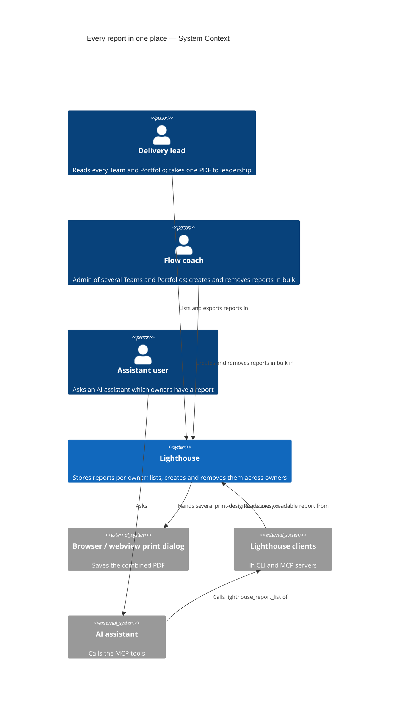
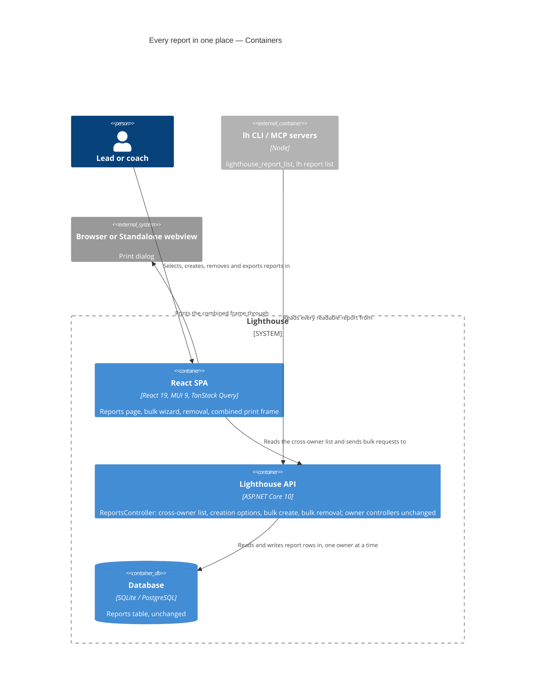

# Feature Delta — epic-6350-bulk-reports

ADO Epic #6350 "Every report in one place, created and removed in bulk". DISCOVER and DIVERGE were skipped by the
maintainer; this file starts at DISCUSS.

> **Revised after DESIGN, 2026-10-27** (maintainer answers MQ-1 to MQ-5; `design/upstream-changes.md` U-1 to U-8
> applied): the "does not capture a chosen metric" half is dropped from D13, AC-2.5, AC-3.4, US-04 and AC-4.2, because
> metrics are captured per owner kind and today every metric applies to both kinds (re-add note under Out of Scope);
> the ceiling is **N = 50** (the selection for removal and PDF, and the owners of one bulk run), dropping to 25 if a
> 50-report print fails in the Linux desktop app; inventory S7 corrected (the Admin set is already in `useRbac()`);
> AC-2b.3 holds because `useRbac()` will report a failed load; the run finishes on the server when the answer is lost.
> Owners and their history starts arrive in one read (DDD-3), so AC-4.5, AC-4.7 and US-04 now have no partial state:
> the owner step has both or shows could-not-load with Retry (US-04 scenarios merged, 6 → 4).
>
> **Revised after the final wave review gate, 2026-10-27** (DISCUSS conditionally approved, 0 blockers; NMD-11..16
> locked by the maintainer): slice 01 carries Edit, Delete and PDF row icons (NMD-16, AC-1.11, ~1¾d); the "9 selected"
> moment moves from US-01 to US-05/US-07; the removal confirm uses NMD-7's copy; D17/AC-2b.3 split loading (disabled)
> from a failed permission load (Create enabled, DDD-17) and adopt NMD-15's wait-for-options; AC-2.12 pins NMD-13; the
> empty page uses NMD-1's sentence from 02a; the Owner cell follows NMD-11; reasons point to NMD-12; the default
> "Then ends on" follows NMD-14; AC-7.4 follows NMD-8's edge; AC-5.4 rewritten; DoR item 8 restated.

## Wave: DISCUSS / [REF] Prior-Wave Reading Confirmation

**Agent**: Luna (`nw-product-owner`) · **Date**: 2026-10-27 · **Mode**: autonomous subagent. The maintainer's
decisions of 2026-10-27 are locked (D1–D6 below; Q1–Q4 answered the same day, so D9's one name, D12, D13 (history) and bulk removal's tier are LOCKED too; D9's
no-de-duplication clause and D10 were PROPOSED, then LOCKED in the DISTILL sketch walk as NMD-10 and NMD-9); decisions this wave takes on its own carry **PROPOSED — maintainer
confirms** and are listed under "Questions for the maintainer". Config: user-facing, walking skeleton "depends"
(brownfield, evaluated below), UX research lightweight, JTBD yes (every story has a `job_id`), density lean.

| Read | Status |
|---|---|
| DISCOVER / DIVERGE artifacts | ⊘ none — skipped by the maintainer (risk noted in `discuss/wave-decisions.md`) |
| ADO Epic #6350 description (via the dispatch brief) | ✓ — the source of the problem and scope |
| Precedent: `docs/feature/epic-6298-report-pdf-export/feature-delta.md` DISCUSS sections, `slices/`, `discuss/wave-decisions.md` | ✓ — structure mirrored |
| `docs/evolution/2026-10-15-epic-5878-then-and-now.md`, `docs/evolution/2026-10-21-epic-6298-report-pdf-export.md` | ✓ (report concepts, cap, known gaps) |
| `docs/product/jobs.yaml` (tail; `job-share-numbers-outside-lighthouse`, `job-config-admin-know-what-a-setting-limits-before-it-bites`) | ✓ |
| `docs/product/personas/delivery-lead-rte.yaml`, `flow-coach` (by reference) | ✓ |
| Brownfield code (targeted, below) | ✓ |
| `lighthouse-clients` checkout | ⊘ not reachable from this session (outside the project root); tool names confirmed from `docs/aiintegration.md` and Epic 6298's feature delta |

---

## Wave: DISCUSS / [REF] Current-State Surface Inventory (brownfield)

| # | What exists | Where | Consequence |
|---|---|---|---|
| S1 | Reports live per owner: the Reports tab of each Team and Portfolio lists that owner's reports in a `DataGridBase` table with Edit, Delete and PDF row icons (PDF disabled with a tooltip in the macOS desktop app, Bug 6425) | `Lighthouse.Frontend/src/pages/Common/Reports/ReportsTab.tsx`, `ReportList.tsx`, `useOwnerReports.ts` | The global page reuses the same table style and row actions; nothing per owner changes. |
| S2 | One report view for both owner kinds, reached at `/teams/:id/:tab/:reportId` and `/portfolios/:id/:tab/:reportId` | `ReportView.tsx`, `App.tsx` | The global page links to these addresses; no second view. |
| S3 | A top-level page that lists items across owners already exists: `/features` | `App.tsx` (`FeaturesView`) | Precedent for a top-level `/reports` page and its place in the navigation. |
| S4 | The create wizard: Type → Then → Now → Metrics & name, one owner, Type step backed by a type list; the window check mirrors the server's bounds; refusal copy per code | `wizard/ReportWizard.tsx`, `TypeStep.tsx`, `reportTypes.ts`, `thenAndNow/*`, `reportWindowCheck.ts`, `reportRefusalCopy.ts` | Bulk creation reuses the type and configuration steps and adds an owner step and a result; the type list already keeps the flow type-agnostic (D4). |
| S5 | Editing gates go through `useMayEditReports.ts`, built on `useRbac()` | `useMayEditReports.ts` | The owner picker and the bulk-removal selection derive "Admin of this owner" the same way, per owner. |
| S6 | Endpoints are per owner only: `api/latest/{teams,portfolios}/{id}/reports` — GET under `TeamRead`/`PortfolioRead`; POST, PUT, DELETE under `TeamWrite`/`PortfolioWrite` (Admin). No cross-owner list, no bulk create or delete | `TeamReportsController.cs`, `PortfolioReportsController.cs`, `ReportsControllerBase.cs` | Slice 01 needs a cross-owner read (DESIGN: new endpoint vs fan-out). Bulk create/remove: a bulk endpoint vs one call per owner is DESIGN's. |
| S7 | Read-scope filtering across owners exists (`GetReadableTeamIdsAsync`, `GetReadablePortfolioIdsAsync`), used by Features, Portfolios and Suggestions. *(Corrected after DESIGN, 2026-10-27)* The Admin set already reaches the browser: `useRbac()` exposes `isTeamAdmin` / `isPortfolioAdmin` from my-summary's admin ids; on the server `GetWritablePortfolioIdsAsync` exists, without a Team twin | `FeaturesController.cs`, `PortfoliosController.cs`, `SuggestionsController.cs`, `hooks/useRbac.ts`, `RbacAdministrationService.cs` | The global list can filter like `/features`. The picker filters readable owners through `useRbac()`; no new RBAC member. |
| S8 | Refusals are ProblemDetails with a `code`; window refusals carry `earliestStart`; the cap answers 403. Codes: name-missing, name-too-long, template-not-supported, no-metric-shown, unknown-metric, duplicate-metric, metric-not-captured, then-too-short/-too-long/-ends-in-the-future/-before-cutoff, now-too-short/-too-long/-before-cutoff, report-cap-reached | `ReportsControllerBase.cs`, `Models/Reports/ReportRefusalCodes.cs`, `ReportWindowPolicy.cs` (min window 14 days) | Per-owner "not created" reasons come from these codes; `earliestStart` gives "its kept history starts {date}". |
| S9 | Each owner keeps its own history, "Closed Items Cutoff (days)" in its settings (`DoneItemsCutoffDays`, default 365), with a line saying it bounds how far back Reports reach (Story 6348) | `AdvancedInputs.tsx` | Same windows on many owners hit different cutoffs (D1). The settings line is where "keep more history" points. |
| S10 | Community: 1 report per type per owner; Premium unlimited; a lapsed licence takes nothing away | `ReportCapPolicy.cs` | Bulk create is Premium (D2), so the cap does not bite unless the licence lapses mid-run. |
| S11 | Then frozen at creation (`ReportCommands.Create` → `template.Freeze`), Now computed on read; creation logs `report-creation-slow` above 10 s (measured 0.23–0.60 s for one 365-day Then) | backend Reports module | Bulk over 20–30 owners takes several seconds or more: DESIGN performance question. |
| S12 | `NewReportRequest`: TemplateKey, Name, ShownMetricKeys, ThenAndNow{ThenEndDate, ThenLengthDays, NowLengthDays} | `API/DTO/Reports` | One configuration applies to many owners unchanged. |
| S13 | The print page per report `/print/{teams,portfolios}/:id/reports/:reportId`, mounted beside the app shell, with preparing/failed looks; a hidden print frame for exports | `print/reportPrintRoutes.tsx`, `ReportPrintPage.tsx`, `PrintFrameHost.tsx` | The combined PDF (slice 07) reuses its content per report; a page holding several reports is new. |
| S14 | Usage data: `ReportCreated = 16`, `ReportOpened = 17`, `ReportDeleted = 18`, `WorkTrackingSystemFieldsChanged = 19`, `ReportPdfExportStarted = 20` (last) | `Models/UsageData/UsageDataEventName.cs` | New events append from 21 on `main` (DEVOPS checks). |
| S15 | Clients: `lh report list --team-id/--portfolio-id`, `lh report get`, MCP `lighthouse_{team,portfolio}_report_{list,get}`; read-only, raw values | `docs/aiintegration.md` | The cross-owner list (D6) sits beside these. |
| S16 | The Overview shows each owner's reports as chips (one request per row) | Epic 5878 slice 12 | Unchanged; the global page is the full list. |
| S17 | Docs: `docs/reports/reports.md`, `docs/reports/thenandnow.md`, `docs/settings/rbac.md`, `docs/settings/usagedata.md`, `docs/aiintegration.md` | `docs/` | Finalize targets. |

---

## Wave: DISCUSS / [REF] Persona IDs

| Persona | Role here |
|---|---|
| `delivery-lead-rte` | **Primary.** Martin Achterberg, Head of Delivery, reads every Team and Portfolio (Viewer); takes one PDF to the steering group each quarter. |
| `flow-coach` (consulting) | **Primary, creates.** Elena Kovacs, external flow coach, Admin of Teams Zenith, Gravity, Equinox, Voyager, Lightspeed and Portfolio Ocean Explorer; Viewer elsewhere. Sets up the comparisons, on a Premium instance. |
| `flow-coach` (internal) | **Secondary.** Priya Raman, Admin of Team Gravity only; a Community instance in one example. |
| `flow-coach` (internal) | Tomás Ruiz, a fellow Admin of Team Gravity on Elena's Premium instance (bulk-removal race). |
| *(no access)* | Jonas Weber, cannot read Team Pulsar — the RBAC boundary in examples. |

Example data is the demo set (Teams Zenith, Voyager, Pulsar, Gravity, Lightspeed, Meridian, Equinox; Portfolios
Apollo, Orion, Ocean Explorer, NeuroLink City, Altobelli). "Today" in examples is 27 Oct 2026; quarter against
quarter: Then 1 May – 29 Jul 2026, Now 30 Jul – 27 Oct 2026 (90 days each, back to back); month against month: Then
29 Aug – 27 Sep, Now 28 Sep – 27 Oct 2026 (30 days each, back to back). Now always ends today; Then is chosen to end the
day before Now starts. Team Equinox keeps 90 days (kept history starts 30 Jul 2026).

## Wave: DISCUSS / [REF] JTBD One-Liner

- `job-lead-compare-every-owner-against-its-own-past-in-one-go` (**new**, `docs/product/jobs.yaml`): when leadership
  asks whether flow got better across several Teams and Portfolios, get the same before-and-after comparison for each,
  set up once and read side by side, without configuring each owner or running an own script. Every story carries it.
- Carried, not served anew: `job-flow-coach-show-whether-flow-changed` (each report created) and
  `job-share-numbers-outside-lighthouse` (slice 07's PDF).

---

## Wave: DISCUSS / [REF] Changed Assumptions

| Was (source) | Now | Why |
|---|---|---|
| Reports are found per owner, on its Reports tab or the Overview chips (Epic 5878) | Also on one top-level Reports page (slice 01) | ADO #6350 scope. |
| Creation is one owner at a time, all-or-nothing (Epic 5878) | Bulk creation is per owner: each owner is created or not, with a reason; never a silent all-or-nothing over the set (D1, D8) | Same windows hit different kept histories. Each owner's own creation stays all-or-nothing. |
| "Several reports at once" out of scope (Epic 6298 Out of Scope) | In, as the last slice (D5) | Maintainer 2026-10-27. |
| Clients read reports per owner only (Epic 6298 D23) | Plus a read-only cross-owner list (D6) | Maintainer 2026-10-27. |
| Story 6347 would keep the single wizard's windows inside the kept history and say which length to pick | **Removed in ADO on 2026-10-27; not depended on.** Slice 04 solves it for the bulk owner step only; the single wizard keeps today's behaviour (window check + refusal) | Maintainer 2026-10-27. |

---

## Wave: DISCUSS / [REF] Locked Decisions

> **Revised after peer review 2026-10-27** (`nw-product-owner-reviewer`, rejected pending revisions): selection rules
> unified and moved into slice 01 (B1); D8 carried into bulk removal (B2); per-owner refusals mid-run and RBAC/auth off
> made explicit (B3); metrics an owner does not capture (H4); licence lapse and button states (H5); slice 02 split into
> 02a and 02b, slice 06 re-estimated at ~1d (H6); the owner step's loading and failure looks (H7); selection under
> filter, select-all and a ceiling (H8); nits 9–16. New behaviour choices carried **PROPOSED — confirm at DISTILL sketch
> walk** and were listed as Q6–Q10; the walk settled them on 2026-10-27 (NMD-1..NMD-10, LOCKED).

D1–D6 restate the maintainer's decisions of 2026-10-27 (locked). D7 onward are this wave's.

- [D1] **Same windows for every selected owner**, so Teams compare like with like. Owners whose kept history cannot
  hold the windows are skipped; the result says why per owner ("Not created: its kept history starts 30 Jul 2026")
  and where to keep more history (Closed Items Cutoff in that owner's settings). The wizard may limit picks to what the
  selection can hold where it can (slice 04). Story 6347 is Removed and not depended on. (Locked.)
- [D2] **Licence**: bulk creation is **Premium**; the Reports page and opening reports are **Community**. (Locked.)
  Bulk removal: **Community — LOCKED (maintainer, 2026-10-27; Q1 (a))**: removing is harmless and a Community owner
  holds at most one Then & Now.
- [D3] **Teams and Portfolios in one selection.** (Locked.) Delivered as slices 02a/02b (Teams) and 03 (Portfolios
  join the same list), so each slice stays ≤ 1 day; the selection is one list once 03 ships.
- [D4] **Type-agnostic flow**: choose report type → configure once → pick owners → per-owner result. Only Then & Now
  exists and only it is built; the type step shows even with one type, as the single wizard does. (Locked.)
- [D5] **Bulk PDF is in, as the last slice (07)**: select reports on the Reports page → one PDF, each report on its own
  page(s), reusing Epic 6298's print content. (Locked.)
- [D6] **Clients**: a read-only cross-owner list beside the per-owner reads; bulk create and remove stay web-only.
  Needs a clients release (changesets, manual `pnpm release:version`, the `lighthouse` skill names the new tool and
  command — drift test). (Locked.)
- [D7] **Who may do what**: the Reports page lists reports on owners the user can read; the owner picker offers only
  owners where the user is Admin (`TeamWrite` / `PortfolioWrite`, from slice 02a); bulk removal acts only on reports
  on such owners (D15); the server re-checks each owner. Auth off or RBAC off: everyone is Admin everywhere, so every
  owner is offered and every report is removable. UI gating via `useRbac()` only.
- [D8] **Per-owner outcome, always**, for creation and removal: every selected owner (or report) appears in the result
  as created/removed or not, with a plain reason. An owner that was deleted, or that the caller no longer administers,
  when the run reaches it, is one "Not created" / "Not removed" row, never a whole-run failure. If the request as a
  whole gets no answer, the result says it cannot confirm what was created (or removed) and sends the user to the
  Reports page — never an implied "nothing happened".
- [D9] **One name for every owner — LOCKED (maintainer, 2026-10-27; Q2 (a))**: the user gives one name (default
  follows Then, as today: "Then & Now — 90 days to 29 Jul 2026"); each report carries it, and the owner is shown beside
  it everywhere it is listed. **No de-duplication — LOCKED (maintainer, 2026-10-27, DISTILL sketch walk, NMD-10; Q11)**: running the same bulk creation again creates second copies.
- [D10] **Several windows = several runs — LOCKED (maintainer, 2026-10-27, DISTILL sketch walk, NMD-9; Q5)**: one bulk run carries one window set. A 90-day and a 30-day copy are
  two bulk runs; the Reports page shows both.
- [D11] **Nothing new is stored**: bulk creation writes the same Reports rows as the single wizard; no "batch" record.
  DESIGN confirms (no EF migration expected).
- [D12] **Combined PDF order and failure — LOCKED (maintainer, 2026-10-27; Q3 (a))**: reports print in the Reports
  page's current order; if any selected report cannot be read, no PDF is made; the page names the report(s) and offers
  Retry or "Leave it out".
- [D13] **Owners that cannot take the report are shown but not pickable — LOCKED for history (maintainer, 2026-10-27;
  Q4 (a))** in slice 04, with the owner's history start and a link to its settings; going back to shorter windows
  makes them pickable. ~~Extended to metrics (Q7)~~ **Dropped after DESIGN (2026-10-27, MQ-3 a)**: metrics are captured
  per owner kind and today every metric applies to both kinds, so no owner can lack a chosen metric.
- [D14] **Usage data is wanted** (DEVOPS designs): Reports page opened; a bulk creation run; a bulk removal run; a
  PDF holding several reports. Name-only preferred; at most a closed enum; never counts, names, ids or values.
- [D15] **Selection rules — LOCKED (maintainer, 2026-10-27, DISTILL sketch walk, NMD-2; Q6)**: on the Reports page every listed row is
  selectable (slice 01). Export PDF is enabled for any selection (read is enough). Remove is enabled only when every
  selected report is on an owner the user is Admin of; otherwise it stays disabled with a reason naming how many
  selected reports cannot be removed ("2 of the 5 selected reports are on a Team or Portfolio you are not Admin of").
- [D16] **Selection under filter, sort and pages — LOCKED (maintainer, 2026-10-27, DISTILL sketch walk, NMD-3; Q8)**: changing a filter
  clears the selection; sorting keeps it; select-all selects every row the current filter shows, on all pages; the
  remove confirm and the PDF name the exact count. A selection larger than the ceiling **N = 50** (maintainer,
  2026-10-27, MQ-2) is refused with "Pick at most 50 reports"; the same N bounds the owners of one bulk-creation run.
- [D17] **"Create reports" states — LOCKED (maintainer, 2026-10-27, DISTILL sketch walk, NMD-4; Q9)**: always shown on the Reports page.
  On Community: disabled with the existing Premium-licence tooltip (`LicenseToolTip`, NMD-4). On Premium for a user who
  administers no owner: disabled with "You are not Admin of any Team or Portfolio." (slice 02b). While permissions load:
  disabled. If the permission load **fails**, Create is enabled (permissive fallback, DDD-17) and the owner step shows
  its could-not-load look with Retry. Clicking Create first loads the creation options (spinner in the button, button
  disabled); the wizard opens at step 1 only once they are ready, or on "What a report needs couldn't be loaded." with
  [Cancel] [Retry] (NMD-15). RBAC or auth off: enabled for everyone on Premium.
- [D18] **Slice 02a's owner step offers only the Teams the user administers** (every Team with RBAC or auth off), so
  02a is releasable on its own (re-review, 2026-10-27; settles Q10). 02b adds only the no-Admin state (D17) and the
  owner step's loading and could-not-load looks. A Team that stops being administered mid-run is still one "Not
  created" row (D8).
- [D19] **The bulk-run usage event fires for every run, including one that created nothing, and carries no outcome
  property — decided by DEVOPS (DVO-2)**: K2 counts users who try bulk creation, not runs that succeed.

---

## Wave: DISCUSS / [REF] Scope Assessment

**PASS — 8 stories (01, 02a, 02b, 03–07), 2 code bases (Lighthouse frontend + backend Reports module;
`lighthouse-clients`), ~7¼ days** (rev. 2026-10-27 at the final review gate: slice 01 ~1¾d with the row icons of
NMD-16, was ~7; after DESIGN: slice 04 ~¾d without its metric half; after review and re-review: was ~6; 01 +½d for row
selection, 02 split into 02a ~1d and 02b ¼d, 06 ~1d).
No new bounded context. The walking skeleton touches 3 integration points (cross-owner read, new page + navigation,
existing report view). Under 2 weeks. Four user outcomes (find, create, remove, one PDF) ship as slices of one Epic
because the maintainer framed them as one; each slice adds value alone and the Epic is releasable after any finished
slice.

---

## Wave: DISCUSS / [REF] Journey

SSOT: `docs/product/journeys/epic-6350-bulk-reports.yaml` (two journeys; shared artifacts and their sources there).

```
[Reports page + selection] ──> [Create reports: type → Then → Now → metrics+name → owners] ──> [Per-owner result] ──> [Remove selected] ──> [Export selected as one PDF]
 Burdened→Oriented              Hopeful→Focused                                                Anxious→Confident     Cautious→Relieved    Ready→Confident
 readable_owners, report_name   report_windows, admin_owners, licence_tier, owner_history_start refusal_reason        admin_owners         report_values, generated_at
```

Emotional arc **burdened → focused → confident**. The peak tension is the result: "which ones did it make?" — D8
answers it per owner. Integration checkpoints: the page lists what the per-owner tabs list; every created report
carries the same windows; each report in the combined PDF equals its single-report PDF read at the same moment.

---

## Wave: DISCUSS / [REF] Story Map & Slices

**Backbone**: *find and select reports* → *create for many* → *understand each owner's outcome* → *tidy up* → *share
the big picture*; beside it, *an assistant lists every report*.

| Find & select | Create for many | Each owner's outcome | Tidy up | Share | Assistant |
|---|---|---|---|---|---|
| **01 Reports page + selection** | 02a write path + Admin owners · 02b no-Admin and loading looks · 03 + Portfolios | 02a result · 04 owners that cannot take the report | 05 bulk removal | 07 one PDF | 06 cross-owner list |

**Walking skeleton = slice 01** (brownfield): a top-level Reports page listing every readable report across owners,
with row selection, opening the existing view. Read-only, Community, no new write path.

**How the consultant's "big picture" is reached**: 01 shows every report in one place → 02a–03 create the quarter's
and the month's comparison for every Team and Portfolio in two runs → 07 puts the chosen ones into one PDF for
leadership. K4 (several reports in one PDF) shows it working; K6 asks whether the script retired.

| # | Slice | Tier | Est. | Depends on | Learning hypothesis — disproves … if it fails |
|---|---|---|---|---|---|
| 01 | Every report in one place: top-level Reports page, all readable reports across Teams and Portfolios, opens each; row icons Edit/Delete (Admin) and PDF (every reader) reused from `ReportList` (NMD-16); row selection built but hidden until 05/07 (filter clears it, select-all = filtered rows, exact count); loading, failure, empty looks | Community | ~1¾d (rev. final gate: +¼d for the row icons, NMD-16) | — | "One list ends per-owner hunting" — if on the dev instance (`:5169`) the maintainer still goes through a Team's tab to find a known report, or the page takes > 2 s |
| 02a | Create a Then & Now for several Teams at once — the write path: type → windows + metrics + name once → pick from the Teams the user administers (every Team with RBAC/auth off) → per-Team result, incl. refusals mid-run, licence lapse, an all-refused run and a lost answer; server Premium and Admin checks | Premium | ~1d | 01 | "Same windows for many Teams is what leads want" — if after a run over the dev instance's Teams the maintainer edits most created reports, or more than half are skipped |
| 02b | The owner step says why Create is unavailable: the no-Admin state and the owner step's loading and could-not-load looks | Premium | ¼d | 02a | "Saying why beats an empty step" — if a dogfood user without Admin rights, or on a throttled connection, cannot tell why there is nothing to pick |
| 03 | Portfolios join the same selection | Premium | ½d | 02b | "Leads compare Teams and Portfolios on one setup" — if no dogfood run picks a Portfolio together with Teams |
| 04 | The owner step shows owners that cannot take the report (history too short; the metric half dropped after DESIGN), with the reason and where to fix it | Premium | ~¾d | 02b, 03 | "Saying it before Create beats reasons after" — if dogfood runs still end with skipped owners the user did not expect |
| 05 | Remove the selected reports (Admin owners only), with confirm and per-report result, incl. a lost answer | Community | 1d | 01 | "Bulk removal is needed once bulk creation exists" — if after a month no dogfood or opted-in run uses it |
| 06 | Every report through the clients: `lh report list` with no owner and an MCP tool (stdio and HTTP), skill drift test, changesets, clients release | Community | ~1d | 01 (released) | "Assistants want the whole list, not per owner" — if in the `lighthouse` skill eval the assistant still lists owner by owner |
| 07 | Several reports in one PDF: export the selection, each report on its own page(s) | Community | 1d | 01 | "One combined PDF replaces the script for leadership" — if the maintainer, given the dev instance's 90-day reports, would rather send separate PDFs or a spreadsheet |

Briefs: `slices/slice-NN-*.md` (02a's brief is `slice-02-create-for-several-teams.md`).

### Priority Rationale

- **01** first: walking skeleton, Community, every later slice builds on its page and selection; no write risk.
- **02a** next: the Epic's core pain (setup per Team) and the riskiest assumption (same windows across owners, D1); it
  ships the write path with every per-owner refusal so the result is honest from day one.
- **02b** adds the no-Admin state and the owner step's loading and could-not-load looks; small, and 02a is already
  releasable without it.
- **03** completes D3 cheaply on the same flow.
- **04** reduces skipped owners; after 03 so it covers both kinds at once.
- **05** tidies what 02a–04 made; needs only 01's selection.
- **06** is in another repo and needs 01's cross-owner read released; before 07 because D5 fixes the PDF as last.
- **07** last (D5): the payoff for leadership, built on a page full of comparable reports.

### Slice taste tests

| Test | Verdict |
|---|---|
| 4+ new components in one slice? | Pass after the split: 02a has the bulk write path and the result (the type and configuration steps are reused, S4); 02a also the Admin-set filter; 02b the no-Admin state and owner-step looks. 01 carries list + selection + the reused `ReportList` row icons (~1¾d, the only slice above 1d — the selection is the grid's own checkbox column and the icons and delete confirm are reused unchanged, NMD-16). |
| Every slice depends on a new abstraction? | Pass — the cross-owner read and the selection are born in 01 and reused by 05, 06, 07; the type-agnostic bulk flow (D4) is born in 02a. |
| Disproves a pre-commitment? | Pass — 01 tests "one list", 02a tests D1, 04 tests D13, 05 tests D2's removal half, 07 tests D5. |
| Synthetic-data-only slices? | Pass — every slice is dogfooded on the dev instance (`:5169`, real history, many owners); demo data covers E2E and screenshots. |
| Two slices alike except scale? | Pass. |

---

## Wave: DISCUSS / [REF] User Stories

<!-- markdownlint-disable MD024 -->

System constraints (all stories): RBAC per D7, UI gating via `useRbac()` only, never fetching
`/api/latest/authorization/my-summary` · works with auth off and RBAC off (everyone is Admin everywhere) · every label
through Terminology (seeded {Team}, {Portfolio}, {Cycle Time}, …) · no new stored data (D11) · each created report is
exactly what the single wizard would create with the same inputs · per-owner outcome always (D8) · every view that
fetches has a loading look and a failure look, never stale rows or an empty look passed off as "none" · meaning never
by colour alone.

### US-01 — Every report in one place (slice 01, walking skeleton)

`job_id: job-lead-compare-every-owner-against-its-own-past-in-one-go` · persona `delivery-lead-rte` (Martin)

**Problem**: Martin reads seven Teams and five Portfolios. To find this quarter's Then & Now for Team Gravity he must
remember it lives on Gravity's Reports tab; to see which Teams have one at all he opens twelve tabs.

#### Elevator Pitch

Before: reports are found only on each {Team}'s or {Portfolio}'s Reports tab.
After: Martin chooses **Reports** in the navigation → sees one table: "Then & Now — 90 days to 29 Jul 2026 · Then &
Now · [Team icon] Gravity · 27 Oct 2026" and the rest, across every owner he can read → clicks a row → the report
opens; every row carries PDF, and Edit and Delete appear only where the reader is Admin.
Decision enabled: which Teams and Portfolios still lack a comparison, and which report to open, without visiting each.

**Examples**: (1) Martin reads 7 Teams and 5 Portfolios holding 14 reports; all 14 are listed with their owner and he
opens Team Gravity's. (2) Jonas cannot read Team Pulsar; Pulsar's report is not in his list. (3) A fresh instance has
no reports; the page says reports are created on a {Team}'s or {Portfolio}'s Reports tab (from 02a: "… or here with
Create reports."). (4) The list cannot be loaded on a dropped connection; the page says so with Retry, not "no
reports". (5) The instance calls Teams "Squads"; Gravity's Owner cell shows "Gravity" with the Team icon, read out as
"Gravity, Squad". (6) Elena, Admin of Zenith and Viewer on Gravity, sees Edit, Delete and PDF on Zenith's row and PDF
only on Gravity's (NMD-16).

```gherkin
Scenario: A lead sees every report he can read and opens one
  Given Martin can read 7 Teams and 5 Portfolios that hold 14 reports between them
  When Martin opens Reports from the navigation
  Then he sees all 14 reports with their name, type, owner and created day
  And choosing "Then & Now — 90 days to 29 Jul 2026" of Team Gravity opens that report

Scenario: Reports on owners he cannot read stay hidden
  Given Team Pulsar has a report and Jonas cannot read Team Pulsar
  When Jonas opens Reports
  Then Team Pulsar's report is not listed

Scenario: An instance without reports says where they are made
  Given no Team or Portfolio has a report
  When Martin opens Reports
  Then he is told "Reports are created on a Team's or Portfolio's Reports tab."
  And from slice 02a the sentence ends "… Reports tab, or here with Create reports.", on Community too

Scenario: A list that could not be loaded is not mistaken for no reports
  Given the reports cannot be loaded for Martin
  When Martin opens Reports
  Then he sees that the reports couldn't be loaded, with Retry
  And he is not told there are no reports

Scenario: Owners carry the instance's terms
  Given the instance calls a Team a "Squad"
  When Martin opens Reports
  Then Team Gravity's report shows "Gravity" with the Team icon in its Owner cell
  And that cell's accessible name reads "Gravity, Squad"

# NMD-16
Scenario: Row icons follow what the reader may do
  Given Elena is Admin of Team Zenith and Viewer on Team Gravity, each holding a report
  When Elena opens Reports
  Then Zenith's row offers Edit, Delete and PDF
  And Gravity's row offers PDF only

# D16 — LOCKED (NMD-3); from slice 05/07, when the checkboxes and count are shown
Scenario: Select-all takes exactly the reports the filter shows
  Given 14 reports are listed and 9 of them are named "Then & Now — 90 days to 29 Jul 2026", over two pages
  When Martin filters to that name and selects all
  Then the page says "9 selected"
  And when he changes the filter, nothing is selected
```

**AC**: AC-1.1 A top-level Reports entry in the navigation opens the page (address DESIGN's, e.g. `/reports`) for
every signed-in user. AC-1.2 The table lists every report on every owner the user can read — name, Type, Owner,
created day — in the existing `DataGridBase` style with its sorting and filtering. The Owner cell follows NMD-11: the
owner's name only, as the link to that Team or Portfolio, with a small Team or Portfolio icon in front; its accessible
name carries the kind in the instance's terms ("Zenith, Team", "Ocean Explorer, Portfolio"); the filter still matches
the kind. AC-1.3 Choosing a row opens the existing report view at its owner address. AC-1.4 Reports on owners the user
cannot read are absent; the server filters, not the browser. AC-1.5 While loading: a loading look; on failure:
could-not-load with Retry; with no reports: an empty look — in slice 01 "Reports are created on a Team's or
Portfolio's Reports tab."; from slice 02a NMD-1's full sentence "Reports are created on a Team's or Portfolio's
Reports tab, or here with Create reports.", unchanged on Community; never stale rows shown as current. AC-1.6 A report
of a type this version cannot show is listed and opens to the existing "cannot be shown" look. AC-1.7 Community; auth
off lists all. AC-1.8 The usage event of D14 for opening the page, listed in `docs/settings/usagedata.md`. AC-1.9 Every
listed row is selectable (D15) and the page knows the exact count selected; slice 01 builds the selection but shows no
checkboxes and no "N selected" until the first slice with an action on it (05 or 07) ships. AC-1.10 Changing a filter
clears the selection; sorting keeps it; select-all selects every row the current filter shows, on all pages (D16,
LOCKED, NMD-3); visible, like AC-1.9, from slice 05 or 07. AC-1.11 Row icons (NMD-16), reusing `ReportList`'s icons
and its single-report delete confirm unchanged: Edit and Delete only on rows whose Team or Portfolio the user is Admin
of (from `useRbac()`, held back while permissions load), PDF on every row for every reader (disabled with its existing
reason in the macOS desktop app).
**KPI**: K1, G2. **Tech**: cross-owner read (S6, S7) — new endpoint or fan-out is DESIGN's; owner names in the payload.

### US-02a — Create a Then & Now for several Teams at once (slice 02a)

`job_id: job-lead-compare-every-owner-against-its-own-past-in-one-go` · persona `flow-coach` (Elena)

**Problem**: Elena coaches four Teams at a client. For the quarterly review she runs the Then & Now wizard four times
with the same dates, retyping them each time; once she mistyped one Team's end date and the comparison was not like
with like.

#### Elevator Pitch

Before: one wizard per Team, the same dates typed again each time.
After: Reports → **Create reports** → Type: Then & Now → Then ends 29 Jul 2026, 90 days; Now 90 days; all metrics;
name "Then & Now — 90 days to 29 Jul 2026" → picks from her Admin Teams Zenith, Gravity, Equinox → **Create 3
reports** → sees "2 reports created, 1 not created": Zenith Created, Gravity Created, Equinox "Not created: its kept
history starts 30 Jul 2026. Keep more history under Closed Items Cutoff in its settings."
Decision enabled: which Teams can join the comparison as set, and whether to keep more history for Equinox.

**Examples**: (1) Elena creates the quarter's comparison for Zenith, Gravity and Equinox; two are created, Equinox is
skipped with its history start. (2) Elena is Viewer on Team Pulsar; Pulsar is not offered. With RBAC or auth off
every Team is offered. (3) Priya's instance is Community; Create reports is shown disabled with the Premium hint; the
Team's own Create Report still works. (4) The connection drops while creating; Elena is told it could not be confirmed
which reports were made and to check Reports. (5) During a run over Zenith, Gravity, Voyager and Lightspeed, Voyager is
deleted, Elena loses Admin of Gravity and the licence lapses while Lightspeed already holds a Then & Now: Zenith is
created, the other three are "Not created" with their reasons. (6) Elena picks Equinox and Voyager, whose kept
histories both start after 1 May 2026: "0 reports created, 2 not created". (7) The same afternoon she runs it with
30-day windows ending 27 Sep 2026; each Team holds both. Running the quarter again would add second copies (D9's clause, LOCKED, NMD-10).

```gherkin
Scenario: A coach creates the same comparison for several Teams in one go
  Given Elena is Admin of Teams Zenith and Gravity on a Premium instance
  When Elena creates "Then & Now — 90 days to 29 Jul 2026" with Then 1 May – 29 Jul 2026 and Now 90 days for both
  Then each Team holds that report with the same windows and metrics
  And the result says "2 reports created"

Scenario: A Team whose kept history is too short is skipped with the reason
  Given Team Equinox keeps finished work only since 30 Jul 2026
  When Elena creates the quarter's comparison for Zenith, Gravity and Equinox
  Then Zenith and Gravity are created
  And Equinox reads "Not created: its kept history starts 30 Jul 2026" with where to keep more history

Scenario Outline: The owner step offers the Teams she may create on
  Given the instance runs with RBAC <rbac>
  And Elena is Admin of Team Gravity and Viewer on Team Pulsar
  When Elena reaches the owner step
  Then Team Gravity is offered and Team Pulsar is <pulsar>
  And creating for every offered Team passes the server's check
  Examples:
    | rbac | pulsar      |
    | on   | not offered |
    | off  | offered     |

# D17 — LOCKED (NMD-4)
Scenario: Community shows bulk creation as a Premium capability
  Given Priya's instance has a Community licence
  When Priya opens Reports
  Then Create reports is shown disabled with a Premium hint

Scenario: A lost connection never reads as nothing created
  Given Elena chose Create 3 reports
  When the answer does not arrive
  Then she is told it could not be confirmed which reports were created and to check Reports

Scenario: Changes during the run are refused owner by owner
  Given Elena picked Teams Zenith, Gravity, Voyager and Lightspeed, and Lightspeed already holds a Then & Now
  And during the run Team Voyager is deleted, Elena stops being Admin of Team Gravity and the Premium licence lapses
  When the run finishes
  Then Zenith is created
  And Gravity, Voyager and Lightspeed are each listed as not created, with the Admin, deleted and licence reasons

Scenario: A run where every owner is refused says so plainly
  Given Teams Equinox and Voyager both keep finished work only since 30 Jul 2026
  When Elena creates the quarter's comparison for both
  Then the result reads "0 reports created, 2 not created"
  And each row gives its reason and where to keep more history
```

**AC**: AC-2.1 Create reports on the Reports page, Premium only; on Community shown disabled with the existing
Premium-licence tooltip (`LicenseToolTip`; D2, D17, LOCKED, NMD-4); from this slice the empty page shows NMD-1's full
sentence, unchanged on Community (AC-1.5). AC-2.2 Steps: Type → Then → Now → Metrics & name (the single wizard's
steps and rules, once) → owners → result (D4); Then length 30 / 90 / 180 or custom (NMD-6); the default "Then ends on"
follows NMD-14: Now ends today and Then ends the day before Now starts (90 / 90 on 27 Oct 2026: Then 1 May – 29 Jul,
Now 30 Jul – 27 Oct), following the lengths until the user edits the date. AC-2.3 The owner step offers only the Teams
the user administers, derived via `useRbac()`; with RBAC or auth off, every Team (D7, D18). AC-2.4 Every created report
equals what the single wizard creates with the same inputs; one name for all (D9). AC-2.5 The result lists every
picked owner: Created (opens it) or Not created with the line NMD-12's table gives for its outcome (not Admin, owner
gone, Community cap, history too short with Closed Items Cutoff, not saved, any other refusal). AC-2.6 A whole-request
failure says "It could not be confirmed which reports were created." with [Go to Reports] (D8, NMD-7).
AC-2.7 The server checks each owner when it reaches it: an owner the caller does not (or no longer) administer, or one
deleted mid-run, becomes one "Not created" row with its reason, never a whole-run failure; a run from a non-Premium
instance is refused as a whole with the licence reason. AC-2.8 A licence that lapses mid-run: owners past the
Community cap are "Not created" with the licence reason, the rest are created. AC-2.9 Duplicates are allowed: no
de-duplication by name or windows (D9's clause, LOCKED, NMD-10). AC-2.10 Usage: the D14
bulk-run event once per run, and `ReportCreated` once per report created, as today; the run event fires also for a run
that created nothing and carries no outcome property (D19, decided by DEVOPS, DVO-2). AC-2.11 When every picked owner is
refused, the headline reads "0 reports created, {N} not created" and every row carries its reason; never an empty or
success-looking result. AC-2.12 One run takes at most 50 owners (the shared ceiling). Picking stays possible above it
and the button names the count ("Create 60 reports"), but Create is disabled with "Pick at most 50 Teams and
Portfolios." beside it (NMD-13); a group's Select all is not capped; the server refuses a larger request. A chosen
metric that does not apply to an owner's kind (`unknown-metric`) has a plain result wording as a safety net; no owner
can meet it today.
**KPI**: K2, K3, G1, G4. **Tech**: bulk endpoint vs one call per owner, progress and the 10 s slow log (S11) are
DESIGN's; the Admin set per user is new (S7).

### US-02b — The owner step says why Create is unavailable (slice 02b)

`job_id: job-lead-compare-every-owner-against-its-own-past-in-one-go` · persona `delivery-lead-rte` (Martin) and
`flow-coach` (Elena)

**Problem**: after 02a, Martin, who administers nothing, finds Create reports leads to an owner step with nothing in
it; and on a slow connection Elena's owner step looks empty while the Admin set is still on its way.

#### Elevator Pitch

Before: an empty owner step reads as "no Teams", whether the user administers none or the list is still loading.
After: Martin, Admin of nothing, sees Create reports disabled with "You are not Admin of any Team or Portfolio.";
Elena chooses Create reports → the button shows a spinner while what a report needs loads → the wizard opens at step 1
only when it is ready; if her permissions could not be loaded, the owner step says "Your Teams and Portfolios couldn't
be loaded." with Retry instead of an empty list.
Decision enabled: whether to ask for Admin rights, wait, or retry, instead of guessing.

**Examples**: (1) Martin, Viewer everywhere on a Premium instance, sees Create reports disabled with the reason.
(2) Elena's permissions are still loading: Create reports is disabled. (3) Elena's permissions could not be loaded:
Create reports stays enabled (permissive fallback, DDD-17); the owner step shows could-not-load with Retry; Retry
succeeds and her Admin Teams appear. (4) Elena chooses Create reports on a slow connection: the button spins and the
wizard opens at step 1 once the creation options arrive (NMD-15). (5) They cannot be loaded: the wizard opens on "What a
report needs couldn't be loaded." with [Cancel] [Retry].

```gherkin
# D17 — LOCKED (NMD-4)
Scenario: A Viewer on a Premium instance is told why he cannot create
  Given Martin administers no Team or Portfolio on a Premium instance
  When Martin opens Reports
  Then Create reports is shown disabled with "You are not Admin of any Team or Portfolio."

Scenario: Create reports waits while permissions load
  Given Elena's permissions are still on their way
  When Elena opens Reports
  Then Create reports is disabled

Scenario: A failed permission load does not block Create, and the owner step says what failed
  Given Elena's permissions could not be loaded
  When Elena chooses Create reports and reaches the owner step
  Then she sees "Your Teams and Portfolios couldn't be loaded." with Retry
  And Create is not available in the owner step

# NMD-15
Scenario: The wizard opens only once what a report needs has loaded
  Given the creation options are slow to arrive
  When Elena chooses Create reports
  Then the button shows a spinner and is disabled
  And the wizard opens at step 1 once they have arrived

# NMD-15
Scenario: The wizard says so when what a report needs cannot be loaded
  Given the creation options cannot be loaded
  When Elena chooses Create reports
  Then the wizard opens on "What a report needs couldn't be loaded." with Cancel and Retry
```

**AC**: AC-2b.1 No Admin owner on Premium: Create reports disabled with "You are not Admin of any Team or Portfolio."
(D17, LOCKED, NMD-4). AC-2b.2 While permissions load, Create reports is disabled. AC-2b.3 If the permission load
fails, Create reports is enabled (permissive fallback, DDD-17) and the owner step shows "Your Teams and Portfolios
couldn't be loaded." with Retry, Create disabled there; never an empty list read as "no Teams". AC-2b.4 Choosing Create
reports first loads the creation options: the button shows a spinner and is disabled; the wizard opens at step 1 only
once they are ready, so no step is shown half-filled; if they cannot be loaded, the wizard opens on "What a report
needs couldn't be loaded." with [Cancel] [Retry] (NMD-15).
**KPI**: G1. **Tech**: the looks reuse the existing loading and could-not-load patterns (DESIGN).

### US-03 — Portfolios in the same selection (slice 03)

`job_id: job-lead-compare-every-owner-against-its-own-past-in-one-go` · persona `flow-coach` (Elena)

**Problem**: Elena also reports on Portfolio Ocean Explorer; after 02b she still runs the single wizard for it, with
the same dates.

#### Elevator Pitch

Before: bulk creation covers Teams; the Portfolio needs its own wizard run.
After: Create reports → … → the owner step lists {Teams} and {Portfolios} → picks Zenith, Gravity and Ocean Explorer
→ "3 reports created", the row for Ocean Explorer (Portfolio icon) reading "Ocean Explorer · Created".
Decision enabled: show Teams and their Portfolio on one set of windows.

**Examples**: (1) Zenith, Gravity and Ocean Explorer in one run, all created. (2) Elena is Viewer on Portfolio
Apollo; it is not offered. (3) Only Portfolios picked (Ocean Explorer, NeuroLink City); both created. (4) The window
presets offer 30, 90 and 180 days whatever the mix, or a custom number of days of at least 14 (LOCKED, NMD-6).

```gherkin
Scenario: Teams and a Portfolio get the same comparison in one run
  Given Elena is Admin of Teams Zenith and Gravity and Portfolio Ocean Explorer
  When Elena creates the quarter's comparison for all three
  Then all three hold it and the result lists Ocean Explorer, with its Portfolio icon, as created

Scenario: Only Portfolios she administers can be picked
  Given Elena is Viewer on Portfolio Apollo
  When Elena picks owners for new reports
  Then Portfolio Apollo is not offered

Scenario: A run of Portfolios only
  Given Elena is Admin of Portfolios Ocean Explorer and NeuroLink City
  When Elena creates the quarter's comparison for both
  Then both hold it
```

**AC**: AC-3.1 The owner step lists Teams and Portfolios in one selection, grouped by kind, in the instance's terms
(D3). AC-3.2 Portfolio admin rights as D7, AC-2.3 and AC-2b.1–2b.3 apply. AC-3.3 Presets cover the mix (LOCKED, NMD-6: 30 / 90 / 180
and any number of days ≥ 14). AC-3.4 Result rows name the owner kind; every AC-2.5 reason applies to Portfolios. **KPI**: K2. **Tech**: same path
as 02a.

### US-04 — The owner step says which owners cannot take the report (slice 04)

`job_id: job-lead-compare-every-owner-against-its-own-past-in-one-go` · persona `flow-coach` (Elena)

**Problem**: in 02a Elena learns only after Create that Equinox cannot hold the quarter; she would rather see it while
picking and decide then (shorter windows, or keep more history first).

#### Elevator Pitch

Before: owners that cannot hold the windows are found out in the result.
After: on the owner step Team Equinox shows unpickable with "Kept history starts 30 Jul 2026 — Then starts 1 May 2026"
and a link to its settings; the button reads "Create 2 reports".
Decision enabled: shorten the windows, keep more history first, or go ahead without Equinox.

**Examples**: (1) Equinox shown unpickable with its history start. (2) Elena goes back and picks 30-day windows
ending 27 Sep 2026; Equinox becomes pickable. (3) The owners cannot be loaded; the owner step shows could-not-load with
Retry and offers nothing half-checked. (4) Elena opens Equinox's settings from the link and raises Closed Items Cutoff; Equinox becomes
pickable only after its next update has brought the older Work Items back.

```gherkin
Scenario: An owner that cannot hold the windows is shown but cannot be picked
  Given Team Equinox keeps finished work only since 30 Jul 2026
  When Elena reaches the owner step with Then 1 May – 29 Jul 2026
  Then Team Equinox cannot be picked and shows "Kept history starts 30 Jul 2026"
  And it links to where Equinox keeps more history

Scenario: Shorter windows make it pickable
  Given Team Equinox cannot be picked for the quarter's comparison
  When Elena goes back and chooses Then 29 Aug – 27 Sep 2026
  Then Team Equinox can be picked

Scenario: Owners arrive with their history starts, or not at all
  Given the owners and their kept-history starts cannot be loaded
  When Elena reaches the owner step
  Then she sees that they couldn't be loaded, with Retry
  And no owner is offered without its history start
  And Create is not available
```

**AC**: AC-4.1 On the owner step each owner whose kept history cannot hold Then or Now is shown but not pickable, with
its history start and a link to its settings (D13, LOCKED). AC-4.2 *Dropped after DESIGN (2026-10-27, MQ-3 a): no
owner can lack a chosen metric today.* AC-4.3 The Create count excludes them.
AC-4.4 Going back and changing windows re-evaluates. AC-4.5 *(rev. after DESIGN)* The owner step has every owner
together with its history start, or none: there is no owner offered with an unknown start (an owner keeping all its
history has no start and takes any windows); the server still decides (02a). AC-4.6 Uses the same bounds as the server (as `reportWindowCheck.ts` does today). AC-4.7 *(rev. after DESIGN)*
While the owners and their history starts load, the step shows its loading look and Create is not available; if they
cannot be loaded, the step shows the could-not-load look with Retry (AC-2b.3's look). No partial state. **KPI**: K3. **Tech**: each owner's earliest kept day reaches the browser in the
creation-options read (DESIGN DDD-3).

### US-05 — Remove reports in bulk (slice 05)

`job_id: job-lead-compare-every-owner-against-its-own-past-in-one-go` · persona `flow-coach` (Elena)

**Problem**: after a trial run Elena holds a dozen reports she does not need, spread over five owners; deleting them
means opening each owner's tab and confirming one at a time.

#### Elevator Pitch

Before: one Delete and one confirm per report, per owner tab.
After: Reports → filters to "Then & Now — 30 days to 27 Sep 2026" → selects all ("3 selected") → **Remove** → the
confirm lists "Then & Now — 30 days to 27 Sep 2026 — Zenith", "… — Gravity", "… — Ocean Explorer", warns "1 of them has
a Then that can no longer be rebuilt from the kept history; removing it loses it for good." → **Remove 3 reports** →
"3 reports removed".
Decision enabled: clear out trial or outdated comparisons in one go, knowing which cannot be recreated.

**Examples**: (1) Elena removes three trial reports in one go. (2) Elena also selects Team Pulsar's report (Viewer):
Remove stays disabled with "1 of the 4 selected reports is on a Team or Portfolio you are not Admin of" (LOCKED, NMD-2;
Q6). (3) The confirm warns that 1 of them has a Then that can no longer be rebuilt. (4) Tomás Ruiz, a fellow Admin of
Team Gravity, removed one of them a minute earlier; it counts as removed. (5) Elena lost Admin of Gravity meanwhile;
Gravity's report is "Not removed: you are no longer Admin of Gravity." (NMD-12). (6) The answer never arrives: "could not
confirm what was removed". (7) RBAC off: every report is removable.

```gherkin
Scenario: A coach removes several reports in one go
  Given Elena is Admin of Teams Zenith and Gravity and Portfolio Ocean Explorer, each holding a trial report
  When Elena selects the three trial reports, chooses Remove and confirms
  Then the three reports are gone from Reports and from each owner's Reports tab

# D15 — LOCKED (NMD-2)
Scenario: A mixed selection cannot be removed, and says why
  Given Elena selected 3 reports on Teams she administers and 1 on Team Pulsar, where she is Viewer
  When Elena looks at Remove
  Then it is disabled with "1 of the 4 selected reports is on a Team or Portfolio you are not Admin of"

Scenario: The confirmation lists each report and warns about a Then that cannot be rebuilt
  Given 1 of the 3 selected reports has a Then that starts before its owner's kept history
  When Elena chooses Remove
  Then the confirmation lists the 3 reports as "Name — Owner"
  And it says "1 of them has a Then that can no longer be rebuilt from the kept history; removing it loses it for good."
  And the button reads "Remove 3 reports"

Scenario: A report already removed by someone else counts as removed
  Given Tomás removed Team Gravity's trial report after Elena selected it
  When Elena confirms the removal
  Then the result says 3 reports removed

Scenario: Losing Admin meanwhile is said per report
  Given Elena lost Admin of Team Gravity after selecting its report
  When Elena confirms the removal
  Then Gravity's report is listed as not removed with that reason

Scenario: A lost answer never reads as nothing removed
  Given Elena confirmed removing 3 reports
  When the answer does not arrive
  Then she is told it could not be confirmed what was removed and to check Reports

Scenario: With RBAC off every report can be removed
  Given the instance runs with RBAC off
  When Elena selects any reports
  Then Remove is enabled and the server's check passes
```

**AC**: AC-5.1 Remove acts on 01's selection; it is enabled only when every selected report is on an owner where the
user is Admin; otherwise disabled with a reason naming how many cannot be removed (D15, LOCKED, NMD-2). A user who
administers nothing therefore never has Remove enabled. AC-5.2 Remove asks to confirm with NMD-7's dialog: every
selected report listed as "Name — Owner"; when it applies, "1 of them has a Then that can no longer be rebuilt from the
kept history; removing it loses it for good." (the count follows); [Cancel] [Remove 3 reports] naming the exact count.
AC-5.3 Result per report (D8, NMD-7), each "Not removed" line as NMD-12's table gives it; already gone counts as
removed (shown as removed; told apart in the answer only so it is not counted as a deletion in usage data, DU-1
applied 2026-10-27). AC-5.4 The server re-checks Admin per report: a report whose owner the caller no longer
administers is Not removed (not-admin); one already gone, including with its deleted owner, is removed (already-gone);
never a whole-run failure. AC-5.5 Licence: Community (D2, LOCKED). AC-5.6 `ReportDeleted` keeps firing per report; D14's run
event once. AC-5.7 A whole-request failure says it cannot confirm what was removed and links to Reports (D8, as
AC-2.6). AC-5.8 Auth off or RBAC off: every report removable. **KPI**: G1. **Tech**: bulk endpoint or per-report
calls (DESIGN). AC-5.9 Removal shares the PDF's ceiling N = 50 (maintainer, 2026-10-27): a selection above it is refused
with "Pick at most 50 reports" (D16).

### US-06 — Every report through the clients (slice 06)

`job_id: job-lead-compare-every-owner-against-its-own-past-in-one-go` · persona `delivery-lead-rte` (Martin)

**Problem**: Martin asks his assistant "which of my Teams have a Then & Now?"; today it must list every Team and
Portfolio, then each one's reports — a dozen calls, and it often stops early.

#### Elevator Pitch

Before: `lh report list --team-id 1`, once per owner.
After: `lh report list` with no owner → one table of every report Martin can read, e.g. a row "ID 9 · Then & Now — 90
days to 29 Jul 2026 · Then & Now · Team Gravity · 2026-10-27"; `--json` gives report id, owner kind, owner id and name
per report, ready for `lh report get`. The MCP tool (name DESIGN's) returns the same.
Decision enabled: the assistant answers across all owners and reads the right report next.

**Examples**: (1) Martin's assistant lists 9 reports in one call. (2) Jonas's list omits Team Pulsar's. (3) Against a
Lighthouse older than this Epic: "upgrade Lighthouse". (4) The per-owner `list` and `get` keep working unchanged.

```gherkin
Scenario: The command line lists every report without naming an owner
  Given Martin can read owners holding 9 reports
  When Martin runs lh report list with no owner
  Then lh prints the 9 reports, each with its id and owner

Scenario: An assistant lists every readable report in one call
  Given Martin can read owners holding 9 reports
  When his assistant lists every report through MCP
  Then it receives 9 reports, each with its owner kind, owner id and owner name

Scenario: An older Lighthouse is named as the reason
  Given Martin's Lighthouse predates the cross-owner list
  When Martin runs lh report list with no owner
  Then he is told to upgrade Lighthouse
```

**AC**: AC-6.1 `lh report list` with no `--team-id` / `--portfolio-id` lists every readable report (the contract); an
MCP tool returns the same over stdio and HTTP, name DESIGN's (D6). AC-6.2 Uses slice 01's read with the caller's
credential; filtering is the server's. AC-6.3 Relays as the existing report tools (no access, upgrade). AC-6.4 The
`lighthouse` skill names the new tool and command (drift test). AC-6.5 Changesets; manual `pnpm release:version`,
commit and push before the clients release. AC-6.6 Usage data per the clients' consent-gated practice (DEVOPS; a list
reports nothing today). **KPI**: K5.

### US-07 — Several reports in one PDF (slice 07)

`job_id: job-lead-compare-every-owner-against-its-own-past-in-one-go` · persona `delivery-lead-rte` (Martin)

**Problem**: for the steering group Martin wants every Team's quarter comparison in one document. With Epic 6298 he
exports nine PDFs one by one and merges them in another tool.

#### Elevator Pitch

Before: one Export PDF per report, then merging files by hand.
After: Reports → filters to "Then & Now — 90 days to 29 Jul 2026" → selects all ("9 selected") → **Export PDF (9)** →
Save as PDF → one file: Team Gravity's report on its own page(s) with its own header ("Team Gravity", windows,
"Produced 27 Oct 2026, 14:05"), then Team Zenith's, … each ending with the Lighthouse footer.
Decision enabled: hand leadership the whole group's comparison as one file.

**Examples**: (1) Martin exports 9 reports into one PDF in the table's order. (2) Martin is Viewer on every owner; he
can still export all 9. (3) Team Voyager's report cannot be read; no PDF is made; the page names Voyager's report with
Retry and "Leave it out". (4) In the macOS desktop app the action is disabled with the same reason as single export
(Bug 6425). (5) Martin selects more reports than the ceiling N = 50, for example 51: "Pick at most 50 reports". (6) One
report selected: the same PDF the single export makes.

```gherkin
Scenario: A lead hands the steering group every Team's comparison in one PDF
  Given Martin selected 9 reports on Reports
  When Martin chooses Export PDF and saves the file
  Then the PDF holds the 9 reports in the table's order, each starting on a new page with its own header

Scenario: A Viewer exports reports on owners he only reads
  Given Martin is Viewer on Teams Gravity and Zenith and selected their reports
  When Martin chooses Export PDF
  Then the PDF holds both reports

Scenario: Each report reads as its own PDF would
  Given Team Gravity's report is among the selected
  When Martin exports the selection
  Then Gravity's pages show the same values as Gravity's own PDF read at the same moment

Scenario: No PDF passes a missing report off as complete
  Given Team Voyager's report cannot be read
  When Martin exports a selection including it
  Then no PDF is made and the page names Voyager's report with Retry and Leave it out

Scenario: The macOS desktop app explains why it cannot print
  Given Martin uses the Lighthouse desktop app on macOS
  When Martin selects reports
  Then Export PDF is disabled with the reason given for a single report

# D16 — LOCKED (NMD-3)
Scenario: Too many reports are refused before preparing
  Given the ceiling is 50 reports and Martin selected 51
  When Martin looks at Export PDF
  Then he is told "Pick at most 50 reports"
```

**AC**: AC-7.1 Export PDF acts on 01's selection, for any reader, whatever the user administers (D15; Community).
AC-7.2 One print document; each report starts on a new page with Epic 6298's header, body and footer, its values read
for this export (D5). AC-7.3 Order = the table's current order (D12, LOCKED). AC-7.4 Any unreadable report → no PDF;
a "No PDF was made" dialog names it with [Cancel] [Leave it out] [Retry] (D12, LOCKED, NMD-8); Leave it out is not
offered when leaving the report out would empty the selection (Retry and Cancel only). AC-7.5 A selection above the ceiling N = 50 is refused with
"Pick at most 50 reports"; the action names the exact count (D16; N by the maintainer, 2026-10-27; it drops to 25 if a
50-report print fails in the Linux desktop app). AC-7.6 macOS desktop: disabled with Bug
6425's reason (on `main`); slice 07 adds no macOS handling of its own. AC-7.7 Preparing and failed looks as the single print page.
AC-7.8 Usage per D14: two or more selected count one combined-PDF event; exactly one selected counts as the
single export (`ReportPdfExportStarted`), since it is the same PDF (DU-3 applied 2026-10-27). **KPI**: K4, K6. **Tech**: a print page holding several reports reusing `ReportPrintContent`
(S13); N = 50 (maintainer, 2026-10-27).

---

## Wave: DISCUSS / [REF] Outcome KPIs

Objective: leads see and share every Team's and Portfolio's comparison without setting each up by hand. **North
star: K2.** Targets are first guesses; DEVOPS turns "Measured by" into usage-data design (per-browser proxies, as in
Epics 5878 and 6298).

| # | Who | Does what | Target | Baseline | Measured by | Type |
|---|---|---|---|---|---|---|
| K1 | Opted-in browsers that open ≥ 1 report in 90 days | open the Reports page | ≥ 40% | 0 | page-opened event ÷ browsers with `ReportOpened` | Leading |
| K2 | Opted-in Premium browsers that create reports in 90 days | create through bulk at least once | ≥ 30% | 0 | bulk-run event ÷ browsers with `ReportCreated` (Premium) | Leading (north star) |
| K3 | The maintainer, dogfooding on the dev instance | sets up a Then & Now for 10 owners | ≤ 2 min | ~15 min (10 wizard runs) | timed dogfood, slices 02a–04 | Outcome |
| K4 | Bulk creators | export a PDF holding several reports within 90 days | ≥ 20% | 0 | multi-report PDF event ÷ bulk-run browsers | Leading |
| K5 | Instances using the clients | list every report through MCP or `lh` | ≥ 3 client ids in 90 days | 0 | clients' practice (DEVOPS) | Leading |
| K6 | The informant who prompted the Epic | stops running his own script for leaders | yes | script in use | maintainer asks after slice 07 ships | Qualitative |

Guardrails: G1 no report is created or removed on an owner where the caller is not Admin (acceptance test); G2 the
Reports page is ready ≤ 2 s on the dev instance; G3 the single wizard and the per-owner Reports tab behave as before
(existing tests); G4 every picked owner appears in the result (acceptance test).

Hypothesis: we believe creating the same comparison for many owners at once, and reading them in one place and one
PDF, will replace per-Team setup and own scripts. We will know when ≥ 30% of Premium report creators use bulk (K2)
and ≥ 20% of those export several reports in one PDF (K4).

---

## Wave: DISCUSS / [REF] Definition of Done

1. Every UAT scenario passes as an automated acceptance test (the combined PDF via print-media emulation; the dialog
   is checked by hand).
2. Unit and component tests green; `pnpm test`; `dotnet test` (filtered per CLAUDE.md); clients `pnpm ci` for 06.
3. `pnpm build` and `dotnet build` with zero warnings; Biome clean; no new SonarCloud issues.
4. RBAC per D7; the server re-checks every owner; UI gating via `useRbac()` only.
5. Copy through Terminology; never "Epic", "Story", "Initiative" for product concepts.
6. One E2E walking skeleton (Page Object, demo data, Premium licence fixture): bulk-create on two demo Teams, both
   listed on Reports, one opens. No more E2E than that.
7. Dogfood evidence per slice on the dev instance (`:5169`): Reports page timing (G2); a bulk run over its Teams with
   the result; for 07 a combined PDF printed from Chrome and the Linux desktop app.
8. Mutation testing ≥ 80% on the feature's code, run last on frozen code (both stacks).
9. At feature finalization: docs, screenshots, website, usage-data entries and the clients release per the Checklist.

---

## Wave: DISCUSS / [REF] Out of Scope

Bulk editing of existing reports · one report spanning several Teams · new report types (Signals) · scheduled
delivery (#5882) · several windows in one bulk run (D10, LOCKED, NMD-9) · per-owner names in one run (D9) · de-duplicating reports
(D9) · bulk create or remove through the clients (D6) · changing the single wizard's window limits (Story 6347,
Removed) · a summary endpoint for the Overview chips · creating reports for owners the user does not administer ·
owners that do not capture a chosen metric (dropped after DESIGN, 2026-10-27: metrics are captured per owner kind and
today every metric applies to both kinds; **re-add to the owner step when a metric applies to one kind only**).

---

## Wave: DISCUSS / [REF] WS Strategy, Driving Ports, Pre-requisites

**Walking skeleton**: brownfield, slice 01 — navigation → Reports page → cross-owner read → open the existing report
view, with row selection; demo data for E2E, dev instance for dogfood.

**Driving ports**: the Reports navigation entry and page with its selection; Create reports (owner step, result); the
selection actions Remove and Export PDF; the cross-owner read and the bulk create/remove entry points DESIGN names;
`lh report list` and the MCP tool (06).

**DESIGN must answer**:

- Slow connection (project rule): the Reports page's loading and could-not-load looks; **the owner step's loading and
  could-not-load looks** (Admin set, kept-history starts — Create unavailable meanwhile, AC-2b.3,
  AC-4.7); the bulk result while creation or removal runs (progress, or a lone spinner) and when the answer never
  arrives (D8); the combined print page's preparing and failed looks (reuse Epic 6298's). Keyed queries so a late
  answer never lands on a newer view.
- The cross-owner read: one endpoint (filtered with `GetReadable*IdsAsync`) or fan-out; payload with owner names.
- The Admin set per user (S7, corrected: already in `useRbac()`) for the picker and the Remove rule, and how `useRbac()`
  exposes it.
- Bulk create/remove: one endpoint per action with per-owner outcomes vs one call per owner; per-owner checks at the
  moment each owner is reached (AC-2.7); Premium enforced on the server; licence lapse mid-run (AC-2.8); time budget
  for 20–30 owners against the 10 s slow log (S11).
- Each owner's earliest kept day for slice 04.
- Type-agnostic flow (D4): how a report type plugs its configuration into the bulk flow (`reportTypes.ts`).
- Combined PDF: a print page for several reports, page breaks between them, the ceiling N, which bulk removal shares
  (AC-5.9).
- Clients: the MCP tool name; `lh report list` with no owner is the contract.

**DISTILL must sketch with the maintainer first** (reuse `DataGridBase`, the `ReportList` columns and row icons): the
Reports page (navigation entry, columns, selection column and count — shown from slice 05 or 07, empty / loading /
failure looks, where Create reports, Remove and Export PDF sit, their disabled states and reasons — D15, D16, D17);
the owner step (grouping by kind, unpickable owners with history start and link, the no-Admin state,
loading and could-not-load, the Create count); the presets for mixed selections; the result list wording for each
refusal, including the all-refused headline; the bulk-removal confirm and its could-not-confirm look; the combined-PDF
failure page (Retry / Leave it out) and the shared ceiling message; and the two open product choices D10 (several
windows, several runs) and D9's no-de-duplication clause.

**The sketch walk is a hard gate for every PROPOSED item** (held: the walk ran on 2026-10-27 and settled each one as NMD-1..NMD-10 before any scenario was written). DISTILL writes no scenario that pins a PROPOSED behaviour
(D9's clause, D10, D15–D17, the presets) until the maintainer has confirmed or changed it in
the walk; the outcome is recorded as a maintainer-decision block in this file.

**Pre-requisites**: Reports and Then & Now (Epic 5878), the print route (Epic 6298) on `main`; Bug 6425's macOS
disabling (on `main`, AC-7.6). Story 6347 is Removed and not needed. None
block slice 01.

**NFRs**: Reports page ready ≤ 2 s on the dev instance; keyboard-operable selection and steps; never colour alone;
the bulk result readable by a screen reader as a list; no new stored data.

---

## Wave: DISCUSS / [REF] Project DISCUSS Checklist

No silent N/A — every item answered.

| Item | Answer |
|---|---|
| **RBAC impact** | **Applies.** Reports page: reports on owners the user can read (`TeamRead`/`PortfolioRead`), filtered on the server; every listed row selectable. Bulk create: only owners with `TeamWrite`/`PortfolioWrite` offered (02a), checked per owner on the server when reached. Bulk removal: enabled only when every selected report is on such an owner, checked per report. Combined PDF and clients list: read only. No new permission. UI gating via `useRbac()`, which already carries the Admin set (S7, corrected after DESIGN). Auth/RBAC off: everyone may do everything. `docs/settings/rbac.md` gains rows for the page, bulk create, bulk remove and the combined PDF at finalize. |
| **Lighthouse-Clients CLI/MCP** | **Slice 06 applies** (D6): `lh report list` with no owner and an MCP tool (stdio and HTTP); changesets for `lighthouse-client`, `lighthouse-mcp-core`, `lighthouse-cli` (minor); adapters by dependency bump; manual `pnpm release:version`, commit and push before the clients release; the `lighthouse` skill names the new tool and command (drift test); the `lighthouse-reports` skill may mention the list (skill-only, no changeset). **Slices 01–05 and 07: N/A, because** bulk create/remove stay web-only and the PDF is a browser print. |
| **Website / marketing surface** | **Owed at finalize**: features list "Every report in one place; create a Then & Now for many Teams and Portfolios at once (Premium); several reports in one PDF"; the Premium list on the pricing page gains bulk creation. The website hot-links `docs/assets` from `@main`. Copy confirmed with the maintainer first. |
| **Docs + screenshots** | **Owed at finalize**: `docs/reports/reports.md` (Reports page and selection, bulk create with per-owner outcomes and the history-start reason, bulk remove, combined PDF), `docs/reports/thenandnow.md` (same windows for many owners, Closed Items Cutoff), `docs/settings/rbac.md`, `docs/settings/usagedata.md` (each new event in the slice that emits it), `docs/aiintegration.md` (06). `@screenshot` one per theme: the Reports page, the owner step, the result with a skipped owner. Docs wait for the maintainer's confirmation. |
| **Demo data** | **No change planned.** Reports are not seeded; the E2E bulk-creates on two demo Teams with the Premium licence fixture (gitignored, copy into the worktree). Whether a demo Team's history gives a natural skipped owner for the screenshot is checked at finalize. |
| **Terminology** | **No new key.** "Reports", "Create reports", "Remove", "Export PDF" are product words. The owner column, the owner step's groups, the disabled reasons and the result rows use {Team}/{Teams}, {Portfolio}/{Portfolios}; metric reasons use the metric's term. |
| **Usage-data event** | **Wanted (D14), designed in DEVOPS**, appended after `ReportPdfExportStarted = 20`: Reports page opened (name-only, slice 01); bulk creation run (name-only, slice 02a; fires for every run, including one that created nothing, with no outcome property — D19, decided by DEVOPS (DVO-2), since K2 counts users who try bulk creation; `ReportCreated` keeps counting each report — DEVOPS decides whether it gains a closed `origin` {Wizard, Bulk}); bulk removal run (name-only, slice 05); a PDF of several reports (a new name-only event or a closed `scope` {One, Several} on `ReportPdfExportStarted`, slice 07). A count bucket is not proposed: it carries a count. Clients list: per the clients' practice (06). Never names, ids, counts or values. |
| **EF migrations** | **N/A, because** nothing new is stored (D11); DESIGN confirms. |
| **Premium gating** | **Applies**: bulk creation is Premium (D2), refused on the server too; on Community the button is shown disabled with the existing Premium-licence tooltip (`LicenseToolTip`; D17, LOCKED, NMD-4). A licence that lapses mid-run: owners past the Community cap are "Not created" with the licence reason (AC-2.8). Reading, the Reports page, selection, the combined PDF, bulk removal (LOCKED) and the clients list are Community. |
| **ADO** | Epic #6350 exists. Proposed, one Story per slice: 01 "Every report in one place" (includes the Edit, Delete and PDF row icons, NMD-16), 02a "Create a Then & Now for several Teams at once", 02b "Bulk creation says why Create is unavailable", 03 "Portfolios join bulk report creation", 04 "Bulk creation says which owners cannot take the report", 05 "Remove reports in bulk", 06 "List every report through the Lighthouse clients", 07 "Several reports in one PDF". Story 6347 stays Removed. Creating Stories is the maintainer's call; the Epic's state is the maintainer's. Not touched by this wave. |
| **Release notes** | The maintainer's. Proposed lead: the pain (one wizard per Team, reports scattered over tabs, own scripts for the big picture), then the win (one page, one setup for every Team, one PDF for leadership). Clients CHANGELOG through changesets for 06. |

---

## Wave: DISCUSS / [REF] DoR Validation

(rev. 2026-10-27 after peer review; rev. 2026-10-27 after DESIGN: US-04 down to 4 scenarios, slice 04 ~¾d; rev. 2026-10-27 at the final review gate: slice 01 ~1¾d with NMD-16's row icons, US-01 7 and US-02b 5 scenarios, item 8 per the DISTILL walk)

| # | DoR item | Status | Evidence |
|---|---|---|---|
| 1 | Problem clear, domain language | PASS — clear, not validated | Each story opens with Martin's or Elena's situation; the source is one informant (DISCOVER skipped by the maintainer). |
| 2 | Persona specific | PASS | Martin (Head of Delivery, Viewer on 12 owners), Elena (coach, Admin of 4 Teams + 1 Portfolio, Premium), Priya (Admin of one Team, Community), Tomás (fellow Admin of Gravity), Jonas (no read on Pulsar). |
| 3 | 3+ domain examples, real data | PASS | 4–7 per story with demo owners, contiguous windows (Then 1 May – 29 Jul, Now 30 Jul – 27 Oct 2026; Then 29 Aug – 27 Sep, Now 28 Sep – 27 Oct 2026), history start 30 Jul 2026. |
| 4 | UAT G/W/T, 3–7 | PASS | US-01 7, US-02a 7 (one an outline, RBAC on/off), US-02b 5, US-03 3, US-04 4, US-05 7, US-06 3, US-07 6; each has a boundary or failure path. |
| 5 | AC from UAT | PASS | AC-n.m per story trace to scenarios and D-decisions. |
| 6 | Right-sized | PASS, one at the edge | 01 ~1¾d (list + the row icons of NMD-16 + the grid's selection column, shown from 05/07; demonstrable in one session), 02a ~1d (write path + Admin-set filter), 02b ¼d, 03 ½d, 04 ~¾d, 05 1d, 06 ~1d, 07 1d; ~7¼d total. US-01, US-02a and US-05 at the 7-scenario cap. |
| 7 | Technical notes | PASS | Inventory S1–S17; NFRs; "DESIGN must answer" incl. the owner step's looks. |
| 8 | Dependencies tracked | PASS | 02a on 01; 02b on 02a; 03 on 02b; 04 on 02b and 03; 05, 06, 07 on 01 only; one direction. Q1–Q4 answered 2026-10-27; Q10 settled by the re-review; Q5, Q6, Q8, Q9, Q11 answered in the DISTILL walk (NMD-9, 2, 3, 4, 10); Q7 withdrawn. |
| 9 | Outcome KPIs | PASS | K1–K6 with targets, baselines and measurement; G1–G4. |

Elevator Pitch check: all eight stories carry Before / After / Decision enabled; no `@infrastructure` story; every
story has `job_id: job-lead-compare-every-owner-against-its-own-past-in-one-go`.

**DoR status: 9 of 9 PASS** (item 1 "clear, not validated" on one informant; item 6 with 01 at ~1¾d). D2's removal
half, D9's one name, D12 and D13 (history) are LOCKED by the maintainer (2026-10-27); D18 is settled by the re-review.
N = 50 is LOCKED (maintainer, after DESIGN); D13's metric extension is dropped. Settled in the DISTILL sketch walk (2026-10-27, NMD-1..NMD-10, LOCKED): D9's no-de-duplication clause, D10, D15–D17 and
the presets for mixed selections; D19 was decided by DEVOPS (DVO-2). None blocks DESIGN.

---

## Wave: DISCUSS / [REF] Questions for the maintainer

*Q1–Q4 answered on 2026-10-27 — see "Maintainer answers" below; the options are kept for the record. Q5 and Q11 were
open (never answered) until the DISTILL sketch walk; Q6–Q9 were added after the peer review; Q10 was settled by the re-review. Q5, Q6, Q8, Q9, Q11 and the presets were
answered in the DISTILL sketch walk on 2026-10-27 (NMD-2, NMD-3, NMD-4, NMD-6, NMD-9, NMD-10), each LOCKED; see the
maintainer-decision block at the end of this file.*

1. **Q1 — Licence for bulk removal.** (a) Community; (b) Premium, like bulk creation. **Recommendation: (a)** —
   removing is harmless, and a Community owner holds at most one Then & Now, so gating it protects nothing.
2. **Q2 — Names across owners.** (a) One name for every owner, the owner shown beside it everywhere (default follows
   Then); (b) a name with the owner put in, e.g. "Then & Now — 90 days to 29 Jul 2026 — Team Gravity"; (c) edit each
   owner's name in the owner step. **Recommendation: (a)** — every list and the PDF header already show the owner;
   (b) duplicates it and gets long; (c) undoes the "set up once" win.
3. **Q3 — Combined PDF when one report cannot be read.** (a) No PDF; name the report(s), Retry or Leave it out;
   (b) print the rest with a page listing what is missing. **Recommendation: (a)** — a file that reads complete but
   is not is what Epic 6298 refused to make.
4. **Q4 — Owners that cannot hold the windows (slice 04).** (a) Shown, not pickable, with history start and settings
   link; (b) pickable with a warning, then skipped in the result; (c) drop slice 04 and rely on 02a's result.
   **Recommendation: (a)** — the user decides before Create; D1 still holds on the server.
5. **Q5 — Several windows in one run** (the 90-day and 30-day copies). *Open — defaulted by the main session, not
   answered by the maintainer.* (a) Out: two runs (D10); (b) in, as a further slice after 07. **Default: (a)** — a
   second run costs a minute, and the flow stays type-agnostic. **Answered in the DISTILL sketch walk (2026-10-27): (a), LOCKED, NMD-9.**
6. **Q6 — Selection rules (D15).** (a) Every row selectable; Export PDF for any selection; Remove only when every
   selected report is removable, else disabled with "{n} of the {m} selected reports are on a Team or Portfolio you are
   not Admin of"; (b) Remove acts on the removable ones and lists the rest as not removed; (c) non-removable rows
   cannot be selected (breaks the PDF for Viewers). **Default: (a).** **Answered in the DISTILL sketch walk (2026-10-27): (a), LOCKED, NMD-2.**
7. **Q7 — Metrics an owner does not capture (D13 extension).** *Withdrawn after DESIGN (2026-10-27, MQ-3 a): no owner
   can lack a metric today.* (a) Metrics step offers every metric; such owners shown
   but not pickable with the reason; (b) metrics limited to what every picked owner captures; (c) create without that
   metric for those owners. **Default: (a)** — same pattern as Q4, and (c) breaks "same comparison for everyone".
8. **Q8 — Selection under filter and the ceiling (D16).** (a) Changing a filter clears the selection; select-all
   takes the filtered rows on all pages; above N = 50 (set after DESIGN), "Pick at most 50 reports"; (b) the selection survives filter changes
   (hidden selected rows). **Default: (a)** — nothing selected is ever out of sight. **Answered in the DISTILL sketch walk (2026-10-27): (a), LOCKED, NMD-3.**
9. **Q9 — "Create reports" states (D17).** (a) Always shown; Community: disabled with a Premium hint; Premium without
   any Admin owner: disabled with "You are not Admin of any Team or Portfolio"; (b) hidden in both cases. **Default:
   (a)** — it matches the existing licence tooltip on Create Report and tells people the capability exists. **Answered in the DISTILL sketch walk (2026-10-27): (a), LOCKED, NMD-4.**
10. **Q10 — Slice 02a's owner list (D18).** *Settled by the re-review (2026-10-27)*: 02a offers only the Teams the
    user administers, so it is releasable alone; the former default (every readable Team until 02b) is withdrawn.
11. **Q11 — Running the same bulk creation twice (D9's clause).** (a) No de-duplication: second copies are created;
    (b) skip owners that already hold a report with the same name and windows, saying so per owner; (c) ask before
    creating duplicates. **Default: (a)** — simplest, and the single wizard allows duplicates today. **Answered in the DISTILL sketch walk (2026-10-27): (a), LOCKED, NMD-10.**

Non-blocking: the preset choice for mixed selections (30 / 90 / 180) was settled in the DISTILL sketch walk: NMD-6, LOCKED.

**Answered in the DISTILL sketch walk, 2026-10-27, all LOCKED**: Q5 → NMD-9 (two runs), Q6 → NMD-2, Q8 → NMD-3,
Q9 → NMD-4, Q11 → NMD-10 (no de-duplication), the presets → NMD-6 (30 / 90 / 180 or custom ≥ 14; Now same as Then
or custom); Q7 withdrawn after DESIGN. D19 was decided by DEVOPS (DVO-2).

## Wave: DISCUSS / [REF] Maintainer answers (2026-10-27)

These settle Q1–Q4; every PROPOSED default they touch is now LOCKED.

| Q | Answer |
|---|---|
| Q1 Bulk removal licence | **(a) Community** (D2's removal half). |
| Q2 Names across owners | **(a) One name for every owner**, the owner shown beside it everywhere (D9). |
| Q3 Combined PDF when a report cannot be read | **(a) No PDF**; the page names that report and offers Retry or "Leave it out" (D12). |
| Q4 Owners that cannot hold the windows | **(a) Shown but not pickable**, with their history start and a settings link (D13). |

Not answered here, so they stayed PROPOSED until the DISTILL sketch walk, which LOCKED them on 2026-10-27 (Q5 → NMD-9, Q11 → NMD-10): Q5
(several windows in one run, D10) was defaulted by the main session, not answered by the maintainer; D9's
no-de-duplication clause (Q11) was never asked.

---

## Wave: DISCUSS / [REF] Handoff

To DESIGN (`nw-solution-architect`): this file, `slices/`, `discuss/wave-decisions.md`, the journey SSOT
`docs/product/journeys/epic-6350-bulk-reports.yaml`, the job in `docs/product/jobs.yaml`. Open for DESIGN: the list
under "DESIGN must answer"; the usage events (and D19) to DEVOPS; the sketches and every PROPOSED item (settled in the walk on 2026-10-27, NMD-1..NMD-10) (Q5–Q9, Q11,
the presets) to the DISTILL sketch walk, which is a **hard gate**: DISTILL pins none of them in a scenario until the
maintainer has confirmed or changed it there. Re-review (2026-10-27): conditionally approved; the conditions are
applied in this file.

---

## Wave: DESIGN / [REF] Prior-Wave Reading Confirmation

> **Revised at the final wave review gate, 2026-10-27** (DESIGN conditionally approved, 0 blockers; NMD-8 and
> NMD-11..16 locked by the maintainer): DDD-3 and DDD-16 follow NMD-15 (Create reports fetches the creation options
> first, keyed per opening, and opens the wizard only once they are ready, else on its could-not-load look), with a
> new wizard-opening sketch; DDD-15 and the Reports-page sketch follow NMD-11 (Owner cell = name with a kind icon) and
> NMD-16 (row icons from slice 01); R9 carries the three new codes, with NMD-12's table as the copy source; the
> combined-print sketch is NMD-8's dialog; DDD-9 says why an already-gone report skips the Admin check;
> `IReportWriter.DiscardPendingChanges` is part of `CreateForEach`'s bounded change.
>
> **Revised after DEVOPS, 2026-10-27** (`devops/upstream-changes.md` DU-1 to DU-4 applied; DVQ-1 answered (a)):
> DDD-9 a report already gone is answered `removed` with `code: "already-gone"`, so the browser counts
> `ReportDeleted` only for reports the run removed; DDD-13 fixes the `report-bulk-run` fields, adds
> `report-bulk-run-slow` (create > 30 s, remove > 10 s) and two slow-read Warnings (> 2 s); the usage placement
> table counts the Reports page as soon as its list shows (no dwell) and the combined-PDF event only for two or
> more reports. ADR-266 items 5 and 8 updated to match.

**Agent**: Morgan (`nw-solution-architect`) · **Date**: 2026-10-27 · **Mode**: PROPOSE, autonomous subagent. Every
decision this wave takes on its own is **Decided**; every genuine product or trade-off choice is **PROPOSED —
maintainer picks** and listed under "Questions for the maintainer" (MQ-n).

| Read | Status |
|---|---|
| This file, DISCUSS sections (all 973 lines), `discuss/wave-decisions.md`, all 8 `slices/*.md` (DESIGN-must-answer of each) | ✓ |
| `docs/product/journeys/epic-6350-bulk-reports.yaml` | ✓ (structure and shared artifacts) |
| `docs/product/architecture/brief.md` (tail sections, numbering) and ADR-219–264 titles; highest ADR is 264, no in-flight ADR above it in `docs/feature/*` | ✓ |
| Root `ARCHITECTURE.md` (§4 module 9 Reports, §8 stored reports, §16 ADR index) | ✓ |
| Epic 6264 modular-monolith DISCUSS | ✓ (Reports is cited there as already in the target module shape; nothing in this design crosses a module line) |
| Epic 6298 DESIGN (section set, Reuse table, C4) | ✓ — mirrored at lean density |
| `docs/ci-learnings.md` preflight rules (S107, S6964, S1192, CA1859, NUnit2045) | ✓ — nothing below needs any of them broken |
| Backend Reports module, `ReportsControllerBase`, both owner controllers, `ReportRepository`, `IRbacAdministrationService`, `LicenseGuardAttribute`, `TeamsController.GetTeams`, `FeatureListController` | ✓ |
| Frontend `pages/Common/Reports/*` (list, tab, wizard, print), `useRbac`, `useLicenseRestrictions`, `widgetStatus`, `FeaturesView`, `App.tsx` routes | ✓ |
| `/storage/repos/lighthouse-clients` (`mcp-core/src/reportTools.ts`, `client/src/index.ts`, `cli` report group) | ✓ — reachable from this session, unlike in DISCUSS |

## Wave: DESIGN / [REF] What DESIGN found in the code (beyond DISCUSS S1–S17)

| # | Finding | Where | Consequence |
|---|---|---|---|
| F1 | **The Admin set already reaches the browser.** `useRbac()` exposes `isTeamAdmin(id)` / `isPortfolioAdmin(id)` from the my-summary's `adminTeamIds` / `adminPortfolioIds` (true everywhere with RBAC off or for a System Admin). S7's "no Admin-set helper" holds for the server's *list* helpers only, and even there `GetWritablePortfolioIdsAsync` exists; only its Team twin is missing | `hooks/useRbac.ts`, `UserAuthorizationSummary.cs`, `RbacAdministrationService.cs` | The owner step and the Remove rule need **no new backend**: readable owners from the server, filtered in the browser through `useRbac()`. |
| F2 | **`useRbac()` fails open**: when my-summary cannot be loaded it answers the permissive summary (everyone Admin everywhere) and says nothing | `useRbac.ts` | AC-2b.3 ("could not load, with Retry") cannot be met as is. MQ-4. |
| F3 | **"Captured metrics" are per owner kind, not per owner.** `ThenAndNowTemplate.Freeze` captures every metric `catalog.For(owner.Kind)` offers; `metric-not-captured` is an **Edit-only** refusal; a chosen metric outside the owner's kind is refused on creation as `unknown-metric`. Today every metric applies to both kinds (`WindowedReportMetric.AppliesTo` is `true`, no override) | `ThenAndNowTemplate.cs`, `ReportMetricCatalog.cs`, `WindowedReportMetric.cs` | No owner can lack a chosen metric today. D13's metric extension (AC-4.2) and AC-2.5's `metric-not-captured` row have nothing to act on. MQ-3, upstream U-1/U-2. |
| F4 | The Reports module's ports take a `ReportOwner`, never a user; authorisation sits in the controllers (ADR-222, ARCHITECTURE §4) | `ReportCommands`, `ReportQueries`, owner controllers | A bulk run must check Admin per owner *inside* its loop without the module learning about users: a principal-bound capability handed in from the API (DDD-5). |
| F5 | `ReportCommands.Create` adds to the request's one `DbContext` and saves; a save that fails (an owner deleted between lookup and save trips its foreign key) leaves the added row tracked, so the next owner's save would retry it | `ReportCommands.cs`, `ReportRepository.cs` | A failed save is caught per owner and its pending row discarded before the next owner (DDD-6). |
| F6 | The list row (`ReportSummary`) already carries `thenAndNow.thenRebuildable`, computed on read by `ReportWindowPolicy.ThenRebuildable`; `Summarise` never computes Now | `ThenAndNowTemplate.Summarise` | The cross-owner list is cheap, and it is the source of the removal confirm's "can no longer be rebuilt" count (DESIGN Q5). |
| F7 | `ReportSummary` has no owner name; `GET /teams` computes blackout overlap and forecast-filter state per Team, too heavy to serve as an owner list | `ReportReadModels.cs`, `TeamsController.GetTeams` | The owner name and the owner list come from the Reports module's owner lookup (a projection), not from `/teams` + `/portfolios`. |
| F8 | The bulk wizard has no owner when it reaches the Metrics step, but the single wizard reads its metrics from one owner's `templates` endpoint | `ReportWizard.tsx`, `ReportQueries.Templates` | One owner-free creation-options read carries the templates, their metrics per owner kind, the window bounds and every readable owner with its kept-history start (DDD-3). |
| F9 | `DataGridBase` has no row selection; the grid is MUI X DataGrid (community, MIT), which has a checkbox column whose select-all takes the filtered rows on every page | `components/Common/DataGrid/DataGridBase.tsx` | Selection is an opt-in prop on `DataGridBase` (R5). |
| F10 | `/api/*` never falls back to the SPA shell, so a Lighthouse without the new route answers 404 | `Program.cs` `ShouldNotFallBackToSpaShell` | The clients' existing 404 relay ("upgrade Lighthouse") covers AC-6.3 unchanged. |
| F11 | Usage events are sent by the browser under its consent and forwarded by the backend; the backend never originates one | `UsageDataService.ts`, `ReportWizard.tsx`, `useReportDeletion.tsx` | The domain-event bus cannot carry them (DDD-12). |

## Wave: DESIGN / [REF] Architecture in one paragraph

The Reports module gains a cross-owner face and nothing else changes shape. A new `ReportsController` at
`api/{v1,latest}/reports` serves four things: the list of every report on an owner the caller may read (filtered on
the server with the existing `GetReadable*IdsAsync`, each row carrying its owner's name); one owner-free
*creation options* read (templates with their metrics per owner kind, window bounds, today, and every readable owner
with its name and kept-history start); one bulk-create request; and one bulk-removal request. Both bulk requests are
answered with **one outcome per owner (or per report)** — created/removed, or not, with a code from the closed refusal
set — and go **through the same `ReportCommands.Create` / `Delete` as the single wizard**, one owner after another,
a failed owner caught and its pending change discarded before the next, Admin checked for each owner at the moment the run reaches it through a
principal-bound capability the controller hands in, so the module still never sees a user. Bulk creation is
refused as a whole on Community by the existing `LicenseGuard`; a licence lapsing mid-run is already caught per owner
by `ReportCapPolicy`. Nothing new is stored (no migration). In the browser, a top-level **Reports page** (`/reports`)
lists the rows in `ReportList` on `DataGridBase` with an opt-in selection; **Create reports** opens a bulk wizard that
reuses the type and configuration steps, adds an owner step (readable owners filtered through `useRbac()`, limits from
the creation options) and a per-owner result; **Remove** and **Export PDF** act on the selection. The combined PDF
reuses Epic 6298's hidden print frame, drawing several `ReportPrintContent`s one after another, ready only when every
one is. `lighthouse-clients` gains `lighthouse_report_list` and `lh report list` with no owner, reading the same list.

## Wave: DESIGN / [REF] Decisions (DDD-n)

| # | Decision | Status | ADR |
|---|---|---|---|
| DDD-1 | **One cross-owner list endpoint**, `GET api/latest/reports` → `{ reports: ReportSummary[] }`, each row the per-owner row plus `ownerName`. Server-filtered by `GetReadableTeamIdsAsync` / `GetReadablePortfolioIdsAsync` over every owner id, then one database read of the readable owners' reports (`TeamId IN … OR PortfolioId IN …`). No Now computation. Rejected: fan-out over the per-owner GETs (one request per owner, no owner names, 12+ requests on a slow connection; G2 at risk) | Decided | 265 |
| DDD-2 | `ReportSummary` gains an optional `OwnerName`, written only when set, so every per-owner list body stays byte-identical | Decided | 265 |
| DDD-3 | **One owner-free creation-options read**, `GET api/latest/reports/creation-options` → `{ today, minimumLengthDays, templates: [{ templateKey, metricKeysByOwnerKind }], owners: [{ ownerKind, ownerId, ownerName, earliestStart }] }`, owners filtered by Read. Serves the bulk wizard's Type and Metrics steps, the owner step (02a, 03) and its limits (04) in one request. (rev. at the final gate, NMD-15) It is fetched when Create reports is clicked, before the wizard mounts, so the wizard's first step never shows half-filled (DDD-16). Rejected: `/teams` + `/portfolios` plus one `templates` read per owner (F7; 30 requests for slice 04) | Decided | 265 |
| DDD-4 | **The Admin set is derived in the browser** from that owner list through `useRbac().isTeamAdmin` / `isPortfolioAdmin` (F1); no component reads my-summary; no new `IRbacAdministrationService` member. The server never trusts it: DDD-5 | Decided | — |
| DDD-5 | **Admin is checked per owner when the run reaches it**, through an asynchronous capability port `IReportOwnerWriteAccess.MayWriteAsync(ReportOwner)` (a `Task<bool>`, because the checks it wraps are asynchronous) that the controller builds from `User` over the existing `CanWriteTeamAsync` / `CanWritePortfolioAsync`. All RBAC logic stays in `IRbacAdministrationService`; the Reports module still takes no user. Rejected: one `GetWritable*` set at the start of the run (misses an Admin lost mid-run, AC-2.7) | Decided | 266 |
| DDD-6 | **Each owner stands alone** (rev. after review): `ReportBulkCommands` catches a failed creation or removal of one owner (a database update failure, e.g. the owner deleted between lookup and save), discards the failed pending change through a new `IReportWriter` member, logs a Warning naming the exception type only (never its message or stack, which can carry names), and answers that owner `notCreated` / `notRemoved` with a new code `not-saved`; the next owner proceeds and the response is still `200`. Rejected: a fresh DI scope per owner (resolving `ReportCommands` through a scope factory inside the module is service location, heavier than the one-line discard). Never all-or-nothing over the set (D8) | Decided | 266 |
| DDD-7 | **Bulk create = one request**, `POST api/latest/reports/bulk` `{ templateKey, name, shownMetricKeys, thenAndNow, owners: [{ ownerKind, ownerId }] }`, `[LicenseGuard(RequirePremium)]` (a Community run is refused whole, 403, AC-2.7). Owners de-duplicated, kept in the order given, processed **sequentially**. Answer `200 { outcomes: [{ ownerKind, ownerId, ownerName?, status: created \| notCreated, reportId?, code?, earliestStart? }] }`. The configuration part is exactly `NewReportRequest` (type-agnostic, D4): a future type adds its own block as the single wizard does | **LOCKED (maintainer, 2026-10-27; MQ-1 a)** | 266 |
| DDD-8 | Per-owner refusals reuse the closed refusal set; three codes are added for what only a run can meet: `owner-not-found` (deleted before or during the run), `not-admin` and `not-saved` (DDD-6). **400 rules** (rev. after review): an unknown owner kind, an owner list empty after de-duplication, more than N owners or ids after de-duplication, and a Then & Now body without its Then (the single create's own validation, shared, not copied) refuse the whole request; nothing is written. A licence lapse mid-run surfaces as the existing `report-cap-reached` on owners already holding one (AC-2.8) | Decided | 266 |
| DDD-9 | **Bulk removal = one request**, `POST api/latest/reports/bulk-removal` `{ reportIds }` (Community). The server resolves each report's owner itself (never trusting a client-sent owner), checks Admin per report (DDD-5), deletes through `ReportCommands.Delete`. A report already gone has no owner left to check, so it skips the Admin check on purpose and is answered removed with `already-gone`; nothing is written for it. A report already gone counts as `removed` (AC-5.3) and carries `code: "already-gone"` (rev. after DEVOPS, DU-1), so usage data never counts it as a deletion, as the single path never counts a 404. Accepted consequence: an id that exists on an owner the caller may not administer answers `not-admin`, so a caller can tell such an id exists; it learns nothing of its owner or content, and report ids are sequential anyway. Answer `{ outcomes: [{ reportId, status: removed \| notRemoved, code? }] }`; on `removed`, `code` is absent or `already-gone` | Decided | 266 |
| DDD-10 | **Ceiling N**, one constant shared by the selection (removal and combined PDF) and by the owners of one bulk-create run; the server refuses a request above it (400) and the browser says "Pick at most N …" first | **LOCKED (maintainer, 2026-10-27; MQ-2: N = 50, dropping to 25 if a 50-report print fails in the Linux desktop app)** | 266, 267 |
| DDD-11 | **The run finishes even when the browser stops listening** (no cancellation between owners): what was asked for gets made, and the "could not confirm, check Reports" look (D8) stays true. No server-side deadline either: N bounds the run, and the timed dogfood run in slice 02a is the gate that N is small enough | **LOCKED (maintainer, 2026-10-27; MQ-5 a, with MQ-1 a)** | 266 |
| DDD-12 | **Usage events stay browser-sent** (F11). The domain-event bus was weighed for `ReportCreated` / `ReportDeleted` in bulk runs and rejected: consent and the per-browser proxy live in the browser, so a backend handler could neither honour the consent nor attribute the event. No other side effect of a run has a second consumer, so no domain event is introduced (YAGNI) | Decided | — |
| DDD-13 | **Observability**: each owner's creation keeps its `report-creation-slow` line (10 s per report); the run adds one line `report-bulk-run` (Information) with `Action`, `TemplateKey`, `ThenLengthDays`, `NowLengthDays` (create), `Asked`, `Done`, `NotDone`, `RefusedByCode` (code → count), `ElapsedMs` — no names, no ids of customers' owners beyond what existing report lines already log. (rev. after DEVOPS, DU-4) The same line is written as Warning `report-bulk-run-slow` when a create run exceeds 30 s or a removal 10 s; `GET reports` and `GET reports/creation-options` write `report-list-slow` / `report-creation-options-slow` (Warning; `Owners`, `Rows` where it applies, `ElapsedMs`) above 2 s (G2) | Decided | 266 |
| DDD-14 | **Reports page at `/reports`**, a navigation entry beside Features; read with a keyed TanStack query `["reports", "all"]` (`staleTime: 0`, as `useOwnerReports`), so any invalidation of the `["reports"]` prefix after a per-owner or bulk change refreshes it; looks through `WidgetShell` `status` | Decided | — |
| DDD-15 | **`ReportList` serves both pages**: an optional Owner column and an opt-in selection. (rev. at the final gate, NMD-11) The Owner cell is the owner's **name only**, as the link to that Team or Portfolio, with a small Team or Portfolio icon in front; its accessible name carries the kind in the configured terms; the filter still matches the kind. (NMD-16) The row icons ship in slice 01, reused from `ReportList` unchanged with its single-report delete confirm: PDF for every reader; Edit and Delete only on rows whose owner the user is Admin of, from `useRbac()` (the rule `useMayEditReports` applies to one owner), held back while it loads. `DataGridBase` gains opt-in `checkboxSelection`; a filter change clears the selection; select-all takes the filtered rows on every page (D16). (rev. after review) `useRbac()` answers "Admin everywhere" until my-summary arrives, so Remove, the Create button's Admin state and every row's Edit and Delete icons stay unavailable while `useRbac().isLoading`, as `useMayEditReports` already does for one owner | Decided | — |
| DDD-16 | **The bulk wizard reuses the single wizard's steps** via `reportTypes.ts`: Type → the type's configuration steps (fed by the creation options instead of one owner's templates) → owner step → result. The window check runs per owner with `reportWindowCheck.ts` against each owner's `earliestStart` (the server's bounds, AC-4.6). (rev. at the final gate, NMD-15) The creation options are a keyed query `["reportCreationOptions", opening]` with `staleTime: 0`, prefetched through the query client when Create reports is clicked: the button shows its spinner and is disabled meanwhile, and the wizard mounts at step 1 only once that opening's answer is in; a failure mounts the wizard on "What a report needs couldn't be loaded." with [Cancel] [Retry] and no steps. Because the key carries the opening, a late answer from an earlier click never fills a newer wizard. A bulk run invalidates the `["reports"]` prefix (the lists), not the options, which a run does not change | Decided | — |
| DDD-17 | `useRbac()` gains a load-failed flag and a retry, used only by the owner step; every existing caller keeps today's permissive fallback | **LOCKED (maintainer, 2026-10-27; MQ-4 a)** | — |
| DDD-18 | **Combined PDF = the same hidden print frame drawing several reports.** `PrintFrameHost` takes a list of (owner, report id) in the table's order and draws one `ReportPrintContent` per report, each starting on a new page with its own header and footer. A pure `bundleStateOf(states[])` is `ready` only when every report is; any failed report → no print, and NMD-8's "No PDF was made" dialog names it with [Cancel] [Leave it out] [Retry] (D12); Leave it out is not offered when it would empty the selection; no snackbar. Reads run in parallel through the app's query cache (the browser caps connections per host). The frame's 30-second budget becomes 30 s plus 2 s per report beyond the first (a starting value; DELIVER measures it on the dev instance). One document title for the bundle. A `/print/reports?reports=team-3-12,portfolio-5-7` route mirrors it for the E2E print-media check and never prints by itself | Decided | 267 |
| DDD-19 | **macOS desktop**: the selection's Export PDF reuses Bug 6425's predicate and copy (`utils/tauri`, `pdfExportCopy.ts`); no handling of its own (AC-7.6) | Decided | — |
| DDD-20 | **Clients**: `lighthouse_report_list` (no input) and `lh report list` with neither `--team-id` nor `--portfolio-id` read `GET /api/latest/reports` with the caller's credential and relay the answer raw, a summary block naming each owner; an older Lighthouse answers 404 (F10), relayed as "upgrade Lighthouse" by the existing refusal reader | Decided | (247 extended) |
| DDD-21 | **Premium gating in the browser** through the shared `useLicenseRestrictions` query (ADR-259): Create reports is disabled while the licence is unknown, disabled with `LicenseToolTip` on Community | Decided | — |

## Wave: DESIGN / [REF] Component decomposition

```
 DRIVING                                   APPLICATION / DOMAIN (Reports module)               DRIVEN
 ───────                                   ────────────────────────────────────               ──────
 Browser: ReportsPage /reports  (NEW) ┐
   ReportList + selection     (EXT)   │    IReportQueries / ReportQueries           (EXT)
   BulkReportWizard           (NEW)   ├──▶   ListAcross(readable owners)  (NEW op)   ┐
     OwnerStep, BulkResult    (NEW)   │      CreationOptions(readable)    (NEW op)   │    IReportReader / ReportRepository (EXT)
   RemoveSelected dialog      (NEW)   │      Templates/List/Get           (unch.)    ├──▶   ListForOwners, OwnerOf (NEW ops)
   PrintFrameHost bundle      (EXT)   │    IReportBulkCommands / ReportBulkCommands (NEW)│
 lh report list / MCP tool (NEW, 06)  │      CreateForEach, RemoveEach               ├──▶ IReportOwnerLookup / ReportOwnerLookup (EXT)
        │                             │        └─ per owner: ReportCommands (unch.)  │      All(): kind, id, name, cutoff
        ▼                             │    IReportOwnerWriteAccess (NEW port) ◀──────┘    ILicenseService (unch.)
 API: ReportsController (NEW) ────────┘      bound per request by the API to           IRbacAdministrationService (unch.)
   GET  reports                              IRbacAdministrationService.CanWrite*        SQLite / Postgres Reports table (unch.)
   GET  reports/creation-options
   POST reports/bulk        [LicenseGuard Premium]
   POST reports/bulk-removal
 Team/PortfolioReportsController (unch.)
```

- **NEW backend**: `ReportsController`; `IReportBulkCommands` + `ReportBulkCommands` (the loop, the per-owner unit of
  work, the outcome list, the run log line); `IReportOwnerWriteAccess` + its API-side adapter; the outcome records
  (`ReportOwnerOutcome`, `ReportRemovalOutcome`); bulk request DTOs (value types nullable, S6964).
- **MODIFIED backend**: `IReportQueries`/`ReportQueries` (two operations), `IReportReader`/`ReportRepository` (two
  reads), `IReportOwnerLookup`/`ReportOwnerLookup` (`All()`, a projection of id, name, cutoff — never the aggregates),
  `ReportSummary` (+`OwnerName`), `ReportRefusalCodes` (+3), `IReportWriter`/`ReportRepository` (+`DiscardPendingChanges`), composition root.
- **UNCHANGED backend**: `ReportCommands`, `ThenAndNowTemplate`, `ReportCapPolicy`, `ReportWindowPolicy`, the owner
  controllers, `RbacGuard`, `LicenseGuard`, `IRbacAdministrationService`, the schema (no migration, D11 confirmed).
- **NEW frontend**: `ReportsPage`, `useAllReports`, `useReportCreationOptions`, `BulkReportWizard`, `OwnerStep`,
  `BulkResult`, `useBulkReportCreation`, `useBulkReportRemoval`, `RemoveSelectedDialog`, `ReportPrintBundle` +
  `bundleStateOf`, `useReportsPdfExport`, `ReportService` bulk/cross-owner methods.
- **MODIFIED frontend**: `App.tsx` (route + nav entry), `ReportList`, `DataGridBase` (opt-in selection),
  `reportTypes.ts`, `reportWindowCheck.ts` (per owner), `reportRefusalCopy.ts` (+2 codes, history-start sentence),
  `PrintFrameHost`, `ReportPrintContent` (tells its state to a holder; title left to the holder), `reportPrintRoutes`,
  `useRbac` (MQ-4).
- **Clients (06)**: `client` `getAllReports()`; `mcp-core` `lighthouse_report_list`; `cli` `lh report list` without an
  owner; the `lighthouse` skill names both (drift test); changesets.

## Wave: DESIGN / [REF] Driving and driven ports

| Port | Kind | Contract | Guard |
|---|---|---|---|
| `GET api/latest/reports` | driving, read | `{ reports: [{ id, name, templateKey, ownerKind, ownerId, ownerName, createdOn, thenAndNow?: { thenRebuildable } }] }`, ordered by owner kind, owner name, report id; the browser sorts | signed in; rows filtered by Read on the server |
| `GET api/latest/reports/creation-options` | driving, read | DDD-3 | signed in; owners filtered by Read |
| `POST api/latest/reports/bulk` | driving, write | DDD-7, DDD-8; 400 on no owners or more than N; 403 on Community | Premium (`LicenseGuard`); Admin per owner inside the run |
| `POST api/latest/reports/bulk-removal` | driving, write | DDD-9; 400 on no ids or more than N | Admin per report inside the run |
| `IReportQueries.ListAcross`, `.CreationOptions` | application, read | take readable `ReportOwner`s; no user; reach persistence only through `IReportReader` and `IReportOwnerLookup` | — |
| `IReportBulkCommands.CreateForEach`, `.RemoveEach` | application, write | owners/ids + configuration + `IReportOwnerWriteAccess`; one outcome per item, in the order given; each item through `IReportCommands`; a failed item is caught, its pending change discarded, answered `not-saved` (DDD-6) | — |
| `IReportWriter.DiscardPendingChanges` (NEW member) | driven, write | drops whatever a failed save left tracked; nothing else. Part of `CreateForEach`'s (and `RemoveEach`'s) bounded change: it only removes the failed item's own pending row, never anything saved | — |
| `IReportOwnerWriteAccess.MayWriteAsync` | driven (capability) | bound to the caller; RBAC off/auth off → true (existing `CanWrite*` semantics) | — |
| `IReportReader.ListForOwners`, `.OwnerOf` | driven, read | no write member (ADR-222 kept) | — |
| `IReportOwnerLookup.All` | driven, read | projection; an owner deleted after it was read is met by `Find` returning null inside the run → `owner-not-found` | — |

**Contract shapes**: the two reads are *pure* (return only). `CreateForEach` is *bounded change*: universe = Reports
rows of the listed owners; delta = at most one new row per owner, exactly what `ReportCommands.Create` writes for the
same inputs; nothing else. `RemoveEach`: universe = the listed report ids; delta = those rows gone where Admin holds.
Earned trust: no new external dependency or adapter kind is introduced (same database, same RBAC service, same
browser print), so no new `probe()`; the risky substrate behaviours are pinned by tests instead (Architectural
enforcement).

## Wave: DESIGN / [REF] State sketches (slow-connection rule; copy pinned at DISTILL's sketch walk)

Reports page (`WidgetShell` status, `data-widget-status`):

```
LOADING (nothing yet)            LOADED                                                FAILED
┌ Reports ───────────────────┐   ┌ Reports        [Create reports] [Remove] [Export PDF (3)] ┐   ┌ Reports ──────────────────────┐
│                            │   │ ☐ Name                  Type        Owner        Created │   │ The reports couldn't be       │
│          (spinner)         │   │ ☑ Then & Now — 90 d…   Then & Now  [T] Gravity  27 Oct  │   │ loaded.            [Retry]    │
│                            │   │ ☐ …                                         3 selected   │   │ (no table, no "no reports")   │
└────────────────────────────┘   └──────────────────────────────────────────────────────────┘   └───────────────────────────────┘
Owner cell (NMD-11): kind icon + name only, the name links to the Team or Portfolio; accessible name "Gravity, Team".
Row icons (NMD-16, from slice 01, ReportList's own): [PDF] on every row; [Edit] [Delete] only where useRbac() says
Admin of that row's owner, absent while it loads. The checkbox column and "N selected" show from slice 05 or 07.
RE-READING after a change: the table dims under the small spinner (never shown as current while a newer answer is on its way).
EMPTY (answered, none): "Reports are created on a Team's or Portfolio's Reports tab."
```

Opening the wizard (NMD-15; the creation options, keyed per opening):

```
LOADING                                   READY                       FAILED
Reports  [ (spinner) Create reports ]     wizard opens at step 1      ┌ What a report needs ───────────────────┐
         (disabled; no wizard yet)        (Type), every step filled   │ What a report needs couldn't be     │
                                                                      │ loaded.                             │
                                                                      │                  [Cancel] [Retry]   │
                                                                      └── no steps shown ─────────────────────────┘
```

Owner step (the options are already in, NMD-15; the Admin set from `useRbac`, DDD-17):

```
LOADING (permissions)            LOADED (slice 04 limits)                         FAILED (permissions)          LIMITS UNKNOWN
┌ Owners ──────────────┐         ┌ Owners ────────────────────────────────────┐   ┌ Owners ──────────────────┐   n/a: limits travel with the
│ (spinner)            │         │ Teams                                      │   │ Your Teams and Portfolios│   owners in one read, so they
│                      │         │ ☑ Zenith   ☑ Gravity                       │   │ couldn't be loaded.      │   arrive together (NMD-15)
│ [Create] disabled    │         │ ☐ Equinox  kept history starts 30 Jul 2026 │   │ [Retry]                  │
└──────────────────────┘         │            — Then starts 1 May  [Settings] │   │ [Create] disabled        │
                                 │ Portfolios                                 │   └──────────────────────────┘
                                 │ ☑ Ocean Explorer                           │
                                 │                    [Create 3 reports]      │
                                 └────────────────────────────────────────────┘
```

Bulk result and bulk removal (one request each):

```
WORKING                              DONE                                                  NO ANSWER
┌──────────────────────────────┐     ┌ 2 reports created, 1 not created ────────────────┐   ┌──────────────────────────────────┐
│ (spinner)                    │     │ Team Zenith          Created          [Open]      │   │ It could not be confirmed which  │
│ Creating 3 reports…          │     │ Team Gravity         Created          [Open]      │   │ reports were created.            │
│ (dialog cannot be closed)    │     │ Team Equinox  Not created: its kept history       │   │ [Go to Reports]                  │
└──────────────────────────────┘     │   starts 30 Jul 2026. Keep more history under     │   └──────────────────────────────────┘
                                     │   Closed Items Cutoff in its settings.            │
                                     └───────────────────────────────────────────────────┘
Removal: same three looks — "Removing 3 reports…", "3 reports removed" / per-report "Not removed: …", "could not confirm what was removed".
```

Combined print (hidden frame; the selection's Export PDF button carries the waiting spinner, as single export):

```
PREPARING: Export PDF (9) shows the waiting spinner, disabled.     READY: the print dialog opens with all 9 reports.
FAILED (a report), NMD-8's dialog:                 FAILED (a part: fonts, terms, mark):
┌ No PDF was made ──────────────────────────────┐   ┌ No PDF was made ─────────────────────┐
│ Team Voyager's report "Quarter vs qtr"       │   │ Part of the page couldn't be loaded,  │
│ couldn't be loaded.                          │   │ so no PDF was made.                   │
│        [Cancel] [Leave it out] [Retry]       │   │                    [Cancel] [Retry]   │
└─────────────────────────────────────────────┘   └───────────────────────────────────────┘
Leave it out deselects the failed report(s) and prints the rest; it is not offered when it would empty the selection.
No snackbar.
```

## Wave: DESIGN / [REF] Technology choices

No new dependency. MUI X DataGrid community (MIT, already installed) for the checkbox column; TanStack Query (MIT,
installed) for every read and both mutations; ASP.NET Core 10 and EF Core (MIT, installed). Rejected: server-sent
progress (SSE/NDJSON) for the bulk run — a streaming transport for a ≤ 30 s request is a second protocol to keep
honest across proxies and the Standalone app (MQ-1 c).

## Wave: DESIGN / [REF] Reuse Analysis

Default EXTEND. Contract shape · universe · delta · assertion the crafter uses.

| # | Existing | Verdict | How it is used | Contract shape · assertion |
|---|---|---|---|---|
| R1 | `ReportCommands.Create` / `Delete` | REUSE | The only writer, per owner, for single and bulk | Bounded change · bulk-vs-single parity test (same inputs → same payload, metrics, name) |
| R2 | `ReportQueries` | EXTEND | `ListAcross`, `CreationOptions` | Pure · golden per-owner bodies unchanged; new-op tests |
| R3 | `IReportReader` / `ReportRepository` | EXTEND | `ListForOwners`, `OwnerOf`; no write member | Pure · SQL captured shows the owner filter in the database |
| R4 | `IReportOwnerLookup` / `ReportOwnerLookup` | EXTEND | `All()` projection with name and cutoff | Pure · projection test (no Include) |
| R5 | `DataGridBase` | EXTEND | Opt-in `checkboxSelection`, off by default | Unbounded preservation · every existing grid test green |
| R6 | `ReportList` | EXTEND | Optional owner column, opt-in selection, row icons by the row's owner | Unbounded preservation for the Reports tab · `ReportsTab*.test.tsx` green |
| R7 | `ReportWizard` steps, `TypeStep`, `reportTypes.ts`, `thenAndNow/*` | REUSE / EXTEND | Bulk wizard composes them; `reportTypes` names what a type configures without an owner | Pure render · single-wizard tests green |
| R8 | `reportWindowCheck.ts` | EXTEND | Called per owner with its `earliestStart` | Pure · table tests incl. the server's bounds |
| R9 | `reportRefusalCopy.ts` | EXTEND | +3 codes: `owner-not-found`, `not-admin`, `not-saved`; history-start sentence. Copy source for every "Not created:" and "Not removed:" line: NMD-12's table (any other code = "Not created: " + the single wizard's existing copy) | Pure · copy table |
| R10 | `useRbac()` | REUSE (+ EXTEND per MQ-4) | `isTeamAdmin` / `isPortfolioAdmin` filter the owner list and the Remove rule | Unbounded preservation for existing callers |
| R11 | `useLicenseRestrictions`, `LicenseToolTip` | REUSE | Create reports gating | — |
| R12 | `WidgetShell` / `WidgetBody` status, `widgetStatus.ts` | REUSE | Every look above | — |
| R13 | `PrintFrameHost`, `ReportPrintContent`, `printPageStateOf`, `usePrintOnce`, `reportPrintRoutes` | EXTEND | Several reports per frame; per-report state rolled up by `bundleStateOf`; one more route | Unbounded preservation of single export · `ReportPrintPage*.test.tsx`, `ReportView.exportPdf*.test.tsx` green |
| R14 | `pdfExportCopy.ts`, `utils/tauri` (Bug 6425) | REUSE | macOS disabled state | — |
| R15 | `GetReadableTeamIdsAsync` / `GetReadablePortfolioIdsAsync`, `CanWriteTeamAsync` / `CanWritePortfolioAsync` | REUSE | Read filter; per-owner Admin check | — |
| R16 | `LicenseGuardAttribute(RequirePremium)` | REUSE | Whole-run Community refusal | — |
| R17 | `ReportCapPolicy` | REUSE | Mid-run lapse per owner | — |
| R18 | Clients' `readReportRefusal`, `summariseReportList`, report command group | EXTEND | Cross-owner list tool and command | Unbounded preservation of the four per-owner tools |
| N1 | **`ReportsController`** | CREATE NEW | No controller is keyed by no owner; the owner controllers' class-level Read guard needs a route id. Adding cross-owner actions there would make an owner controller answer for every owner | — |
| N2 | **`ReportBulkCommands` + `IReportOwnerWriteAccess`** | CREATE NEW | No loop-with-outcomes exists; putting it in the controller would put a business rule (per-owner outcome, unit of work) in the API, and putting RBAC into `ReportCommands` breaks the module's "no user" rule (F4) | Bounded change (above) |
| N3 | **`ReportsPage`, `BulkReportWizard`, `OwnerStep`, `BulkResult`, `RemoveSelectedDialog`, `ReportPrintBundle`** | CREATE NEW | No page lists across owners with a failure look (`FeaturesView` has none to copy), no owner picker, no per-owner result exists; each composes the reused pieces above | Pure render + keyed queries |

Totals: 18 EXTEND/REUSE, 3 CREATE NEW groups.

## Wave: DESIGN / [REF] Quality attributes

| Attribute | Strategy | Check |
|---|---|---|
| Performance — page (G2 ≤ 2 s) | One request; RBAC filter in two calls; one indexed read; owner names by projection; no Now | Timed on `:5169` (DoD 7) |
| Performance — bulk create | Sequential, ≈ 0.23–0.60 s per owner (S11): 30 owners ≈ 7–18 s; N caps one run at about 30 s worst case, under common proxy read timeouts (60 s) | Timed dogfood run (K3); `report-bulk-run` line |
| Performance — combined PDF | Parallel reads, budget 30 s + 2 s per extra report | 50-report print by hand on Chrome and the Linux desktop app |
| Reliability | A failed owner caught and discarded, answered `not-saved`; outcome for every item; lost answer said, never "nothing happened" | FK-race test; disconnect test |
| Security | Read filter on the server; Admin per item at reach time; owner of a removed report resolved by the server; Premium on the server | RBAC 403-vs-filtered scenarios; Admin-lost-mid-run scenario with a stand-in |
| Maintainability | Bulk is a loop over the single path; type-agnostic request | Parity test; ArchUnitNET rules |
| Usability / a11y | Every fetching view has loading and failure looks; result as a list for screen readers; never colour alone | DISTILL scenarios; `data-widget-status` |

## Wave: DESIGN / [REF] Architectural enforcement

Style: ports-and-adapters inside the Reports module. Tools: ArchUnitNET (backend, already in use), Vitest source-tree
tests (frontend, the existing `*.enforcement.test.ts` pattern).

- ArchUnitNET: nothing in `Services.*.Reports` depends on `ClaimsPrincipal`, `HttpContext` or
  `IRbacAdministrationService`; only `ReportCommands` calls `IReportWriter.Add` / `.Remove` (so bulk cannot write
  around the single path); `ReportsController` depends on no repository and no `LighthouseAppContext`.
- Behavioural: bulk-vs-single parity (same inputs, same stored report); an owner deleted between lookup and save fails
  only its own row and the next owner is created; a non-Admin owner in a run is `not-admin` and nothing is written on
  it; RBAC off → every owner allowed; golden bodies of the per-owner list, get and templates endpoints unchanged; SQL
  captured for the cross-owner read shows the owner filter.
- Frontend source tree: no file outside `hooks/useRbac.ts` and the RBAC service calls `getAuthorizationSummary` or
  names `my-summary`; only `useBulkReportCreation` / `useBulkReportRemoval` call the bulk service methods;
  `bundleStateOf` is a pure function covered by a state table; the Reports page object waits on
  `data-widget-status="ready"`.

## Wave: DESIGN / [REF] C4

System Context (L1)



Container (L2)



L3 is not drawn: the new backend pieces are three (controller, bulk commands, a capability port), below the
threshold where a component view earns its keep; the decomposition sketch above names them.

## Wave: DESIGN / [REF] Usage data (placement only; DEVOPS designs the events)

| Moment | Fires where | Note |
|---|---|---|
| Reports page opened (`AllReportsListed`) | `ReportsPage`, once per history entry, as soon as the list is shown, no dwell (rev. after DEVOPS, DU-2; DVQ-1 a) | slice 01; a failed load counts nothing |
| Bulk creation run | Bulk wizard, on the Create click, before the request | fires for every run, including one that will create nothing (D19) |
| `ReportCreated` (existing) | The result handler, once per `created` outcome when the answer arrives | a lost answer counts none — accepted |
| Bulk removal run | Removal dialog, on the confirm click, before the request | slice 05 |
| `ReportDeleted` (existing) | Once per `removed` outcome without a code; never for `already-gone` (rev. after DEVOPS, DU-1) | — |
| Several reports in one PDF (`ReportCombinedPdfExportStarted`) | `useReportsPdfExport`, on the click, before the frame mounts, with two or more selected; exactly one selected counts `ReportPdfExportStarted` with its type (rev. after DEVOPS, DU-3) | slice 07; a Retry or Leave it out counts nothing (as ADR-255) |
| Clients list | `AllReportsListed`, source `Cli` / `Mcp`, no-owner form only, on success after consent (DEVOPS) | slice 06 |

## Wave: DESIGN / [REF] Changed Assumptions

| Was (source) | Now | Why |
|---|---|---|
| "No `GetWritable*` exists; the Admin set is new" (S7, DISCUSS DESIGN-must-answer) | The Admin set is already in `useRbac()`; no new backend member | F1 |
| An owner may not capture a chosen metric; such an owner gets `metric-not-captured` (D13 ext., AC-2.5, AC-3.4, AC-4.2) | Capture is per owner kind; today no owner can lack a metric; a kind-excluded metric would be refused as `unknown-metric` | F3; MQ-3; U-1, U-2 |
| The owner step's Admin set may fail to load and say so (AC-2b.3) | Only true once `useRbac()` reports its failure | F2; MQ-4; U-3 |
| A bulk run may be any size | At most N owners per run | MQ-2; U-4 |

Back-propagation: `design/upstream-changes.md`.

## Wave: DESIGN / [REF] Open questions (not the maintainer's; resolved downstream)

- OQ-1 (DELIVER 01): the order of the cross-owner rows — server order is a stable default; the grid's default sort
  (Created, newest first, or Owner) is a sketch-walk call.
- OQ-2 (DELIVER 07): the frame budget per extra report (2 s) is a starting value; measure a 50-report print.
- OQ-3 (DEVOPS): whether `ReportCreated` gains a closed `origin` {Wizard, Bulk} (DISCUSS checklist).
- OQ-4 (DELIVER 06): the summary block's wording in the instance's terms, beside `summariseReportList`.

## Wave: DESIGN / [REF] Questions for the maintainer

*All five answered by the maintainer on 2026-10-27, each with the recommendation — see "Maintainer answers" below;
the options are kept for the record.*

1. **MQ-1 — How a bulk creation travels.** (a) One request, the server goes owner by owner and answers every outcome
   at once; the dialog shows "Creating N reports…" with a spinner, no live progress; Community refused whole on the
   server. (b) The browser calls the existing per-owner create once per owner, three at a time, ticking each row as it
   lands (live progress, no new write endpoint) — but the server can no longer refuse a Community run as a whole
   (AC-2.7 changes: on Community, owners holding no Then & Now would be created), and a dropped connection leaves only
   the in-flight rows unknown. (c) As (a) plus streamed progress (server-sent events). **Recommendation: (a)** — it
   keeps every rule on the server, one round trip on a slow connection, and N keeps the wait near 30 s at worst.
2. **MQ-2 — The ceiling N** (selection for removal and PDF, and owners per bulk run). (a) 25; (b) 50; (c) 100.
   **Recommendation: (b) 50**, with a gate in slice 07: if a 50-report print fails in the Linux desktop app, lower it
   to 25. 50 covers a quarter and a month report for 25 owners; 100 risks a 300-page print and a bulk run past a
   proxy's 60-second timeout.
3. **MQ-3 — The metric half of slice 04.** (a) Drop it: AC-4.2 and its scenario go; `unknown-metric` keeps a plain
   result wording as a safety net; slice 04 ≈ ¾d. (b) Build it per owner kind from the creation options, dormant
   until a metric applies to one kind only. (c) Keep it as written (cannot be shown with real data). **Recommendation:
   (a)** — nothing today could trigger it; (b) is cheap to add the day a kind-only metric arrives.
4. **MQ-4 — When my-summary cannot be loaded.** (a) `useRbac()` also reports the failure and offers a retry; the owner
   step shows could-not-load (AC-2b.3 as written); every existing caller keeps its fallback. (b) Keep failing open:
   the owner step offers every readable owner and the server answers `not-admin` per owner (AC-2b.3 changes).
   **Recommendation: (a)**, by a small margin: (b) costs nothing, touches no shared hook and is safe because the server
   re-checks; it only shows a non-Admin a list they cannot create on, and tells them after Create.
5. **MQ-5 — The browser stops listening mid-run.** (a) The run finishes on the server. (b) It stops before the next
   owner. **Recommendation: (a)** — "check Reports" then finds everything asked for; (b) leaves a half-made set the
   user cannot see the edge of.

## Wave: DESIGN / [REF] Maintainer answers (2026-10-27)

These settle MQ-1 to MQ-5; DDD-7, DDD-10, DDD-11 and DDD-17 are LOCKED. Applied upstream: `design/upstream-changes.md`.

| MQ | Answer |
|---|---|
| MQ-1 How a bulk creation travels | **(a) One request**, owners processed one by one; a spinner, no live progress (DDD-7). |
| MQ-2 The ceiling N | **N = 50**, shared by removal, the combined PDF and the owners of one bulk run; slice 07 gate: drop to 25 if a 50-report print fails in the Linux desktop app (DDD-10). |
| MQ-3 The metric half of slice 04 | **(a) Dropped**: AC-4.2 and its scenario removed; re-add when a metric applies to one owner kind only (Out of Scope). |
| MQ-4 my-summary cannot be loaded | **(a)** `useRbac()` reports the failure; the owner step shows could-not-load with Retry (DDD-17; AC-2b.3 as written). |
| MQ-5 The browser stops listening | **(a) The run finishes on the server**, part of the MQ-1 answer (DDD-11). |

## Wave: DESIGN / [REF] Peer review (2026-10-27)

`nw-solution-architect-reviewer` (Sonnet): **approved with conditions**, no critical issue; F1–F6, F8 and F10 checked
against the code and confirmed. Addressed in this revision: I-1 (the write-access port is asynchronous, DDD-5);
I-2 and I-3 (the per-owner isolation is a caught failure plus a discarded pending change, code `not-saved`; the fresh
scope per owner is rejected as service location, DDD-6, ADR-266); I-4 (Remove, Create's Admin state and the row icons
wait for `useRbac()` to load, DDD-15); I-5 (the id-exists signal of `not-admin` accepted explicitly, DDD-9); I-6 (400
rules, DDD-8); I-7 (no server deadline; N plus the timed dogfood run is the gate, DDD-11); I-8 (MQ-4 now states what
(b) saves); I-9 (creation-options query key, DDD-16); I-10 (readable owners listed on purpose, ADR-265). I-11 (split
ADR-266) not taken: its items are one decision seen from several sides. No second iteration was run.

## Wave: DESIGN / [REF] Handoff

To DEVOPS (`nw-platform-architect`): ADR-265, ADR-266, ADR-267 (Proposed); the usage placement table and D14/D19;
the `report-bulk-run` log line (DDD-13); no new container, no migration, no new external system. External
integrations: none new; `lighthouse-clients` consumes `GET /api/latest/reports` — a contract test on the client side
(its existing socket-level tests against a stand-in Lighthouse) is recommended for the new row shape. Development
paradigm: OOP. Then DISTILL with the sketch walk, with MQ-1 to MQ-5 answered (2026-10-27) and `design/upstream-changes.md` applied to the DISCUSS sections.

---

## Wave: DEVOPS / [REF] Scope and Prior-Wave Reading

> **Revised after the final wave review gate, 2026-10-27** (DEVOPS conditionally approved, 0 blockers; NMD-11..16
> read, LOCKED): `report-bulk-run-slow` fires above 20 s for a create run (was 30 s, which equalled the worst case and
> the shutdown drain) and the 10 s removal threshold is re-justified per delete; thresholds are fixed, not scaled by
> N; the `AllReportsListed` usage-data row is browser-only in slice 01 and extended to the clients in slice 06; the
> `report-bulk-run` fields move from G2 to a new K3 / run-length contract (`OUT-6350-K3-bulk-run-length`), with
> ElapsedMs named as server time only; the not-saved Warning logs exception type names only; the prose coexistence
> matrix gains the usage budget and the connector-suite CI rows; the terminology axis gains slices 05 and 07; K2 / K4
> note the budget's low bias; NMD-15 adds no event and NMD-16's row Delete reports the existing `ReportDeleted`.

**Agent**: Apex (`nw-platform-architect`) · **Date**: 2026-10-27 · **Mode**: autonomous subagent, documents only,
lean. Per-wave review skipped: no trigger (no new deployment target, CI framework, observability rewrite or security
posture change). **No new infrastructure, service, workflow, configuration entry or migration.** Decisions this wave
cannot take alone carried **PROPOSED — maintainer picks** (DVQ-1..3, all answered and LOCKED 2026-10-27).

| # | Decision | Answer for this feature | Source |
|---|---|---|---|
| 1 | Deployment target | What Lighthouse ships: server zips, the Docker image (browser), the Standalone Tauri app (Linux, Windows, macOS), Kubernetes via the Helm chart (Epics 5305/5306). **No chart change** | `ci.yml`, `chart/` |
| 2 | Orchestration | Docker / Helm for those who use them; nothing new | — |
| 3 | CI/CD | Existing GitHub Actions; E2E in `ci_verifysqlite` / `ci_verifypostgres`; clients' own `ci.yml`. **No workflow change in either repository** | `.github/workflows/` |
| 4 | Existing infra | All reused | — |
| 5 | Observability | Serilog structured logs + the opt-in usage-data pipe (browser or client → backend → PostHog) | `docs/settings/usagedata.md` |
| 6 | Deployment | Calver release with the gated `release` job (`/release`); no new strategy. Clients: changesets + manual `pnpm release:version` | project memory |
| 7 | Continuous learning | No feature flags, no A/B; usage data only | — |
| 8 | Branching | Trunk-based, push to `main` | `CLAUDE.md` |
| 9 | Mutation | `per-feature`, Stryker.NET + StrykerJS, ≥ 80% (already in `CLAUDE.md`, not edited) | `CLAUDE.md` |

| Read | Status |
|---|---|
| This file: every DISCUSS and DESIGN section (1–1368), incl. D14/D19, Outcome KPIs, the Checklist's usage-data row, DDD-1..21, Usage data placement, Handoff | ✓ |
| `discuss/wave-decisions.md`, `design/wave-decisions.md`, `design/upstream-changes.md` | ✓ |
| Precedent `epic-6298-report-pdf-export`: DEVOPS sections, `environments.yaml`, `devops/wave-decisions.md`, `OUT-6298-*` contracts | ✓ |
| `UsageDataEventName.cs`: **last `ReportPdfExportStarted = 20`** on this checkout, on `origin/main` (90e4bef8a, fetched 2026-10-27), on the main checkout and on the other worktree; no in-flight feature claims 21+ | ✓ |
| `UsageDataEventShapes.cs` (a name-only event must carry no route and no part), `UsageDataReportTemplate` {`ThenAndNow = 0`} | ✓ |
| Browser reporters: `useReportOpenedReporter` (once per history entry, 5 s dwell), `ReportWizard` (`ReportCreated` after the server accepted), `useReportDeletion` (`ReportDeleted` only on `deleted`, never on already-gone 404), `useReportPdfExport` (on the click, template mapped or nothing), `UsageDataService.ts` (string values) | ✓ |
| `docs/settings/usagedata.md` (event table, "Ten of the twenty-one" sentence, field-table counts, the 1000/day budget) | ✓ |
| Ingest limits: `UsageDataIngest` 60 batches/min per browser, no batch-size cap, `DailyEventBudget` 1000 | ✓ |
| `docs/product/kpi-contracts.yaml` (format, `OUT-6298-*`) | ✓ |
| `docs/ci-learnings.md` (index; test-time budget guard; Program.cs connector-shared rule via `Scripts/test-selection/path-classifier.sh`) | ✓ (targeted) |
| `ci_backend.yml` filter, `ci_changes.yml`, `ci_verifysqlite.yml` (Premium licence generated and imported for E2E) | ✓ |
| `Program.cs` (Reports DI registrations at ~1338), `ReportCommands` / `ReportQueries` slow-log lines, `chart/values.yaml` (`shutdownTimeoutSeconds: 30`) | ✓ |
| `lighthouse-clients` (00e77a3): `client/src/usageData.ts` (client event unions), `cli/src/commandResult.ts` (`REPORTED_COMMANDS`), `FEATURE_REQUIRES_SERVER_NEWER_THAN` | ✓ (read only) |

**Contradictions with DESIGN**: four small ones, in `devops/upstream-changes.md` (DU-1..DU-4): the already-gone
removal outcome needs telling apart for `ReportDeleted`; the Reports-page dwell; the combined-PDF event's one-report
case; two slow-read log lines beside `report-bulk-run`. **All four APPLIED 2026-10-27** to the DESIGN sections,
`design/wave-decisions.md` and ADR-266, and to AC-5.3, AC-7.8 and slice briefs 01, 02, 05, 06, 07.

---

## Wave: DEVOPS / [REF] Usage-Data Event Design

**Answered, not "N/A"** (CLAUDE.md DEVOPS rule). Four new **name-only** events, plus the existing `ReportCreated` /
`ReportDeleted` fired per outcome inside bulk runs. Integers are **provisional**: each emitting slice's first step
re-reads `UsageDataEventName.cs` on `main` and takes the next integer then; slices 05 and 07 depend only on 01, so the
order can change. Tests pin names and append order (every existing member keeps its number), never the integer.

| Event | Prov. # | Properties | Fires where | Slice | KPI |
|---|---|---|---|---|---|
| `AllReportsListed` | 21 | none | Browser: `ReportsPage`, once per history entry, when the list has been shown (`ready`, empty included; a failed load counts nothing). No dwell (DVQ-1 (a), LOCKED (maintainer, 2026-10-27)). Clients (06): a successful `lh report list` with neither `--team-id` nor `--portfolio-id`, and `lighthouse_report_list`, once per run or call | 01 (browser), 06 (clients) | K1, K5 |
| `ReportBulkCreationStarted` | 22 | none | Bulk wizard, on the Create click, **only when the request is sent** (after the browser's own checks pass), before the answer | 02a | K2, K4 (cohort) |
| `ReportBulkRemovalStarted` | 23 | none | Removal dialog, on the confirm click, when the request is sent | 05 | slice 05 hypothesis |
| `ReportCombinedPdfExportStarted` | 24 | none | `useReportsPdfExport`, on the selection's Export PDF click, before the frame mounts, **when 2 or more reports are selected**. Exactly one selected → the existing `ReportPdfExportStarted` with that report's type (it is the same PDF). Retry and "Leave it out" count nothing | 07 | K4 |
| `ReportCreated` (16, existing) | — | `report_template` (existing) | Bulk wizard result handler, **once per `created` outcome**, when the answer arrives; template from the chosen type (`usageDataReportTemplateFor`). A lost answer counts none (accepted) | 02a | K2 (denominator) |
| `ReportDeleted` (18, existing) | — | none (existing) | Removal result handler, **once per outcome this run removed**; never for a report that was already gone (as the single path; needs DU-1) | 05 | — |

**NMD-15 adds no event**: loading the creation options on the Create reports click is not counted; the run is counted
only when Create sends it. **NMD-16's row icons on the Reports page report exactly what they report on the per-owner
tab**: the row Delete goes through the same single-report confirm and reports the existing `ReportDeleted` on
`deleted` (never on already-gone); the row PDF icon reports `ReportPdfExportStarted` with its type; Edit reports
nothing, as today.

**D19 — decided here: the bulk-creation event fires for every run that is sent, including one that creates nothing,
and carries no outcome property.** K2 counts browsers that *try* bulk creation; the per-report `ReportCreated`
already says what was made. A Community click cannot happen (the button is disabled, D17), and a selection over N is
refused in the browser before sending, so "sent" is the honest attempt.

**Weighed and declined** (each fails "a property only when a KPI cannot be counted without it"):

- **`report_template` on the bulk events**: no KPI asks which type is created in bulk; the per-report
  `ReportCreated` from the run already carries the type. (6298 kept it on export only by the maintainer's explicit
  wish; offered again as DVQ-3, declined: LOCKED (maintainer, 2026-10-27).)
- **A closed `origin` {Wizard, Bulk} on `ReportCreated`** (DESIGN OQ-3): K2 is per browser, and the bulk event
  already marks bulk browsers. Dropped; OQ-3 is closed.
- **An entry-point enum on `ReportOpened` / `ReportPdfExportStarted`** (Reports page vs per-owner tab): no KPI splits
  by entry. Opening a report from the Reports page lands on the same report view and counts as today; the row icon's
  single export on the Reports page is "its icon in the Reports list".
- **A count bucket on the bulk or combined events**: a count; never proposed.
- **A scope {One, Several} on `ReportPdfExportStarted`**: a mixed bundle has no single `report_template`, and the
  property is required on that event; a separate name keeps both events exact.

**Clients (slice 06): yes, `AllReportsListed` from source `Cli` / `Mcp`.** K5 has no other instrument. The clients'
`UsageDataEventName` union gains it as a plain occurrence; `lh`'s reported-command mapping must key on the
**no-owner** form only (the per-owner `report list` keeps reporting nothing). Only after consent, only on a 2xx
answer; a 404 (older Lighthouse), 401/403 or network failure reports nothing. No backend change beyond slice 01's
member: the event is sent only after `GET /api/latest/reports` answered, and slice 01 ships the endpoint and the
member together, so no server can receive it without knowing it.

**Privacy check** (memory: usage data is never personal). What travels: the event name plus the facts every event
already carries (source, server-held identifier, version, deployment mode, licence tier, authentication, timestamp)
and, on the per-report `ReportCreated`, the existing closed type word. Never: how many owners or reports, which owners,
report names or ids, windows, values, refusal reasons, outcome counts, durations, filters, sort, the selection.

**Rows DELIVER adds to `docs/settings/usagedata.md`** (each in the emitting slice, same commit as the enum member):

| Event | When it is sent | What travels with it |
|---|---|---|
| Every report was listed *(slice 01 wording, browser only)* | Somebody opened the **Reports** page and it showed its list, as soon as it is shown, with no five-second wait. Counted once each time the page is opened; **a list your server could not give is never reported** | Nothing. **Not how many reports, not which Teams or Portfolios, not any report's name** |
| Reports were created for several Teams or Portfolios | Somebody chose **Create** in **Create reports** and the request went to your server. Counted once per run, **whether or not any report was made**; each report made is also counted as *A report was created* | Nothing. **Not how many Teams or Portfolios were picked, not which, not how many were made, not why any were not** |
| Several reports were removed at once | Somebody confirmed **Remove** for the reports selected on the **Reports** page and the request went to your server. Each report it removed is also counted as *A report was deleted* | Nothing. **Not how many, not which, not their Teams or Portfolios** |
| Several reports were exported as one PDF | Somebody chose **Export PDF** for two or more reports selected on the **Reports** page. Counted when chosen, before the print dialog opens, so a cancelled dialog counts too; trying again after a report could not be loaded counts nothing more. One selected report is counted as *A report was exported as a PDF* | Nothing. **Not how many reports, not which, not their types, never whether a file was saved** |

**Slice 06 extends that row** (Lighthouse docs, at slice 06's finalize, once the clients release carrying it is out):
*When* becomes "Somebody opened the **Reports** page and it showed its list, as soon as it is shown, with no
five-second wait, or listed every report with `lh report list` without a Team or Portfolio, or the MCP tool
`lighthouse_report_list`. Counted once each time the page is opened, the command is run or the tool is called;
**listing one Team's or Portfolio's reports, or a list your server could not give, is never reported**". *What
travels* is unchanged. No count changes then: the event already exists.

Existing rows, edited in the slice that changes them: *A report was created* (02a) gains "…, including each report
made by **Create reports** for several Teams or Portfolios"; *A report was deleted* (05) gains "…, including each
report removed with **Remove** on the Reports page; a report that was already gone is not counted"; *A report was
exported as a PDF* (07) gains "…, or **Export PDF** with one report selected on the Reports page".
Counts DELIVER keeps true: every new event adds one to each field row's "On the other N events", including "Which type
of report" (still only three carry it); the sentence "**Ten of the twenty-one** carry nothing" becomes "Eleven of the
twenty-two" after 01, and +1/+1 per later event (Fourteen of the twenty-five after 07).

**Volume**: a 50-owner run sends up to 51 events in one batch (no batch cap; one POST, well inside 60/min). The
instance budget is 1000/day; twenty full runs in a day would spend it. Accepted: the page already says counts are a
floor.

---

## Wave: DEVOPS / [REF] Environment Matrix

Machine artifact: `environments.yaml` (target environments, `scenario_axes` per slice, coexistence, assumptions).

| Environment | Why it exists here |
|---|---|
| `clean` / `premium` / `community` | Bulk create is Premium and refused whole on Community (403); page, removal and combined PDF are Community. CI's verify workflows already import a generated Premium licence |
| `db-sqlite` / `db-postgres` | New cross-owner reads and the owner-deleted-mid-run save failure (DDD-6). **The FK-race test needs a relational provider; EF InMemory enforces no foreign key and would pass vacuously.** E2E runs on both through `ci_verify*` |
| `browser-chromium` (auto) / `browser-firefox` (manual) | The combined print; Chromium through print-media emulation of `/print/reports?reports=…` |
| `standalone-linux-webkitgtk` | **The N = 50 gate**: a 50-report combined print by hand in slice 07; failure drops N to 25 everywhere |
| `standalone-windows-webview2` | One combined print by hand |
| `standalone-macos-wkwebview` | Export disabled (Bug 6425 predicate reused); asserted in Vitest, no manual check |
| `docker`, `kubernetes` | No change. A bulk run is ≤ ~30 s; the chart's 30 s shutdown drain can cut a run during a rollout, which D8's could-not-confirm look covers |
| `auth-off`, `auth-on-rbac-off`, `auth-on-rbac-on`, `rbac-summary-unavailable` | D7, DDD-5, DDD-17 |
| `slow-connection` | Project rule: every fetching view has its loading and failure looks |
| `renamed-terminology` | Owner column, owner groups, reasons, result rows |
| `usage-data-consented` | The only place the events above leave the instance |
| `dev-instance-dogfood` | G2, K3, the run's elapsed ms, the 50-report print |
| `clients-vs-older-lighthouse` / `older-clients-vs-newer-lighthouse` | 404 → "upgrade Lighthouse"; per-owner bodies byte-identical |

**Left out**: work tracking system kind; paper size and theme (pinned by Epic 6298, a bundle repeats the same
content); Safari (checked in 6298); a hosted tenant (torn down).

---

## Wave: DEVOPS / [REF] CI/CD Pipeline Outline

**Lighthouse: no workflow change. Clients: no workflow change** (no new skill, so the pack dry-run list is untouched;
the `lighthouse` skill's edit is covered by the existing drift test).

| Stage | Workflow | What it does for this feature |
|---|---|---|
| Change detection | `ci_changes.yml` | Backend in 01, 02a, (03/04 if the options read changes), 05; frontend in every Lighthouse slice. **Slice 02a's `Program.cs` registration of `ReportBulkCommands` is on the connector-shared list** (`path-classifier.sh`), so that push runs the live-connector suite once. Expected; land the registration in one commit, and do not touch `Program.cs` again in later slices if the composition can be avoided |
| Backend | `ci_backend.yml` | NUnit: controller, bulk commands, owner write access, parity, FK-race (relational provider), golden per-owner bodies, ArchUnitNET rules (DESIGN), enum name + append-order pins. Test-time budget guard runs last: keep new classes fast (shared Postgres container, never one per case) |
| Frontend | `ci_frontend.yml` | Vitest: page, selection, wizard, owner step, result, removal, bundle state, usage events consented / not consented; `pnpm build` (Biome `--write` in prebuild). Budget guard runs last |
| E2E | `ci_verifysqlite.yml`, `ci_verifypostgres.yml` | **One walking skeleton** (DoD 6): bulk-create on two demo Teams under the CI-imported Premium licence → both listed on Reports → one opens. POMs wait on `data-widget-status="ready"`. Slice 07 may add a print-media check of `/print/reports` inside the same POM set, with `window.print` stubbed |
| Sonar | `ci_sonar_gates.yml` | No new issue; DESIGN's preflight (S6964 nullable value types on the bulk DTOs, S107, CA1859, NUnit2045) |
| Package / Docker / Chart / Standalone | existing jobs | Unchanged |
| Release | `ci_release.yml` via `/release` | Calver; `waiting` on main is deploy approval, which the maintainer gives |
| Clients CI | `lighthouse-clients/.github/workflows/ci.yml` | `pnpm ci` (drift test names `lighthouse_report_list` and `lh report list`), socket-level tests against a stand-in Lighthouse for the new row shape (DESIGN handoff), changeset check |

**Local gates**: `pnpm test`, `pnpm build`; `dotnet build` (zero warnings) and the filtered `dotnet test`; `pnpm ci`
in the clients. Run the E2E spec live before committing (memory).

---

## Wave: DEVOPS / [REF] Monitoring Contracts (KPI → instrument)

The pipe carries no instance, owner or report identity, so per-instance KPIs are measured per browser (or per `lh`
install / MCP server identifier). Contracts appended to `docs/product/kpi-contracts.yaml` as `OUT-6350-*`.

| KPI | Instrument | Derivation (90-day window from the release carrying the slice) | Scope | Contract |
|---|---|---|---|---|
| **K1** ≥ 40% open the Reports page | `AllReportsListed` (Browser) ÷ `ReportOpened` (Browser) | Num: browsers with ≥ 1 of each. Den: browsers with ≥ 1 `ReportOpened` | opt-in | `OUT-6350-K1-reports-page-used` |
| **K2** (north star) ≥ 30% of Premium creators use bulk | `ReportBulkCreationStarted`, `ReportCreated`, licence tier | Den: Premium browsers with ≥ 1 `ReportCreated` **or** ≥ 1 `ReportBulkCreationStarted`. Num: those with ≥ 1 `ReportBulkCreationStarted` (D19: tries count) | opt-in | `OUT-6350-K2-bulk-creation-used` |
| **K3** 10 owners ≤ 2 min | Read **by hand against the wall clock** on `:5169`, slices 02a–04, from the Create reports click to the result: it includes the wizard steps and the browser. The `report-bulk-run` / `report-bulk-run-slow` `ElapsedMs` is the server's share only, kept beside it | — | manual + per-instance log | `OUT-6350-K3-bulk-run-length` |
| **K4** ≥ 20% of bulk creators export several in one PDF | `ReportCombinedPdfExportStarted` ÷ `ReportBulkCreationStarted` | Num: browsers with ≥ 1 of each. Den: browsers with ≥ 1 `ReportBulkCreationStarted`. Window from the release carrying 07 | opt-in | `OUT-6350-K4-combined-pdf-by-bulk-creators` |
| **K5** ≥ 3 client ids list every report | `AllReportsListed` (Cli / Mcp) | Distinct identifiers within 90 days of the clients release carrying 06 | opt-in | `OUT-6350-K5-all-reports-listed-by-clients` |
| **K6** the informant retires his script | Maintainer asks after 07 ships | — | manual | none |
| Slice 05 hypothesis | `ReportBulkRemovalStarted` | Any opted-in browser or a dogfood run within 30 days of the release carrying 05 | opt-in | `OUT-6350-bulk-removal-used` |
| **G1** no write on a non-Admin owner; **G4** every picked owner in the result | Acceptance tests (DDD-5, D8) | — | CI | `OUT-6350-G-per-owner-outcome-and-rbac` |
| **G2** Reports page ready ≤ 2 s | Dogfood timing (manual) + `report-list-slow` / `report-creation-options-slow` Warnings from real instances (DU-4) | — | manual + per-instance log | `OUT-6350-G2-reports-page-ready` |
| **G3** single wizard and per-owner tab unchanged | Existing tests + golden bodies | — | CI | part of `OUT-6350-G-per-owner-outcome-and-rbac` |

Caveats: per browser, not per person or instance; K2 and K4 are lower bounds for people on several browsers; K4's
cohort is Premium (bulk creation), though the combined PDF is Community; a lost bulk answer sends no `ReportCreated`.
**The 1000/day budget biases K2 and K4 low**: events past it are discarded, and a bulk run's burst (up to 51 events)
makes that likelier on a busy day, so a dropped bulk or combined-PDF event removes a browser from a numerator while
the same browser's other events may keep it in the denominator. Read both as floors.

---

## Wave: DEVOPS / [REF] Deployment and Release Strategy

**Rollback first.** Nothing is stored and no migration runs; rollback = install the previous release. Reports a bulk
run made are ordinary rows and keep working on the previous release (the per-owner tab lists them). Past events in
PostHog are harmless. SPA and backend ship together, so no browser sends a member its server lacks. Clients roll back
by installing the previous npm / binary version; against an older Lighthouse they already relay 404 as "upgrade".

**Lighthouse**: each slice lands green on trunk; releases follow the maintainer's normal cadence (**DVQ-2 (a), LOCKED (maintainer, 2026-10-27)**); slice 01 reaches users first. The N = 50 gate in
slice 07 can only *tighten* N; a lower constant is a one-line change and harmless to anything already released.

**Clients (slice 06)**: one changeset, **minor**, for `lighthouse-client`, `-cli`, `-mcp-core`, `-mcp-stdio`,
`-mcp-http` (same five as 6298 slice 04); the `lighthouse` skill names the tool and command (drift test; skill text
needs no changeset). **The clients release follows a Lighthouse release carrying slice 01**; before it, run
`pnpm release:version`, commit and push (memory). No `FEATURE_REQUIRES_SERVER_NEWER_THAN` entry is required (DDD-20
relays the 404); adding one is DELIVER's option for a clearer message, valued at the last release without slice 01.

**Long request vs. shutdown**: a bulk run (≤ ~30 s) caught by an update or rollout (Kubernetes drain
`shutdownTimeoutSeconds: 30`, Standalone update) may stop mid-run. Every completed owner is saved; the browser shows
could-not-confirm and points to Reports (D8). No mitigation added.

---

## Wave: DEVOPS / [REF] Observability

Operational logs, not usage data; no owner or report **names**, no user. Existing per-report lines keep their ids.

| Line | Level | When | Fields |
|---|---|---|---|
| `report-bulk-run` (DDD-13) | Information | once per bulk request, after the last item | `Action` (`create` \| `remove`), `TemplateKey` (create), `ThenLengthDays`, `NowLengthDays` (create), `Asked` (items after de-duplication), `Done` (created / removed), `NotDone`, `RefusedByCode` (dictionary code → count, codes from the closed refusal set), `ElapsedMs` |
| `report-bulk-run-slow` (in place of the line above) | Warning | create run `ElapsedMs` > **20 000**; removal run > **10 000** | same fields |
| `report-creation-slow` (existing) | Warning | per owner > 10 s, unchanged inside a run | unchanged |
| not-saved owner (DDD-6) | Warning | per failed owner | owner kind + id (as existing report lines), code `not-saved`, `ExceptionType` and `InnerExceptionType` (type names only). **Never the exception message or stack**: a database error can quote values, owner names or connection details |
| `report-list-slow` (DU-4) | Warning | `GET reports` > **2 000 ms** (G2) | `Owners` (readable owner count), `Rows`, `ElapsedMs` |
| `report-creation-options-slow` (DU-4) | Warning | `GET reports/creation-options` > **2 000 ms** | `Owners`, `ElapsedMs` |

Thresholds (rev. at the final gate): **create 20 s** sits below DESIGN's worst case at N = 50 (≈ 0.6 s per owner,
≈ 30 s), which is also the chart's 30 s shutdown drain and half a common 60 s proxy timeout; a warning at 30 s would
fire only when the answer is already at risk. 20 s is an average above 0.4 s per owner at N = 50, inside the measured
0.23–0.60 s band, so it says "this instance's runs are drifting towards the edge" while a run still finishes.
**Removal 10 s**: a delete does no Then computation; it is one report lookup, one Admin check and one save, estimated
at tens of milliseconds (unmeasured; DELIVER reads it on the dev instance in slice 05). 50 × 50 ms ≈ 2.5 s, so 10 s
means ≥ 200 ms per delete, four times the estimate. **The thresholds are fixed and do not scale with N**: if N drops to
25, a create run's worst case is ≈ 15 s and the 20 s Warning then means > 0.8 s per owner, past the measured band, which
is still the signal wanted. 2 s is G2. **No names**: every line above carries counts, codes, kinds, ids and type names
only, never a report, owner or user name, an exception message or a stack. No alerting: Lighthouse is self-hosted; operators read their logs. No metric or dashboard is added.

---

## Wave: DEVOPS / [REF] Mutation Testing Strategy

`per-feature`, ≥ 80%, both stacks, as `CLAUDE.md` says (not edited). Mutated last, on frozen code; acceptance suite
excluded from Stryker.NET (memory); read the per-file table, not only the total. Results in
`docs/feature/epic-6350-bulk-reports/mutation/`.

| When | Tool | Scope |
|---|---|---|
| After the last backend slice (05) | Stryker.NET | `ReportsController`, `ReportBulkCommands`, the `IReportOwnerWriteAccess` adapter, `ReportQueries.ListAcross` / `.CreationOptions`, `ReportRepository` new reads + `DiscardPendingChanges`, `ReportOwnerLookup.All`, `ReportRefusalCodes` additions, the slow-log thresholds. Mutate whole files (line spans are ignored by .NET, memory) |
| After 07 | StrykerJS | `ReportsPage`, `useAllReports`, `useReportCreationOptions`, `BulkReportWizard`, `OwnerStep`, `BulkResult`, `useBulkReportCreation`, `useBulkReportRemoval`, `RemoveSelectedDialog`, `ReportPrintBundle`, `bundleStateOf`, `useReportsPdfExport`, the `AllReportsListed` reporter, `ReportService` additions, and the extended parts (`ReportList` owner column / selection, `DataGridBase` selection prop, `reportWindowCheck`, `reportRefusalCopy`, `useRbac` load-failed flag, `PrintFrameHost`). Excluded: `App.tsx` routing (covered by E2E) |
| After 06 | StrykerJS in the clients | The cross-owner list reader and summary, `lighthouse_report_list`, `lh report list` without an owner, the `AllReportsListed` occurrence and its no-owner keying |

---

## Wave: DEVOPS / [REF] Branching Strategy

Trunk-based on `main` in both repositories. One focused commit per step; push only when green; no autonomous rebase.

---

## Wave: DEVOPS / [REF] Coexistence Matrix

| Must not break | Why it is at risk |
|---|---|
| Per-owner Reports tab, its row icons, every other `DataGridBase` grid | `ReportList` / `DataGridBase` gain an owner column and opt-in selection |
| Single wizard and refusal copy | Steps reused; `reportTypes`, `reportWindowCheck`, `reportRefusalCopy` extended |
| Per-owner endpoints' bodies (and so older clients) | `ReportSummary.OwnerName`, written only when set (DDD-2) |
| Epic 6298 single export (view button, list icon, print route) | `PrintFrameHost` takes a list |
| macOS desktop disabled Export PDF (Bug 6425) | The selection reuses the predicate |
| `useRbac()` callers' permissive fallback | Load-failed flag added (DDD-17) |
| RBAC off / auth off: everyone Admin everywhere | Owner step and Remove derive Admin through `useRbac()`; server through `CanWrite*` |
| Community: page, removal, combined PDF | Bulk create refused whole (403) |
| `ReportCreated` / `ReportDeleted` meaning, disclosure test, page counts | Bulk adds per-outcome occurrences; already-gone never counted (DU-1) |
| Newer clients vs older Lighthouse | 404 → "upgrade"; no event |
| Overview chips; `report-creation-slow` | Unchanged |
| Usage-data daily budget (1000 events per instance) | A 50-owner bulk run spends up to 51 events (one `ReportBulkCreationStarted` + up to 50 `ReportCreated`); accepted, the page says counts are a floor (K2 / K4 caveat) |
| Backend CI test selection | Registering `ReportBulkCommands` in `Program.cs` (02a) marks the push connector-shared, so the live-connector suite runs once; an expected cost, not a break |

---

## Wave: DEVOPS / [REF] Pre-requisites from DESIGN

| DESIGN item | Platform answer |
|---|---|
| DDD-12 usage events browser-sent | Kept; four name-only events, per-outcome `ReportCreated` / `ReportDeleted` |
| Usage placement table | Kept, with DU-1 (already-gone), DU-2 (dwell, DVQ-1), DU-3 (one-report export) |
| DDD-13 `report-bulk-run` | Fields and slow thresholds above; DU-4 adds two slow-read lines |
| DDD-10 N = 50, Linux desktop gate | `standalone-linux-webkitgtk`, slice 07, by hand |
| DDD-11 run finishes when the browser leaves | Holds; a process shutdown can still cut it (D8 covers) |
| DDD-20 clients 404 relay | Holds; gate entry optional |
| OQ-3 `origin` on `ReportCreated` | Closed: not needed |
| No migration, no container | Confirmed; no chart or config change |

---

## Wave: DEVOPS / [REF] Handoff to DISTILL

To `nw-acceptance-designer`: `environments.yaml` and the event design above; tags `@kpi-OUT-6350-*`.

- Vitest, consented / not consented: `AllReportsListed` once per history entry when the list is shown, never on a
  failed load, with no dwell (DVQ-1 (a)); `ReportBulkCreationStarted` once per sent run, also for an all-refused run, never
  when the browser refuses before sending; `ReportCreated` with `ThenAndNow` once per `created` outcome, none on a lost
  answer; `ReportBulkRemovalStarted` once per sent removal; `ReportDeleted` once per outcome removed by this run, none
  for already-gone; `ReportCombinedPdfExportStarted` once per click with ≥ 2 selected, none on Retry / Leave it out;
  one selected → `ReportPdfExportStarted` with its type.
- Backend: names and append order after `ReportPdfExportStarted = 20`, 0..20 fixed; `Fits` accepts each new event
  bare and refuses it with any part; the disclosure test's row count.
- Backend: FK-race on a relational provider; `report-bulk-run` fields (no names) via a captured logger.
- Clients (06): consented `lh report list` without an owner and `lighthouse_report_list` report `AllReportsListed`
  with source `Cli` / `Mcp` once; with an owner, on 404 / 403 / failure, and without consent: nothing.
- E2E: the one walking skeleton (DoD 6), under the CI-imported Premium licence.

---

## Wave: DEVOPS / [REF] Questions for the maintainer

*All three answered by the maintainer on 2026-10-27, each with the recommendation; see "Maintainer answers"
below. The options are kept for the record.*

1. **DVQ-1 — When the Reports page counts as opened.** (a) As soon as its list is shown, once per history entry, no
   wait; (b) after 5 s on the page, like the tab openings and `ReportOpened`. **Recommendation: (a)**: the page is a
   launcher, and passing through it to a report is exactly the use K1 measures; with (b) a quick find-and-open counts
   nothing. The usage-data page then says so beside the Refinement verdict's no-wait exception.
2. **DVQ-2 — Release cut.** (a) Normal cadence: release whenever you cut one; slice 01 (Community, valuable alone)
   reaches users first, and the clients release follows the first release carrying 01; (b) once the whole Epic (01–07)
   has landed, as you chose for 6298; (c) after 02a, so the first release already offers the page and bulk creation.
   **Recommendation: (a)**: unlike 6298's typeface, no gate spans slices here (the N gate only tightens). Cost: user
   docs and screenshots arrive at finalize, after the first slices ship.
3. **DVQ-3 — `report_template` on the bulk and combined events.** (a) Name-only (project rule; no KPI needs it);
   (b) carry it, as you chose for `ReportPdfExportStarted`, to see which types are made or printed in bulk (a combined
   PDF of mixed types would then need a rule). **Recommendation: (a).**

## Wave: DEVOPS / [REF] Maintainer answers (2026-10-27)

These settle DVQ-1 to DVQ-3; each is now LOCKED. DU-1 to DU-4 are applied upstream (`devops/upstream-changes.md`).

| DVQ | Answer |
|---|---|
| DVQ-1 When the Reports page counts as opened | **(a)** As soon as its list is shown, once per history entry, no wait. |
| DVQ-2 Release cut | **(a)** Normal cadence; the clients release follows the first release carrying slice 01. |
| DVQ-3 `report_template` on the bulk and combined events | **(a)** Name-only. |

---

## Wave: DEVOPS / [REF] Changed Assumptions

| Was (source) | Now | Why |
|---|---|---|
| D19 PROPOSED for DEVOPS | Decided: fires per sent run, no outcome property | K2 counts tries |
| A PDF of several reports: new event or a `scope` on `ReportPdfExportStarted` (Checklist) | New name-only `ReportCombinedPdfExportStarted` for ≥ 2; one report keeps the single event | A mixed bundle has no single type (DU-3) |
| `ReportCreated` may gain `origin` (OQ-3) | No | No KPI needs it |
| Clients list: "per their practice" | Clients report `AllReportsListed` (no-owner form only) | K5 has no other instrument |
| K2 denominator: browsers with `ReportCreated` (Premium) | … or with `ReportBulkCreationStarted` | Keeps an all-refused try inside the cohort (D19) |
| Already gone = removed (DDD-9) | Still shown as removed; told apart for `ReportDeleted` | Single path never counts a 404 (DU-1) |
| Reports page counted once per history entry "(the `useReportOpenedReporter` rule)" | Once per history entry, as soon as the list shows, no dwell (DVQ-1 (a), LOCKED (maintainer, 2026-10-27)) | That rule carries a 5 s wait (DU-2) |
| `report-bulk-run` only (DDD-13) | Plus slow thresholds and two slow-read lines | G2 needs a signal from real instances (DU-4) |
| (rev. final gate) Create slow Warning at 30 s | 20 s; fixed, not scaled by N | 30 s equalled the worst case and the shutdown drain |
| (rev. final gate) DDD-6 "logs a Warning with the exception" | Exception type names only, never message or stack | No names in operational lines; DDD-6 and ADR-266 now say the same |


## Maintainer decisions — 2026-10-27, DISTILL UI walk-through

The sketch walk ran with the maintainer before any scenario was written. Every PROPOSED item (D9's no-de-duplication
clause, D10, D15, D16, D17, the presets) is settled here; each decision below is **LOCKED (maintainer, 2026-10-27)**.
Layouts reuse `DataGridBase` and the `ReportList` columns and row icons.

### NMD-1 — The Reports page

A top-level **Reports** entry in the header navigation, between the Features entry and System Settings. A fixed
toolbar above the table: **Create reports** on the left; **Remove (n)** and **Export PDF (n)** on the right, disabled
until rows are selected, each disabled state carrying its reason as a tooltip. A filter field (name / owner / type)
and the "n selected" count sit under the toolbar. Columns: checkbox · Name (opens the report) · Type · Owner (links to
the Team or Portfolio) · Created · row actions (Edit and Delete where the user is Admin, PDF for every reader).

```
Overview  Features  [Reports]  System Settings
┌ Reports ──────────────────────────────────────────────────────┐
│ [+ Create reports]          [Remove (3)] [Export PDF (3)]     │
│ [Filter: name / owner / type ...]                3 selected   │
│ ☐ Name               Type        Owner          Created  Act. │
│ ☑ Quarter vs qtr     Then & Now  Team Zenith    27 Oct   ✎ 🗑 PDF│
│ ☑ Quarter vs qtr     Then & Now  Team Gravity   27 Oct   PDF   │
│ ☐ Month vs month     Then & Now  Ocean Explorer 20 Oct   ✎ 🗑 PDF│
└───────────────────────────────────────────────────────────────┘
Empty:   "Reports are created on a Team's or Portfolio's Reports tab, or here with Create reports."
Loading: spinner, no table.   Failed: message + [Retry].
```

Rejected: a contextual selection bar (actions hidden until something is selected) and a Reports tab inside Overview.

### NMD-2 — Selection rules (settles D15, Q6)

Every readable row is selectable. **Export PDF** works for any selection. **Remove** is enabled only when every
selected report is on a Team or Portfolio the user is Admin of; otherwise it stays disabled with the tooltip
"1 of the 4 selected reports is on a Team or Portfolio you are not Admin of." (counts adapt). Rejected: removing the
removable subset; hiding checkboxes on Viewer rows.

### NMD-3 — Selection under filter, select-all and the ceiling (settles D16, Q8)

Changing the filter clears the selection; sorting keeps it. The header checkbox selects every row the current filter
shows, on all pages. Above 50 selected, Remove and Export PDF are disabled with "Pick at most 50 reports." Rejected:
keeping selections hidden by the filter; select-all limited to the visible page.

### NMD-4 — "Create reports" states (settles D17, Q9)

Always shown on the Reports page.
- Community: disabled with **the existing Premium-licence-needed tooltip** (`LicenseToolTip`, the same one used
  elsewhere for Premium-only actions); no new copy.
- Premium, Admin of no Team or Portfolio: disabled, tooltip "You are not Admin of any Team or Portfolio."
- Premium, Admin of at least one: enabled, opens the bulk wizard.
- While permissions load: disabled. If they cannot be loaded, the owner step shows its could-not-load look with Retry.
- RBAC off or auth off: enabled for everyone on Premium.

Rejected: hiding the button; showing it only on Community.

### NMD-5 — The owner step

Step 5 of 5, "Who gets this report?". A grouped checklist: **Teams**, then **Portfolios**, each alphabetical with its
own "Select all". Owners that cannot hold the windows stay listed but greyed and unpickable, with their kept-history
start, the Then start, and a link to that owner's settings. Only owners the user is Admin of are listed (every owner
with RBAC or auth off). The primary button names the count.

```
Step 5 of 5 — Who gets this report?
Teams                               [Select all]
 ☑ Gravity
 ☑ Zenith
 ☐ Equinox    (greyed)
     Kept history starts 30 Jul 2026; Then starts 1 May 2026. [Open Equinox settings]
Portfolios                          [Select all]
 ☑ Ocean Explorer
Only Teams and Portfolios you are Admin of are listed.
                       [Back]  [Create 3 reports]
Loading: spinner, Create disabled.
Failed:  "Your Teams and Portfolios couldn't be loaded." [Retry], Create disabled.
Admin of none: "You are not Admin of any Team or Portfolio."
```

Rejected: one sortable table with a Kind column; an autocomplete multi-select.

### NMD-6 — Window presets (settles the presets)

Then length: **30 / 90 / 180 days, or a custom number of days** (minimum 14), the same whatever mix of Teams and
Portfolios is picked, then the day Then ends. Now length: **same as Then** (default) or a custom number of days.

```
Then — how long?   ( ) 30 days  (•) 90 days  ( ) 180 days  ( ) Custom [   ] days
Then ends on [ 29 Jul 2026 ]
Now — how long?    (•) Same as Then   ( ) Custom [   ] days
```

Rejected: only the single wizard's choices; adding a 14-day preset.

### NMD-7 — Bulk result and bulk removal

A dialog. While working: "Creating 3 reports…" with a spinner; it cannot be closed. When done: a headline with counts
("2 reports created, 1 not created"; all refused: "0 reports created, 3 not created"), then one line per owner —
"Created" with [Open], or "Not created: <plain reason>" — and [Done]. No answer: "It could not be confirmed which
reports were created." with [Go to Reports].

Removal mirrors it after a confirm dialog that lists every selected report as "Name — Owner", warns when any of them
has a Then that can no longer be rebuilt from the kept history ("1 of them has a Then that can no longer be rebuilt
from the kept history; removing it loses it for good."), and offers [Cancel] [Remove 3 reports]; then
"3 reports removed" or per-report "Not removed: …", and the could-not-confirm look.

Rejected: a snackbar summary with details on demand.

### NMD-8 — Combined PDF failure

A dialog titled "No PDF was made": "Team Voyager's report "Quarter vs qtr" couldn't be loaded." with
[Cancel] [Leave it out] [Retry]. Leave it out deselects that report and prints the rest. A page part (fonts, terms)
failing: "Part of the page couldn't be loaded, so no PDF was made." with [Cancel] [Retry]. Rejected: a snackbar.

### NMD-9 — Several windows (settles D10, Q5)

One bulk run carries one window set. A 90-day and a 30-day version per owner are two runs. Rejected: several window
sets per run.

### NMD-10 — Duplicates (settles D9's no-de-duplication clause, Q11)

Running the same bulk creation twice creates a second identical report per owner, as single creation already allows;
the list tells them apart by created date. No check, no warning. Rejected: a warning in the owner step; skipping
owners that already hold a report of that name.


### NMD-11 — Owner cell (settles DISTILL upstream issues UI-1, UI-2)

The Owner cell shows the owner's **name only**, as the link to that Team or Portfolio, with a small Team or Portfolio
icon in front; the accessible name carries the kind ("Team Zenith, Team", "Ocean Explorer, Portfolio", using the
configured terms). The filter still matches the kind. No "Team Team Zenith". Rejected: a separate Kind column; name
with no kind at all.

### NMD-12 — "Not created" / "Not removed" reasons (settles UI-4)

| Outcome | Line |
|---|---|
| Not Admin (create) | Not created: you are no longer Admin of {owner}. |
| Not Admin (remove) | Not removed: you are no longer Admin of {owner}. |
| Owner gone | Not created: {owner} no longer exists. |
| Community cap (licence lapsed) | Not created: {owner} already has its one Then & Now report; Premium lifts this limit. |
| History too short | Not created: its kept history starts {date}. Keep more history under Closed Items Cutoff in its settings. |
| Not saved | Not created: it couldn't be saved. Try again. |
| Any other refusal | "Not created: " followed by the single wizard's existing refusal copy for that code. |

### NMD-13 — More than 50 owners picked in the owner step (settles UI-5)

The same rule as the Reports page: picking stays possible, the count shows (for example "Create 60 reports"), and
Create is disabled with "Pick at most 50 Teams and Portfolios." beside it. Rejected: stopping the ticking at 50.

### NMD-14 — Default "Then ends on" (settles UI-6)

Now ends today. Then ends on the day before Now starts, so the two windows sit back to back (90 / 90 on 27 Oct 2026:
Then 1 May – 29 Jul, Now 30 Jul – 27 Oct). The default follows the lengths until the user edits the date.
Rejected: copying whatever the single wizard defaults to.


### NMD-15 — The wizard waits for what a report needs (settles the final review's wizard-loading gap)

Clicking **Create reports** loads the creation options first: the button shows a spinner and is disabled while they
load, and the wizard opens at step 1 only once they are ready, so no step is ever shown half-filled. If they cannot be
loaded, the wizard opens on a could-not-load look instead of any step: "What a report needs couldn't be loaded." with
[Cancel] [Retry]. Rejected: opening the wizard at once with a spinner inside step 1.

### NMD-16 — Row icons on the Reports page ship in slice 01

The global Reports page reuses `ReportList`'s row icons and its single-report delete confirm unchanged from slice 01:
Edit and Delete only on rows whose Team or Portfolio the user is Admin of (from `useRbac()`, held back while it
loads), PDF for every reader. Slice 01 grows by about a quarter of a day. Rejected: PDF only in slice 01, Edit and
Delete with slice 05.

## Wave: DISTILL / [REF] Scope, reading and reconciliation

DISTILL ran on 2026-10-27, after the maintainer's sketch walk (NMD-1..NMD-10, all LOCKED), and was revised the same
day after the final wave review gate (DISTILL conditionally approved, 0 blockers) against the revised DISCUSS, DESIGN
and DEVOPS sections and NMD-11..NMD-16. Read: this file end to end, the eight slice briefs, `discuss/wave-decisions.md`,
`design/` and `devops/` wave decisions, `environments.yaml`, the journey `docs/product/journeys/epic-6350-bulk-reports.yaml`,
`docs/product/architecture/brief.md`, `docs/architecture/atdd-infrastructure-policy.md`, and the Epic 6298 suites it
mirrors.

First, every PROPOSED marker the walk settled was flipped to LOCKED and pointed at its NMD (D9's no-de-duplication
clause → NMD-10, D10 → NMD-9, D15 → NMD-2, D16 → NMD-3, D17 → NMD-4, the presets → NMD-6; D19 → DEVOPS DVO-2) in this
file, `discuss/wave-decisions.md`, slices 01/02/02b/03/05, the journey and `environments.yaml`. Q5, Q6, Q8, Q9 and Q11
are marked answered.

**Reconciliation hard gate: passed, 0 contradictions**, both times. Refinements that supersede earlier wording are
recorded as DS decisions in `distill/wave-decisions.md`: the empty-page sentence split between slices 01 and 02a
(DS-3), selection visible from slice 05 (DS-4), NMD-7's confirm copy (DS-5), NMD-8's dialog over DESIGN's snackbar
(DS-6), and NMD-11's Owner cell, which settles what the first pass logged as UI-1/UI-2 (DS-7). NMD-12..NMD-16 settle
UI-4..UI-6 and the wizard-loading gap; the scenarios now pin their copy word for word.

## Wave: DISTILL / [REF] Scenarios per slice

A scenario is one NUnit `[Test]` or `[TestCase]` row, one Vitest `it` or `it.each` row, or one Playwright test; the
four everyone-is-Admin backend scenarios count once though they run under two fixtures (auth off, roles not
enforced). Backend counts include the slice's usage-event rows in `BulkReportsUsageEventTests.cs`, so slice 05's 15
are 8 methods in `Slice05RemoveReportsInBulkScenarios.cs`, 1 in `BulkReportsWhereEveryoneIsAdminScenarios.cs` and 6
usage rows. "Err %" is scenarios tagged `@error` or `@edge` over the slice's total.

| Slice | Backend | Frontend | E2E | Clients | Total | Err % | Walking skeleton |
|---|---|---|---|---|---|---|---|
| 01 Every report in one place | 15 (1 active guard) | 22 | — | — | 37 | 54% | FE `a coach finds the reports of two Teams and a Portfolio on one page and opens one` |
| 02a Create for several Teams | 27 | 27 | 1 | — | 55 | 65% | E2E `a coach creates one comparison for two Teams from the Reports page…` (fixme); FE `a coach creates the same comparison for Zenith and Gravity and finds both listed` |
| 02b Owner step offers Admin owners | — (server side in 02a's creation-options scenarios) | 7 | — | — | 7 | 71% | FE `a coach who only reads Pulsar is offered Gravity and Zenith…` |
| 03 Portfolios join the selection | 5 | 7 | — | — | 12 | 50% | BE `Teams_and_a_Portfolio_get_the_same_comparison_in_one_run`; FE `a coach creates one comparison for two Teams and Ocean Explorer in one go` |
| 04 Owners that cannot hold the window | 1 | 5 | — | — | 6 | 67% | FE `Equinox is listed but cannot be picked, and says why and where to change it` |
| 05 Remove reports in bulk | 15 | 15 (incl. 5 selection) | — | — | 30 | 67% | BE `A_coach_removes_reports_on_two_Teams_and_a_Portfolio_in_one_go_on_a_Community_instance`; FE `a coach removes three trial reports…` |
| 06 Every report through the clients | — | — | — | 18 | 18 | 61% | CLI `passes on every report exactly as Lighthouse sent it, each with its owner`; MCP `hands over every report as Lighthouse sent it…` |
| 07 Several reports in one PDF | 6 (usage) | 20 | — | — | 26 | 46% | FE `a coach exports the reports of two Teams as one PDF, each on a page of its own` |
| (no slice) | 1 active guard | — | — | — | 1 | — | — |
| **All** | **70** | **103** | **1** | **18** | **192** | **59%** | |

Every scenario is pending except two backend guards that hold today and must keep holding (the per-owner list still
names no owner; every usage event named before keeps its number). Tags follow the 6298 style: `@us-NN @slice-NN`,
`@walking_skeleton @driving_port` on the skeletons, `@error` / `@edge`, `@real-io` / `@adapter-integration`, `@kpi-…`,
and `@contract-shape:…` on every one. RBAC on, roles not enforced, auth off, Premium and Community are dimensions.

The AC → scenario traceability matrix (every AC-1.x … AC-7.x to `file::name`) is in `distill/wave-decisions.md`. In
summary: every testable AC has at least one scenario; AC-6.4 (skill drift test) and AC-6.5 (changesets, release
steps) are release mechanics checked by the clients' own CI, and AC-1.8's documentation row is covered by the backend
usage-page scenarios.

## Wave: DISTILL / [REF] Walking-skeleton strategy

One skeleton per slice and layer that owns user value, as in Epic 6298, each pending at hand-off (NUnit `[Ignore]`,
Vitest `it.skip`, Playwright `fixme`). DELIVER enables a slice's skeleton first, then its focused scenarios one at a
time. E2E stays one walking skeleton for the whole Epic (bulk-create on demo Teams Zenith and Gravity under scenario
12, both listed, one opens), as DEVOPS DoD 6 asks; everything else is pushed down.

## Wave: DISTILL / [REF] Driving-port and adapter coverage

| Port / adapter | Covered by | Real or stood in |
|---|---|---|
| `GET api/latest/reports` | Slice01 scenarios, everyone-is-Admin fixtures | Real host (WebApplicationFactory, SQLite) |
| `GET api/latest/reports/creation-options` | Slice02a (content, filtered), Slice03 (each owner's history start) | Real host |
| `POST api/latest/reports/bulk` | Slice02a, Slice03, Postgres FK race | Real host; Postgres via SharedPostgresContainer |
| `POST api/latest/reports/bulk-removal` | Slice05, everyone-is-Admin fixtures | Real host |
| `IRbacAdministrationService` | every RBAC scenario; mid-run Admin loss | Test claims double (RBAC on; its readable-Team answer is now scoped to the caller's grants, like its Portfolio twin), production service (RBAC off / auth off); a pass-through decorator arms one change at one owner |
| `IReportOwnerLookup` | owner deleted mid-run, FK race | Production lookup behind a decorator that deletes the owner right after it is found |
| Licence | Community 403, cap reached mid-run, Community removal | Mocked licence service |
| Clock | every window | `FakeLighthouseClock`, 27 Oct 2026 |
| Usage-data collector and `docs/settings/usagedata.md` | `BulkReportsUsageEventTests` | Existing observation harness; the real docs file |
| Browser `ReportService`, RBAC summary, licence, terminology | every Vitest scenario | `aReportService` overrides; mock services through `ApiServiceContext`; real `TerminologyProvider` |
| Hidden print frame | combined PDF scenarios | `aPrintFrameBrowser` |
| Usage reporter (browser) | `ReportsPage.usageData*.test.tsx` | Mocked reporter; the consent file uses the real reporter and buffer |
| Lighthouse over HTTP (clients) | CLI and MCP scenarios | `aFakeLighthouse` on a real socket, `all-reports.json` answer |

Every new driven adapter with real I/O has a real-I/O scenario: the bulk write on SQLite (base host) and on Postgres
(container). EF InMemory is not used anywhere in this Epic's suites.

## Wave: DISTILL / [REF] Scaffolds (RED, not BROKEN)

| Scaffold | Throws | Replaced in |
|---|---|---|
| `Lighthouse.Frontend/src/models/Reports/ReportsAcrossOwners.ts` | types only | 01 / 02a / 05 |
| `ReportService.getAllReports / getCreationOptions / createReportsInBulk / removeReportsInBulk` | `SCAFFOLD: …` through `withErrorHandling` | 01 / 02a / 05 |
| `Lighthouse.Frontend/src/pages/Reports/ReportsPage.tsx` (`__SCAFFOLD__ = true`) | `SCAFFOLD: the Reports page is not built yet` | 01 |
| `Lighthouse.Frontend/src/pages/Common/Reports/print/bundleState.ts` (`__SCAFFOLD__ = true`) | `SCAFFOLD: the combined PDF is not built yet` | 07 |
| `aReportService` defaults for the four new methods | — | — |
| Backend | none needed: the endpoints do not exist, so every scenario fails on a 404; zero build warnings | 01 / 02a / 05 |
| E2E `AllReportsPage` POM and `LighthousePage.goToReports()` | — | 01 / 02a |

`ReportsPage` is not routed in `App.tsx` yet; DELIVER routes it in slice 01 (E2E covers routing).

## Wave: DISTILL / [REF] Test placement

- Backend acceptance: `Lighthouse.Backend/Lighthouse.Backend.Tests/API/Integration/Reports/BulkReports/` —
  `BulkReportsAcceptanceTest.cs`, `ChangesDuringABulkRun.cs`, `PendingEpic6350.cs`, `Slice01…`, `Slice02a…`,
  `Slice03…` (holds the slice-04 scenario too), `Slice05…`, `BulkReportsWhereEveryoneIsAdminScenarios.cs`.
- Backend real database: `Integration/Containers/BulkReportOwnerDeletedMidRunOnPostgresTests.cs`; usage data:
  `Integration/UsageData/BulkReportsUsageEventTests.cs`; test double: `TestHelpers/ClaimsDrivenRbacAdministrationService.cs`.
- Frontend: `src/pages/Reports/` — `ReportsPage.test.tsx` (01, row icons), `ReportsPage.removal.test.tsx` (05 + selection),
  `ReportsPage.combinedPdf.test.tsx` (07), `ReportsPage.usageData.test.tsx`, `ReportsPage.usageData.consent.test.tsx`,
  `BulkReportWizard.test.tsx` (02a, NMD-13, NMD-14, NMD-15), `BulkReportWizard.ownerStepLooks.test.tsx` (02b),
  `BulkReportWizard.portfolios.test.tsx` (03), `BulkReportWizard.ownerLimits.test.tsx` (04);
  `src/components/App/Header/Header.reportsNav.test.tsx`; `src/pages/Common/Reports/print/bundleState.test.ts`; kit
  `src/tests/BulkReportsTestKit.tsx`.
- E2E: `Lighthouse.EndToEndTests/tests/specs/reports/BulkReports.spec.ts`, POM `tests/models/reports/AllReportsPage.ts`.
- Clients (`lighthouse-clients`, uncommitted): `packages/cli/src/reportListAll.test.ts`,
  `packages/cli/src/reportListAllUsageData.test.ts`, `packages/mcp-stdio/src/reportsAcrossOwners.test.ts`,
  `test-support/reportAnswers/all-reports.json`, two exports in `test-support/reportAnswers.ts`. The HTTP MCP adapter
  is covered by dependency, as for the per-owner tools; DELIVER adds one row to `reports.e2e.test.ts` with the tool.

## Wave: DISTILL / [REF] Pre-requisites for DELIVER

1. Build `Lighthouse.sln` once before the test project: the migration DLLs are HintPath references.
2. The premium licence fixture `valid_not_expired_license.json` is absent from worktrees; copy it from the main
   checkout for a full run (without it exactly the 2 known Licensing tests fail), never commit it.
3. Docker for the Postgres scenario (SharedPostgresContainer, one fresh database per case).
4. `App.tsx` route `/reports` and the header entry in slice 01; the existing Header nav-order test changes with it.
5. The frontend `UsageDataEventName` mirror gains the four names when each slice emits its event.
6. Clients: the stand-in tag for the last Lighthouse without the cross-owner list is replaced by the real one,
   read from the releases at DELIVER.

## Wave: DISTILL / [REF] Step and page-object vocabulary

Backend (`BulkReportsAcceptanceTest`): owners `ATeam`, `APortfolio`, `ATeamKeepingFinishedWorkSince`,
`TheKeptHistoryNowStartsOn`, `TheOwnerIsDeleted`; caller `TheCallerAdministersTheInstance`, `TheCallerIsAdminOf`,
`TheCallerOnlyReadsEach`, `AnotherAdminOf`; setup `GivenTheOwnerHolds`; mid-run `TheCallerStopsBeingAdminWhenTheRunReaches`,
`TheOwnerIsDeletedWhenTheRunReaches`, `ThePremiumLicenceLapsesWhenTheRunReaches`, `TheOwnerIsDeletedBetweenLookupAndSave`;
actions `AskForEveryReport`, `TheCreationOptions`, `CreateForEach`, `RemoveEach`; reads `TheOutcomesOf`,
`EveryReportTheCallerCanRead`, `ReportNamesOn`, `ThenTheWholeRequestIsRefusedAndNothingIsWritten`.

Frontend (`BulkReportsTestKit`): `renderTheReportsPage({ reportService, permissions, licence, usageDataService, terms })`,
`theReportsTable`, `rowOf(name, owner)` (finds the report link and the Owner link announced as "Zenith, Team"),
`ownerCellOf` (the name alone), `ownerLinkNameOf`, `confirmLineOf`, `selectTheRowOf`, `theReportNamesListed`,
`toTheOwnerStep`, `nextUntil`, `pickOwner`, answers `aReportOn`, `everyReport`, `creationOptionsFor`,
`anOwnerToCreateOn`, `created`, `notCreated`, `removed`, `notRemoved`, NMD-12's lines as `notCreatedBecause` /
`notRemovedBecause`, and every NMD sentence as a named constant.

E2E: `LighthousePage.goToReports()` → `AllReportsPage` (`waitUntilReady` on
`[data-testid="all-reports"][data-widget-status="ready"]`; `ownerLink({ name, kind })` announced as
"Team Zenith, Team" on demo data; `rowOf(name, owner)`; `open(name, owner)`; `createForEach(owners, name)` waits for
each wizard step by its own words).

Clients: `EVERY_REPORT`, `EVERY_REPORT_READ`; CLI `lhAgainst`; MCP `anAssistantListing`, `listing`.

## Wave: DISTILL / [REF] Existing tests that change when a slice lands

| Test | Why it changes | When |
|---|---|---|
| `Header.featuresNav.test.tsx` "sits between Overview and System Settings" | pins the navigation as Overview, Features, System Settings; Reports joins it | slice 01: update to the four labels |
| clients `reportCommands.test.ts` "Missing --team-id or --portfolio-id for report list." and the `lh report list (--team-id <id> \| --portfolio-id <id>)` help line | `list` with no owner becomes valid | slice 06 |
| clients `reportView.test.ts` / `reportUsageData.test.ts` "reports nothing for a list of reports" | still true for the per-owner list | unchanged |
| any backend test relying on `ClaimsDrivenRbacAdministrationService` answering every Team as readable | the double now scopes readable Teams to the caller's grants | DISTILL (done): the full backend suite was run after the change; only the 2 known worktree Licensing failures remain |

## Wave: DISTILL / [REF] Handoff to DELIVER

RED classification in `distill/red-classification.md`: every un-skipped scenario failed for a missing behaviour,
none for a broken setup, apart from the guards that already hold. DS decisions and the AC traceability matrix are in
`distill/wave-decisions.md`; `distill/upstream-issues.md` has none open that blocks DELIVER.

### Maintainer decisions on the open questions (2026-10-30, after slice 03)

- The could-not-load dialog title, the "Pick at most 50" placement, the generic line for a duplicate-metric refusal,
  the Groups / FolderSpecial owner icons, UI-7 ("Select at least one report.") and UI-8 (the could-not-confirm
  sentence for removal) stay as built.
- The Reports page lists Portfolios first, then Teams, each alphabetically by owner name, until the reader sorts a
  column (settles OQ-1).
- The Remove tooltip's wording is settled at the slice 05 sketch.
- The hand-throttled pass of the owner step runs now, before slice 04.
