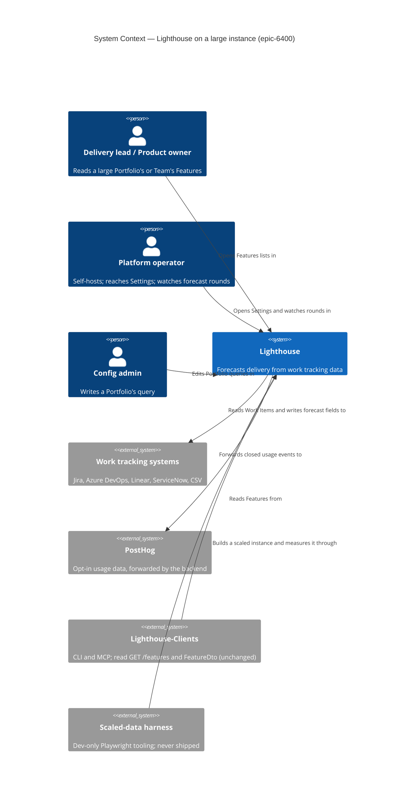
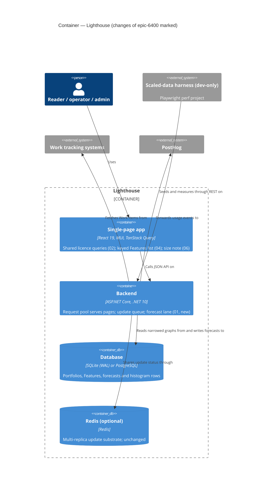
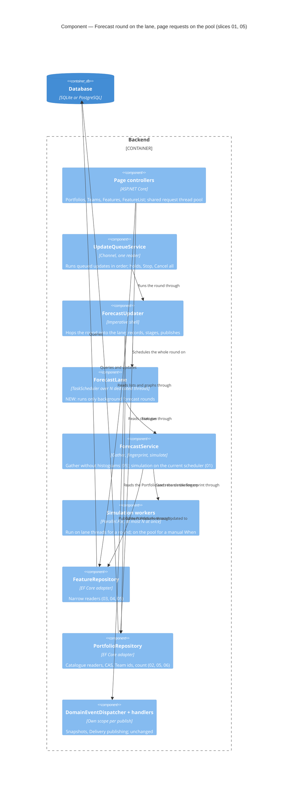

# Feature Delta — epic-6400-fast-with-many-features

**ADO**: Epic #6400 *Lighthouse stays fast with many Features* (state Planned, no child Stories). It replaces Story
#6351 (*Features list opens fast on large Portfolios*, removed so its scope is re-sliced here). Related, shipped:
Epic #6311 *Keep Lighthouse responsive during updates* (forecast bounded to half the cores, in v26.10.19.10) and
Story #6354 *Updates that change nothing skip the forecast* (Resolved, on `main` after the v26.10.19.10 tag).

**Waves**: DISCOVER (2026-10-23), revised the same day after the maintainer's answers and the peer review. Reporter:
Steve Pereira, a customer with Portfolios of 400–920 Features across 8 Teams. No live interview. The evidence:
- the reporter's own description of the Overview and the Features list (Epic #6400 text, and the maintainer's
  answers, 2026-10-23);
- a log excerpt from 2026-10-20 on v26.10.19.10, as transcribed by the maintainer (see Maintainer answers);
- a read of the code at `ead31f93f`.

**One line**: on a large instance, the screens that list Portfolios, Teams and Features read far more than they show,
and much of it scales with **every Feature of the instance**. On top of that, every Team or Portfolio update starts a
forecast that runs for 4–8 minutes over all Features of the Teams involved, and the server stalls while it runs.

**Population served**: instances with Portfolios of a few hundred Features or more. The maintainer expects people to
start out with Portfolios that size (Maintainer answers, 7). Today the evidence comes from one such instance.

**Density**: `lean`, Tier-1 `[REF]` only. `evidence_standard: past_behavior`. Each claim is graded as
**observed behaviour** (a log or measurement), **second-hand report** (of past behaviour), **stated intent**, or
**desk/codebase fact**. Paths are relative to `Lighthouse.Frontend/src/` or `Lighthouse.Backend/Lighthouse.Backend/`.

**Evidence ledger**:
- **Opportunities**: of 10, 4 rest on observed or second-hand behaviour (O3, O5, O9, O10), 2 on stated intent (O1's
  staggered-loading shape, O7), and 4 on desk/codebase fact alone (O2, O4, O6, O8).
- **Where-the-time-goes rows**: all 13 (W1–W10) are desk/codebase fact.
- **Observed behaviour**: limited to the 2026-10-20 log readings and the one ≈50 s list reading.
- **Measurements**: none of our own yet.

---

## Wave: DISCOVER / [REF] Maintainer answers — 2026-10-23

These answer the open questions from the first pass of this wave. No customer, Portfolio, Team or tracker names are
recorded here.

| # | Question | Answer | Effect here |
|---|---|---|---|
| 1 | Version when the heartbeat log was taken | **v26.10.19.10**, the latest release. It **includes** Epic 6311's half-the-cores limit and does **not** include Story 6354. | Stalls during forecasts persist with the limit in place (X5). |
| 2 | Does the 920-Feature Features tab ever finish? | **Yes, after about 50 seconds.** One second-hand reading; whether a forecast was running then is unknown (A13). | Reference symptom for the list. The "never loads, URL too long" hypothesis is invalidated (X6). |
| 3 | Is navigation clickable while the Overview's wheel spins? | **Unknown.** The reporter's own description, paraphrased: opening the Overview often shows a loading wheel when they only want to get into Settings. They would like loading staggered, so the basic scaffold and links (a cached list of Portfolios, Teams and connections) build the page at once and the rest loads in the background. Being held on the Overview is second-hand past behaviour; staggered loading is **stated intent**. | The code finding (W1, links render without waiting) stands. The gap between the report and the code is recorded as unvalidated (A12). |
| 4 | Instance size, database, cores, hosting | **Unknown** beyond a log excerpt of 2026-10-20 on v26.10.19.10 (readings below). | Modelling defaults kept and marked **assumed** (Measurement plan). |
| 5 | System Administrator, RBAC | **RBAC off.** | Every caller is treated as a System Administrator, so the header's Update All button and its extra `/teams` + `/portfolios` pair are on every page. |
| 6 | HAR from the reporter | **None.** | Measurement uses only the scaled data set. |
| 7 | Is a 920-Feature Portfolio a mistake? | **Probably too big, but assume people will start out with Portfolios that size. Lighthouse must cope with it; the warning is a nudge, not the fix.** Threshold 100 stays as the default for DISCUSS to confirm. | O7 stays last; it cannot stand in for the speed work. |
| 8 | Dependency verdicts from a light projection | **Yes.** | D3 holds. |
| 9 | Targets | **Accepted**: first navigation paint < 1 s and first Feature row < 2 s at 920 Features on 4 cores, idle and during a forecast. Revised after the baseline. | K1, K2 (Targets). |
| 10 | Scaled-data generator | **Dev-only.** | Not shipped, no demo scenario. |
| 11 | Paging | **A later Epic.** | Out of scope. |

**Log readings, 2026-10-20, v26.10.19.10.** Grade: observed behaviour, second-hand. These are the maintainer's
transcription of a raw log that is not retained in this repository.

| Round | Forecast | Notes |
|---|---|---|
| Team update (mode=Delta), scanned 71, fetched 0 | 269,719 ms | Nothing changed. On `main`, Story 6354 would skip this round's simulation and save; the gather still runs (W8b). |
| 400-Feature Portfolio update, fetched 1 | 269,746 ms | Update duration 372,736 ms. |
| Team update, scanned 454, fetched 10 | 483,083 ms | Update duration 22,879 ms; the forecast takes 21× as long as the refresh. |
| 920-Feature Portfolio update, fetched 7 | 263,949 ms | Update duration 856,032 ms (≈14 min). About 13 min of that passes between "Updating Features for Portfolio" and the parent-details fetch, so most of it is the read from the work tracking system. |

- Each forecast run names **8 Teams** ("for all Features with involved Teams"). Every run took **264–483 s**.
- A forecast is started by every Team update and every Portfolio update, and covers all Features of all Teams
  involved. With hourly Team and Portfolio updates, that is several 4–8 minute runs per hour.
- **Kestrel heartbeat warnings appear only during forecast runs**: nine readings across the four rounds, 18.5,
  11.8, 18.4, 29.2, 12.7, 1.4, 49.3, 23.9 and 20.0 s.
- Afterwards the operator used **Cancel all**: 5 refreshes stopped, 2 held updates let go.

---

## Wave: DISCOVER / [REF] Persona IDs

| Persona | Role here |
|---|---|
| `delivery-lead-rte` | **Primary.** Opens a large Portfolio's Features list to read dates and progress; waited ≈50 s on the 920-Feature list. |
| `delivery-forecaster`, `product-owner` | **Primary, same screens.** Read the Features list on a Portfolio or a Team. |
| `platform-operator` | **Primary for the forecast stalls; secondary for the Overview.** Wants to get into Settings without waiting on the Overview, and pressed Cancel all after the long forecasts on 2026-10-20. |
| `config-admin` | **Secondary, area 3 only.** Sets up the Portfolio query that returns too many Features. |

No new persona.

| Job | Status |
|---|---|
| `job-operator-keep-lighthouse-usable-while-it-forecasts` (Epic 6311, reused by Story 6354) | **Reused**, now with evidence that it is still under-served on a release with the 6311 limit (heartbeat warnings only during forecasts, 1.4–49.3 s). |
| *(candidate)* "When I open a large Portfolio or Team, I want its Features to appear quickly, so I read dates without waiting through a spinner on every visit." | **Not created.** DISCUSS adds it to `docs/product/jobs.yaml`. It is distinct from the reused job if the list is slow with no forecast running, which is falsifier (a) in the Handoff waiver. |
| *(candidate)* "When I open Lighthouse to change a setting, I want the navigation and the lists of Portfolios, Teams and connections at once, so I am never held by data I did not come for." | **Not created.** Its shape comes from the reporter's stated intent (Maintainer answers, 3). DISCUSS decides whether it is its own job. |

No journey created or extended. The closest is `docs/product/journeys/epic-6311-responsive-during-updates.yaml`. Its
error path reads: "Pages still hang with the bounded simulation → the incident has a second cause". The 2026-10-20 log
is that situation, observed. DISCUSS decides whether to extend that journey or seed
`epic-6400-fast-with-many-features.yaml`.

---

## Wave: DISCOVER / [REF] Opportunity statement

The outcome: on an instance with hundreds of Features per Portfolio, a user can move around Lighthouse, open a
Portfolio's or Team's Features list, and keep doing both while forecasts run. They never wait on work the page does
not need, and they never mistake a slow or failed load for an empty or finished one.

| # | Opportunity (outcome form) | Evidence | Grade |
|---|---|---|---|
| O1 | Minimise the time from opening Lighthouse to a usable navigation and list of Portfolios, Teams and connections | Reporter held on the Overview (second-hand); staggered-loading wish; W1, W2, W3 | **stated intent** for the shape; second-hand report for the wait; desk/codebase fact |
| O2 | Minimise what the server reads to answer "which Portfolios and Teams exist" and "this one Portfolio" | W2, W3, W3b | desk/codebase fact |
| O3 | Minimise the time to the first Feature row on a large Portfolio or Team | One ≈50 s reading on the 920-Feature list; W4–W6, W10 | second-hand report (one reading); desk/codebase fact |
| O4 | Minimise the share of each list request that scales with every Feature of the instance (dependency graph, in-progress lookup) | W4, W5 | desk/codebase fact |
| O5 | Minimise the time requests wait while a forecast runs (isolation: responsiveness, whatever the forecast costs) | Nine heartbeat warnings, 1.4–49.3 s, only during four forecast rounds, on v26.10.19.10; W8 | observed behaviour (log, second-hand) |
| O6 | Minimise the likelihood that a failed or empty list reads as "still loading" | W7 | desk/codebase fact |
| O7 | Minimise the likelihood that a user builds a Portfolio far larger than they need without knowing what it costs | Epic text, area 3; maintainer: "a nudge, not the fix" | **stated intent** |
| O8 | Minimise repeat cost on return to a list the user saw minutes ago | W6 (full refetch on every completed update) | desk/codebase fact |
| O9 | Minimise how long a forecast round runs and how often it repeats (cost reduction) | 264–483 s per run, several per hour, 8 Teams per run; a skipped round still gathers (W8b) | observed behaviour (log, second-hand); desk/codebase fact |
| O10 | Minimise how long a large Portfolio's read from the work tracking system takes | ≈13 of 14 min on the 920-Feature Portfolio update | observed behaviour (log, second-hand). **Candidate for a separate Epic** |

### Opportunity tree

All scores below are **provisional desk estimates**, re-scored on measured shares once the baseline exists (G2).

```
Outcome: Lighthouse stays quick to move around and read on instances with hundreds of Features per Portfolio,
         also while it forecasts
 |
 +-- Responsiveness (isolation): other work does not stall the page you are on
 |     +-- O5 Requests keep answering while a forecast runs                                    provisional 17
 |           +-- request paths async end to end, so a long read does not hold a pool thread
 |           +-- simulation and the forecast's gather/save off the shared request pool
 |
 +-- Cost reduction: each page and each forecast does less work
 |     +-- O2 Scoped server reads (lists and by-id reads stop loading forecasts and histograms)  provisional 15
 |     |     +-- Portfolio/Team list endpoints project id+name+counts; GetById filters in the database
 |     |     +-- FeatureRepository.GetByPredicate filters in the database
 |     +-- O3 + O4 Features list: lighter payload and light instance-wide parts                 provisional 15
 |     |     +-- dependency graph from a projection (ids, references, Portfolios)  (maintainer: yes)
 |     |     +-- in-progress answered as ids from one query, not one whole-table read per Feature
 |     |     +-- a list endpoint keyed by Portfolio/Team id, only the shown columns, parents folded in
 |     +-- O1 Scaffold first (navigation and entity lists before heavy data)                    provisional 14
 |     |     +-- licence-restriction counts from one cheap, shared call instead of /teams + /portfolios per hook
 |     |     +-- one shared, cached authorization summary and licence status (TanStack Query, already in App.tsx)
 |     +-- O9 Fewer and shorter forecast rounds                                                  provisional 13
 |     |     +-- Story 6354 reaches the reporter in the next release (saves simulation and save, not gather)
 |     |     +-- a cheaper gather, so a skipped round is cheap too
 |     |     +-- coalesce rounds that overlap (a Team in N Portfolios, Team then Portfolio update)
 |     +-- O8 Client caching on return; no full refetch on every completed update               provisional 9
 |
 +-- Honest states
 |     +-- O6 A failure look and an empty look for the Features list                            provisional 12
 |
 +-- Nudge
 |     +-- O7 Too-many-Features warning (log and/or Portfolio validation)                        provisional 7 (intent)
 |
 +-- (separate Epic) O10 Faster large reads from the work tracking system
 +-- (later Epic, maintainer) Paging / server-side sort and filter
```

Scores use Importance + max(0, Importance − Satisfaction), 1–10 each, as desk estimates from the code and the log,
not from user ratings. They rank by strength of evidence, not by measured cost.

**Independently shippable** (CLAUDE.md "Each Epic ships on its own"):
- O5, O2, O3+O4, O1, O6 and O7 each deliver value alone.
- O9 partly ships with Story 6354 in the next release; a cheaper-gather or coalescing slice stands alone.
- O8 is worth little until O2 and O3 cut the cost of each read.
- O10 belongs to the connectors, not to this Epic.

---

## Wave: DISCOVER / [REF] Where the time goes (static evidence)

Read on 2026-10-23 at `ead31f93f`. Counts below are **requests per open**, as a function of the Portfolio's Teams
(T). Payload and server work also grow with the Portfolio's Features (F) and, where marked, with **all Features of
the instance (F_all)**.

Two kinds of read recur:
- **P\***: one read of every Portfolio with every Feature, its Team work and its completion forecasts with their
  histogram rows.
- **F\***: one read of every Feature with its Portfolios, Team work, completion and start forecasts with their
  histogram rows, and its dependency links.

All reads below are synchronous EF calls on the request thread unless noted.

| # | Fact | Evidence |
|---|---|---|
| W1 | **Navigation is not gated.** The desktop header renders Overview, Features and System Settings without waiting on anything; the Overview's wheel wraps only the page body. Why the reporter still feels held there is open (A12). | `components/App/Header/Header.tsx:61-66, :150-158`; `pages/Overview/OverviewDashboard.tsx:427` |
| W2 | **The Overview reads every Portfolio's Features and forecast histograms to show names.** `GET /portfolios` loads all Portfolios with Features → FeatureWork → Team → connection options, and Features → Forecasts → SimulationResults. The DTO keeps only each Feature's id and name. `GET /teams` loads all Portfolios the same way. | `API/PortfoliosController.cs:36-61`; `Services/Implementation/Repositories/PortfolioRepository.cs:54-58, :100-111`; `API/DTO/PortfolioDto.cs:16-18`; `API/TeamsController.cs:38-70` (`:47`) |
| W3 | **`/teams` + `/portfolios` are fetched again by every `useLicenseRestrictions()` instance, only to count them.** Each instance keeps its own state and fires `/license`, `/teams` and `/portfolios`. 23 call sites outside tests (search: `useLicenseRestrictions\(\)` in `Lighthouse.Frontend/src`, excluding `*.test.ts*`), among them the header's Update All button (on every page with RBAC off), the Overview, `PortfolioDetail`, `useFeatureOrdering` (inside every Features list) and `DataGridBase` (every grid). First Overview load: 3× `/portfolios` + 3× `/teams` = **6 P\***. | `hooks/useLicenseRestrictions.ts:28-54` (`:31-35`); `components/App/Header/UpdateAllButton.tsx:18`; `OverviewDashboard.tsx:152, :186-190`; `pages/Portfolios/Detail/PortfolioDetail.tsx:193-194`; `hooks/useFeatureOrdering.ts:46`; `components/Common/FeatureListDataGrid/FeatureListDataGrid.tsx:48, :136`; `components/Common/DataGrid/DataGridBase.tsx:181` |
| W3b | **Reading one Portfolio reads all of them.** `GetById` runs `SingleOrDefault` on an `IEnumerable`, so every Portfolio with its Features and histograms is loaded and then filtered in memory. The detail page calls it twice in series (portfolio, then settings), then reads T Team settings. The Team page and the forecast updater read all Portfolios the same way. | `PortfolioRepository.cs:60-66`; `API/APIHelpers.cs:20-31`; `PortfolioDetail.tsx:196-231` (`:209, :211-213`); `API/TeamController.cs:57`; `Services/Implementation/BackgroundServices/Update/ForecastUpdater.cs:125, :156` |
| W4 | **The Features list reads the whole Feature table, with histograms, to answer dependencies, twice.** `GET /features/ids` loads the requested Features (filtered in the database, ordered in memory). Then `WhatTheseFeaturesWaitOn` loads **every** Feature with all includes for the dependency verdicts. The parent column's `GET /features/references` takes the same path, so the whole table is read a second time. The whole graph is read on purpose, so two screens never disagree on a dependency. But it needs only ids, references and Portfolios, not forecasts. | `API/FeaturesController.cs:76-100, :214-231` (`:217` sync `ToList`), `:241-266` (`:254-256`); `Services/Implementation/Repositories/FeatureRepository.cs:40-43, :66-80`; `hooks/useParentWorkItems.ts:24-65` (`:42`) |
| W4b | **Move permissions and the global order are cheap.** Move verdicts are one RBAC lookup per page and an in-memory loop. Positions are a three-column `AsNoTracking` projection of all Features, ordered in memory. | `Services/Implementation/Authorization/FeatureMoveAuthorization.cs:15-30`; `Services/Implementation/FeaturePositionMap.cs:24-38`; `FeaturesController.cs:219, :225` |
| W5 | **"In progress" reads the whole Feature table once per in-progress Feature, per Team.** `GetCurrentFeaturesInProgressForTeam` calls `featureRepository.GetByPredicate` per parent reference. That method loads every Feature with all includes and filters in memory. The result is cached per Team per day for the refresh interval, and every Team refresh runs it too (`UpdateFeatureWipForTeam`). The endpoint returns full `FeatureDto`s; the list uses only `referenceId`. | `Services/Implementation/TeamMetricsService.cs:31-72` (`:43`), `:908`; `FeatureRepository.cs:50-53`; `Services/Implementation/BaseMetricsService.cs:947-965, :1357`; `API/TeamMetricsController.cs:126-138`; `pages/Portfolios/Detail/PortfolioFeatureList.tsx:25-41, :84-99` |
| W6 | **Requests per Portfolio Features tab open** (arriving from the Overview, header already mounted), in order:<br>1. The detail page reads `getPortfolio`, then settings (2 P\*, in series), then T Team settings.<br>2. The list reads `features/ids` (F\*) and T × `featuresInProgress` (up to k_t × F\* each on a cache miss).<br>3. After the rows arrive, it reads `features/references` (F\*).<br>4. Alongside, three `useLicenseRestrictions` mounts each fire `/license`, `/teams` and `/portfolios` (6 P\*), plus one authorization summary and two update-status reads.<br>In all, about **2T + 15 requests, 8 P\* and 2 F\*** before the list is complete. Every completed Features or Forecasts update for the Portfolio re-runs the whole chain. | `PortfolioDetail.tsx:196-231, :304-318, :344-366`; `PortfolioFeatureList.tsx:61, :70-99`; W3, W4, W5 |
| W6b | **The Team Features list has the same shape**: `features/ids`, one `featuresInProgress`, `features/references`; the Team page reads all Portfolios (W3b). A Team's Features span Portfolios, so its list can be longer than any one Portfolio's. | `pages/Teams/Detail/TeamFeatureList.tsx:41, :56-80, :139` |
| W6c | **Each row's payload grows with the Feature's Teams.** Per Feature: four completion and four start percentiles. Per Team: a start and a completion forecast at four percentiles, plus remaining and total work. Also dependencies and Portfolios. | `API/DTO/FeatureDto.cs:22-80` |
| W7 | **The Features list has no failure look and no empty look.** `loading={features.length === 0}`, so a failed request (logged to the console only) or a Portfolio with no Features shows the loading placeholders forever. Minor note: the ids travel in the query string, but the 920-Feature list does load (X6), so this is not a cause of the slowness. | `PortfolioFeatureList.tsx:74-82, :142`; `TeamFeatureList.tsx:139`; `services/Api/FeatureService.ts:25-43` |
| W8 | **The forecast round is the prime suspect for the stalls.** On a release that already has Epic 6311's limit (`Parallel.For` with `MaxDegreeOfParallelism = max(1, cores/2)` inside `Task.Run`), heartbeat warnings appear only during forecasts. Each run still holds pool threads:<br>• up to half the cores' worth of `Parallel.For` workers, plus the thread that waits on them;<br>• the update queue's own loop thread;<br>• a synchronous gather that reads every Portfolio (`GetById`, P\*) and every Feature of the involved Teams with histograms;<br>• a save that rewrites the histograms of all those Features.<br>Every request that arrives meanwhile blocks one more pool thread in its own synchronous P\*/F\* read. Which of these dominates is unmeasured: simulation, gather and save, request reads, or GC pauses from large tracked graphs. | `Services/Implementation/Forecast/ForecastService.cs:82-107, :112-119, :145-154, :205-221`; `Models/Forecast/ForecastSimulationLimits.cs:17, :25`; `Services/Implementation/BackgroundServices/Update/UpdateQueueService.cs:796-800`; `ForecastUpdater.cs:125, :156` |
| W8b | **A forecast covers every Feature of every Team involved, not only the Portfolio's.** Every Team update and every Portfolio update starts one. **Story 6354 saves the simulation and the save, not the gather.** `TheFeaturesWorkedOnBy` and `Gather` run before `IsUnchangedSinceRecorded`, because the fingerprint is built from the gathered inputs. A skipped round therefore still reads all Features of the involved Teams and their throughput. | `ForecastService.cs:89-96` (`:89` read, `:93` gather, `:94` fingerprint, `:96` compare), `:102-104` (simulate, save); log readings above |
| W9 | **Small but real.** `useRbac()` fires its own authorization-summary request per mount (16 call sites, 3 on the Overview). TanStack Query is set up but used only for child items. `ApiHelpers` blocks on `.Result` only for an already-completed task. SQLite runs in WAL mode, so a forecast's save does not block readers. | `hooks/useRbac.ts:29-55`; `App.tsx:237`; `components/Common/FeatureListDataGrid/useFeatureChildItems.ts:31`; `API/APIHelpers.cs:12`; `Data/DatabaseConfigurator.cs:67-68` |
| W10 | **Client-side work for the list**, expected small at 100 rendered rows but not measured:<br>• Every `FeatureDto` is deserialised.<br>• Hide-completed filters in memory.<br>• The community DataGrid paginates on the client at 100 rows a page, with `getRowHeight={() => "auto"}`, so each visible row is measured after it renders.<br>• Per row: `FeatureProgressIndicator` maps the row's Teams, and `getActiveWorkTeams` filters involved Teams against in-progress ids.<br>• `useFeatureChildItems` and `useParentWorkItems` run once per list, not per row.<br>• When the parents arrive, the columns `useMemo` (keyed on `parentMap`) changes, so the whole grid re-renders once more. | `services/Api/FeatureService.ts:41`; `services/Api/BaseApiService.ts:206`; `FeatureListDataGrid.tsx:54-58`; `components/Common/DataGrid/RowRangeFooter.tsx:11`; `DataGridBase.tsx:358-373` (`:369`, `:372`); `components/Common/FeatureListDataGrid/FeatureProgressIndicator.tsx:90`; `PortfolioFeatureList.tsx:61, :69, :104-125` (`:124`), `:127-134` |

What follows:

- **W2 + W3 + W3b** explain a slow Overview and a slow start to every detail page, even with no forecast running.
  The scaffold is expensive because the cheap lists are served, several times, from the most expensive read in the
  product.
- **W4 + W5** are the instance-wide part of the Features list (the Epic's "whole dependency graph"). By the code,
  the global order and move permissions (W4b) are not where the time goes.
- **W8 + W8b**: on a release with the half-cores limit, the stalls still line up with forecast runs, so the forecast
  round stays the prime suspect. The request reads make it worse. Story 6354 removes the simulation from unchanged
  rounds but not the gather. The measurement has to split simulation, gather, save and request reads.
- **W10** has to be measured so the ≈50 s can be split into server, network and client time.

---

## Wave: DISCOVER / [REF] Validated assumptions

Risk score = Impact×3 + Uncertainty×2 + Ease×1 (interviewing-techniques skill); >12 test first. The two symptom
claims are kept apart; neither carries the other.

| # | Assumption | Evidence | Confidence | Risk |
|---|---|---|---|---|
| V1a | **Forecast stalls**: requests stall while forecasts run, on the current release. | Nine heartbeat warnings (1.4–49.3 s) across four forecast rounds, only during those rounds; v26.10.19.10, 2026-10-20. Observed, second-hand (maintainer transcription). | **High** that the stalls happen and coincide with forecasts; their cause inside the round is unmeasured (W8). | 13 |
| V1b | **List slowness**: the 920-Feature Features list is slow on the current release. | One second-hand reading, ≈50 s. Whether a forecast overlapped it is unknown (A13); by the round frequency in the log, the prior for an overlap is about 20–80%, so this reading is not independent of V1a. | **Low-Medium.** A single reading; falsifier (a) in the Handoff waiver tests it (idle under ~10 s fails the claim; the target K2 is a separate < 2 s). | 14 |
| V2 | The Features list's server work scales with the whole instance, not the Portfolio. | W4, W5. | **High** for the mechanism; its share of any slowness is unmeasured (A11). | 9 |
| V3 | The Overview and every detail page pay for reads they do not show. | W2, W3, W3b. | **High** for the mechanism; share unmeasured. | 9 |
| V4 | The Team Features list has the same cost as the Portfolio one. | W6b. | **High** (same endpoints). | 6 |
| V5 | Client caching is cheap to add. | TanStack Query already set up (`App.tsx:237`) and in use (`useFeatureChildItems.ts:31`). | **High** for feasibility. | 5 |
| V7 | Lighthouse must cope with 920-Feature Portfolios; a warning does not replace the speed work. | Maintainer decision 2026-10-23 (Q7). | **Decision**, not evidence. | — |

---

## Wave: DISCOVER / [REF] Invalidated assumptions

| # | Assumption (as stated or implied) | Evidence against |
|---|---|---|
| X1 | "Move permissions are part of the list's cost." | One RBAC lookup per page and an in-memory verdict per row (`FeatureMoveAuthorization.cs:15-30`, written for 500 Features). **Challenged on the code**; the measurement confirms. |
| X2 | "Reading the global forecast order is part of the cost." | A three-column `AsNoTracking` projection (`FeaturePositionMap.cs:24-28`): instance-wide, but light. **Challenged on the code.** |
| X3 | "The Overview's loading wheel is a page-side gate in front of navigation." | The header's links render without waiting on anything (`Header.tsx:150-158`). **Challenged on the code.** The reporter's experience is real but unexplained (A12). |
| X4 | "The Overview needs heavy data and should load it in the background." | It shows names and counts. The heavy data is read only because the repository's includes load it (W2). The reporter's wish is met by not reading it at all. |
| X5 | "Epic 6311's half-the-cores limit removed the stalls during forecasts" (leaned on in the first pass of this wave). | **Invalidated.** The 2026-10-20 log on v26.10.19.10, which has the limit, shows nine heartbeat warnings, only during forecast runs. |
| X6 | "The 920-Feature list never loads, because 920 ids in the URL exceed Kestrel's 8 KB request line" (was A8). | **Invalidated.** It loads, after about 50 s (maintainer, Q2). |
| X7 | "Story 6354 removes the cost of an unchanged forecast round." | **Corrected.** It removes the simulation and the save; the gather still runs before the comparison (W8b, `ForecastService.cs:89-96`). |

---

## Wave: DISCOVER / [REF] Unvalidated assumptions (need measurement or answer)

| # | Assumption | Why it matters | Risk |
|---|---|---|---|
| A11 | The instance-wide reads dominate over the Portfolio-sized ones. | Instance size, database, cores and hosting are unknown; the scaled data set uses assumed values. **Unvalidated — needs measurement.** | 13 |
| A12 | The reporter is held on the Overview because the Settings page's own requests wait behind a busy server, not because navigation is blocked. | It separates client work (O1) from server work (O2, O5). Alternatives: the reporter's network, browser or proxy. **Unvalidated — settled by the disconfirmation check.** | 12 |
| A13 | The ≈50 s reading was taken with no forecast running. | If a forecast was running, part of the 50 s belongs to O5, not O3/O4. **Prior (added in DIVERGE)**: several 4–8 minute rounds an hour keep a forecast running roughly 12–48 minutes of every hour, so a random reading overlaps one about **20–80%** of the time. The list symptom is therefore not independent of V1a. **Unknown; the measurement takes both readings.** | 10 |
| A14 | Story 6354, once released, shortens a large share of the reporter's forecast rounds. | Only the no-change round in the log would be skipped, and that one only in simulation and save; its gather still runs. The three rounds that fetched 1, 7 and 10 items would compute in full. **Unvalidated — gather time measured in step 6; reporter's log after the next release.** | 10 |
| A10 | A warning at about 100 Features leads some users to narrow their query. | A nudge only (V7). Stated intent. **Unvalidated — DISCUSS confirms the threshold.** | 7 |

---

## Wave: DISCOVER / [REF] Dropped options

| Option | Why dropped |
|---|---|
| Defer the Overview's heavy data to the background (area 1 as written) | The Overview needs none of it (X4). Not reading it is cheaper than reading it later. |
| Answer dependencies only from the requested Features | Rejected in code on purpose: the same dependency would be warned about on one screen and silent on another (`FeaturesController.cs:241-248`). The graph stays whole and becomes lighter (maintainer, Q8). |
| Paging | Maintainer: a later Epic (Q11). |
| The warning as the answer to large Portfolios | Maintainer: Lighthouse must cope with them; the warning is a nudge (Q7). |
| Faster reads from the work tracking system (O10) inside this Epic | ≈13 min of the 920-Feature Portfolio update is the tracker read. That is a connector concern with its own evidence and risks, so it is recorded as a candidate separate Epic. |
| Moving the id list out of the URL as a fix | Not a cause (X6). A list endpoint keyed by Portfolio or Team id removes it anyway. |

---

## Wave: DISCOVER / [REF] Targets (proposed KPIs)

| # | Target | Status |
|---|---|---|
| K1 | First navigation paint < 1 s, and Settings usable < 1 s after opening the Overview, idle and during a forecast round. | Accepted by the maintainer (Q9) for navigation; the Settings half is added here, proposed. |
| K2 | First Feature row < 2 s at 920 Features on 4 cores, idle and during a forecast round. | Accepted (Q9). Revised after the baseline. |
| K3 | While a forecast round (computed or skipped) runs over a 920-Feature Portfolio and its 8 Teams, K1 and K2 still hold, and Kestrel logs no heartbeat warning. | Proposed. This is O5's target. |
| K4 | Duration of a computed forecast round, and of a skipped one, at 8 Teams. | Proposed. The figure is set after the baseline; O9 is in scope through this KPI. |
| — | The ≈856 s 920-Feature Portfolio update, ≈13 min of it the tracker read (O10). | **Out of scope** for this Epic's KPIs. A candidate separate Epic, because the time is spent in the connector's read, not in anything this Epic changes. |

---

## Wave: DISCOVER / [REF] Decision gate

| Gate | Status | Why |
|---|---|---|
| G1 Problem | **PASS on the stall symptom; CONDITIONAL on the list symptom** | **Passes on symptoms, not on a causal argument.**<br>(1) **Forecast stalls (V1a)**: nine heartbeat warnings across four forecast rounds on v26.10.19.10, the current release. Observed, second-hand. **Pass.**<br>(2) **List slowness (V1b)**: one second-hand ≈50 s reading, and whether a forecast overlapped it is unknown (A13). **Conditional** on an independent falsifier: if the idle 920-Feature list on the seeded scaled instance loads in under about 10 s, the 50 s is environmental (a forecast running, the reporter's network or host), and G1 fails for the list claim. The stall claim stands either way.<br>**Falsifier vs target (clarified in DIVERGE, 2026-10-23)**: the ~10 s falsifier is a go/no-go for the *claim*, not the target. The target is K2, first row under 2 s. Between 2 s and 10 s the claim stands and the target is unmet.<br>Forecast timings are used only to calibrate the data set, by ratio (forecast round vs list load), never as absolute seconds on hardware we do not know.<br>**Why the five-informant threshold does not fit:** that threshold tests whether a pain is shared across people's judgement. A performance symptom is a measurable property of the software at a given data size, so one reproduction on a representative data set tests it more directly than more opinions would. Who is affected is then a question of how many instances reach that size (Population served). |
| G2 Opportunity | **PENDING** | Ten opportunities, scores provisional. The causal claim moves here as a hypothesis, not a finding: the mechanism is deterministic code whose cost grows with every Feature of the instance (W2–W5) and every Feature of the involved Teams (W8b), so **if A11 holds**, any instance of that size would hit it. A11 is unvalidated. G2 passes when the baseline ranks opportunities by measured share of the time and the maintainer accepts the slice order. |
| G3 Solution | **PENDING** | Nothing tested. Here, tested means before/after readings on the scaled data set against K1–K4, taken by DELIVER for each slice. |
| G4 Viability | **CONDITIONAL** until G2 and G3 pass | Lean Canvas N/A: this is a free performance change to an existing product, with no new revenue, channel or pricing. The four risks, each with its evidence:<br>• **Value: amber.** The symptoms are observed on the current release, but on one instance (V1a, V1b). The maintainer states that instances will start at that size (Q7), which is stated intent.<br>• **Usability: green.** Same screens, with loading and failure looks added under the existing CLAUDE.md rule; nothing new to learn.<br>• **Feasibility: amber.** Each candidate fix uses a pattern already in the code: projections (`FeaturePositionMap.cs:24-28`), TanStack Query (`useFeatureChildItems.ts:31`), bounded parallelism (`ForecastService.cs:205-211`). Async EF on the request paths is a wide change, and its share of the stall is unmeasured.<br>• **Viability: green.** No licence change; dependency projection approved (Q8).<br>The maintainer's answers of 2026-10-23 are a direction, not yet a go on a measured case. |

---

## Wave: DISCOVER / [REF] Handoff waiver (maintainer, 2026-10-23)

**AGREED** by the maintainer on 2026-10-23. G2 and G3 stay pending; the measurement moves into the Epic itself.

- **DIVERGE starts now.** It works on directions, not on slice order.
- **DISCUSS goes ahead without readings first.** It makes the measurement the Epic's **first slice**: the dev-only
  scaled data set (P1) and a before/after harness. Every later slice proves its gain with it.
  - **Correction (DIVERGE, 2026-10-23)**: this used to say the slice "ships value on its own". It does not. It is an
    internal enabler, dev-only, with no user-visible value. The Epic's first user-visible value is the next slice,
    which takes the forecast round off the request pool (`recommendation.md`).
  - That slice takes **(a)** the idle 920-Feature list (time to first row and requests per open, G1's independent
    falsifier for the list claim: < ~10 s means the list claim fails), **(b)** the client-side split of that load
    (server, network and client time, W10), and the forecast-round timings (gather, simulation and save apart) with
    the thread-pool and GC statistics during a round.
- **DISCUSS orders the later slices on the code evidence**, provisionally. Once the first slice's baseline is in, G2
  is re-scored on measured shares and the later slices are re-ordered if the shares say so. Each slice ships on its
  own, so a re-order costs little.
- **Accepted risk:** the order of the slices after the first rests on reading the code, not on measurement.

---

## Wave: DISCOVER / [REF] Measurement plan

**Constraints:**
- The dev instance on :5169 is not running.
- The checked-in dev DB backup holds 102 Features in 3 Portfolios (largest 86) and 3 Teams, so it cannot reproduce
  400–920-Feature cost.
- The reporter has no HAR to share (Q6).
- No measurement has been taken.

**Data set: scaled synthetic seed only**, from a dev-only generator (Q10). It writes through the CSV connector path
that the demo data uses (`Services/Implementation/DemoDataService.cs`, `WorkTrackingConnectors/Csv/`). It creates child
Work Items and dependency links, then runs forecasts so histograms exist.

| Parameter | Value | Status |
|---|---|---|
| Teams | 8, all working on the large Portfolios | from the log |
| Scale points (Features per Portfolio) | 100, 400, 920 | from the reporter, plus 100 for the warning threshold |
| Features in the whole instance | about 3,000 over 6 Portfolios | **assumed** |
| Database | both SQLite and PostgreSQL | **assumed** |
| Host | 4 cores (the target's reference), container or zip | **assumed** |
| RBAC | off | from the maintainer (Q5) |

**Calibration, by ratio**: the reporter saw forecast rounds of 264–483 s and a list of ≈50 s, about 5–10 to 1. The
seeded instance should show a forecast round that is several times its idle list time, and lasts minutes rather than
seconds. If the round takes seconds, the data set's shape is wrong (Features per Team, remaining Work Items,
throughput) and must be fixed before any baseline counts. Absolute seconds are not compared, because the reporter's
hardware is unknown.

**Protocol**:
- **Scale points**: 100, 400 and 920 Features per Portfolio, 8 Teams.
- **Repeats**: each reading is the **median of 5 runs** after one warm-up run, with the min–max spread recorded.
- **Cold start**: a reading right after a restart is recorded separately.
- **Conditions**: every reading is taken idle, and again while a forecast round over the 8 Teams runs.

**What to measure:**

1. **Requests per open** (Overview; Overview then Settings; Portfolio Features tab; Team Features tab): count and
   order, from the Playwright request log.
2. **Server time per request**, from ASP.NET Core `http.server.request.duration` or request logging, for:
   - `/portfolios`, `/teams`;
   - `/portfolios/{id}`, `/portfolios/{id}/settings`;
   - `/features/ids`, `/features/references`;
   - `/teams/{id}/metrics/featuresInProgress`.
3. **Payload bytes** per request.
4. **Database and client work**:
   - queries and rows read per request (EF command logging);
   - row counts of Features, forecasts and histogram rows in the data set;
   - on the client, a Playwright performance trace of the same opens, with long-task count and total long-task time
     and scripting versus rendering time.
5. **Times the user sees**, against K1 and K2, from Playwright performance marks:
   - time to first navigation paint;
   - time until Settings is usable after opening the Overview (A12);
   - time to first Feature row.

   Each is split into server, network and client time (W10). This yields readings (a) and (b) of the Handoff waiver.
6. **Inside a forecast round, computed and skipped** (K3, K4):
   - time in gather (including on a skipped round, W8b), simulation and save;
   - thread-pool queue length, thread count and GC pause time (`dotnet-counters`, `System.Runtime`);
   - Kestrel heartbeat warnings.
7. **Release comparison**: the same rounds on `main` (with Story 6354) and on the v26.10.19.10 tag. This shows what
   the reporter gains from the next release before any of this Epic's slices are credited with it.

**Disconfirmation check** (H4): repeat steps 1, 5 and 6 with the browser throttled to a slow connection, as CLAUDE.md
asks. If, on the scaled set, Settings is usable within K1 after opening the Overview, both idle and during a round, the
reporter's Settings wait has another cause (their network, browser or proxy), and A12 is rejected.

**Reference symptoms**: about 50 s to the 920-Feature list (one reading), forecast rounds of 264–483 s, and heartbeat
warnings up to 49.3 s. Baseline readings are recorded in this delta before any slice; each slice re-reads its own
numbers.

---

## Wave: DISCOVER / [REF] Constraints established

| # | Constraint | Evidence source |
|---|---|---|
| C1 | List reads keep RBAC readability: unreadable Portfolios are never named, and unreadable blockers are "withheld", not dropped. This holds with RBAC on, even though the reporter runs with it off. | `FeaturesController.cs:224, :273-300`; `FeatureDto.cs:66-74` |
| C2 | Dependency verdicts stay computed over the whole graph, so two screens never disagree. The data gets lighter; the answer does not change. | `FeaturesController.cs:241-248`; maintainer, Q8 |
| C3 | A Feature's position is global across the instance, numbered before RBAC filtering. | `FeaturePositionMap.cs:8-11` (ADR-135) |
| C4 | UI gating comes only from `useRbac()`; any sharing or caching of the summary lives inside it. | CLAUDE.md, Architecture |
| C5 | Every new or changed view has a loading look and a failure look. Today the Features list has neither a failure look nor an empty look (W7). | CLAUDE.md "Design for a slow connection" |
| C6 | `GET /api/latest/features` and `FeatureDto` are read by Lighthouse-Clients (CLI/MCP). New lean endpoints are additive; the existing shape stays until the clients move. | Story 6354 delta (US-02 reads `GET /api/latest/features`) |
| C7 | Schema changes (indexes, columns) are expand-only. | project memory, expand-only migrations |
| C8 | Copy uses the configurable terms (Feature, Work Item, Team, Portfolio). | CLAUDE.md; `TerminologySeeder.cs` |
| C9 | No customer company, Portfolio, Team, tracker project or issue names in git. | project rule; maintainer 2026-10-23 |
| C10 | Each Epic that DISCUSS splits off ships alone. | CLAUDE.md |
| C11 | K1–K4 (Targets). | maintainer, Q9; proposed here |
| C12 | A forecast's results stay the same. Isolating it or shortening rounds must not change what it computes. | Epic 6311 and Story 6354 invariants |

---

## Wave: DISCOVER / [REF] Key decisions

- [D1] One workspace, `epic-6400-fast-with-many-features`, carrying Story 6351's scope (see: Epic #6400 description).
- [D2] DISCOVER for a performance Epic asks three things: is it real, who it hits, and where the time goes. It does
  not test market fit. G1 passes on observed symptoms. The causal claim belongs to G2 and waits on A11 (see: Decision
  gate).
- [D3] The Epic's named suspects are re-ranked on the code. The dependency-graph read (W4) and the in-progress lookup
  (W5) are heavy; move permissions and the global order are not (X1, X2). The graph is to be built from a light
  projection (see: Where the time goes; maintainer, Q8).
- [D4] Area 1 is reframed from "load heavy data later" to "stop reading data the scaffold does not show". That answers
  the reporter's stated wish (see: X4; Maintainer answers, 3).
- [D5] Two causes the Epic did not name are recorded: the licence-restriction hook's repeated `/teams` +
  `/portfolios` (W3), and `GetById` reading every Portfolio (W3b) (see: Where the time goes).
- [D6] **Superseded** by D10. The first pass held forecast isolation until the reporter's version was known.
- [D7] No new persona, no new job in `jobs.yaml`, no journey file yet. Two candidate jobs are named for DISCUSS (see:
  Persona IDs).
- [D8] Measurement uses only a scaled synthetic data set from a dev-only generator, with assumed sizes marked and a
  median-of-5 protocol (see: Measurement plan; maintainer, Q6, Q10).
- [D9] **Handoff with G2 and G3 pending goes through the Handoff waiver, agreed 2026-10-23.** DIVERGE now; DISCUSS
  without readings first. The measurement (readings (a), (b) and the forecast-round timings) is the Epic's first
  slice; the later slices are ordered provisionally and re-ordered once G2 is re-scored (see: Handoff waiver).
- [D10] Isolation (O5) and cost reduction (O2, O3+O4, O9) are separate branches. The forecast round is the prime
  suspect for the stalls, and its gather, simulation and save are measured apart (see: W8, W8b; log 2026-10-20).
- [D11] O9 is in scope through K4. Story 6354 saves the simulation and save of an unchanged round, not its gather; its
  gain is measured on its own (step 7) before this Epic claims any of it (see: W8b, X7, A14).
- [D12] The tracker read (≈13 of 14 min on the 920-Feature Portfolio update) is out of scope, as candidate separate
  Epic O10, and is not one of this Epic's KPIs (see: Targets).
- [D13] The URL-length hypothesis is closed as a cause (see: X6).
- [D14] Lighthouse must cope with 920-Feature Portfolios. The too-many-Features warning is a nudge, with threshold 100
  for DISCUSS to confirm (see: V7; maintainer, Q7).
- [D15] Paging is out of scope, for a later Epic (see: maintainer, Q11).
- [D16] Targets K1–K2 are accepted; K3–K4 are proposed; all are revised after the baseline (see: Targets).

---

## Wave: DISCOVER / [REF] Pre-requisites

- **P1** The dev-only scaled data set and the measurement harness above, calibrated by ratio. Built as the Epic's
  first slice; the baseline it records comes before any other slice's DELIVER.
- **P2** The Premium licence fixture in the worktree, if the data set uses Premium dependency-aware forecasting
  (dependency verdicts read the licence, `DependencyDecision.cs:18-25`).
- **P3** ✓ The maintainer's yes on the Handoff waiver (2026-10-23).

---

## Wave: DISCOVER / [REF] Open questions

The maintainer answered Q1, Q2 and Q5–Q11 of the first pass on 2026-10-23 (see Maintainer answers). Still open:

1. ✓ **Handoff waiver**: answered yes on 2026-10-23, with the measurement moved into the Epic's first slice.
2. **Instance size, database, cores, hosting.** Unknown; the data set uses assumed values. *Default: keep the
   assumptions; replace them if the reporter ever shares sizes.*
3. **Is navigation clickable while the Overview's wheel spins?** (A12). Settled by the measurement and the
   disconfirmation check. *Default: no gate on the client; Settings waits behind the server.*
4. **Was a forecast running during the ≈50 s reading?** (A13). Unknown; the measurement takes both readings.
   *Default: assume it may have been, since there are several rounds an hour.*
5. **Too-many-Features threshold and placement** (A10). Left to DISCUSS. *Default: 100, a log line plus a
   non-blocking validation note.*
6. **The reporter's log after the next release** (A14), to see what Story 6354 removed on their instance. *Default:
   ask when the release is out; do not block on it.*
7. **K1's Settings half and K3–K4** are proposed here, not yet accepted. *Default: accept, revise after the baseline.*

---

## Wave: DIVERGE / [REF] Maintainer answers (DIVERGE) — 2026-10-23

Answers to the eight questions that DIVERGE handed over. No customer, Portfolio, Team or tracker names.

| # | Question | Answer | Effect |
|---|---|---|---|
| 1 | Too-many-Features nudge | Threshold 100; a log line plus a non-blocking note; last slice. Yes. | Slice 7. Copy is DISCUSS's. |
| 2 | Overlap with Epic 6264 | Default accepted ("ok fair"). | S05b stays 6264's. This Epic only adds database-side reader methods for its hot callers. 6400 lands first, and 6264's S05c–e adopt them. The S05a ratchet only shrinks. S13's Feature → Forecast navigation is left in place. Recorded for 6264's DESIGN; 6264's files are not edited. |
| 3 | Lighthouse-Clients | Keep it simple. New endpoints are additive; the clients stay on `FeatureDto` and the current Features endpoint. | C6 unchanged. |
| 4 | Hide-completed | Stays client-side. Yes. | The lean list returns all Features. |
| 5 | K1's Settings half, K3, K4 | Accepted; figures set after the baseline. | K1's Settings half is credited only when slice 1 shows the server holds Settings back (A12). |
| 6 | Harness readings as CI budgets | Not in this Epic. | — |
| 7 | Journey | Seed `epic-6400-fast-with-many-features.yaml`, and link the 6311 journey's error path. | For DISCUSS. |
| 8 | Usage data | Extend the existing "A Portfolio tab was opened" and "A Team tab was opened" events (`docs/settings/usagedata.md`) with how many Features there are. | For DEVOPS, recorded as a **closed size-bucket enum** on those two events, for example `Under100` / `100To399` / `400Plus` (DEVOPS fixes the buckets). Never the raw count, and never which Portfolio or Team. |

**Orchestrator decision, 2026-10-23.** It was taken under the maintainer's "continue autonomously", and the
maintainer may overturn it: **K3 is an exit criterion of this Epic.** Option 3's round-isolation step becomes an
unconditional slice, right after the measurement.

## Wave: DIVERGE / [REF] Job and outcomes

Full text: `diverge/job-analysis.md` (revision 1). Desk estimates, 1–10; `jobs.yaml` uses 1–5, halved and
rounded.

- **Reused**: `job-operator-keep-lighthouse-usable-while-it-forecasts`, wording unchanged. It is still under-served
  on a release with the half-the-cores limit (X5).
- **New**: `job-reach-and-read-what-i-came-for-on-a-large-instance` (`delivery-lead-rte`, `delivery-forecaster`,
  `product-owner`; `platform-operator` on the way to Settings).
  - The job: "… I want to get what I came for without waiting on data I did not ask for, so I keep using Lighthouse
    for delivery decisions instead of falling back to the tracker or a spreadsheet."
  - It merges DISCOVER's two candidates.
  - It is not independent of the stall: a random reading overlaps a round about 20–80% of the time.
- **Outcomes**:

  | # | Outcome | Target | Score |
  |---|---|---|---|
  | OS1 | Minimise the time a page waits for an answer while a forecast runs | K3 | 16 |
  | OS2 | Minimise the time to read the first Feature of a large Portfolio or Team | K2 | 14 |
  | OS3 | Minimise the time to reach the screen I came for | K1 | 10 |
  | OS4 | Minimise the time one forecast round takes | K4 | 10 |
  | OS5 | Minimise the likelihood that a slow or failed load reads as empty | C5 | 10 |
  | OS6 | Minimise the likelihood of an oversized Portfolio built unknowingly | O7 | 5 |

## Wave: DIVERGE / [REF] Comparables

Full text: `diverge/competitive-research.md`. Sources fetched 2026-10-23.

| Comparable | What it does | What it means here |
|---|---|---|
| Jira Cloud boards | A 5,000-issue display cap with a warning | An honest state at the limit; the push-back-on-size direction |
| Jira Plans | A bounded calculation; "exclude completed work" | The forecast round is the thing to bound |
| ActionableAgile | Fetches less per load | Fetch only what is shown |
| Linear (non-obvious) | Local-first sync | Its cheap half, the shell from cache, is TanStack Query's stale-while-revalidate |
| Recording rules and CQRS read models | Precompute the expensive answer | Our forecasts already are precomputed; the reads around them are what is heavy |
| .NET thread-pool starvation guidance | Diagnose with dotnet-counters; async end to end | Isolation is a lever separate from cost |

## Wave: DIVERGE / [REF] Recommendation

Full text: `recommendation.md` · artifacts: `diverge/` · decisions DV-1..DV-11: `wave-decisions.md`.
Revision 1, after peer review round 1.

- **Matrix** (weights DVF 30 / Subtraction 15 / Concept count 15 / Staging 10 / Speed-as-trust 30, with numeric
  rubrics):
  1. "Scope every read to what the screen shows" **3.95**
  2. "The forecast gets its own lane" 3.60
  3. "Shell first, then a client cache" 3.05, which wins the tie with read models (3.05) on DVF
  4. In-flight first plus a nudge 2.95
  5. Forecast less often 2.75
- **Direction: a stated hybrid.** Option 1's direction, plus Option 3's round-isolation step as slice 2: the round
  runs off the request pool, on a dedicated worker with bounded parallelism, with no async request paths. The hybrid
  scores 3.85, and 3.95 in the most likely case (S7). Under the K3 exit criterion it is the best row that moves both
  conditions.
- **Why a hybrid**: the surer problem (the stalls, V1a) and the surer code change (the scoped reads, W2–W5) sit in
  different options.
- **Endpoints**: additive; the clients stay on `FeatureDto` (C6). Forecast results are unchanged (C12).
- **Falsifier and target, separately**:
  - The falsifier is the idle 920-Feature list under ~10 s. It fails the list claim.
  - The target is K2, under 2 s.
- **Triggers**, as ratios on the scaled set:
  - Q_r is the round-attributable share of queue and heartbeat time. S_q is the request-read share of request wall
    time during a round.
  - **Dissent A**: Q_r ≥ 0.6, S_q ≤ 0.3, and idle already met. Option 3 alone would have sufficed, so slices 4–5
    become optional.
  - **Dissent B**: K3 still fails after slice 2 or at the end, and S_q > 0.3. Open the async-request-paths Epic.
  - Prior: 9 of 9 warnings inside rounds has a chance probability of p⁹ ≤ 0.13.
- **Provisional slice order** (Handoff waiver):
  1. Measurement. An **internal enabler, not user value**.
  2. The forecast round off the request pool. **K3, and the first user-visible value.**
  3. Scaffold reads. K1 idle; the Settings half is conditional on A12.
  4. The Features list's instance-wide parts, with response shapes unchanged.
  5. The lean Features list with loading, failure and empty looks. **Depends on 4.**
  6. A lighter forecast gather. It touches C12; outputs and the Story 6354 fingerprint must be identical on SQLite
     and PostgreSQL.
  7. The too-many-Features nudge at 100.

  Slices 3, 4 and 6 swap freely; 5 must follow 4; 1 and 2 are fixed first; 7 is last. Every slice states its
  loading and failure look, or "N/A, because …". Slices 5 and 7 are sketched at the start of DISTILL.
- **Candidate follow-up Epics**: async request paths (Dissent B); forecast less often; client cache; tracker read
  (O10); paging.
- **Into DISCUSS**: DISCOVER's G4 is CONDITIONAL, and G2 and G3 are PENDING (Handoff waiver). Also: confirm the K3
  exit-criterion decision with the maintainer; the nudge copy; the journey's content.

---

## Wave: DISCUSS / [REF] Prior-Wave Reading Confirmation

**Agent**: Luna (`nw-product-owner`) · **Date**: 2026-10-23 · **Mode**: autonomous subagent under the maintainer's
"continue autonomously"; decisions that are the maintainer's carry a default and are listed under "Questions for the
maintainer". Config: feature type **cross-cutting** (backend reads and the forecast round; two slices change what a
user sees), walking skeleton **depends** (brownfield, evaluated below), research depth **lightweight**, JTBD **reused
from DIVERGE, not re-run**, density lean. Per-wave peer review not run (the consolidated review runs at the end of
DISTILL).

| Read | Status |
|---|---|
| `CLAUDE.md` (no silent N/A; per-feature docs; DEVOPS usage-data question; configurable terms; sketch UI at the start of DISTILL; loading and failure looks at DESIGN; each Epic ships on its own) | ✓ |
| `feature-delta.md` DISCOVER + DIVERGE sections | ✓ |
| `recommendation.md`, `wave-decisions.md` (DV-1..DV-11) | ✓ — locked inputs |
| `diverge/job-analysis.md`, `diverge/review.yaml` | ✓ |
| `diverge/options-raw.md`, `diverge/taste-evaluation.md` | ✓ structure only; the recommendation and DV-3..DV-6 carry their results |
| `diverge/competitive-research.md` | ⊘ not read; summarised in the DIVERGE Comparables section |
| `docs/product/jobs.yaml` (both jobs) | ✓ — unchanged, no refinement needed |
| `docs/product/journeys/epic-6311-responsive-during-updates.yaml` | ✓ — its error path is linked from the new journey |
| `docs/product/vision.md` | ⊘ not found |
| `docs/product/architecture/brief.md` | ✓ outline only; nothing in it is binding beyond CLAUDE.md's hexagonal rule |
| Precedents: DISCUSS of `epic-6303-configure-once-per-connection` and `epic-6298-report-pdf-export`; `story-6354-skip-unchanged-forecasts/slices/` | ✓ |
| `epic-6264-modular-monolith/feature-delta.md` S05a–S05g, S13 | ✓ — DV-9 kept as is |
| Brownfield: `UsageDataEventName.cs`, `docs/settings/usagedata.md`, `PortfolioService.ts` (validate), `WidgetShell.tsx`, `docs/portfolios/` | ✓ (targeted, below) |

No DISCUSS decision contradicts DISCOVER evidence. Two DIVERGE wordings change (see Changed Assumptions).

---

## Wave: DISCUSS / [REF] Current-State Surface Inventory (brownfield)

| # | What exists | Where | Consequence |
|---|---|---|---|
| S1 | Header links render without waiting (W1) | `components/App/Header/Header.tsx` | K1's navigation half may already hold; slice 01a measures it before anything is credited. |
| S2 | `GET /portfolios`, `GET /teams` read every Portfolio with every Feature and its histograms (W2); their bodies are read by the clients | `PortfoliosController.cs`, `TeamsController.cs`, `PortfolioRepository.cs` | Slice 02 reads less behind **unchanged** bodies (C6). |
| S3 | 23 `useLicenseRestrictions()` mounts each fetch `/license`, `/teams`, `/portfolios` to count (W3) | `hooks/useLicenseRestrictions.ts` | Slice 02 asks once per page; the count keeps today's meaning. |
| S4 | `PortfolioRepository.GetById` loads every Portfolio and filters in memory (W3b) | `PortfolioRepository.cs:60-66` | Slice 02 (detail pages), slice 05 (forecast gather). |
| S5 | Features list: `features/ids`, `features/references`, T × `featuresInProgress`; dependency verdicts and in-progress read the whole Feature table with histograms (W4–W6b) | `FeaturesController.cs`, `TeamMetricsService.cs`, `FeatureRepository.cs` | Slice 03 (same responses), slice 04 (lean endpoint). |
| S6 | Features list shows loading placeholders forever on failure or when empty (W7); hide-completed and paging (100 rows) are client-side | `PortfolioFeatureList.tsx`, `TeamFeatureList.tsx`, `FeatureListDataGrid.tsx` | Slice 04 adds failure and empty looks. |
| S7 | Forecast round: `Parallel.For` at half the cores inside `Task.Run`; synchronous gather and save on pool threads; Story 6354's skip decides after the gather (W8, W8b) | `ForecastService.cs`, `UpdateQueueService.cs`, `ForecastUpdater.cs` | Slice 01 moves the round off the request pool; slice 05 lightens the gather. |
| S8 | Task Manager rows and Settings → System Info → Refresh History show forecast runs, skips and durations | Epic 6311, Story 6354 | The operator's existing window on a round; slices 01 and 05 are read there. |
| S9 | Usage data: `TeamTabOpened = 0`, `PortfolioTabOpened = 1`, with "which tab" as their only property; last integer on this checkout `WorkTrackingSystemFieldsChanged = 19` | `Models/UsageData/UsageDataEventName.cs`; `docs/settings/usagedata.md:43-44, :91` | The size bucket is a new closed property on two existing events, not a new event. |
| S10 | `WidgetShell` status (dimmed under a spinner, lone spinner, could-not-load) and `data-widget-status`; TanStack Query set up | `pages/Common/MetricsView/WidgetShell.tsx`; `App.tsx` | Reuse candidates for slice 04's looks and slice 02's shared count. |
| S11 | `POST /portfolios/validate` answers a boolean only; a Portfolio's Features count exists only after an update stored them | `services/Api/PortfolioService.ts:129-143` | Slice 06's note reads the stored count, not the validation. |
| S12 | Docs: `docs/portfolios/detail.md`, `edit.md`, `portfolios.md`; Team docs under `docs/teams/`; `docs/settings/usagedata.md` | `docs/` | Finalize targets. |
| S13 | Dev DB backup: 102 Features in 3 Portfolios (largest 86), 3 Teams | DISCOVER Measurement plan | Real-history **regression** data for every slice; too small for timings or the nudge. |
| S14 | Epic 6264's S05a baseline lists `FeaturesController`, `TeamMetricsService`, `PortfolioMetricsService` | `epic-6264-modular-monolith/feature-delta.md` | Every slice keeps or shrinks their entries (DV-9). |

---

## Wave: DISCUSS / [REF] Persona IDs

All names below are fictional, and so are the scaled data set's Portfolio and Team names (D29). No customer, Portfolio,
Team or tracker name from the report appears here.

| Persona | Example | Role here |
|---|---|---|
| `delivery-lead-rte` | **Martin Achterberg**, Head of Delivery. Opens Portfolio *Northwind Platform* (920 Features, 8 Teams) several times a day to read dates before steering meetings. | **Primary**, slices 03–04. |
| `product-owner` / `delivery-forecaster` | **Aisha Khan**, Product Owner of Team *Borealis*, one of the 8 Teams, with 310 Features across 3 Portfolios. Opens the Team's Features tab. | **Primary**, slices 03–04 (Team tab). |
| `platform-operator` | **Jonas Weber**. Self-hosts Lighthouse in Docker on a 4-core VM, RBAC off, hourly Team and Portfolio updates. Wants Settings without waiting; has pressed Cancel all. | **Primary**, slices 01, 02, 05. |
| `config-admin` | **Sofia Lindqvist**. Wrote Northwind Platform's query. | **Secondary**, slice 06. |

No new persona.

## Wave: DISCUSS / [REF] JTBD One-Liners

- `job-operator-keep-lighthouse-usable-while-it-forecasts` (reused, wording unchanged): while Lighthouse recalculates
  forecasts, every page keeps answering. **US-01, US-05.**
- `job-reach-and-read-what-i-came-for-on-a-large-instance` (DIVERGE, reused): on an instance with hundreds of Features
  per Portfolio, get what I came for without waiting on data I did not ask for. **US-02, US-03, US-04, US-06** (US-06
  through outcome OS6). US-01 also serves its "while one runs" half.
- The precursor Task 01a is `job_id: infrastructure-only` with a rationale (D17).
- `jobs.yaml` is not changed: both job statements fit every story as written.

---

## Wave: DISCUSS / [REF] Locked Decisions

DISCOVER used D1–D16 and DIVERGE DV-1..DV-11; this wave continues at D17. All are taken under the maintainer's
"continue autonomously". The ones the maintainer may want to overturn are repeated under "Questions for the
maintainer".

- [D17] **Slice-composition gate: the measurement is a precursor step inside Story 01, not a slice.** DIVERGE's slice
  1 holds only `@infrastructure` work, so it cannot be released alone. It lands **first, as its own commits, inside
  the slice-01 Story** (option (b) of the gate: a precursor, not a separately shipped slice), tracked as an ADO
  **Task** under that Story. Why not merge it into a later slice instead: its baseline must exist before *any* change,
  and slice 01 is the first change. Why not leave it separate: it has no user value. `job_id: infrastructure-only`;
  rationale: dev-only tooling that proves every later slice's gain; nothing a user runs.
- [D18] **Renumbering.** DIVERGE's slices 1+2 → **01**, 3 → **02**, 4 → **03**, 5 → **04**, 6 → **05**, 7 → **06**.
  The rules carry over: 01 first; 02, 03 and 05 swap freely after the baseline; 04 follows 03; 06 last. If the
  falsifier fires (idle 920-Feature list under ~10 s), 04 moves to just before 06.
- [D19] **K3 stays an exit criterion** (DV-5, orchestrator decision), flagged again for the maintainer.
- [D20] **No existing response shape changes in any slice.** `GET /portfolios`, `GET /teams`, `GET /portfolios/{id}`,
  `GET /features`, `GET /features/ids`, `GET /features/references`, `featuresInProgress` and `FeatureDto` keep their
  bodies. Slice 04's endpoint is additive. **No Lighthouse-Clients release in this Epic** (maintainer, DIVERGE Q3).
- [D21] **One lean-list slice serves both the Portfolio and the Team Features tab.** They share the grid and the
  cost (V4); two slices would differ only by owner.
- [D22] **The Features list's looks** (slice 04): loading placeholders until the first answer; after a completed
  update the rows stay, dimmed under a small spinner, and a late answer for an older request never lands; failure:
  "The {Features} couldn't be loaded." with Retry; empty: "This {Portfolio} has no {Features} yet." (or {Team}); all
  hidden by hide-completed: "All {N} {Features} are completed. Turn off Hide completed to see them." Copy is a
  default; DISTILL's sketch settles it.
- [D23] **The nudge** (slice 06): shown when a Portfolio holds **more than 100** Features (101 and up), counted from
  what its last update stored. Two places: one log line at the end of each such Portfolio update, and a non-blocking
  note on the Portfolio's **edit page**, above the query, for whoever can edit it. It never blocks Save or an update.
  Portfolio only; no Team nudge. Copy default: "This {Portfolio} holds {N} {Features}. Above 100, its pages and
  forecasts get slower. If you don't plan with all of them, narrow the query." The threshold is one constant shared
  by the note and the log line.
- [D24] **Usage data**: a closed size-bucket property on the existing `PortfolioTabOpened` and `TeamTabOpened` events
  (DEVOPS fixes the buckets, e.g. `Under100` / `100To399` / `400Plus`; never a raw count, never which Portfolio or
  Team). Emitted in **slice 01**, the slice that first makes the Epic usable, and listed in
  `docs/settings/usagedata.md` there.
- [D25] **Production-data checks, since timings come only from synthetic data.** Every slice: the dev DB backup (S13,
  real history) gives identical screens, dependency verdicts, positions and forecast outputs before and after.
  Slice 01: the reporter's first log after the release is the K3 production reading. All slices: the size bucket
  (D24) shows how many real instances are this large.
- [D26] **Evidence per slice**: the before/after readings of the harness (median of 5 after one warm-up, scaled set
  at 100 / 400 / 920, 4 cores, SQLite and PostgreSQL, idle and during a round) are recorded in this delta. They are
  not CI budgets (maintainer, DIVERGE Q6).
- [D27] **Re-score gate after the precursor.** G2 is re-scored on measured shares, Q_r and S_q are recorded, Dissent
  A/B (DV-6) are checked, and the order of 02, 03, 05 is fixed then. The result is written here before slice 01's
  isolation step starts.
- [D28] **Epic 6264 rules apply to every slice** (DV-9): only new database-side reader methods for the hot callers;
  no new `GetAllByPredicate` outside the adapters; no new controller dependency on a repository; S05a entries only
  shrink; S13's Feature → Forecast navigation stays.
- [D29] **Fictional names** for personas and for the scaled data set (*Northwind Platform* 920, *Northwind Payments*
  400, *Northwind Mobile* 100, Teams *Atlas*, *Borealis*, *Cobalt*, *Delta Ops*, *Ember*, *Fjord*, *Granite*,
  *Harbour*).
- [D30] **Licence counts keep today's meaning.** Whatever slice 02 shares, a gated action is allowed or refused
  exactly as today, with RBAC on and off. A count that failed to load never reads as "under the limit".
- [D31] **Scope: one Epic, by decision.** Two oversize signals fire (four modules touched; outcomes that could ship
  apart); see Scope Assessment.

---

## Wave: DISCUSS / [REF] Scope Assessment

**PASS by decision — 6 Stories plus 1 precursor Task, one code base (backend + frontend), ~10½ days.**

Signals: under 10 Stories (pass); **4 modules touched** — forecasting, the Portfolio/Team catalogue reads, the
Features list read, the licence UI (fires); walking skeleton needs no new integration point (pass); ~2 weeks (at the
edge); **outcomes that could ship apart** — the stalls, the lists, the nudge (fires).

Kept as one Epic because every slice already ships alone (CLAUDE.md), so a split would relabel slices without
changing what ships when; the four K's are one measured set from one harness; and DIVERGE and the maintainer framed
one Epic. The slices are ordered, not interleaved; the only dependency is 04 on a finished 03.

---

## Wave: DISCUSS / [REF] Journey

SSOT: `docs/product/journeys/epic-6400-fast-with-many-features.yaml` (seeded this wave). It links the 6311 journey's
error path "Pages still hang with the bounded simulation", which the 2026-10-20 log observed.

```
Reader:   [Open Lighthouse] ─> [Open Northwind Platform] ─> [Features tab] ─> [Read dates, dependencies]
          Resigned              Hopeful                      Focused            Confident
          nav < 1 s (K1)        one Portfolio read (02)      first row < 2 s (K2), same verdicts (03)
                                                             fails? "couldn't be loaded" + Retry; empty says so (04)

Operator: [Update runs, round starts] ─> [Opens System Settings] ─> [Round finishes on its own] ─> [Refresh History]
          Wary                           Reassured                  Relieved                        In control
          Task Manager: Forecasting      Settings < 1 s (K1, K3)    0 heartbeat warnings (K3)       round duration (K4, 05)

Admin:    [Opens Northwind Platform's edit page] ─> [Reads the size note] ─> [Narrows the query, or not]
          Unaware                                   Informed (not blocked)    Deliberate
```

Emotional arc: **resigned → confident** (reader), **wary → in control** (operator), **unaware → deliberate**
(admin). Shared artifacts and their single sources are in the YAML: `features_count`, `size_threshold`,
`dependency_verdicts`, `feature_positions`, `in_progress_ids`, `forecast_outputs`, `forecast_input_fingerprint`,
`terms`. Integration checkpoint: every screen shows the same dependency verdicts, positions and forecast dates as
before its slice, on the dev backup and the scaled set.

---

## Wave: DISCUSS / [REF] Story Map & Slices

**Backbone**: *open Lighthouse* → *reach the screen I came for* → *open a large Portfolio or Team* → *read its
Features* → *keep working while it forecasts* → *see the round end* → *learn what a Portfolio's size costs*.

| Open Lighthouse | Reach Settings | Open a Portfolio / Team | Read Features | Work during a round | Round ends | Size cost |
|---|---|---|---|---|---|---|
| (exists) | **02** lists read names and counts | **02** one Portfolio read | **03** light verdicts and in-progress · **04** lean list, honest looks | **01** round off the request pool | **05** lighter gather | **06** nudge |

| # | ADO Story title (user-facing) | US | job_id | Moves | UI sketch at DISTILL | Changes a fetch (DESIGN looks) | Est. | Ships alone | Learning hypothesis — disproves … if it fails |
|---|---|---|---|---|---|---|---|---|---|
| 01 | **Pages keep answering while Lighthouse forecasts** (Task 01a: *Measure with a scaled data set, dev-only*) | US-01 | `job-operator-keep-lighthouse-usable-while-it-forecasts` | **K3**; K1, K2 during a round | No | N/A — no screen's fetch or response changes; the size bucket rides an existing event | ~3d (01a ~1.5d + ~1.5d) | Yes | "The round's own threads starve the requests" — if during-a-round readings stay above 1.2 × idle, or heartbeat warnings remain |
| 02 | **The Overview and Settings open without waiting on every Feature** | US-02 | `job-reach-and-read-what-i-came-for-on-a-large-instance` | K1 idle (Settings half only if A12 holds) | Only if DESIGN gives the licence count a new failure look | **Yes** — the licence count becomes one shared request | ~1.5d | Yes | "Scaffold reads hold the Overview and Settings back" — if the Overview → Settings time moves less than 30% |
| 03 | **Large Features lists open sooner, with the same dependencies** | US-03 | `job-reach-and-read-what-i-came-for-on-a-large-instance` | K2; K3 in part | No | N/A — same requests and responses; only the server's work behind them | ~1.5d | Yes | "Instance-wide reads dominate the list" (A11) — if the first row moves less than 40% |
| 04 | **The Features list opens fast and says when it cannot load** | US-04 | `job-reach-and-read-what-i-came-for-on-a-large-instance` | **K2** | **Yes** (loading, failure, empty, all-hidden) | **Yes** — new endpoint per Portfolio / Team | ~2d | Yes (after 03) | "A lean payload brings the first row under 2 s" — if K2 is still missed at 920 idle |
| 05 | **Forecast rounds finish sooner** | US-05 | `job-operator-keep-lighthouse-usable-while-it-forecasts` | **K4**; K3 in part | No | N/A — no screen's fetch changes | ~1.5d | Yes | "The gather dominates a skipped round" (A14) — if a skipped round still takes over 15% of a computed one |
| 06 | **Lighthouse says when a Portfolio grows past 100 Features** | US-06 | `job-reach-and-read-what-i-came-for-on-a-large-instance` | OS6 (a nudge) | **Yes** (the note) | **Yes**, if the count needs a read of its own (DESIGN) | ~1d | Yes | "A note at 100 leads some admins to narrow" (A10) — read later from the size bucket; not testable inside the Epic |

Briefs: `slices/slice-NN-*.md`. Release points: every slice leaves `main` releasable and is released on its own.

### Priority Rationale

1. **01** (value 5, urgency 5, effort 3): the only symptom observed on the current release (V1a), K3 is an exit
   criterion, and its precursor is the baseline every other slice needs. Riskiest assumption first (Q_r).
2. **02, 03, 05** in this provisional order, re-fixed by D27: 02 is cheapest and lifts every page; 03 removes the
   instance-wide reads and unblocks 04; 05 shortens what 01 isolated.
3. **04** after 03 (consumes the light verdicts and in-progress ids).
4. **06** last (maintainer).

### Slice taste tests

| Test | Verdict |
|---|---|
| 4+ new components in one slice | Borderline in 01: generator, harness, worker, event property. The first two are dev-only tooling in the precursor Task; the shipped change is the worker and one property. Borderline in 04: an endpoint, a hook, and four looks of one grid. Kept. |
| A new abstraction ships first | Pass. The harness is the shared abstraction and lands first (01a). Each slice adds its own reader methods (D28). |
| A slice disproves a pre-commitment | Pass; see the hypothesis column. 06 is the exception: A10 is read after release from usage data. |
| Synthetic data only | **Fails for timings, by documented reason**: the reporter shared no data or HAR (Q6), the dev DB holds 102 Features, and the maintainer chose a dev-only generator (Q10). Required instead (D25): dev-backup regression on every slice, the reporter's next log for K3, the size bucket for the population. |
| Two slices alike except scale | Pass. 03 changes server work behind the same responses; 04 changes the payload and the looks. |
| ≤ 1 day per slice | **Not met**, as in 6298 and 6303 (½–1½ d). 01 is ~3 d because the gate puts the precursor inside it; 04 is ~2 d. Both stay within 1–3 days. |

### Slice-composition gate

Resolved by D17. Slice 1 of DIVERGE held only `@infrastructure` work; it is now Task 01a, the first commits of Story 01.
Every slice listed above carries one user-visible story with an Elevator Pitch.

---

## Wave: DISCUSS / [REF] User Stories

<!-- markdownlint-disable MD024 -->

System constraints (all stories): RBAC readability unchanged (C1): unreadable Portfolios never named, unreadable
blockers withheld · dependency verdicts over the whole graph (C2) · positions global (C3) · UI gating only through
`useRbac()` (C4) · loading and failure looks for every changed fetch (C5) · existing response shapes unchanged (C6,
D20) · expand-only schema (C7) · copy in the configured terms, seeded defaults {Feature}, {Work Item}, {Team},
{Portfolio} (C8) · no customer names in git (C9) · forecast outputs unchanged (C12) · Epic 6264 rules (D28).

**Measured** below means: the harness of Task 01a, scaled set (D29) at 920 Features, 8 Teams, ~3,000 Features in the
instance, 4 cores, SQLite and PostgreSQL, median of 5 after one warm-up, idle and during a round (DISCOVER
Measurement plan).

### US-01 — Pages keep answering while Lighthouse forecasts (slice 01)

`job_id: job-operator-keep-lighthouse-usable-while-it-forecasts` · persona `platform-operator` (Jonas Weber);
`delivery-lead-rte` (Martin) for the list during a round

**Problem**: Jonas runs Lighthouse on a 4-core VM with hourly Team and Portfolio updates. Each update starts a forecast
round of 4–8 minutes over every Feature of the 8 Teams involved. On v26.10.19.10, which already caps the simulation at
half the cores, the log shows nine Kestrel heartbeat warnings of 1.4–49.3 s, all during rounds. Pages wait meanwhile;
Jonas pressed Cancel all to get his instance back.

#### Elevator Pitch

Before: while a forecast round runs, a page can wait tens of seconds and the log fills with heartbeat warnings, so
Jonas cancels the round.
After: with Task Manager showing the Forecasting row for Northwind Platform, Jonas clicks **System Settings** in the
header → sees the Settings page in **under 1 s** (measured), and the log of the whole round carries **no** "Heartbeat
took longer than" warning; the Forecasting row leaves Task Manager when the round ends on its own.
Decision enabled: let the round run instead of pressing Cancel all or restarting the container.

**Precursor Task 01a** — `@infrastructure` · `job_id: infrastructure-only` · `infrastructure_rationale`: dev-only
tooling (scaled data generator and before/after harness) that records the baseline every slice is judged against; no
user runs it and nothing of it ships. It lands first, as its own commits inside this Story (D17).

**Examples**:
1. 10:00, Northwind Platform's hourly update starts a computed round over 8 Teams. At 10:02 Jonas opens System
   Settings: it shows in 0.6 s; the round's log has no heartbeat warning.
2. 10:03, same round. Martin opens Northwind Platform → Features: the first row comes no later than 1.2 × his idle
   reading.
3. 11:00, nothing changed; Story 6354 skips the simulation. The gather still runs, off the request pool; no warning.
4. A 2-core container: the round runs with one simulation worker; Settings still opens within 1 s.
5. 12:00, Jonas presses Cancel all mid-round: the round stops within seconds and yesterday's forecasts stay (6311
   behaviour unchanged).
6. On the dev backup, Feature dates and percentiles read exactly as before the change.

```gherkin
Scenario: Settings opens at once while a forecast round runs
  Given a computed forecast round over Northwind Platform's 8 Teams is running
  When Jonas clicks System Settings in the header
  Then the Settings page is shown in under 1 second
  And the round's log carries no heartbeat warning

Scenario: A large Features list opens as fast during a round as without one
  Given Martin's idle first-row time for Northwind Platform has been measured
  And a computed forecast round over its 8 Teams is running
  When Martin opens Northwind Platform's Features tab
  Then the first row appears within 1.2 times the idle time

Scenario: A round that changes nothing stays out of the way too
  Given nothing has changed since Northwind Platform's last forecast
  When the 11:00 update runs and its round is skipped
  Then Settings opens in under 1 second while the round's gather runs
  And the round's log carries no heartbeat warning

Scenario: Cancel all still stops a round and keeps yesterday's forecasts
  Given a computed round over Northwind Platform's 8 Teams is running
  When Jonas presses Cancel all in Task Manager
  Then the Forecasting row leaves within seconds
  And every Feature keeps the forecast it had before the round

@property
Scenario: Forecasts read the same wherever the round runs
  Given the dev backup and the same random seed
  Then every Feature's percentiles and histogram rows equal those computed before the change
  And Story 6354's input fingerprint is unchanged
```

**AC**:
- AC-1.0 (Task 01a, precursor) The dev-only generator builds the scaled set (D29) through the CSV connector path,
  with child Work Items, dependency links and forecasts, at 100 / 400 / 920 Features; it is not reachable in a release
  build. The calibration ratio holds (a computed round lasts minutes and is several times the idle list time) before
  any baseline counts. The harness records the Measurement plan's readings 1–7, Q_r and S_q, and the falsifier, on
  SQLite and PostgreSQL, on `main` and on the v26.10.19.10 tag. The baseline table and the D27 re-score are written
  into this delta before AC-1.1's change starts.
- AC-1.1 During a computed and a skipped round, Overview → System Settings shows Settings in under 1 s (measured).
- AC-1.2 During a round, the first Feature row of Northwind Platform and of Team Borealis comes within 1.2 × its
  idle reading (measured).
- AC-1.3 No heartbeat warning in the log across 5 computed and 5 skipped rounds at 920 Features, 8 Teams.
- AC-1.4 Cancel all and per-row Stop still stop the round within seconds and keep the previous forecasts.
- AC-1.5 Forecast outputs and Story 6354's fingerprint are identical before and after, on the dev backup and the
  scaled set, on SQLite and PostgreSQL (C12).
- AC-1.6 `PortfolioTabOpened` and `TeamTabOpened` carry the closed size bucket (D24); never a count or an id; listed
  in `docs/settings/usagedata.md`.
- AC-1.7 Production reading (D25): the reporter's first log after the release is checked for heartbeat warnings
  during forecast rounds; the result is recorded here (not a release gate).

**KPI**: K3, K1 and K2 during a round. **Tech**: where the round runs is DESIGN's (DV-10); no async conversion of
the request paths (Dissent B decides that later); Epic 6311's half-cores bound and Cancel-all token stay. Premium
licence fixture in the worktree if the scaled set uses dependency-aware forecasting (P2). **Looks**: N/A, because no
screen's fetch or response changes.

### US-02 — The Overview and Settings open without waiting on every Feature (slice 02)

`job_id: job-reach-and-read-what-i-came-for-on-a-large-instance` · persona `platform-operator` (Jonas),
`delivery-lead-rte` (Martin)

**Problem**: Jonas opens Lighthouse only to change a setting and gets a loading wheel on the Overview. To show names
and counts, the Overview reads every Portfolio with every Feature and its forecast histograms, six times; each
Portfolio detail page reads all Portfolios twice to show one.

#### Elevator Pitch

Before: the Overview and every detail page read every Feature of the instance to show names and counts.
After: Jonas opens Lighthouse → the Overview lists Portfolios and Teams in **under 1 s** idle (measured) with the same
names and counts as before → clicks **System Settings** → sees Settings in **under 1 s**; `GET /api/latest/portfolios`
returns the same body as before.
Decision enabled: go straight to the setting he came for, instead of waiting the Overview out.

**Examples**:
1. Idle, Jonas opens the Overview at 09:00: 6 Portfolios and 8 Teams listed in 0.7 s; Settings 0.4 s later.
2. Martin opens Northwind Payments (400 Features): `GET /portfolios/{id}` takes the same time with the other five
   Portfolios present as without them (± 15%).
3. Community licence at its Team limit: "Add Team" is disabled with today's reason; the page asked for the count once.
4. The count cannot be loaded: "Add Team" is not offered as allowed (DESIGN picks the look, D30).
5. RBAC on, Aisha is a Viewer on Team Borealis only: the Overview names only what she can read, as today.

```gherkin
Scenario: The Overview lists Portfolios and Teams at once
  Given the instance holds 6 Portfolios with about 3,000 Features
  When Jonas opens the Overview with no forecast running
  Then the Portfolio and Team lists appear in under 1 second
  And they show the same names and counts as before

Scenario: Reading one Portfolio does not read the others
  Given Northwind Payments holds 400 Features
  When Martin opens Northwind Payments with and without the other five Portfolios present
  Then the Portfolio's own read takes the same time within 15 percent

Scenario: A licence limit is enforced exactly as before
  Given the Community licence allows no more Teams
  When Jonas opens the Teams overview
  Then "Add Team" is disabled with today's reason

Scenario: A count that could not be loaded never reads as room to spare
  Given the licence count cannot be loaded
  When Jonas opens the Teams overview
  Then "Add Team" is not offered as allowed

Scenario: Readers see only what they may read
  Given RBAC is on and Aisha may read only Team Borealis
  When Aisha opens the Overview
  Then only Team Borealis and the Portfolios she may read are named
```

**AC**: AC-2.1 Overview lists < 1 s idle at 920 (measured); same names and counts. AC-2.2 Overview → Settings < 1 s
idle (measured); credited to K1's Settings half only if 01a showed the server held Settings back (A12). AC-2.3 One
Portfolio's read scales with that Portfolio, not the instance (± 15%). AC-2.4 Licence decisions unchanged, RBAC on and
off (D30); the count is requested once per page, not per mount. AC-2.5 A failed count never enables a gated action.
AC-2.6 Bodies of `/portfolios`, `/teams`, `/portfolios/{id}` unchanged (D20). AC-2.7 Dev backup: every page identical.
**KPI**: K1. **Tech**: reader methods per D28; S05d stays 6264's. **Looks**: the Overview keeps its body spinner while
its lists are on their way; DESIGN states the licence count's loading and failure looks (recommendation §3).

### US-03 — Large Features lists open sooner, with the same dependencies (slice 03)

`job_id: job-reach-and-read-what-i-came-for-on-a-large-instance` · persona `delivery-lead-rte` (Martin),
`product-owner` (Aisha)

**Problem**: Martin opens Northwind Platform's Features tab before a steering meeting and waits about 50 s. To answer
"what does each Feature wait on" and "which Teams are working on it", the server reads every Feature of the instance
with all its forecasts, twice, and once more per in-progress Feature.

#### Elevator Pitch

Before: a 920-Feature list reads the whole instance's Features with their forecasts for its dependency and
in-progress columns.
After: Martin opens Northwind Platform → **Features** → sees the first row **at least 40% sooner** than the 01a
baseline (measured, idle), with the same "Waits on" verdicts, the same withheld blockers and the same in-progress
Teams; `GET /api/latest/features/ids` and `/features/references` return the same bodies.
Decision enabled: read dates and dependencies in the meeting instead of opening the tracker.

**Examples**:
1. Northwind Platform, idle: first row 40% sooner; Feature "Checkout redesign" still waits on "Payment provider
   switch" in Northwind Payments.
2. With the instance at ~1,000 instead of ~3,000 Features, the list's server time differs by ≤ 15%.
3. RBAC on, Aisha may not read Northwind Payments: the blocker reads "withheld", as today (C1).
4. Team Borealis's update runs: its in-progress refresh no longer reads the whole table per in-progress Feature.
5. Dev backup: every dependency verdict and position identical.

```gherkin
Scenario: A large list opens sooner and shows the same dependencies
  Given Northwind Platform holds 920 Features and its baseline first-row time is recorded
  When Martin opens its Features tab with no forecast running
  Then the first row appears at least 40 percent sooner
  And "Checkout redesign" still waits on "Payment provider switch"

Scenario: The list's cost follows the Portfolio, not the instance
  Given the instance holds about 1,000 Features in one reading and about 3,000 in another
  When Martin opens Northwind Platform's Features tab in each
  Then the server time differs by at most 15 percent

Scenario: An unreadable blocker stays withheld
  Given RBAC is on and Aisha may not read Northwind Payments
  When Aisha opens Team Borealis's Features tab
  Then the blocker of "Checkout redesign" reads as withheld

Scenario: In-progress Teams are the same as before
  Given Team Atlas and Team Cobalt work on "Checkout redesign"
  When Martin opens Northwind Platform's Features tab
  Then both Teams are shown as working on it
```

**AC**: AC-3.1 First row ≥ 40% sooner, idle, 920 (measured). AC-3.2 Server time scale-invariant to instance size
(≤ 15%). AC-3.3 Verdicts over the whole graph, withheld and unnamed rules unchanged (C1, C2). AC-3.4 In-progress
answers unchanged, on the list and in a Team update. AC-3.5 Response bodies unchanged (D20). AC-3.6 Dev backup
identical. **KPI**: K2, K3 in part. **Tech**: projection mechanism is DESIGN's (DV-10); `FeaturesController` and
`TeamMetricsService` S05a entries only shrink. **Looks**: N/A, because the screen's requests and responses are
unchanged.

### US-04 — The Features list opens fast and says when it cannot load (slice 04)

`job_id: job-reach-and-read-what-i-came-for-on-a-large-instance` · persona `delivery-lead-rte` (Martin),
`product-owner` (Aisha)

**Problem**: even with lighter server work, the list asks for every Feature's full forecast payload, ids travel in
the URL, and parents arrive in a second round. When the request fails or the Portfolio is empty, the list shows
loading placeholders forever, so Martin cannot tell "slow" from "broken" from "nothing there".

#### Elevator Pitch

Before: the list's payload grows with every Team of every Feature, and failure or emptiness looks like loading.
After: Martin opens Northwind Platform → **Features** → sees the first row in **under 2 s** at 920 Features on 4 cores,
idle and during a round (measured); if it cannot load he sees "The Features couldn't be loaded." with **Retry**; an
empty Portfolio says "This Portfolio has no Features yet."
Decision enabled: trust that the list is complete, or retry, instead of waiting on a spinner.

**Examples**:
1. Northwind Platform, idle: first row 1.4 s; the same dates, progress, dependencies and parent as today.
2. Team Borealis (310 Features across 3 Portfolios): first row 0.9 s.
3. The server is restarting: "The Features couldn't be loaded." with Retry; Retry after it is back shows the rows.
4. Northwind Mobile was just created and not yet updated: "This Portfolio has no Features yet."
5. Northwind Mobile's 100 Features are all completed and Hide completed is on: "All 100 Features are completed. Turn
   off Hide completed to see them."
6. A Features update completes while Martin reads: the rows stay, dimmed under a small spinner, then refresh; an
   older answer never replaces a newer one.
7. The instance calls Features "Themes" in its terms: every message uses "Themes".

```gherkin
Scenario: A 920-Feature list shows its first row within two seconds
  Given Northwind Platform holds 920 Features across 8 Teams on a 4-core host
  When Martin opens its Features tab, with and without a forecast round running
  Then the first row appears in under 2 seconds
  And dates, progress, dependencies and parent read as before

Scenario: A Team's list is just as quick
  Given Team Borealis has 310 Features across 3 Portfolios
  When Aisha opens Team Borealis's Features tab
  Then the first row appears in under 2 seconds

Scenario: A list that cannot be loaded says so and can be retried
  Given the Features of Northwind Platform cannot be loaded
  When Martin opens its Features tab
  Then he sees "The Features couldn't be loaded." with Retry
  And once the server answers again, Retry shows the rows

Scenario: An empty Portfolio says it is empty
  Given Northwind Mobile has no Features yet
  When Martin opens its Features tab
  Then he sees "This Portfolio has no Features yet."

Scenario: A list whose Features are all completed says why it looks empty
  Given all 100 Features of Northwind Mobile are completed and Hide completed is on
  When Martin opens its Features tab
  Then he sees "All 100 Features are completed. Turn off Hide completed to see them."

Scenario: A list refreshed by an update never shows an older answer
  Given Martin reads Northwind Platform's Features
  When a Features update completes for Northwind Platform
  Then the rows stay visible, dimmed, until the new answer arrives
  And an answer to an earlier request never replaces it

Scenario: Messages use the instance's terms
  Given the instance calls a Feature a "Theme"
  When Martin opens an empty Portfolio's tab
  Then the message reads "This Portfolio has no Themes yet."
```

**AC**: AC-4.1 First row < 2 s at 920, Portfolio and Team tab, idle and during a round (measured; K2). AC-4.2 Columns
and values identical to today's list (dev backup and scaled set). AC-4.3 Failure look with Retry; empty look;
all-hidden look; copy per D22, settled at DISTILL. AC-4.4 Refresh after a completed update keeps rows dimmed; a late
answer never lands (keyed query). AC-4.5 The new endpoint is additive, guarded by Portfolio / Team read as today;
`GET /features` and `FeatureDto` unchanged (D20). AC-4.6 Hide-completed stays client-side (maintainer). AC-4.7 The
E2E page object waits for the list's ready state, not mere visibility. **KPI**: K2. **Tech**: endpoint shape is
DESIGN's; reuse `WidgetShell` status and a keyed TanStack query (S10). **Looks**: DESIGN pins loading, failure, empty
and all-hidden; **sketched at the start of DISTILL**.

### US-05 — Forecast rounds finish sooner (slice 05)

`job_id: job-operator-keep-lighthouse-usable-while-it-forecasts` · persona `platform-operator` (Jonas)

**Problem**: a round that Story 6354 skips still reads every Feature of the 8 Teams with all their forecasts before
it decides to skip, and a computed round reads and rewrites far more than the simulation uses. Rounds of 264–483 s,
several an hour, keep the instance busy most of the hour.

#### Elevator Pitch

Before: a skipped round costs nearly as much reading as a computed one, and every round reads what it does not use.
After: Jonas opens **Settings → System Info → Refresh History** → sees Northwind Platform's skipped Forecast rows take
**at most 15%** of the baseline computed round and computed rows **at least 30% shorter** than the baseline (measured),
while every Feature's dates are unchanged.
Decision enabled: keep hourly updates instead of spacing them out to protect the instance.

**Examples**:
1. 11:00, nothing changed: the skipped round's Forecast row reads 28 s against a 240 s baseline round.
2. 12:00, Team Atlas closed 3 Work Items: the computed round reads 160 s against 240 s.
3. SQLite and PostgreSQL: identical percentiles and histogram rows before and after, same seed.
4. Dev backup: the same rounds skip and compute as before (fingerprint unchanged).

```gherkin
Scenario: A round that changes nothing costs little
  Given nothing has changed since Northwind Platform's last forecast
  When the 11:00 update's round is skipped
  Then its Forecast row in Refresh History takes at most 15 percent of the baseline computed round

Scenario: A computed round is shorter
  Given Team Atlas closed 3 Work Items since the last forecast
  When the 12:00 round computes Northwind Platform's forecasts
  Then the round takes at least 30 percent less time than the baseline

@property
Scenario: Forecasts and skip decisions are unchanged
  Given the same data and seed on SQLite and on PostgreSQL
  Then every percentile, histogram row and input fingerprint equals its value before the change
```

**AC**: AC-5.1 Skipped round ≤ 15% of baseline computed round (measured). AC-5.2 Computed round ≥ 30% shorter.
AC-5.3 Outputs and fingerprint identical on both providers (C12). AC-5.4 Dev backup: identical skip / compute
decisions. AC-5.5 S13's Feature → Forecast navigation and cascade stay (D28). **KPI**: K4, K3 in part. **Tech**: how
the save replaces histograms is DESIGN's. **Looks**: N/A, because no screen's fetch changes.

### US-06 — Lighthouse says when a Portfolio grows past 100 Features (slice 06)

`job_id: job-reach-and-read-what-i-came-for-on-a-large-instance` (outcome OS6) · persona `config-admin` (Sofia)

**Problem**: Sofia's query for Northwind Platform brings in 920 Features, most of which nobody plans with. Nothing
tells her that every page and forecast for that Portfolio pays for each one.

#### Elevator Pitch

Before: a Portfolio can grow to 920 Features without anyone being told what it costs.
After: Sofia opens Northwind Platform → **Edit** → sees above the query "This Portfolio holds 920 Features. Above 100,
its pages and forecasts get slower. If you don't plan with all of them, narrow the query." — and Save works as
before; after each update the log carries one line with the count.
Decision enabled: whether to narrow the query, knowingly.

**Examples**:
1. Northwind Platform, 920 Features: the note shows; Sofia saves unchanged; the update runs.
2. Northwind Mobile, exactly 100 Features: no note, no log line.
3. A new Portfolio never updated: no note (count unknown).
4. Jonas reads the log after the 10:00 update: one line, Northwind Platform holds 920 Features, over 100.
5. Terms: an instance that calls Features "Themes" reads "This Portfolio holds 920 Themes. …".

```gherkin
Scenario: An admin learns a Portfolio's size cost where the query is written
  Given Northwind Platform's last update stored 920 Features
  When Sofia opens its edit page
  Then she sees the note naming 920 Features and the threshold of 100
  And Save works as before

Scenario: No note at the threshold
  Given Northwind Mobile's last update stored exactly 100 Features
  When Sofia opens its edit page
  Then no size note is shown

Scenario: No note before the first update
  Given a Portfolio that has never been updated
  When Sofia opens its edit page
  Then no size note is shown

Scenario: The log names an oversized Portfolio once per update
  Given Northwind Platform holds 920 Features
  When its update completes
  Then the log carries one line with the count and the threshold
```

**AC**: AC-6.1 Note when > 100 stored Features; none at ≤ 100 or unknown. AC-6.2 Never blocks Save or an update.
AC-6.3 One log line per update of such a Portfolio. AC-6.4 One threshold constant for note and log. AC-6.5 Copy in
the configured terms, settled at DISTILL. AC-6.6 Shown to whoever can open the edit page; no new guard.
**KPI**: OS6 (read from the size bucket after release, A10). **Looks**: no note while the count is unknown or failed
to load — a missing nudge cannot be misread as data; **sketched at the start of DISTILL**.

---

## Wave: DISCUSS / [REF] Outcome KPIs

Objective: on an instance with hundreds of Features per Portfolio, people reach and read what they came for at once,
also while it forecasts. **North star: K3** (exit criterion, D19). Self-hosted, so every K is measured on the scaled
set per the protocol (D26) plus the production checks of D25. Targets are provisional and revised after the 01a
baseline (D16, DIVERGE Q5).

| # | Who | Does what | Target | Baseline | Measured by | Type |
|---|---|---|---|---|---|---|
| K1 | Operators and readers on a large instance | reach navigation and Settings | first navigation paint < 1 s; Overview → Settings usable < 1 s; idle and during a round | unknown until 01a; reporter: "a loading wheel" | harness, Playwright marks, 920 scale, 4 cores | Leading |
| K2 | Delivery leads and POs | read the first Feature row of a large list | < 2 s at 920 Features, Portfolio and Team tab, idle and during a round | ≈ 50 s (one second-hand reading); 01a records the scaled value | harness, first-row mark | Leading |
| K3 | Every user during a forecast round | keep getting answers | **0** heartbeat warnings across 5 computed + 5 skipped rounds at 920 / 8 Teams; K1, K2 hold; during-round reading ≤ 1.2 × idle | 9 warnings, 1.4–49.3 s, in 4 rounds (2026-10-20, v26.10.19.10) | harness (log scan, `dotnet-counters`); production: reporter's first log after release | Leading (north star) |
| K4 | The instance, per round at 8 Teams | spend less time per round | skipped ≤ 15% of the baseline computed round; computed ≥ 30% shorter | 264–483 s per round (reporter); 01a records the scaled value | harness round split; Refresh History durations | Leading (lever for K3) |
| K5 | Opted-in instances | open large Portfolios and Teams | descriptive, no target: share of tab openings per size bucket | none | size bucket on the tab-opened events (D24) | Descriptive |

Guardrails: **G1** forecast outputs and Story 6354 fingerprints identical (C12); **G2** dependency verdicts, positions
and RBAC readability identical (C1–C3); **G3** existing response bodies unchanged (D20); **G4** dev-backup screens
identical; **G5** a Team or Portfolio update takes no longer than its baseline.

Hypothesis: we believe that running the forecast round off the request pool and scoping every read to what the screen
shows will let users of large instances reach and read what they came for at once. We will know when K3 shows no
heartbeat warning through a round and K1–K2 hold on the scaled set, and the reporter's next log carries none.

---

## Wave: DISCUSS / [REF] Definition of Done

1. Every UAT scenario of the story passes as an automated acceptance test, except the timing ACs, which are evidence
   readings from the harness recorded in this delta (D26); their scenarios are checked by the harness, not CI.
2. Unit and component tests green; frontend `pnpm test`; backend `dotnet test` with the CLAUDE.md filter.
3. `pnpm build` and `dotnet build` with zero warnings; Biome clean; no new SonarCloud issues; `docs/ci-learnings.md`
   pre-applied.
4. Guardrails G1–G4 shown on the dev backup and the scaled set, on SQLite and PostgreSQL.
5. RBAC readability unchanged; UI gating only via `useRbac()`.
6. Copy through Terminology; no "Epic", "Story", "Initiative" for product concepts.
7. E2E: no new walking skeleton; existing Features-tab E2E stays green; from slice 04 its page object waits for the
   list's ready state.
8. Mutation testing ≥ 80% on the slice's code, run last on frozen code (Stryker, both stacks where touched).
9. At feature finalization: docs, usage-data entry, release notes per the Checklist; no clients release (D20).

---

## Wave: DISCUSS / [REF] Out of Scope

Paging and server-side sort or filter (D15, a later Epic) · async conversion of the request paths (Dissent B, a
follow-up Epic) · forecasting less often, coalescing rounds (follow-up) · client cache and stale-while-revalidate
beyond slice 02's shared count (follow-up) · faster tracker reads, O10 (separate Epic) · read models (wait for Epic
6264) · harness readings as CI budgets (maintainer) · a nudge on Teams, or a nudge that blocks · moving the clients off
`FeatureDto` · shipping the scaled-data generator or a demo scenario from it (maintainer Q10) · changing Epic 6264's
ports or files.

---

## Wave: DISCUSS / [REF] WS Strategy, Driving Ports, Pre-requisites

**Walking skeleton**: brownfield, none new. Every journey step exists and works, only slowly. Slice 01 is the first
end-to-end proof: the scaled set through the real HTTP surfaces and the real update queue, read by the harness.

**Driving ports**: header links (Overview, System Settings); `GET /portfolios`, `GET /teams`, `GET /portfolios/{id}`
and settings; the Portfolio and Team Features tabs with `features/ids`, `features/references`, `featuresInProgress`
(unchanged) and slice 04's new list endpoint; the update queue's Team and Portfolio updates (scheduled and buttons);
Task Manager (Stop, Cancel all); Settings → System Info → Refresh History; the Portfolio edit page; the server log.

**DESIGN must answer**: where the round runs (01); how the licence count is shared and its loading and failure looks
(02); the projection and in-progress query (03); the lean endpoint's shape and the four looks (04); the lighter gather
and save (05); the nudge's data source (06); new reader names fitted to 6264's S01 glossary.

**DISTILL must sketch with the maintainer first**: slice 04's loading, failure, empty and all-hidden looks; slice 06's
note; slice 02's count look only if DESIGN makes one.

**Pre-requisites**: P1 Task 01a before any other DELIVER step · P2 Premium licence fixture in the worktree · P4 the dev
DB backup restored for regression (`Restore-DbBackup.ps1`) · P5 a PostgreSQL instance for the provider readings · P6
Story 6354 on `main` (it is).

---

## Wave: DISCUSS / [REF] Project DISCUSS Checklist (no silent N/A)

| Item | Answer |
|---|---|
| **RBAC impact** | **No new permission, no new guard.** Slice 04's endpoint uses Portfolio / Team read, as the Features tabs do today; unreadable Portfolios never named, blockers withheld (C1). Slice 02's shared count keeps today's licence decisions with RBAC on and off (D30). Slice 06's note shows on the edit page to whoever can open it. UI gating via `useRbac()` only. `docs/settings/rbac.md`: **N/A, because** no permission changes. |
| **Lighthouse-Clients CLI/MCP** | **N/A, because** every existing response shape stays (D20) and the clients stay on `FeatureDto` and `GET /features` (maintainer, DIVERGE Q3). Slice 04's endpoint is additive and the clients do not adopt it in this Epic. **No changeset, no version bump.** |
| **Website / marketing surface** | **N/A, because** no new capability or screen the website shows. The release notes carry the speed-up. Whether to claim "hundreds of Features per Portfolio" on the website once K1–K3 are met is a question for the maintainer (Q7). |
| **Docs + screenshots** | **Owed at finalize, per feature**: `docs/portfolios/detail.md` and the Team docs (the list's failure, empty and all-hidden looks); `docs/portfolios/edit.md` (the size note and threshold); `docs/settings/usagedata.md` (size bucket, in slice 01); a short note on forecast rounds in the Task Manager / Refresh History docs if DESIGN changes what they show. **Screenshots**: none changed by default (the loaded list looks the same; demo Portfolios are under 100, so no note in demo screenshots); the note is described in text. Docs wait for the maintainer's confirmation. |
| **Demo data** | **No change.** The generator is dev-only (Q10). Demo Portfolios stay under 100 Features, so the note does not show in demo; slice 06 is covered below E2E. |
| **Terminology** | **No new key.** Messages use {Feature(s)}, {Portfolio}, {Team} (D22, D23). "Hide completed" keeps today's label. |
| **Usage-data event** | **Wanted, designed in DEVOPS (D24)**: a closed size-bucket property on `PortfolioTabOpened` (1) and `TeamTabOpened` (0); no new event, no renumbering. Emitted in slice 01, listed in `docs/settings/usagedata.md` there. Never a raw count, never which Portfolio or Team. |
| **EF migrations** | **N/A unless DESIGN adds an index** for the projections; if it does, expand-only through `CreateMigration` (C7). No new column is planned (the nudge reads the stored count). |
| **Premium gating** | **None new.** Dependency verdicts keep their existing licence check. |
| **Loading / failure looks** | 02 and 04 change fetches and get looks at DESIGN; 06 if its count needs a read; 01, 03, 05 **N/A, because** no screen's fetch changes. |
| **UI sketch at DISTILL** | 04 and 06 yes; 02 only if DESIGN adds a look; 01, 03, 05 **N/A, because** nothing a user sees changes. |
| **Epic split** | One Epic (D31); each slice ships alone; the only sibling dependency is 04 on a finished 03. |
| **ADO** | Epic #6400 (Planned, no children). One Story per slice with the titles in the Story Map; Task 01a under Story 01. Creating them is `/ado-sync`'s, not this wave's. Epic state is the maintainer's. |
| **Release notes** | The maintainer's. Proposed lead: the pain (pages that wait during forecasts, a 920-Feature list that takes about 50 s) and the win (answers while Lighthouse forecasts; large lists in about 2 s). |

---

## Wave: DISCUSS / [REF] DoR Validation

| # | DoR item | Status | Evidence |
|---|---|---|---|
| 1 | Problem clear, domain language | PASS — clear; evidence is one reporting instance (DISCOVER G1: pass on stalls, conditional on the list) | Each story opens with Jonas's, Martin's, Aisha's or Sofia's situation in the product's words. |
| 2 | Persona specific | PASS | Fictional but specific: 4-core Docker operator with hourly updates; Head of Delivery on a 920-Feature Portfolio; PO of a 310-Feature Team; the query's author. |
| 3 | 3+ domain examples, real data | PASS | 4–7 per story, with Portfolio and Team names, sizes, times (10:00, 11:00), Feature names and readings. Names are fictional by rule C9. |
| 4 | UAT G/W/T, 3–7 | PASS | US-01 5, US-02 5, US-03 4, US-04 7, US-05 3, US-06 4. Each has a failure or boundary path (Cancel all, failed count, RBAC withheld, failed list, exactly 100, never updated, identical outputs). |
| 5 | AC from UAT | PASS | AC-n.m per story trace to scenarios and D-decisions; timing ACs name the measured reading. |
| 6 | Right-sized | PASS, two at the edge | 01 ~3 d (the gate puts the precursor inside it; the user-visible part is ~1.5 d), 04 ~2 d; others 1–1.5 d. All within 1–3 days. |
| 7 | Technical notes | PASS | Inventory S1–S14; DESIGN questions; D28; looks per story. |
| 8 | Dependencies tracked | PASS | 01a before everything; 04 after 03; P2–P6; D27 re-score. |
| 9 | Outcome KPIs | PASS | K1–K5 with numeric targets (K5 descriptive), baselines, method; guardrails G1–G5. |

Elevator Pitch check: all six stories have Before / After (a UI action or endpoint with a measured or visible output) /
Decision enabled. The only `@infrastructure` item, Task 01a, sits inside Story 01 (D17). Every story has a `job_id`.

**DoR status: PASSED (9 of 9).**

---

## Wave: DISCUSS / [REF] Risks

| Risk | P | I | Mitigation |
|---|---|---|---|
| Q_r is low: slice 01 helps little and K3 rests on 02–05 | M | H | D27 re-score; Dissent B opens the async Epic if S_q > 0.3 |
| The scaled set does not resemble the reporter's instance | M | M | Calibration ratio before any baseline; the reporter's next log (D25) |
| The falsifier fires (idle list < ~10 s) | M | M | 04 moves before 06; the job narrows to the way to Settings |
| Provider differences (SQLite vs PostgreSQL) in projections or the save | M | M | Both providers in every reading and identity check |
| Slice 01 runs past 3 days | M | L | 01a is a Task with its own commits; the isolation step does not start before the baseline |
| The shared licence count changes a gated action under RBAC | L | H | D30; scenarios with RBAC on and off |
| Collision with Epic 6264's port Stories | L | M | D28; 6400 lands first |
| Stalls come from GC or the database, not the pool | L | H | 01a records GC pauses and DB waits; troubleshoot before opening an Epic |

---

## Wave: DISCUSS / [REF] Questions for the maintainer

Each has a default this wave took; none blocks DESIGN.

1. **K3 as an exit criterion** (D19, DV-5, orchestrator decision). *Default: it stands; if overturned, the isolation
   step in slice 01 becomes trigger-gated and Task 01a stays first.*
2. **Measurement as a Task under Story 01** (D17), not its own Story. *Default: yes; `/ado-sync` creates it as a
   Task.*
3. **The nudge's place, boundary and copy** (D23): edit page only, strictly more than 100, the copy above. Also on
   the Features tab? *Default: edit page only, because only an editor can act on it.*
4. **Where the size bucket is emitted** (D24). *Default: slice 01 (the rule's "first usable" slice); alternative:
   slice 04, where the Features tab changes anyway.*
5. **The Features list's messages** (D22), including the all-hidden one. *Default: as written; settled in DISTILL's
   sketch.*
6. **K4's figures** (skipped ≤ 15%, computed −30%) and K2/K3's 1.2 × idle tolerance. *Default: as written, revised
   after the 01a baseline.*
7. **Website claim** once K1–K3 are met. *Default: none; release notes only.*

---

## Wave: DISCUSS / [REF] Wave Decisions Summary

- **Key decisions**: D17 (measurement as precursor Task inside Story 01), D18 (renumbering to 01–06), D19 (K3 exit
  criterion, flagged), D20 (no response-shape change, no clients release), D22–D23 (looks and nudge), D24 (size bucket
  in slice 01), D25 (production-data checks), D27 (re-score after 01a), D28 (6264 rules), D31 (one Epic).
- **Requirements summary**: two reused jobs; six Stories, each releasable alone; K3 is the north star.
- **Walking skeleton**: brownfield, none new; slice 01 is the first end-to-end proof.
- **Feature type**: cross-cutting.
- **Constraints established**: C1–C12 carried; D20, D26, D28, D30 added.
- **Upstream changes**: see Changed Assumptions.

---

## Wave: DISCUSS / [REF] Changed Assumptions

DISCOVER and DIVERGE sections are not edited; these supersede them from DESIGN onward.

| Was (source, verbatim) | Now | Why |
|---|---|---|
| DISCOVER Handoff waiver: "It makes the measurement the Epic's **first slice**: the dev-only scaled data set (P1) and a before/after harness." | The measurement is **Task 01a, the first commits of Story 01**, not a slice (D17). | nWave's slice-composition gate: a slice of only `@infrastructure` work cannot be released. |
| DIVERGE provisional order: "1. Measurement. An **internal enabler, not user value**. 2. The forecast round off the request pool." | Both are **slice 01**; the later slices are renumbered 02–06 (D18). | Same gate; the order is unchanged. |
| DIVERGE: "Slices 3, 4 and 6 swap freely; 5 must follow 4; 1 and 2 are fixed first; 7 is last." | 02, 03, 05 swap freely; 04 follows 03; 01 first; 06 last. | Renumbering only. |

---

## Wave: DISCUSS / [REF] Handoff

To DESIGN (`nw-solution-architect`): these DISCUSS sections, `slices/slice-01..06`, the journey SSOT. To DEVOPS:
the Outcome KPIs and D24 (the size bucket). Open for DESIGN: the questions under "DESIGN must answer", each slice's
loading and failure look or its N/A, and the architecture summary CLAUDE.md asks for at the end of DESIGN.

---

## Wave: DISCUSS / [REF] Maintainer answers and ADO mirror — 2026-10-23

The maintainer accepted every default in "Questions for the maintainer" (K3 is an exit criterion; the measurement
is a Task under Story 01; the size note on the edit page only, above 100 Features, with the drafted copy; the size
bucket emitted in slice 01; the list messages settled at DISTILL's sketch; the provisional K4 and during-forecast
figures; no website claim).

| Slice | ADO |
|---|---|
| 01 Pages keep answering while Lighthouse forecasts | User Story #6404 (Task #6405: Measure with a scaled data set, dev-only) |
| 02 The Overview and Settings open without waiting on every Feature | User Story #6406 |
| 03 Large Features lists open sooner, with the same dependencies | User Story #6407 |
| 04 The Features list opens fast and says when it cannot load | User Story #6408 |
| 05 Forecast rounds finish sooner | User Story #6409 |
| 06 Lighthouse says when a Portfolio grows past 100 Features | User Story #6410 |

---

## Wave: DESIGN / [REF] Prior-Wave Reading Confirmation

**Agent**: Morgan (`nw-solution-architect`) · **Date**: 2026-10-23 · **Mode**: PROPOSE, autonomous subagent under the
maintainer's "continue autonomously". Every significant decision lists its options and takes the recommendation; what
genuinely needs the maintainer is under "Questions for the maintainer", each with the default this wave took. Skills
loaded: `nw-architecture-patterns`, `nw-architectural-styles-tradeoffs`, `nw-sa-critique-dimensions`. Paths below are
relative to `Lighthouse.Backend/Lighthouse.Backend/` or `Lighthouse.Frontend/src/` unless written in full.

| Read | Status |
|---|---|
| `CLAUDE.md` (hexagonal; RBAC through `IRbacAdministrationService` and `useRbac()`; comments rare, no internal refs; loading and failure looks at DESIGN; architecture summary at the end of DESIGN; expand-only migrations; domain events preferred) | ✓ |
| `docs/ci-learnings.md`, preflight rules (S107 ≤ 7 constructor parameters, CA1859, CA1861, S1192, NUnit2045, S4136, S2325/S4487 on skeletons) | ✓ |
| This delta: DISCOVER, DIVERGE, DISCUSS (US-01..06, AC, D17–D31, K1–K5, guardrails G1–G5, Out of Scope, Changed Assumptions, Maintainer answers and ADO mirror) | ✓ |
| `wave-decisions.md` (DV-1..DV-11), `slices/slice-01-…md` | ✓ |
| `recommendation.md`, `slices/slice-02..06` | ⊘ not opened; their content is carried by the DIVERGE Recommendation section, DV-1..DV-11 and US-02..US-06 in this delta |
| `docs/product/architecture/brief.md` (head; the Epic 6311 and Story 6354 sections), ADR-248 | ✓ |
| ADR-249, ADR-253, ADR-256 | ⊘ not opened; relied on through the brief's 6311 and 6354 sections and Story 6354's DESIGN DDD-1..DDD-5 (✓ read) |
| `docs/product/journeys/epic-6400-fast-with-many-features.yaml` (jobs, linked 6311 error path, the reach-and-read journey) | ✓ |
| `docs/product/journeys/epic-6311-responsive-during-updates.yaml` | ⊘ not opened; its linked error path is quoted in the 6400 journey |
| `docs/feature/epic-6264-modular-monolith/feature-delta.md` S05a–S05g, the S13 dependency lines | ✓. The S05a guard is **not yet in code** (no `GetAllByPredicate` rule under `Lighthouse.Backend.Tests/Architecture/`) |
| Code: `Forecast/ForecastService.cs`, `BackgroundServices/Update/ForecastUpdater.cs`, `UpdateQueueService.cs` (constructor, loop `:792-812`, enqueue `:222-300`), `Models/Forecast/ForecastSimulationLimits.cs`, `ForecastBase.cs`, `Models/Feature.cs` (`CanBeForecast`, `TeamsWithoutForecast`), `Models/Portfolio.cs`, `Repositories/PortfolioRepository.cs`, `FeatureRepository.cs`, `TeamRepository.cs`, `IFeatureRepository.cs`, `IPortfolioRepository.cs`, `API/APIHelpers.cs`, `FeaturesController.cs`, `PortfoliosController.cs`, `TeamsController.cs`, route and guard attributes of `PortfolioController` / `TeamController` / the metrics controllers, `DTO/PortfolioDto.cs`, `DtoExtensions.cs`, `Helpers/TeamExtensions.cs`, `DTO/FeatureDto.cs`, `Dependencies/DependencyDecision.cs`, `DependencyFacts.cs`, `WhatTheForecastWaitsFor.cs`, `TeamMetricsService.cs:1-80`, `WriteBackTriggerService.cs:62-103`, `DomainEvents/DomainEventDispatcher.cs`, `Data/DatabaseConfigurator.cs` (WAL, `busy_timeout=10000`, split queries), `LighthouseAppContext.cs` (indexes, cascades), `Csv/CsvWorkTrackingConnector.cs`, `CsvWorkTrackingOptionNames.cs`, `Tests/Architecture/*` (ArchUnitNET in use) | ✓ |
| Frontend: `hooks/useLicenseRestrictions.ts` and its 23 call sites, `components/Common/LicenseStatus/LicenseStatusIcon.tsx` (key `["licenseStatus"]`), `App.tsx` (QueryClient: stale 5 min, retry 2), `pages/Overview/OverviewDashboard.tsx:106-240`, `pages/Portfolios/Detail/PortfolioDetail.tsx:186-370`, `PortfolioFeatureList.tsx`, `pages/Teams/Detail/TeamFeatureList.tsx`, `hooks/useParentWorkItems.ts`, `FeatureListDataGrid.tsx`, `DataGridBase.tsx` (`loading`, `emptyStateMessage`), `pages/Common/MetricsView/WidgetShell.tsx` (`WidgetBody`) | ✓ |
| `Lighthouse.EndToEndTests/playwright.config.ts` (`testDir: "./tests"`) | ✓ |
| `nwave-ai outcomes check-delta` | ⊘ no shell in this wave; left to the orchestrator |
| `lighthouse-clients` | ⊘ outside this checkout; nothing they read changes (D20) |

Highest ADR in use: ADR-256; no feature folder claims ADR-257 or later. This wave takes **ADR-257..ADR-262**.

## Wave: DESIGN / [REF] Scope and Mode

Application scope, PROPOSE mode, AFK. **Style unchanged**: ports-and-adapters inside the existing modular monolith; no
new container, no new external call, no new package. Default (simplest-first) honoured: every slice is a narrower read
or a moved thread, never a new tier. L1 and L2 C4 views change only by one dev-only actor (the harness); an L3 of the
forecast round and its isolation is below because it has more than five collaborating parts.

The invariant every slice rests on: **the answer does not change, only the work behind it.** Forecast outputs and
Story 6354 fingerprints (C12), dependency verdicts, positions and RBAC readability (C1–C3), and every existing response
body (D20) are identical before and after, on the dev backup and on the scaled set, SQLite and PostgreSQL.

## Wave: DESIGN / [REF] What the Code Says That DISCUSS Could Not See

| # | Fact | Where | Consequence |
|---|---|---|---|
| CF-1 | The update queue is one sequential reader that runs each update inline on whatever pool thread its loop resumes on (`UpdateQueueService.cs:796-804`; the loop itself stays on the pool after this Epic). `ForecastService.Simulate` calls `Task.Run`, which always schedules on the shared pool; `Parallel.For` inside it uses up to ⌊cores ÷ 2⌋ pool workers. The gather is a synchronous EF read on the loop's pool thread; the save is awaited (`ForecastService.cs:104`), but SQLite's provider does its work synchronously under the await, and the continuation resumes on a pool thread. | `UpdateQueueService.cs:792-812`; `ForecastService.cs:145-154, :205-221` | Slice 01 needs one hop at the edge of the round **and** `Simulate` must stop forcing the pool (DDD-5, DDD-6). |
| CF-2 | **Hypothesis, unverified (OQ-1)**: recent Kestrel versions may run the heartbeat on a dedicated thread rather than a timer on the pool. Neither can be checked offline for the .NET 10 Kestrel in use. On a pool timer, the warnings measure pool starvation; on a dedicated thread, they measure stop-the-world GC pauses, CPU throttling, or work the heartbeat itself waits on. | runtime behaviour | Task 01a keeps both branches open and classifies stalls by measurement, not by this assumption (DDD-3); `design/upstream-changes.md` UC-2. |
| CF-3 | `useLicenseRestrictions` is **permissive** while loading and on any failure (`licenseStatus === null` → every count-based answer `true`). Only 5 of the 23 call sites read the counts (two create gates on the Overview, three edit/update gates); 18 read the licence status. `LicenseStatusIcon` already queries `["licenseStatus"]` through TanStack Query. | `hooks/useLicenseRestrictions.ts:61-73`; `LicenseStatusIcon.tsx:27-45` | D30's "exactly as today" and AC-2.5 cannot both hold; UC-1, Q-M1 (scope: create gates only). The shared query reuses the existing key (DDD-11). |
| CF-4 | `Feature.CanBeForecast` reads forecast **headers** (`TeamId`, stored `TotalTrials`) and Team work, never histogram rows. Dependency facts read `ReferenceId`, Portfolio ids and `IgnoreDependencies`, `CanBeForecast`, dependency references, positions. | `Feature.cs:122, :189-227`; `DependencyFacts.cs`; `ForecastBase.cs:26` | The whole graph for verdicts, and the forecast gather and fingerprint, can be read without histograms (DDD-12, DDD-17). |
| CF-5 | Every round, computed or skipped, stages forecast write-back by resolving `portfolio.Features` → `feature.Forecast` percentiles on the Portfolio object `ForecastUpdater` read (`WriteBackTriggerService.cs:92, :287-294`); a Feature whose value resolves to null is silently dropped (`:211`). Today that Portfolio is tracked in the round's context, so it sees the new forecasts after a compute. Domain-event handlers open a scope of their own. | `ForecastUpdater.cs` `StageTheWriteBackAndAnnounce`; `WriteBackTriggerService.cs`; `DomainEventDispatcher.cs:11` | Any lighter Portfolio read in the round must not be what write-back resolves against: untracked copies never receive a computed round's forecasts and carry no histograms on a skip. Write-back gets its own read after the save (DDD-17, DDD-18, ADR-261). Handlers are unaffected. |
| CF-6 | A forecast's histogram rows cascade-delete with it in the model. | `LighthouseAppContext.cs:278-282` | A computed round can replace forecasts without loading old histograms (ADR-261). |
| CF-7 | SQLite runs WAL with `busy_timeout=10000`; the round saves in one transaction that today deletes every old histogram row one by one. | `DatabaseConfigurator.cs:67-68` | During a long save any other writer waits up to 10 s, then fails. Slice 05's lighter save shortens it; slice 01 does not change it. |
| CF-8 | Every forecast trigger reads its Portfolio through `GetById` (every Portfolio with every histogram, W3b) to learn its Team ids. | `ForecastUpdater.cs` `TeamsOfThePortfolioWaitingToRefresh` | Slice 02 makes it one Portfolio; slice 05 makes it ids only (DDD-18). |
| CF-9 | `GetByPredicate` runs `SingleOrDefault` in memory (`FeatureRepository.cs:52`), so two stored Features with the same reference id make the in-progress lookup throw today, which breaks `featuresInProgress` and the Feature WIP and worked-on counts of that Team. | `FeatureRepository.cs:50-53` | The batched read takes the first in forecast order, the dependency path's precedent (`DependencyHonourPolicy.cs:180-181`), and logs a warning (DDD-13, Q-M2). |
| CF-10 | `FeatureListDataGrid` already forwards `loading` and `emptyStateMessage` to `DataGridBase`; `WidgetBody` is exported with `status`, `hasContentToDim`, `failureMessage`, `onRetry`. | `FeatureListDataGrid.tsx`; `DataGridBase.tsx:167-170, :363, :493`; `WidgetShell.tsx` | Slice 04's looks need no new component (DDD-16). |
| CF-11 | The Features grid never reads `teamForecasts`; only the Delivery timeline does. `Feature.Forecast`, which the forecast column shows, is `AggregatedWhenForecast(Forecasts)`: a fold over **every per-Team completion forecast** (`Feature.cs:53-57`); there is no Feature-level completion row. Only start forecasts have a Feature-level row (`TeamId` null, `Feature.cs:63-67`). | search of `teamForecasts` in `src`; `Feature.cs` | The lean row drops `teamForecasts` and per-Team start histograms; the per-Team completion histograms must still be read (ADR-260, DDD-15). |
| CF-12 | Usage events start in the browser with closed shapes the backend validates; the detail pages already hold `PortfolioDto.features` / `TeamDto.features`. | `Tests/Integration/UsageData/*`; `PortfolioDto.cs`, `TeamExtensions.cs` | The size bucket needs no new read (DDD-8). |
| CF-13 | The CSV connector reads its rows from the owner's `DataRetrievalValue` and supports Parent and Depends-On columns. | `CsvWorkTrackingConnector.cs:208, :425, :492-508` | The scaled set can be built entirely through the public REST API, with no production code (DDD-1). |
| CF-14 | `ForecastUpdater` has 7 constructor parameters, `ForecastService` 7, `FeaturesController` and `PortfoliosController` carry S107 suppressions. | constructors | No new constructor parameter on those four (DDD-6, DDD-15). |

## Wave: DESIGN / [REF] Reuse Analysis

| Existing component | File | Overlap | Decision | Justification |
|---|---|---|---|---|
| `UpdateQueueService` | `BackgroundServices/Update/UpdateQueueService.cs` | Sequential update loop, holds, Stop, Cancel all, write-back round | **REUSE AS-IS** | The round stays a queued update; only where its body runs moves (ADR-257). |
| `ForecastUpdater` | `BackgroundServices/Update/ForecastUpdater.cs` | The round's imperative shell | **EXTEND** | Hops onto the lane once (01); its Portfolio read becomes the catalogue read and its trigger reads Team ids (05); one Debug timing line (01a). |
| `ForecastService` | `Forecast/ForecastService.cs` | Gather, fingerprint, simulate, save | **EXTEND** | `Simulate` follows the current scheduler (01); the gather reads without histograms (05). |
| `ForecastSimulationLimits` | `Models/Forecast/ForecastSimulationLimits.cs` | `MostRunsAtOnce` | **REUSE AS-IS** | Sizes the lane, so the bound stays one number (ADR-248). |
| `PortfolioRepository` / `IPortfolioRepository` | `Repositories/PortfolioRepository.cs` | Portfolio reads, set-based fingerprint writes | **EXTEND** | `GetById` filters in the database; catalogue readers; Team-ids and Feature-count reads (02, 05, 06). |
| `FeatureRepository` / `IFeatureRepository` | `Repositories/FeatureRepository.cs` | Feature reads; narrow-reader precedent (`GetAllReferenceIds`, `ConfirmForecastsAsOf`) | **EXTEND** | Whole graph without histograms; by reference ids; by owner for the list; gather without histograms (03, 04, 05). |
| `DependencyFacts` / `DependencyDecision` / `WhatTheForecastWaitsFor` | `Dependencies/` | The one projection and decision | **REUSE AS-IS** | Fed lighter entities; the code that decides is untouched (C2). |
| `TeamMetricsService` | `TeamMetricsService.cs` | In-progress Features per Team, cached | **EXTEND** | In-progress as reference ids; counts from them; one batched read for the endpoint (03). |
| `FeaturesController` | `API/FeaturesController.cs` | Rows, dependencies, positions, move verdicts | **EXTEND** | Swaps its whole-graph read (03); its private dependency rendering moves to one shared collaborator (04). |
| `PortfoliosController`, `TeamsController`, `TeamController`, `PortfolioController` | `API/` | Catalogue and detail reads | **EXTEND** | Read through the catalogue readers; one new `size` action on `PortfolioController` (02, 06). |
| `PortfolioUpdater` | `BackgroundServices/Update/PortfolioUpdater.cs` | End of a Features update | **EXTEND** | One log line over the threshold (06). |
| `useLicenseRestrictions` | `hooks/useLicenseRestrictions.ts` | Licence gating | **EXTEND** | Shared queries, a status; while not ready only the create answers refuse, edits as today (02). |
| `LicenseStatusIcon`'s query | `components/Common/LicenseStatus/LicenseStatusIcon.tsx` | `["licenseStatus"]` | **REUSE** the key and query function | One request per page for both (ADR-259). |
| `PortfolioFeatureList`, `TeamFeatureList` | `pages/…/Detail/` | The two Features tabs | **EXTEND** | Read through one keyed hook; stop calling `features/ids`, `useParentWorkItems` and per-Team `featuresInProgress` (04). |
| `FeatureListDataGrid`, `DataGridBase` | `components/Common/` | Grid, `loading`, `emptyStateMessage`, hide-completed | **EXTEND** | Empty and all-hidden messages; `data-widget-status` on the container (04). |
| `WidgetBody` | `pages/Common/MetricsView/WidgetShell.tsx` | Dimmed-under-spinner and could-not-load looks with Retry | **REUSE** | The house look for slow and failed data (CLAUDE.md). |
| `useParentWorkItems` | `hooks/useParentWorkItems.ts` | Parent names | **REUSE AS-IS** for its other callers | The two lists take parents from the list response instead. |
| Portfolio edit page (`ModifyProjectSettings`) | `components/Common/ProjectSettings/` | The query editor | **EXTEND** | The size note above the query (06). |
| Usage-data tab-opened events | `Models/UsageData/`, frontend reporter | `PortfolioTabOpened`, `TeamTabOpened` | **EXTEND** (DEVOPS designs) | A closed size bucket from data already on screen (DDD-8). |
| Playwright project | `Lighthouse.EndToEndTests/` | API helpers, browser driving | **EXTEND** with a separate `perf/` folder and config | Outside `testDir: "./tests"`, so never in CI (DDD-1). |

**CREATE NEW** (each with "no existing alternative"):
- `ForecastLane` (dedicated-thread `TaskScheduler`, singleton): nothing in the code or the BCL runs tasks on a fixed set of
  non-pool threads; `ConcurrentExclusiveSchedulerPair` and `LongRunning` both leave work on the pool (ADR-257).
- `FeatureListController` (two routes) + driving port `IFeatureListService` + `FeatureListService` + `FeatureListDto` /
  `FeatureListRowDto`: no owner-keyed list endpoint exists; `FeaturesController` is at S107 and on Epic 6264's S05a
  baseline, so it should not grow (ADR-260).
- One shared dependency-rendering collaborator, extracted from `FeaturesController`'s private `WhatTheseFeaturesWaitOn` /
  `DependenciesAsRead`: two endpoints must render verdicts identically, so it is one piece of knowledge.
- `useFeatureList` hook: no keyed query for list rows exists.
- `PortfolioSize` domain value and `GET /portfolios/{id}/size`: no rule or read for a Portfolio's size exists (ADR-262).
- `Lighthouse.EndToEndTests/perf/` (generator and harness, dev-only): no tool builds a large instance; the demo data is
  102 Features and the maintainer ruled out a demo scenario (Q10).

## Wave: DESIGN / [REF] Decisions

| ID | Slice | Decision | Options weighed (rejected, one line each) |
|---|---|---|---|
| DDD-1 | 01a | **The generator and harness live in `Lighthouse.EndToEndTests/perf/`**, a Playwright folder with its own `playwright.perf.config.ts`, outside `testDir: "./tests"`, so CI never runs it and nothing of it is in any build. The generator writes CSV text for 8 Teams and 6 Portfolios (D29 names) and builds the instance **through the public REST API**: connections, Teams and Portfolios whose CSV query carries the rows (CF-13), then Team and Portfolio updates and forecasts. It needs the Premium licence fixture (P2). | A dev-only seeder in the backend: production assembly, so "not reachable in a release build" becomes a claim to prove. An NUnit fixture: in-process, cannot observe a real Kestrel's pool or heartbeat, and could be swept into `dotnet test`. A `DemoDataService` scenario: ruled out by the maintainer (Q10). |
| DDD-2 | 01a | **Readings and instruments.** Server: request durations from ASP.NET Core's request-finished log lines and Entity Framework command durations (`Database.Command` at Information), both switched on by configuration only; payload bytes from Playwright. Runtime: `dotnet-counters` on `System.Runtime` (pool queue length, pool thread count, GC pause time, gen 2 count) sampled each second, cgroup `cpu.stat` throttling when in a container, and a log scan for Kestrel heartbeat warnings. Client: Playwright request log (count, order, bytes per open), marks for first navigation paint, Settings usable after the Overview, and first Feature row; a long-task observer injected before load; one Chrome trace per open for scripting versus rendering. Median of 5 after one warm-up, min–max, cold start apart; idle, during a computed round and during a skipped round; 100 / 400 / 920; SQLite and PostgreSQL (`examples/postgres`); `main` and the v26.10.19.10 tag. | OpenTelemetry exporters or Prometheus: a new dependency for a one-off baseline. BenchmarkDotNet: micro-level, not end to end. Browser HAR only: no server split. |
| DDD-3 | 01a | **Ratios and classification, thresholds fixed before reading.** Windows of 5 minutes each: **T** scripted page traffic only, **R** a round only, **RT** both; **C** = RT with only the pool's minimum worker threads raised (`System.Threading.ThreadPool.MinThreads`, or its `DOTNET_` environment form in a container); **C0** = T with the same raised minimum and no round (the page-only control: raising the minimum adds threads, context switches and allocation, so C0 shows what the knob costs on its own). *Q_r* = delay(R) ÷ delay(RT), for heartbeat delay (primary, K3's measure) and integrated pool queue length (secondary). *S_q* = Σ Entity Framework command time ÷ Σ request wall time over requests that finish inside RT's round (a floor: materialisation is not counted). **Classification of RT's stalls** (decided now, applied to the readings): **pool starvation** if C removes ≥ 80% of RT's heartbeat delay and C0 shows no new warnings; **GC** if GC pause time is ≥ 10% of wall time across RT, or ≥ 50% of the wall time inside the ±1 s around each warning; **CPU quota** if throttled periods are ≥ 20% of all periods (cgroup `cpu.stat`) across RT. More than one may hold; each is reported. **D27 ordering per branch**: pool starvation → 01's lane as planned, then 03 (instance-wide request reads), 02, 05; GC → 01 still ships (K3 is an exit criterion) but 05 and 03 (smaller tracked graphs) move ahead of 02; CPU quota → 01 ships, the finding goes to the maintainer as host sizing (nothing in the Epic adds CPU), and the order stays 03, 02, 05 by measured share. The heartbeat thread question (OQ-1) changes how Q_r is read, never these thresholds. **Calibration**: a computed round at 920 lasts ≥ 60 s and ≥ 3× the idle first-row time, else the set is reshaped first. **Falsifier**: idle 920 first row under ~10 s. All recorded before slice 01's isolation step (AC-1.0, D27). | Absolute seconds against the reporter's (unknown hardware). Q_r from one window (cannot separate round from traffic). Thresholds chosen after the readings (lets the data pick the story). |
| DDD-4 | 01a | **The only production change of Task 01a is log-only**: `ForecastUpdater`'s existing Debug line splits the round into gather, simulate, save and publish milliseconds. No behaviour, setting or endpoint changes. The v26.10.19.10 readings use the Refresh History round duration, which that tag already writes. | An `EventSource` or a `Meter`: more code for the same four numbers. |
| DDD-5 | 01 | **The forecast round runs on a dedicated `ForecastLane`** (ADR-257): a singleton `TaskScheduler` over `MostRunsAtOnce` named background threads. | Raising the pool's minimum (kept as control experiment C). A separate forecast process or container (new deployable, breaks standalone). A hosted service with its own forecast queue (leaves 6311's holds, Stop, Cancel all). `ConcurrentExclusiveSchedulerPair` / `LongRunning` (still on the pool). Below-normal priority (ignored in Linux containers). Async request paths (Dissent B, a later Epic). |
| DDD-6 | 01 | **One hop, in `ForecastUpdater.Update`, and what it does and does not cover.** Mechanism: `Task.Factory.StartNew(body, CancellationToken.None, TaskCreationOptions.DenyChildAttach, lane.Scheduler).Unwrap()`, awaited by the queue's update task (the loop's thread is released, not blocked; the loop itself stays on the pool, `UpdateQueueService.cs:796-804`). Inside the body, every `await` in Lighthouse's own round code resumes on `TaskScheduler.Current`, which is the lane, because ASP.NET Core has no synchronisation context; so round code must not use `ConfigureAwait(false)` on its own awaits (none does today on that path). EF Core and Npgsql internals do use `ConfigureAwait(false)`, so their internal continuations (I/O completions inside a query or save) run briefly on pool threads: **accepted and stated**, those are short and non-blocking. The lane is resolved from the scope's service provider (constructor stays at 7, CF-14). **`Simulate`** starts the simulation with `Task.Factory.StartNew(…, cancellationToken, DenyChildAttach, TaskScheduler.Current)` and awaits it, and sets `ParallelOptions.TaskScheduler = TaskScheduler.Current`: on the lane the workers are lane threads; for a manual `When` from a page the current scheduler is the pool, so the request thread is still released while the simulation runs and the forecast keeps its own half (ADR-248, NMD-14). The per-update cancellation token, the write-back round and `AsyncLocal` contexts flow to the lane with the execution context. | The lane injected into `ForecastService` (8th parameter, S107; manual forecasts would queue behind a background round). A scheduler parameter on `IForecastService` (leaks threading into the port). Hopping inside `ForecastService` (the shell's reads, confirm, staging, publish and record would stay on the pool). Running the simulation inline without `StartNew` (a manual `When` would block its request thread). |
| DDD-7 | 01 | **Lane size = `MostRunsAtOnce`**, so CPU use is unchanged; the startup banner reads the lane: "Forecast rounds run on N dedicated threads; each forecast uses up to N of M cores". | A separate setting: `DOTNET_PROCESSOR_COUNT` already moves the bound (ADR-248). One thread for the round body plus N workers: an idle extra thread, since `Parallel.For` runs on its calling thread. |
| DDD-8 | 01 (D24) | **The size bucket is computed in the browser from the owner payload the detail page already holds** (`portfolio.features.length`, `team.features.length`), and the tab-opened event carrying it is sent once that payload has arrived. DEVOPS fixes the closed enum and the backend's shape check gains it; never the count, never the id. No new read. | A server-side count per tab open: a request for telemetry. An `Unknown` bucket sent before the payload: a value nobody can read; DEVOPS may still add it. |
| DDD-9 | 02 | **`PortfolioRepository.GetById` filters in the database** with unchanged includes, so every caller (detail pages, `ApiHelpers`, the forecast updater) reads one Portfolio. | Leaving it for Epic 6264's S05d: the forecast updater calls it on every trigger (CF-8), today. |
| DDD-10 | 02 | **Catalogue readers** on `IPortfolioRepository` (provisional names `AllWithoutForecasts()`, `OneWithoutForecasts(id)`): root, connection and options, Features with Team work and Teams, **no forecasts**, no tracking with identity resolution. `GET /portfolios`, `GET /teams`, `GET /teams/{id}`, `GET /portfolios/{id}`, `GET /portfolios/{id}/settings` build their unchanged DTOs from them (ADR-258). | Projection records with new DTO constructors (a second mapping of every DTO; bodies must stay byte-identical). Caching the heavy read (stale, per replica, the same memory). |
| DDD-11 | 02 | **Licence gating is one shared query per answer** (ADR-259): `["licenseStatus"]` (the key `LicenseStatusIcon` already uses) and the counts from shared `["teams"]` / `["portfolios"]` list queries, enabled only when the licence is known and not Premium, stale time 0. The hook adds `status: loading / ready / failed`. **Scope of the refusal (Q-M1)**: while `loading` or `failed`, only the count-gated **create** actions (new Team, new Portfolio) are refused, with "Couldn't check your licence" when failed and no reason while loading; edits and updates of existing Teams and Portfolios (`canUpdateTeamData`, `canUpdatePortfolioData` in `EditTeam`, `ModifyProjectSettings`, the detail pages) stay allowed as today. `ready` answers exactly as today. The server's `LicenseGuard` is unchanged. Count meaning unchanged (the served, RBAC-filtered list). | A new count endpoint (new contract; RBAC count re-implemented). A context provider (a second cache). Refusing edits too (a transient failure would block saving settings someone is mid-way through, for an instance already within its licence; the server still refuses anything over the limit). Keeping everything fail-open (contradicts AC-2.5 for creation). |
| DDD-12 | 03 | **The dependency graph is read without histograms** (ADR-258): `IFeatureRepository` reader (provisional `WholeGraphWithoutHistograms()`) with Portfolios, Team work and Teams, dependency references and completion-forecast headers; no histogram rows, no start forecasts; no tracking **with identity resolution** (so shared Teams and Portfolios stay one object, as in a tracked read). `FeaturesController` passes it to the unchanged `DependencyFacts` / `DependencyDecision`. Used for `features/ids` and `features/references`; `GET /features` keeps its own full list. | A projection record plus a second `DependencyFacts.About` (two projections, the class's own warning). Plain no-tracking (separate Team objects per row; harmless for `Any()` but not provably identical). Requested Features only (C2). |
| DDD-13 | 03 | **In-progress by reference id, and a rule for a reference id stored twice (maintainer-visible, Q-M2).** `TeamMetricsService` derives a Team's in-progress Feature references from its WIP snapshot (it already does) and caches them under today's key and lifetime; Feature WIP and worked-on counts use them, with no Feature read. The `featuresInProgress` endpoint resolves them with one database-side read by reference id (provisional `WithReferenceIds(...)`, full includes), keeps first-seen order and the "not tracked by Lighthouse" placeholders. **Duplicates**: today `GetByPredicate`'s `SingleOrDefault` (`FeatureRepository.cs:52`) throws when two stored Features share a reference id, which breaks `featuresInProgress` and that Team's WIP counts. The new read takes **the first in forecast order**, the rule the dependency path already uses (`DependencyHonourPolicy.cs:180-181`), and logs one warning per refresh naming the reference id. Default: adopt (it turns a crash into an answer). Test: two Features with one reference id → the endpoint answers with the first in forecast order, the counts count it once, one warning. `TeamMetricsService` and `ForecastService` take `IFeatureRepository` instead of `IRepository<Feature>` (same parameter count). | Keep throwing (a crash on data the tracker produced). Return both (changes the endpoint's body and the counts). One `GetAllByPredicate` with `Contains` in `TeamMetricsService` (adds the call to the ratchet's biggest file). Per-reference reads (instance-wide per in-progress Feature, W5). |
| DDD-14 | 04 | **Owner-keyed list endpoint** (ADR-260): `GET api/latest/portfolios/{portfolioId}/feature-list` (`PortfolioRead`) and `GET api/latest/teams/{teamId}/feature-list` (`TeamRead`), each also under `api/v1` as every controller is. Body `{ features, parents, activeWork }`; a row is a **field subset of `FeatureDto` with the same names and shapes**, without `teamForecasts`, parsed by the existing `Feature` model. Same order, same readability. | One endpoint with an owner discriminator (custom guarding). Full `FeatureDto` rows (per-Team start histograms and payload the grid ignores). A POST with an id body (the client still owns the id list). GraphQL (new technology). A precomputed percentile read model (the larger win; waits for 6264, recorded as the K2 follow-up). |
| DDD-15 | 04 | **Server path**: thin `FeatureListController` (no repository dependency) → driving port `IFeatureListService` → the owner's Features read in the database by owner via `IFeatureRepository`, with **every per-Team completion forecast and its histogram** (`Feature.Forecast` folds all of them, `Feature.cs:53-57`; there is no Feature-level completion row to narrow to) and **only the Feature-level start forecast** (`TeamId` null) with its histogram; per-Team start forecasts are not read. Then the histogram-free graph (DDD-12), `IFeaturePositionMap`, `IFeatureMoveAuthorization`, the shared dependency collaborator extracted from `FeaturesController`, RBAC readability via `IRbacAdministrationService`, and `TeamMetricsService`'s in-progress references. Parents: a database-side read of reference, name, url and Portfolio ids, named only when readable, as `/features/references` does. Constructor ≤ 7. **K2 consequence**: the completion histograms of the owner's Features remain the largest part of the list read; the per-Team start histograms (about half of all start rows) and the payload go. K2-miss risk stays **M** (see Risks). | Growing `FeaturesController` (S107, S05a baseline). Copying the dependency rendering (two renderings of one verdict). Narrowing completion to one row (none exists; it would change `Feature.Forecast`). |
| DDD-16 | 04 | **Frontend**: `useFeatureList(owner)` over a keyed TanStack query `["feature-list", "portfolio" \| "team", id]`; `PortfolioDetail` and `TeamDetail` invalidate that key on a completed Features or Forecasts update (the handler that refetches the owner today). Looks (below): first answer → `DataGridBase` loading placeholders (today's); refetch with rows → `WidgetBody` dimmed under a small spinner; failure → `WidgetBody` could-not-load with Retry; empty and all-hidden → `DataGridBase` `emptyStateMessage`. The container carries `data-widget-status` (`loading` / `ready` / `error`) for the E2E page object (AC-4.7). The two lists stop calling `features/ids`, `useParentWorkItems` and per-Team `featuresInProgress`. Hide completed stays client-side (maintainer). | Local `useState` + `useEffect` as today (no keyed cancellation; a late answer can land). A new list-status component (CLAUDE.md: reuse `WidgetShell`'s look). |
| DDD-17 | 05 | **The gather reads forecast headers, not histograms** (ADR-261): Features of the involved Teams, tracked, with Portfolios, Team work and Teams, dependency references and completion-forecast headers. Fingerprint and skip are decided on that (CF-4). A computed round replaces forecasts as today; old histogram rows go by the database cascade (CF-6). **Write-back resolves against its own read (B1, option chosen: a fresh read after the save).** After the save and the confirm-stamp, and only when the Portfolio's connection has a forecast write-back mapping that the licence allows, `ForecastUpdater` reads the Portfolio's Features with their completion and start forecasts **and histograms**, no tracking, from the database, and passes that to write-back resolution. A computed round therefore resolves the forecasts just saved; a skipped round the stored ones with their histograms; both stage today's values. Without a mapping nothing extra is read. | (a) Pass the tracked gathered Features: they are the Features of the involved Teams, not the Portfolio's, so membership differs at the edges (a Portfolio Feature with no Team work), and on a skip they carry no histograms. (b) Keep the full tracked `GetById` read in the round: its histograms are identity-resolved into the gather and deleted row by row again, undoing slice 05. Set-based delete plus bulk insert (provider-specific; the general bulk library is dual-licensed commercial). Storing percentiles instead of histograms (C12). |
| DDD-18 | 05 | **The round's other reads shrink**: `ForecastUpdater` reads its Portfolio through the catalogue reader (no forecasts) for what it needs of the root (name, id, fingerprint, connection and mappings, Teams, Feature count), and the trigger's collision check reads the Portfolio's Team ids only (provisional `TeamIdsOf(portfolioId)`). That Portfolio object is **never** what write-back resolves against (DDD-17). Tests (SQLite and PostgreSQL): a computed round and a skipped round, each with a forecast write-back mapping on a Premium licence, stage exactly the field values today's code stages for the same seed; a round without a mapping reads no histograms. | Keeping `GetById` there (re-imports histograms into the tracked gather). |
| DDD-19 | 06 | **Size note** (ADR-262): `PortfolioSize` in `Models` (count, threshold 100, "over" = more than 100); `GET api/latest/portfolios/{portfolioId}/size` → `{ featureCount, threshold, isOverThreshold }`, `PortfolioRead`, one `COUNT` (provisional `FeatureCountOf(id)`); `PortfolioUpdater` logs one Information line after a successful Features update when over, from the count it holds. **Looks (decision, maintainer may overturn, Q-M3)**: loaded and over → the info note, worded as of the last update ("This {Portfolio} holds {N} {Features} (as of its last update). …"); loading → nothing yet; **failed → the same info Alert with one line, "Couldn't check this {Portfolio}'s size."**, never silent (CLAUDE.md: a failure must not look like "no data"); at or under 100, or never updated → nothing. Copy provisional, settled at DISTILL's sketch. Save never waits on the count. | A field on `PortfolioSettingDto` (an input DTO; clients read it). Counting on the client (two threshold constants). Blocking validation (maintainer: a nudge). Silent failure (DISCUSS's default; hides a failed read as "under 100"). |
| DDD-20 | all | **Indexes: none planned.** Every new filter is on a key or a foreign key that is already indexed (Portfolio id, Team id through `FeatureWork`), except `Features.ReferenceId` (the in-progress and parent lookups), a few thousand rows. **Condition**: if the slice-03 or slice-04 command log shows a reference-id lookup above 50 ms at 3,000 Features, add one index on `Features.ReferenceId`, expand-only, through `CreateMigration` for every provider. No column is added anywhere. | Adding the index up front: a migration for an unmeasured cost. |
| DDD-21 | all | **Epic 6264 fit** (D28, DV-9): every new reader is a method on an existing repository port (`IPortfolioRepository`, `IFeatureRepository`), takes and returns no `IQueryable`, `Expression` or `Func`, and is named for what it reads and what it leaves out. The S05a ratchet is **per file** (a file is on the list or not), so the rule here is: no file that does not call `GetAllByPredicate` today starts to, and no touched file calls it more often. Effects: `FeaturesController` drops one of its three calls (stays on the list); `ForecastService` drops its only call (`ForecastService.cs:117`) in slice 05, so it leaves; `TeamMetricsService` drops its `GetByPredicate(Func)` call (S05b's concern, not S05a's). **Recorded for 6264's DESIGN, without editing its files**: its S05a baseline of 14 (its `feature-delta.md:215`) omits `ForecastService`, which calls `GetAllByPredicate` today; after slice 05 the omission is moot. The new controller depends on no repository. Names are provisional until 6264's S01 glossary; S05c–e and S13 adopt or rename them. | Waiting for 6264's ports (6400 lands first, maintainer). Role-specific reader interfaces now (6264's S05c–e own that split). |
| DDD-22 | all | **Enforcement**: see Architecture Enforcement; three layers for the lane (behavioural probe, ArchUnitNET structure, identity goldens), parity goldens for every unchanged body, property-based verdict identity. | Convention and review only (ADR rules without enforcement erode). |
| DDD-23 | 01 | **`ForecastLane` lifecycle.** A singleton created at startup, disposed by the container after the hosted services have stopped. On host stop the update queue's existing drain (`UpdateQueueService.DrainAsync`: complete the channel, wait for the in-flight update up to the shutdown timeout, then abandon) runs first; an in-flight round is stopped through its existing cancellation token, which leaves between simulated runs before anything is saved (ADR-249), so nothing is half-saved. A save already in its transaction either commits or is rolled back by the database if the process ends; no fingerprint is recorded for an unfinished round, and every start forgets fingerprints anyway (Story 6354). Disposal stops accepting tasks, completes the lane's queue, and joins its threads with a short timeout; the threads are background threads, so they never hold the process open. | Foreground threads (could block shutdown). Disposing the lane before the queue drains (an in-flight round would fault instead of cancelling). |
| DDD-24 | 02 | **The Overview's looks are stated, unchanged in kind.** Slice 02 changes what its two list requests cost, not how the page waits: the header and its links render at once (W1); the page body shows `LoadingAnimation`'s spinner while the Portfolios, Teams and connections are on their way, and its existing "Error loading data. Please try again later." when one fails. **Reporter's "scaffold first" intent**: slice 02 serves it by making the lists themselves cheap (the server no longer reads histograms to name them), so the wait for the body becomes about one cheap request; it does not render the lists before the rest of the body, and it does not cache them across visits (client cache is a follow-up, Out of Scope). | A per-section skeleton on the Overview (a new look for a page whose wait this slice shortens; reconsider only if K1 is missed after 02). |

## Wave: DESIGN / [REF] Task 01a — the measurement harness (dev-only)

```
Lighthouse.EndToEndTests/
  playwright.config.ts            testDir ./tests   (CI; unchanged)
  playwright.perf.config.ts       testDir ./perf    (never in CI)
  perf/
    scaled-set   -> writes CSV text for 8 Teams + 6 Portfolios (D29), builds the instance over REST:
                    connection, Teams (CSV rows as their query), Portfolios (920 / 400 / 100 + three fillers to
                    ~3,000 Features), parents and Depends-On links, then Team + Portfolio updates and forecasts
    readings     -> opens Overview, Overview->Settings, Portfolio Features tab, Team Features tab;
                    idle / during a computed round / during a skipped round; median of 5 after a warm-up
    rounds       -> starts a computed round ("Update forecast" forgets the fingerprint) or a skipped one
                    (an update that changes nothing), and waits on the Task Manager status
    collect      -> reads request and EF log lines, dotnet-counters CSV, cgroup cpu.stat, heartbeat lines;
                    writes one results table per run for this delta
```

- **Shape of the set** (assumed, calibrated by ratio): every Feature has 0–15 remaining child Work Items spread over
  1–3 of the 8 Teams; each Team has about 90 days of closed history; about 10% of Features carry Depends-On links (some
  across Portfolios); about half have a parent above them.
- **Both builds**: the harness runs against `main` and against a worktree at the v26.10.19.10 tag. If the tag's API
  shape differs, the seeding step carries a small per-version map (OQ-4).
- **Results** go into this delta as `Wave: DELIVER / [REF] Baseline (Task 01a)`, with the D27 re-score (G2, Q_r, S_q,
  control experiment C, Dissent A/B, order of 02, 03, 05) before slice 01's isolation step starts.
- **Never ships**: no backend code except the log-only Debug split (DDD-4); no demo scenario; not a CI budget.

## Wave: DESIGN / [REF] Component Decomposition

| Slice | NEW | MODIFIED | UNCHANGED (named because a reader might expect a change) |
|---|---|---|---|
| 01a | `Lighthouse.EndToEndTests/perf/` (generator, harness, perf config) | `ForecastUpdater` (Debug timing split, log-only) | Everything else |
| 01 | `ForecastLane` (+ registration, banner line) | `ForecastUpdater.Update` (one hop); `ForecastService.Simulate` (current scheduler); usage-data reporter of the two tab-opened events (bucket, with DEVOPS) | `UpdateQueueService`, `UpdateServiceBase`, the Team and Portfolio updaters, holds, Stop, Cancel all, `ForecastSimulationLimits`, the simulation, every HTTP contract |
| 02 | — | `PortfolioRepository` (`GetById` in the database; catalogue readers), `IPortfolioRepository`; `PortfoliosController`, `TeamsController`, `TeamController`, `PortfolioController` (read through the catalogue); `useLicenseRestrictions` (shared queries, status); `OverviewDashboard` (the two create actions show the could-not-check reason on `failed`) | Response bodies; `LicenseGuard`; `useRbac`; the edit and update gates in `PortfolioDetail`, `ModifyProjectSettings`, `TeamDetail`, `EditTeam`; the Overview's `LoadingAnimation` spinner and error look |
| 03 | — | `IFeatureRepository` / `FeatureRepository` (whole graph without histograms; by reference ids); `FeaturesController` (graph read); `TeamMetricsService` / `ITeamMetricsService` (in-progress references, batched read) | `DependencyFacts`, `DependencyDecision`, `FeaturePositionMap`, `FeatureMoveAuthorization`; all response bodies |
| 04 | `FeatureListController`, `IFeatureListService`, `FeatureListService`, `FeatureListDto` / `FeatureListRowDto` / parent and active-work items; the shared dependency-rendering collaborator; `useFeatureList`; `FeatureService.getFeatureList` (frontend service method) | `FeaturesController` (uses the shared collaborator); `IFeatureRepository` (owner reads); `PortfolioFeatureList`, `TeamFeatureList`, `FeatureListDataGrid` (messages, status attribute); `PortfolioDetail`, `TeamDetail` (invalidate the key); the Features-tab E2E page object (waits on `data-widget-status="ready"`) | `GET /features`, `/features/ids`, `/features/references`, `FeatureDto`, `useParentWorkItems`, the Delivery timeline, the `Feature` model |
| 05 | — | `ForecastService` (gather without histograms), `IFeatureRepository` (team gather; the Portfolio's Features with full forecasts for write-back), `ForecastUpdater` (catalogue Portfolio read, Team-ids trigger check, write-back resolved against its own read after the save), `IPortfolioRepository` (`TeamIdsOf`) | The fingerprint and its members, `ForecastRunOutcome`, the CAS and forget writes, `WriteBackTriggerService`, domain-event handlers |
| 06 | `PortfolioSize`; `GET /portfolios/{id}/size` (action on `PortfolioController`); the note in the edit page | `IPortfolioRepository` (`FeatureCountOf`); `PortfolioUpdater` (log line); `PortfolioService.ts` (`getSize`) | Save, validation, updates |

### Contract shapes (effects)

| Component | Shape | Universe | How the crafter asserts it |
|---|---|---|---|
| Catalogue readers, whole-graph reader, reference-id reader, owner list read, `TeamIdsOf`, `FeatureCountOf` | pure read (no tracking) | the database rows they select | No `SaveChanges` path can reach them (no tracking); golden bodies equal |
| Gather without histograms | read, tracked (the round writes these Features) | Features of the involved Teams | The computed round's stored rows equal the old code's for the same seed |
| Write-back read after the save | pure read (no tracking), only with a forecast mapping | the Portfolio's Features with full forecasts | Staged values equal today's for a computed and a skipped round |
| `ForecastService.UpdateForecastsForPortfolio` | bounded change | the forecasts of the gathered Features, nothing else | Row diff on SQLite and PostgreSQL limited to forecast and histogram tables of those Features |
| `ForecastLane` | effect shell (threads) | its own threads | Probe test: round work never on a pool thread |
| `IFeatureListService.For(owner)` | pure read | the owner's Features, the graph, positions, verdicts | Parity with `/features/ids`, `/features/references`, `featuresInProgress` |
| `PortfolioSize` | pure function | count, constant | Unit at 100 / 101 |
| `useLicenseRestrictions` | pure derivation over shared queries | three query states | Hook tests per state |

## Wave: DESIGN / [REF] Driving Ports

| Port | Kind | Slice | Change |
|---|---|---|---|
| Header links (Overview, System Settings) | UI | 02 | Unchanged |
| `GET /portfolios`, `GET /teams`, `GET /teams/{id}`, `GET /portfolios/{id}`, `GET /portfolios/{id}/settings` | HTTP | 02 | Same bodies, catalogue reads behind them |
| `GET /features/ids`, `GET /features/references`, `GET /teams/{id}/metrics/featuresInProgress` | HTTP | 03 | Same bodies, lighter reads |
| `GET /portfolios/{id}/feature-list`, `GET /teams/{id}/feature-list` → `IFeatureListService` | HTTP, **new** | 04 | Additive |
| `GET /portfolios/{id}/size` | HTTP, **new** | 06 | Additive |
| Update queue: Team and Portfolio updates, "Update forecast", refresh buttons | queue | 01, 05 | Forecast rounds run on the lane |
| Task Manager Stop / Cancel all; Refresh History | UI | 01, 05 | Unchanged |
| Portfolio edit page | UI | 06 | Note above the query |
| Usage-data tab-opened events | browser → backend | 01 | Closed bucket property (DEVOPS) |

## Wave: DESIGN / [REF] Driven Ports and Adapters

| Port | Adapter | Change |
|---|---|---|
| `IPortfolioRepository` | `PortfolioRepository` (EF Core; SQLite and Npgsql) | `GetById` in the database; catalogue readers; `TeamIdsOf`; `FeatureCountOf` |
| `IFeatureRepository` | `FeatureRepository` (EF Core) | Whole graph without histograms; by reference ids; by owner for the list; team gather without histograms; histogram load for given Features |
| `ITeamMetricsService` (application service used as a port by controllers) | `TeamMetricsService` | In-progress references |
| `IRbacAdministrationService` | `RbacAdministrationService` | Unchanged (readability as today) |
| Thread scheduling | `ForecastLane` | New (in-process; no external system) |
| Work tracking connectors, PostHog forwarder, Redis substrate | as today | Unchanged; **no new external call** |

**External integrations**: none new. Contract tests are not newly recommended; the PostHog pipe gains one closed
property on two existing events through the existing backend forwarder (DEVOPS).

## Wave: DESIGN / [REF] Technology Choices

No new package. Everything uses what is installed:

| Need | Choice | Licence | Why not something new |
|---|---|---|---|
| Dedicated threads | `System.Threading.Thread` + a small `TaskScheduler` subclass (BCL) | MIT (.NET) | No OSS scheduler package is needed for ~60 lines; the BCL has none built in |
| Narrow reads | EF Core 10 includes, filtered includes, `AsNoTrackingWithIdentityResolution`, `ExecuteUpdate` precedent | MIT | Already the persistence adapter |
| Shared client cache | TanStack Query (already in `App.tsx`) | MIT | Already the cache |
| Harness | Playwright (already the E2E tool), `dotnet-counters` (Microsoft diagnostics, MIT) | Apache-2.0 / MIT | OpenTelemetry or BenchmarkDotNet add dependencies for a one-off baseline |
| Bulk insert for the save | **Rejected**: EFCore.BulkExtensions (dual licence with a commercial tier); Npgsql binary `COPY` (PostgreSQL only) | — | OSS-first, two providers |

## Wave: DESIGN / [REF] C4 — System Context (L1)



## Wave: DESIGN / [REF] C4 — Container (L2)



## Wave: DESIGN / [REF] C4 — Component (L3): the forecast round and its isolation



## Wave: DESIGN / [REF] Loading and Failure Looks (slices 02, 04, 06)

Copy is provisional and uses the seeded defaults ({Features}, {Portfolio}, {Team}); every word a user can rename renders
as their term. DISTILL walks these with the maintainer before writing scenarios (CLAUDE.md). Slices 01, 03 and 05:
**N/A, because** no screen's fetch or response changes (01 moves threads; 03 lightens reads behind the same bodies;
05 changes the round only). Check every look by hand with the browser throttled to a slow connection.

### Slice 02 — the Overview (unchanged components, cheaper requests)

Slice 02 changes what the Overview's requests cost, not how it waits (DDD-24). Reuses `Header` and `LoadingAnimation`.

```
Scaffold ready, lists on their way          Lists loaded                         A list failed to load
+---------------------------------------+   +-------------------------------+   +---------------------------------------+
| Lighthouse  Overview  Features  System|   | Lighthouse  Overview  ...     |   | Lighthouse  Overview  Features  System|
|             Settings  [Update All]    |   +-------------------------------+   |             Settings                  |
+---------------------------------------+   | Portfolios  [+ Add Portfolio] |   +---------------------------------------+
|                                       |   |  Northwind Platform  920 ...  |   | Error loading data. Please try again  |
|               ( o )                   |   | Teams       [+ Add Team]      |   | later.                                |
|  (links clickable; Settings opens)    |   |  Atlas ...                    |   |  (links still clickable)              |
+---------------------------------------+   +-------------------------------+   +---------------------------------------+
```

The reporter asked for the scaffold first and the rest in the background. The header already renders first (W1); slice
02 makes the body's wait about one cheap request instead of six reads of every histogram. It does not render the lists
before the rest of the body or keep them across visits (a client cache is a follow-up).

### Slice 02 — the licence-gated create actions (reuses each control's existing disabled-with-tooltip style)

Only creating a Team or a Portfolio changes (DDD-11, Q-M1). Edits and updates of existing Teams and Portfolios keep
today's behaviour in every state.

```
Loaded, under the limit (today)        Loaded, at the limit (today, today's reason)
+------------------+                   +------------------+
| + Add Team       |                   | + Add Team       |  (disabled)
+------------------+                   +------------------+
                                         tooltip: today's limit text, unchanged

Licence still loading (new)            Licence could not be checked (new)
+------------------+                   +------------------+
| + Add Team       |  (disabled,       | + Add Team       |  (disabled)
+------------------+   no tooltip)     +------------------+
                                         tooltip: "Couldn't check your licence. Reload the page to try again."
```

On a Premium instance the "loading" state lasts one `/license` request and no list is fetched for licensing.

### Slice 04 — the Features list (Portfolio and Team tab; reuses `DataGridBase`, `WidgetBody`, `FeatureListDataGrid`)

```
Loaded (same columns and values as today)                         data-widget-status="ready"
+--------------------------------------------------------------------------------------------+
|                                                     Hide Completed Features [ o]           |
| #  | Feature            | ! | Working on it | Progress     | Parent  | Start | Forecast | . |
| 1  | Checkout redesign  |   | Atlas, Cobalt | ======--  6/9| Pay 2027| 03 Nov| 85%: Dec | . |
| 2  | ...                                                                                    |
|                                                           Rows 1-100 of 920   < 1 2 ... > |
+--------------------------------------------------------------------------------------------+

First answer on its way (today's placeholders)                    data-widget-status="loading"
+--------------------------------------------------------------------------------------------+
| #  | Feature            | ! | Working on it | Progress     | Parent  | Start | Forecast | . |
| ░░ | ░░░░░░░░░░░░░░     |   | ░░░░░░░░      | ░░░░░░░░░░   | ░░░░░░  | ░░░░  | ░░░░░░   |   |
| ░░ | ░░░░░░░░░░         |   | ░░░░░         | ░░░░░░░░░░   | ░░░░    | ░░░░  | ░░░░░░   |   |
+--------------------------------------------------------------------------------------------+

Refreshing after a completed update (rows kept, dimmed, not clickable)   data-widget-status="loading"
+--------------------------------------------------------------------------------------------+
| (rows of the last answer at 40% opacity)            ( o )   <- small centred spinner       |
+--------------------------------------------------------------------------------------------+
  A late answer for an older request never replaces a newer one (keyed query).

Could not be loaded (first load, or a refresh that failed)        data-widget-status="error"
+--------------------------------------------------------------------------------------------+
|                 /!\  The Features couldn't be loaded.   [ Retry ]                          |
+--------------------------------------------------------------------------------------------+

Empty (loaded, nothing stored)                                    data-widget-status="ready"
+--------------------------------------------------------------------------------------------+
|                      This Portfolio has no Features yet.     (Team tab: "This Team …")      |
+--------------------------------------------------------------------------------------------+

All hidden by Hide completed (loaded, every row completed)        data-widget-status="ready"
+--------------------------------------------------------------------------------------------+
|                                                     Hide Completed Features [x]            |
|   All 100 Features are completed. Turn off Hide Completed Features to see them.            |
+--------------------------------------------------------------------------------------------+
```

Decision for DISTILL's sketch (S-1): a refresh that fails after rows were shown takes the could-not-load look (default;
the previous answer is never shown as current), or keeps the rows dimmed with an inline "couldn't refresh" line. The
default follows `WidgetShell`.

### Slice 06 — the size note on the Portfolio edit page (reuses MUI `Alert` severity `info`, as other settings notes)

```
Loaded, over 100 (920 stored at the last update)
  Work Item Query
  +--------------------------------------------------------------------------------------+
  | (i) This Portfolio holds 920 Features (as of its last update). Above 100, its pages  |
  |     and forecasts get slower. If you don't plan with all of them, narrow the query.  |
  +--------------------------------------------------------------------------------------+
  [ query editor ................................................................ ]   [Save]

The count could not be loaded (new; never silent)
  Work Item Query
  +--------------------------------------------------------------------------------------+
  | (i) Couldn't check this Portfolio's size.                                            |
  +--------------------------------------------------------------------------------------+
  [ query editor ................................................................ ]   [Save]

Loaded at or under 100, never updated (0), or still loading
  Work Item Query
  [ query editor ................................................................ ]   [Save]
  (no note; Save never waits on the count)
```

## Wave: DESIGN / [REF] Quality Attributes

| Attribute (ISO 25010) | Strategy | Measured by |
|---|---|---|
| Performance: time behaviour | Narrow reads (02, 03, 05), one list request (04), off-pool rounds (01) | K1, K2, K4 (harness) |
| Performance: resource use | Smaller tracked graphs (fewer GC cycles), shorter save transactions | GC pause and pool counters in 01a and each slice |
| Reliability: availability under load | Lane isolation; no heartbeat warning through a round | K3 |
| Reliability: fault tolerance | Failure looks with Retry; licence gates refuse when unknown; cancellation unchanged | DISTILL scenarios |
| Functional correctness | Identity goldens: bodies, verdicts, positions, forecasts, fingerprints | G1–G4 |
| Security | Same RBAC guards; readability rules unchanged; new endpoints guarded `PortfolioRead` / `TeamRead`; usage data a closed enum | RBAC on/off scenarios |
| Maintainability | Fits 6264's reader direction; one dependency rendering; ArchUnitNET rules | Architecture tests |
| Portability | SQLite and PostgreSQL in every reading; threads named, background, no OS priority | Provider-backed tests |
| Observability | Round timing split (Debug), lane banner line, harness | Logs |

## Wave: DESIGN / [REF] Architecture Enforcement

Style: ports-and-adapters within the modular monolith. Language: C# and TypeScript. Tools: ArchUnitNET (already in
`Lighthouse.Backend.Tests/Architecture/`), NUnit provider-backed tests, Vitest.

- **Lane, three layers** (ADR-257). **Behavioural probe over round frames**: a queued round on seeded data records the
  thread at each of `ForecastUpdater`'s segments (Portfolio read, after the gather, each simulation worker's share, after
  the save, after `ConfirmForecastsAsOf`, after staging, after publish, after recording or forgetting the fingerprint)
  and at `ForecastService.UpdateForecastsForPortfolio`'s entry and exit; every recorded frame is a lane thread
  (`IsThreadPoolThread == false` and named by the lane). Continuations inside EF Core or Npgsql are not frames and are
  not asserted (DDD-6). The probe runs on 1, 2 and 4 lane threads. A manual `When` forecast runs its workers on pool
  threads and **releases its request thread** while they run (the caller's continuation is not the worker thread).
  Structural (ArchUnitNET): `ForecastService` does not call `Task.Run`; only `ForecastUpdater` and the composition root
  depend on `ForecastLane`. Identity: seeded percentiles, histogram rows and fingerprints equal before and after, SQLite
  and PostgreSQL.
- **Lane lifecycle** (DDD-23): host stop during a round cancels it with nothing saved; the lane's threads end after
  disposal.
- **Bodies**: golden JSON for every endpoint listed under Driving Ports as "same bodies", dev backup and scaled set.
- **Verdicts**: property-style NUnit `TestCaseSource` over seeded, generated graphs (no property-testing package is in
  the test project, and none is added): verdicts from the full read equal those from the histogram-free read.
- **List parity** (ADR-260): row fields equal `FeatureDto` fields; parents and active work equal the old endpoints.
- **Reads in the database**: provider-backed tests capture SQL for `GetById`, the reference-id read and the owner read
  (a `WHERE`, never a full scan into memory).
- **6264 rules** (until S05a's guard lands): ArchUnitNET rule that `FeatureListController` depends on no
  `IRepository<>` / `I*Repository`; a review check that `GetAllByPredicate` call counts in touched files only shrink.
- **Cascade**: provider-backed test that a computed round leaves no orphaned histogram row; on SQLite the test first
  asserts `PRAGMA foreign_keys` reads 1 on the connection the round uses (the configurator sets only WAL and
  `busy_timeout`, so this must be proven, not assumed from the provider default).
- **Write-back** (DDD-17/18): SQLite and PostgreSQL, a computed and a skipped round with a forecast write-back mapping
  stage the same values as today's code for the same seed.
- **Duplicates** (DDD-13): two Features with one reference id give one in-progress answer (the first in forecast order),
  counts count it once, one warning.
- **Frontend**: hook tests for shared queries and states; a source-tree test that only the shared licence query calls
  `getLicenseStatus`; the Features-tab page object waits on `data-widget-status="ready"`.

## Wave: DESIGN / [REF] Risks

| Risk | P | I | Mitigation |
|---|---|---|---|
| The stalls are GC or CPU throttling, not pool starvation (UC-2) | M | H | Control experiment C and GC/throttling readings in 01a; slices 03 and 05 shrink tracked graphs; D27 re-orders |
| K2 still missed at 920 after slice 04: every per-Team completion histogram of the owner's Features must still be read, because `Feature.Forecast` folds them all (CF-11); only per-Team start histograms and the payload go | M | M | The 01a baseline shows the completion-histogram share of the list's server time; if it alone exceeds the K2 budget, the percentile read model is the named follow-up (ADR-260) |
| K4's computed −30% unreachable if the simulation dominates (UC-3) | M | L | Target set at D27 from the measured split |
| A lane task blocks on another lane task (deadlock) | L | H | `Parallel.For` runs on its caller; ADR-257 forbids blocking on lane work; probe test runs a full round on 1, 2 and 4 lane threads |
| A partial entity (no histograms or untracked) reaches a percentile read or write-back | L | H | Names say what is left out; no tracking on read-only readers; golden bodies; write-back resolves only against its own full read after the save, with provider-backed tests for a computed and a skipped round (DDD-17, DDD-18) |
| SQLite writers time out during a long round save (CF-7) | M | M | Slice 05 shortens the save; record busy errors in 01a |
| The tag v26.10.19.10 API differs for seeding (OQ-4) | M | L | Per-version map in the seeder |
| Collision with 6264's port Stories | L | M | DDD-21; names provisional |

## Wave: DESIGN / [REF] Open Questions (DISTILL / DELIVER)

- **OQ-1** Hypothesis, unverified: does the .NET 10 Kestrel heartbeat run on a dedicated thread or on a timer on the
  pool? It changes how Q_r is read, not the thresholds of DDD-3. 01a answers it from the Kestrel source of the version
  in use or by experiment C0/C, and records it beside the baseline (UC-2).
- **OQ-2** The licence "could not check" copy for the two create actions (DISTILL sketch, slice 02).
- **OQ-3** Settled as DDD-13 (Q-M2); DELIVER records whether the dev backup holds any duplicated reference id.
- **OQ-4** If the v26.10.19.10 tag's API differs for the seeder, a per-version map; otherwise one path.
- **OQ-5** `WidgetBody` inside the grid's `TableContainer`: it assumes a sized flex parent; DELIVER may need a small
  height wrapper (no new look).
- **OQ-6** Usage data (DEVOPS): the bucket enum, and whether an `Unknown` value is wanted for a tab opened before its
  owner loaded (default: send after the owner loads, DDD-8).
- **S-1** The refresh-failure look in slice 04 (sketch decision above).

## Wave: DESIGN / [REF] Questions for the maintainer

Each has the default this wave took; none blocks DISTILL.

1. **Q-M1 Licence gate scope** (ADR-259, UC-1). Today every count-gated action is offered while the licence is loading
   and when it cannot be loaded; AC-2.5 asks the opposite. *Default: while loading or failed, refuse only creating a
   Team or a Portfolio ("Couldn't check your licence" when failed); edits and updates stay allowed; the server's guard
   is unchanged.* Cost of the alternative (refuse edits too): a transient failure blocks saving settings someone is
   mid-way through, on an instance that is within its licence.
2. **Q-M2 A reference id stored twice** (DDD-13, UC-4). Today `featuresInProgress` and that Team's WIP counts throw.
   *Default: the first Feature in forecast order answers (the dependency path's rule), with a warning naming the id once
   per refresh.*
3. **Q-M3 Slice 06 looks** (DDD-19, UC-5). *Default: a failed count shows "Couldn't check this {Portfolio}'s size." in
   the info note instead of nothing; the count reads "as of its last update". Copy settled at DISTILL's sketch.*
4. **Q-M4 K4's computed-round figure** may be unreachable without touching the simulation (UC-3). *Default: keep −30%
   as provisional and set it at the D27 re-score from the measured split.*

## Wave: DESIGN / [REF] Changed Assumptions

Full text with verbatim quotes: `design/upstream-changes.md`.

| Was (source, verbatim) | Now | Why |
|---|---|---|
| D30: "a gated action is allowed or refused exactly as today, with RBAC on and off. A count that failed to load never reads as 'under the limit'." and AC-2.5: "A failed count never enables a gated action." | "Exactly as today" holds once loaded. While loading or failed, only the count-gated **create** actions refuse; edits and updates of existing Teams and Portfolios stay allowed (UC-1, Q-M1). | Today's hook is permissive in both states, so D30's halves conflict; refusing edits on a transient failure would block saving settings on an instance already within its licence, and the server's guard refuses anything over the limit anyway. |
| DISCOVER W8: "Every request that arrives meanwhile blocks one more pool thread in its own synchronous P\*/F\* read." | Pool starvation is one candidate cause; GC pauses and CPU throttling are others. Task 01a classifies by thresholds fixed in DDD-3 (UC-2). | Whether the heartbeat runs on the pool or on a dedicated thread is an unverified hypothesis (OQ-1), so the warnings alone cannot name the cause. |
| AC-5.2: "Computed round ≥ 30% shorter." | Provisional until the 01a split (UC-3, Q-M4). | Slice 05 cannot shorten the simulation (C12). |
| AC-3.4: "In-progress answers unchanged, on the list and in a Team update." | Unchanged wherever today answers; where two stored Features share a reference id (today a thrown exception), the first in forecast order answers and a warning is logged (UC-4, Q-M2). | Today's answer in that case is a crash. |
| US-06 Looks: "no note while the count is unknown or failed to load — a missing nudge cannot be misread as data" | Loading shows nothing; a failed count shows one line, "Couldn't check this {Portfolio}'s size.", in the same info note; the count is labelled "as of its last update" (UC-5, Q-M3). | CLAUDE.md: a failed load must not look like "no data"; a silent failure reads as "under 100". |

## Wave: DESIGN / [REF] Hand-off Notes for DEVOPS

- **Usage data** (D24): two existing events gain one closed size-bucket property; the count comes from the owner payload
  on screen (DDD-8); the backend's event-shape check gains the enum; listed in `docs/settings/usagedata.md` in slice 01.
- **Observability**: the round timing split is a Debug line; the startup banner gains the lane line. No new metric
  endpoint.
- **Deployment**: nothing new to deploy; thread count follows `DOTNET_PROCESSOR_COUNT` as today. The harness needs a
  PostgreSQL container (`examples/postgres`) and `dotnet-counters` on the measuring machine only.
- **Contract tests**: no new external integration; none newly recommended.
- **Paradigm**: object-oriented (CLAUDE.md).

## Wave: DESIGN / [REF] Self-Review (critique dimensions)

Per-wave peer review is not run, as in DISCUSS; the consolidated review runs at the end of DISTILL. Self-check against
`nw-sa-critique-dimensions`:
- **Bias**: no new technology; the only new mechanism (dedicated threads) is the fallback ADR-248 already named. The
  bulk-insert library was rejected on licence, not preference.
- **ADR quality**: six ADRs, each with context, two or more alternatives with rejection reasons, consequences and
  enforcement.
- **Completeness**: performance, reliability, security, maintainability, portability and observability addressed above.
- **Feasibility**: every change uses a pattern already in the code (narrow readers, set-based writes, TanStack queries,
  `WidgetBody`, ArchUnitNET).
- **Priority (Q1–Q4)**: largest bottleneck is unmeasured by design (Handoff waiver); 01a measures before any change,
  and D27 re-orders 02, 03, 05 on measured shares. Simpler alternatives are recorded for every decision. Q4 (data) is
  NO_DATA until 01a, which the waiver accepts.

## Wave: DESIGN / [REF] Architecture Summary for the Maintainer

**The shape, in hexagonal terms.** Nothing about Lighthouse's style changes. Six slices narrow what the adapters read
and move where one piece of work runs. **No new external call**; Lighthouse talks to the same trackers, database,
Redis and PostHog as today.

```
 DRIVING ADAPTERS                    APPLICATION / DOMAIN                        DRIVEN ADAPTERS
 (browser, queue)                    (services, ports, Models)                   (persistence, threads)

 [SPA] useLicenseRestrictions (M) ─┐
 [SPA] useFeatureList (N) ─────────┤
 [SPA] size note (N) ──────────────┤
                                   v
 PortfoliosController (M) ──────────────────────────────────────────┐
 TeamsController / TeamController (M) ──────────────────────────────┤
 PortfolioController (M, +size) ─── PortfolioSize (N, Models) ──────┤
 FeaturesController (M) ─────┐                                      │
 FeatureListController (N) ──┴─> IFeatureListService (N)            │
                                  ├─ dependency rendering (N, moved)│
                                  ├─ DependencyFacts/Decision (=)   │
                                  └─ TeamMetricsService (M) ────────┤
                                                                    v
                                                  IPortfolioRepository (M) ──> PortfolioRepository (M) ─┐
                                                  IFeatureRepository  (M) ──> FeatureRepository  (M) ─┤
                                                                                                         v
 UpdateQueueService (=) ─> ForecastUpdater (M) ──> ForecastLane (N, own threads) ──> ForecastService (M)  [SQLite /
                                                    └─ simulation workers on the lane                      PostgreSQL]
 PortfolioUpdater (M, log line)

 (N) new   (M) modified   (=) unchanged
```

- **Driving adapters**: `PortfoliosController`, `TeamsController`, `TeamController`, `PortfolioController` and
  `FeaturesController` are **modified** to read through narrower readers; `FeatureListController` is **new** (two
  additive routes); `PortfolioController` gains a **new** `size` action. On the client, `useLicenseRestrictions` is
  **modified**, `useFeatureList` and the size note are **new**. The update queue is **unchanged**.
- **Application services and ports**: `IFeatureListService` is a **new** driving port; `ForecastUpdater` and
  `ForecastService` are **modified** (the round hops onto the lane; the gather reads headers, not histograms);
  `TeamMetricsService` is **modified** (in-progress by reference id); the dependency decision is **unchanged**.
- **Domain (Models)**: `PortfolioSize` is **new**; `Feature`, `Portfolio` and the forecast types are **unchanged**.
- **Driven adapters**: `IPortfolioRepository` / `IFeatureRepository` and their EF adapters are **modified** with
  readers that leave histograms out; `ForecastLane` is a **new** in-process adapter for threads. Trackers, Redis and
  PostHog are **unchanged** (one closed property on two existing usage events).
- **Unchanged on purpose**: every existing response body, `FeatureDto`, `GET /features`, Lighthouse-Clients, the
  simulation, the fingerprint, Stop and Cancel all, RBAC rules, the database schema.

**Patterns weighed.**

| Pattern | Verdict | Why, in one line |
|---|---|---|
| Bulkhead (a separate thread pool for one kind of work) | **Chosen** (ForecastLane) | The forecast can no longer eat the threads pages need. |
| Raise the shared pool's minimum | Rejected as the fix, kept as an experiment | Hides starvation for everyone instead of isolating the cause. |
| Separate worker process | Rejected | Strongest isolation, but a new deployable that breaks the standalone install. |
| Single Responsibility / Interface Segregation (narrow readers named for what they read) | **Chosen** | Each caller states what it needs, so it stops paying for histograms it never shows; it is Epic 6264's direction. |
| Projection value objects (read models) instead of partly loaded entities | Rejected for now | Safer, but every unchanged body would need a second mapping; Epic 6264's S13 removes the risk later. |
| CQRS read model of stored percentiles | Deferred | The largest win for the list, but a schema and write path; waits for 6264's data ownership. |
| Functional core / imperative shell | **Kept** | `ForecastService` stays the decision core, `ForecastUpdater` the shell, now also the one place that chooses threads. |
| Plan-value / dependency inversion for threads (a scheduler parameter on the port) | Rejected | Would leak threading into `IForecastService`; the round's scheduler flows from the one hop. |
| Unit of work with cascade delete | **Chosen** for the save | Old histograms go by the database's cascade instead of one delete per row. |
| Bulk insert library | Rejected | Commercial-tier licence or PostgreSQL only. |
| Strategy (owner kind for the list) | Rejected | Two routes with two guards are simpler than a discriminator. |
| DRY of knowledge (one dependency rendering for both endpoints) | **Chosen** | Two endpoints must never disagree on a verdict. |
| Domain events for the nudge | Rejected | One log line at the end of an update needs no subscriber; the domain value `PortfolioSize` keeps the rule in one place. |
| Shared client cache (TanStack Query) | **Chosen** | One request per page for the licence and one keyed request per list, and a late answer cannot land. |
| Fail-closed versus fail-open gating | Fail-closed **for creation only** chosen, asked (Q-M1) | A new Team or Portfolio is never offered when the instance cannot tell; edits stay open, and the server still guards both. |
| Index on `Features.ReferenceId` | Deferred | Small table; added expand-only only if measured. |

## Wave: DESIGN / [REF] Handoff

To DISTILL (`nw-acceptance-designer`): these DESIGN sections, ADR-257..ADR-262, `design/upstream-changes.md`. Start
DISTILL with the sketch walk-through: slice 04's six looks and S-1, slice 06's note, slice 02's two new gate states
(OQ-2). Pin per slice: identity goldens (G1–G4), the lane probe, list parity, and the `data-widget-status` wait.
To DEVOPS: Hand-off Notes above. Questions Q-M1..Q-M4 carry defaults and do not block. DISTILL pins, for the new routes,
the RBAC behaviour for an unreadable owner: the guard refuses (as `PortfolioController` and the metrics controllers do),
where `/features/ids` and `/features/references` today answer with the readable subset; both behaviours get a scenario.

## Wave: DESIGN / [REF] Wave Decisions Summary

- **Key decisions**: DDD-1..DDD-4 (harness in a Playwright perf folder; config-only readings; Q_r, S_q and control
  experiment C; a log-only timing split), DDD-5..DDD-8 (forecast lane, one hop, sized by the existing bound; size bucket
  from data on screen), DDD-9..DDD-11 (one Portfolio read in the database; catalogue readers; shared licence queries
  that refuse only creation while unknown), DDD-12..DDD-13 (graph and in-progress without histograms), DDD-14..DDD-16 (owner-keyed list endpoint,
  shared dependency rendering, keyed hook and looks), DDD-17..DDD-18 (round reads and saves without histograms),
  DDD-19 (size note), DDD-20 (no index unless measured), DDD-21..DDD-22 (6264 fit, enforcement), DDD-23 (lane
  lifecycle), DDD-24 (Overview looks).
- **ADRs**: 257 (lane), 258 (histogram-free reads), 259 (licence queries), 260 (list endpoint), 261 (round reads and
  save), 262 (size note).
- **Upstream changes**: UC-1..UC-5 in `design/upstream-changes.md`; no story removed.
- **Revision 1 (2026-10-23, after the architecture review, NEEDS_REVISION iteration 1)**: write-back resolves against a
  fresh full read after the save (B1, DDD-17/18); the one-hop mechanism and the probe over round frames are stated
  (DDD-6); the heartbeat thread is a hypothesis with fixed classification thresholds and a page-only control (CF-2,
  DDD-3); the list read keeps every per-Team completion histogram, which `Feature.Forecast` needs (CF-11, DDD-15); slice
  06 shows a failed count and labels the count as of the last update (DDD-19); the duplicate reference-id rule is a
  maintainer question (DDD-13); licence refusal covers creation only (DDD-11); the lane's lifecycle (DDD-23) and the
  Overview's looks (DDD-24) are added; ADR-260's RBAC text and DDD-21's ratchet arithmetic are corrected.
