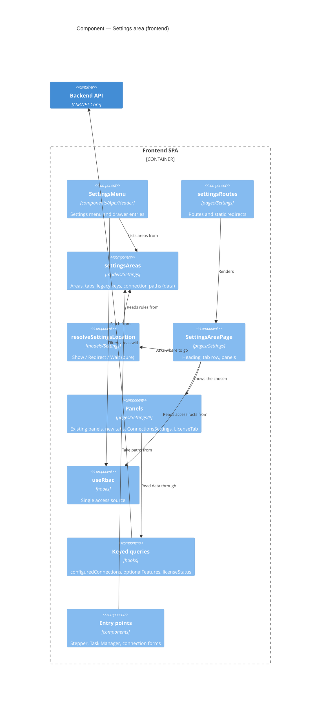

<!-- markdownlint-disable MD024 -->
# Feature Delta — epic-6473-settings-split

ADO Epic #6473 "Settings split by who decides: Organization, Access and System". ADR-271 step U1. Locked as its own
small Epic, delivered first in the 6455 family (6455 feature-delta, D4, D21). Precedes #6349 (organisation defaults
with a local override). Runs in parallel with #6474 "One structure" DISCUSS.

Status: DISCUSS drafted 2026-11-02; maintainer answered Q1–Q6 the same day (see Locked decisions). Q7 and Q8 are new,
raised by the connections decision. The sketches still go through DISTILL's walk-through. Nothing mirrored to ADO.

**2026-11-06, maintainer's vision.** ADR-271 Decision 4 is revised: a connection owns its mapping, shown under
Organization with one tab per connection; credentials and health stay on the connection page in System. No slice of
this Epic changes: M4 stands, and "Mapping, connection defaults, per-unit settings: OUT" stands. #6474 slice 08 adds
the Connection mapping tab, so the Organization area should leave room for a further tab.

---

## Wave: DISCUSS / [REF] Locked decisions

### Maintainer decisions (2026-11-02)

- **M1 (Q1) Navigation.** One header menu, "Settings ▾" → Organization / Access / System. Scope confirmed: every
  installation-wide setting lands in one of the three areas; each Team's and Portfolio's own settings stay on its page;
  a redesign of units comes later, outside this Epic.
- **M2 (Q2) Labels.** "Settings"; areas "Organization", "Access", "System"; Organization tabs "Terminology",
  "Calendar", "Refresh & ordering". (DISCUSS wrote "Organisation"; spelling changed to American by the maintainer at
  DESIGN, MD1. All UI labels, slugs and test ids in this document now use "Organization" and "License".)
- **M3 (Q3) License.** System → License. `/settings/license` redirects there, fixing today's broken link from the
  connection wizard and connection settings.
- **M4 (Q4) Connections move to System only** and are removed from the Overview (against the recommendation). Reason: a
  connection belongs there, and a future onboarding flow will connect first (for example to read hierarchies from
  Jira). Slices 04 and 05 carry it.
- **M5 (Q5)** Organization stays hidden from anyone who is no System Admin, as today.
- **M6 (Q6) DIVERGE skipped explicitly.** The Epic 6455 DIVERGE plus ADR-271 count as this Epic's DIVERGE.
- **M7 Levels.** Organization later receives the levels section from #6474 (its slice 05 waits for this Epic's
  Organization shell, delivered by slice 02).

---

## Wave: DISCUSS / [REF] Inputs and grounding

| Input | Used for |
|---|---|
| `../epic-6455-deeper-hierarchies/feature-delta.md` D4, D6, D21, Scope candidate A, "Input for DISCUSS" | Scope (A: IN/OUT), order, boundary with #6474 and #6349 |
| ADR-271 Decision 2 (who decides), Decision 4 (a connection is credentials and health), U1 | Target placement of every setting |
| ADR-270 Decision 1 (contexts), Decision 4 (three setting buckets), Decision 5 (glossary) | Context map placement |
| `docs/product/personas/config-admin.yaml`, `platform-operator.yaml` | Personas |
| `docs/product/jobs.yaml` (8822 lines; too large for ctx_search, read in part) | Reused `job-rbac-manage-users`; two new jobs proposed |
| Current code (see inventory) | Brownfield walking skeleton |

No DIVERGE ran for #6473 itself. It is grounded in the Epic 6455 DIVERGE, the event storming (ADR-270) and ADR-271,
which the maintainer accepted (2026-11-01) and then split out as this Epic (D4, 2026-11-02). **DIVERGE is skipped
explicitly (M6):** the maintainer counts the 6455 DIVERGE plus ADR-271 as this Epic's DIVERGE. **Risk (low):** the three-area split was decided top-down from the storming, not tested
with users; slice 01's learning hypothesis checks it cheaply.

---

## Wave: DISCUSS / [REF] Jobs (JTBD)

| job_id | Persona | Job story | Status |
|---|---|---|---|
| `job-config-admin-find-how-we-work-in-one-place` | config-admin | When I change how my organisation works in Lighthouse (our words, the days that do not count, how often data refreshes, who orders the Features), I want all of it in one place named for that, so I do not wade past backups and encryption keys, and I can leave the server to someone else. | **New**, proposed below |
| `job-operator-run-the-instance-apart-from-how-we-work` | platform-operator | When I look after the Lighthouse instance (backups, encryption key, demo data, log level, usage data), I want those in one place apart from the organisation's settings, so I know what is mine and cannot rename a Team by accident. | **New**, proposed below |
| `job-rbac-manage-users` | system-admin | (existing) control who can view or administer which Teams and Portfolios. | **Reused**: the Access area is where it is done |

The two new job ids do not exist in `jobs.yaml` yet (parallel-work rule). **Merging them, from the "Proposed SSOT"
section, is a precondition of the DESIGN handoff**, or the JTBD gate fails. Related, not overlapping:
`job-operator-decide-usage-data-for-a-shared-mcp-server` (story-6193) decides usage data for the shared MCP server by
a variable; the new operator job is about where the instance's in-app veto is found.

Forces for the two new jobs. Push: one "Configuration" tab holds four groups for two audiences, and "Never send usage
data" sits next to "Let Lighthouse own the order of your Features". Pull: the area's name tells you whether it is yours.
Anxiety: "my bookmark and the docs link stop working"; "I can no longer find Terminology". Habit: seven tabs in one
row, learned by position.

---

## Wave: DISCUSS / [REF] Scope Assessment

## Scope Assessment: PASS — 5 stories, 0 domain contexts changed (UI surfaces of 5 contexts/lanes), estimated 5–6 days

| Signal | Evidence | Verdict |
|---|---|---|
| >10 stories | 5 | right-sized |
| >3 bounded contexts | none changes; the UI re-homes views owned by Organisation set-up, Access, Licensing, platform lane | right-sized |
| >5 integration points | header link, routes and redirects, RBAC gating, in-app deep links, E2E POMs | 5, at the limit, all in the frontend |
| >2 weeks | 5–6 days | right-sized |
| Independent outcomes | one: settings found by who decides | right-sized |

Behaviour stays unchanged: no setting is added, removed, renamed in meaning, or re-guarded. Backend untouched. The one
deliberate change: the views get loading and failure looks where today they hide or bounce (see that section).
M4 adds a second, visible one: connections leave the Overview for System → Connections, with every way of creating,
opening or fixing a connection pointing there. What a connection page does stays the same.

---

## Wave: DISCUSS / [REF] Current-state inventory (brownfield, 2026-11-02)

Page `Lighthouse.Frontend/src/pages/Settings/Settings.tsx`, route `/settings` (exact match only), header link
"System Settings". Tabs are chosen by `?tab=<key>` and written back with `history.replaceState`.

| Today's tab (value, test id) | Who sees it today | Setting / section | Component |
|---|---|---|---|
| Configuration (20, `configuration-tab`) | System Admin | Blackout Periods & Recurring Rules | `System/BlackoutSettings` |
| | | Behaviour Settings row "Let Lighthouse own the order of your {features}" (Premium) | `System/BehaviourSettingsTable` (`FeatureOrdering`) |
| | | Behaviour Settings row "Never send usage data" | `System/BehaviourSettingsTable` (`UsageData`) |
| | | Terminology Configuration | `components/TerminologyConfiguration` |
| | | {Team} Refresh | `Refresh/RefreshSettingUpdater` (Team) |
| | | {Feature} Refresh | `Refresh/RefreshSettingUpdater` (Feature) |
| Demo Data (25, `demo-data-tab`) | System Admin | Demo data scenarios | `DemoData/DemoDataSettings` |
| Database (30, `database-tab`) | System Admin | Backup, restore, clear | `DatabaseManagement/DatabaseManagementSettings` |
| API Keys (40, `api-keys-tab`) | everyone (keys are personal; empty when auth is off) | API keys | `ApiKeys/ApiKeysSettings` |
| Encryption (45, `encryption-tab`) | System Admin | Secret encryption key ring | `Encryption/EncryptionPanel` |
| System Admins (50, `rbac-tab`) | RBAC on and System Admin | System Admins, SSO group mappings, RBAC status | `Rbac/RbacSettings` |
| System Info (99, `system-info-tab`) | everyone; Log Level section System Admin only | System Info, Refresh History, Log level and log viewer, Third Party Packages | `SystemInfo/SystemInfoSettings` |

Settings ADR-271 names that are **not** on this page today:

| Setting | Lives today | Notes |
|---|---|---|
| Connections (credentials, health) | Overview: "Connections" section (System Admin only: `DataGridBase` list with edit and delete, reconnect banners, "No {connection} found. Load Demo Data or Check the documentation" empty state, a connections-refused alert) and the "Add {connection}" button; full pages `/connections/new`, `/connections/:id/edit`, which return to `/` on save and cancel. Entry points elsewhere: Onboarding stepper step 1 "Add {connection}", the "Create a {connection} before adding a {team}" tooltip, Task Manager connections section | ADR-271 puts them in System; M4 moves them (slices 04, 05). The Overview still needs to know whether a connection exists (stepper, disabled "Add {team}") |
| License | Header `LicenseStatusIcon` popover (import, clear for System Admin) | ADR-271 puts it in System. `ModifyConnectionSettings` and `CreateConnectionWizard` link to `/settings/license`, which appears to match **no route** today (verify in DESIGN) |
| Usage data, per person | Footer `UsageDataDialog` | A personal choice, not an instance setting: stays |
| Task Manager | Header | Live view, not a setting: stays |
| Mapping, connection defaults, per-unit settings | Connection and unit pages | ADR-271 U2/U3, #6349: OUT |

---

## Wave: DISCUSS / [REF] Target placement (ADR-271 Decision 2)

| Setting | Today | Target area → tab (DRAFT names) | Placed by ADR-271? |
|---|---|---|---|
| Terminology | Configuration | Organization → Terminology | yes |
| Blackout periods and recurring rules | Configuration | Organization → Calendar | yes ("calendar") |
| {Team} Refresh, {Feature} Refresh | Configuration | Organization → Refresh & ordering | yes ("refresh cadence") |
| Let Lighthouse own the order of your {features} | Configuration / Behaviour | Organization → Refresh & ordering | yes ("Feature ordering policy") |
| Never send usage data (admin veto) | Configuration / Behaviour | System → Usage Data | yes ("usage data") |
| System Admins, SSO group mappings, RBAC status | System Admins | Access → System Admins | yes |
| API Keys | API Keys | Access → API Keys | yes |
| Demo Data | Demo Data | System → Demo Data | yes |
| Database (backup, restore, clear) | Database | System → Database | yes |
| Encryption | Encryption | System → Encryption | yes |
| System Info, log level and viewer | System Info | System → System Info | yes |
| Refresh History | System Info | System → System Info | **not named** (it reads as system info; kept with it) |
| Third Party Packages | System Info | System → System Info | **not named** (same) |
| RBAC status diagnostic | System Admins | Access → System Admins | **not named** (Access diagnostics) |
| License | header popover (stays too) | System → License (slice 03, M3) | yes, but not on today's page |
| Connections | Overview | System → Connections only (slices 04, 05, M4) | yes, but not on today's page |

Counts: **Organization 4** (Terminology, Calendar, the two refresh cadences as one, Feature ordering), **Access 2**
(System Admins with group mappings, API Keys), **System 5** (Demo Data, Database, Encryption, Usage Data veto, System
Info) plus License and Connections (M3, M4): **System 7**. Three sections ADR-271 does not name, all placed with their current neighbours.

Room for #6474: the Organization → Terminology tab is where #6474 adds its levels section (D6: levels and the
remaining terms in the same tab). This Epic builds the tab and its first section only; #6474 may rename the tab.

---

## Wave: DISCUSS / [REF] Journey — find the setting by who decides

Persona: Priya Raman, flow coach and System Admin at Northwind Logistics (12 Teams, 2 Portfolios); Tomasz Nowak,
platform operator for the same instance; Morgan Lee, a Team reader.

Emotional arc: **unsure** ("where was that again?") → **oriented** (the area's name says whose it is) → **confident**
(the setting is unchanged and the old link still works).

```text
[Trigger]               [Step 1]                [Step 2]                 [Step 3]                [Goal]
Priya wants to add      Opens Settings in the   Picks Organization; sees Opens Calendar, adds    Change saved, same
Christmas week as a  →  header; sees three  →   Terminology, Calendar,→  the period as before →  dialog as last year
blackout period         areas, what each holds  Refresh & ordering
Feels: unsure           Feels: oriented         Feels: "this is mine"    Feels: in control       Feels: confident
Artifacts: header       area names, visibility  tab list per area        unchanged panel         URL /settings/
label                   (useRbac)                                                                organization/calendar

Error paths
E1 Old bookmark /settings?tab=database   → lands on System → Database (redirect, replace)
E2 Tomasz opens an Organization link     → he is System Admin too: he sees it (gating unchanged)
E3 Morgan opens /settings/system/database → lands on System → System Info, the first tab he may see
E4 Deep link while access is still loading → lone spinner, then the right tab (no bounce to the first tab)
E5 /settings/license (dead today)        → System (slice 01), System → License (slice 03)
```

Steps 2 and 3 show the end state after slice 02 (after slice 01 Organization holds one Configuration tab). Error paths
feel like this: E1, E5 relief ("it still works"); E3 calm, nothing to see that is not his; E4 a short wait instead of
confusion.

Integration checkpoints: one source for area and tab names and slugs; the legacy key map covers every key the old page
accepted (14, matched case-insensitively); gating reads `useRbac()` only; in-app links use the new paths.

Gherkin per step (embedded; no `.feature` file, no tags in code):

```gherkin
Scenario: The organisation's settings are found under Organization
  Given Priya Raman is a System Admin of Northwind Logistics
  When she opens Settings and chooses Organization
  Then she sees the tabs Terminology, Calendar, and Refresh & ordering
  And none of them holds backups, encryption, or demo data

Scenario: An old bookmark still opens the same setting
  Given Tomasz Nowak bookmarked "/settings?tab=database" last month
  When he opens the bookmark
  Then he lands on System, Database, with backup and restore as before

Scenario: A reader sees only what is theirs
  Given Morgan Lee reads one Team and is no System Admin, with RBAC on
  When he opens Settings
  Then he sees Access with API Keys and System with System Info
  And he sees no Organization area
```

---

## Wave: DISCUSS / [REF] UI sketches (DRAFT; area menu, labels, License and Connections decided by M1–M4)

Reuses the existing `Settings.tsx` shell (heading, `Paper`, MUI `TabList` with icon tabs, `TabPanel`) for each area,
and every panel component unchanged. New: the area menu (M1: option A, chosen) and the System → Connections tab.

```text
 Overview   Features   Reports   [Settings v]              (licence) (theme) (Update all)
                                 +-----------------+
                                 | Organization    |  how your organisation works
                                 | Access          |  who may do what
                                 | System          |  running this Lighthouse
                                 +-----------------+

 Settings > Organization                                       /settings/organization/terminology
 +---------------------------------------------------------------------------+
 |  [Terminology]        [Calendar]         [Refresh & ordering]              |
 +---------------------------------------------------------------------------+
 |  Terminology Configuration (unchanged)                                    |
 |  ...                                                                      |
 |  (place for #6474: levels, each naming its unit and item)                 |
 +---------------------------------------------------------------------------+

 Settings > Access                                             /settings/access/system-admins
 |  [System Admins]*     [API Keys]                                          |   * RBAC on + System Admin

 Settings > System                                             /settings/system/connections
 | [Connections] [Database] [Encryption] [Demo Data] [Usage Data] [System Info] [License] |

 Settings > System > Connections  (slice 04; moved from the Overview, same parts)
 +---------------------------------------------------------------------------+
 |  {Work Tracking Systems}                          [+ Add {Work Tracking System}] |
 |  ! Northwind Jira needs to be reconnected [Reconnect]   (ReconnectBanner)  |
 |  Name            | Type        | ...today's columns...  | [Edit] [Delete] |
 |  Northwind Jira  | Jira Cloud  |                        |                 |
 |  Empty: No {Work Tracking System} found. Load Demo Data or Check the       |
 |         documentation for more information.                                |
 +---------------------------------------------------------------------------+

 Overview after slice 04: Portfolios, Teams; no Connections section, no "Add {connection}" button.
 Onboarding stepper step 1 "Add {connection}" -> /settings/system/connections/new (slice 05).
```

Rejected by M1: a left-hand area list on one page; three header entries. Connections is the first System tab because
first-run set-up starts there (M4); the DISTILL walk-through may change the order.

Refresh & ordering tab (slice 02): `InputGroup`s stacked as today: "{Team} Refresh", "{Feature} Refresh", then
"Behaviour Settings" with one row, "Let Lighthouse own the order of your {features}". System → Usage Data holds the
`BehaviourSettingsTable` with the one row "Never send usage data" and a link to the usage-data docs page.

Page heading: "System Settings" (the `h1`) becomes "Settings › {area}" (M2).

Mobile: the area menu becomes three entries in the header drawer; each area keeps today's scrollable tab list on
small screens. Keyboard and screen readers: the area menu is an MUI `Menu` (arrow keys, Escape, focus return) and each
area's tabs stay MUI tabs, so both keep their built-in roles; the page heading names the area.

Visualization skill: N/A, because no chart, metric or data view is added or changed; panels move unchanged.

---

## Wave: DISCUSS / [REF] Navigation and URLs

New routes: `/settings/:area/:tab?` with areas `organization`, `access`, `system`. A tab is a path segment, as on Team
and Portfolio pages. Redirects use `replace`, so Back does not loop.

Legacy keys: 14, matched case-insensitively, as `Settings.tsx` does today.

| Old link | New target (slice 01) | After slice 02 (and later slices) |
|---|---|---|
| `/settings` (header, docs) | first area the person may see | same |
| `?tab=configuration`, `?tab=system` | `/settings/organization/configuration` | `/settings/organization/terminology` |
| `?tab=demodata`, `?tab=demo-data` | `/settings/system/demo-data` | same |
| `?tab=database`, `?tab=database-management` | `/settings/system/database` | same |
| `?tab=api-keys`, `?tab=apikeys` | `/settings/access/api-keys` | same |
| `?tab=encryption` | `/settings/system/encryption` | same |
| `?tab=rbac`, `?tab=authorization` | `/settings/access/system-admins` | same |
| `?tab=logs`, `?tab=systeminfo`, `?tab=system-info` | `/settings/system/system-info` | same |
| `/settings/license` (dead today) | `/settings/system` | `/settings/system/license` after slice 03 |
| `/connections/new` | unchanged until slice 05 | `/settings/system/connections/new` (slice 05) |
| `/connections/:id/edit` | unchanged until slice 05 | `/settings/system/connections/:id/edit` (slice 05) |
| Connection page Save / Cancel (today back to `/`) | unchanged until slice 05 | back to System → Connections (slice 05) |
| unknown area or tab, or one the person may not see | first visible tab of that area, else first visible area | same |

In-app links updated to the new paths: Task Manager "the full log" (`RecentProblemsSection`), demo-data links on
`DataOverviewTable` and `OverviewDashboard`, the two `/settings/license` links in the connection forms. Slice 05:
Onboarding stepper "Add {connection}", the "Create a {connection} before adding a {team}" tooltip (adds a link),
Task Manager connections section, `ReconnectBanner` (Q7), the connection pages' return path.

Usage data: `usageDataRouteKeys` only matches `/teams/:id/:tab` and `/portfolios/:id/:tab`; the new paths must stay
event-free, as `/settings` is today (its test asserts that). Whether an event should show the areas are used is
DEVOPS's question.

E2E POM impact (specs change only through POMs): `LighthousePage.goToSettings` (header label and menu),
`SettingsPage.goTo*` (choose the area first, or `page.goto` the path), `RbacSettingsPage.goToAccessTab` (its
"same pathname" workaround becomes unnecessary), `SystemConfigurationPage` (split in slice 02 between Terminology,
Calendar and Refresh & ordering). Slice 04: `OverviewPage.addConnection`, `editConnection`, `deleteConnection` move to a
System connections page object; specs ado, csv, jira, linear, servicenow, OAuthConnection, ConnectionDefaults and
Screenshots call it instead (the connection wizard and edit page objects are unchanged). Specs reached: Screenshots, AuthScreenshots, DatabaseManagement,
RoleBasedAccessControl, ApiKeys, PeriodicRefreshSettings, ViewerEmbedSession, ManualSortingMove, ManualSortingSwitch,
ThirdPartyPackagesPaging. Keep the existing tab test ids so the POMs change in one place.

---

## Wave: DISCUSS / [REF] RBAC impact

Gating moves with the tabs and does not change. All gating reads `useRbac()`; nothing fetches `my-summary` directly.
Backend guards (`RbacGuard SystemAdmin` on blackout, optional features, logs, encryption and others) are untouched.

| Area → tab | RBAC off (everyone is System Admin) | RBAC on, System Admin | RBAC on, anyone else |
|---|---|---|---|
| Organization (all tabs) | yes | yes | area hidden |
| Access → System Admins | hidden (as today) | yes | hidden |
| Access → API Keys | yes (shows "auth off" state) | yes | yes |
| System → Database, Encryption, Demo Data, Usage Data | yes | yes | hidden |
| System → System Info | yes | yes | yes, without Log Level |
| System → License (slice 03) | yes | yes, with import and clear | yes, read-only (as the popover) |
| System → Connections (slice 04) | yes | yes | hidden (the Overview section is System Admin only today) |

Scoped Team and Portfolio admins keep picking a connection in their forms through the existing summary endpoint;
unchanged.

Fix carried by slice 01: today, with RBAC on, `useRbac()` starts with `isRbacEnabled: false`, so a deep link to the
System Admins tab is likely bounced to the first tab before access has loaded. The new shell resolves the fallback
only once `isLoading` is false.

---

## Wave: DISCUSS / [REF] Loading and failure looks

| View | Fetches | While loading | On failure |
|---|---|---|---|
| Settings shell, area menu, tab list | nothing; `useRbac()` | lone spinner in the panel area until `isLoading` is false (new, small) | `useRbac()`'s existing failure handling; no new look |
| Each moved panel | its own, unchanged | its existing look | its existing look |
| System → Connections (new home, slice 04) | connection list | lone spinner in the tab (the list never shows the empty-state alert while loading) | refused (403): today's connections-refused alert; any other failure: the inline "Failed to load …" alert, never the empty state |
| Overview after slice 04 | still asks whether a connection exists (stepper, "Add {team}") | today's look | as today |
| Behaviour Settings rows (ordering in Organization, usage veto in System) | optional features, licence status | today: section hidden until loaded | today: optional features failing hides the section; licence status failing sets it to none, so the Premium ordering switch shows as locked |

The behaviour rows are the one gap: each now stands alone on its tab, so a hidden section is an empty tab, and an
unreadable licence looks like "no Premium". Slice 02 gives them a spinner while loading and the existing inline alert
style ("Failed to load …", as in `ApiKeysSettings`) on failure of either call. Slice 01 ships the Configuration panel
as it is today, so this gap stays for the days between slice 01 and slice 02 on `main`; accepted, because no release
is cut in between (the Epic is released after slice 02). DESIGN confirms; no `WidgetShell`, because these are settings forms, not dashboard widgets.

---

## Wave: DISCUSS / [REF] Story map

Backbone (user activities): **Open Settings → Pick the area that is mine → Pick the tab → Change the setting →
Come back by link later.**

Slices 04 and 05 (connections, M4) add to "Pick tab" (System → Connections) and "Come back by link" (every way to a
connection points at System; old connection URLs redirect).

| Activity | Walking skeleton (slice 01) | Release 2 (slice 02) | Release 3 (slice 03) |
|---|---|---|---|
| Open Settings | header entry with three areas | | |
| Pick area | Organization, Access, System, gated as today | | |
| Pick tab | today's tabs re-homed whole (Configuration under Organization) | Configuration split into Terminology, Calendar, Refresh & ordering; Usage Data in System | License in System |
| Change setting | panels unchanged | behaviour rows with loading and failure looks | licence import and clear as in the popover |
| Come back by link | 14 old keys redirect, in-app links updated, POMs updated | `configuration` key → Terminology | `/settings/license` → License |

### Priority Rationale

1. Slice 01 first: it carries the whole navigation risk (redirects, gating, POMs) on unchanged panels, and is the
   smallest step a user notices.
2. Slice 02 second: the outcome the Epic exists for (no instance setting in Organization), built on 01's routes.
3. Slice 03 (M3): fixes a dead link; small and independent.
4. Slice 04 then 05 (M4): the list moves first with its page objects, so `main` stays green; then every entry point
   and old URL follows. Between them, the stepper still opens the old `/connections/new`, which works.

Each slice is shippable to `main` on its own. The Epic is released after slice 05: releasing after 04 alone would
leave Save on a connection page returning to an Overview with no connections on it.

---

## Wave: DISCUSS / [REF] User stories

### System Constraints

- Behaviour unchanged: no setting added, removed or re-guarded; no API, payload or backend change.
- Copy uses configurable terms (`{Team} Refresh`, `{features}`), never "Epic" or "Story".
- All UI gating via `useRbac()`.
- Sketch and maintainer's yes before any slice is built; DISTILL walks the sketches first.
- No nWave scenario tags in test code.
- Keep tab test ids and docs file names; screenshot file names stay (the website hot-links them).

### US-01: Three settings areas, everything where it was inside them

- **job_id**: `job-config-admin-find-how-we-work-in-one-place` (also `job-operator-run-the-instance-apart-from-how-we-work`)
#### Elevator Pitch

- Before: Priya scans seven tabs in one row (Configuration, Demo Data, Database, API Keys, Encryption, System Admins,
  System Info) to find the blackout periods.
- After: she opens Settings → Organization and sees one tab, Configuration; Database and Encryption are under System.
- Decision enabled: Priya can leave the System area to Tomasz without worrying he will rename a Team.

Details, examples, UAT and AC: `slices/slice-01-three-areas.md`.

### US-02: Organization holds only how the organisation works

- **job_id**: `job-config-admin-find-how-we-work-in-one-place`
#### Elevator Pitch

- Before: "Never send usage data" sits next to Feature ordering in one Configuration tab.
- After: Settings → Organization shows the tabs Terminology, Calendar, Refresh & ordering; Settings → System → Usage
  Data shows the one switch "Never send usage data".
- Decision enabled: Tomasz decides about usage data without opening the organisation's settings.

Details: `slices/slice-02-organisation-tabs.md`.

### US-03: The licence has a home in System

- **job_id**: `job-operator-run-the-instance-apart-from-how-we-work`
#### Elevator Pitch

- Before: "import a licence" in the connection form opens a blank page.
- After: it opens Settings → System → License, showing licence status, organisation and expiry date, with import and
  clear for a System Admin.
- Decision enabled: Tomasz renews the licence from a link.

Details: `slices/slice-03-licence-in-system.md`. Decided by M3.

### US-04: Connections live in System

- **job_id**: `job-operator-run-the-instance-apart-from-how-we-work`

#### Elevator Pitch

- Before: the {Work Tracking Systems} list, with edit, delete and reconnect, sits at the bottom of the Overview under
  the Portfolios and Teams.
- After: Settings → System → Connections shows that list with "Add {Work Tracking System}"; the Overview shows only
  Portfolios and Teams.
- Decision enabled: Tomasz checks and fixes the instance's connections where he runs the rest of the instance.

Details: `slices/slice-04-connections-in-system.md`.

### US-05: Every way to a connection leads to System

- **job_id**: `job-operator-run-the-instance-apart-from-how-we-work`

#### Elevator Pitch

- Before: the onboarding stepper, Task Manager and old links open `/connections/...`, and saving returns to the Overview.
- After: they open Settings → System → Connections (or its add and edit pages), and Save and Cancel return there.
- Decision enabled: a first-time admin sets up the first connection and lands where connections live.

Details: `slices/slice-05-connection-entry-points.md`.

---

## Wave: DISCUSS / [REF] Outcome KPIs

| KPI | Who | Does what | Target | Measured by | Baseline |
|---|---|---|---|---|---|
| K1 Right area | System Admins | find a named setting in the right area at the first try | 5 of 5 named settings (Terminology, blackout period, Team refresh, backup, API key) for 3 maintainer-chosen testers | maintainer walkthrough at DELIVER review | today: one page, 7 tabs, Configuration mixes 2 audiences |
| K2 No misplaced setting | product | settings placed per ADR-271 Decision 2 | 0 instance settings in Organization, 0 organisation settings in System after slice 02 | inventory table above, checked at finalize | 1 misplaced (usage-data veto) plus 4 org settings on the System Settings page |
| K3 No broken link | everyone with a bookmark | old links open the same setting | 14 of 14 legacy keys plus `/settings/license` resolve | unit tests on the key map; E2E walking skeleton | `/settings/license` dead today |
| K4 Support | users | ask "where is X in settings?" | no rise in such questions in the release after | maintainer's support inbox, Slack | not counted today |

Usage-data event: DEVOPS answers whether one is worth it (for example opening an area, name-only).

---

## Wave: DISCUSS / [REF] Shared artifacts registry

| Artifact | Single source (DESIGN names the file) | Consumers | Risk |
|---|---|---|---|
| Area names, slugs, tab names, slugs, test ids | one frontend settings-areas definition | header menu, shell, redirects, POMs, docs | HIGH: a mismatch is a dead link |
| Legacy `?tab=` key map | the same definition | redirect, unit tests | HIGH |
| Visibility per tab | `useRbac()` | shell, header menu | HIGH: leaking an admin tab |
| `{Team}`, `{Feature}`, `{features}` | `TerminologyContext` | refresh and ordering labels | MEDIUM |
| Docs page names and anchors | `docs/settings/*.md` | in-app doc links (`encryption.html`, `usagedata.html`), release notes (`configuration.html#…`) | HIGH: keep names |
| Screenshot file names | `docs/assets/settings/*.png` | docs, website (hot-linked from @main) | HIGH: keep names |

---

## Wave: DISCUSS / [REF] Context map placement (ADR-270, ADR-271)

- **Contexts touched**: none in the domain. The UI re-homes views of Organisation set-up (Terminology, calendar,
  refresh cadence, Feature ordering), Access (System Admins, group mappings, API keys), Licensing (licence, slice 03)
  and the platform lane (database, encryption, demo data, log level, usage-data veto, system info).
- **New terms**: the three settings areas Organization, Access and System, already named by ADR-271 Decision 2.
  "Access" also names the Team and Portfolio Access tab; both mean the Access context, so no clash.
- **Domain events**: none published or handled, because no domain state or rule changes; only where a view sits.
- **UI surface**: this Epic creates ADR-271's Organization, Access and System surfaces (U1), and puts Tracker
  integration's connections on System (M4, towards ADR-271 Decision 4). The connection page still holds mapping;
  moving mapping to Organization is U3, later. Team and Portfolio pages keep their own settings (M1).
- **ARCHITECTURE.md §4**: no change, because no module or edge changes.

---

## Wave: DISCUSS / [REF] DISCUSS checklists

- **RBAC impact**: gating moves unchanged; see the RBAC table. One likely deep-link bug fixed in slice 01.
- **Lighthouse-Clients (CLI/MCP)**: no route, payload or permission change, so no client release. One check owed:
  grep the Clients repo for "System Settings" in help or error copy (not reachable from this worktree); if found,
  the copy changes in a client patch at finalize.
- **Website marketing surface**: the website hot-links `docs/assets` from `@main`, so refreshed screenshots reach it
  without a website change as long as file names stay. Check the website for "System Settings" copy at finalize.
- **Docs (per feature, at finalize)**: `docs/settings/settings.md` (rewrite into the three areas, title "Settings"),
  `configuration.md` (becomes Organization; the usage-data veto section moves to `usagedata.md`), `apikeys.md`,
  `rbac.md`, `databasemanagement.md`, `demodata.md`, `encryption.md`, `systeminfo.md`, `usagedata.md`,
  `taskmanager.md`, `worktrackingsystems.md` (how to add, edit and delete a connection now starts from System →
  Connections, not the Overview), the Overview and getting-started pages that describe the connection list or the
  onboarding stepper; plus "System Settings" mentions in `aiintegration.md`,
  `Installation/*`, `concepts/*`, `index.md`, `features/features.md` (68 mentions in 26 files outside `feature/`).
  Release notes are history and are not edited. Keep file names and anchors.
- **Screenshots**: page shots change (`settings/configuration.png`, `demodata.png`, `systeminfo.png`,
  `encryption.png`, `databasemanagement.png`, `rbac.png`, `apikeys.png`); element shots likely do not
  (`optionalfeatures.png` does: it loses a row; `teamrefreshsettings.png`, `featurerefreshsettings.png`,
  `systeminfo_auth.png`, `rbac_groupmapping.png`, `apikeys_create.png`); `terminologyConfiguration.png` and
  `blackoutPeriodsSection.png` have no producing spec found — check at finalize. New: a License shot and a System →
  Connections shot. Overview page shots lose the Connections section. Connection wizard and edit shots keep their
  file names (the specs reach them through the new page object).
- **Demo data**: N/A, because no data shape changes.
- **Usage data**: DEVOPS question; see KPIs.

---

## Wave: DISCUSS / [REF] Boundary with #6474 and #6349

- #6473 builds the three areas and moves today's settings, unchanged.
- #6474 adds levels (each naming its unit and item) inside Organization → Terminology, and may rename that tab.
  #6473 builds nothing about levels, units, item types or level names.
- #6349 adds organisation defaults with a local override (U2) in Organization, in a tab of its own. #6473 leaves the
  Organization tab list open-ended for it.

---

## Wave: DISCUSS / [REF] Proposed SSOT and ADR updates

To merge later; not edited here (parallel-work rule).

`docs/product/jobs.yaml`, append:

```yaml
  - id: job-config-admin-find-how-we-work-in-one-place
    title: Find how my organisation works in one place, apart from running the server
    persona: config-admin
    created_in_feature: epic-6473-settings-split
    job_story: >
      When I change how my organisation works in Lighthouse (our words, the days that do not count,
      how often data refreshes, who orders the Features),
      I want all of it in one place named for that,
      so I do not wade past backups and encryption keys, and I can leave the server to someone else.
    dimensions:
      functional: Reach Terminology, blackout periods, refresh cadence and Feature ordering from one area
      emotional: Feel that the area is mine and nothing in it can break the server
      social: Hand the instance's running to IT without handing over how we work
    forces:
      push: One Configuration tab mixes four groups for two audiences; seven tabs in one row
      pull: The area's name says whether it is mine
      anxiety: My bookmark and the docs link stop working; I cannot find Terminology any more
      habit: Tabs learned by position
    opportunity_score: { importance: 3, current_satisfaction: 2, gap: 1 }

  - id: job-operator-run-the-instance-apart-from-how-we-work
    title: Run the instance without touching the organisation's settings
    persona: platform-operator
    created_in_feature: epic-6473-settings-split
    job_story: >
      When I look after the Lighthouse instance (backups, encryption key, demo data, log level, usage data),
      I want those in one place apart from the organisation's settings,
      so I know what is mine and cannot rename a Team by accident.
    dimensions:
      functional: Reach database, encryption, demo data, usage-data veto, system info and licence from one area
      emotional: Feel safe changing what is mine
      social: Not be the person who changed the organisation's words by mistake
    forces:
      push: Usage-data veto sits between Feature ordering and Terminology
      pull: One System area that matches the job
      anxiety: Links in runbooks to /settings?tab=database break
      habit: Bookmarked tabs
    opportunity_score: { importance: 3, current_satisfaction: 2, gap: 1 }
```

Personas: `config-admin.yaml` `primary_jobs` add `job-config-admin-find-how-we-work-in-one-place  # epic-6473 (2026-11-02, #6473)`;
`platform-operator.yaml` `primary_jobs` add `job-operator-run-the-instance-apart-from-how-we-work  # epic-6473 (2026-11-02, #6473)`.

Journey: `docs/product/journeys/settings-by-who-decides.yaml` (new), from the journey section above, changelog entry
`2026-11-02, epic-6473-settings-split, created`. `rbac-enhancements.yaml`: its "System Settings → Access" and "License
Info section in System Settings" lines become "Settings → Access → System Admins" and "header licence popover /
System → License" (changelog entry).

ADR-271: "Today" column of Decision 2 and the U1 row get "done by Epic #6473" once shipped; the System row notes
Connections moved from the Overview to System by #6473 (mapping still on the connection page until U3). ADR-270: no map or context change; glossary
Organisation set-up gains no term (the areas are UI surfaces, named in ADR-271). ARCHITECTURE.md §4: no change.

---

## Wave: DISCUSS / [REF] Findings outside this Epic

1. `/settings/license`, linked from the connection forms, appears to render nothing (no matching route). Slice 01
   redirects it; slice 03 gives it its target.
2. `docs/settings/settings.md` lists "Configuration export/import"; no such control exists in the frontend, and
   `Lighthouse.EndToEndTests/.../SystemSettings/ImportDialog.ts` looks unused. Fix in the finalize docs pass.
3. Behaviour Settings is hidden when its fetch fails (reads as "no settings"). Slice 02 fixes it for both rows.
4. `rbac-enhancements.yaml` still says licence info lives in System Settings; it lives in the header popover.

---

## Wave: DISCUSS / [REF] Definition of Ready

| DoR item | US-01 | US-02 | US-03 | US-04 | US-05 |
|---|---|---|---|---|---|
| Problem in domain language | PASS | PASS | PASS | PASS | PASS |
| Persona with characteristics | PASS (Priya, Tomasz, Morgan) | PASS | PASS | PASS | PASS |
| 3+ domain examples | PASS | PASS | PASS | PASS | PASS |
| UAT 3–7 scenarios | PASS (6) | PASS (6) | PASS (4) | PASS (5) | PASS (5) |
| AC from UAT | PASS | PASS | PASS | PASS | PASS |
| Right-sized | PASS (~2 days; split redirects from POMs if it grows) | PASS (~0.5–1 day) | PASS (~0.5 day) | PASS (~1 day) | PASS (~1 day) |
| Technical notes | PASS | PASS | PASS | PASS | PASS |
| Dependencies tracked | PASS (none) | PASS (US-01) | PASS (US-01) | PASS (US-01) | PASS (US-04; Q7, Q8) |
| Outcome KPIs | PASS (K1, K3) | PASS (K1, K2) | PASS (K3) | PASS (K1, K2) | PASS (K3) |

DoR status: PASSED for all five. Q7 and Q8 change copy and URL shape inside US-05, not scope. DESIGN handoff
precondition: the two new jobs merged into `jobs.yaml` and the personas.

Peer review (nw-product-owner-reviewer, iteration 1): NEEDS_REVISION, 0 critical, 3 high. All high and medium items
fixed in this revision (licence-failure scenario, JTBD precondition, pitch format, key count 14, testable redirect
scenario, page heading, mobile and keyboard, interim gap accepted, US-01 re-estimated, US-03 conditional, DIVERGE Q6).

---

## Wave: DISCUSS / [REF] Open questions for the maintainer

Q1–Q6 were answered on 2026-11-02 (Locked decisions, M1–M6):

1. **How do people reach the three areas?** ANSWERED (M1): one header menu "Settings ▾" → Organization / Access /
   System (the recommendation).
2. **Labels.** ANSWERED (M2): "Settings"; "Organization", "Access", "System"; "Terminology", "Calendar", "Refresh &
   ordering" (the recommendation).
3. **License in System?** ANSWERED (M3): yes, System → License; `/settings/license` redirects there.
4. **Connections in System?** ANSWERED (M4): connections move to System only and leave the Overview (not the
   recommendation). Slices 04 and 05 added.
5. **Readers and Organization.** ANSWERED (M5): hidden from non-admins, as today.
6. **DIVERGE.** ANSWERED (M6): skipped explicitly; the 6455 DIVERGE plus ADR-271 count.

New, raised by M4 (for the DISTILL walk-through; neither blocks DESIGN):

7. **ANSWERED at DESIGN (MD2): today's banner stays on the Overview and also shows on System → Connections.**
   **Reconnect warnings after the move.** An OAuth connection that needs reconnecting shows a banner at the top of the
   Overview list today. (a) Keep one banner on the Overview, "Northwind Jira needs to be reconnected", linking to
   System → Connections; the list itself moves. (b) Banner only on System → Connections and in the Task Manager.
   **Recommend (a)**: a broken connection stops every Team refreshing, and the Overview is where admins look; it is a
   warning, not the connection list.
8. **ANSWERED at DESIGN (MD3): option (a).** **Connection page URLs.** (a) `/settings/system/connections/new` and `/settings/system/connections/:id/edit`, old
   `/connections/...` redirecting. (b) Keep `/connections/...` as the pages' address and only change where they are
   opened from and return to. **Recommend (a)**: the address says where the page lives, and the area menu shows
   System as current.

---

## Wave: DESIGN / [REF] Design summary

Wave: DESIGN, application scope, interaction mode PROPOSE, 2026-11-02. Architect: Morgan. Paradigm: OOP project,
functional-leaning React. Frontend only; **no backend, API, payload or schema change**. Style unchanged: the
frontend's existing layering (pages → components/hooks/models/services, enforced by `fallow` boundaries in
`.fallowrc.json` and `layerBoundaries.enforcement.test.ts`) on top of the backend's ports-and-adapters. This Epic
adds one data definition, one pure resolver, one header control and one parameterised shell, and re-homes existing
panels. Read before the design: every DISCUSS section, slices 01–05, ADR-270, ADR-271, brief.md lines 1–205,
CLAUDE.md, ci-learnings (Frontend, E2E), and the code listed in the Reuse Analysis.

Verified in code (DISCUSS asked DESIGN to verify):

- `/settings/license` matches **no route**: `App.tsx` has only `path="/settings"` and no catch-all, so it renders an
  empty shell. Confirmed dead.
- `useRbac()` starts with `PERMISSIVE_SUMMARY` (`isSystemAdmin: true`, `isRbacEnabled: false`) and `isLoading: true`.
  So today the System Admins tab is filtered out on the first render and the "selected tab not visible" effect
  bounces a deep link to the first tab. Confirmed; slice 01 fixes it by not resolving before `isLoading` is false.
- `useRbac()` on failure keeps the permissive summary and sets `loadFailed`. The rbac-enhancements brief makes "a
  failed RBAC call never locks users out" an invariant. DESIGN keeps it: no new failure look for the shell (as
  DISCUSS said); backend guards remain the protection.
- The Overview's connections section is **inline JSX in `OverviewDashboard.tsx`** (lines ~586–698 plus the column
  definition, delete dialog and handlers), not a component. "Reuse, not rewrite" therefore means: extract it as a
  behaviour-unchanged refactor first, then mount it in System (DD9).
- A non-403 failure of the connection list today turns the **whole Overview** into "Error loading data"; there is no
  inline connections failure look yet. The System tab's inline "could not be loaded" alert is new (as DISCUSS said).
- The backend serves `index.html` for any SPA path (`UseSpa`, `vite base: '/'`, absolute asset paths), and
  `/teams/:id/:tab/:reportId` already proves three-segment deep links load. `/settings/system/connections/4/edit`
  (five segments) relies on the same fallback; the walking-skeleton E2E `page.goto` of a deep link is its probe.

---

## Wave: DESIGN / [REF] DDD list (design decisions)

| ID | Decision | Rejected (why) |
|---|---|---|
| DD1 | **Routes are path segments**: `/settings/:area/:tab?`, areas `organization`, `access`, `system`; declared as nested `<Route>`s so React Router ranks static paths (`/settings/license`, `/settings/system/connections/new`) above the dynamic one | `?area=&tab=` query tabs (inconsistent with Team/Portfolio pages; DISCUSS chose paths); one `/settings/*` splat parsed by hand (hides routes from the router's ranking, a second matcher to keep right) |
| DD2 | **One definition, data only**: `src/models/Settings/settingsAreas.ts` holds areas (slug, label, order), tabs per area (slug, label, test id, panel test id, visibility rule, earlier slugs), the 14 legacy `?tab=` keys, and the connection page paths. It lives in `models` because the Header and `OnboardingStepper` (zone `components`) may import `models` but not `pages`. Panels are bound to tab slugs in `pages/Settings` | Definition in `pages/Settings` (the Header could not import it: fallow violation); one list per consumer (the HIGH shared-artifact risk: a mismatch is a dead link) |
| DD3 | **One pure resolver** `resolveSettingsLocation(request, access) → Show(area, tab) \| Redirect(path) \| Wait`, where `access` is the three facts the rules need (`isLoading`, `isSystemAdmin`, `isRbacEnabled`) read from `useRbac()`. Covers bare `/settings`, the 14 keys (case-insensitive), unknown or earlier slugs, a tab or area the person may not see. Contract shape: pure function, return-only | Rules spread over effects in the shell (today's shape; it caused the deep-link bounce) |
| DD4 | **Where redirects live**: `pages/Settings/settingsRoutes.tsx`, returning the settings route elements with lazy pages (precedent: `reportPrintRoutes()`). Static path redirects (`/settings/license`, `/connections/new`, `/connections/:id/edit`) are `<Navigate replace>` routes; `?tab=` and visibility redirects are the resolver's `Redirect`, rendered as `<Navigate replace>`. `App.tsx` calls `settingsRoutes()` once | Server-side 301s in ASP.NET (the `?tab=` mapping and the visibility fallback need the person's access, and the Standalone app runs the same SPA); a redirect table in `App.tsx` (splits the knowledge from the definition) |
| DD5 | **One parameterised shell** `SettingsAreaPage` extracted from `Settings.tsx`: same `Container`, heading, `Paper`, `TabList`, `TabPanel`, icons, mobile scrollable tabs. Heading "Settings › {area}". While `Wait`: `LoadingAnimation` lone spinner in the panel area, no tab row (nothing to bounce). A tab click navigates with `replace` (as TeamDetail does, and as today's `replaceState` does) | Three area pages (three copies of the shell); keeping `?tab=` written back by `history.replaceState` (bypasses the router, which is why the RBAC POM needed a click workaround) |
| DD6 | **Header `SettingsMenu`** in `components/App/Header`: an MUI `Button` "Settings" with `Menu` items that are router links, each with its one-line description; bold/underlined as active when the path starts with `/settings`. The mobile drawer lists the three areas as `NavigationItem`s. Items come from the definition, filtered by the same rules; gated items appear once `useRbac()` has loaded | A `NavigationItem` to `/settings` plus areas on the page (rejected by M1) |
| DD7 | **Slice 02 split**: `SystemSettingsTab` becomes `TerminologyTab`, `CalendarTab`, `RefreshAndOrderingTab` (Organization) and `UsageDataTab` (System), each composing today's `InputGroup` sections unchanged. A new hook `useBehaviourSettings` reads the optional features through a **keyed TanStack query** `["optionalFeatures"]` and the licence through the shared `useLicenseStatusQuery`, and returns `loading \| failed \| ready` plus the rows; each tab filters rows by `key`, never id. Toggle and usage reporting keep today's logic. `CalendarTab` passes `isPremium` from `useLicenseStatusQuery`. `SystemSettingsTab.tsx` is deleted and **removed from the licence-asker allow-list** (the list shrinks, as it should) | Copying the fetch into two tabs (two requests, two places to fix); `WidgetShell` (dashboard widgets, not settings forms; DISCUSS agreed) |
| DD8 | **License tab** (slice 03): extract `LicenseStatusContent` from `LicenseStatusPopover` (the popover becomes a thin `Popover` around it). The tab renders it with `useLicenseStatusQuery`; import and clear invalidate `["licenseStatus"]`, so the header icon updates from the same query. No new licence asker, so `licenseStatusOneAsker` stays green unchanged | A second licence card (two looks, two askers); embedding the popover (anchored overlay inside a tab) |
| DD9 | **Connections tab** (slice 04) in two commits: (1) `refactor`: extract the Overview's inline section into `pages/Settings/Connections/ConnectionsSettings.tsx` (title, Add button, empty-state alert with Load Demo Data and docs links, `ReconnectBanner`s, `DataGridBase` with today's columns and `storageKey="overview-connection-table"` so saved column state survives, delete dialog), still rendered on the Overview; (2) `feat`: mount it as System → Connections and remove it and the Add button from the Overview. The list reads a new keyed query hook `useConfiguredConnections` (`["configuredConnections"]`). Writes that change the list (add, update, delete, reconnect) **remove** that key (as the Overview's `forgetReportsOf` does for reports), so coming back after Save shows a spinner and then the fresh list, never the old list as if current. Looks: no data → lone spinner; 403 → today's refused alert; other error → inline "Could not load the {Work Tracking Systems}" alert (ApiKeys style); empty list only after a successful load. The Overview keeps its own existence check (unchanged fetch) for the stepper and the disabled "Add {team}" | Rewriting the list for System; sharing one query with the Overview now (changes the Overview's whole-page error handling, out of scope); `invalidateQueries` (a remount shows the cached old list while refetching) |
| DD10 | **Connection pages** (slice 05, Q8 a, maintainer MD3): `EditConnection` is mounted at `/settings/system/connections/new` and `/settings/system/connections/:id/edit`; `/connections/new` and `/connections/:id/edit` are `<Navigate replace>` routes keeping the id. Save, Cancel and wizard completion go to the Connections tab path from the definition. The no-access alert keeps "Back to Overview" (a person refused here cannot see System → Connections). Every entry point (stepper, "Add {team}" hint link, Task Manager connections section, row Edit links) takes its path from the definition | Keeping `/connections/...` (Q8 b): two routes fewer, but the address no longer says where the page lives and the area menu shows nothing as current |
| DD11 | **Reconnect warning** (Q7, maintainer MD2): the existing `ReconnectBanner` stays on the Overview for each connection that needs reconnecting, unchanged (it already reconnects in place through the OAuth popup), and also shows on System → Connections | A new link-only banner (new copy and look for no gain) |
| DD12 | **E2E page objects**: `LighthousePage.goToSettings()` opens the header "Settings" menu and returns `SettingsPage`; every `SettingsPage.goTo<Tab>()` picks its area in the menu, then the tab by its unchanged test id, then waits for content only that panel renders. Specs that call them do not change. `RbacSettingsPage.goToAccessTab` goes through the same path (its same-pathname workaround goes). New `SystemConnectionsPage` (`addConnection`, `editConnection(name)`, `deleteConnection(name)`) scoped to the connections grid and its name cell; `OverviewPage` loses the three connection methods in the same change; 11 call sites in 8 specs switch (Screenshots 3, ConnectionDefaults 2, ado, csv, jira, linear, servicenow, OAuthConnection 1 each). `RoleBasedAccessControl.spec.ts` (`page.goto("/connections/new")`, expects the no-access alert) keeps working because the connection pages render outside the area resolver (see Amendments). Slice 02 splits `SystemConfigurationPage` into Terminology, Calendar and Refresh & ordering page objects | Specs calling `page.goto("/settings/...")` directly (bypasses the menu the walking skeleton must prove); keeping connection methods on `OverviewPage` as a second path |
| DD13 | **Test ids**: every existing tab and panel id is kept where its tab survives. New: `connections-tab`, `license-tab`, `usage-data-tab`, `terminology-tab`, `calendar-tab`, `refresh-ordering-tab`, plus `settings-menu` and one id per area item. `configuration-tab`/`configuration-panel` retire with the Configuration tab in slice 02. `src/tests/e2eTestIds.test.ts` keeps the POMs and the app in step | Reusing `configuration-tab` for Terminology (a test id that names a tab no one sees) |
| DD14 | **Enforcement**: (1) the existing fallow boundaries keep the definition importable by the Header (models zone); (2) a new source-scan enforcement test, shaped like `licenseStatusOneAsker.enforcement.test.ts`: no production module other than the definition and `settingsRoutes.tsx` (which declares the route patterns, including the old `/connections/...` ones) contains a string or template literal that *starts with* `/settings` or `/connections` (so `/teams/${id}/settings` and `/api/...` paths stay allowed). It turns the HIGH "mismatch is a dead link" risk into a failing build; (3) a unit test feeds every one of the 14 legacy keys, both cases, through the resolver; (4) a test that every settings and connection path yields no usage-data page opening (`usageDataPageOpeningFor`) | A ledger rule in ci-learnings (the check can be automated, so per CLAUDE.md it is) |
| DD15 | **Context map**: no domain, context, edge, event or glossary change. This Epic creates ADR-271's three UI surfaces (U1) and puts connections on System (towards ADR-271 Decision 4). ADR-270 and `ARCHITECTURE.md` §4 unchanged; ADR-271 gets the "done" notes (proposed block below). ADR-272 records DD1–DD4 and DD14 | — |
| DD16 | **#6474 and #6349 additive**: Organization's tab list is open-ended in the definition; `TerminologyTab` is a stack of `InputGroup` sections, so #6474 adds its levels section inside it, and a rename of the tab moves the old slug into the tab's "earlier slugs" (the resolver redirects it), with no change to the shell, menu or POM structure. #6349 appends a tab | A fixed three-tab Organization |

---

## Wave: DESIGN / [REF] Component decomposition

| Component | File (proposed) | New / changed | Slice |
|---|---|---|---|
| Settings definition (areas, tabs, legacy keys, connection paths) | `src/models/Settings/settingsAreas.ts` | NEW (data only) | 01, grows in 02–05 |
| Location resolver | `src/models/Settings/resolveSettingsLocation.ts` | NEW (pure) | 01 |
| Settings routes and static redirects | `src/pages/Settings/settingsRoutes.tsx` | NEW | 01, 03, 05 |
| Area shell | `src/pages/Settings/SettingsAreaPage.tsx` (from `Settings.tsx`) | CHANGED (extracted, parameterised) | 01 |
| Panel binding (tab slug → panel) | `src/pages/Settings/settingsPanels.tsx` | NEW | 01–04 |
| Header menu | `src/components/App/Header/SettingsMenu.tsx`; `Header.tsx` uses it | NEW + CHANGED | 01 |
| Organization tabs | `src/pages/Settings/Organization/{Terminology,Calendar,RefreshAndOrdering}Tab.tsx` | NEW (compose existing sections) | 02 |
| Usage Data tab | `src/pages/Settings/System/UsageDataTab.tsx` | NEW (composes `BehaviourSettingsTable`) | 02 |
| Behaviour settings hook | `src/hooks/useBehaviourSettings.ts` | NEW (keyed query + shared licence query) | 02 |
| `SystemSettingsTab` | `src/pages/Settings/System/SystemSettingsTab.tsx` | DELETED (split), its tests move | 02 |
| License content | `src/components/Common/LicenseStatus/LicenseStatusContent.tsx`; popover wraps it | NEW (extracted) + CHANGED | 03 |
| License tab | `src/pages/Settings/System/LicenseTab.tsx` | NEW (thin) | 03 |
| Connections list | `src/pages/Settings/Connections/ConnectionsSettings.tsx` | NEW (extracted from Overview) | 04 |
| Connections query hook | `src/hooks/useConfiguredConnections.ts` | NEW | 04 |
| Overview | `OverviewDashboard.tsx` | CHANGED (section and Add button out; `ReconnectBanner`s stay, Q7) | 04, 05 |
| Connection page | `pages/Connections/Edit/EditConnection.tsx` | CHANGED (return path) | 05 |
| Entry points | `OnboardingStepper`, Overview "Add {team}" hint, `TaskManager/ConnectionsSection`, `RecentProblemsSection`, `DataOverviewTable`, `CreateConnectionWizard`, `ModifyConnectionSettings` | CHANGED (paths from the definition) | 01, 05 |
| E2E POMs | `LighthousePage`, `SettingsPage`, `RbacSettingsPage`, `SystemConfigurationPage` (split), new `SystemConnectionsPage`, `OverviewPage` | CHANGED / NEW | 01, 02, 04 |

---

## Wave: DESIGN / [REF] Driving ports

Frontend driving adapters only; no HTTP endpoint is added or changed.

| Driving port | Shape | Notes |
|---|---|---|
| URL `/settings` (bare, and with `?tab=<legacy key>`) | redirect (replace) | resolver; waits for access only when the target depends on it |
| URL `/settings/:area/:tab?` | page | resolver decides Show / Redirect / Wait |
| URL `/settings/license` | redirect (replace) | to `/settings/system` (slice 01), `/settings/system/license` (slice 03) |
| URL `/settings/system/connections/new`, `.../:id/edit` | page (`EditConnection`) | slice 05 (Q8 a) |
| URL `/connections/new`, `/connections/:id/edit` | redirect (replace) | slice 05 |
| Header "Settings" menu and mobile drawer entries | navigation | items filtered by access |
| In-app links (stepper, hint, Task Manager, demo-data links, licence links, row Edit) | navigation | paths from the definition only (DD14) |

Read/write split holds: the shell and menu only read access; writes stay inside the unchanged panels.

---

## Wave: DESIGN / [REF] Driven ports and adapters

All existing, all unchanged, all reached through `ApiServiceContext`:

| Port (frontend service interface) | Used by | Change |
|---|---|---|
| `IRbacService.getAuthorizationSummary` via `useRbac()` | shell, menu | none; the only access source (no component fetches `my-summary`) |
| `IWorkTrackingSystemService` (list, delete, add, update) | Connections tab, connection page, Overview existence check | none; list now also read through `useConfiguredConnections` |
| `ILicensingService.getLicenseStatus` via `useLicenseStatusQuery` | License tab, Refresh & ordering, Calendar, header icon | none; one more consumer of the shared query, one fewer direct asker |
| `IOptionalFeatureService` (`getAllFeatures`, `updateFeature`) | `useBehaviourSettings` | none |
| Every panel's own service | moved panels | none |

Earned Trust: no new driven adapter, so no new probe contract. The environment assumptions this design rests on, and
how each is checked empirically: the SPA fallback serves deep nested paths (walking-skeleton E2E opens a deep link
by `page.goto` on a real backend, SQLite and Postgres CI runs); a slow `my-summary` (resolver unit test for `Wait`,
plus a manual check with the browser throttled); a failing `my-summary` (permissive fallback, existing tests); a
failing list or licence call (component tests per failure look).

---

## Wave: DESIGN / [REF] Technology choices

No new dependency. React 19, React Router (`Navigate`, nested `Route`, `useParams`, `useNavigate` with `replace`),
MUI 9 (`Button`, `Menu`, `MenuItem`, `@mui/lab` `TabContext`/`TabList`/`TabPanel`), TanStack Query (keyed
queries), Vitest + RTL, Playwright POMs, fallow (boundaries). All MIT or Apache-2.0 and already installed.

---

## Wave: DESIGN / [REF] Loading and failure looks per view

| View | Loading | Failure | Reused look |
|---|---|---|---|
| Shell (all areas) | lone spinner in the panel area until `useRbac().isLoading` is false; no tab row yet | permissive fallback (invariant), no new look | `LoadingAnimation` |
| Header menu | gated items absent until loaded | permissive | — |
| Moved panels (Database, Encryption, Demo Data, System Info, API Keys, System Admins, Terminology, Calendar) | their own, unchanged | their own, unchanged | — |
| Refresh & ordering, Usage Data (behaviour rows) | spinner in the section | "Could not load the behaviour settings" inline alert when either the optional features or the licence cannot be read (never a locked switch for an unread licence) | `LoadingAnimation`, `ApiKeysSettings` alert style |
| License tab | the popover content's own loading | its own could-not-load message | `LicenseStatusContent` |
| Connections tab | lone spinner while no data | 403: refused alert; other: inline "Could not load the {Work Tracking Systems}"; never the empty state | `LoadingAnimation`, today's alerts |
| Connection page | unchanged | unchanged | — |

Keyed queries: `["configuredConnections"]`, `["optionalFeatures"]`, `["licenseStatus"]` (existing). A late answer
cannot land on another view because each key names one thing, and the list key is removed on every write.

---

## Wave: DESIGN / [REF] C4 diagrams

L1 System Context: unchanged by this Epic (see `docs/product/architecture/c4-diagrams.md`, rbac-enhancements L1).
Repeated briefly for the handoff.

```mermaid
C4Context
  title System Context — Lighthouse (unchanged by #6473)
  Person(admin, "System Admin / platform operator", "Sets up how the organisation works; runs the instance")
  Person(reader, "Team or Portfolio reader", "Reads forecasts; manages own API keys")
  System(lighthouse, "Lighthouse", "Forecasting and flow metrics")
  System_Ext(trackers, "Work tracking systems", "Jira, Azure DevOps, Linear, ServiceNow, CSV")
  System_Ext(idp, "Identity provider", "OIDC sign-in, groups")
  Rel(admin, lighthouse, "Configures settings and connections in")
  Rel(reader, lighthouse, "Reads forecasts in")
  Rel(lighthouse, trackers, "Reads work items from")
  Rel(lighthouse, idp, "Authenticates users with")
```

```mermaid
C4Container
  title Container — Lighthouse (no container changes; the SPA's routes change)
  Person(admin, "System Admin")
  Container(spa, "Frontend SPA", "React 19, MUI, React Router", "Settings areas Organization, Access, System")
  Container(api, "Backend API", "ASP.NET Core .NET 10", "Serves the SPA (UseSpa fallback) and /api/latest")
  ContainerDb(db, "Database", "SQLite or PostgreSQL", "Settings, connections, RBAC")
  System_Ext(trackers, "Work tracking systems")
  Rel(admin, spa, "Opens /settings/{area}/{tab} in")
  Rel(spa, api, "Reads access, settings and connections from")
  Rel(api, db, "Persists settings in")
  Rel(api, trackers, "Validates connections against")
```

L3, the Settings area inside the SPA:



---

## Wave: DESIGN / [REF] Reuse Analysis (HARD GATE)

| Existing component | File | Overlap | Decision | Contract shape · universe · assertion |
|---|---|---|---|---|
| Settings page shell | `pages/Settings/Settings.tsx` | heading, Paper, tab row, panels, gating | EXTEND (extract to `SettingsAreaPage`, parameterise by area) | bounded-change: renders; mutates only the URL via `navigate(replace)`; RTL asserts tabs per access and the URL after a click |
| Tab key map, `systemAdminTabValues`, `settingsTabTestIds` | `Settings.tsx` | legacy keys, gating, test ids | MOVE into `settingsAreas.ts` | data; unit test over all 14 keys |
| `useRbac` / `useRbacGate` | `hooks/` | access | REUSE unchanged | read-only; resolver takes plain facts so tests need no hook |
| `NavigationItem` | `components/App/Header` | header link | REUSE for drawer entries | read-only |
| `SystemSettingsTab` | `pages/Settings/System` | all four Configuration groups | SPLIT into four tabs; delete | bounded-change: toggle writes one optional feature by `key`; tests assert only that row changes |
| `BehaviourSettingsTable`, `BlackoutSettings`, `TerminologyConfiguration`, `RefreshSettingUpdater`, `InputGroup` | `pages/Settings/*`, `components/*` | panel content | REUSE unchanged | as today |
| `useLicenseStatusQuery` | `hooks/useLicenseRestrictions.ts` | licence read | REUSE (more consumers) | read-only; `licenseStatusOneAsker` enforces one asker |
| `LicenseStatusPopover` | `components/Common/LicenseStatus` | licence view, import, clear | EXTEND (extract `LicenseStatusContent`) | bounded-change: import/clear invalidate `["licenseStatus"]` only |
| Overview connections section | `pages/Overview/OverviewDashboard.tsx` | list, banners, empty state, delete | EXTRACT then MOVE (`ConnectionsSettings`) | bounded-change: delete removes one row and the list key |
| `DataGridBase` | `components/Common/DataGrid` | grid | REUSE (same `storageKey`) | read-only |
| `ReconnectBanner`, `DeleteConfirmationDialog`, `LoadingAnimation` | `components/Common/*` | banner, dialog, spinner | REUSE unchanged | as today |
| `EditConnection`, `CreateConnectionWizard`, `ModifyConnectionSettings` | `pages/Connections`, `components/Common/Connection` | connection pages | REUSE at new routes; only return path and links change | as today |
| `OnboardingStepper`, `TaskManager/ConnectionsSection`, `RecentProblemsSection`, `DataOverviewTable` | `components/*` | entry links | EXTEND (paths from definition) | navigation only |
| `reportPrintRoutes()` pattern | `pages/Common/Reports/print` | routes module with lazy pages | REUSE pattern for `settingsRoutes()` | — |
| `usageDataRouteKeys` | `services/UsageData` | page events | REUSE unchanged | regression test: no settings path yields an event |
| fallow boundaries, `layerBoundaries.enforcement.test.ts` | frontend root | layering | REUSE | build-time |
| E2E `SettingsPage`, `LighthousePage`, `RbacSettingsPage`, `SystemConfigurationPage`, `OverviewPage`, connection wizard/edit POMs | `Lighthouse.EndToEndTests/tests/models` | navigation | EXTEND; new `SystemConnectionsPage` | specs unchanged except 8 one-line switches |

New components and why no existing one fits: `settingsAreas`/`resolveSettingsLocation` (no route definition
exists that the Header may import), `SettingsMenu` (the header has links only, M1 needs a menu),
`useBehaviourSettings` and `useConfiguredConnections` (no keyed query exists for these lists), the four split tabs
and `LicenseTab` (thin compositions of existing parts).

---

## Wave: DESIGN / [REF] Architecture enforcement

Style: frontend layering (fallow zones) under backend ports-and-adapters. Language: TypeScript. Tools: fallow
(existing), Vitest source-scan enforcement tests (existing pattern), `e2eTestIds.test.ts` (existing).

- The definition lives in `models`; nothing in `components` imports `pages` (fallow, existing).
- No settings or connection path literal outside `settingsAreas.ts` (new enforcement test, DD14).
- No new direct `getLicenseStatus` asker; `SystemSettingsTab.tsx` leaves the allow-list (existing test, edited).
- No component fetches `my-summary` (existing invariant; the shell and menu read `useRbac()`).

---

## Wave: DESIGN / [REF] Docs, screenshots and deep links (for finalize)

- In-app links all move to definition paths (DD14 makes a missed one a build failure). Old bookmarks, runbooks and
  release notes keep working through the redirects (K3). Docs pages contain no in-app URLs today (searched
  `docs/` outside `feature/`), so no docs link needs rewriting for routing; the copy changes listed under DISCUSS
  checklists stand. Docs file names and anchors stay, because the app links to `encryption.html`,
  `usagedata.html` and the website hot-links `docs/assets`.
- Screenshot specs reach every view through the POMs (DD12), so file names stay; new shots for System → Connections
  and System → License are added at finalize.

---

## Wave: DESIGN / [REF] Maintainer decisions (DESIGN, 2026-11-02)

All four DESIGN questions are answered; none is left for the DISTILL walk-through.

- **MD1 (Q-D1 Spelling) ANSWERED: American everywhere.** Labels "Organization" and "License"; slugs
  `/settings/organization/...` and `/settings/system/license`; test ids to match (`license-tab`). This overrides
  the British spelling DISCUSS wrote for M2/M3 (not DESIGN's default (a)); recorded in `design/upstream-changes.md`.
  `/settings/license` redirects to `/settings/system/license`. #6474's Levels section uses the same "Organization"
  area name. Prose about the domain keeps the context name "Organisation set-up" (ADR-270), which is not a UI label.
- **MD2 (Q7) ANSWERED:** today's `ReconnectBanner` stays on the Overview (it fixes in place), and the same banner
  also shows on System → Connections (DD11, A10).
- **MD3 (Q8) ANSWERED:** connection pages move under `/settings/system/connections/new` and
  `/settings/system/connections/:id/edit`; old `/connections/...` URLs redirect; Save and Cancel return to
  System → Connections (DD10).
- **MD4 (Q-D2) ANSWERED:** no text filter on System → Connections (A11; an AC change, upstream-changes row 2).

---

## Wave: DESIGN / [REF] Open questions

- None. Q-D1, Q7, Q8 and Q-D2 are answered (Maintainer decisions MD1–MD4).
- JTBD precondition: the reviewer found `job-config-admin-find-how-we-work-in-one-place` in `jobs.yaml` and both
  persona files referencing the new ids; `job-operator-run-the-instance-apart-from-how-we-work` was confirmed in
  `docs/product/jobs.yaml` on 2026-11-12 (OI-1 closed).
- DEVOPS: the usage-data event question (DESIGN adds none; DD14 keeps settings paths event-free until DEVOPS says
  otherwise).

## Wave: DESIGN / [REF] Changed Assumptions

- DISCUSS spoke of "the existing component" for the connections list; it is inline JSX in the Overview. DD9 adds a
  refactor-only extract step inside slice 04 (no scope change, about +0.25 day).
- DISCUSS's "existing failure handling" for the shell is the permissive fallback, which is an architectural
  invariant; DESIGN confirms no new look rather than adding one.
- Details in `design/upstream-changes.md`.

---

## Wave: DESIGN / [REF] Proposed brief.md section

To append under the heading "## Application Architecture — epic-6473-settings-split" (not edited here).

```markdown
## Application Architecture — epic-6473-settings-split

Wave: DESIGN · 2026-11-02 · Morgan · frontend only, no backend change.

Settings are split by who decides (ADR-271 U1) into three areas, Organization, Access and System, addressed as
`/settings/:area/:tab?` (ADR-272). One data definition, `src/models/Settings/settingsAreas.ts`, holds the areas,
tabs, legacy `?tab=` keys and connection page paths; a pure resolver turns a request plus the person's access into
Show, Redirect or Wait. `settingsRoutes()` owns every settings route and redirect, `SettingsAreaPage` is the one
shell, and the header's `SettingsMenu` lists the areas. Access comes only from `useRbac()`; nothing resolves before
it has loaded, and its permissive fallback stays. Connections live in System → Connections
(`/settings/system/connections`, add and edit pages beneath it, old `/connections/...` URLs redirect); the list
reads the keyed query `["configuredConnections"]`, which every write removes. Behaviour settings read
`["optionalFeatures"]` and the shared licence query. Enforcement: fallow zones keep the definition importable by the
header; a source-scan test bans settings and connection path literals outside the definition.
```

---

## Wave: DESIGN / [REF] Proposed ADR-271 edits

To apply at finalize (not edited here).

- Decision 2 table, "Today" column: Organization → "Settings → Organization (Terminology, Calendar, Refresh &
  ordering), done by Epic #6473; connection defaults and per-unit settings unchanged"; Access → "Settings → Access
  (System Admins, API Keys), done by #6473; unit settings unchanged"; System → "Settings → System (Connections,
  Database, Encryption, Demo Data, Usage Data, System Info, License), done by #6473; connection mapping still on
  the connection page until U3".
- "How we get there", U1 row: add "Done by Epic #6473 (addresses per ADR-272)".
- Builds on / see also: add ADR-272.

---

## Wave: DESIGN / [REF] Handoff

To DEVOPS (platform-architect): no external integration added or changed, so no new contract test; the usage-data
event question; CI unchanged (the E2E deep-link `page.goto` runs in the existing verify jobs on SQLite and Postgres).
To DISTILL: MD1–MD4 are settled (no DESIGN question left for the walk-through); resolver cases as unit scenarios; per-view loading and failure looks
as above; no nWave tags in test code.

---

## Wave: DESIGN / [REF] Amendments after peer review (iteration 1)

The solution-architect-reviewer returned REJECTED on count (0 critical, 4 high, 8 medium, 8 low). It found no
architecture change needed, only gaps in the document. These amendments take precedence over the DD rows above
wherever they disagree.

- **A1 (H-1) Optional-feature toggles write the query.** A toggle updates `["optionalFeatures"]` in the cache
  straight away and puts the old value back if the server refuses (the same order as today: the switch moves first,
  usage is reported only once the server accepts). So leaving the tab and coming back within the 5-minute stale time
  shows the new value, never the old one. DISTILL scenario: toggle, leave, return, the switch shows the new value.
- **A2 (H-2) Calendar does not read an unknown licence as "no Premium".** While the licence is loading, the
  Calendar tab's Premium-gated controls (those `BlackoutSettings` locks when `isPremium` is false) show a spinner in their place. When the licence cannot be
  read, they show the inline "Could not load the licence" alert in place of the "Premium required" state. Slice 02's
  AC gains: "the Calendar tab never shows Premium-required while the licence is unknown". The blackout periods list
  keeps its own looks.
- **A3 (H-3) Every connection write names its invalidation.** The writers and what each does to
  `["configuredConnections"]`: the list's own delete (removes the row from the cached list, then removes the key on
  failure so the next view reloads); `EditConnection` save for add and update, and wizard completion (remove the key
  before navigating, so the add from the stepper lands on a list that loads fresh); the wizard's draft deletes
  (remove the key); `ModifyConnectionSettings` save (goes through `EditConnection`'s save, same rule);
  `ReconnectBanner` (`ConnectionsSettings` and the Overview pass `onReconnected`, which removes the key). The crafter
  may gather these behind one hook that owns the removal; the contract is that no write leaves the old list cached.
  DISTILL scenario: create from the stepper, land on System → Connections, the new connection is listed.
- **A4 (H-4) Loading and failure sketches**, reusing existing looks:

```text
 Shell, Wait (any area, deep link, access loading)        Connections tab, loading            Connections tab, failed
 Settings › System                                        [Connections] [Database] ...        [Connections] [Database] ...
 +------------------------------------------+             +------------------------------+    +----------------------------------------+
 |                                          |             |                              |    | (!) Could not load the {Work Tracking  |
 |                 ( spinner )              |             |          ( spinner )         |    |     Systems}. Try again later.         |
 |                                          |             |                              |    +----------------------------------------+
 +------------------------------------------+             +------------------------------+    403: "You don't have access to the
 no tab row until access has loaded                       no empty-state alert, no Add yet     connections list. Ask a Lighthouse
                                                                                               administrator to check your roles."

 Refresh & ordering, behaviour row loading                 Refresh & ordering, behaviour row failed
 > {Team} Refresh        (unchanged)                       > {Team} Refresh        (unchanged)
 > {Feature} Refresh     (unchanged)                       > {Feature} Refresh     (unchanged)
 v Behaviour Settings                                      v Behaviour Settings
   ( spinner )                                               (!) Could not load the behaviour settings.
 (Usage Data tab: the same two looks for its one row)      (either call failing; never a locked switch)

 License tab, loading / failed: the popover content's own spinner and its own could-not-load message, in the tab.
```

- **A5 (M-1) ADR-272 slugs.** Settled by MD1: `organization` and `license`; ADR-272 updated.
- **A6 (M-2) Access reads.** `useRbac()` asks per instance, so the header and the shell each send one request
  (today's behaviour; accepted, no shared query added in this Epic). They can differ for a moment: the menu hides
  gated items until its own read has loaded, and the shell waits for its own. Neither shows a gated item early.
- **A7 (M-3) Failure look, stated.** When access cannot be read, the permissive fallback applies: every person sees
  all three areas and every tab, including Organization, as the old page did. This deliberately overrides M5 in that
  one state, to keep the "a failed access call never locks anyone out" invariant; the backend refuses what the
  person may not do. Pinned by a resolver unit test and a DISTILL scenario.
- **A8 (M-4) Connection pages sit outside the area resolver.** Their routes are their own, so a reader opening
  `/connections/new` or `/settings/system/connections/new` gets the connection page's existing no-access alert, not
  a redirect to System Info. `RoleBasedAccessControl.spec.ts` (line 855) is on the E2E impact list; with Q8 (a) its
  `goto` hits the redirect and then the same alert.
- **A9 (M-5)** The reviewer could not find `e2eTestIds.test.ts`; it exists at
  `Lighthouse.Frontend/src/tests/e2eTestIds.test.ts`. DD13 stands.
- **A10 (M-6) Banners in slice 04.** Slice 04 keeps the Overview's `ReconnectBanner`s (only the list, empty state,
  Add button and delete move), so no broken connection is hidden between slices 04 and 05. DD11 departs from DISCUSS
  Q7 (a) (in-place banner instead of a link-only one); recorded in `design/upstream-changes.md`.
- **A11 (M-7) Text filter.** Once the list leaves the Overview (slice 04), the Overview's filter box can no longer
  narrow it; MD4 settles it: System → Connections has no text filter. That is an AC change, recorded in `design/upstream-changes.md`, and the "no AC changes
  meaning" line does not hold for that item.
- **A12 (L-2) Failure copy.** One copy: "Could not load the {Work Tracking Systems}." (DISTILL pins it.)
- **A13 (L-3)** `settingsRoutes()` is mounted inside `AppShell`; `App.tsx`'s `/connections` and `/settings` routes
  are deleted in the same change, so the source-scan test can pass.
- **A14 (L-4)** The source scan catches literals that start with `/settings` or `/connections`. A path built from a
  variable passes it; accepted, because the definition exports the paths and code review sees a hand-built one.
- **A15 (L-7)** The `SystemSettingsTab.tsx` entry leaves the licence-asker allow-list in the commit that deletes the
  file.
- **A16 (L-8)** Note for the release: `?tab=configuration` opens Terminology; the usage-data veto now sits in System
  → Usage Data.
- L-1, L-5, L-6 accepted as noted (out of scope, diagram detail, test ids in the definition left to DISTILL).

Re-review (iteration 2) was not run inside this DESIGN; the orchestrator may run it before DISTILL.

---

## Wave: DEVOPS / [REF] Environment matrix

Frontend only, no backend change, nothing new deployed. The "environments" are where the E2E and unit suites run and the
configurations a customer may run the shipped SPA in. Detail in `environments.yaml`.

| Axis | Values | Covered by |
|---|---|---|
| Browser | Chromium only (Playwright project `chromium`) | all E2E |
| Viewport | 1920x1080 in E2E. Mobile (scrollable tabs, drawer listing the three areas) has no E2E: Vitest + React Testing Library only | E2E thin by policy |
| Database | SQLite (`ci_verifysqlite`) and Postgres (`ci_verifypostgres`); the feature touches no persistence, both runs only prove the deep-link walking skeleton on each | existing jobs |
| Auth off, RBAC off (default) | everyone is System Admin: all three areas and every tab | `pnpm test` (default E2E, grep-invert of `@auth|@rbac|@screenshot|@proxyauth`) |
| Auth on, RBAC on (`Authorization__Enabled`) | System Admin sees all; non-admin sees Organization hidden, Access API Keys, System Info only; deep link to a hidden tab redirects | `@rbac` run inside `ci_verifyauth` (`RoleBasedAccessControl.spec.ts`, `RbacSettingsPage`) |
| Auth on, RBAC off | API Keys shows its "auth off" state | unit test of the resolver and the tab rules |
| Access call failing | permissive fallback: every area and tab visible (A7) | resolver unit test (Vitest) |
| Slow connection | Wait state: lone spinner, no tab row; Connections tab spinner then list | Vitest looks; manual throttled-browser check at DELIVER review (CLAUDE.md rule) |
| Delivery form | Docker image, Helm chart, Standalone (Tauri webview, same SPA, same router) | the SPA is identical; Standalone gets the verifymacos / verifywindows runs of ci.yml |

## Wave: DEVOPS / [REF] CI/CD outline

No new workflow, job or step. Everything runs in the existing pipeline; trunk-based push to `main`.

| Gate | Where | What it catches here |
|---|---|---|
| Local, pre-push | `pnpm test`, `pnpm build` (prebuild = `biome check --write`, then `tsc -b`, `vite build`) | resolver cases (all 14 legacy keys, both cases, A7 fallback), `e2eTestIds.test.ts` (POMs vs app ids), DD14 source-scan test, usage-data page-opening test, `licenseStatusOneAsker` allow-list edit |
| Local, E2E | Playwright run by Claude/maintainer before commit of any spec or POM (memory rule) | the POM menu navigation really reaches each tab |
| Commit stage | `ci.yml` -> `ci_frontend.yml` (Vitest, Biome, fallow, Sonar gate) | same as local, plus fallow zone check (definition in `models`, Header may import it) and Sonar new-issue gate |
| Acceptance | `ci_verifysqlite`, `ci_verifypostgres` (default E2E) | deep-link `page.goto` and menu walking skeleton |
| Auth/RBAC | `ci_verifyauth` (`test:auth`, `test:rbac`) | gating: hidden tabs, redirect to first visible |
| Release | `ci_release.yml` via `ci.yml` needs-list | nothing new |

The DD14 source-scan enforcement test needs no CI change: it is an ordinary Vitest file, so it runs in `pnpm test` and
`ci_frontend.yml`. Its exemption list is `settingsAreas.ts` and `settingsRoutes.tsx` only; the DELIVER crafter must not
widen it. No new ledger rule in `docs/ci-learnings.md` (automated instead, per CLAUDE.md).

Order constraint for `main`: slice 01 ships the Configuration panel unchanged and the behaviour-row loading/failure gap
(DISCUSS "Loading and failure looks") stays until slice 02. No release is cut between; DEVOPS records this as a
**release precondition**: do not run `/release` with slice 01 only on `main`. Epic order: this Epic is
releasable after slice 02 (slices 03-05 add License and Connections; each leaves `main` consistent).

## Wave: DEVOPS / [REF] Monitoring contracts (outcome KPIs without a usage event)

Lighthouse is self-hosted; no vendor pipeline. Maintainer decided: **usage-data event N/A, because it is a navigation
reorganisation; no outcome an event would count better than support questions.** Consequence: DD14 keeps settings paths
event-free (`usageDataRouteKeys` unchanged, test asserts no page opening for settings or connection paths), and
`UsageDataEventName` and `docs/settings/usagedata.md` are not touched.

| KPI | Measure | Scope (kpi-contracts vocabulary) | Check point | Alert |
|---|---|---|---|---|
| K1 Right area | maintainer walkthrough, 5 named settings x 3 testers, target 5/5 | vendor_repository (human check, no instrument) | DELIVER review, before `/release` | any miss: fix labels/descriptions in the menu before release |
| K2 No misplaced setting | inventory table in DISCUSS compared to `settingsAreas.ts` tab list; 0 instance settings in Organization, 0 organization settings in System | vendor_repository | finalize (`nw-finalize`) | any hit blocks finalize |
| K3 No broken link | Vitest: 14 of 14 legacy keys plus `/settings/license`, `/connections/new`, `/connections/:id/edit` resolve; E2E walking skeleton | automated, every CI run (hard gate) | every push | red build |
| K4 Support | count of "where is X in settings?" questions in maintainer inbox and Slack, release after vs before; baseline "not counted today" is stated as unknown, so the check is "no visible rise" | vendor_repository (maintainer reads) | one release after shipping | a rise: add Terminology-style redirect hints or revisit menu descriptions; reconsider an event only if the questions cannot be triaged |

Proposed block for `docs/product/kpi-contracts.yaml` (not applied; append under `outcomes:`; maintainer decides):

```yaml
  - id: OUT-settings-split-by-who-decides
    feature: epic-6473-settings-split
    title: Settings found by who decides
    target: "K1 5/5 named settings found first try; K2 0 misplaced; K3 all legacy links resolve; K4 no rise in where-is-X questions"
    measurement_scope: vendor_repository
    measurement_plan:
      data_collection:
        - "K3: Vitest resolver cases and E2E deep-link skeleton, run in every CI build"
        - "K1/K2: maintainer walkthrough and inventory check at DELIVER review and finalize"
        - "K4: maintainer's support inbox and Slack, one release after"
      usage_data_event: "N/A, because it is a navigation reorganisation; no outcome an event would count better than support questions"
```

## Wave: DEVOPS / [REF] Deployment strategy and rollback

- **Strategy:** release-based. The change is frontend routing, no data, no migration, no config. It ships in the next
  release as Docker image, Standalone installer and Helm chart together; nothing is deployed by this Epic itself.
  Rejected simpler alternative: none needed (no component added). Rejected heavier ones: a feature flag for the old
  page (two Settings UIs to keep; redirects already give compatibility), staged rollout (customers choose when to
  upgrade).
- **Rollback (designed first):** install the previous release. Safe because there is no persisted state: the only
  stored thing touched is the DataGrid column state under the unchanged `storageKey="overview-connection-table"` and
  the `["configuredConnections"]` cache, both client-side. Old bookmarks of the new layout (`/settings/system/...`)
  break after a rollback; accepted (they are three days old at most and never published; the release notes name old
  links, not new ones).
- **Smoke test after release (maintainer, 5 minutes):** header Settings menu lists the areas; open each tab once as
  System Admin; with RBAC on, open one tab as a non-admin; `?tab=rbac` and `/connections/new` redirect.
- **Release-note points** (written at `/release`, not finalize): `?tab=configuration` opens Terminology; the usage-data
  veto now sits in System -> Usage Data (A16); connections list moved to System -> Connections.

## Wave: DEVOPS / [REF] Mutation testing strategy

Per-feature, as in CLAUDE.md (not rewritten): Stryker for the frontend, kill rate >= 80%, run LAST on frozen code
(any later edit shifts the line numbers). Backend: no C# change, so Stryker.NET is N/A, because no backend file
changes. Frontend scope to mutate: `src/models/Settings/settingsAreas.ts` (resolver and key map; the highest-value
target), `pages/Settings/settingsRoutes.tsx`, `SettingsAreaPage`, `SettingsMenu`, `useBehaviourSettings`,
`useConfiguredConnections`. Follow the existing config precedent
(`Lighthouse.Frontend/stryker.config.story-6249-chart-loading-indicators.mjs`) and the Stryker traps in memory (the
acceptance suite is excluded; read per-file scores). Survivors are killed by tests, not by long reruns. Declarative
data tables (labels, slugs) may survive as string mutants; a resolver test that names each slug kills them.

## Wave: DEVOPS / [REF] Observability

Existing structured logs and the opt-in usage data pipe; nothing added. No backend change, so no new log events, no
new SLO, no new alert. Frontend failures show as the in-page looks defined in DESIGN (Wait spinner, Connections
failed alert, behaviour-row failed alert); there is no client error telemetry in the product and none is added.
Detection after release is human (K4). Continuous learning: no new capability.

## Wave: DEVOPS / [REF] Branching

Trunk-based, push directly to `main` after the local gates (`pnpm test`, `pnpm build`, Playwright on touched specs)
are green. One focused commit per step, conventional scopes (`feat(settings): ...`, `refactor(settings): ...`, refactor
separate from feature, e.g. DD9 commit 1 vs 2). Slices land in order 01 -> 05 (Epic ships on its own; no
interleaving with #6474 slices on shared files except via the additive Organization tab list, DD16). #6474 runs in
parallel in another worktree: both edit `Settings` files, so whoever pushes second does not rebase autonomously;
stop and report if trunk moved.

## Wave: DEVOPS / [REF] Coexistence matrix

| Existing thing | Must keep working | How | Verified by |
|---|---|---|---|
| Bookmarks `/settings?tab=<14 keys>`, any case | yes | resolver `Redirect` (replace) | resolver unit test, 14 x 2 cases |
| `/settings` bare | yes | first visible area | unit + E2E |
| `/settings/license` (dead today) | resolves | redirect to `/settings/system` (slice 01), `/settings/system/license` (slice 03) | unit |
| `/connections/new`, `/connections/:id/edit` | yes | `<Navigate replace>` keeping id (slice 05); until then unchanged | unit + `RoleBasedAccessControl.spec.ts` line ~855 |
| Back button | no loop | `replace` on every redirect and tab click | unit |
| Docs links in app (`encryption.html`, `usagedata.html`, `configuration.html#...`) | yes | docs file names and anchors stay | finalize checklist |
| Website hot-links `docs/assets/**` from `@main` via jsDelivr | yes | screenshot file names stay; only content refreshes, which reaches the website live on push of `main` | see below |
| E2E specs | yes | change only through POMs (`LighthousePage.goToSettings`, `SettingsPage.goTo*`, `RbacSettingsPage`, new `SystemConnectionsPage`); test ids kept (DD13) | `e2eTestIds.test.ts`, E2E in verify jobs |
| `licenseStatusOneAsker` | green | no new asker; `SystemSettingsTab.tsx` leaves allow-list in the deleting commit (A15) | existing test |
| Usage data | no event for settings paths | `usageDataRouteKeys` untouched | test (DD14.4) |
| Saved Overview connection-table column state | yes | same `storageKey` | manual |
| Standalone (Tauri) | yes | same SPA and router | verifymacos / verifywindows |

**Screenshots (website hot-link):** because the website serves `docs/assets` live from `main`, a screenshot regenerated
at finalize is public the moment it is pushed. Order at finalize: code released/merged first, docs and screenshots
after the maintainer confirms (memory rule), all `@screenshot` specs reach views through POMs so the file names do not
change. Specs that change content: the Settings shots (`docs/assets/settings/*.png`: configuration, system settings
becoming Terminology/Calendar/Refresh & ordering, rbac, apikeys, databasemanagement, demodata, encryption, systeminfo,
usagedata) and the Overview shot (Connections section leaves it in slice 04). New shots: System -> Connections, System
-> License. Regeneration traps: pixel threshold keeps the OLD PNG when the diff is under the threshold; the
`@screenshot` run needs a premium licence fixture (gitignored; copy from the main checkout). One `@screenshot` per
theme. A file whose view no longer exists (`configuration` for the retired tab) is NOT deleted until the docs and the
website no longer reference it; DEVOPS lists it as a finalize check, answered "keep until the references are gone".

## Wave: DEVOPS / [REF] Usage-data event decision

N/A, because it is a navigation reorganisation; no outcome an event would count better than support questions.
No `UsageDataEventName` entry, no `docs/settings/usagedata.md` change, no DELIVER emission step.

## Wave: DEVOPS / [REF] Pre-requisites and open items

Pre-requisites for DELIVER:
1. Playwright runnable locally (Chromium installed, backend started with `Start-DevServer.ps1`, demo data loaded);
   RBAC specs need the `ci_verifyauth` setup, so run `@rbac` locally only if the auth fixture can be reproduced,
   otherwise rely on CI and say so.
2. Premium licence fixture copied from the main checkout before the `@screenshot` run (finalize).
3. Docs-only pushes start no CI run (`ci.yml` paths filter): the code commit's run is the signal.
4. Maintainer-attended UI sketch approvals are recorded in DISTILL; DELIVER only re-sketches what DISTILL left open.
5. Throttled-browser check of the Wait spinner and Connections loading look (manual, at DELIVER review).

Open items (uncertain, decided by default):
- OI-1 CLOSED 2026-11-12: `job-operator-run-the-instance-apart-from-how-we-work` is in `docs/product/jobs.yaml`.
- OI-2 The `kpi-contracts.yaml` block above is proposed, not applied; apply at finalize if the maintainer wants K1-K4 tracked there.
- OI-3 K4 has no baseline; "no rise" is judged by the maintainer's memory of the inbox. Accepted.
- OI-4 Mobile viewport has no E2E coverage (E2E is a thin sanity check); covered by Vitest only.
- OI-5 No E2E for the RBAC-on non-admin path of the new Connections hidden tab beyond `RoleBasedAccessControl.spec.ts`; DISTILL decides if one assertion is added there.
- OI-6 `/release` guard: do not cut a release with only slice 01 on `main` (behaviour-row gap).

---

## Wave: DELIVER / [REF] Inventory refresh (2026-11-12)

Read against `main` at `f32a7dab5`. Scope: what changed in the code since DISCUSS and DESIGN (2026-11-02), with
file:line. Facts only; the decisions are in the sketch section below. Spelling follows MD1 (Organization, License).
Seeded default terms are used (Work Tracking System for a connection, Team, Portfolio, Feature).

### 1. The settings page today (all rows of the DISCUSS inventory)

`Settings.tsx` is unchanged in shape: one `Container`, h1 "System Settings" (l.210), `TabContext`/`TabList` with
icon tabs, `?tab=` read in an effect (l.57-85) and written back with `history.replaceState` (l.87-106).
Visibility rule is still l.167-175: tab 50 needs `isRbacEnabled && isSystemAdmin`, tabs 20/25/30/45/50 need
`isSystemAdmin` (`systemAdminTabValues`, l.31-37), 40 and 99 are for everyone.

| Row (DISCUSS) | Old | Now | Who sees it now | Change since 2026-11-02 |
|---|---|---|---|---|
| Configuration (20): Blackout Periods & Recurring Rules | `System/BlackoutSettings` | same, `SystemSettingsTab.tsx` | System Admin | none |
| Configuration: Behaviour Settings (Feature ordering, Never send usage data) | `BehaviourSettingsTable` | same, section hidden until `optionalFeatures.length > 0` (`SystemSettingsTab.tsx` ~l.115); licence read by `licensingService.getLicenseStatus` directly, failure sets `null` (= "no Premium") | System Admin | none; the gap DESIGN named (hidden section, unreadable licence reads as no Premium) is still there |
| Configuration: Terminology Configuration | `TerminologyConfiguration` | same | System Admin | none |
| Configuration: {Team} Refresh, {Feature} Refresh | `RefreshSettingUpdater` | same | System Admin | none |
| Demo Data (25) | `DemoDataSettings` | same | System Admin | none |
| Database (30) | `DatabaseManagementSettings` | same | System Admin | none |
| API Keys (40) | `ApiKeysSettings` | same | everyone | none |
| Encryption (45) | `EncryptionPanel` ("Secret Encryption Key") | same | System Admin | none |
| System Admins (50, `rbac-tab`) | users table, SSO group mappings, RBAC status | **grown by Epic 6577** (see 2) | RBAC on + System Admin | **yes: SSO Groups now carry three roles and a new "Everyone signed in" switch; the user table says "No direct role" instead of "Unassigned"** |
| System Info (99) | System Info, Refresh History, Logs (`LogSettings`), Third Party Packages | same four `InputGroup`s (`SystemInfoSettings.tsx` l.11-18) | everyone; Log Level System Admin only | none structural; Refresh History sentences now name "Parent sources" (Story 6501, `refreshFindingSentences.ts`) |
| (not on page) Connections | Overview section, `OverviewDashboard.tsx` | same, inline JSX l.586-709; Add button in the page header row l.497-503; refused alert l.453-461; stepper l.463-478 | System Admin | none |
| (not on page) License | header `LicenseStatusIcon` popover | same; `useLicenseStatusQuery` in `hooks/useLicenseRestrictions.ts:35`; popover is `LicenseStatusPopover.tsx` (props `error`, loading text l.328) | everyone read, System Admin import/clear | none |
| (not on page) Usage data per person | footer `UsageDataDialog` | same | everyone | none |
| (not on page) Task Manager | header | same; `ConnectionsSection.tsx` has per-row "Test connection" and "Edit" buttons | everyone | none |

### 2. What is new since DESIGN

- **Epic 6577 (system-wide access), on the System Admins tab** (`pages/Settings/Rbac/RbacSettings.tsx`):
  `ssoGroupRoles = ["SystemAdmin", "ViewerOnAll", "AdminOnAll"]` (l.45), labels "System Admin", "Viewer on all",
  "Admin on all" (l.55-71); h6 "SSO Groups" (l.419) with the mapping form shown only `status?.hasSystemAdmin`
  (l.415); `EveryoneSignedInSection` mounted at l.500 under the same condition, h6 "Everyone signed in"
  (`EveryoneSignedInSection.tsx` ~l.150), a switch with a confirm dialog, its own pending, failed and save-problem
  looks. Tab label, slug, gating and test id `rbac-tab` are unchanged. Consequence: the tab is named "System
  Admins" but now holds the system-wide rules for everyone, not only admins (decision D5).
- **Same word, second place.** Commit `d5bcc1530` adds an "Access" tab on a Team or Portfolio page (read-only list
  of the system-wide rules that reach the unit). The Settings area called "Access" and a unit's "Access" tab are two
  different things; no code conflict (different routes), but docs and the walk-through must keep them apart.
- **Story 6501 (parent sources), on the connection page.** `ParentSourcesList` is rendered inside
  `ModifyConnectionSettings.tsx` (l.237, import l.54); `EditConnection.tsx` l.17-34 and the save path report a usage
  event after saving a default with several sources, then `navigate("/")` (l.137). Effect on this Epic: none on
  scope; the save still ends in one `navigate`. It does make "mapping stays on the connection page" truer than at
  DESIGN, which #6474 slice 08 later moves.
- **`pages/Settings/Connections/` already exists** and holds `WriteBackMappingsEditor.tsx` and
  `AdditionalFieldsEditor.tsx` (imported by `ModifyConnectionSettings.tsx` l.45). DD9 puts `ConnectionsSettings.tsx`
  in the same folder: same folder, different job (editors of the connection page vs the list). FE5 may move those
  editors; the crafter must not assume the folder is empty.
- **FE5 (Story 6393)** has not landed: no `OAuthPremiumNotice.tsx` exists yet. The `/settings/license` link in
  `ModifyConnectionSettings.tsx` is still at l.878 (notice at l.867-880, test id `oauth-premium-upgrade-affordance`).

### 3. Every entry point into settings or connections today

| # | File:line | Target today | Moves in |
|---|---|---|---|
| 1 | `components/App/Header/Header.tsx:66` (nav array; desktop l.~154, drawer l.71-76) | `/settings`, text "System Settings", a plain `NavigationItem` | slice 01 |
| 2 | `components/App/Header/TaskManager/RecentProblemsSection.tsx:14` | `/settings?tab=system-info` | slice 01 |
| 3 | `components/Common/DataOverviewTable/DataOverviewTable.tsx:354` | `/settings?tab=demodata` (empty Teams or Portfolios list) | slice 01 |
| 4 | `pages/Overview/OverviewDashboard.tsx:626` | `/settings?tab=demodata` (inside the connections empty state; moves with the extraction) | slice 01, then 04 |
| 5 | `components/Common/Connection/CreateConnectionWizard.tsx:499` | `/settings/license` (dead) | slice 01 (lands on System), 03 (License) |
| 6 | `components/Common/Connection/ModifyConnectionSettings.tsx:878` | `/settings/license` (dead); FE5 moves it to `OAuthPremiumNotice.tsx` | same as 5 |
| 7 | `components/Common/OnboardingStepper/OnboardingStepper.tsx:90` | `navigate("/connections/new")`, step "Connect", label "Add {Work Tracking System}" | slice 05 |
| 8 | `pages/Overview/OverviewDashboard.tsx:265` (`handleAddConnection`, button l.497-503) | `navigate("/connections/new")` | slice 04 removes button, 05 |
| 9 | `pages/Overview/OverviewDashboard.tsx:350` and `:385` | `/connections/${row.id}/edit` (name link and Edit button) | slice 04 (moves with the list), 05 |
| 10 | `pages/Overview/OverviewDashboard.tsx:509` | tooltip text "Create a {Work Tracking System} before adding a {Team}" on the disabled Add {Team}; **no link** | slice 05 |
| 11 | `components/App/Header/TaskManager/ConnectionsSection.tsx:98` | `navigate("/connections/${id}/edit")` from the per-row Edit button; the empty text "No connections are configured." (l.~64) has no link | slice 05 |
| 12 | `pages/Connections/Edit/EditConnection.tsx:137` | after Save of an existing connection: `navigate("/")` | slice 05 |
| 13 | `pages/Connections/Edit/EditConnection.tsx:180`, `:181` | wizard `onCancel` and `onComplete`: `navigate("/")` | slice 05 |
| 14 | `pages/Connections/Edit/EditConnection.tsx:161` | no-access alert "Back to Overview" (`to="/"`); stays (A8) | none |
| 15 | `App.tsx:259-262` | routes `/connections/new`, `/connections/:id/edit` (inside `AppShell`) | slice 05 (A13) |
| 16 | `App.tsx:283` | route `/settings` (exact) | slice 01 (A13) |
| 17 | `Lighthouse.EndToEndTests/tests/specs/auth/RoleBasedAccessControl.spec.ts:866` | `goto("/connections/new")` (DESIGN said l.855) | slice 05 |
| 18 | `Lighthouse.EndToEndTests/tests/models/app/LighthousePage.ts:93` | `goToSettings` clicks the link named "Settings" | slice 01 |
| 19 | `.../models/auth/rbac/RbacSettingsPage.ts:29` | same-pathname `/settings` workaround | slice 01 |
| 20 | `.../models/overview/OverviewPage.ts` (3 calls) and 8 specs (ado, csv, jira, linear, OAuthConnection, servicenow 1 each, ConnectionDefaults 2, Screenshots 3 = 11 calls) | `addConnection`, `editConnection`, `deleteConnection` | slice 04 (count matches DESIGN) |

No backend code, e-mail or redirect names `/settings?tab=...`, `/settings/license` or `/connections/...`
(grep over `*.cs`), and the OAuth popup returns to `/oauth/popup-complete` (App.tsx:255), not to a connection URL.
The only other holders are docs and screenshots (finalize).

### 4. Confirmations

- **Bug #6498 is still real, in two places:** `CreateConnectionWizard.tsx:499` and `ModifyConnectionSettings.tsx:878`
  both link "View license options" to `/settings/license`. `App.tsx` has no such route and no catch-all, so the shell
  renders empty.
  I did not look at ADO.
- **The deep-link bounce is still real.** `useRbac()` starts with `PERMISSIVE_SUMMARY` (`isRbacEnabled: false`) and
  `isLoading: true` (`hooks/useRbac.ts:5-35`); `Settings.tsx` filters tab 50 out on first render and the effect at
  l.177-188 sets the first visible tab. A deep link to the System Admins tab is therefore bounced to the first tab.
- **FE5 correction for slice 05.** The connection page's return path is `EditConnection.tsx` l.137 (save of an
  existing connection), l.180 (wizard cancel) and l.181 (wizard complete); `ModifyConnectionSettings.tsx` holds **no**
  `navigate` and no Cancel button (grep for `navigate`, `Cancel`, `useNavigate` is empty). Its only settings link is
  the license link (l.878). Slice 05's own text says "Connection add and edit pages return to System → Connections"
  and does not name the file; the DESIGN component table (feature-delta, "Entry points") lists
  `ModifyConnectionSettings` as a changed entry point, which is right only for the license link. So for slice 05:
  return paths = `EditConnection.tsx`; the license link belongs to slice 01/03 and will have moved to
  `OAuthPremiumNotice.tsx` if FE5 lands first. **There is no Cancel on the edit page of an existing connection**; the
  slice 05 scenario "Cancelling returns to the connections" applies to the wizard only.

### 5. Where DESIGN no longer matches the code, and what each slice must change

| # | DESIGN said | Code now | Slice effect |
|---|---|---|---|
| M1 | The Access tab's "System Admins" holds admins, group mappings, RBAC status | Also Viewer on all, Admin on all, "Everyone signed in" switch (Epic 6577) | Slice 01 moves it unchanged; the label is a decision (D5); slice 01 scenario "Access holds System Admins and API Keys" needs the wider sentence |
| M2 | "Task Manager connections section links there" (slice 05) | It has a per-row Edit button (l.98) and an unlinked empty text; no section-level link | Slice 05 decides what to add (D13); the Edit path moves, nothing else changes |
| M3 | Connection page "Save, Cancel and wizard completion" | Edit page has Save only (l.137); Cancel and complete are the wizard (l.180-181) | Slice 05 AC is satisfied by 3 call sites, not 4; wording only |
| M4 | Overview connections section "lines ~586-698" | l.586-709 incl. delete dialog; the Add button is in the page header row (l.497) beside Add {Team} and Add {Portfolio}, not in the section | Slice 04 removes the button from the header row; the row keeps two buttons |
| M5 | Connection page license link in `ModifyConnectionSettings` | FE5 will move it to `OAuthPremiumNotice.tsx` | Slice 01 (path string) and slice 03 touch whichever file holds it when they run; the wizard link (l.499) stays in the wizard |
| M6 | E2E RBAC spec l.855 | l.866 | cosmetic |
| M7 | Terminology rule in copy | `ConnectionsSection.tsx` has literal "No connections are configured.", "Test connection", "Edit connection" | Not a slice item by itself; slice 05 touches the file, so it should say {Work Tracking Systems} there (D13) |
| M8 | Header has a nav array with plain links | Same; the "Update all" button and Task Manager icon sit right of the nav (Header.tsx l.~166-169) | no change; the menu replaces one link |
| M9 | Overview stepper can be dismissed for good | Still (`rememberDismissed`, OnboardingStepper l.~80) | After slice 04 a dismissed stepper leaves no Overview route to Connections except the disabled-Add-{Team} hint (D12) |

Unchanged and still true: DD1-DD16 and A1-A16, the 14 legacy keys, `useRbac()` per-instance reads (A6), the
Overview needing the list for stepper and disabled Add {Team}, `licenseStatusOneAsker` allow-list naming
`SystemSettingsTab.tsx` (4 test files `SystemSettingsTab*.test.tsx` and `Settings.test.tsx`, which mocks
`./System/SystemSettingsTab` and asserts the h1 "System Settings", move with slices 01 and 02).

---

## Wave: DELIVER / [REF] Sketches for the walk-through (PROPOSED, not approved)

Nothing here is decided. Each sketch names the control it reuses and lists the decisions the maintainer has to
make, one per line with options and my recommendation. Terms in braces are the configurable seeded defaults
(Team, Portfolio, Feature, Work Item, Work Tracking System). All panels keep their content unchanged unless a
sketch says otherwise. Visualization skill: N/A, no chart or metric is added.

### Sketch S1 (slice 01): the header "Settings" menu, desktop and mobile

Reuses: `Header.tsx` nav row and `NavigationItem` look; MUI `Menu`/`MenuItem` (DD6); mobile drawer `List`.

```text
 DESKTOP  (nav row today: Overview  Features  Reports  System Settings)
 +--------------------------------------------------------------------------------------+
 | [logo]  Overview  {Features}  Reports  [Settings v]        (update all) (tasks) (licence)... |
 |                                        +----------------------------------+          |
 |                                        | Organization  how we work         |          |
 |                                        | Access        who may do what     |          |
 |                                        | System        running this server |          |
 |                                        +----------------------------------+          |
 +--------------------------------------------------------------------------------------+
  "Settings" is bold/underlined while the path starts with /settings (as NavigationItem is today).
  A person who may see only System and Access (RBAC on, no System Admin) sees those two entries.
  Gated entries are absent until access has loaded (A6); no spinner in a menu.

 MOBILE DRAWER (today: four NavigationItems, then theme, license, update-all)
 +----------------------------+
 |  Overview                  |
 |  {Features}                |
 |  Reports                   |
 |  Settings                  |   <- a non-link caption
 |    Organization            |
 |    Access                  |
 |    System                  |
 |  [theme] [licence icon] ...|
 +----------------------------+
```

Open decisions:

- **D1 Menu entries show a one-line description** (a) yes, as drawn; (b) names only. Recommend (a): the point of the Epic is that the name says whose it is.
- **D2 Trigger look:** (a) text "Settings" with a down arrow, same weight as the other nav items; (b) gear icon only. Recommend (a): the E2E link-by-name and screen readers stay simple.
- **D3 Mobile drawer:** (a) caption "Settings" with three indented entries, as drawn; (b) one "Settings" item that expands; (c) three flat items without a caption. Recommend (a).

### Sketch S2 (slice 01, walking skeleton): an area page, with today's tabs whole

Reuses: today's `Settings.tsx` shell as is (`Container`, h1, `Paper`, `TabContext`/`TabList`, `TabPanel`, icons, scrollable tabs on mobile, `LoadingAnimation` for the wait).

```text
 Settings > Organization                                   /settings/organization/configuration
 +-------------------------------------------------------------------------------------------+
 | Settings › Organization                                                         (h1)      |
 | +---------------------------------------------------------------------------------------+ |
 | |   [ Configuration ]                                                                   | |
 | +---------------------------------------------------------------------------------------+ |
 | |  (today's Configuration panel, unchanged: Blackout, Behaviour, Terminology, Refresh)  | |
 | +---------------------------------------------------------------------------------------+ |

 Settings > Access        /settings/access/system-admins
 |  [ System Admins ]*   [ API Keys ]                       * RBAC on and System Admin
 |  (System Admins panel unchanged: users, SSO Groups with three roles, Everyone signed in)

 Settings > System        /settings/system/demo-data   (first visible tab in slice 01)
 |  [ Demo Data ] [ Database ] [ Encryption ] [ System Info ]

 WAIT (deep link, access still loading)            NOT ALLOWED (reader opens /settings/system/database)
 Settings › System                                 lands on /settings/system/system-info (first tab he may see)
 +---------------------------+
 |        ( spinner )        |  no tab row until access is known
 +---------------------------+
```

Failure look: none new. If the access call fails the permissive fallback applies (A7): everyone sees all
three areas and every tab, as the old page did, and the backend refuses what they may not do.
Bare `/settings` lands on the first area the person may see. `/settings/license` lands on `/settings/system`.

Open decisions:

- **D4 Heading text:** (a) "Settings › Organization" (DESIGN, M2); (b) just "Organization". Recommend (a).
- **D5 Label of the Access tab now that it holds more than admins (Epic 6577):** (a) keep "System Admins" and rename in a later improvement; (b) rename to "System-wide access", slug `system-wide`, `system-admins` kept as an earlier slug, test id `rbac-tab` kept; (c) rename to "People and groups". Recommend (b) because the tab now also holds who may view or administer everything, and the rename costs one definition row; accept (a) if you want slice 01 to stay a pure move.
- **D6 System tab order after all slices:** (a) Connections, Database, Encryption, Demo Data, Usage Data, System Info, License (DISCUSS order); (b) Connections, License, Database, Encryption, Usage Data, Demo Data, System Info (the two things first-time admins need first); (c) today's order with new tabs appended. Recommend (a). In slice 01 alone the first tab is Demo Data, as today.
- **D7 Where bare `/settings` lands for a System Admin:** (a) Organization (first area); (b) the area last used (needs storage). Recommend (a).

### Sketch S3 (slice 02): Organization with three tabs, and the behaviour rows' looks

Reuses: `InputGroup` sections of `SystemSettingsTab` unchanged; `BehaviourSettingsTable`; `LoadingAnimation`; the inline alert style of `ApiKeysSettings`.

```text
 Settings > Organization                         /settings/organization/terminology
 | [ Terminology ]   [ Calendar ]   [ Refresh & ordering ]                                  |
 +------------------------------------------------------------------------------------------+
 | v Terminology Configuration                (unchanged)                                   |
 |   ...                                                                                     |
 |   (room below for the levels section of the next Epic; nothing built here)               |

 Calendar tab:       v Blackout Periods & Recurring Rules  (unchanged)
                     Premium-gated controls: spinner while the licence loads;
                     "Could not load the license." in place of "Premium required" if it fails (A2)

 Refresh & ordering tab:
   > {Team} Refresh        (unchanged)
   > {Feature} Refresh     (unchanged)
   v Behaviour Settings
       Let Lighthouse own the order of your {Features}      [ switch ]   (Premium)

 Behaviour row LOADING                   Behaviour row FAILED
   v Behaviour Settings                    v Behaviour Settings
       ( spinner )                           (!) Could not load the behaviour settings.
```

Open decisions:

- **D8 Tab icons for the new tabs** (today every tab has an MUI icon, `iconPosition` top): Terminology `Translate`, Calendar `EventBusy`, Refresh & ordering `Sync`. Options: (a) these; (b) other. Recommend (a), maintainer may swap.
- **D9 Failure copy for the licence on the Calendar tab:** (a) "Could not load the license." as A2; (b) reuse the behaviour sentence. Recommend (a): one sentence per cause.

### Sketch S4 (slice 02): System → Usage Data

Reuses: `BehaviourSettingsTable` filtered to the one row; `InputGroup`; the S3 looks.

```text
 Settings > System > Usage Data                       /settings/system/usage-data
 | v Usage Data                                                                              |
 |   Never send usage data                                        [ switch ]                 |
 |   Learn what Lighthouse sends: <link to the usage-data docs page>                         |
 |   (optional line) Each person can still choose for themselves in the footer.             |
 |   loading: ( spinner )     failed: (!) Could not load the behaviour settings.             |
```

Open decisions:

- **D10 Extra line about the personal footer choice:** (a) none, row and docs link only (DISCUSS); (b) one sentence as drawn. Recommend (b): the tab is otherwise a lone switch, and the footer choice is the likely next question. Docs link target needs the exact page name, to confirm at finalize.

### Sketch S5 (slice 03): System → License

Reuses: the popover's content extracted as `LicenseStatusContent` (DD8), `useLicenseStatusQuery`, its own loading and failure looks.

```text
 Settings > System > License                          /settings/system/license
 | v License                                                                                 |
 |   Premium                                              (status icon + text as the popover)|
 |   Licensed to: Northwind Logistics    Valid until: 31 March 2027                          |
 |   [ Clear license ]  [ Import license ]        <- System Admin only; readers see none     |
 |   loading: "Loading..."    failed: the popover's own could-not-load message               |
 Header icon stays; import here updates it (same query key).
```

Open decisions:

- **D11 Layout of the tab:** (a) the content at its natural width inside one `InputGroup` "License"; (b) full-width card. Recommend (a).
- **D12 Link text in the connection forms:** (a) keep "View license options", only the target changes; (b) "Open License in System". Recommend (a): the target fixes Bug #6498 with no copy change.

### Sketch S6 (slice 04): System → Connections, and the Overview without them

Reuses: the Overview's own section, extracted unchanged (`DataGridBase`, `storageKey="overview-connection-table"`, `ReconnectBanner`, `DeleteConfirmationDialog`, the empty-state `Alert` with Load Demo Data and docs links, the refused `Alert`), `LoadingAnimation`.

```text
 Settings > System > Connections                      /settings/system/connections
 | [ Connections ] [ Database ] [ Encryption ] [ Demo Data ] [ Usage Data ] [ System Info ] [ License ] |
 +-------------------------------------------------------------------------------------------------+
 |  {Work Tracking Systems}                                          [ + Add {Work Tracking System} ] |
 |  (!) Northwind Jira needs to be reconnected                         [ Reconnect ]  (ReconnectBanner)|
 |  Name             | Type        | ...today's columns...                       | [Edit] [Delete]  |
 |  Northwind Jira   | Jira Cloud  |                                             |                  |
 |  Northwind ADO    | Azure DevOps|                                             |                  |
 |  no text filter (MD4)                                                                            |
 |  EMPTY:   No {Work Tracking System} found. Load Demo Data or Check the documentation ...        |
 |  LOADING: ( spinner ), no empty state, no Add button yet                                         |
 |  FAILED:  (!) Could not load the {Work Tracking Systems}.        403: refused alert (today's text)|

 OVERVIEW after slice 04
 |  [stepper: Connect > Add {Team} > Add {Portfolio}]   (still System Admin only)                    |
 |  (!) Northwind Jira needs to be reconnected [Reconnect]    <- stays here too (MD2)                |
 |                                      [ Add {Team} ] [ Add {Portfolio} ]   (no Add {WTS} button) |
 |  Portfolios ...   Teams ...         (no connections section; filter box filters these only)      |
```

Open decisions:

- **D13a Place of "Add {Work Tracking System}":** (a) right of the section title, in the existing flex row of the extracted section (drawn); (b) in a toolbar above the tabs. Recommend (a).
- **D13b Section title inside the tab:** (a) keep the capitalised "{Work Tracking Systems}" h5 (the extraction is unchanged); (b) drop it because the tab already says it. Recommend (a): zero behaviour change in the refactor commit.
- **D12 A dismissed stepper leaves the Overview with no route to Connections** (M9): (a) none, M4 stands and the disabled Add {Team} hint links there (slice 05); (b) also show a small "Set up a {Work Tracking System}" text link on the Overview while none exists; (c) the stepper cannot be dismissed while there is no connection. Recommend (a). This one may be a product call, see the report.

### Sketch S7 (slice 05): every way in, and the way back

Reuses: `OnboardingStepper` action, the Add {Team} `Tooltip`, `TaskManager/ConnectionsSection`, `EditConnection` pages unchanged.

```text
 STEPPER (Overview)                    Step 1  Connect: "Set up a {Work Tracking System} ..." [ Add {Work Tracking System} ]
                                       -> /settings/system/connections/new (wizard), stays on the Overview otherwise

 DISABLED Add {Team} (Overview)        tooltip: Create a {Work Tracking System} before adding a {Team}.
                                                 <Go to Settings › System › Connections>   (new link inside the tooltip)
                                       (a tooltip that holds a link must stay open while the pointer is on it)

 TASK MANAGER (header popover)
   Connections                                     [ Manage {Work Tracking Systems} ]   <- new, one link to the tab
   (ok)  Northwind ADO            [Test connection] [Edit]
   (x)   Northwind Jira  ...why...[Test connection] [Edit]   Edit -> /settings/system/connections/:id/edit
   empty: "No {Work Tracking Systems} are configured."  + link to the tab (today: plain text, no link)

 CONNECTION PAGE  /settings/system/connections/:id/edit  and  .../new   (unchanged content)
   Save (edit page)  -> System > Connections      Wizard Cancel / Complete -> System > Connections
   no-access alert keeps "Back to Overview" (A8)
   old /connections/new and /connections/:id/edit redirect here (replace)
   header "Settings" is shown as active while on these pages (path starts with /settings)

 CONNECTION PAGE, ability to go back by hand (not drawn today; the edit page has no Cancel)
   <  Back to {Work Tracking Systems}                  <- proposed text link above the page title
   Edit {Work Tracking System}: Northwind Jira
```

Open decisions:

- **D13 Task Manager connections section:** (a) only retarget the Edit path and leave the rest; (b) add one "Manage {Work Tracking Systems}" link and a link in the empty text, and use the configurable term in its literals (M7); (c) as (b) without fixing the literals. Recommend (b).
- **D14 Back link on the connection pages:** (a) none (OUT: "any change to the connection pages"); (b) a small "Back to {Work Tracking Systems}" link above the title, on both pages; (c) a breadcrumb "Settings › System › Connections › {name}". Recommend (b): the pages now sit under Settings but show no sign of it, and the edit page has no Cancel. It is a UI addition on the connection page, so it needs a yes.
- **D15 Disabled Add {Team} hint:** (a) link inside the tooltip as drawn; (b) a text line under the buttons when no connection exists. Recommend (b): a link inside a hover tooltip is hard to use on touch and with a keyboard, and it needs a sketch of its own if (a).

### Sketch S8 (slice 01): the Access area after Epic 6577 (for the label decision D5)

Reuses: `RbacSettings.tsx` unchanged; only the tab label may change.

```text
 Settings > Access > [ System Admins ]* [ API Keys ]                    (* RBAC on and System Admin)
 | RBAC Status  [enabled] [premium gate] [emergency admin] [ready] ...                       |
 | Users  [search]   name | System Admin / No direct role | [Grant|Revoke] [Remove]          |
 | SSO Groups   Group value [____]  Role [System Admin | Viewer on all | Admin on all]  [Add Mapping]
 |              mapping table (System Admin and all-units rules)                              |
 | Everyone signed in   [ switch ]  Off: people see only what they are given.                |
 |   (section shown only once a System Admin exists)                                          |
```

Open decisions: D5 only (above).

### Loading and failure looks, as the DESIGN chose them (nothing new)

| View | Loading | Failure | Reused look |
|---|---|---|---|
| Shell, any area | lone spinner, no tab row, until `isLoading` is false | permissive fallback (A7) | `LoadingAnimation` |
| Header menu | gated entries absent until loaded | permissive | none |
| Behaviour rows (Refresh & ordering, Usage Data) | spinner in the section | "Could not load the behaviour settings." | `LoadingAnimation`, `ApiKeysSettings` alert |
| Calendar Premium controls | spinner | "Could not load the license." | same |
| License tab | the popover's own | the popover's own | `LicenseStatusContent` |
| Connections tab | lone spinner, never the empty state | 403 refused alert; otherwise "Could not load the {Work Tracking Systems}." | `LoadingAnimation`, today's alerts |
| Connection pages | unchanged | unchanged | none |

Manual check for each: browser throttled to a slow connection (CLAUDE.md "Design for a slow connection").

---

## Wave: DELIVER / [REF] Slice impact of the refresh

| Slice | Scope change? | Note |
|---|---|---|
| 01 Three areas | **No change in size; one new decision (D5) and one wider sentence** | The System Admins panel moves as is but now carries Epic 6577's roles and switch; its scenario text should say so. In-app link list gains exact lines (section 3). The h1 test and the `Settings.test.tsx` mock of `SystemSettingsTab` move with it. Decide D1-D7 before the first oracle |
| 02 Organization tabs | No | Four `SystemSettingsTab*.test.tsx` files and the licence-asker allow-list entry move; AC unchanged. D8-D10 |
| 03 License in System | No | **Bug #6498 fits slice 03** (its AC already says the connection forms' link opens System → License). Slice 01 already stops the blank page by landing on System; slice 03 makes it land on License. Do not start a separate fix. If FE5 lands first the link is in `OAuthPremiumNotice.tsx`, and the wizard still has its own (l.499): the crafter edits both holders |
| 04 Connections in System | No | Anchors updated (section l.586-709, Add button l.497, refused alert l.453); the page header row keeps two Add buttons; the Overview keeps the stepper, refused alert and reconnect banners. Extraction commit first, as DD9 |
| 05 Connection entry points | **Wording and two additions pending a yes** | Correct the file: return paths are in `EditConnection.tsx` (l.137, 180, 181); `ModifyConnectionSettings.tsx` has none. No Cancel on the edit page. Task Manager has an Edit button, not a section link (D13). Hint has no link yet (D15). A back link on the connection pages (D14) would be new scope unless the maintainer says yes. Bug #6498 does **not** belong here: its fix is the license target, owned by slices 01 and 03 |
