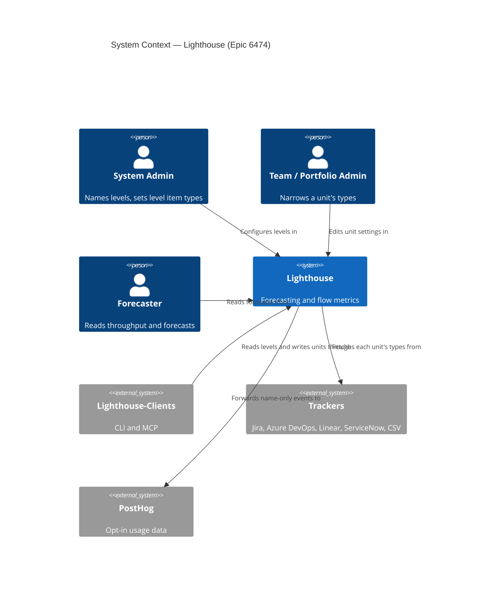
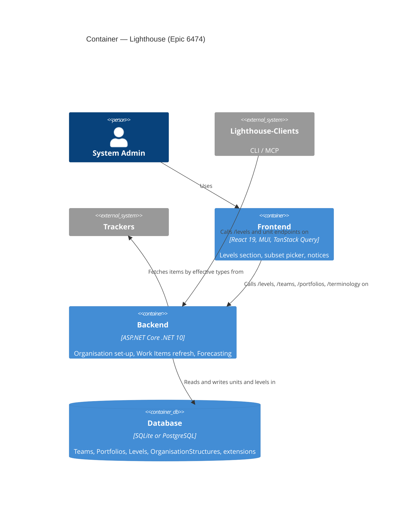
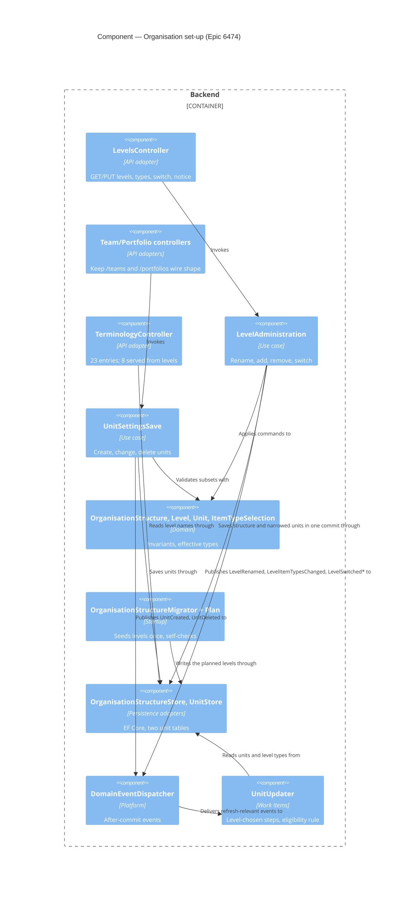

<!-- markdownlint-disable MD024 -->
# Feature Delta — epic-6474-one-structure

**Epic**: ADO #6474 "One structure: Teams and Portfolios as units on levels". Part of the Epic 6455 family
(D21); precedes #6455 "Levels above", #6476 and #6477.
**Waves present**: DISCOVER and DIVERGE inherited from `../epic-6455-deeper-hierarchies/` (not re-run, by
instruction). DISCUSS 2026-11-02 (this file, plus `slices/`).
**UX depth**: comprehensive. **Feature type**: cross-cutting, backend-heavy with visible parts. **Walking
skeleton**: brownfield.
**Locked input**: 6455 `feature-delta.md` → DISCUSS "Locked decisions" D1–D21. Not re-litigated here; cited as
D-numbers. Everything else in this file is a proposal until the maintainer walk-through.
**Terminology**: default terms (Team, Portfolio, Work Item, Feature). Tracker type names (Story, Bug, Epic,
Change, User Story) are literal tracker values. Personas below are fictional; customers stay anonymous.

---

## Wave: DISCUSS / [REF] Locked decisions

D1–D21 are inherited from the 6455 DISCUSS. Added for this Epic:

### Maintainer decisions (2026-11-02)

Numbered as the open questions Q1–Q12 they answer.

- **M1.** An API write (`/teams`, `/portfolios`) naming a type the level does not list is refused with **400
  naming the type, for everyone, System Admins included**; no automatic adding. Removing that ability is
  deliberate. It is a **breaking API change** for the Lighthouse-Clients CLI/MCP: major version bump and a
  breaking-change note, to be confirmed at DESIGN. Later idea, out of scope: separate AI skills for
  administering Lighthouse and for using it.
- **M2.** A type newly added to a level is ticked for no existing unit; the dialog shows "N units could read it".
- **M3.** Removing a type that units tick is allowed after a confirmation naming them.
- **M4.** **Only System Admins add types to a level, and only in Organisation → levels.** Unit forms show only
  the level's list, with no "Add to the level" control; a non-admin missing a type is pointed to a System Admin.
- **M5.** Slice 05 waits for #6473's Organisation shell; the invisible slices go first.
- **M6.** The union of types is deduplicated ignoring case.
- **M7.** Renaming **levels** (each level's unit and item names) is **free**, still System Admin only; the rest
  of Terminology stays Premium. `TerminologyController`'s Premium guard on `PUT /terminology` must no longer
  apply to the 8 moved keys (slice 06).
- **M8.** All slices stay in this Epic.
- **M9.** The CLI and MCP get a `levels` read **now, in this Epic**, released together with the breaking-change
  client release (new slice 14; the Lighthouse-Clients repo is handled at DESIGN/DELIVER).
- **M10.** Code names Unit and Level; the leaf item's code name is settled at DESIGN.
- **M11.** Empty type subsets are allowed (Linear, ServiceNow).
- **M12.** Two-tracker installs and Customer-A-shaped installs are left to DESIGN under D10 (migrate as is);
  DESIGN adds migration tests for both (slice 02 notes).
- **M13.** An install can switch the level above Teams off ("Teams only": one level). Off: no Portfolios,
  Features or Deliveries shown; Teams keep throughput, flow metrics and forecasts. First-run set-up offers
  "Teams only". Switching off with existing Portfolios asks first, naming them; they are hidden, data kept, and
  shown again when switched on. Locked while more than two levels exist. Prototyped, approved. No licence rule;
  hidden Portfolios stop refreshing (to confirm at DESIGN). Slice 15.

---

## Wave: DISCUSS / [REF] Job grounding

DIVERGE artifacts exist (`../epic-6455-deeper-hierarchies/diverge/job-analysis.md`); JTBD is not re-run.

| Job (SSOT `docs/product/jobs.yaml`) | How this Epic serves it |
|---|---|
| `job-config-admin-describe-our-levels-once` | Directly, for the two levels that exist: the admin sees the organisation's structure in one place, in its own words, and says once which tracker types each level holds. "Will adding levels change the Portfolios that work today? (It must not.)" is this Epic's acceptance bar. |
| `job-forecaster-know-when-each-promise-level-lands` | Preparation only (D8). Nothing a forecaster reads changes; the guard is that nothing does. |
| **New, proposed**: `job-config-admin-say-item-types-once` | See "Proposed SSOT and ADR updates". D8 calls level-owned types an improvement in its own right. |

Mapping: 4 visible slices → `job-config-admin-describe-our-levels-once`; slice 09 → the new job; the 8
invisible slices → `infrastructure-only` with a rationale naming the job they prepare.

---

## Wave: DISCUSS / [REF] Scope Assessment

| Signal | Evidence | Verdict |
|---|---|---|
| > 10 stories | 15 slices, each ≤ 1 day (14 added by M9, 15 by M13) | **Over**; kept in one Epic by M8 |
| > 3 bounded contexts | Organisation set-up (core of it), Work Items (refresh per unit), Forecasting (leaf extension), Access + Licensing (re-expressed, no new rules) | 3 changed, 2 re-expressed: borderline |
| Walking skeleton > 5 integration points | migration → level store → Terminology read → Organisation UI: 4 | Pass |
| > 2 weeks | ~13 slice-days plus review | Borderline |
| Independent outcomes | One: "the structure is one thing". The visible parts have no value without the levels store | Pass |

**Verdict: PASS with a flag.** 13 slices is one over the ~12 guideline. The natural split line is between
"levels visible" (01–06, 08, 09, 11) and "one Unit type underneath" (07, 10, 12, 13). The second half is
invisible on its own, so under "each Epic ships on its own" it cannot be its own Epic; the only alternative
home is the opening slices of #6455 (D7 demands one Unit type before a level is *added*, which is #6455's
first step). Recommendation: keep one Epic (D7, D8, D20). Open question Q8.

---

### D8 waiver: eight infrastructure-only slices

Slices 01, 02, 03, 04, 07, 10, 12 and 13 change nothing a person or an API client can observe; the maintainer
accepted an Epic whose value is mostly preparation (D8) and asked for the deep step as several slices (D7).
Slice 04 keeps the `/teams` and `/portfolios` payloads identical, with one deliberate exception decided by the
maintainer (M1): a type the level does not list is refused for everyone. That is a breaking change for API
clients, announced through slice 14's major client release, not a silent one. Slice 13 keeps the
free-tier limits and messages exactly. The guard on all eight is slice 01's check (OUT-1).

---

## Wave: DISCUSS / [REF] Team and Portfolio difference inventory (code, 2026-11-02)

Source: `Models/WorkTrackingSystemOptionsOwner.cs`, `Team.cs`, `Portfolio.cs`, `Data/LighthouseAppContext.cs`,
`LicenseGuardAttribute.cs`, `RbacAdministrationService.cs`, `DataRetrievalSchemaDto.cs`, `TerminologySeeder.cs`.
Storage today: two tables, two id sequences (Team 3 and Portfolio 3 can both exist), mapped from one abstract
base. Several side tables already carry a kind discriminator: `OwnerType` (snapshots), `PermissionScopeType`
(RBAC scopes), `ReportOwnerKind` (reports).

### Shared already (the abstract base `WorkTrackingSystemOptionsOwner`) → the Unit

Identity (`Id`, `Name`, `ConcurrencyToken`), connection, query (`DataRetrievalValue`), `UpdateTime`,
`FetchFingerprint`, `WorkItemTypes` (abstract, different defaults), To Do / Doing / Done states,
`StateMappings`, `WaitStates`, `BlockedRuleSetJson`, `CycleTimeDefinitions`, SLE (probability, range),
`SystemWIPLimit`, `DoneItemsCutoffDays`, staleness thresholds, process-behaviour baseline dates, Estimation
bundle and Parent Override (each "follows the connection default / set here", ADR-241).

### Leaf only (Team) → leaf extensions

| Field or behaviour | Target owner (ADR-270) |
|---|---|
| `FeatureWIP`, `AutomaticallyAdjustFeatureWIP` | Forecasting extension keyed by unit id (slice 07) |
| Throughput window: `ThroughputHistory`, `UseFixedDatesForThroughput`, start/end dates | Forecasting extension (slice 07) |
| `ForecastFilterRuleSetJson` | Forecasting extension (slice 07) |
| `RefinementSettings` | Refinement (already its own owned config; stays) |
| `WorkItems`; `WorkItem.TeamId`, `FeatureWork.TeamId`, `WhenForecast/StartForecast.TeamId` | Work Items / Forecasting reference the unit by id; unchanged ids |
| Connection defaults `ParentOverrideForTeams`, `EstimationForTeams` | per level (leaf) |
| `TeamUpdater`, `TeamDataRefreshed`, `TeamDeleted` (published from a controller) | one unit refresh (slice 12), `UnitDeleted` (slice 03) |
| Free tier: 3 Teams | "3 units on the leaf level" (slice 13) |
| Manual forecasts, feature-size metrics, Refinement routes, Team members | leaf tabs; membership per unit |

### Level 2 only (Portfolio, the leaf's direct parent) → level-2 extension

| Field or behaviour | Target owner |
|---|---|
| Default-size guess: `DefaultAmountOfWorkItemsPerFeature`, `UsePercentileToCalculateDefaultAmountOfWorkItems`, `PercentileHistoryInDays`, `DefaultWorkItemPercentile`, `OverrideRealChildCountStates` | Work Items' roll-up, keyed by unit id (slice 10) |
| Mapping fields: Size Estimate, Feature Owner, Dependency field, `IgnoreDependencies` | Organisation set-up, level-2 part of the unit (slice 10) |
| `OwningTeamId` (a Portfolio's owning Team) | Organisation set-up, level-2 part (slice 10) |
| `ForecastInputFingerprint` | Forecasting (slice 10) |
| `Features` (many-to-many: one Feature can be in several Portfolios), `FeatureBlockedTransition.PortfolioId` | Work Items, by unit id; unchanged |
| Deliveries, rules, sources (`/portfolios/{id}/delivery-*`) | Promises; stay on level 2 (D2, D11) |
| `PortfolioUpdater` (refresh, then direct forecast trigger), `PortfolioFeaturesRefreshed`, `PortfolioForecastsUpdated` | one unit refresh (slice 12) |
| Free tier: 1 Portfolio; `CanCreatePortfolio` needs a Team first | "1 unit on level 2" (slice 13) |
| Linear: no query; ServiceNow: no Portfolio at all (ADR-116) | level-2 capability per connector, unchanged |

**Finding.** Almost nothing is "non-leaf" in general: what a Portfolio adds is tied to being the **leaf's direct
parent** (its items' children are Work Items). For #6455 this means a level 3 unit needs only the shared Unit
part, which is why D7's deep step pays off there. Proposed term: **"Feature level"** in conversation, coded as
"the level above the leaf" (never "level 2" in code; ADR-270 Decision 4).

### Not a difference, but a trap

- Item types are matched per tracker and may differ in case ("Bug" from Jira and from Azure DevOps). The union
  is deduplicated ignoring case (M6); DESIGN confirms today's matching rule.
- Linear does not use item types (`IsWorkItemTypesRequired = false`); a ServiceNow Team that names no types reads
  nothing on purpose (`docs/concepts/worktrackingsystems/servicenow.md`). An empty subset must stay legal.
- Renaming Terminology is **Premium and System Admin** today (`TerminologyController.cs:27-28`); item types
  are free and set by Team/Portfolio Admins. Level names inherit the first rule, level types the free tier.

---

## Wave: DISCUSS / [REF] What the one Unit holds

```
Level (installation-wide, exactly two for now)            Organisation set-up
  ordinal · is-leaf · unit name (sg/pl) · item name (sg/pl) · item types
    └── Unit (one type)                                   Organisation set-up
          identity, level, connection, query, item-type SUBSET of its level,
          states + state mapping (local, D13), blocked rules, cycle-time defs,
          SLE, WIP limit, staleness, estimation, parent override
          ├── leaf extension, keyed by unit id            Forecasting (+ Refinement)
          │     Feature WIP, auto-adjust, throughput window, forecast filter rules
          └── feature-level extension, keyed by unit id   Work Items roll-up / Org set-up / Forecasting
                default-size guess, size/owner/dependency fields, owning Team, fingerprint
Deliveries hang off a Feature-level unit (Promises, unchanged, D2)
```

Ids: the ids the API, the CLI/MCP clients, RBAC scopes, report owners and snapshot rows use **do not change**
(D9). How the unit keeps them (a unit table beside today's tables, kind + legacy id, or another shape) is
DESIGN's call within expand-only migrations.

---

## Wave: DISCUSS / [REF] Context map placement

| Question | Answer |
|---|---|
| Contexts touched | **Organisation set-up** (levels, units, names, types: changed heavily, so refactored here, D20). **Work Items** (one refresh per unit, slice 12). **Forecasting** (leaf extension, slice 07). **Access** and **Licensing** re-expressed per unit and level, no rule changes (slice 13). Tracker integration: unchanged; it receives each unit's type subset with the fetch as today. Promises: unchanged (Deliveries stay on the Feature level). |
| New terms | **Level** (stops being target-only for two fixed levels), **Unit** (one code type), **level's item types**, **unit's subset** ("narrows"), **Feature level** (the level above the leaf). Team, Portfolio, Work Item, Feature become the seeded **names of levels 1 and 2**, not concepts of their own. |
| Domain events published | `LevelRenamed` (Organisation set-up; no backend handler needed now, the frontend re-reads names), `LevelItemTypesChanged` (handled by Work Items: refresh the units whose subset changed), `UnitCreated`, `UnitDeleted` (replace `TeamDeleted`, fill ADR-270's "Team or Portfolio created / Portfolio deleted" gaps; handled by Access membership clean-up, Reports, snapshots as today's inline clean-up does). "Level introduced" stays reserved for #6455. |
| Domain events handled | `TeamDataRefreshed` / `PortfolioFeaturesRefreshed` kept as published names (handlers unchanged) until slice 12 decides whether one `UnitDataRefreshed` replaces them. |
| UI surface (ADR-271) | **Organisation**: a Levels section in the same tab as Terminology (D6), above "Other terms". **Unit Settings tab** (Team and Portfolio pages, kept parallel per ADR-271 Decision 1): item types become a subset picker. **Overview**: onboarding stepper names the two levels. Step towards target: Terminology loses the 8 structure keys to the levels; no move towards U4 (one unit page) in this Epic, said explicitly. |

---

## Wave: DISCUSS / [REF] Journeys

Four journeys, each `journey → steps → emotional arc → Gherkin`. Visual and YAML are combined here to keep
one file; DISTILL takes the Gherkin from the slice files.

### J1 Upgrade keeps every number (config-admin Priya Raman, delivery-forecaster Jonas Weber)

```
[Upgrade to vNext] → [Migration seeds 2 levels] → [First refresh] → [Jonas opens "Checkout Revamp"]
 Feels: wary          Sees: nothing new            Sees: same counts    Sees: same 85% date, same throughput
 "will it break?"     (log: levels seeded,          per unit             Feels: unbothered (nothing to notice)
                       N units carried over as is)
```

```yaml
journey: {name: upgrade-keeps-every-number, persona: config-admin, emotional_arc: {start: wary, middle: unaware, end: unbothered}}
steps:
  - id: 1
    name: Migration carries set-ups over as they are (D10, D12)
    shared_artifacts: [level_names, level_item_types, unit_type_subset]
    failure_modes: ["custom Terminology lost", "a type dropped by case dedupe", "an empty Linear subset rejected"]
    gherkin: |
      Scenario: Every unit reads exactly what it read before the upgrade
        Given Priya's install has Team "Payments Crew" reading Story and Bug and Portfolio "Checkout Revamp" reading Epic and Change
        When the install is upgraded
        Then the Team level lists Story and Bug and the Feature level lists Epic and Change
        And "Payments Crew" ticks Story and Bug and "Checkout Revamp" ticks Epic and Change
  - id: 2
    name: Numbers unchanged after the first refresh
    gherkin: |
      Scenario: Forecasts and throughput are the same after the upgrade
        Given the pinned numbers of every unit before the upgrade
        When the first refresh after the upgrade has run
        Then each unit's item counts, throughput series and forecast percentiles equal the pinned numbers
```

### J2 See and rename the levels (Priya, System Admin, Premium)

```
[Organisation → Structure & terms] → [Levels: 2 rows] → [Edit level 1] → [Save] → [Team pages say "Squad"]
 Feels: curious                       "so that's where    focused          relieved   confident
                                       Team went"
```

Gherkin: slices 05 and 06.

### J3 Say the item types once, let a Team narrow them (Priya; Team Admin Tom Becker)

```
[Level 1 → Edit types] → [Add "Task"] → [Remove "Bug": 4 Teams lose it, confirm?] → [Tom ticks Task on his Team]
 Feels: in control        quick           careful (explicit warning buffer)         satisfied, nothing typed
```

Gherkin: slices 08 and 09.

### J4 New install sees its structure (first-time-system-admin Ana Lima, free tier)

```
[Overview, empty] → [Stepper: "Teams work on Work Items, which roll up into Features of Portfolios"] → [Add Team]
 Feels: unsure       oriented ("this is the shape")                                          ready
```

Gherkin: slice 11.

---

## Wave: DISCUSS / [REF] UI sketches (DRAFT, for the maintainer's yes before DISTILL)

Organisation → Structure & terms (new section above the existing Terminology list; reuses the Terminology
table look and `WorkItemTypesComponent` chips in the edit dialog):

```
Organisation   [Structure & terms] [Calendar] [Behaviour] ...                         DRAFT
┌ Levels ───────────────────────────────────────────────────────────────────────────────┐
│ Your organisation has two levels. Levels above come in a later release.               │
│ Level  Unit                    Item                     Item types                    │
│ 2      Portfolio · Portfolios  Feature · Features       Epic, Change            [Edit]│
│ 1      Team · Teams            Work Item · Work Items   Story, Bug, Task, User Story [Edit]│
│        generates throughput                                                           │
└───────────────────────────────────────────────────────────────────────────────────────┘
┌ Other terms ──────────────────────────────────────────────────────────────────────────┐
│ Cycle Time [Cycle Time]  Throughput [Throughput]  WIP [WIP]  Blocked [Blocked] ...    │
└───────────────────────────────────────────────────────────────────────────────────────┘
Loading: both boxes dimmed with a small spinner; no seeded names shown as if loaded.
Failure: "Could not load the levels. [Try again]"; Edit disabled.
Any licence: level names and types editable by System Admins (M7); others see no [Edit].
```

Unit Settings → Work Item Types (Team page; the Portfolio page mirrors it with "Feature Types"):

```
Work Item Types — from the Team level                                                 DRAFT
 [x] Story   [x] Bug   [ ] User Story
 The list belongs to the Team level. Change it in Organisation (System Admins).
 Load from board found "Sub-task", which is not on the Team level. A System Admin can add it in Organisation.
 (No add control here, for anyone: M4.)
Loading: the Team's own ticks as read-only chips + spinner.
Failure: "Could not load the Team level's types. Your selection is kept." Types not editable; other fields are.
```

Level edit dialog (slices 06 and 08; reuses the Terminology TextFields and `WorkItemTypesComponent` chips):

```
Edit level 1                                                                         DRAFT
 Unit   [Team      ] singular   [Teams      ] plural      (System Admin, any licence)
 Item   [Work Item ] singular   [Work Items ] plural
 Item types  (Story x) (Bug x) (Task x) (User Story x)  [+ Add type]
 Adding a type ticks it for no existing Team. 12 Teams could read it.
                                                                       [Cancel] [Save]
Loading the impact of a removal: the Remove button shows a small spinner; nothing is removed yet.
Save failed: "Could not save level 1. Nothing was changed. [Try again]"; the dialog keeps the edits.
Impact could not be loaded: "Could not check which Teams read Bug"; Remove stays disabled.
```

Remove-a-type confirmation (reuses the existing confirm dialog):

```
Remove "Bug" from the Team level?                                                    DRAFT
 4 Teams read Bug today: Payments Crew, Checkout Crew, Search, Platform.
 They stop reading Bug at their next refresh, and their throughput and forecasts change.
                                                                  [Cancel] [Remove "Bug"]
```

---

## Wave: DISCUSS / [REF] Shared artifacts registry

| Artifact | Source of truth | Consumers | Risk |
|---|---|---|---|
| `level_names` (unit and item, singular/plural) | Level store (slice 02) | `GET /terminology/all` (same 8 keys, served from levels), every `useTerminology()` screen, onboarding stepper, Levels section | HIGH: two sources = names drift |
| `level_item_types` | Level store | Levels section, unit subset picker, Load-from-board diff, migration check | HIGH |
| `unit_type_subset` | Unit | the fetch (Tracker integration), `/teams` and `/portfolios` payload `workItemTypes`, subset picker | HIGH: any drift moves numbers |
| `pinned_numbers` | Slice 01 characterisation fixture | every invisible slice's gate, J1 | HIGH |
| unit ids | unchanged legacy ids | routes, clients, RBAC scopes, reports, snapshots, usage data | HIGH |

---

## Wave: DISCUSS / [REF] Story map and slices

Backbone: **Carry over** → **Hold the structure** → **See it** → **Shape it** → **Unify underneath**.
Walking skeleton (brownfield): 01 → 02 → 05: an upgraded demo install shows its two levels in Organisation, with
the names it had under Terminology, and every unit's numbers unchanged.

| # | Slice (≤ 1 day) | Visible? | Depends on |
|---|---|---|---|
| 01 | Pin today's numbers per unit (characterisation on demo data + an upgrade fixture) | no | — |
| 02 | Two levels seeded from today's Terminology and types; Terminology served from them | no | 01 |
| 03 | Every Team and Portfolio is a unit on its level; ids unchanged; `UnitCreated`/`UnitDeleted` | no | 02 |
| 04 | A unit reads its level's types narrowed to its subset; migration ticks today's list | no | 03 |
| 05 | Levels shown in Organisation (read-only) + `GET /levels` | **yes** | 02, **#6473 Organisation shell** |
| 06 | Rename a level's unit and item there; Terminology loses the 8 keys | **yes** | 05 |
| 07 | Leaf capacity inputs move to Forecasting's extension by unit id | no | 03 |
| 08 | Add and remove a level's item types, with impact preview | **yes** | 04, 05 |
| 09 | A unit narrows its level's types (settings and create wizards) | **yes** | 08 |
| 10 | Feature-level settings move to an extension by unit id | no | 03 |
| 11 | New-install set-up shows the two levels | **yes** | 05 |
| 12 | One refresh for every unit (leaf and Feature-level steps by level) | no | 07, 10 |
| 13 | Permissions, free-tier limits, reports and history stay with each unit | no | 03 (12 soft) |
| 14 | CLI and MCP read the levels; unknown-type 400 surfaced; major client release (M1, M9) | **yes** (clients) | 04, 05, 06 |
| 15 | "Teams only": switch the level above Teams off, Portfolios hidden with data kept (M13) | **yes** | 05, 06 (11) |

**Delivery order (M5: invisible first):** 01, 02, 03, 04, 07, 10, 12, 13, then 05 (once #6473's shell is
there), 06, 15, 08, 09, 11, 14. Slice 04's server release and slice 14's client release ship together.

### Priority rationale

1. 01 first: every later slice is gated on "numbers unchanged"; it costs a day and de-risks the whole Epic.
2. 02–04 make one source for names and types before anything shows them (else two sources ship).
3. The deep slices 07, 10, 12, 13 follow straight away (M5): none needs a visible slice or #6473, which is the
   decoupling from #6473.
4. 05 is the first visible outcome; it waits for #6473's shell (M5). The visible slices then come back to back.
5. 14 last: the client release ships with the server release that carries slice 04's 400.

Each slice's file: `slices/slice-NN-<name>.md` (hypothesis, IN/OUT, examples, UAT, AC, KPI).

---

## Wave: DISCUSS / [REF] Outcome KPIs

| Id | Who | Does what | Target | Measured by | Baseline |
|---|---|---|---|---|---|
| OUT-1 | every upgraded install's units | read the same items and show the same numbers | 100% of units identical (counts, 90-day throughput, forecast percentiles on pinned draws) on the fixture and demo data; 0 "my forecasts changed after the upgrade" reports in the 30 days after release | slice 01 harness in CI; support channel | new guard |
| OUT-2 | config-admin creating another unit on a level | picks types instead of typing or loading them | 0 typed types for a unit whose types are on the level | maintainer walk-through; DEVOPS may add a name-only event | today: every unit types or loads its list |
| OUT-3 | config-admin renaming Team/Feature words | finds them on the levels first try | 3 of 3 walk-through testers; every screen that renders the 8 terms shows the new word | walk-through; term-coverage test | today under Terminology |
| OUT-4 (leading) | developers of #6455 | add level 3 without a new unit kind | 0 places outside adapters that branch on Team vs Portfolio in Organisation set-up and the refresh | source scan / ArchUnit count | measured at DESIGN |

---

## Wave: DISCUSS / [REF] Checklist answers (no silent N/A)

- **RBAC.** No new roles. Membership stays per unit (Team members, Portfolio members); scopes keep their wire
  values (`PermissionScopeType.Team/Portfolio`), resolved through the unit and its level (slice 13). Levels
  (names, types) are edited by **System Admin**, as Terminology is today. Narrowing a unit's subset needs that
  unit's Admin, as editing its types does today. Adding a type to a level happens only in Organisation, by a
  System Admin (M4); unit forms have no add control.
  `useRbac()` gates every new control; nothing reads `my-summary` directly.
- **Licensing.** Free tier unchanged: 3 units on the leaf level, 1 on the Feature level (today's `count >
  limit` checks, re-expressed per level in slice 13). Renaming levels and editing level types are **free** (M7);
  the rest of Terminology stays Premium, so `PUT /terminology`'s Premium guard changes for the 8 moved keys. D15 (levels above are Premium) is #6455's.
- **Lighthouse-Clients (CLI/MCP).** Repo not in this checkout, so usage was not read; to verify at DESIGN.
  `/teams` and `/portfolios` keep routes, ids and payload shape (`workItemTypes` = the unit's subset), but a
  write naming a type the level lacks is now a 400 for everyone (M1): a **breaking change**, so the clients get
  a **major version bump** and a breaking-change note (confirm at DESIGN), released with a new `levels` read in
  CLI and MCP (M9, slice 14). `GET /terminology/all` keeps its 8 keys.
- **Public API.** Added: `GET /api/latest/levels`, `PUT` for a level's names and types. Kept, not deprecated:
  every `/teams` and `/portfolios` route. Behaviour change: a write carrying a type not on the level is refused
  with 400 naming the type, for everyone (M1). No route deprecated; the change is announced via slice 14.
- **Website / marketing.** N/A, because the website names Teams and Portfolios and their names do not change;
  the marketable story is #6455's.
- **Docs and screenshots** (at finalisation): `docs/settings/configuration.md` (Terminology section, new Levels
  section, `assets/settings/terminologyConfiguration.png` per theme), `docs/teams/edit.md` and
  `docs/portfolios/edit.md` ("Work Item Types"), `docs/concepts/concepts.md` (levels), the "Work Item Types"
  passages of the Jira, Azure DevOps, CSV and ServiceNow connector pages, the Overview onboarding screenshot.
- **Demo data.** Demo units carry over by the same migration; DELIVER checks the demo seeder writes the levels.
- **Usage data.** DEVOPS decides; candidates `LevelRenamed`, `LevelItemTypesChanged` (name-only).
- **Loading and failure looks.** In the sketches above for every new or changed view.
- **Terminology rule.** Copy uses the configured words via `useTerminology()`; "Feature level" in copy renders
  as "{feature} level".

---

## Wave: DISCUSS / [REF] Epic 6264 re-cut proposal (for 6264's own plan; nothing edited there)

| 6264 Story | What this Epic absorbs | What 6264 keeps |
|---|---|---|
| S03i Package Organisation set-up (#6468) | Team and Portfolio as units, their settings, Terminology/levels, `TeamDeleted` ratchet (slice 03), Portfolio deletion event | Moving blackouts, refresh cadence, Feature ordering policy and connection-default inheritance into the module. M–L → S. New unit/level code is written in the Organisation set-up module layout if S02 has settled it. |
| S03c Package Forecasting | The schema move of Feature WIP + throughput window (+ forecast filter rules) to an extension keyed by unit id (slice 07) | The behaviour-free folder move |
| S03d Package Promises | Nothing; Deliveries keep pointing at the Feature-level unit's id | Unchanged; can run before or after |
| S08 Aggregates and invariants | The Organisation set-up catalogue: Level and Unit roots, extensions by id, the "subset ⊆ level types" invariant | Every other context's catalogue |
| S10 Data ownership | Owners of Levels, Units and the two extension tables, recorded here | The rule and every other table |
| 6455's proposed R2 "Units on levels, two levels only" | All of it | Drop from 6264 |

---

## Wave: DISCUSS / [REF] Proposed SSOT and ADR updates (merge later; not applied)

Not applied in this wave only because another DISCUSS (#6473) edits the same files in parallel. They are
applied **within this Epic** (CLAUDE.md: same feature): the SSOT entries when the two DISCUSS waves are merged,
the ADR-270 and ARCHITECTURE.md §4 edits with the slice that makes them true, checked by `nw-finalize`.

`docs/product/jobs.yaml`: add `epic-6474-one-structure` to `feature_context`, and:

```yaml
  - id: job-config-admin-say-item-types-once
    title: Say once which tracker types each level holds, and let each unit only narrow them
    persona: config-admin
    feature_context: epic-6474-one-structure
    ado: "Epic #6474"
    created: 2026-11-02
    note: >
      NEW in DISCUSS of epic-6474-one-structure. Maintainer D8/D12 (6455 DISCUSS): item types are owned by the
      level and a unit only narrows them; the maintainer sees this as an improvement. Desk estimates.
    job_story: >
      When I set up many Teams and Portfolios on the same trackers,
      I want to say once which tracker types count as Work Items and as Features, and let each unit untick
      what it does not read,
      so a new unit takes a minute and no unit silently reads a type the rest of the organisation does not count.
    forces:
      push: Every Team and Portfolio types or loads its own list; nothing shows which units read which type.
      pull: The lists are mostly identical already; Load from board finds them.
      anxiety: "Will my Teams' numbers move when the list moves?" (Not on upgrade; only on an explicit, previewed removal.)
      habit: Copying a working Team's settings by hand.
    opportunity_score: {importance: 3, current_satisfaction: 2, gap: 1, rationale: "Desk estimate; preparation value dominates (D8)."}
```

`docs/product/journeys/epic-6474-one-structure.yaml`: the four journeys above (J1–J4) in the journey schema.
Personas: none new.

ADR-270:
- Decision 1, Organisation set-up row: Owns adds "Levels (two, fixed), Units (one type)"; Packaged-or-target:
  "two fixed levels: built by Epic 6474; levels above the Feature: target".
- Decision 3, pivotal events: add `LevelRenamed`, `LevelItemTypesChanged`, `UnitCreated`, `UnitDeleted`
  (Organisation set-up); `TeamDeleted` is replaced; strike "Team or Portfolio created" and "Portfolio deleted"
  from the "facts with no event" gaps.
- Decision 4, settings buckets: new row "**Owned by the level, unit narrows** | Work Item types; Feature types
  | a unit may untick, never add (D12)"; move "state mapping" from "Org default, local override" to "Local only"
  (D13); Terminology row: "Terminology (the remaining terms); level names live on the levels".
- Decision 5 glossary: Level "Target only" → "two fixed levels exist (Epic 6474); more are target"; Unit "one
  code type `Unit`"; Team, Portfolio → "seeded names of level 1 and level 2; Portfolio overload resolved into
  'unit on the Feature level'"; Terminology drift → "no notion of a level" resolved; add "Feature level: the
  level above the leaf"; Member: "per unit (wire scopes unchanged)".
- Decision 8 table: Forecasting leaf capacity "moved by Epic 6474 slice 07"; Organisation set-up "Levels, Units
  and extensions".
- Left open: "leaf unit's name" → code name Unit (M10); "leaf item's name" → settled at DESIGN of 6474.
- Licensing (Decision 1 / glossary "Licence"): level names are free to rename (System Admin); the remaining
  Terminology stays Premium (M7).

Lighthouse-Clients (for its own repo, at DESIGN/DELIVER): major version, breaking-change note "a Team or
Portfolio update naming a type its level does not list is refused" (M1), new `levels` read in CLI and MCP (M9).

ARCHITECTURE.md §4: Organisation set-up holds Level and Unit (with leaf and Feature-level extensions); Team and
Portfolio are the seeded names of the two levels; refresh is one per unit (after slice 12).

---

## Wave: DISCUSS / [REF] Definition of Ready

| Item | Status | Evidence |
|---|---|---|
| Problem in domain language | PASS | each slice opens with the admin's or developer's pain |
| Persona specific | PASS | Priya Raman (System Admin, Premium, Jira Cloud, 12 Teams/2 Portfolios), Tom Becker (Team Admin), Ana Lima (free-tier first admin), Jonas Weber (forecaster) |
| 3+ domain examples | PASS | 3 per slice, real tracker types |
| UAT 3–7 | PASS | 3–5 per slice |
| AC from UAT | PASS | per slice |
| Right-sized | PASS with flag | ≤ 1 day each; 12 and 13 flagged "may split at DESIGN" |
| Technical notes | PASS | per slice |
| Dependencies tracked | PASS | table above; #6473 named on 05 |
| Outcome KPIs | PASS | OUT-1..4, linked from slices |

---

## Wave: DISCUSS / [REF] Open questions for the maintainer

All twelve **answered on 2026-11-02**; see "Maintainer decisions" under Locked decisions.

| Q | Question | Answer |
|---|---|---|
| Q1 | API write with a type not on the level | M1: 400 for everyone; breaking client change, major bump (not the recommendation) |
| Q2 | New level type ticked for existing units? | M2: no; show "N units could read it" |
| Q3 | Removing a ticked type | M3: allowed after a confirmation naming the units |
| Q4 | Who adds types to a level | M4: System Admins, in Organisation only; no add control in unit forms (not the recommendation) |
| Q5 | Wait for #6473 or sit beside Terminology | M5: wait; invisible slices first |
| Q6 | Union ignoring case | M6: yes |
| Q7 | Level renaming Premium? | M7: free, System Admin only; other terms stay Premium (not the recommendation) |
| Q8 | Keep all slices in one Epic | M8: yes |
| Q9 | Clients `levels` read | M9: now, with the breaking client release; slice 14 (not the recommendation) |
| Q10 | Code names | M10: Unit and Level; leaf item at DESIGN |
| Q11 | Empty subsets | M11: allowed |
| Q12 | Two-tracker and Customer-A-shaped installs | M12: DESIGN, migrate as is (D10), with tests for both |

Still open for DESIGN: whether `PUT /terminology` rejects the 8 moved keys or checks the Premium guard per key
(slice 06); whether slices 12 and 13 split; the unit's id-keeping shape; the leaf item's code name.

---

## Wave: DESIGN / [REF] Domain Model — Scope and inputs

DESIGN 2026-11-02, domain part (Hera, PROPOSE mode). The solution architect's application part follows and owns
components, controllers, EF mapping, ADR-275/276. This part decides the model only: Level and Unit, aggregates and
invariants, leaf-only and Feature-level-only data, ids, domain events, data ownership and the migration's domain
rules. New ADRs: `design/adr-273-unit-identity-and-the-organisation-structure.md`,
`design/adr-274-item-types-belong-to-the-level.md` (proposed; promoted to `docs/product/architecture/` with the
slice that makes them true, after the #6473 DESIGN has merged).

Evidence read in code (2026-11-02): `WorkTrackingSystemOptionsOwner`, `Team`, `Portfolio`, the five kind
discriminators (`OwnerType`, `PermissionScopeType`, `ReportOwnerKind`, `RefreshType`, `UpdateType`),
`FetchFingerprint.For`, `EnumerableExtensions.IsItemInList`, the domain events and their handler registrations in
`Program.cs`, `TerminologySeeder`.

Two findings that shape the model:

1. **Every side table already keys a unit as (kind, number).** Snapshots (`OwnerType`), RBAC scopes
   (`PermissionScopeType`), reports (`ReportOwnerKind`), refresh history (`RefreshType`, `EntityId`) and the update
   queue (`UpdateType`) all store "Team 3" or "Portfolio 3". Team and Portfolio numbers come from two sequences and
   collide. A unit's identity in today's data is therefore *(which level, number on that level)*, not a bare number.
2. **The fetch fingerprint renders the item types exactly as stored** (`Unordered(queryOwner.WorkItemTypes)`, which
   sorts but does not fold case), while every connector matches types ignoring case (`IsItemInList` is
   `OrdinalIgnoreCase`; JQL and WIQL are case-insensitive). So rewriting a unit's "bug" to the level's "Bug" reads
   the same records but changes the fingerprint, which costs one full refetch of that unit. The maintainer accepted
   that cost (MD4): every unit takes the level's spelling, and the respelled units are a named exception to OUT-1.

---

## Wave: DESIGN / [REF] Domain Model — Aggregates

Organisation set-up gets two aggregates; three small extensions live in the contexts that own their data. Vernon
rules are cited as R1 (true invariants only), R2 (small), R3 (reference by id), R4 (eventual outside the boundary).

### Shape options (Level and Unit)

| Option | Shape | For | Against |
|---|---|---|---|
| A | Each Level its own aggregate; Unit its own aggregate | Smallest roots | "Exactly two levels", "one leaf", "only the level above the leaf can be off, only while two levels exist" span levels: no root guards them (R1 broken) |
| **B (recommended)** | **`OrganisationStructure`** aggregate (one per installation) holding the `Level` entities; `Unit` its own aggregate referencing its level by `LevelId` | Cross-level invariants have one guard; tiny (2 levels, later a handful), low churn, System Admin only, one concurrency token | A level rename and a type edit on another level share a token (409 on a race of two System Admins; acceptable) |
| C | Structure aggregate that also holds the Units | "Subset ⊆ level types" inside one boundary | God aggregate: every Team settings save locks the whole structure; units have their own lifecycle and admins (R2, R4) |

### Shape options (where leaf-only and Feature-level-only data live)

| Option | Shape | For | Against |
|---|---|---|---|
| U1 | One `Unit` with nullable leaf and Feature-level parts | One row, one load | Level-3 units (#6455) carry dead settings; code branches on "is this a Portfolio" (OUT-4) |
| **U2 (recommended)** | `Unit` = shared part + an **optional Feature-level mapping value object** (same owner, same form). Data other contexts own is an **extension keyed by `UnitId`** in that context | Follows ADR-270 Decision 8; a level-3 unit is just the shared part | Settings save spans the Unit and one extension (see "Settings save across two owners") |
| U3 | Unit + one extension per role, all owned by Organisation set-up | Fewer owners to coordinate | Forecasting's capacity inputs stay in Organisation set-up, against Decision 8 and 6264 S03c |

### 1. `OrganisationStructure` (root) with `Level` (entity)

**Full observable state.** `ConcurrencyToken`; `Levels[]`, each: `LevelId` (stable, never reused, never equal to
the ordinal), `Ordinal` (1 = leaf, contiguous), `UnitName` (singular, plural), `ItemName` (singular, plural),
`ItemTypes` (set of type names, unique ignoring case, order kept for display), `IsSwitchedOn`.
Derived, never stored: `IsLeaf` (ordinal 1), `IsFeatureLevel` (ordinal 2: the leaf's direct parent).

**Invariants (R1).**
- Exactly two levels for now (#6455 lifts this to "at least one, at most N"); ordinals contiguous from 1; one leaf.
- The leaf level is always on. Only the Feature level can be switched off, and only while exactly two levels exist
  (M13).
- **A type belongs to exactly one level across the whole structure, ignoring case** (MD6); a type is a non-empty,
  trimmed string. This is why the rule sits on the structure, not on a level. Moving a type between levels is a
  remove plus an add (no move command in this Epic).
- An empty type list is legal (Linear-only and ServiceNow-only installs, M11).
- Names: all four non-empty.

**Commands, declared delta, complement.**

| Command | Who | Declared delta (may change) | Event appended | Complement (must not change) |
|---|---|---|---|---|
| `RenameLevel(levelId, unitNames, itemNames)` | System Admin, any licence (M7) | that level's four names | `LevelRenamed` | other level; every `ItemTypes`; `IsSwitchedOn`; all units |
| `AddItemType(levelId, type)` | System Admin (M4) | that level's `ItemTypes` (+1); refused if present **on any level** ignoring case (MD6), naming the level that holds it | `LevelItemTypesChanged` (added) | every unit's subset (M2: ticked for no unit); names; other level |
| `RemoveItemType(levelId, type)` | System Admin, after confirmation naming the units (M3) | that level's `ItemTypes` (−1) **and** the subsets of the named units (−that type) | `LevelItemTypesChanged` (removed, units narrowed) | other types; other levels; units that did not tick it |
| `SwitchFeatureLevelOff()` / `On()` | System Admin, no licence rule (M13) | Feature level's `IsSwitchedOn` | `LevelSwitchedOff` / `LevelSwitchedOn` | every unit and its data (hidden, not deleted); names; types |

`RemoveItemType` is the one deliberate cross-aggregate write (structure + several units in one transaction). It
stays inside Organisation set-up, it is a rare admin command, and the confirmation the admin saw names exactly the
units it changes, so making those units change later would show the admin a state they did not confirm. Recorded
in ADR-274 as an accepted exception to R4. Safety net for the race with a concurrent unit save: what a unit reads
is always *its subset ∩ its level's types* (ADR-274), so a stale tick never reaches a tracker.

### 2. `Unit` (root)

**Full observable state.** `UnitId` (ADR-273), `LevelId`, `Name`, `ConcurrencyToken`, connection id, query
(`DataRetrievalValue`), `ItemTypeSubset` (strings), To Do / Doing / Done states, state mapping (D13, local only, no
organisation default), wait states, blocked rules, cycle-time definitions, SLE, system WIP limit, done-items
cut-off, staleness thresholds, process-behaviour baseline, estimation and parent override (each "follows the
connection default or set here", ADR-241), and, **only on the Feature level**, `FeatureLevelMapping` (value
object: Size Estimate, Feature Owner and Dependency fields with their sources, `IgnoreDependencies`,
`OwningUnitId` = today's `OwningTeamId`, which must name a leaf unit).

Sync-written columns that sit on the unit row today (`UpdateTime`, `FetchFingerprint`) are **Work Items' data**;
they stay where they are in this Epic (no behaviour gain in moving them) and are excluded from the unit's
human-edit delta and token (as today).

**Invariants (R1).**
- `ItemTypeSubset ⊆ level.ItemTypes`, compared ignoring case and **stored in the level's spelling** (MD4); empty
  allowed (M11, D12).
- A write naming a type the level does not list is refused, naming the type and the level, for everyone (M1). A
  write sending a case variant of a level type is accepted and stored in the level's spelling, so a read-then-write
  round-trip stays identical.
- `FeatureLevelMapping` is present iff the unit's level is the Feature level; `OwningUnitId`, when set, is a leaf
  unit (checked against a read of the leaf's ids; R3, by id).
- A unit's level never changes after creation (moving a Team to become a Portfolio is not a domain operation).
- The existing per-owner rules carry over unchanged (cycle-time definition validity, state-category consistency).

**Commands, declared delta, complement.**

| Command | Declared delta | Event | Complement |
|---|---|---|---|
| `CreateUnit(levelId, settings)` | a new unit; its subset ⊆ level types; for the leaf, a `LeafCapacity` extension with today's create defaults; for the Feature level, a `DefaultSizeGuess` extension | `UnitCreated` | every other unit; structure |
| `ChangeUnitSettings(unitId, settings)` | the unit's settings fields named in the request, its token | none new (today's inline reset when the fetch shape changes stays) | `UnitId`, `LevelId`; every other unit; structure; extensions not named |
| `DeleteUnit(unitId)` | the unit is gone (its extensions, members, reports and snapshots follow: cascades and handlers, as today) | `UnitDeleted` | every other unit (their links to it are cleaned by handlers); structure |

### 3. Extensions keyed by `UnitId` (other contexts)

| Extension | Owner context | Present on | Holds | Written by |
|---|---|---|---|---|
| `LeafCapacity` | Forecasting | leaf units | Feature WIP, auto-adjust, throughput window (days, fixed dates, start/end), forecast filter rules | settings save (human) |
| `DefaultSizeGuess` | Work Items (roll-up) | Feature-level units | default Work Items per Feature, percentile switch, history days, percentile, override-real-child-count states | settings save (human) |
| `ForecastInputFingerprint` | Forecasting | Feature-level units | the forecast input digest | only the forecast run (keeps `SetAfterSaveBehavior(Ignore)` semantics: never written by a settings save) |

Refinement settings stay Refinement's own owned config on the leaf unit (unchanged).

**Correction to slice 10.** DISCUSS put the Size Estimate / Feature Owner / Dependency fields, `IgnoreDependencies`
and the owning Team into the "Feature-level extension". They are mapping, which is Organisation set-up's (ADR-270
Decision 4, "Mapping is not Translation"), edited in the same form under the same token as the rest of the unit, so
they are a value object **inside** the Unit (present only on the Feature level), not a separate extension. Slice 10
therefore moves two records out (`DefaultSizeGuess`, `ForecastInputFingerprint`) and turns the rest into
`FeatureLevelMapping` on the unit, with no table of its own required by the model (the solution architect may keep
the columns where they are).

**Settings save across two owners.** One `/teams/{id}` PUT writes the Unit and `LeafCapacity` (one `/portfolios`
PUT: the Unit and `DefaultSizeGuess`). Domain rule: the Unit's token guards the whole save, both writes commit
together, and each owner's own use case validates and writes its own part; no context writes the other's table. The
application shape (one request orchestrating two use cases in one unit of work) is the solution architect's.

### Vernon check

| Aggregate | R1 | R2 | R3 | R4 |
|---|---|---|---|---|
| OrganisationStructure | cross-level invariants only | 2 entities | units referenced from outside by `LevelId` | units narrowed by `RemoveItemType` in the same transaction: accepted, documented exception |
| Unit | subset rule, Feature-level-only part, fixed level | root + value objects (~70% case) | connection, level, owning unit, items by id | extensions and side tables react to `UnitDeleted` |
| Extensions | none across the boundary | one row each | `UnitId` only | created with the unit, deleted by cascade or `UnitDeleted` |

ES/CQRS: **not warranted** for any of these. Low-churn configuration, no temporal queries on it, no audit
requirement beyond today's; state-based with after-commit events (ADR-027) is enough.

---

## Wave: DESIGN / [REF] Domain Model — Ids (ADR-273)

| Option | Shape | Routes, clients, RBAC, reports, snapshots, queue | Expand-only cost | #6455 fit |
|---|---|---|---|---|
| **I1 (recommended)** | **`UnitId` = (level, number on that level)**. Numbers are allocated per level; level 1 continues today's Team numbers, level 2 today's Portfolio numbers. The five stored kind discriminators are read as the level key (`Team` ↔ leaf, `Portfolio` ↔ Feature level) and never rewritten | unchanged: `/teams/3` is (leaf, 3), `/portfolios/3` is (Feature level, 3) | none for ids; no column rewritten | a level-3 unit is (level 3, n): one more discriminator value or a level-id column, #6455's call |
| I2 | New global surrogate `UnitId`; (kind, legacy number) kept as an alias | routes resolve through the alias forever | a new id column on every table that references a unit (work items, feature work, the Portfolio-Feature join, deliveries, 3 snapshot tables, permissions, API-key permissions, reports, refresh log, queue keys) and dual keys until a later contract step | clean, but pays the whole cost now for two levels |
| I3 | One number space by offsetting Portfolio ids (+1,000,000) | breaks every URL, bookmark, client script, scope and owner row unless mapped back | rewrites ids: **not expand-only** | rejected |

Domain rules carried by I1:
- `UnitId` is a value object (level, number); equality on both. A bare `int` never identifies a unit outside an
  adapter that already knows the level (a `/teams` route, a `Team` discriminator value).
- `LevelId` is stable and distinct from the ordinal, so #6455 adding a level above changes no existing id.
- Storage stays the solution architect's choice within I1: keeping the two tables behind one `Unit` model is the
  cheapest expand-only shape; one table with a composite key (level, number) is the later contract step if wanted.
  The model requires only that the per-level sequences keep issuing the numbers they issue today.

---

## Wave: DESIGN / [REF] Domain Model — Domain events

All after commit, in-process (ADR-027), each in the context that publishes it. "Events across contexts, pipelines
inside one" (ADR-270 Decision 3): the pruning of unit subsets inside `RemoveItemType` is a pipeline step, not an
event.

| Event | Publisher | Carries | Handled by | Replaces / note |
|---|---|---|---|---|
| `UnitCreated(UnitId, LevelId)` | Organisation set-up | ids | Work Items: first refresh of the unit (today inline in the controllers) | fills ADR-270 gap "Team or Portfolio created"; usage-data `TeamCreated` stays in the platform lane |
| `UnitDeleted(UnitId, LevelId, UnitsThatReferencedIt: UnitId[])` | Organisation set-up | ids; the referencing units are snapshotted **before** delete (today's `AffectedPortfolioIds`, computed from feature work and owning-team links) | Work Items: refresh-log cleanup; Forecasting: retrigger forecasts of the referencing units; Access: memberships and scopes of the unit; Reports and Flow metrics: where no cascade covers them, as today | replaces `TeamDeleted` and Portfolio deletion's inline clean-up |
| `LevelRenamed(LevelId)` | Organisation set-up | id | none in the backend now (the frontend re-reads names); DEVOPS usage-data candidate | new |
| `LevelItemTypesChanged(LevelId, Added[], Removed[], UnitsNarrowed: UnitId[])` | Organisation set-up | ids and type names | Work Items: enqueue a refresh of `UnitsNarrowed` (same pattern as `ConnectionFetchShapeChanged`); nothing for `Added` (M2: no unit reads it yet) | new |
| `LevelSwitchedOff(LevelId)` / `LevelSwitchedOn(LevelId)` | Organisation set-up | id | Work Items: stop scheduling refreshes of that level's units / enqueue one catch-up refresh each on switch-on. Forecasting and Promises need nothing: no refresh, no forecast round | new (M13) |
| `TeamDataRefreshed(int)`, `PortfolioFeaturesRefreshed(int)`, `PortfolioForecastsUpdated(int)` | Work Items / Forecasting | unchanged | unchanged | **kept** in this Epic (recommendation below) |
| `ConnectionFetchShapeChanged(connectionId, TeamIds, PortfolioIds)` | Tracker integration | unchanged | unchanged | kept |

**Refresh events: keep or replace?** Six handlers already subscribe to both `TeamDataRefreshed` and
`PortfolioFeaturesRefreshed` with the same reaction (`BlockedCountSnapshotRecordingHandler`,
`PercentilesOverTimeRecordingHandler`, `ProcessBehaviorRecordingHandler`, `ReconstructionMemo`, the two demo
backfill handlers), which argues for one `UnitDataRefreshed(UnitId)`. Two react to one kind only (forecast trigger
on the leaf, metrics invalidation on the Feature level), so one event moves a branch into those handlers.
Recommendation: **keep the names in this Epic** (slice 12 pins event order; zero handler churn) and make
`UnitDataRefreshed(UnitId)` the first step of #6455, when a level-3 refresh needs it. Recorded for the solution
architect; not a maintainer question unless the architect wants it now.

Licensing publishes nothing new: the free-tier limits read "units on the leaf level ≤ 3, units on the Feature level
≤ 1" on create (today's `count > limit`). Units on a switched-off level **still count** while they exist (they are
hidden, not gone; switching off is no way around the limit and no rule changes).

---

## Wave: DESIGN / [REF] Domain Model — Migration domain rules (ADR-274)

Rules the migration (slices 02 and 04) must satisfy, each with a test the slice 01 harness or a migration test
pins. "Migrate as is" (D10) governs every case not listed. Revised with the maintainer's answers (MD4, MD6).

1. **Levels.** Two levels: ordinal 1 (leaf) and 2 (Feature level), both on. Names from today's Terminology rows
   (`team/teams`, `workItem/workItems`; `portfolio/portfolios`, `feature/features`), custom values kept verbatim.
2. **Feature level first.** Level 2 = union of all Portfolios' types, deduplicated ignoring case. The level's spelling
   of a case-collapsed type is the one **most units on that level use; on a tie, the one of the unit with the lowest
   number** (deterministic, testable). Order: first appearance by unit number.
3. **Then the leaf.** Level 1 = union of all Teams' types, deduplicated ignoring case the same way, **minus every
   type already on level 2, ignoring case** (MD6: a type lives on exactly one level; the Feature level wins).
4. **Install with no units on a level:** today's create defaults (level 1: User Story, Bug; level 2: Epic), less any
   default the other level already holds (MD6).
5. **Each unit's subset = its pre-upgrade list, rewritten to its level's spelling** (MD4), minus any type its level
   does not list (only a Team can lose one, by rule 3). Order kept.
6. **Empty subsets stay empty** (Linear; ServiceNow by choice, M11). An all-empty level gets an empty type list.
7. **Two-tracker installs** (Jira and Azure DevOps Teams on one level): one tracker-agnostic list per level ("Story"
   and "User Story" both listed; "Bug" once). A Jira Team never gets an ADO-only type ticked. Consequence for
   copy: "N units could read it" (M2) counts every unit on the level, not only those on the type's tracker; a
   per-tracker layer stays ADR-270 "Left open".
8. **Customer-A shapes** (Change as the Portfolio's Feature type): Change stays on the Feature level (D10). If any
   Team also reads Change, rule 3 applies to it.
9. **No number changes (OUT-1), with two named exceptions.** After migration, for every unit: ids, Feature WIP,
   throughput window, forecast filter rules, default-size guess and the Feature-level mapping read back identical,
   and the types sent to the tracker equal the old list ignoring case, except:
   - **(i) Respelled units** (MD4): a unit whose stored spelling differed from its level's gets a new fetch
     fingerprint and **refetches in full once**. Its items and numbers are expected to be identical; the harness
     checks that and reports them as "respelled, refetched".
   - **(ii) Teams that lose a type to the Feature level** (MD6): they stop reading that type, so their item counts,
     throughput and forecasts **may change**. The harness reports them separately with the type they lost and the
     before/after numbers; it does not fail on them.
   Every other unit must match the pinned numbers and keep its stored fingerprint.
10. **The upgrade names the Teams of exception (ii).** The migration records each (Team, lost type) pair as a fact;
    the Organisation levels screen shows a notice listing them until a System Admin dismisses it, and the release
    note names the rule. Exception (i) needs no notice (nothing a user sees changes). See
    `design/upstream-changes.md`.
11. **Expand-only.** Old columns and the 8 Terminology rows stay, unread and unwritten, until a later release
    removes them. The pre-upgrade type lists stay in the old columns, which keeps exception (ii) recoverable.

---

## Wave: DESIGN / [REF] Domain Model — Ubiquitous language (Organisation set-up delta)

| Term | Meaning | Code name |
|---|---|---|
| Organisation structure | The installation's levels, in order | `OrganisationStructure` |
| Level | A tier of the structure pairing an owning unit with its unit of work; names both; lists the item types | `Level` |
| Leaf level | Level 1, where throughput is generated | `Level.IsLeaf` |
| Feature level | The leaf's direct parent; holds today's Features and Deliveries | `Level.IsFeatureLevel` (never "level 2" in code) |
| Unit | A group of people or a board that owns work on one level | `Unit` |
| Level's item types | The tracker types a level's items have; each type on exactly one level | `Level.ItemTypes` |
| Subset ("narrows") | The level types one unit reads | `Unit.ItemTypeSubset` |
| Feature-level mapping | Size Estimate, Feature Owner, Dependency fields and owning unit of a Feature-level unit | `FeatureLevelMapping` |
| Switched off | A level hidden with its units and data kept, not refreshed | `Level.IsSwitchedOn = false` |
| Item | An item mirrored from a tracker, on any level | `Item` (today's `WorkItemBase`) |
| Work Item | The item on the leaf level | `WorkItem` |
| Team, Portfolio, Work Item, Feature | Seeded **names** of levels 1 and 2 (user-facing), not unit types | adapters and routes (`/teams`, `/portfolios`); `WorkItem` and `Feature` stay as item code names |

### The leaf item's code name (answered: MD2)

| Option | Leaf item | Item on any level | For | Against |
|---|---|---|---|---|
| **N1 (chosen, MD2)** | `WorkItem` (unchanged) | `Item` (today's `WorkItemBase`) | Follows ADR-270 Decision 5's own rule (code uses the seeded terms; the leaf's seeded item name is "Work Item", D16); no rename of the most-used type | Reverses the ADR-270 glossary note; the "Work Items" context name and the generic `Item` must be kept apart in reviews |
| N2 | `LeafItem` | `WorkItem` | Literal to the model | Renames the most-used type and every `WorkItem*` table name in code for no user-visible gain |
| N3 | `TeamItem` | `WorkItem` | Short | Names a level after its seeded unit name, which a user renames |

The rename of `WorkItemBase` to `Item` is not needed before slice 12 (slices 01–10 touch no item type).

---

## Wave: DESIGN / [REF] Domain Model — Data ownership (ADR-270 Decision 8 delta)

| Data | Owner | Aggregate | Notes |
|---|---|---|---|
| Levels (names, types, on/off) | Organisation set-up | OrganisationStructure | new store; Terminology keeps the remaining terms |
| Units (shared part, Feature-level mapping) | Organisation set-up | Unit | today's Teams and Portfolios rows |
| `LeafCapacity` | Forecasting | extension by `UnitId` | slice 07 |
| `DefaultSizeGuess` | Work Items | extension by `UnitId` | slice 10 |
| `ForecastInputFingerprint` | Forecasting | extension by `UnitId` | slice 10; only the forecast run writes it |
| `UpdateTime`, `FetchFingerprint` on the unit row | Work Items | (sync state, not the Unit's) | left in place; owner recorded |
| Memberships and scopes by unit | Access | unchanged | stored `PermissionScopeType` read as the level key |
| Free-tier limits | Licensing | unchanged | per level |
| Snapshots, reports, refresh log, queue keys | Flow metrics, Reports, Work Items, platform lane | unchanged | discriminators read as the level key, never rewritten |

---

## Wave: DESIGN / [REF] Domain Model — Epic 6264 re-cut (confirmed with corrections)

The DISCUSS proposal holds for S03i, S03c, S08, S10 and R2. Corrections:

| 6264 Story | Correction |
|---|---|
| S03d Package Promises | The **Portfolio-as-unit half** is absorbed here (ADR-270 split Portfolio/Delivery into Organisation set-up and Promises); S03d keeps Deliveries only |
| S05c Team ports, S05d Portfolio ports | If 6474 lands first they **collapse into one Unit reader/store** written here (slice 03); a separate Team and Portfolio port pair would be built only to be merged |
| S07c `WorkTrackingOptions` value object | **Answered here**: inheritance from `WorkTrackingSystemOptionsOwner` gives way to one `Unit`; whether its tracker settings become one value object is the solution architect's call inside slice 03, recorded in their ADR |
| S08 catalogue | Organisation set-up's entry is this section (two roots, three extensions, the invariants above) |
| S13 aggregate boundaries in persistence | Unchanged; note that `FeatureWork → Team` becomes `FeatureWork → UnitId (leaf)` in the model, no schema change |

---

## Wave: DESIGN / [REF] Domain Model — Proposed brief block (merge later; not applied)

To append to `docs/product/architecture/brief.md` once the #6473 DESIGN has merged:

```markdown
## Domain Model — epic-6474-one-structure

Epic #6474, DESIGN 2026-11-02, Hera (PROPOSE). Context: Organisation set-up (changed), Work Items and Forecasting
(extensions, events), Access and Licensing (re-expressed per level, no rule change).

- Aggregates: `OrganisationStructure` (root; `Level` entities: stable id, ordinal, unit and item names, item types,
  on/off; exactly two levels, one leaf, only the Feature level can be off and only while two levels exist) and
  `Unit` (root; `UnitId` = (level, number on that level); shared tracker and way-of-working settings; item-type
  subset ⊆ its level's types ignoring case; `FeatureLevelMapping` value object only on the Feature level).
- Extensions keyed by `UnitId`: `LeafCapacity` (Forecasting), `DefaultSizeGuess` (Work Items),
  `ForecastInputFingerprint` (Forecasting).
- Ids (ADR-273): numbers per level, today's Team and Portfolio numbers kept; stored kind discriminators read as the
  level key, never rewritten.
- Item types (ADR-274): owned by the level, each type on exactly one level (the Feature level wins at migration);
  a unit narrows, in the level's spelling; what it reads is subset ∩ level types; removing a type narrows the named
  units in the same transaction. OUT-1 has two named exceptions: respelled units refetch once, Teams that lose a
  type to the Feature level are listed.
- Events: `UnitCreated`, `UnitDeleted` (replaces `TeamDeleted`), `LevelRenamed`, `LevelItemTypesChanged`,
  `LevelSwitchedOff`/`On`. Refresh events keep their names in this Epic.
- ES/CQRS: not warranted.
```

---

## Wave: DESIGN / [REF] Domain Model — Proposed ADR-270 edits (merge later; not applied)

The DISCUSS list ("Proposed SSOT and ADR updates") stands, with these domain changes:

- **Decision 1**, Organisation set-up "Owns": "the organisation structure (levels: names, item types, on/off), the
  units on each level (one type, `Unit`) with their Feature-level mapping, Terminology (remaining terms), …".
- **Decision 3** pivotal events: "Organisation set up / level introduced" row, Today column: `LevelRenamed`,
  `LevelItemTypesChanged`, `LevelSwitchedOff`/`On`, `UnitCreated`, `UnitDeleted` (Epic 6474); "level introduced"
  reserved for #6455. Gaps: strike "Portfolio deleted" and "Team or Portfolio created". Event list: `TeamDeleted`
  replaced by `UnitDeleted`.
- **Decision 4** buckets: new row "**Owned by the level, unit narrows** | Work Item types; Feature types | each type
  on exactly one level (MD6); a unit unticks, never adds (D12); new level types ticked for no unit (M2)"; move "state
  mapping" to "Local only" (D13); Org-wide row: "hierarchy levels and their names, item types and on/off;
  Terminology (remaining terms)".
- **Decision 5** glossary (Organisation set-up): the table in "Ubiquitous language" above; Level: "two fixed levels
  exist (Epic 6474), more are target; each item type is on exactly one level"; Unit: "one code type `Unit`, identity
  (level, number)"; Portfolio: "overload resolved: the seeded name of the Feature level's unit"; Owner:
  `OwningTeamId` becomes `OwningUnitId` (a leaf unit). **Work Items glossary** (MD2): Item row: "One record mirrored
  from a tracker, on any level | code `Item` (today's `WorkItemBase`)"; Work Item row: "The item on the leaf level |
  code `WorkItem`", replacing the note that "Work Item" in the model means an item on any level and that the leaf's
  item needs a name of its own.
- **Decision 7** shared kernel: `UnitId` and `LevelId` join the cross-context identifiers.
- **Decision 8**: rows from "Data ownership" above.
- **Left open**: "leaf unit's name" → resolved: `Unit` on the leaf level (M10); "leaf item's name" → resolved:
  `WorkItem`, with `Item` for any level (MD2); add "per-tracker layer for level item types" under "Org default or
  per-tracker default".

---

## Wave: DESIGN / [REF] Domain Model — Questions for the maintainer (answered 2026-11-02)

| # | Question | Recommendation | Answer |
|---|---|---|---|
| DQ1 | Unit ids: I1 (level, number per level) · I2 new global id + alias · I3 offset ids | I1 | **MD1: I1**, as recommended |
| DQ2 | Leaf item's code name: N1 `WorkItem` stays, generic `Item` · N2 `LeafItem` · N3 `TeamItem` | N1 | **MD2: N1**, as recommended |
| DQ3 | Removing a level type: units lose it in the same transaction · later through an event | same transaction | **MD3: same transaction**, as recommended |
| DQ4 | Case variants: unit keeps its own spelling · takes the level's | its own | **MD4: the level's** (not the recommendation) |
| DQ5 | Units on a switched-off level and the free tier: still count · do not count | still count | **MD5: still count**, as recommended |

### Maintainer decisions (DESIGN, 2026-11-02)

- **MD1.** A unit is identified by (level, number on that level); today's Team and Portfolio numbers are kept
  (ADR-273).
- **MD2.** The any-level item is `Item` in code (today's `WorkItemBase`); `WorkItem` keeps meaning the leaf-level
  item. ADR-270's glossary note changes accordingly.
- **MD3.** Removing a type from a level narrows the subsets of the units that tick it in the same transaction.
- **MD4.** At migration every unit takes its **level's spelling** of each type. A respelled unit refetches in full
  once (new fingerprint), with identical results expected. Named exception (i) to OUT-1.
- **MD5.** Units on a switched-off level still count towards the free-tier limits.
- **MD6 (new rule).** An item type lives on **exactly one level** across the structure, ignoring case. A type ticked
  on both levels today goes to the **Feature level**; the Teams that read it **lose it** from their subsets on
  upgrade, and their throughput and forecasts may change. Named exception (ii) to OUT-1. The upgrade lists the
  affected Teams (notice on the levels screen and the release note), and slice 01's harness reports them separately
  instead of failing. Slice and AC changes: `design/upstream-changes.md`.

### New question (DQ6)

MD6 can leave a Team with an **empty subset** (a Team that read only "Epic", which a Portfolio also reads). An empty
subset is legal (M11) and on Linear or ServiceNow means "no type filter" or "read nothing" by design; on Jira, Azure
DevOps and CSV the effect of an empty type list on the query was not verified here and may be "read every type".
Options: (a) let it be empty and list the Team in the notice as "reads no types now"; (b) keep its old list for that
Team only, in breach of MD6, until an admin fixes it; (c) refuse the upgrade step for that install. Recommendation:
**(a)**, with the solution architect confirming per connector that an empty list reads nothing (and making it so if
not), since reading every type would change numbers far more than losing one.

Domain review (nw-ddd-architect-reviewer) not yet run for this section.

---

## Wave: DESIGN / [REF] Application — Scope and inputs

DESIGN 2026-11-02, application part (Morgan, PROPOSE). Builds on the domain part above (MD1–MD6) without reopening
it, adds maintainer decision **MD7**, and owns components, ports, EF mapping, the migration, endpoints, the refresh,
the frontend and enforcement. New ADRs: `design/adr-275-units-keep-their-two-tables-and-levels-are-migrated-at-start.md`,
`design/adr-276-one-refresh-per-unit-with-steps-chosen-by-level.md`. Upstream AC changes:
`design/upstream-changes.md` ("application part").

- **MD7 (DESIGN, 2026-11-02).** A Team left with no types after migration because its only type moved to the Feature
  level is **flagged and its refresh paused**: it keeps its last data, is marked "needs item types" on the levels
  notice and its own page, and is not refreshed until an admin ticks a type. "No types ticked = no type filter" stays
  reserved for connectors without types (Linear, ServiceNow). The model tells the two apart by an explicit state.
  Answers DQ6.

Style: unchanged. Ports-and-adapters backend (OOP, EF Core over SQLite and PostgreSQL) inside the modular monolith
ADR-270 describes; functional-leaning React with keyed TanStack queries. Read for this part: every DISCUSS and domain
section above, all 15 slices, ADR-273, ADR-274, upstream-changes, ADR-270 (Decisions 1–8), brief.md lines 1–205,
CLAUDE.md, ci-learnings (backend design rules, EF migrations), #6473's DESIGN (DD1–DD16 and amendments), and the code
named in the Reuse Analysis.

Verified in code (2026-11-02):

1. `Team` and `Portfolio` are two EF entity types over an **unmapped** CLR base; each has its own table, sequence and
   concurrency token; `WorkItemTypes` is a primitive collection (JSON text on SQLite, `text[]` on PostgreSQL).
2. An empty type list puts **no type clause** in Jira JQL and Azure DevOps WIQL (both read every type); CSV and
   ServiceNow refuse it at validation; Linear ignores types. This is why MD7 needs an explicit state.
3. `GET /terminology/all` returns `TerminologyEntry {id, key, description, defaultValue, value}` ordered by id;
   `useTerminology().getTerm` shows `value || defaultValue`. `PUT /terminology` carries
   `[LicenseGuard(RequirePremium)]` and `[RbacGuard(SystemAdmin)]` on the whole action.
4. `LicenseGuardAttribute` counts `IRepository<Team|Portfolio>.GetAll()` with `count > limit` and words the refusal
   with the CLR type name (`Free users can only use up to 3 Team.`). `TeamUpdater` repeats the Team limit.
5. Startup runs `Database.Migrate()` (PostgreSQL under an advisory lock), then every `ISeeder` in registration order
   (`DatabaseConfigurator.SeedDatabase`), before the hosted updaters start.
6. `TeamDeleted` is published from `TeamController.DeleteTeam` inside the update-queue job; `OwnerSettingRefusals`
   already words 400s with a `code` per owner kind (`team-…`, `portfolio-…`) in the configured words.
7. No `Modules/` folder exists yet in backend or frontend; modules are namespace patterns in
   `ModuleBoundariesArchUnitTest` (Refinement and Reports are the precedents).

---

## Wave: DESIGN / [REF] Application — DDD list (design decisions)

**Amended**: by AM1–AM14 (review) and then by MA1–MA10 (maintainer, end of file), which win where they disagree.
A-D1 is replaced by MA1, A-D14's split by MA6, A-D18's "message bytes kept" by MA5.

| ID | Decision | Rejected (why) |
|---|---|---|
| A-D1 | **Placement**: Organisation set-up code goes in today's namespace style, `Models/OrganisationSetup` (domain), `Services/Interfaces/OrganisationSetup` (ports), `Services/Implementation/OrganisationSetup` (use cases, migrator), adapters where their kind lives (`API/`, `Services/Implementation/Repositories/`), with a new `OrganisationSetupPattern` in `ModuleBoundariesArchUnitTest`. A behaviour-free move to `Modules/OrganisationSetup/{Domain,Application,Adapters}` stays 6264 S03i's (A-Q1) | Creating `Modules/` here (fixes ADR-270's folder names ahead of the Flow metrics pilot that ADR-270 gives that job) |
| A-D2 | **`Unit` = the renamed base `WorkTrackingSystemOptionsOwner`**; `Team` and `Portfolio` stay as persistence-shaped subclasses on their own tables (ADR-275). Code outside adapters takes `Unit` and `UnitId` | TPH table (FK retarget, not expand-only); TPC (needs unique keys across tables: Team 3 and Portfolio 3 collide); a union view (two dialects to keep in step) |
| A-D3 | **Level storage**: `OrganisationStructures` (one row, fixed key, token, notice dismissal) and `Levels` (stable id, ordinal, `StoredKind` = `Team`/`Portfolio`, four names, item types, `IsSwitchedOff`). The kind column maps the five stored discriminators to a level by data | JSON in `AppSettings` (no constraints, platform lane's table); a token per level (the aggregate has one token); `IsSwitchedOn = true` (non-default CLR initialiser, ci-learnings EF) |
| A-D4 | **Unit columns**: new `ItemTypeSubset` (level spelling) and `NeedsItemTypes` on both tables; old `WorkItemTypes` kept, mapped read-only (no DropColumn, keeps exception (ii) recoverable); `UnitTypeLossNotices` (kind, number, lost type) | Rewriting `WorkItemTypes` in place (loses the pre-upgrade list, against domain rule 11) |
| A-D5 | **Migration = EF schema migration (Create-Migration.ps1, both providers) + `OrganisationStructureMigrator`** (an `ISeeder` after `TerminologySeeder`, runs once: no structure row yet). A pure `OrganisationStructureMigrationPlan.From(teams, portfolios, terminology, connectorsUsingTypes)` returns levels, subsets, flags and notices; the migrator applies it in one transaction, then self-checks and refuses to start on a failed check (ADR-275) | Raw SQL in the migration (two dialects, JSON vs `text[]`, provider case folding differs); lazy migration on read (two code paths) |
| A-D6 | **What a unit reads = subset ∩ level types**, computed by one pure domain function at the fetch boundary (refresh, validate, preview) from the structure reader, and handed to connectors through the existing `IWorkItemQueryOwner.WorkItemTypes`. Connectors and `FetchFingerprint` unchanged | Joining level types inside each connector (five places); trusting the stored subset alone (a removal race could reach a tracker) |
| A-D7 | **Ports** (split read/write, principle 12): `IOrganisationStructureReader` (read only) and `IOrganisationStructureStore`; `IUnitReader` and `IUnitStore` (by `UnitId`, dispatching to the level's table) replace a Team pair plus a Portfolio pair (6264 S05c/S05d collapse); `ILevelTypeUsageQuery` (which units tick a type, how many could read it). Use cases: `LevelAdministration` (rename, add, remove, switch), `UnitSettingsSave` (create, change, delete) | One god port per aggregate (read paths could write); keeping `IRepository<Team>`/`IPortfolioRepository` as the domain's ports (Team-vs-Portfolio stays in callers, OUT-4) |
| A-D8 | **`/teams` and `/portfolios` keep routes, ids and payloads** (D9). Controllers stay the adapters that know the level: they map `TeamSettingDto`/`PortfolioSettingDto` to a unit settings command for the leaf or the Feature level and back. Additive response fields only (`needsItemTypes`, nullable) | A new `/units` API now (clients and UI would move for no user gain) |
| A-D9 | **Unknown type → 400 for everyone** (M1), raised by `Level.Resolve(types)` and worded by `OwnerSettingRefusals` (EXTEND) with codes `team-item-type-not-on-level` / `portfolio-item-type-not-on-level`: "Spike is not on the {Team} level. Nothing was saved."; a type held by the other level names it ("Epic is a {Feature} type"). Applies to create, change and the validate endpoints. Case variants are accepted and stored in the level's spelling | A separate validator per controller (two wordings); a silent drop of the unknown type (hides the breaking change) |
| A-D10 | **Levels API** (`LevelsController`, `/api/{v1,latest}/levels`): `GET` (any signed-in user) returns `{concurrencyToken, levels[]}`; `PUT /levels/{levelId}/names`; `POST /levels/{levelId}/item-types` (add); `GET /levels/{levelId}/item-types/{type}/usage` (units ticking it, units that could read it); `DELETE /levels/{levelId}/item-types/{type}` with the **units the admin confirmed** in the body, refused 409 when the ticking set has changed since; `PUT /levels/feature-level/switch` with the confirmed Portfolios; `GET`/`DELETE /levels/upgrade-notice` (System Admin). Writes: `[RbacGuard(SystemAdmin)]`, **no** `LicenseGuard`, body `concurrencyToken` → 409 on a race | Names and types inside `PUT /terminology` (keeps Premium on them, M7); removing without the confirmed set (the admin could confirm a list that is stale by the time it runs) |
| A-D11 | **Terminology split**: after slice 06, `PUT /terminology` refuses the eight level keys with 400 `terminology-key-on-level`, naming them and the levels endpoint; its Premium guard stays as it is for the other terms. Slices 02–05: it writes those keys to the levels (Premium, as today) | A per-key licence check inside one endpoint (two write paths for one fact, the HIGH drift risk); silently ignoring the keys |
| A-D12 | **`GET /terminology/all` keeps its 23 entries, ids and order**: the eight level keys keep their rows (id, key, description, default) and take `value` from the level (empty when it equals the default, as a never-edited row is today). `getTerm` returns the same word on every screen; only a row edited to exactly its default reads back empty, which renders the same | Serving the eight keys from a new endpoint the frontend must merge (every `useTerminology()` caller would wait on two queries) |
| A-D13 | **Domain events on the existing `IDomainEventDispatcher`**, after commit: `UnitCreated` (handler: first refresh, replacing the inline `TriggerUpdate`), `UnitDeleted` (handlers: refresh-log clean-up and forecast retrigger move over from `TeamDeleted`; Portfolio deletion's inline clean-up becomes handlers), `LevelRenamed` (no backend handler), `LevelItemTypesChanged` (handler enqueues the narrowed units, as `ConnectionFetchShapeChanged` does), `LevelSwitchedOff/On` (handler: stop / one catch-up refresh each). `RemoveItemType` writes structure and units in **one `SaveChanges` of the scoped context**, then publishes (MD3) | An outbox (ADR-027: in-process is enough); pruning subsets in a handler (rejected by MD3) |
| A-D14 | **One refresh per unit** (ADR-276): `UnitUpdater` with level-chosen steps; queue keys, refresh settings and event names unchanged; `UnitRefreshEligibility` decides skips (switched off, needs item types, free tier). Slice 12 splits into 12a/12b | Two updaters behind a facade as the target (kept only as 12's fallback) |
| A-D15 | **MD7 state**: `Unit.NeedsItemTypes` is explicit, set by the migration (and by A-Q3's removal case), cleared by a save that ticks a type or moves the unit to a connector that does not use types. The manual update answers 409 `unit-needs-item-types` | Inferring it from "empty list + connector uses types" (an existing empty Jira Team would silently stop refreshing: a rule change nobody asked for) |
| A-D16 | **Settings save across two owners** (Unit + `LeafCapacity`, Unit + `DefaultSizeGuess`): the request runs both owners' use cases in the request's scoped `LighthouseAppContext` and saves once; the Unit's token guards it. Each extension is its own entity with its own store in its own context, a table keyed by the unit's number with a cascading FK (ADR-275 Decision 6) | An EF owned type on `Unit` (Forecasting's data written through Organisation set-up's entity, against ADR-270 Decision 8) |
| A-D17 | **"Teams only" is enforced on the server** through one `IStructureVisibility` read: `GET /portfolios` lists none, `/portfolios/{id}…` → 404 `level-switched-off`, Portfolio create → 409, Team payloads omit Portfolio and Feature references, Feature-level units are neither refreshed nor forecast, a Team refresh triggers no Portfolio forecast. The frontend hides navigation from `useLevels()` (A-Q2) | Frontend-only hiding (CLI, MCP and every Team payload would still show Portfolios, the traces slice 15 must not leave) |
| A-D18 | **Licensing per level** (13a): the count reads `IUnitReader.CountOn(level)` (units on a switched-off level count, MD5); `count > limit` and per-route overrides unchanged; message bytes kept (A-Q5). `TeamUpdater`'s own count moves into `UnitRefreshEligibility` | A Premium gate per level (D15 is #6455's) |
| A-D19 | **Frontend** (detail in Component decomposition): `LevelService` + `useLevels()` on the keyed query `["levels"]`; a `LevelsSection` added inside #6473's `TerminologyTab` (DD16), above the remaining terms; the level dialog reuses `WorkItemTypesComponent` (add/remove chips) and the Terminology text fields; unit forms get a `LevelTypeSubsetPicker` (checkboxes, no add control, M4). Level writes remove `["levels"]` and refetch `["terminology-database"]` | `WidgetShell` for settings (dashboard widgets; #6473 DD7 reached the same verdict); one hook per consumer for level data |
| A-D20 | **Clients contract**: `GET /levels` shape is the client contract; unit refusals keep the ProblemDetails shape with `code`; one major version for the CLI/MCP release with slice 04's server release. Breaking: M1's 400, A-D11, A-D17 | Versioning the API route (`/api/v2`) for three refusals (the routes do not change) |
| A-D21 | **Enforcement** (Architecture enforcement section): ArchUnitNET rules for the new module, single publishers of the new events, a ratchet on `Team`/`Portfolio` type tests outside adapters (OUT-4), a read-only structure reader; a frontend source scan for `/levels` | A ledger rule (every one of these can be automated) |
| A-D22 | **Context map**: two contexts gain data (Organisation set-up: levels, units; Forecasting and Work Items: extensions); no new context or edge; the edges Work Items ← Organisation set-up (`LevelItemTypesChanged`, `LevelSwitched*`, `UnitCreated`) and Access/Reports/Forecasting ← Organisation set-up (`UnitDeleted`) are new events on existing edges. ADR-270 edits proposed below | — |

---

## Wave: DESIGN / [REF] Application — Component decomposition

**Paths amended by MA1** (end of file): new Organisation set-up code goes under `Modules/` and `src/modules/`; the
rows below keep their responsibilities, only the folders move.

Backend paths under `Lighthouse.Backend/Lighthouse.Backend/`; frontend under `Lighthouse.Frontend/src/`; E2E under
`Lighthouse.EndToEndTests/`. Placement per A-D1 (changes if A-Q1 picks `Modules/`).

| Component | Path | Kind | Slice |
|---|---|---|---|
| `Unit` (renamed base: identity, connection, query, subset, states, rules, SLE, …) | `Models/WorkTrackingSystemOptionsOwner.cs` → `Models/Unit.cs` | MODIFY (rename + `ItemTypeSubset`, `NeedsItemTypes`, `UnitId`) | 03, 04 |
| `Team`, `Portfolio` (persistence-shaped subclasses) | `Models/Team.cs`, `Models/Portfolio.cs` | MODIFY (shrink in 07, 10; `FeatureLevelMapping` value object in 10) | 03–10 |
| `OrganisationStructure`, `Level`, `LevelId`, `UnitId`, `ItemTypeSelection` (resolve, effective types), events | `Models/OrganisationSetup/` | CREATE | 02–04, 06, 08, 15 |
| `OrganisationStructureMigrationPlan` (pure) + `OrganisationStructureMigrator` (`ISeeder`) | `Services/Implementation/OrganisationSetup/` | CREATE | 02, 04 |
| `LevelAdministration` (rename, add, remove, switch) | `Services/Implementation/OrganisationSetup/` | CREATE | 06, 08, 15 |
| `UnitSettingsSave` (create, change, delete; publishes `UnitCreated`/`UnitDeleted`) | `Services/Implementation/OrganisationSetup/` | CREATE (logic lifted from `TeamController`, `TeamsController`, `PortfolioController`, `PortfoliosController`) | 03, 04 |
| Ports `IOrganisationStructureReader/Store`, `IUnitReader/Store`, `ILevelTypeUsageQuery`, `IStructureVisibility` | `Services/Interfaces/OrganisationSetup/` | CREATE | 02–04, 08, 15 |
| Store adapters | `Services/Implementation/Repositories/OrganisationStructureStore.cs`, `UnitStore.cs` | CREATE (over `LighthouseAppContext`) | 02, 03 |
| EF mapping | `Data/LighthouseAppContext.cs` | MODIFY (2 tables, 3 columns, notices; read-only old column) | 02–04 |
| Migrations | `Lighthouse.Migrations.Sqlite/`, `Lighthouse.Migrations.Postgres/` via `Create-Migration.ps1` | CREATE (additive) | 02, 04, 07, 10 |
| `LevelsController` | `API/LevelsController.cs` + `API/DTO/LevelDto.cs` family | CREATE | 05, 06, 08, 15 |
| Team/Portfolio controllers | `API/TeamController.cs`, `TeamsController.cs`, `PortfolioController.cs`, `PortfoliosController.cs` | MODIFY (delegate to `UnitSettingsSave`; DTO mapping stays) | 03, 04, 15 |
| `OwnerSettingRefusals` | `API/Helpers/OwnerSettingRefusals.cs` | EXTEND (item-type refusals) | 04 |
| `TerminologyController`, `TerminologyService` | `API/TerminologyController.cs`, `Services/Implementation/TerminologyService.cs` | MODIFY (8 keys from/to levels; refuse after 06) | 02, 06 |
| `TerminologySeeder` | `Services/Implementation/Seeding/TerminologySeeder.cs` | MODIFY (keeps the 8 rows' default and description, no longer the source of their value) | 02 |
| `LicenseGuardAttribute` | `Services/Implementation/Licensing/LicenseGuardAttribute.cs` | MODIFY (count per level through `IUnitReader`) | 13a |
| RBAC scope resolution | `Services/Implementation/Authorization/RbacAdministrationService.cs` | MODIFY (scope type → level; unchanged wire values) | 13a |
| Reports, snapshots owners | `Services/Implementation/Reports/*`, snapshot recording handlers | MODIFY (address the unit) | 13b |
| `UnitUpdater`, step strategies, `UnitRefreshEligibility` | `Services/Implementation/BackgroundServices/Update/` | CREATE; `TeamUpdater`/`PortfolioUpdater` become facades | 12a, 12b |
| Event handlers (`UnitCreated…`, `UnitDeleted…`, `LevelItemTypesChanged…`, `LevelSwitched…`) | `Services/Implementation/DomainEvents/`, `…/Update/` | CREATE; `TeamDeleted*` handlers re-subscribe | 03, 08, 15 |
| `LeafCapacity` + store (Forecasting) | `Models/Forecast/`, `Services/…/Forecast/` | CREATE | 07 |
| `DefaultSizeGuess` (Work Items), `ForecastInputFingerprint` (Forecasting) | `Models/`, matching services | CREATE | 10 |
| DI registrations | `Program.cs` | MODIFY (forces the full Integration suite, memory) | 02–15 |
| `LevelService`, `ILevelService` | `services/Api/LevelService.ts`; `ApiServiceContext` | CREATE + MODIFY | 05 |
| `Level`, `OrganisationStructure` models | `models/OrganisationSetup/Level.ts` | CREATE | 05 |
| `useLevels()` (keyed `["levels"]`, derived `featureLevelIsOn`, `leaf`, `featureLevel`) | `hooks/useLevels.ts` | CREATE | 05 |
| `LevelsSection` (table, notice, Edit) | `pages/Settings/Organisation/LevelsSection.tsx`, inside `TerminologyTab.tsx` | CREATE + MODIFY (#6473's tab) | 05 |
| `UpgradeNotice` (lost types, needs item types) | `pages/Settings/Organisation/UpgradeNotice.tsx` | CREATE | 05 (or 05b, A-Q7) |
| `LevelEditDialog` (names; types via `WorkItemTypesComponent`) and removal confirmation (existing confirm dialog) | `pages/Settings/Organisation/LevelEditDialog.tsx` | CREATE (reuse) | 06, 08 |
| Terminology list ("Other terms") | `TerminologyTab.tsx` / its `InputGroup` | MODIFY (drop 8 keys) | 06 |
| `LevelTypeSubsetPicker` | `components/Common/WorkItemTypes/LevelTypeSubsetPicker.tsx` | CREATE; used by `ModifyTeamSettings`, `ModifyProjectSettings`, `CreateWizardShell` (MODIFY) | 09 |
| Needs-item-types warning | `pages/Teams/Detail/TeamDetail.tsx` | MODIFY | 09 |
| `OnboardingStepper` (structure sentence, "Teams only" choice) | `components/Common/OnboardingStepper/OnboardingStepper.tsx` | MODIFY | 11, 15 |
| Feature-level switch + hidden navigation | `LevelsSection`, `Header`, `OverviewDashboard` | MODIFY | 15 |
| E2E POMs | `SettingsPage`/#6473's Terminology page object gains `levels` section; team settings POM gains the picker | MODIFY | 05, 09, 15 |

---

## Wave: DESIGN / [REF] Application — Driving ports

| Port (inbound) | Adapter | Who | Change |
|---|---|---|---|
| `GET /levels` | `LevelsController` | any signed-in user | NEW (05) |
| `PUT /levels/{levelId}/names` | `LevelsController` → `LevelAdministration.Rename` | System Admin, any licence (M7) | NEW (06) |
| `POST /levels/{levelId}/item-types`, `GET …/{type}/usage`, `DELETE …/{type}` (confirmed units) | `LevelsController` → `LevelAdministration` / `ILevelTypeUsageQuery` | System Admin, any licence | NEW (08) |
| `PUT /levels/feature-level/switch` (confirmed Portfolios) | `LevelsController` → `LevelAdministration.Switch` | System Admin, any licence | NEW (15) |
| `GET`/`DELETE /levels/upgrade-notice` | `LevelsController` | System Admin | NEW (05/05b) |
| `/teams…`, `/portfolios…` (create, change, delete, validate, update) | existing controllers → `UnitSettingsSave`, `IUnitRefresh` | unchanged guards | MODIFY: 400 unknown type (04), 409 needs types (04), hidden level (15) |
| `GET /terminology/all`, `PUT /terminology` | `TerminologyController` | unchanged | MODIFY (02, 06) |
| Startup | `OrganisationStructureMigrator` (`ISeeder`) | the app | NEW (02, 04) |
| Schedule loop | `UnitUpdater` | the app | NEW (12a/b) |

Wire sketch of `GET /api/latest/levels` (the clients' contract; names in the instance's words):

```json
{ "concurrencyToken": 7,
  "levels": [
    { "id": 2, "ordinal": 2, "isLeaf": false, "isFeatureLevel": true, "isSwitchedOn": true,
      "unitName": { "singular": "Portfolio", "plural": "Portfolios" },
      "itemName": { "singular": "Initiative", "plural": "Initiatives" },
      "itemTypes": ["Epic", "Change"] },
    { "id": 1, "ordinal": 1, "isLeaf": true, "isFeatureLevel": false, "isSwitchedOn": true,
      "unitName": { "singular": "Squad", "plural": "Squads" },
      "itemName": { "singular": "Work Item", "plural": "Work Items" },
      "itemTypes": ["Story", "Bug", "Task", "User Story"] } ] }
```

---

## Wave: DESIGN / [REF] Application — Driven ports and adapters

| Port | Adapter | Technology | Contract shape | Probe (Earned Trust) |
|---|---|---|---|---|
| `IOrganisationStructureReader` | `OrganisationStructureStore` (read side) | EF Core | pure read, no write members | the migrator's self-check after apply; a startup read that finds no structure row after seeding refuses to start |
| `IOrganisationStructureStore` | `OrganisationStructureStore` | EF Core | bounded change: the structure row and its levels; token-checked | `ConcurrencyToken` → 409 on a race; tested on SQLite and PostgreSQL |
| `IUnitReader` / `IUnitStore` | `UnitStore` (dispatches by level to `Teams`/`Portfolios`) | EF Core | reader: pure read; store: bounded change (one unit, plus subsets in `RemoveItemType`) | FK and cascade behaviour tested on SQLite, not InMemory (slice 03 note) |
| `ILevelTypeUsageQuery` | `UnitStore` | EF Core, case-folding in C# | pure read | the same planner fixture: counts equal the planner's |
| Migration planner input | `OrganisationStructureMigrator` | EF Core + pure C# | `Plan` value; only the migrator applies it | self-check: one level per type, subset ⊆ level, unit count unchanged, no unit gained a type; else roll back and refuse to start (structured fatal log, like the key-ring check) |
| Trackers | existing connectors | unchanged | unchanged | unchanged; they receive the effective types (A-D6) |
| Event bus | `DomainEventDispatcher` | in-process | after commit | existing `DomainEventDispatcherSeamArchUnitTest` |

Environment lies the design answers: PostgreSQL compares text by case and SQLite `NOCASE` folds ASCII only, so all
case folding is `StringComparer.OrdinalIgnoreCase` in C# (never `ToLower`, never SQL); EF stores type lists as JSON on
SQLite and `text[]` on PostgreSQL, so no SQL reads them; two PostgreSQL instances starting together race on the
structure row's fixed key, and the loser re-reads.

---

## Wave: DESIGN / [REF] Application — Technology choices

No new library. EF Core (MIT) with the SQLite and Npgsql providers (MIT/PostgreSQL licence) as today; ArchUnitNET
(Apache-2.0) for the new rules; TanStack Query (MIT) keyed queries; MUI (MIT) checkboxes and chips through existing
components. `Create-Migration.ps1` for both providers.

---

## Wave: DESIGN / [REF] Application — Persistence and migration (what slice 01 proves)

Options (recommendation marked):

| Option | Shape | For | Against |
|---|---|---|---|
| **P1 (recommended, ADR-275)** | `Unit` base, two tables kept; `Levels` + `OrganisationStructures`; new subset/flag columns | expand-only, no FK change, cheapest | `Team`/`Portfolio` subclasses remain until a contract step |
| P2 | one `Units` TPH table, rows copied | one table | every FK retargeted or dual-written: not expand-only |
| P3 | `Units` SQL view for reads | one read surface | view DDL in two dialects, kept in step forever |
| P4 | EF TPC | one model | incompatible with I1 (keys collide) |

| Option (data step) | For | Against |
|---|---|---|
| **M-B (recommended)** EF schema + startup migrator with pure planner and self-check | one C# implementation for both providers; planner unit-tested on every ADR-274 rule | one more startup step |
| M-A raw SQL in the migration | runs with `Migrate()` | two dialects, JSON vs `text[]`, provider case folding |
| M-C lazy on first read | no startup step | two code paths in every reader |

**How slice 01 proves the outcome.** The planner's output is the oracle's input: it names, per unit, *unchanged*,
*respelled* (exception i), *lost a type* (exception ii) or *needs item types* (MD7). The harness runs the slice 01
fixture and demo data through the real migrator on SQLite and PostgreSQL, refreshes against the fixture's connector
doubles, and asserts per group: unchanged units keep stored fingerprint and every pinned number; respelled units get
a new fingerprint and the same numbers; lost-a-type and needs-item-types units are reported with type and
before/after numbers and do not fail. Fixtures added: two-tracker install (Jira + Azure DevOps Teams on one level),
Customer-A shape (Change as Feature type, M12), a Jira Team reading only Epic (MD7), a Linear Team with no types
(not flagged). `HistoricalSchemaPatch` learns the new tables and columns.

---

## Wave: DESIGN / [REF] Application — Loading and failure looks per view

| View | Loading | Failure | Reuses |
|---|---|---|---|
| Levels section (Terminology tab) | box dimmed under a small spinner; no seeded names shown | "Could not load the levels. [Try again]"; Edit and the switch disabled | `LoadingAnimation`, the inline `Alert` look #6473 uses (DD9, A4) |
| Upgrade notice | not shown until the notice read has loaded | not shown; the levels section still loads (the notice is secondary) | `Alert` |
| Level edit dialog | — | save failed: "Could not save level {n}. Nothing was changed. [Try again]", edits kept | Terminology text fields, `WorkItemTypesComponent` |
| Removal usage | Remove shows a small spinner | "Could not check which {Teams} read Bug"; Remove disabled | existing confirm dialog |
| Unit subset picker | the unit's own ticks as read-only chips + spinner | "Could not load the {Team} level's types. Your selection is kept."; types read-only, other fields editable and savable | `ItemListManager` chips |
| Onboarding sentence | no sentence and no reserved space jump (sentence slot keeps its height) | today's stepper without the sentence | `OnboardingStepper` |
| Teams-only switch | disabled while levels load | disabled with the levels failure alert | — |
| Needs-item-types warning (Team page) | comes with the Team payload (no extra request) | the Team page's existing failure look | `Alert` |

Every write removes `["levels"]` (never shows the old list as current; #6473 A3 rule) and refetches
`["terminology-database"]` after a rename.

---

## Wave: DESIGN / [REF] Application — C4 diagrams

System Context (L1): unchanged in shape; the clients now also read the levels.



Container (L2):



Component (L3), Organisation set-up inside the backend:



---

## Wave: DESIGN / [REF] Application — Reuse Analysis (HARD GATE)

| Need | Existing | Verdict | Contract shape · universe · assertion |
|---|---|---|---|
| One unit type | `WorkTrackingSystemOptionsOwner` (shared base) | **EXTEND** (rename to `Unit`) | bounded change · the class name and new members · `NoPendingModelChangesTest` shows no schema rename |
| Two tables, ids, sequences | `Teams`, `Portfolios` | **EXTEND** (2 columns each) | bounded change · additive columns · `ExpandOnlyMigrationGuardTest` |
| Level names | `TerminologyEntry` rows (8 keys), `TerminologySeeder` | **EXTEND** (rows keep id/default/description; value from level) | unbounded preservation · `GET /terminology/all` entries · payload-equality test before/after |
| Level item types | per-unit `WorkItemTypes` | **CREATE** `Levels.ItemTypes` (no existing owner) | bounded change · new table · planner tests |
| Structure aggregate | none | **CREATE** (no existing alternative: nothing guards cross-level rules) | bounded change · 2 tables |
| One-off data upgrade | `ISeeder` pattern (`ApiKeyOwnerReconciliationSeeder`, `ForecastInputsForgottenAtStartSeeder`) | **EXTEND** the pattern (new seeder) | Plan value from a pure function; migrator is the only impure applier |
| Refusal wording | `OwnerSettingRefusals.RefusedWithCode` | **EXTEND** | pure function of (kind, setting, level) · response body · existing refusal tests |
| Licence guard | `LicenseGuardAttribute` | **EXTEND** (count per level) | preservation · status and message bytes · existing licence tests |
| Refresh | `UpdateServiceBase<T>`, `TeamUpdater`, `PortfolioUpdater`, update queue | **EXTEND** (one `UnitUpdater` on the base; old ones as facades) | preservation · pinned numbers and event order · slice 01 harness + event-order test |
| Events | `IDomainEventDispatcher`, `TeamDeleted` handlers | **EXTEND** (new events; handlers re-subscribed) | preservation · clean-up effects · existing handler tests moved |
| Fetch-shape refresh | `ConnectionFetchShapeChanged` handler pattern | **EXTEND** (same pattern for `LevelItemTypesChanged`) | — |
| Type chips with add/remove | `WorkItemTypesComponent`, `ItemListManager` | **REUSE** in the level dialog | — |
| Subset picker | none (today free text) | **CREATE** `LevelTypeSubsetPicker` (no existing checkbox list of fixed options) | pure component |
| Settings host | #6473 `TerminologyTab` (`InputGroup` stack, DD16) | **EXTEND** (one more section) | — |
| Terminology access | `useTerminology()` | **REUSE** unchanged | — |
| Confirm dialog | existing delete/confirm dialog | **REUSE** | — |
| Loading/failure look | `LoadingAnimation`, inline `Alert` (#6473) | **REUSE** | — |
| Onboarding | `OnboardingStepper` | **EXTEND** | — |
| Module rules | `ModuleBoundariesArchUnitTest`, single-publisher tests | **EXTEND** | — |

---

## Wave: DESIGN / [REF] Application — Architecture enforcement

Style: ports-and-adapters within the modular monolith. Language: C# and TypeScript. Tools: ArchUnitNET (existing
`Architecture/` tests, `IlDependencies` for async edges in Release), Vitest source scans (existing
`licenseStatusOneAsker` shape).

- Organisation set-up domain (`Models.OrganisationSetup`) depends on nothing in `API`, `Services`, `Data`.
- `IOrganisationStructureReader` and `IUnitReader` expose no member that writes (principle 12; test shaped like
  `The_sizing_log_port_offers_no_way_to_edit_an_entry`).
- Only `Services.Implementation.OrganisationSetup` publishes `UnitCreated`, `UnitDeleted`, `LevelRenamed`,
  `LevelItemTypesChanged`, `LevelSwitchedOff/On` (shape of `ConnectionFetchShapeChangedSinglePublisherArchUnitTest`);
  no controller publishes a domain event.
- Only `OrganisationStructureStore` and the migrator reference `DbSet<Level>`/`OrganisationStructures`.
- **OUT-4 ratchet**: the count of `is Team`, `as Portfolio`, `typeof(Team)` and similar tests outside `API`,
  `Data` and `Repositories`, in Organisation set-up and the refresh, may only go down; target 0 after 12b.
- Ratchet on callers of `ITeamUpdater`/`IPortfolioUpdater` (may only go down).
- Behavioural: `TerminologyService` never writes the eight level keys after slice 06; connectors receive the
  effective types (subset ∩ level), checked through a connector double.
- Frontend: no module but `services/Api/LevelService.ts` contains a `/levels` path literal; nothing outside
  `hooks/useLevels.ts` reads the `["levels"]` key.

---

## Wave: DESIGN / [REF] Application — Quality attributes

| Attribute | Scenario | Strategy |
|---|---|---|
| Correctness (OUT-1) | upgrade of any install | pure planner + self-check + slice 01 harness on both providers |
| Compatibility | CLI/MCP scripts | wire shape kept; three refusals announced by a major client version |
| Reliability | two System Admins edit levels | one token, 409; removal carries the confirmed set |
| Performance | fetch per unit | effective types computed in memory from a two-row structure; no join per fetch |
| Maintainability | #6455 adds a level | new stored kind + steps; OUT-4 ratchet |
| Security | level writes | `RbacGuard(SystemAdmin)` on every write; read open to signed-in users only |
| Usability | slow connection | looks per view above |

---

## Wave: DESIGN / [REF] Application — Epic 6264 re-cut (confirmed with corrections)

**Amended by MA1** (end of file): S02 (Metrics pilot) becomes a prerequisite of #6474's DELIVER, and S03i no longer
moves this Epic's new code into `Modules/` (it is born there).

| 6264 Story | Verdict |
|---|---|
| S03i Package Organisation set-up | **Confirmed.** This Epic builds levels, units, the terminology split and the event ratchet in the namespace style (A-D1); S03i keeps blackouts, refresh cadence, ordering policy, connection defaults and the behaviour-free move into `Modules/` |
| S03c Package Forecasting | **Confirmed**: schema step = slice 07; folder move stays |
| S03d Package Promises | **Confirmed half**: Portfolio-as-unit here; Deliveries stay in S03d |
| S05c/S05d Team and Portfolio ports | **Collapse** into `IUnitReader`/`IUnitStore` (slice 03). Correction: `ITeamUpdater`/`IPortfolioUpdater` stay as facades with a caller ratchet; 6264 removes them |
| S07c `WorkTrackingOptions` value object | **Decided: not in this Epic.** The tracker settings stay as members of `Unit`; a value object would need an owned-type mapping whose column names must be pinned one by one to avoid renames, for no behaviour gain. Optional for 6264 |
| S08, S10 | **Confirmed** (domain part's catalogue and ownership rows) |
| S13 | **Confirmed** (no schema change; `FeatureWork → UnitId (leaf)` in the model) |

---

## Wave: DESIGN / [REF] Application — Proposed brief block (merge later; not applied)

**Superseded** by the revised block under "Application — Maintainer decisions (DESIGN app, 2026-11-02)".

```markdown
## Application Architecture — epic-6474-one-structure

Wave: DESIGN · 2026-11-02 · Morgan · backend and frontend.

Teams and Portfolios are one `Unit` type (the renamed `WorkTrackingSystemOptionsOwner`) on two installation-wide
levels held by the `OrganisationStructure` aggregate (ADR-273). Units keep their two tables, ids and sequences; levels
live in `Levels` and `OrganisationStructures`; a unit's item-type subset and its "needs item types" state are new
columns, the old type list stays read-only (ADR-275). A startup migrator applies a pure plan once and checks its own
result. Each type is on one level; what a unit reads is its subset intersected with its level's types (ADR-274).
`/teams` and `/portfolios` keep their wire shape and refuse an unknown type with 400 for everyone; `/levels` reads
and (System Admin, any licence) writes names, types and the Feature-level switch; `PUT /terminology` keeps Premium for
the remaining terms and refuses the eight level keys. One `UnitUpdater` refreshes every unit with level-chosen steps
and one eligibility rule (switched off, needs item types, free tier) (ADR-276). Events: `UnitCreated`, `UnitDeleted`,
`LevelRenamed`, `LevelItemTypesChanged`, `LevelSwitchedOff/On`. Frontend: `useLevels()` on `["levels"]`, a Levels
section inside Organisation → Terminology, a subset picker in unit forms. Enforcement: ArchUnitNET single-publisher,
read-only reader and OUT-4 ratchet rules; a source scan for the `/levels` path.
```

---

## Wave: DESIGN / [REF] Application — Proposed ADR-270 edits (in addition to the domain part's)

**Amended by MA1** (end of file): the Decision 1 and Decision 6 lines below are replaced there.

- Decision 1, Organisation set-up row, Packaged-or-target: "levels and units built by Epic 6474 in the
  `Services.*.OrganisationSetup` namespaces; move to `Modules/` with 6264 S03i".
- Decision 3: add the handler side: Work Items reacts to `UnitCreated` (first refresh), `LevelItemTypesChanged`
  (refresh the narrowed units), `LevelSwitchedOff/On` (stop / catch up); Access, Reports and Forecasting react to
  `UnitDeleted`.
- Decision 7: `UnitId` and `LevelId` live in the shared kernel namespace (`Models`), not in Organisation set-up.
- Decision 8: `ItemTypeSubset`, `NeedsItemTypes` (Organisation set-up, on the unit row); `UnitTypeLossNotices`
  (Organisation set-up); `LeafCapacity`, `DefaultSizeGuess`, `ForecastInputFingerprint` tables keyed by the unit's
  number with cascading FKs.
- Glossary, Organisation set-up: "Needs item types: a unit whose connector uses types and that ticks none; not
  refreshed until one is ticked (MD7)".

---

## Wave: DESIGN / [REF] Application — Questions for the maintainer

**All answered 2026-11-02** (A-Q1–A-Q9): see "Application — Maintainer decisions (DESIGN app, 2026-11-02)" at the
end. A-Q1, A-Q5 and A-Q6 went against the recommendation.

1. **A-Q1 Where the new code lives.** (a) today's namespace style with Domain/Application/Adapters kept apart by
   namespace, moved by 6264 S03i; (b) create `Modules/OrganisationSetup/` now, making this Epic fix ADR-270's folder
   names before the Flow metrics pilot. **Recommend (a).**
2. **A-Q2 "Teams only" on the API.** (a) the server hides Feature-level units (lists empty, 404, 409 on create);
   (b) the API is unchanged and adds `isHidden`, the frontend hides. **Recommend (a)**: no traces in Team payloads,
   CLI or MCP.
3. **A-Q3 Removing a level type leaves a Jira, Azure DevOps or CSV unit with no types.** (a) the unit is marked
   "needs item types" and paused, as MD7, and the confirmation says so; (b) the removal is refused until those units
   tick another type; (c) allowed, the unit reads every type. **Recommend (a).**
4. **A-Q4 The eight keys on `PUT /terminology` after slice 06.** (a) refused with 400 naming the levels endpoint
   (breaking, in slice 14's note); (b) a per-key licence check, both endpoints write names. **Recommend (a).**
5. **A-Q5 Free-tier message (slice 13a).** Today it reads "Free users can only use up to 3 Team." (a) keep the bytes;
   (b) switch to the configured words now ("3 Squads"), a visible change. **Recommend (a)** in 13a; (b) as a small
   follow-up if wanted.
6. **A-Q6 Splits.** (a) 12 → 12a/12b and 13 → 13a/13b (17 slices); (b) split 12 only. **Recommend (a)**: 12 changes
   both pipelines, 13 touches RBAC.
7. **A-Q7 The upgrade notice.** (a) its own small slice 05b right after 05 (05 stays read-only); (b) inside 05.
   **Recommend (a).**

---

## Wave: DESIGN / [REF] Application — Open questions and handoff

- Lighthouse-Clients is not in this checkout: whether the clients write `PUT /terminology` or send types on unit
  writes is verified at DELIVER of slice 14; both are covered by the breaking-change note either way.
- DEVOPS: usage-data candidates `LevelRenamed`, `LevelItemTypesChanged`, `FeatureLevelSwitched` (name-only); no new
  external integration. Contract-test recommendation: Lighthouse-Clients consumes `GET /levels` and the unit refusal
  ProblemDetails; pin both as payload-shape tests in the backend (existing `PropertyNames` pattern) and run the
  clients' own suite against the server release (consumer-driven, e.g. Pact-JS, only if the clients repo wants it).
- DISTILL: walk A-Q1–A-Q7 first, then the sketches (Levels section, notice, subset picker, needs-item-types warning,
  Teams-only switch) with their loading and failure looks; no nWave tags in test code.
- Peer review (nw-solution-architect-reviewer) for this part: see below.

---

## Wave: DESIGN / [REF] Application — Amendments after peer review (iteration 1)

nw-solution-architect-reviewer: **NEEDS_REVISION** (1 critical, 5 high, 6 medium, 2 low). Its code checks held
(LicenseGuard wording, Jira/ADO empty-list reads, `TeamUpdater` and `PortfolioUpdater` limits). These amendments take
precedence over the A-D rows above wherever they disagree.

- **AM1 (critical, MD7 hole) The flag is set by any save, not only by the migration.** `NeedsItemTypes` is set by
  *every* write (migration, create, change, a connection move, a type removal) that leaves a unit whose connector
  uses types (Jira, Azure DevOps, CSV) with an empty effective list; cleared when the effective list is non-empty or
  the connector does not use types. A create or change that would leave such a unit empty is still saved (empty is
  legal, M11) and the unit is created paused. Probe: the fetch boundary never hands an empty list to a connector that
  uses types (a test through a connector double; the eligibility rule skips such a unit). **Behaviour change:** an
  existing Jira or Azure DevOps unit that ticks no types today, and so reads every type, is flagged at upgrade too.
  Maintainer question **A-Q8** (recommend: flag it, the notice names it; the alternative is to keep its "reads every
  type" behaviour and flag only new cases).
- **AM2 (high) `PUT /terminology` refuses only a changed level key.** The frontend sends the whole list; an entry for
  a level key whose value equals the level's current name is accepted and ignored. Pinned: a PUT of the unmodified
  `GET /terminology/all` payload returns 200 and changes nothing. A-D11 stands otherwise (conditional on A-Q4).
- **AM3 (high) Free-tier limits are a per-level table.** `PortfolioUpdater` skips when `count > 1`, `TeamUpdater` when
  `count > 3`. `UnitRefreshEligibility` and `LicenseGuardAttribute` read one table: leaf 3, Feature level 1, both with
  `count > limit`; both pinned in tests.
- **AM4 (high) Rollback to the previous release.** In this Epic's releases `ItemTypeSubset` is authoritative, and every
  unit save also writes `WorkItemTypes` (dual write) with the effective list, **except** for a flagged unit, whose
  `WorkItemTypes` keeps its pre-upgrade list. So a rollback reads what each unit reads now, and a flagged Jira Team
  reads its old list rather than every type. Pre-upgrade lists stay recoverable from `UnitTypeLossNotices` (which
  records every lost type), which replaces the domain part's "old column keeps the list" (rule 11) as the recovery
  record; that is a departure, listed for the maintainer as **A-Q9**. Roll-forward after edits made in the old
  release: at each start the migrator compares the two columns per unit, re-derives a differing subset from
  `WorkItemTypes` with the planner's per-unit rule, and records any type not on the level as a notice line. Test: an
  N-1 read of the N schema (the old model on the new database) on SQLite and PostgreSQL.
- **AM5 (high) Forecasts using a paused Team say so.** A Feature forecast or Team widget whose inputs include a unit
  that needs item types shows "Uses {Team} data from {date}: {Team} is not refreshed until it has item types",
  through `WidgetShell`'s existing stale or warning status on dashboards and an `Alert` above the Feature list, never
  as current. Row added to the looks: "paused input: stale label with the date, link to the Team for its Admins".
  Pinned at DISTILL. This needs a sketch.
- **AM6 (high) Contract shapes for every new or changed port**: `IStructureVisibility` pure read; `IUnitRefresh`
  bounded change (enqueues one key); `ILevelTypeUsageQuery` pure read (consumer: the usage endpoint and
  `LevelAdministration.RemoveItemType`, which re-reads it inside the command to check the confirmed set);
  `LevelsController` adapter; `TerminologyService` reads bounded to 23 entries, writes bounded to non-level keys;
  `RbacAdministrationService` preservation (same answers per scope); `UnitStore` reader pure, store bounded to the
  named unit(s); "Fetch-shape refresh" handler bounded change (enqueues the narrowed units only). Frontend rows marked
  "—" are components with no persistence contract.
- **AM7 (medium)** A-D11 is conditional on A-Q4 and A-D15's removal case on A-Q3.
- **AM8 (medium)** Every store, extension stores included, uses the request's scoped `LighthouseAppContext`; "its own
  context" in A-D16 means its own *bounded context*, not its own `DbContext`.
- **AM9 (medium)** `RemoveItemType` checks each narrowed unit's concurrency token in the same `SaveChanges`; a unit
  saved meanwhile makes the whole removal answer 409, nothing changed.
- **AM10 (medium)** Events stay after commit with no outbox (ADR-027). Fallback when the process dies between commit
  and publish: the scheduled refresh picks the narrowed units up (their fetch fingerprint changed); a switch-on
  catch-up lost this way happens at the next scheduled round. Each event is published right after its `SaveChanges`
  in the use case; handlers run in the dispatcher's own scope and re-read what they need.
- **AM11 (medium)** ADR-276's step lists are pinned in full in 12a/12b: leaf (fetch, write-back staging, item count,
  refresh log, summary, connection health, `TeamDataRefreshed`); Feature level (free-tier check, fetch, roll-up and
  default sizing, delivery recomputation, large-portfolio warning, orphaned-Feature clean-up, refresh log, summary,
  connection health, `PortfolioFeaturesRefreshed`, forecast with its fingerprint skip, `PortfolioForecastsUpdated`).
- **AM12 (medium)** L3 additions: `LicenseGuardAttribute` (reads unit counts per level), the connectors (receive the
  effective types from the refresh), the forecast trigger (on `TeamDataRefreshed`, asks the eligibility rule).
- **AM13 (low) Routes.** Removal is `POST /levels/{levelId}/item-types/{type}/removal` with the confirmed units in
  the body (no DELETE with a body). The switch is `PUT /levels/{levelId}/switch`, refused 400 unless `levelId` is the
  Feature level.
- **AM14 (low)** The self-check runs inside the transaction, before commit. "Read-only" old column = mapped property
  with `SetAfterSaveBehavior(Ignore)` and `SetBeforeSaveBehavior(Ignore)` (until AM4's dual write, which then makes
  it normal). `ItemTypeSubset` is non-null with the provider's empty-list default (`'[]'` on SQLite, `'{}'` on
  PostgreSQL), so the SQLite table rebuild needs no backfill before the migrator runs; `NeedsItemTypes` non-null,
  default false.

New maintainer questions: **A-Q8** (flag existing empty Jira/Azure DevOps units at upgrade: recommend yes) and
**A-Q9** (dual-write `WorkItemTypes` for rollback, making the loss-notice table the recovery record instead of the old
column: recommend yes). Re-review (iteration 2) not run inside this DESIGN; run it before DISTILL if wanted.

---

## Wave: DESIGN / [REF] Application — Maintainer decisions (DESIGN app, 2026-11-02)

These answer A-Q1–A-Q9 and take precedence over every A-D and AM row above.

- **MA1 (A-Q1, not the recommendation).** New Organisation set-up code is born in ADR-270's layout:
  backend `Modules/OrganisationSetup/{Domain, Application, Adapters}` (`Adapters/Api`, `Adapters/Persistence`), with
  ports next to the use cases that need them; frontend `src/modules/<organisation-setup>/` with one public `index.ts`.
  The exact folder spelling is the one **6264 S02 (Metrics pilot)** fixes. What moves in: `OrganisationStructure`,
  `Level`, `ItemTypeSelection`, the events (Domain); `LevelAdministration`, `UnitSettingsSave`, the migration planner
  and migrator, the ports (Application); `LevelsController`, `OrganisationStructureStore`, `UnitStore` (Adapters).
  Frontend: `LevelService`, `useLevels`, `LevelsSection`, `UpgradeNotice`, `LevelEditDialog`,
  `LevelTypeSubsetPicker` live in the module; #6473's Terminology tab and the unit forms import them from its
  `index.ts`. Stays where it is: `Unit`, `Team`, `Portfolio` (EF entities in `Models`, mapped by
  `LighthouseAppContext`), `UnitId`/`LevelId` (shared kernel), the refresh (Work Items, ADR-276), the extensions
  (their own contexts). ArchUnitNET gains "Domain does not depend on Application or Adapters" and "Application does
  not depend on Adapters" for this module, plus "only the composition root and `API` reach `Adapters`". The frontend
  gets a fallow zone (or source-scan test) for "only `index.ts` is imported from outside the module".
- **MA2 (A-Q2).** "Teams only" is enforced on the server (A-D17 stands).
- **MA3 (A-Q3).** A type removal that leaves a Jira, Azure DevOps or CSV unit with no types flags it and pauses its
  refresh, as MD7; the confirmation names those units.
- **MA4 (A-Q4).** `PUT /terminology` refuses a changed level key (400 `terminology-key-on-level`, pointing to
  `/levels`); unchanged entries are ignored (AM2 stands).
- **MA5 (A-Q5, not the recommendation).** The free-tier limit messages use the level's configured unit name,
  pluralised: "Free users can use up to 3 Teams." / "3 Squads." / "1 Portfolio." (singular for a limit of 1, plural
  otherwise). It is a **visible change** in slice 13 (and the clients' note, since scripts may match the text). AC: "A
  refused create names the level's unit in the configured word and number: 'Free users can use up to 3 Squads' for a
  leaf renamed Squad; 'Free users can use up to 1 Portfolio' for the Feature level." Status 403 and `count > limit`
  are unchanged. `LicenseGuardAttribute` reads the name from `IOrganisationStructureReader`.
- **MA6 (A-Q6, not the recommendation).** Slices 12 and 13 stay **whole**; each is flagged as **over one day**
  (about 1.5–2). ADR-276 Decision 6 becomes "one slice, pinned by slice 01 and an event-order test".
- **MA7 (A-Q7).** The upgrade notice (lost types, needs item types) is its own slice **05b**, right after 05.
- **MA8 (A-Q8).** Existing empty Jira and Azure DevOps units (and CSV) are flagged at upgrade too. This is a
  behaviour change: they stop reading every type and pause until a type is ticked. They appear in the 05b notice, and
  the release note says so.
- **MA9 (A-Q9).** Dual-write `WorkItemTypes` (AM4); `UnitTypeLossNotices` is the recovery record. The departure from
  domain rule 11 is accepted.
- **MA10 (#6473 spelling).** The settings area is **"Organization"**: label "Organization", routes
  `/settings/organization/:tab?`. Every sketch, copy line and route in this Epic uses it: "Organization → Terminology
  → Levels", "A System Admin can add it in Organization", "Rename in Organization". The code namespace stays
  ADR-270's (`OrganisationSetup`) unless 6264 S02 fixes another spelling.

### Prerequisites (DELIVER)

- **Epic 6264 S02 (Metrics pilot)** is merged first: it fixes the `Modules/` and `src/modules/` folder names and
  spelling that MA1 uses. Slice 01 (test-only) may start before it; slices 02 onward wait.
- **#6473's Organization shell** for slice 05 (M5), with the American slugs (MA10).

### Final slice list (16)

01 pin numbers · 02 two levels seeded · 03 units on levels · 04 unit reads its subset (400 for an unknown type,
needs-item-types flag) · 07 leaf capacity extension · 10 Feature-level extension · 12 one refresh per unit (whole, over a day) ·
13 permissions, free-tier limits (configured-word messages, visible), reports and history (whole, over a day) · 05 levels in Organization · **05b upgrade notice** · 06 rename a level · 15 Teams only · 08 level item
types · 09 unit narrows types · 11 set-up shows two levels · 14 clients read levels (major release).
Delivery order unchanged (invisible first), with 05b after 05.

### Revised brief block (replaces the one above)

```markdown
## Application Architecture — epic-6474-one-structure

Wave: DESIGN · 2026-11-02 · Morgan · backend and frontend.

Teams and Portfolios are one `Unit` type (the renamed `WorkTrackingSystemOptionsOwner`) on two installation-wide
levels held by the `OrganisationStructure` aggregate (ADR-273). Organisation set-up is the second context in ADR-270's
layout, after the Metrics pilot: `Modules/OrganisationSetup/{Domain, Application, Adapters}` and `src/modules/` (folder names per 6264 S02).
Units keep their two tables, ids and sequences; levels live in `Levels` and `OrganisationStructures`; a unit's subset
and its "needs item types" state are new columns, and `WorkItemTypes` is dual-written for rollback, with
`UnitTypeLossNotices` as the recovery record (ADR-275). A startup migrator applies a pure plan once and checks its own
result. Each type is on one level; a unit reads its subset intersected with its level's types (ADR-274); a unit on
Jira, Azure DevOps or CSV with no types is flagged and not refreshed. `/teams` and `/portfolios` keep their wire shape
and refuse an unknown type with 400 for everyone; `/levels` reads and (System Admin, any licence) writes names, types
and the Feature-level switch; `PUT /terminology` keeps Premium for the remaining terms and refuses changed level
keys. "Teams only" is enforced on the server. Free-tier messages name the level's unit in the configured word. One
`UnitUpdater` refreshes every unit with level-chosen steps and one eligibility rule (ADR-276). Events: `UnitCreated`,
`UnitDeleted`, `LevelRenamed`, `LevelItemTypesChanged`, `LevelSwitchedOff/On`. Frontend: `useLevels()` on
`["levels"]`, a Levels section in Organization → Terminology, a subset picker in unit forms. Enforcement: ArchUnitNET
layer rules for the module, single publishers, read-only readers, an OUT-4 ratchet; a module-entry rule and a source
scan for `/levels` on the frontend.
```

### ADR-270 edits (replace the Decision 1 line above; add Decision 6)

- Decision 1, Organisation set-up row, Packaged-or-target: "levels and units built by Epic 6474 in
  `Modules/OrganisationSetup/`; blackouts, cadence, ordering policy and connection defaults follow with 6264 S03i".
- Decision 6, Coexistence: "Organisation set-up is the second context in the new layout, after the Metrics pilot
  (6264 S02), which fixes the folder names".

### 6264 re-cut (amended)

| 6264 Story | Change |
|---|---|
| **S02 Metrics pilot** | **Prerequisite of #6474 DELIVER** (from slice 02); fixes folder names and spelling |
| S03i | Keeps blackouts, refresh cadence, ordering policy, connection defaults; the units, levels and terminology split are already in `Modules/OrganisationSetup/` (no move left for them) |
| others | as in the re-cut table above |
