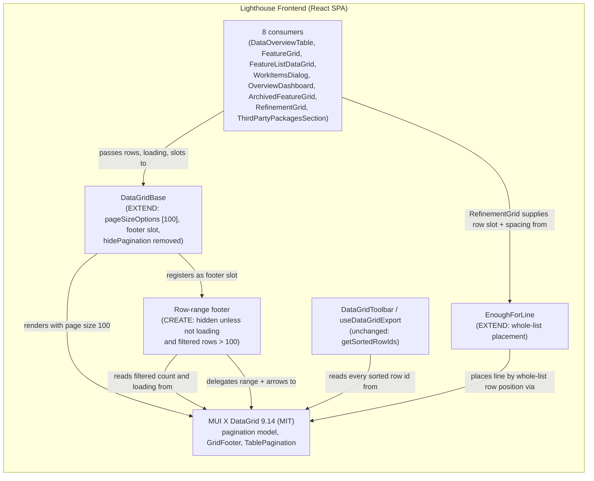

<!-- markdownlint-disable MD024 -->
# Feature Delta — story-6202-lists-beyond-100-rows

> ADO User Story #6202 "Lists with more than 100 rows silently show only the first 100" · tag Tech Debt ·
> Active · no parent. Every list built on the shared `DataGridBase` shows its first 100 rows and nothing
> else, with no hint that more exist. Found in the adversarial review of Story #6144; recorded as a known
> limit in `docs/evolution/2026-10-09-epic-5510-sizing-votes.md:217` and
> `docs/evolution/2026-10-09-epic-5881-refinement-need.md:233`.

Lean DISCUSS pass (2026-10-12), density `lean`, Tier-1 `[REF]` sections only. User-facing, brownfield,
one story, one slice, no walking skeleton. **DISCOVER and DIVERGE were explicitly skipped by the
maintainer.** The layout was approved by the maintainer as a sketch on 2026-10-08 (D1, D2).

---

## Wave: DISCUSS / [REF] Current-State Surface Inventory

Read from the code on 2026-10-12.

| # | Fact | Evidence |
|---|---|---|
| S1 | The free MUI X `DataGrid` always paginates; its page size cannot exceed 100. `DataGridBase` sets no pagination model, so every grid sits on page 1 with 100 rows. | `DataGridBase.tsx:254` (`pageSizeOptions={[10, 25, 50, 100]}`) |
| S2 | `hidePagination` defaults to `true` and is wired to `hideFooter`, so the page controls (and the row count) are hidden. In place since commit `fe426f0a8` (2025-11-21). | `DataGridBase.tsx:66,256`; `types.ts:61-62` |
| S3 | Eight consumers, all affected: `DataOverviewTable`, `FeatureGrid`, `FeatureListDataGrid`, `WorkItemsDialog`, `OverviewDashboard`, `ArchivedFeatureGrid`, `RefinementGrid`, `ThirdPartyPackagesSection`. Only the last overrides the default (`hidePagination={false}`), so it alone shows a footer today, with a rows-per-page picker. | `ctx_search DataGridBase` over `Lighthouse.Frontend/src` (13 files: the 8 consumers, `DataGridBase.tsx`, `types.ts`, `index.ts`, 2 test files) |
| S4 | CSV export and Copy (premium) already take **every** row in the current sort order, not the visible page: they read `getSortedRowIds()`. | `DataGridToolbar.tsx:48-70` |
| S5 | `RefinementGrid` replaces row rendering (`slots`, `getRowSpacing`); whatever paging does must still work with a custom row. | `RefinementGrid.tsx:93`; `DataGridBase.tsx:258-259` |
| S6 | Story #6248 (work-items dialog context columns) is changing `DataGridBase` at the same time: `defaultColumnVisibilityModel` is declared but "not read yet", and its tests are `it.skip`. | `types.ts:77-81`; `DataGridBase.defaults.test.tsx` |

## Wave: DISCUSS / [REF] Persona IDs

| Persona | Role here |
|---|---|
| `team-member-voter` | **Jonas Weber**, developer in Team Gravity. Gravity has **143** Work Items in refinement; he wants to vote on `GR-0131`, which sorts to row 131 and today is unreachable. Primary. |
| `flow-coach` | **Priya Nair**, coach of Team Gravity. Opens the Refinement tab and the Work Items dialog behind a chart (e.g. 260 closed Work Items over the last 180 days) and needs to trust that the list is whole. |
| `product-owner` | **Marco Bianchi**, PO of Team Gravity; walks the refinement list before Wednesday's Refinement. |
| `delivery-forecaster` | **Lena Fischer**, delivery lead for the Ocean Explorer Portfolio; reads the Portfolio's Feature list and archived Features. Secondary. |
| `config-admin` | Reads Settings → System → Third-party packages (well over 100 packages). Secondary. |

The row counts in this document (Gravity 143, Kestrel 38, a 243-row Feature list or Work Items dialog,
260 closed Work Items) are **illustrative**, chosen to sit either side of the 100-row boundary. Nobody
counted demo data or the dev instance for them; the tests build their own lists of these sizes.

## Wave: DISCUSS / [REF] JTBD One-Liner

`job_id: job-team-member-give-sizing-view` (primary) — *When I am asked whether a Work Item fits our SLE,
I want to give my view in seconds, from where I already am.* Today a Work Item past row 100 cannot be
reached at all, so the job fails outright for it.

Also served: `job-flow-coach-refine-just-enough` (the coach's count and triage are only honest when every
Work Item in refinement is on the list). The same defect cuts every other list-backed job short (Feature
lists, Work Items dialogs, archived Features); the fix restores reach for all of them and changes none,
so **`jobs.yaml` is not edited**. Both ids exist there: `job-flow-coach-refine-just-enough` at
`docs/product/jobs.yaml:7756` and `job-team-member-give-sizing-view` at `:7818` (read 2026-10-12).

Forces — *push*: rows past 100 vanish with no hint, so a reader concludes "that's all". *Pull*: the grid
already holds every row; only the way to reach them is missing. *Anxiety*: lists that are short today
must not grow a footer or change. *Habit*: scrolling a list to its end and trusting the end.

## Wave: DISCUSS / [REF] Locked Decisions

| ID | Decision | Verdict |
|----|----------|---------|
| D1 | **The footer appears only when a grid has more than 100 rows the reader can see (after filters).** A grid with 100 such rows or fewer looks exactly as it does today, with no footer. | Maintainer, approved sketch 2026-10-08 |
| D2 | **Fixed pages of 100.** The footer shows the row range and total plus previous/next arrows, e.g. `1–100 of 243  ‹ ›`. There is **no rows-per-page picker**, so nothing is persisted. | Maintainer, 2026-10-08 |
| D3 | **Settings → Third-party packages follows the same rule.** Its always-on footer override goes; it shows a footer only above 100 rows, and loses its rows-per-page picker. | Maintainer |
| D4 | **Every `DataGridBase` consumer in one slice**, not page by page. Virtualised scrolling without pages (the alternative in the ADO item) was rejected in favour of the conditional footer. | Maintainer |
| D5 | **Lightweight DISCUSS**: one story, one slice, no walking skeleton; DISCOVER and DIVERGE skipped. | Maintainer |
| D6 | **CSV export and Copy keep exporting every row** in the current sort order, never only the visible page (S4 — already true; pinned here so paging cannot regress it). | Taken in DISCUSS, from current behaviour |
| D7 | **No DEVOPS wave.** The change is frontend-only, with no infrastructure, pipeline or observability impact. | Maintainer, 2026-10-12 |
| D8 | **No usage-data event.** A paging footer is a fix that makes existing rows reachable, not a feature anyone chooses to use, so there is nothing worth counting. | Maintainer, 2026-10-12 |

## Wave: DISCUSS / [REF] User Stories

### US-01: Every row of a long list can be reached, and a short list stays as it is

As **Jonas** (team-member-voter), I want a list with more than 100 rows to tell me how many rows it has
and let me page to the rest, so that I can find and vote on any Work Item in refinement, not just the
first 100.

`job_id: job-team-member-give-sizing-view` (also `job-flow-coach-refine-just-enough`)

#### Elevator Pitch

Before: Team Gravity's Refinement tab lists 143 Work Items in refinement but shows 100, with nothing
saying so. Jonas looks for `GR-0131`, does not find it, and assumes it was refined already.
After: below the 100th row the tab shows `1–100 of 143  ‹ ›`; Jonas clicks `›`, sees `101–143 of 143`,
and votes on `GR-0131`. A Team with 40 Work Items in refinement sees the same list as today, no footer.
Decision enabled: Jonas votes on every Work Item he has a view on, and Priya decides how many more need
refining from a list she knows is complete.

#### Domain Examples

1. **Happy path** — Gravity, 143 Work Items in refinement: footer `1–100 of 143`; `›` shows rows 101–143.
2. **Short list unchanged** — Team Kestrel, 38 Work Items in refinement; Ocean Explorer's Feature list
   with 12 Features: no footer, identical to today.
3. **Boundary** — exactly 100 rows: no footer. 101 rows: `1–100 of 101`, and page 2 holds one row.
4. **List shrinks** — Priya, on page 2 of a 243-row Work Items dialog, filters to 64 rows: the footer
   disappears and all 64 rows show — never an empty page with no way back.
5. **Export** — Lena (premium) exports the 243-row Feature list while on page 1: the CSV has 243 rows.
6. **Refinement line past row 100** — Gravity needs 120 Work Items before the next Refinement: page 1
   shows no line and its rows read "N of 120 needed"; the line sits under row 120 on page 2. Needing 150
   puts it under row 143 with "All 143 Work Items in Refinement are needed before the next Refinement."
   (MD-2)

#### UAT Scenarios (BDD)

##### Scenario: A long list says how many rows it has and pages to the rest

```gherkin
Given Team Gravity has 143 Work Items in refinement
When Jonas opens Gravity's Refinement tab
Then he sees the first 100 Work Items and "1–100 of 143" below them
When he goes to the next page
Then he sees Work Items 101 to 143 and "101–143 of 143"
And he can vote on GR-0131
```

##### Scenario: A list of 100 rows or fewer looks exactly as today

```gherkin
Given Team Kestrel has 38 Work Items in refinement
When Priya opens Kestrel's Refinement tab
Then all 38 Work Items show
And no row count or page arrows show below the list
```

##### Scenario: The footer starts at the 101st row

```gherkin
Given a Feature list with exactly 100 Features
Then all 100 show and no footer shows
Given the list grows to 101 Features
Then "1–100 of 101" shows and the next page holds the 101st Feature
```

##### Scenario: Pages are always 100 rows, with nothing to choose

```gherkin
Given a list with 243 rows
When Priya looks at the footer
Then it offers the previous and next page only
And there is no rows-per-page choice
```

##### Scenario: Third-party packages follows the same rule

```gherkin
Given Lighthouse ships more than 100 third-party packages
When the admin opens Settings → System → Third-party packages
Then the footer shows the range and total with page arrows and no rows-per-page choice
When the admin searches for "react" and 9 packages match
Then all 9 show and the footer is gone
```

##### Scenario: A list that shrinks to 100 rows or fewer shows all of them

```gherkin
Given Priya is on the second page of a Work Items dialog with 243 Work Items
When she filters it down to 64 Work Items
Then all 64 show and no footer shows
```

##### Scenario: Export takes the whole list, not the page

```gherkin
Given Lena has a premium licence and a Feature list of 243 Features sorted by name
And she is looking at the first page
When she exports the list to CSV
Then the file holds all 243 Features in name order
```

#### Acceptance Criteria

- [ ] **AC-1.1** Every `DataGridBase` grid with more than 100 rows the reader can see (after filters) shows a footer with the range and total (`1–100 of 143`) and previous/next arrows; every row is reachable through them.
- [ ] **AC-1.2** A grid with 100 visible rows or fewer (after filters) renders no footer and is visually unchanged (existing @screenshot images of short lists do not change).
- [ ] **AC-1.3** The rule switches at the boundary of rows the reader can see (after filters): 100 rows → no footer, 101 rows → footer with a second page holding one row.
- [ ] **AC-1.4** The reader sees every page hold 100 rows (the last page holds the rest), and the footer offers no rows-per-page choice. When the reader leaves the list and comes back, it opens on page 1 with pages of 100, and the columns, sort and widths they had saved are as before.
- [ ] **AC-1.5** Settings → Third-party packages has no override left and follows AC-1.1 to AC-1.4, including when its search narrows the list.
- [ ] **AC-1.6** When a grid's rows drop to 100 or fewer while a later page is open (filter, search, data reload), all remaining rows show and the footer disappears; no state leaves the reader on an empty or unreachable page.
- [ ] **AC-1.7** Sorting orders the whole list, not only the visible page (sorting by a column puts the overall first row on page 1).
- [ ] **AC-1.8** CSV export and Copy (premium) contain every row in the current sort order, whichever page is open (D6), including rows an active column filter hides from view (today's behaviour, S4; whether that should change is out of scope).
- [ ] **AC-1.9** It holds for all eight consumers (S3), because every one of them renders through `DataGridBase`: the `DataGridBase` tests check the paging behaviour once for all eight. Five consumers set nothing that paging touches (no `slots`, `getRowSpacing` or `hidePagination`; they pass rows, columns and storage, export or sort props): `DataOverviewTable`, `FeatureGrid`, `FeatureListDataGrid`, `OverviewDashboard`, `ArchivedFeatureGrid`. Three of these narrow their rows with a filter of their own before handing them over, which to the grid is a rows change, covered by the `DataGridBase` cases for rows changing on a later page (AC-1.6). They need no test of their own. The other three customise something paging touches and are checked through their own components: `RefinementGrid` (custom rows and row spacing, S5, AC-1.10), `ThirdPartyPackagesSection` (its footer override goes, and its own search sends the list to page 1, D3, MD-1) and `WorkItemsDialog` (it sorts its own rows, and a column filter is the only way to narrow it, AC-1.6).
- [ ] **AC-1.10** On a Refinement tab with more than 100 Work Items, the enough-for line sits under the row where the needed count is reached in the whole list, on whichever page that row falls, and nowhere else; no line shows on page 1 when that row is past 100. When more are needed than the list holds, the line sits under the last Work Item and says all of them are needed (MD-2, domain example 6).

#### Outcome KPIs

See [REF] Outcome KPIs.

#### Technical Notes

- Frontend only; no API, DTO or schema change.
- MUI X free tier caps a page at 100 (S1) — D2 sits at that cap.
- `DataGridBase.tsx` is also being changed by Story #6248 (S6): expect a merge, not a conflict of intent.
- RefinementGrid's enough-for line has to be placed over the whole list, not the page (DESIGN DDD-10, MD-2): `EnoughForLine.tsx` is in the slice.

## Wave: DISCUSS / [REF] Definition of Done

1. AC-1.1 … AC-1.10 pass in Vitest + React Testing Library: against `DataGridBase` for the paging behaviour all eight consumers inherit, and against `RefinementGrid` (through the Refinement tab), `ThirdPartyPackagesSection` and `WorkItemsDialog`, the three consumers that customise something paging touches (AC-1.9).
2. Checked by hand on the dev instance (`:5169`) on a list above 100 rows and one below (see slice dogfood).
3. Existing E2E and @screenshot runs are green with no regenerated images for lists of 100 rows or fewer.
4. Docs: grep `docs/` for wording that says a list shows "all" rows or mentions page controls; amend only if found. A release-notes line is drafted on #6202 (`Release Notes` tag) in Team/Work Item/Feature terms.
5. `pnpm test` and `pnpm build` (Biome included) clean; no new SonarCloud issues; Stryker ≥ 80 % on changed lines.
6. Website: grep `/storage/repos/website` for a screenshot or copy showing Third-party packages with its old rows-per-page picker, or a list said to show "all" rows; amend or record "none found" (Checklist item 3).

## Wave: DISCUSS / [REF] Out of Scope

- Virtualised scrolling without pages (rejected, D4).
- A rows-per-page picker or remembering the page across visits (D2).
- Server-side paging; lists keep loading all their rows as today.
- Any change to which rows a list holds, its columns, sort defaults or filters.
- Whether CSV export should honour an active column filter (today it does not — S4 reads every sorted row); noted for DESIGN, not changed here.

## Wave: DISCUSS / [REF] WS Strategy

Strategy **B (extend existing)**: no walking skeleton. The grid, its consumers and MUI's pager exist end to
end; the slice changes when the footer shows and what it holds, in one shared component.

## Wave: DISCUSS / [REF] Driving Ports

- The `DataGridBase` component's props (`rows`, and the `hidePagination` prop whose fate is an open question), rendered by each of the eight consumers.
- The user's pager clicks, sort clicks and column filter, and consumer-side search (Third-party packages).
- The toolbar's Export/Copy actions (premium).

## Wave: DISCUSS / [REF] Pre-requisites

- None blocking. MUI X `DataGrid` free tier as installed. Coordinate the `DataGridBase.tsx` edit with Story #6248 (S6), which is unpushed at the time of writing.

## Wave: DISCUSS / [REF] Scope Assessment: PASS

1 story, 1 slice, 1 bounded context (shared frontend grid) touched through 1 component, 1 consumer
override removed, and RefinementGrid's enough-for line placed over the whole list rather than the page
(`EnoughForLine.tsx`, possibly `getRowSpacing`'s type; DESIGN DDD-10, MD-2, about +0.25 day). About 1.25
days. No oversized signal.

## Wave: DISCUSS / [REF] Story Map and Prioritisation

Backbone: *open a list* → *see how much there is* → *reach any row* → *act on it / export it*.
Single release, single slice (`slice-01-every-row-reachable`). Priority rationale: it is a correctness
defect that silently blocks voting and sizing on large Teams (#5510, #5881 shipped with it as a known
limit), costs about a day and a quarter, and has no dependency.

## Wave: DISCUSS / [REF] Outcome KPIs

| KPI | Target | Measurement |
|-----|--------|-------------|
| `OUT-6202-no-hidden-rows` (verification KPI: confirms the fix at release, not a change in behaviour) | 0 of the 8 `DataGridBase` consumers leave a row unreachable (was 8 of 8 above 100 rows); after release, no report of a row missing from a long list reaches the maintainer (GitHub issue or the community Slack) | Component tests with 243 rows on `DataGridBase`, which all eight consumers inherit, plus consumer cases for `RefinementGrid`, Third-party packages and the Work Items dialog, the three that customise what paging touches (AC-1.9, AC-1.10); dev-instance check of Third-party packages and a Work Items dialog over 100 rows |
| `OUT-6202-short-lists-untouched` | 100 % of grids with ≤ 100 rows render no footer; 0 @screenshot images of short lists change | Vitest boundary test (AC-1.3); @screenshot run without regenerated images |

A behavioural KPI (votes on Work Items past row 100) was drafted and dropped: it needs a usage-data event, and the maintainer decided there is none for this story (D8).

## Wave: DISCUSS / [REF] Open Questions for DESIGN

1. **Page on change while still above 100 rows.** When sort, filter or a data reload changes a list that stays above 100 rows, does the reader stay on the current page or go back to page 1? (AC-1.6 already fixes the ≤ 100 case: all rows, no footer.) Lean: back to page 1 on sort/filter, keep the page on a background reload — DESIGN decides.
2. **`hidePagination` prop.** Remove it (one rule for all, D3/D4), or keep it for a future grid that must never page? With its only `false` caller gone, nothing passes it.
3. **Footer copy and look.** MUI's default range label (`1–100 of 243`) and arrow buttons match D2; confirm the default pager hides its rows-per-page select when only one size is offered, or hide it explicitly.
4. **Export and the column filter.** Export reads every sorted row and ignores an active column filter, although a comment in the toolbar says the filter decides. Out of scope here; DESIGN may want a separate item.
5. **Loading look.** While `loading` is true and no rows are known, the footer stays hidden (≤ 100 rule). Confirm no flash of a footer when a list loads in chunks.

## Wave: DISCUSS / [REF] Lighthouse DISCUSS Checklist

1. **RBAC impact — N/A, because** paging changes how rows already delivered to the browser are shown, not which rows are delivered or who may act on them; no new `useRbac()` gate and no read of `/authorization/my-summary`.
2. **Lighthouse-Clients CLI/MCP versioning — N/A, because** the change is frontend-only: no API endpoint, DTO or payload changes, and `lh` / MCP never render `DataGridBase`. No clients release.
3. **Website marketing surface — N/A, because** this fixes a defect in existing lists; there is nothing new to market. The website grep is a named DELIVER step: Definition of Done item 6.
4. **Configurable terminology — applied.** The footer copy uses no configurable term (range and total only). This document, the release note and any docs use the seeded defaults *Team*, *Portfolio*, *Feature*, *Work Item*; never Epic/Story/Initiative for user concepts.
5. **Each Epic ships on its own — N/A, because** this is a single User Story with no parent Epic and one slice.
6. **Usage-data event — N/A** (maintainer, D8), because a paging footer makes existing rows reachable rather than adding a feature anyone chooses to use. DEVOPS, where this is normally asked, is skipped (D7).

## Wave: DISCUSS / [REF] DoR Validation

| # | DoR item | Status | Evidence |
|---|----------|--------|----------|
| 1 | Problem statement clear, domain language | PASS | Elevator Pitch Before: 143 Work Items, 100 shown, nothing says so |
| 2 | Persona with specific characteristics | PASS | Jonas Weber (`team-member-voter`), Team Gravity, 143 Work Items in refinement; Priya, Marco, Lena, config-admin |
| 3 | 3+ domain examples with real data | PASS | 6 examples: Gravity 143, Kestrel 38 / Ocean Explorer 12, 100 vs 101, 243 → 64 filter, 243-row export, Refinement line at 120 / 150 needed (counts illustrative, see Persona IDs) |
| 4 | UAT in Given/When/Then, 3-7 | PASS | 7 scenarios |
| 5 | AC derived from UAT | PASS | Long list pages → AC-1.1; 100 or fewer as today → AC-1.2; footer at the 101st row → AC-1.3; fixed pages → AC-1.4; Third-party packages → AC-1.5; list shrinks → AC-1.6; export → AC-1.8. AC-1.7 (sort orders the whole list) comes from example 1 and S4; AC-1.9 from S3/S5; AC-1.10 from example 6 and MD-2 |
| 6 | Right-sized | PASS | ~1.25 days (incl. the Refinement line, DDD-10), 7 scenarios, one demo session |
| 7 | Technical notes | PASS | Frontend-only; MUI 100-row cap; #6248 overlap |
| 8 | Dependencies resolved or tracked | PASS | None blocking; #6248 tracked in Pre-requisites |
| 9 | Outcome KPIs with measurable targets | PASS | 2 KPIs with numeric targets, both measurable without usage data (D8) |

**DoR: PASSED.** `job_id` present; Elevator Pitch present. Peer review (`nw-product-owner-reviewer`) not run
in this pass — left to the dispatching session.

## Wave: DISCUSS / [REF] Wave Decisions Summary

- **Key decisions:** D1 footer only above 100 rows; D2 fixed pages of 100, range + arrows, no picker; D3 Third-party packages follows; D4 all consumers in one slice, conditional footer over virtualised scroll; D6 export stays whole-list.
- **Feature type:** user-facing defect fix in a shared frontend component.
- **Constraints:** MUI X free tier (100-row page cap); no backend change; short lists must not change.
- **Waves skipped by the maintainer:** DISCOVER, DIVERGE, DEVOPS (D7). DESIGN, DISTILL follow (DISTILL starts with the maintainer sketch walk-through; the D1/D2 sketch is already approved).
- **Upstream changes:** none to `jobs.yaml` or personas.

---

## Wave: DESIGN / [REF] Scope, Mode and Density

**Scope:** application / components (`nw-solution-architect`). It is frontend only: no new bounded
context, no deployment change, no API. **Mode:** propose; the maintainer was AFK, so every choice below
takes the recommended option. **Density:** `lean`, Tier-1 `[REF]` only. Decision IDs follow the house
`DDD-n` convention (story-6055, story-6053).

**Prior-wave reading:** the DISCUSS sections above; `slices/slice-01-every-row-reachable.md`;
`docs/ci-learnings.md` (frontend/Sonar preflight); `brief.md` searched for `DataGrid*`. It has no
shared frontend-components section, only per-feature sections that mention `DataGridBase` in passing
(e.g. `brief.md:5005`, `:7492`), so **no `brief.md` entry is needed**. **No ADR:** every decision is
local to one shared component and reversible in one commit. Nothing changes a boundary, a dependency
or a technology.

**Evidence base.** Every MUI claim below was read in the installed package source, not recalled. The
installed version is `@mui/x-data-grid` **9.14.0**, MIT (`Lighthouse.Frontend/package.json:32`
`^9.14.0`; the main checkout's `node_modules/@mui/x-data-grid/package.json:3`; this worktree has no
`node_modules`). Paths below are relative to `node_modules/@mui/x-data-grid/` unless they say
otherwise.

| # | Verified fact | Source |
|---|---|---|
| V1 | The MIT grid always paginates: `pagination: true` is a forced prop. | `DataGrid/useDataGridProps.js:17-22` |
| V2 | Default page size is 100. A larger one throws `pageSize cannot exceed 100 in the MIT version`. | `hooks/features/pagination/gridPaginationUtils.js:10,26,36-38` |
| V3 | The rows-per-page select **and** its "Rows per page:" label render only when `rowsPerPageOptions.length > 1`. | `@mui/material/TablePagination/TablePagination.js:264,267` |
| V4 | `GridPagination` passes `pageSizeOptions` to that select only when the current page size is in the list, and warns otherwise. With `[100]` and the default 100 there is no warning and no select. | `components/GridPagination.js` (`isPageSizeIncludedInPageSizeOptions`, `pageSizeOptions`) |
| V5 | The range label is `${from}–${to} of ${count}` with an en dash, e.g. `1–100 of 243`. | `constants/localeTextConstants.js:174-182` |
| V6 | A sort change sends the grid back to page 1 (`sortModelChange` → `navigateToStart`). | `hooks/features/pagination/useGridPaginationModel.js:175-189,211` |
| V7 | A change to the **active** column-filter items or the quick filter sends it back to page 1. Opening the panel or changing an operator with no value does not. | same file `:197-207,212` |
| V8 | When the row count drops below the open page, the grid moves to the last page that still exists, after one microtask. A rows change that keeps the page valid keeps the page. | same file `:156-170` (`handleRowCountChange`) |
| V9 | In client mode the pager's row count is the **filtered** top-level row count. | `hooks/features/pagination/useGridRowCount.js:123-140` |
| V10 | The footer slot renders only when `hideFooter` is false, and whatever the slot returns is the footer. A slot returning `null` leaves no footer container. | `components/base/GridFooterPlaceholder.js:11-17` |
| V11 | The default footer is `GridFooter` (exported): a selected-row count unless `hideFooterSelectedRowCount`, then the pagination slot. | `components/GridFooter.js:21-38`; `constants/defaultGridSlotsComponents.js:30`; `components/index.js:154` |
| V12 | `getSortedRowIds()` returns every row id in sort order (`gridSortedRowIdsSelector`). It is not paged and not filtered. | `hooks/features/sorting/useGridSorting.js:140` |
| V13 | **Row-slot `index` covers the whole list** (page start + position on the page), but `getRowSpacing`'s `indexRelativeToCurrentPage` and both `isLastVisible` flags only cover the **current page**. | row index: `@mui/x-virtualizer` 0.7.2 `features/virtualization/virtualization.js:499,518-530` with `range` = the current page's range (`hooks/core/useGridVirtualizer.js:173`, `hooks/features/pagination/gridPaginationSelector.js:84,144`); spacing: `hooks/core/useGridVirtualizer.js:191-200` + `hooks/features/rows/useGridRows.js:185-190` + `hooks/utils/useGridVisibleRows.js:9-11` |

## Wave: DESIGN / [REF] Design decisions

| ID | Decision | Answers | Status |
|----|----------|---------|--------|
| DDD-1 | **One page-size constant, 100, used twice:** as the page size (`pageSizeOptions={[100]}`, page size left at MUI's default 100, V2) and as the footer threshold. It is one piece of knowledge: a page holds 100, and a footer appears once there is more than one page. | D1, D2 | Locked |
| DDD-2 | **The footer appears iff the grid is not `loading` and its *filtered* row count is above 100**, i.e. it has more than one page. It is read inside the grid from grid state (`gridFilteredTopLevelRowCountSelector` or `gridPageCountSelector`, plus `useGridRootProps().loading`), not from `rows.length`. **Why filtered and not `rows.length`:** AC-1.6 and DISCUSS example 4 have the footer vanish when a *filter* brings a list to 100 rows or fewer. The Work Items dialog has no search box of its own, so that filter is MUI's column filter, which never changes `rows`. With `rows.length`, a column-filtered 243-row list would keep a dead `1–64 of 64 ‹ ›` footer. A consumer-side search (Third-party packages) changes `rows`, so the same rule covers it. The pager counts the same filtered rows (V9), so footer and pager always agree. | Brief: threshold | Locked |
| DDD-3 | **Mechanism: a conditional footer slot.** `DataGridBase` stops passing `hideFooter` and passes `slots.footer` = a small Lighthouse footer. That footer returns `null` while DDD-2 says no footer (V10), and MUI's own `GridFooter` otherwise. It is merged as `{ ...slots, footer }`, so a consumer's `row` slot (RefinementGrid) survives and the rule holds for every grid (D4). The merged object must be referentially stable across renders: a `useMemo` over `slots` in `DataGridBase`. `hideFooterSelectedRowCount` is set: no grid shows selection in its footer today, and keyboard row selection must not make a "1 row selected" appear beside the range. *Rejected:* `hideFooter={rows.length <= 100}` (one line, but fails AC-1.6 for column filters, see DDD-2); a pagination-slot override (an empty footer bar would still render under short lists, failing AC-1.2); a custom pager (re-implements V5's copy and the arrows' a11y labels for nothing). | Q3, D1, D2 | Locked |
| DDD-4 | **No rows-per-page picker** comes from `pageSizeOptions={[100]}` alone (V3, V4). The copy is MUI's default `1–100 of 243` (V5). No `localeText` override. | Q3, D2, AC-1.4 | Locked |
| DDD-5 | **Page policy: MUI's built-in behaviour, no Lighthouse code.** A sort sends the list to page 1 (V6). A change of active column filter or quick filter sends it to page 1 (V7). A rows change (background reload, or a consumer-side search such as Third-party packages) **keeps the page while it still exists** and otherwise moves to the last page that does (V8). Paging is never persisted: `PersistedGridState` (`types.ts:94-101`) has no pagination field and nothing writes one. This matches the DISCUSS lean for the grid's own sort and filters. **The consumer-side search case is not locked:** under MUI's default, a search that leaves more than 100 rows keeps the page. For example, on page 2 of the packages a search matching 150 opens at `101–150 of 150`. A reader cannot tell a search from a filter, so the alternative is to reset to page 1 on a search as well. Recommended: reset, matching the DISCUSS lean. It is done in `ThirdPartyPackagesSection`, the one consumer with a search box, without changing `DataGridBase`. The crafter chooses the mechanism, e.g. remounting the grid keyed on the search text. **Maintainer decides at the DISTILL start** (MD-1). | Q1, AC-1.4, AC-1.7 | Locked for sort/filter/reload; search case → MD-1 |
| DDD-6 | **AC-1.6 is guaranteed twice.** (a) Once the filtered count is 100 or fewer, DDD-2 removes the footer. (b) One page then holds every row, and MUI clamps the open page to page 1: V7 for column and quick filters, V8 for rows changes. So no state can leave the reader on an empty page with no way back. V8 runs after a microtask, so DISTILL asserts the settled state (`findBy…`). DELIVER checks by hand for a briefly wrong page on a reload that shrinks the list. Before the clamp lands, the page shows a single row, the list's last, for one render; it is never an empty page. The row range clamps its first index to `min(page × 100, count − 1)` (`hooks/features/pagination/gridPaginationSelector.js:73-74`). If one shows, `DataGridBase` controls `paginationModel` and resets it when the count reaches 100 or fewer. That is a fallback, not the plan. | Q1, AC-1.6 | Locked |
| DDD-7 | **Remove `hidePagination`.** It leaves `types.ts:61-62`, the `DataGridBase` destructure (`:66`) and `ThirdPartyPackagesSection.tsx:147`, its only caller. No test references it, and no `Lighthouse.EndToEndTests` POM locates a pager. A future "never page" grid is speculative (YAGNI), and with one rule for all (D3/D4) a flag would only let a grid hide rows again, which is the defect this story fixes. | Q2, D3, AC-1.5 | Locked |
| DDD-8 | **Export and Copy are untouched.** `useDataGridExport` reads `apiRef.current.getSortedRowIds()` (`DataGridToolbar.tsx:49`), which is every row in sort order, not paged (V12). Paging adds no filter in front of it, so D6 holds by construction. DISTILL pins it: 243 rows, with page 1 open and again with page 2 open; each export holds all 243 rows in sort order. The toolbar comment there ("the sort and any filter still decide the order") overstates the filter's role. Fix the comment if the line is touched; the behaviour stays out of scope (DISCUSS Q4, a separate item for the maintainer to raise). | Q4, D6, AC-1.8 | Locked |
| DDD-9 | **Loading and failure: no footer while `loading`, whatever rows are held.** Reason: a footer showing a range from the previous answer under a loading overlay is a stale value the reader cannot recognise as stale. With no rows (first load or after an error) the count is 0, so there is no footer, and MUI's existing loading overlay or `emptyStateMessage` shows as today. Consumers keep owning their failure look (Third-party packages' own spinner and `Alert`, `ThirdPartyPackagesSection.tsx:122-132`). Nothing changes there. See Loading/failure states. | Q5 | Locked |
| DDD-10 | **RefinementGrid's enough-for line is placed over the whole list, not the page.** The space reserved for the line (`getRowSpacing`) and the line drawn by `EnoughForRow` must agree on **one whole-list row position**. "All N … are needed" may appear only under the **list's** last row, with N counting the whole list. Today they disagree once paging exists (V13). `EnoughForRow` uses the row's whole-list `index` but judges "last" by the page's last row, and `spaceForTheLine` uses the position on the page. Result on 143 rows: page 2 shows a blank 36 px gap where the page-relative position matches, and when 100 rows or more are needed, page 1 says "All 100 Work Items … are needed" while 143 exist. This is not a new product rule: `enoughForPlacement.ts` already says the line "follows the row that makes up the number needed", and that row has one position in the whole list. **Mechanism (crafter's choice), recommended:** `DataGridBase` turned paging on, so it absorbs paging's effect on its own `getRowSpacing` prop. It hands the consumer whole-list facts (whole-list index = page start + position on the page; last = the filtered list's last row) through a Lighthouse-owned parameter shape, structurally the same as `ShownRow { index, isLastShown }` in `enoughForPlacement.ts`. `EnoughForRow` judges `isLastShown` against the filtered row count read from grid state, not `props.isLastVisible`. RefinementGrid is the only `getRowSpacing` caller. *Alternative:* keep the prop as MUI's type and do the whole-list conversion inside the Refinement folder. Allowed if it keeps both halves on one basis. | S5, AC-1.9 | Recommended. Changes what a Team with more than 100 Work Items in refinement sees. **Maintainer confirms placement and wording at the DISTILL start** (MD-2). The mechanism is fixed regardless: spacing and line must share one basis, because a blank gap is a defect under either answer. |
| DDD-11 | **Merge footprint with #6248 kept small.** The footer and the page-size constant live in a **new file** beside `DataGridBase.tsx`. `DataGridBase.tsx` changes about four lines: drop the `hidePagination` destructure, `pageSizeOptions`, `hideFooter` → `hideFooterSelectedRowCount`, the `slots` merge, and DDD-10's `getRowSpacing` wrap if that route is taken. `types.ts` loses lines 61-62 and, under DDD-10's recommended route, changes line 76's type. That is next to #6248's `defaultColumnVisibilityModel` (`:77-81`), so expect an adjacent-hunk merge there. DELIVER merges with #6248 and never overwrites it (and, per house rules, never rebases on its own initiative). | S6, slice dependency | Locked |
| DDD-12 | **FeatureGrid's "Select all" keeps selecting every sorted, filtered row, on every page** (`FeatureGrid.tsx:19-58` reads `getSortedRowIds()`). That is today's meaning of "all", and a page boundary is not a reason to change it. No change, recorded so DISTILL does not read it as a paging defect. | AC-1.9 | Locked |

## Wave: DESIGN / [REF] Component decomposition

All paths are under `Lighthouse.Frontend/src/`.

| Path | Change | What |
|---|---|---|
| `components/Common/DataGrid/DataGridBase.tsx` | EXTEND (≈4 lines) | `pageSizeOptions={[PAGE_SIZE]}`; drop `hideFooter`/`hidePagination`; `hideFooterSelectedRowCount`; stable `{ ...slots, footer }`; DDD-10 spacing wrap if that route is taken |
| `components/Common/DataGrid/<RowRangeFooter>.tsx` (name is the crafter's) | CREATE (small) | `PAGE_SIZE = 100`; the footer slot: `null` unless not loading and filtered count > `PAGE_SIZE`, else MUI `GridFooter` |
| `components/Common/DataGrid/types.ts` | EXTEND | remove `hidePagination` (`:61-62`); DDD-10 may narrow `getRowSpacing`'s parameter type (`:76`) |
| `pages/Settings/SystemInfo/ThirdPartyPackagesSection.tsx` | EXTEND | drop `hidePagination={false}` (D3); a change of search text sends the grid to page 1 while keeping the reader's sort and column filter (MD-1; mechanism is the crafter's) |
| `pages/Teams/Detail/Refinement/EnoughForLine.tsx` | EXTEND | DDD-10: spacing and row on one whole-list basis; "last shown" means the filtered list's last row |
| `pages/Teams/Detail/Refinement/EnoughForLine.test.tsx` | EXTEND | follows DDD-10's parameter shape (`:32-33` call `getRowSpacing(theRow(…))`) |
| `pages/Teams/Detail/Refinement/RefinementGrid.tsx` | EXTEND | DDD-10: the only `getRowSpacing` caller; it hands the row slot and the spacing callback to `DataGridBase`, so the callback follows the new parameter shape (added by the roadmap review, M-2) |
| `pages/Teams/Detail/Refinement/enoughForPlacement.ts` | EXTEND (conditional) | only if DDD-10 reuses or adjusts its `ShownRow { index, isLastShown }` shape |
| The other five consumers | none | they inherit the rule through `DataGridBase` |
| `components/Common/DataGrid/DataGridToolbar.tsx` | EXTEND (comment only) | DDD-8: the comment saying a filter decides what is exported is wrong and is corrected; export behaviour unchanged (made mandatory by the roadmap review, L-6) |

## Wave: DESIGN / [REF] Driving ports

- **`DataGridBaseProps`**, rendered by the eight consumers. The surface shrinks (`hidePagination` goes). `rows`, `loading`, `slots` and `getRowSpacing` keep their roles. `getRowSpacing` may become a Lighthouse-owned whole-list shape (DDD-10).
- **The reader's gestures inside the grid:** the pager's ‹ / ›, column sort, column filter, quick filter. MUI handles all of them (V6-V8).
- **Consumer-side search** (Third-party packages), which reaches the grid as a new `rows` array.
- **Toolbar Export / Copy** (premium): unchanged (DDD-8).

## Wave: DESIGN / [REF] Driven ports and adapters

**N/A, because** the change reads nothing it did not read before. It makes no request, uses no
storage, and adds no external dependency or new persistence (the grid's localStorage state gains no
field). Earned Trust: the one external "substrate" is MUI X's pagination behaviour. It is probed by
V1-V13 above at design time and by DISTILL's component tests, which run the real `DataGrid` (no MUI mock)
at 100, 101, 143 and 243 rows. Contract tests: N/A, no external integration.

## Wave: DESIGN / [REF] Technology choices

| Choice | Version / licence | Rationale |
|---|---|---|
| `@mui/x-data-grid` (Community) built-in pagination, `GridFooter`, grid selectors | **9.14.0** (`^9.14.0`), MIT | Already installed and already paginating (V1). Fixed 100-row pages sit exactly at the MIT cap (V2). No `DataGridPro` (house rule, `brief.md:8623`). |
| `@mui/material` `TablePagination` (through MUI X's `basePagination`) | `^9.4.0`, MIT | Provides the range label and the arrows with their a11y labels. No new dependency. |

Rejected: virtualised scroll without pages (D4, and it would need `DataGridPro`'s unlimited page size);
a hand-rolled pager (re-implements V3/V5).

## Wave: DESIGN / [REF] Reuse Analysis

| Existing component | Overlap | Verdict | Contract shape · universe · assertion |
|---|---|---|---|
| `DataGridBase` | Owns pagination config and footer for all 8 grids | **EXTEND** | Bounded change: footer visibility and page size. Universe: the 8 consumers. Asserted by Vitest on `DataGridBase` (100 / 101 / 243 rows, column filter → ≤ 100, loading) plus RefinementGrid and Third-party packages spot checks |
| MUI `GridFooter` / `GridPagination` / `TablePagination` | The whole footer and pager | **REUSE as-is**, wrapped by a footer that is shown or not | Pure rendering. Copy asserted against the literal `1–100 of 143` (ledger rule: pin copy against the literal) |
| MUI pagination model (reset on sort/filter, clamp on shrink) | The page policy | **REUSE as-is** (DDD-5/6) | No Lighthouse code. Asserted by sort→page 1, filter→page 1, shrink→all rows tests |
| `useDataGridExport` (`DataGridToolbar.tsx`) | Export/Copy row set | **REUSE unchanged** | Pure read of `getSortedRowIds()`. Asserted closed-world (all 243 rows, in sort order) with page 1 open **and** with page 2 open |
| `usePersistedGridState` / `PersistedGridState` | Could persist paging | **REUSE unchanged, deliberately not extended** | Unbounded preservation. Asserted closed-world: after paging, the whole persisted object equals its value before paging |
| `useEnoughForLine` / `EnoughForRow` | Row placement depends on index semantics | **EXTEND** (DDD-10) | Bounded change: line placement only. Universe at 143 rows: `high` = 0, 20, 100, 101, 120, and `high` > filtered count; a column filter that crosses 100; a focused row kept rendered off-page (`isOutOfSight`). Each placement and its sentence are asserted |
| New footer file | The show/hide rule; no existing alternative (MUI has no "hide footer below N pages" prop; `hideFooter` is static) | **CREATE NEW** (small) | Contract shape: pure function (grid state → footer or nothing), no writes. Asserted by the threshold tests, plus a height check: a grid of 100 rows is the same height before and after the change (AC-1.2), not merely without a footer element |

## Wave: DESIGN / [REF] Loading and failure states

| State | What the grid shows | Footer |
|---|---|---|
| First load, no rows yet (`loading` true, `rows` empty), e.g. `PortfolioFeatureList` `loading={features.length === 0}` | MUI loading overlay, as today | **none** |
| Reload with rows held (`loading` true, rows > 100), e.g. `FeatureListDataGrid` | Rows dimmed under the loading overlay, as today | **none** (DDD-9). Returns when loading ends, on the same page if it still exists (V8) |
| Loaded, ≤ 100 filtered rows | rows | none (D1) |
| Loaded, > 100 filtered rows | first 100 rows | `1–100 of N ‹ ›` |
| Failure | owned by the consumer: Third-party packages keeps its `Alert`; the others pass `[]` and show `emptyStateMessage` as today | none (count 0) |

Only `FeatureListDataGrid` passes `loading` into `DataGridBase` today. Third-party packages shows its own
spinner before it mounts the grid. Paging changes no consumer's failure look. Some consumers that show
`emptyStateMessage` after a failed fetch read like "no data", which the house rule forbids. That
predates this story and is not widened by it. **Decision:** not fixed in this slice, because paging
changes neither the fetch nor the empty look. DISTILL lists which of the eight consumers do it, as a
named follow-up for the maintainer to file (no ADO from this wave).

## Wave: DESIGN / [REF] C4

System Context and Container are **unchanged**: still the browser SPA calling the Lighthouse backend,
with no new container, store or external system. They stay as recorded in `brief.md`, so this story
adds no copy of them. The component view of the one container that changes:



## Wave: DESIGN / [REF] Architecture enforcement

No new architectural rule, so no new ArchUnit-style check. Two existing guards carry the decisions:
`tsc -b` fails any leftover `hidePagination` caller once the prop is removed (DDD-7). MUI's runtime
throws on a page size above 100 (V2), which is checked whenever a component test renders the grid. The
no-picker and footer rules are pinned behaviourally by DISTILL, not structurally.

**Frontend ledger rules pre-applied** (`docs/ci-learnings.md`):
- Pin the copy against the literal `1–100 of 143`, with the en dash. A test comparing against
  `PAGE_SIZE`-derived strings is self-satisfying.
- No negated ternary on the visibility check (S7735).
- Keep `DataGridBase`'s render body free of added branching. The decision lives in the footer file
  (S3776).
- No prop declared and unused (S6767). `hidePagination` goes with its uses.
- RTL name matchers are unanchored: match the arrows by MUI's labels `Go to next page` / `Go to
  previous page` exactly.

## Wave: DESIGN / [REF] Open questions deferred to DISTILL / DELIVER

1. **DISTILL:** pick the footer threshold assertion basis. Recommended: one parametrised test over 100, 101 and 243 rows, plus 243 rows column-filtered to 64.
2. **DISTILL start, maintainer decisions (walk through before the scenarios are written):**
   - **MD-1:** a consumer-side search that leaves more than 100 rows. Reset to page 1 (recommended) or keep the page (MUI default)? Sketch both from page 2 of the packages, searching to 150.
   - **MD-2:** the RefinementGrid enough-for line over pages (DDD-10). Sketch 143 rows, page 1 and page 2, with `high` = 20 and `high` = 120. Show where the line lands and its wording, including that "All N … are needed" only appears under the list's last row.

   Neither blocks DISTILL from starting. Both are resolved as its first step, per the house sketch rule.
3. **DELIVER:** after ‹ / ›, is the first row of the new page in view? The grid scrolls its own viewport to the page start (`useGridPaginationModel.js:140-147`). Whether the *window* scroll leaves the reader at the bottom of a shorter page is only visible in a browser. Check on the dev instance. If it does, bring the grid's top into view on page change, as a DELIVER polish item.
4. **DELIVER:** watch for a briefly wrong page on a shrinking reload (DDD-6 fallback).
6. **DELIVER:** narrow-width check. The range and arrows fit, without overlap, in the Work Items dialog at its smallest size.
5. **Maintainer, separate item (not created; no ADO from here):** should Export honour an active column filter (DISCUSS Q4, DDD-8)?

## Wave: DESIGN / [REF] Wave decisions summary

- **Key decisions:** DDD-2 footer iff not loading and filtered rows > 100. DDD-3 conditional footer slot over `hideFooter`. DDD-4 `pageSizeOptions [100]` hides the picker. DDD-5 MUI's own page policy. DDD-7 `hidePagination` removed. DDD-8 export untouched. DDD-10 RefinementGrid line on a whole-list basis.
- **No ADR, no `brief.md` entry, no new dependency, no backend.**
- **Peer review:** `nw-solution-architect-reviewer`, iteration 1: conditionally approved, 0 critical, 2 high.
  - Both high issues are resolved by moving the search page policy and the RefinementGrid line placement out of "locked" into maintainer decisions MD-1 and MD-2.
  - The medium items are folded in: export with page 2 open; closed-world persisted-state check; the EnoughForLine boundary universe; the footer's contract shape and a height check for AC-1.2; an explicit follow-up for the failure looks.
  - The low items are folded in too: the clamp described as a briefly wrong page; `useMemo` named; a narrow-width check.
  - The reviewer verified V6-V10 and V13 against the source.
- **Blocking product questions:** none block DISTILL from starting. Two maintainer decisions are taken at its start: MD-1 (search page policy) and MD-2 (RefinementGrid line placement).
- **Handoff:** DISTILL (acceptance-designer). DEVOPS skipped (D7); no external integrations, so no contract-test annotation.

## Changed Assumptions

- **S5 / AC-1.9: "whatever paging does must still work with a custom row" was assumed to hold
  automatically. It does not.** MUI hands the row slot a whole-list index but gives `getRowSpacing` and
  `isLastVisible` page-relative facts (V13). Above 100 rows, RefinementGrid's enough-for line would
  leave a blank gap on page 2 and could wrongly say "All 100 … are needed". DDD-10 adds
  `EnoughForLine.tsx` (and possibly `getRowSpacing`'s type in `types.ts`) to the slice. That is about
  +0.25 day on the ~1 day estimate.
- **Open question 1:** the DISCUSS lean ("page 1 on sort/filter, keep the page on reload") holds for
  the grid's own sort and filters. A **consumer-side search** (Third-party packages) is a rows change
  to the grid, so MUI keeps the page while it exists and clamps it otherwise. Lighthouse ships well over 100
  packages, so a broad search can stay above 100. Recommended: reset to page 1, matching the lean.
  The maintainer decides at the DISTILL start (MD-1).
- **Open question 5:** DISCUSS considered only "loading with no rows". DESIGN also hides the footer
  while reloading with rows held (DDD-9).
- **Open question 3:** confirmed in source, no change. A single page-size option hides both the select
  and its label (V3).

## Wave: DISTILL / [REF] Maintainer decisions (2026-10-12, sketch walk-through)

| ID | Decision | Verdict |
|----|----------|---------|
| MD-1 | **A search in Third-party packages sends the list back to page 1**, even when more than 100 rows remain. A reader cannot tell a search from a column filter, so both behave alike. Done in `ThirdPartyPackagesSection` only; `DataGridBase` keeps MUI's page policy (DDD-5). Rejected: keep the page (MUI default), which opened page 2 of a 150-row search at `101–150 of 150`. | Maintainer, option (a) |
| MD-2 | **RefinementGrid's enough-for line sits where it falls in the whole list, with nothing added.** With 143 Work Items: needed 20 → under row 20 on page 1, nothing on page 2; needed 120 → no line on page 1 (its rows read "N of 120 needed"), line under row 120 on page 2; needed 150 → under row 143 on page 2, "All 143 Work Items in Refinement are needed before the next Refinement." Rejected: a "continues on page 2" note at the foot of page 1 (new UI, not needed while the row numbers already say it). | Maintainer, option (a) |

DDD-5's search case and DDD-10 are now locked by these decisions.

## Wave: DISTILL / [REF] Reconciliation

`[lang-mode] typescript`. Frontend acceptance tests are Vitest and React Testing Library in co-located
`*.test.tsx` files; E2E is Playwright through page objects. No backend code is touched.

`[policy-mode] inherit`: `docs/architecture/atdd-infrastructure-policy.md` already records both mechanisms used
here (the React component tree through the real component, and Playwright through POMs). The one driven
boundary stood in for, the system-info service's SBOM reads, uses `createMockSystemInfoService()` as the existing
Third-party packages tests do. No row was added.

`[port-mode]` is n/a: the project asserts through what the reader sees (rows, the range label, the arrows, the
exported file), not through a `state_delta` port. fast-check is not a devDependency, so the boundary universe is
written as `it.each` tables (0, 1, 100 / 101, 143, 243 rows; the 64-row filter; the seven line placements).

**DEVOPS artifacts missing — using project defaults.** DEVOPS was skipped by the maintainer (D7): the change is
frontend-only, so the environment matrix is the one every frontend test already runs in (jsdom, `Europe/Zurich`).
No usage-data event (D8). Traceability check A: US-01 is covered by all 42 cases. Check B: N/A, because D7 removes
DEVOPS and the change runs in one environment; the default installer environments do not apply to a list.

**Reconciliation passed — 0 contradictions.** DISCUSS, DESIGN and the DISTILL maintainer decisions all live in
this file; there are no `wave-decisions.md`. Where a later wave moved an earlier one, it refined it:

- DISCUSS S5 ("paging must still work with a custom row") → DESIGN Changed Assumptions / DDD-10: it does not
  hold by itself; the line moves to a whole-list basis. Already reconciled in DESIGN.
- DISCUSS Q1 lean (page 1 on sort/filter, keep on reload) → DDD-5 (MUI's policy) → MD-1: a consumer-side search
  also opens page 1. Consistent with the lean.
- DISCUSS Q5 (no footer while loading with no rows) → DDD-9: also none while reloading with rows held. A
  widening, not a reversal.
- DDD-10 (line placed over the whole list, wording to confirm) → MD-2: option (a), nothing added. MD-2's worked
  examples (20 / 120 / 150 needed on 143 rows) match DDD-10's rule exactly.
- DISCUSS D5 and its WS Strategy say "no walking skeleton". DISTILL adds one thin browser flow, tagged
  `@walking_skeleton` because the house rule is one E2E walking skeleton per flow. D5 was about not building a
  skeleton slice ahead of the real one, which still holds: there is one slice and nothing comes before it.
  Recorded as a refinement, not a reversal.
- AC-1.6 "no footer once the rows drop to 100 or fewer" and DDD-2's *filtered* count agree: a column filter
  never changes `rows`, so only the filtered count satisfies AC-1.6 for the Work Items dialog.

## Wave: DISTILL / [REF] Scenario list with tags

"Pending" means `it.skip` / `it.skip.each` / `test.skip`. A "pin" runs green today and must stay green. Counts are
test cases; each `each` row counts as one. Every test carries a tag comment
`// @us-01 @slice-01 … @contract-shape:…`; the E2E skeleton carries its tags in its title.

**Totals: 42 cases — 33 pending and 9 pins.** Frontend 41 (32 pending, 9 pins); E2E 1 pending.
`@sizing-review-needed`: 42 cases for one slice is above the 8-case sizing signal. Kept as one slice because most
cases are boundary rows of the same footer rule (D4: every consumer in one slice).
**Error / edge / boundary share: 32 of 42 (76 %)**; the 10 happy-path cases are the three range checks, reaching
every row, the whole-list sort, export and copy from page 1, the 243 packages, Jonas's vote and the E2E
skeleton.

| File · scenarios | Cases | Tags | AC / decision |
|---|---|---|---|
| `DataGridBase.paging.test.tsx` · **pins**: 0, 1 and 100 rows show in full with no footer (no range, no arrows, no "Rows per page", no footer bar) | 3 pins | `@regression @boundary @kpi-OUT-6202-short-lists-untouched @contract-shape:unbounded-preservation` | AC-1.2, AC-1.3, D1 |
| `DataGridBase.paging` · 101 / 143 / 243 rows: the first 100 above the literal `1–100 of 101` / `1–100 of 143` / `1–100 of 243`, next enabled, previous disabled | 3 | `@driving_port @boundary @contract-shape:bounded-change` | AC-1.1, AC-1.3, D2, DDD-1 |
| `DataGridBase.paging` · the 101st row alone on page 2 (`101–101 of 101`) · every row of 243 reachable, arrows lead back · previous and next only, no rows-per-page choice · the saved layout entry byte-identical after paging | 4 | `@driving_port` / `@boundary` / `@error`; the last `@contract-shape:unbounded-preservation` | AC-1.1, AC-1.3, AC-1.4, DDD-4, DDD-5 |
| `DataGridBase.paging` · **pin**: a sort orders the whole list (Row 243 first) | 1 pin | `@regression @contract-shape:bounded-change` | AC-1.7 |
| `DataGridBase.paging` · a sort on page 2 goes back to page 1 · a column filter on page 2 leaving 179 opens `1–100 of 179` · a column filter on page 2 leaving 64 shows all 64, no footer | 3 | `@boundary` / `@error` | AC-1.6, AC-1.7, DDD-2, DDD-5 (V6, V7) |
| `DataGridBase.paging` · a reload to 64 on page 2 shows all, no footer · a reload to 250 keeps page 2 (`101–200 of 250`) · a reload to 150 on page 3 lands on `101–150 of 150`, never an empty page | 3 | `@error` / `@boundary` | AC-1.6, DDD-5, DDD-6 (V8) |
| `DataGridBase.paging` · **pin**: a first load with no rows shows the skeleton overlay and no footer · no footer while a 243-row list reloads, the range again once loaded | 1 pin + 1 | `@regression` / `@error` | DDD-9 |
| `DataGridBase.paging` · **pins**: export and copy from page 1 hold all 243 rows in sort order · export and copy from page 2 hold all 243 rows in sort order | 2 pins + 2 | `@regression` / `@boundary` `@contract-shape:unbounded-preservation` | AC-1.8, D6, DDD-8 |
| `ThirdPartyPackagesSection.paging.test.tsx` · 243 packages: `1–100 of 243`, arrows, no picker · 38 packages: no footer · a search from page 2 leaving 9: all show, no footer · a search from page 2 leaving 150 opens `1–100 of 150` · clearing the search from page 2 of its results opens `1–100 of 243` | 5 | `@driving_port` / `@error` / `@boundary` | AC-1.5, AC-1.6, D3, DDD-7, **MD-1** |
| `ThirdPartyPackagesSection.paging` · **pin**: a failed load shows the `Alert` with the reason, no grid, no footer | 1 pin | `@regression @error @contract-shape:unbounded-preservation` | DDD-9 |
| `RefinementView.paging.test.tsx` · Jonas sees `1–100 of 143`, pages to `101–143 of 143` and votes Yes on GR-0131 (the vote reaches the sizing log for GR-0131) | 1 | `@driving_port @kpi-OUT-6202-no-hidden-rows` | AC-1.1, AC-1.9, US-01 scenario 1 |
| `RefinementView.paging` · **pin**: a Team with 38 Work Items in refinement (Kestrel's size) sees them all, no footer | 1 pin | `@regression` | AC-1.2 |
| `RefinementView.paging` · where the enough-for line sits on each page of 143, for **0, 20, 100, 101, 120, 143 and 150** needed: exactly one line (or none), its exact words, beside the right row, and space kept there and **nowhere else** on the page | 7 | `@boundary @contract-shape:bounded-change` | AC-1.9, DDD-10, **MD-2** |
| `RefinementView.paging` · 120 needed: page 1 numbered 1–100 with `100 of 120 needed before the next Refinement` and no line; page 2 continues 101–120 · a State filter on page 2 leaving 64: all show, "All 64 … are needed" under GR-0064, no footer | 2 | `@error` | AC-1.6, AC-1.9, DDD-10, MD-2 |
| `WorkItemsDialog.paging.test.tsx` · Priya, on page 2 of a 243-item dialog, filters State to 64 and sees all of them, with no footer (DISCUSS example 4; added after review so a third consumer is checked through its own component) | 1 | `@error @contract-shape:bounded-change` | AC-1.6, AC-1.9, DDD-2 |
| `Lighthouse.EndToEndTests/tests/specs/settings/ThirdPartyPackagesPaging.spec.ts` · on a real build, Third Party Packages shows `1–100 of N`, no picker, page 2 starts at `101–` with a different first package, and a search leaving more than a page opens `1–100 of …` | 1 | `@walking_skeleton @driving_port @us-01 @kpi-OUT-6202-no-hidden-rows @contract-shape:bounded-change` | AC-1.1, AC-1.4, AC-1.5, MD-1, `OUT-6202-no-hidden-rows` |

AC-1.2's "visually unchanged": the component pins assert that no footer bar exists at all under a short list (the
footer slot returns nothing, so no container is rendered), which is what keeps a short list's height. jsdom has no
layout, so the height itself is held by the existing @screenshot images of short lists, which DoD 3 says must not
be regenerated.

## Wave: DISTILL / [REF] WS strategy

Strategy B (extend existing), as DISCUSS decided.

- **Browser skeleton:** `ThirdPartyPackagesPaging.spec.ts`, one flow through `SystemInfoPage` only. Third Party
  Packages is the one list every build has above 100 rows (both SBOMs), so it needs no demo data and configures
  nothing. Skipped until DELIVER builds the footer.
- **Component skeleton:** Jonas's vote on GR-0131, through the real Refinement tab, the real `DataGridBase` and the
  real MUI grid, with only the refinement read and the sizing log write stood in for.

## Wave: DISTILL / [REF] Test placement

New files beside the code they cover, so the existing suites that pin today's behaviour stay untouched:

- `Lighthouse.Frontend/src/components/Common/DataGrid/DataGridBase.paging.test.tsx`, beside `DataGridBase.test.tsx`
  and `DataGridBase.defaults.test.tsx` (story #6248's precedent for a behaviour-specific file).
- `Lighthouse.Frontend/src/pages/Settings/SystemInfo/ThirdPartyPackagesSection.paging.test.tsx`.
- `Lighthouse.Frontend/src/components/Common/WorkItemsDialog/WorkItemsDialog.paging.test.tsx`, reusing
  `src/tests/WorkItemsDialogTestKit.tsx` (story #6248).
- `Lighthouse.Frontend/src/pages/Teams/Detail/Refinement/RefinementView.paging.test.tsx`, reusing
  `src/tests/RefinementTabTestKit.tsx` as the other `RefinementView.*.test.tsx` files do.
- `Lighthouse.EndToEndTests/tests/specs/settings/ThirdPartyPackagesPaging.spec.ts`, with the members it needs on the
  existing `tests/models/settings/SystemInfo/SystemInfoPage.ts`.

Copy is pinned against literals with the en dash (`1–100 of 243`), never a string built from the page size. Pager
buttons are matched by MUI's exact labels as strings (`"Go to next page"`, `"Go to previous page"`), which RTL
matches whole; every regex is anchored (`/^\d+–\d+ of \d+$/`, `/^Rows per page/`).

## Wave: DISTILL / [REF] Driving-port coverage

| Driving port / reader action | How the specs reach it | Files |
|---|---|---|
| `DataGridBaseProps` (`rows`, `loading`, `storageKey`, `enableExport`) | Rendered directly on the real grid; `rows` and `loading` changed by re-rendering (a reload) | DataGridBase.paging |
| Pager arrows ‹ / › | Clicked by their exact labels; each step waits for the new range | all three, E2E |
| Column sort | Header clicked twice (descending) on page 1 and on page 2 | DataGridBase.paging |
| Column filter | Column menu → Filter → Value, the way a reader filters (Stage in DataGridBase, State on the Refinement tab) | DataGridBase.paging, RefinementView.paging |
| Consumer-side search | Typed into and cleared from "Search packages..." | ThirdPartyPackagesSection.paging, E2E |
| Toolbar Export / Copy (premium) | `export-button` / `copy-button`, reading the Blob handed to `createObjectURL` and the `text/plain` clipboard item | DataGridBase.paging |
| `RefinementGrid` (custom row slot and row spacing) | The real Refinement tab, rows read through the "#" cell, the line's text and each row's kept space | RefinementView.paging |
| Vote on a Work Item past row 100 | `Yes` on GR-0131 on page 2, the sizing log call checked | RefinementView.paging |

`WorkItemsDialog` is checked through its own component too (the 64-row filter from page 2). The other five
consumers (`DataOverviewTable`, `FeatureGrid`, `FeatureListDataGrid`, `OverviewDashboard`, `ArchivedFeatureGrid`)
pass no paging props and inherit the rule through `DataGridBase` (AC-1.9). AC-1.9's wording claims all eight;
see the review gate below for the DISCUSS amendment that would match it to this coverage.
`FeatureGrid`'s "Select all" keeps selecting every sorted, filtered row (DDD-12) and is not re-tested here.

## Wave: DISTILL / [REF] Adapter coverage

**N/A — no driven adapter.** The change reads nothing new, writes nothing new and adds no persistence (the grid's
saved layout gains no field, which the byte-identical layout case pins). The one external substrate, MUI X 9.14's
pagination, is exercised for real in every case: no MUI component is mocked. The SBOM reads in the Third-party
packages cases are stood in for by the existing `createMockSystemInfoService()`.

## Wave: DISTILL / [REF] Loading and failure states pinned

| State (DESIGN table) | Pinned by |
|---|---|
| First load, no rows yet | Pin: skeleton overlay, no footer (DataGridBase.paging) |
| Reload with 243 rows held | Pending: no footer while loading; `1–100 of 243` once loaded (DataGridBase.paging) |
| Loaded, ≤ 100 rows | Pins: 0 / 1 / 100 rows, the Refinement tab's 38; pending: Third-party packages' 38 |
| Loaded, > 100 rows | Pending: the range cases |
| Failure | Pin: Third-party packages keeps its `Alert`, no grid, no footer. The other consumers' failure looks are unchanged by this story; see the next section. |

## Wave: DISTILL / [REF] Lists that read as "no data" after a failed load (follow-up candidate, not in scope)

DESIGN asked DISTILL to name which of the eight consumers show their empty message after a failed fetch. Read from
the code on 2026-10-12; paging changes none of it. For the maintainer to file (no ADO from this wave):

| Consumer · where its rows come from | After a failed load |
|---|---|
| `FeatureListDataGrid` on the **Team's** Feature list (`TeamFeatureList.tsx:66-77`) | The failure is only logged; `features` stays `[]`, so the list shows its empty message, which reads as "no Features". |
| `FeatureGrid` / `FeatureSelector` in the **create-Delivery dialog** (`DeliveryCreateModal.tsx:550-552`) | Only logged; the Feature picker shows an empty list. |
| `FeatureListDataGrid` on the **Portfolio's** Feature list (`PortfolioFeatureList.tsx:84-93`) | Only logged; `loading={features.length === 0}` keeps the loading overlay up for good. Not "no data", but it never says the load failed. |
| `RefinementGrid` (`useRefinement.ts:110-113`) | A snackbar names the error; the tab keeps its loading look while `refinement` is null. Not "no data". |
| `DataOverviewTable` on the Overview (`OverviewDashboard.tsx:131-133`) | `hasError` shows the error look. Fine. |
| `ThirdPartyPackagesSection` | Its own `Alert`. Fine (pinned above). |
| `FeatureGrid` in the Delivery source tab (`DeliverySourceTab.tsx:348-360`) | An error `Alert`. Fine. |
| `WorkItemsDialog` | Rows are handed in by the chart; story #6248 adds the dialog's own could-not-load look for the dialogs that fetch. |
| `ArchivedFeatureGrid` | Rows are handed in from the archived Delivery record; no fetch of its own. |

## Wave: DISTILL / [REF] Scaffolds

| File | What | Marker |
|---|---|---|
| `Lighthouse.Frontend/src/components/Common/DataGrid/RowRangeFooter.tsx` (new) | `PAGE_SIZE = 100` and `RowRangeFooter: React.FC`, which throws `Not yet implemented -- RED scaffold`. Not imported by any test or production file yet: the specs go through `DataGridBase`, so DELIVER wires it as the footer slot (DDD-3) and may rename it (DESIGN left the name to the crafter). | `export const __SCAFFOLD__ = true` |

No other scaffold is needed. DDD-10's whole-list spacing is reached through the Refinement tab, so no test imports
a new helper and the mechanism stays the crafter's choice. `hidePagination` is **not** removed in DISTILL:
removing it is the behaviour change DELIVER makes (DDD-7), and `tsc -b` then fails any leftover caller.

**For DELIVER.** The GREEN step that wires the footer removes the scaffold marker and the throwing body. The
specs pin:

- The range is MUI's default label, `1–100 of 243`, with an en dash; no `localeText` override.
- The arrows are MUI's buttons named `Go to next page` / `Go to previous page`.
- Under 101 rows there is **no** `.MuiDataGrid-footerContainer` at all, not an empty one.
- The saved layout key `lighthouse:datagrid:<storageKey>:state` is byte-identical before and after paging.
- The enough-for line's kept space shows as the row's `margin-top` / `margin-bottom` of `36px`, as the existing
  `RefinementView.enoughFor` cases already read it.

## Wave: DISTILL / [REF] Existing-test disposition

Nothing changes in DISTILL. Each change lands in the DELIVER commit that changes the behaviour it covers.

| File | What changes | When |
|---|---|---|
| `DataGridBase.test.tsx` › "Virtualization … large datasets" (200 rows, fewer rendered than 200) | Stays green: a page holds 100. Its comment credits virtualisation for what paging does; reword it if the line is touched. | DDD-1 step |
| `ThirdPartyPackagesSection.test.tsx` | Unchanged; none of its cases reads the footer. | — |
| `EnoughForLine.test.tsx` (`getRowSpacing(theRow(…))` with MUI's page-relative shape) | Follows whatever parameter shape DDD-10's mechanism picks; DESIGN lists it as EXTEND. | DDD-10 step |
| `RefinementView.enoughFor.test.tsx` | Unchanged; six rows never page. | — |
| `DataGridBase.defaults.test.tsx` (story #6248, pending) | Untouched; merge, never overwrite. | — |

## Wave: DISTILL / [REF] E2E impact

`SystemInfoPage` gains `thirdPartyPackages` (the card found by its "Third Party Packages" heading, so its pager is
never confused with another list's), `packageRows`, `firstPackageName`, `packagesRowRange`,
`packagesRowsPerPageChoice`, `openThirdPartyPackages()` (waits for the first package row, since both SBOMs load
after the tab opens), `goToNextPackagesPage()` (returns once the range has changed) and `searchPackages(text)`
(returns once the range or the first package has changed, so it times out if a search changes nothing). Existing members are untouched, so
`Screenshots.spec.ts`'s System Info shot keeps working.

The spec type-checks (`pnpm tsc --noEmit`), is Biome-clean and is listed by `playwright test --list` as one test.
**It was not run against a live instance in DISTILL** (instructed); DELIVER runs it live before un-skipping, as the
ledger requires of every POM member.

`@screenshot settings/systeminfo.png` is a full-page shot that includes the packages list. Its footer loses "Rows per
page" and the picker, so that image **changes** at finalize (a long list, so AC-1.2 does not cover it): delete the
PNG first, then regenerate. Every @screenshot of a list with 100 rows or fewer must come out unchanged.

## Wave: DISTILL / [REF] Completeness checklist (15 items)

| Item | Verdict |
|---|---|
| C1a empty / zero input | pass: 0 rows; a first load with no rows; a failed SBOM load |
| C1b partition boundaries | pass: 100 / 101 rows; the 101st row alone; needed 100 / 101 around the page edge |
| C2a state machine documented | pass: the page model (page 1 → page n; reset on sort, filter, search; clamp on shrink) and `loading → loaded` |
| C2b illegal event per state | pass: a reload removing the open page; a filter or reload taking the list under 101 while on page 2 |
| C3 0 / 1 / many | pass: 0, 1, 100, 101, 143, 243 rows; 9, 38, 150, 243 packages |
| C4a apply twice | pass: next twice then previous; sort clicked twice; search typed then cleared |
| C4b inverse without prerequisite | pass: previous disabled on page 1, next disabled on the last page |
| C5a every mode combination | pass: export and copy × page 1 and page 2; the seven line placements × both pages |
| C5b flag orthogonality | pass: paging leaves the saved layout byte-identical; export ignores the open page |
| C6a malformed input | N/A, because the grid takes rows the app already holds; nothing is parsed |
| C6b each declared error | pass: the SBOM failure keeps its `Alert` with no footer |
| C6c closed error set | pass: every failure look is the consumer's own (listed above); paging adds none |
| C7a degraded resource | pass: no footer while a reload is on its way (DDD-9) |
| C7b interruption mid-operation | pass: a reload arriving while page 2 or 3 is open |
| C7c concurrent actors | N/A, because a list's page is per browser tab and is never saved |

**13 / 13 applicable pass, 2 N/A with reasons → COMPLETE.** Audit log entry: (story-6202, C1–C7, 0 open findings,
none).

Step-reuse ratio (Mandate-12 criterion 4): N/A as written, because this project writes no Gherkin. The shared
vocabulary lives in each file's helpers (`showTheList`, `namesShown`, `goToNextPage`, `expectNoFooter`,
`expectOnThisPage`), reused by every case in its file.

## Wave: DISTILL / [REF] Upstream findings

None blocks DELIVER.

1. **A row kept rendered off-page because it holds the focus (`isOutOfSight`)** is in DESIGN's DDD-10 universe but
   is not reached by a tab-level test: jsdom cannot scroll a focused row away. Cover it in `EnoughForLine.test.tsx`
   when DDD-10 picks its parameter shape.
2. **The E2E skeleton assumes the instance serves both SBOMs** (`/sbom/frontend.cdx.json` and the backend's). In a
   build that lacks one, Third Party Packages shows an `Alert`, `openThirdPartyPackages()` times out and the spec
   fails loudly rather than passing. DELIVER confirms on the CI verify builds.
3. **DESIGN open question 3** (is the new page's first row in view after ‹ / ›?) and **4** (a briefly wrong page on
   a shrinking reload) are browser checks; DISTILL pins only the settled state (`findBy…`).

## Wave: DISTILL / [REF] Pre-requisites

- **DESIGN driving ports:** `DataGridBaseProps` with `hidePagination` removed (DDD-7); the conditional footer slot
  (DDD-3); MUI's page policy (DDD-5); the whole-list line (DDD-10).
- **DEVOPS environments:** none (D7). Frontend tests run in jsdom pinned to `Europe/Zurich`.
- **Merge:** story #6248 edits `DataGridBase.tsx` and `types.ts` too (DDD-11). Merge with it, never overwrite it,
  and never rebase on your own initiative.

## Wave: DISTILL / [REF] DELIVER hand-off

Un-skip one case at a time, in this order. Each step keeps every pin green.

1. `DataGridBase.paging` › 101 / 143 / 243 rows show the first 100 above the range (DDD-1, DDD-3: footer slot,
   `pageSizeOptions={[100]}`). The 0 / 1 / 100 pins must stay green through this step.
2. › previous and next only, no rows-per-page choice (DDD-4).
3. › the 101st row alone on page 2 → › every row of 243 reachable.
4. › the saved layout byte-identical after paging.
5. › no footer while a 243-row list reloads (DDD-9).
6. › a sort on page 2 goes back to page 1 → › a column filter leaving 179 → › a column filter leaving 64 (DDD-2:
   the *filtered* count).
7. › a reload to 64 → › a reload to 250 keeps the page → › a reload to 150 lands on the last page (DDD-6; add the
   controlled `paginationModel` fallback only if a briefly wrong page shows).
8. › export from page 2 → › copy from page 2 (DDD-8; no code change expected).
9. `ThirdPartyPackagesSection.paging` › 243 packages, no picker (DDD-7: remove `hidePagination` everywhere) →
   › 38 packages, no footer → › a search leaving 9.
10. › a search leaving 150 opens page 1 → › clearing the search opens page 1 (MD-1, in `ThirdPartyPackagesSection`
    only).
11. `WorkItemsDialog.paging` › Priya filters page 2 of 243 down to 64.
12. `RefinementView.paging` › Jonas pages to GR-0131 and votes.
13. › the seven line placements → › 120 needed: numbering → › a State filter leaving 64 (DDD-10, MD-2; update
    `EnoughForLine.test.tsx` to the chosen parameter shape and add the `isOutOfSight` case there).
14. `ThirdPartyPackagesPaging.spec.ts` last: run it live against a local instance, then un-skip.

Then: regenerate `settings/systeminfo.png` at finalize (delete it first); confirm no short-list @screenshot changes;
remove the `RowRangeFooter` scaffold marker; Stryker on the changed lines with the three new test files in the
runner's `include:` list.

RED classification: `docs/feature/story-6202-lists-beyond-100-rows/distill/red-classification.md`. All 32 pending
frontend cases are `MISSING_FUNCTIONALITY`; all 9 pins are green; the E2E skeleton is blocked until DELIVER.

## Wave: DISTILL / [REF] Final Wave Review Gate (2026-10-12)

DEVOPS was skipped (D7), so the platform reviewer does not apply. DESIGN had its own architect review in its wave
(conditionally approved, its highs folded into MD-1 and MD-2) and was not re-run.

| Reviewer | Verdict | What was done |
|---|---|---|
| Acceptance designer (DISTILL) | needs revision: 0 blockers, 1 high, 2 medium, 7 low | **High fixed:** the POM's `goToNextPackagesPage()` and `searchPackages()` now return only once the list has changed. **Mediums fixed:** the walking-skeleton refinement of D5 is recorded in Reconciliation; a `WorkItemsDialog` case adds a third consumer checked through its own component. **Lows fixed:** plain-language E2E header; the first package asserted non-empty before the not-equal check; a comment that narrated the defect reworded; the 38-row pin renamed to match its fixture; the saved-layout case sorts first and asserts the entry exists before comparing; the failure copy matched with an anchored regex; the time-bound describe title and a misleading constant renamed; comments say why the footer-bar class and the row margin are the observable signals. Not re-run after the fixes. |
| Product owner (DISCUSS) | conditionally approved: 0 blockers, 2 high, 5 medium, 4 low | All 11 findings fixed in the DISCUSS sections and the slice brief by the product owner (2026-10-12, maintainer AFK, recommended fix taken each time); see the list below. None changes a test. |

Product owner findings, resolved:

- **H-1** fixed: AC-1.9, the KPI measurement and DoD 1 now say all eight inherit through `DataGridBase`; five set nothing paging touches (checked in code), three have their own cases.
- **H-2** fixed: Scope Assessment, story map, DoR 6 and slice Effort say about 1.25 days; slice IN and Technical Notes list the Refinement line; new AC-1.10 and domain example 6.
- **M-1** fixed: D1 and AC-1.1–1.3 say "rows the reader can see (after filters)".
- **M-2** fixed: AC-1.8 says export also holds rows a column filter hides.
- **M-3** fixed: the KPI is labelled a verification KPI; a missing-row report would reach the maintainer by GitHub issue or the community Slack.
- **M-4** fixed: AC-1.4 rewritten as what the reader sees, including coming back to the list.
- **M-5** fixed: a note under Persona IDs (and the slice's demo-data line) marks the row counts as illustrative.
- **L-1** fixed: DoR row 5 maps each scenario to its AC.
- **L-2** fixed: both job ids found at `jobs.yaml:7756` and `:7818`, cited in the JTBD section.
- **L-3** fixed: flow-coach renamed Priya Nair.
- **L-4** fixed: website grep is DoD item 6; Checklist item 3 points to it.

Acceptance designer, iteration 2: needs revision (1 blocker, 0 high, 2 medium, 7 low); every iteration-1 fix verified.

- **B-1 / L-6** fixed: the E2E title carries `@us-01 @kpi-OUT-6202-no-hidden-rows @contract-shape:bounded-change`, matching the scenario table.
- **M-2** fixed: traceability checks A and B recorded under the DEVOPS note.
- **L-2** fixed: the Export/Copy cases restore `URL`, `ClipboardItem` and `navigator.clipboard` after each case.
- **L-4** fixed: the E2E throws if page 1's first package has no name, so the page-2 comparison cannot go vacuous.
- **L-7** fixed: `@sizing-review-needed` noted under the totals.
- **DELIVER action items (accepted conditions):** **M-1** when un-skipping the GR-0131 vote case, add a Then through the rendered row that shows Jonas's Yes, beside the `castVote` boundary check. **L-5** confirm on the first live run that the "e" search leaves more than 100 packages, or pick a term that does, and record the count in the comment. **L-1** tighten `/^Name/` to an exact header name if the header's accessible name allows it. **L-3** optional: assert the gap without the literal `36px` if a named constant exists.

No blocker remains. DELIVER can start; the DISCUSS amendments are wording and do not change what the tests pin.

## Wave: DELIVER / [REF] Changed Assumptions

- **The walking skeleton assumed every real build serves well over 100 packages. Only main builds do.**
  `Lighthouse.Frontend/public/sbom/backend.cdx.json` and `frontend.cdx.json` are committed placeholders
  holding one component each. CI copies the real SBOM artifact over them only when `sbom-version` is set,
  which `ci.yml` does on `refs/heads/main` only. So on PR builds (Renovate PRs run `ci_verifysqlite` /
  `ci_verifypostgres` too) Third Party Packages lists 2 packages, and the spec as DISTILL wrote it would fail.
  **Decision (engineering, coordinator):** the spec reads how many packages the build serves, from a source
  other than the footer it tests. At 100 or fewer it asserts the short-list look (no range, no arrows) and
  stops with a Playwright annotation saying why. Above 100 it runs the full paging and search flow. Roadmap
  step 01-06 proves the long branch locally on main's downloaded SBOM artifact (never committed) and the
  short branch on the placeholders. It picks the search term from the real data. The spec header's "well
  over 100 packages in any real build" is corrected. Upstream finding 2 above (both SBOMs served) is
  subsumed by this.

## Wave: DELIVER / [REF] Roadmap review

`deliver/roadmap.json`, iteration 1: needs revision (0 blockers, 2 high, 3 medium, 10 low). Revised
2026-10-12 per the coordinator's decisions. It awaits re-review (`validation.status: pending_review`).

| Finding | Disposition |
|---|---|
| H-1 placeholder SBOMs on non-main builds | Accepted, widened: two-branch skeleton (see Changed Assumptions); 01-06 criteria, notes and `SystemInfoPage.ts` count member updated |
| H-2 where `pnpm build` writes | Rejected as a defect: `vite.config.ts` `outDir` is the backend's `wwwroot`. 01-06 now states it and checks `wwwroot/index.html` exists after the build |
| M-1 fallback file missing from 01-02 | `DataGridBase.tsx` added to 01-02, marked fallback-only |
| M-2 `RefinementGrid.tsx` undeclared in DESIGN | Added as EXTEND above (plus `enoughForPlacement.ts`, conditional); 01-05 says why it is in the step |
| M-3 MD-1 missing from DESIGN row | `ThirdPartyPackagesSection.tsx` row now covers the search → page 1 rule |
| L-1 pins mixed into `unskips` | Each step has a separate `pins` array |
| L-2 the 36px gap | Dropped: `LINE_HEIGHT_PX` is module-private in `EnoughForLine.tsx`, and a literal in one test is clearer than a constant exported only for a test |
| L-3 01-05 sizing reason | Restated as one shared spacing rule |
| L-4 vote case | 01-05 names the rendered row as the behaviour and `castVote` as the port contract |
| L-5 structural greps in step criteria | Scaffold, `hidePagination` and `PersistedGridState` checks moved to 01-06's slice gate |
| L-6 toolbar comment optional in DESIGN | Made mandatory in the DESIGN row, matching 01-03 |
| L-7 shared test kit | 01-02 notes that `WorkItemsDialogTestKit.tsx` is shared with unpushed Story #6248: merge, never overwrite |
| L-8 time-zone key | 01-06 drops it (this page does not need it). If kept: `Lighthouse:TimeZone` / `Lighthouse__TimeZone`, as `LighthouseClock.cs` names it, confirmed in `Program.cs` first |
| L-9 remount guidance | Replaced with a criterion: page 1 after a search, with the reader's sort and column filter kept; checked live in 01-06 |
| L-10 live check earlier than 01-06 | Declined: the live long-list check needs the downloaded SBOM artifact; component tests cover 01-01 to 01-05, and 01-06 is the browser proof |
