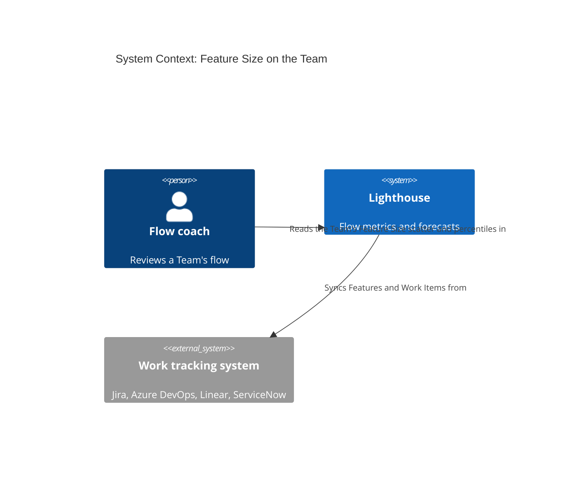
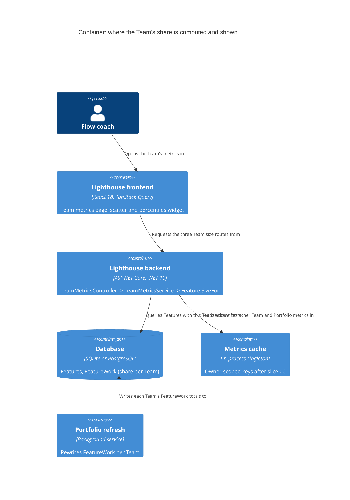

# Feature Delta — story-6251-team-feature-size

> ADO User Story #6251 "Feature Size and Feature Size Percentiles on the Team", raised by Steve Pereira
> (2026-10-06) while following up on Bug #6203. He looked for the Feature Size chart on his Team and could not
> find it. Both Feature Size (scatter) and Feature Size Percentiles (overview widget) exist only on a Portfolio.
> This story brings both to the Team metrics page, counting the Team's own share of each Feature.

## Wave: DISCUSS / [REF] Persona IDs

- **flow-coach**: runs the Team's flow reviews and refinement. Wants to know how big the Team's part of a
  Feature usually gets, next to the Team's Cycle Time and Work Item Age.

## Wave: DISCUSS / [REF] JTBD One-Liners

New job `job-flow-coach-know-how-much-of-a-feature-we-take-on` (`docs/product/jobs.yaml`): *When my team
reviews its flow or splits the next Feature, I want to see how many Work Items our part of each Feature
usually comes to, and which open Features are already bigger than usual, so I can tell when our share is
growing past what we normally finish and raise it before it drags.* (US-01…US-07) (amended: stories after the split, review C-01, 2026-10-13)

New job `job-flow-coach-trust-the-team-numbers-are-the-teams` (`docs/product/jobs.yaml`): *When I read my Team's
Flow Overview in a review, I want every figure to be my Team's own, so I can act on it without cross-checking the
Portfolio.* (US-00) (added: review B1–B3, 2026-10-13)

## Wave: DISCUSS / [REF] Pre-requisites

- Bug #6203 (a typed Jira link label sets which way parents are read) is on `main` (`92b0eb009`). Without it,
  link-based hierarchies counted children the wrong way round, and every size here would inherit that.
- No schema change is needed. A Team's share of each Feature is already stored:
  `FeatureWork.TotalWorkItems` per Team, refreshed by `WorkItemService.RefreshRemainingWork`
  (`Lighthouse.Backend/Services/Implementation/WorkItems/WorkItemService.cs:576-604`; amended: full path, review L-R3-2, 2026-10-13). It counts this Team's child Work Items in any state. Rows with zero are removed.
- **Only Features that some Portfolio loads exist in Lighthouse.** A parent no Portfolio picks up shows up
  elsewhere as "(Item not tracked by Lighthouse)" (`TeamMetricsService.cs:44-56`). It has no state and no
  closed date. So a Team with no Portfolio around its hierarchy gets no Features here (D2).

## Wave: DISCUSS / [REF] Locked Decisions

| ID | Decision | Verdict |
|----|----------|---------|
| D1 | **Size on the Team is the Team's share.** A Feature's size on the Team is the number of this Team's child Work Items under it (`FeatureWork.TotalWorkItems` for this Team), in any state. It is not the whole Feature's `Size`. It answers "how much of a Feature do we usually take on" and pairs with the Team's own Cycle Time. | Locked by the maintainer, 2026-10-13 |
| D2 | **Which Features count:** every Feature that Lighthouse tracks (loaded by any Portfolio) in which this Team has at least one child Work Item. The Team does not have to be part of that Portfolio. A Team with no such Feature sees the empty state, ~~worded so it says Features come from a Portfolio~~ `No {Features} to show.` (amended: empty copy superseded by UI-2, 2026-10-13). Tracking parents that no Portfolio loads is out of scope. If wanted, it becomes its own Story. | Locked by the maintainer, 2026-10-13 |
| D3 | **Widgets:** the Feature Size scatter (Portfolio & Features category) and the Feature Size Percentiles overview widget, including its status rule. The Feature Size PBC, PBC Over Time and every other over-time chart stay Portfolio-only. | Locked by the maintainer, 2026-10-13 |
| D4 | **RBAC:** `TeamRead` on the Team is enough to see every Feature that counts under D2, even one from a Portfolio the reader cannot read. This matches the Team's existing Features In Progress, which already names such Features under `TeamRead`. (amended: on the three new routes, such a Portfolio is not *named* to the reader, AFK-6; a reader without `TeamRead` gets 404, AFK-1; both pending maintainer ratification, 2026-10-13) (amended: the new routes deliberately name fewer Portfolios than `featuresInProgress`, which still names every Portfolio of a Feature; that gap is a known follow-up, not fixed here. The other Teams' names, forecasts and work totals on a Feature stay as on `featuresInProgress` (AFK-9). Both are on the ratification list, review N-05, 2026-10-13) | Locked by the maintainer, 2026-10-13 |
| D5 | **The Team's number must never pass for the Portfolio's.** Both widgets say plainly that they count this Team's Work Items only. A Feature's point or tooltip on the Team names the size as this Team's share. The exact copy and placement are sketched with the maintainer at the start of DISTILL. (amended: for the scatter, "say plainly" is met by its size axis and tooltip, UI-1; for the percentiles card, by its info (ⓘ) description, UI-3, the maintainer's choice, 2026-10-13) | Locked (principle). Copy settled at DISTILL (UI-1…UI-3) |
| D6 | **Same rules as the Portfolio, applied to the share.** The scatter shows Done Features closed in the selected range plus every To Do and In Progress Feature with a share above zero. The percentiles (50th/70th/85th/95th) come from Features closed in the range. The trend compares against the previous period of the same length, with its direction taken from the 50th. Status: Act if any active Feature's share is above the 85th, Observe if any is above the 70th, Sustain otherwise. The closed date and Cycle Time are the Feature's own, not the date the Team finished its share. | Locked |
| D7 | **Default-sized Features are left out.** A Feature that a Portfolio sizes with its Default Feature Size (`IsUsingDefaultFeatureSize`) is not broken down, so it has no real share to count. It drops out on the Team just as it drops out of the Portfolio's percentiles. No Default Feature Size or size-target setting is added to the Team. | Locked |
| D8 | **No size target and no Estimation mode on the Team.** The size-target line comes from the Portfolio's `FeatureSizeTargetProbability/Range`, and a Feature's estimate is configured on the Portfolio. On the Team, the scatter offers the Cycle Time and Closed Date modes only. | Locked |
| D9 | **Terminology.** All copy uses the configurable terms (*Feature*, *Team*, *Portfolio*, *Work Item*), never "Epic". | Locked |

## Wave: DISCUSS / [REF] User Stories

### US-00: A Team's numbers are always the Team's own

(added: folded into #6251 by the maintainer at DESIGN, moved here from DESIGN Changed Assumptions, review B1–B3, 2026-10-13)

As a **flow coach**, I want every figure on my Team's metrics page to be my Team's own, so I can act on it in a
review without cross-checking it against a Portfolio.

`job_id: job-flow-coach-trust-the-team-numbers-are-the-teams`

#### Elevator Pitch
Before: on any instance where a Team and a Portfolio share an id, for example Team Gravity and Portfolio Ocean Explorer both with id 1, Gravity's Total Throughput card shows 5, which is Ocean Explorer's, if the Portfolio's page was opened first. Its Cycle Time 50th shows 21 instead of 2.
After: open **Teams → Gravity → Metrics → Flow Overview** and read Total Throughput 3 and Cycle Time 50th 2, whichever page was opened first.
Decision enabled: whether the Team's throughput really changed, or the page is showing someone else's number.

#### Acceptance Criteria
- **AC-0.1** With a Team and a Portfolio that share an id, asking each for the same metric and window returns that owner's own value, whichever was asked first.
- **AC-0.2** Refreshing a Team clears that Team's cached metrics and no Portfolio's, and the reverse also holds.
- **AC-0.3** A Team and a Portfolio that share an id never show each other's figure for any metric in the colliding list (DESIGN "The colliding cache keys"). (amended: rewritten as an outcome; key uniqueness is a unit-test detail, review H2, 2026-10-13)
- **AC-0.4** On an instance where no Team shares an id with a Portfolio, every Team's and every Portfolio's figures read the same before and after the change. (amended: states the observable, review N-10, 2026-10-13; was "No change in any metric value for a single owner (the existing suites stay green)")

#### UAT Scenarios (added: review C-02, 2026-10-13)

Ledger rows tagged `@us-00`: 0.1, 0.2, 0.3, 0.4, 0.5, 0.6, 0.7 (7; 0.5, 0.6 and 0.7 are guards). (amended: counted from the DISTILL ledger's `@us` tags, 2026-10-13)

```gherkin
Scenario: Gravity's Flow Overview shows Gravity's throughput after Ocean Explorer's was read
  Given Team Gravity and Portfolio Ocean Explorer both have id 1
  And the flow coach has just opened Ocean Explorer's Flow Overview, whose Total Throughput reads 5
  When the flow coach opens Gravity's Flow Overview for the same range
  Then Total Throughput reads 3 and the Cycle Time 50th reads 2, Gravity's own figures

Scenario: Refreshing Gravity leaves Ocean Explorer's figures in place
  Given Gravity and Ocean Explorer both have id 1 and both have their Flow Overview figures computed
  When Gravity is refreshed
  Then Gravity's figures are computed afresh
  And Ocean Explorer's figures are still the ones it had

Scenario: A Team whose id no Portfolio shares reads exactly as before
  Given Team Zenith's id belongs to no Portfolio
  When the flow coach opens Zenith's Flow Overview
  Then every figure is the one Zenith showed before this change
```

### US-01: See our share of each Feature, wherever the Team's page gives a size

(amended: US-01 split by outcome into US-01 and US-03…US-06, and US-02 into US-02 and US-07, so each story holds 3 to 7 scenario rows; the "Features worked on" Size column, AC-1.9, stays here because alone it would hold one row; AC ids unchanged, review C-01, 2026-10-13)

As a **flow coach**, I want the Feature Size scatter on my Team, counting only my Team's Work Items under each
Feature, and the same number wherever the Team's page gives a Feature's size, so I can see how much of a Feature
we usually take on without opening a Portfolio and subtracting the other Teams. (amended: "wherever the Team's page gives a size" added with AC-1.9, review C-01, 2026-10-13)

`job_id: job-flow-coach-know-how-much-of-a-feature-we-take-on`

#### Elevator Pitch
Before: on Team Gravity's metrics page there is no Feature Size chart. Seeing how big Gravity's part of OE-002 was means opening the Ocean Explorer Portfolio, where OE-002's size counts Equinox's, Lightspeed's and Zenith's Work Items too. Gravity's own "Features worked on" dialog gives OE-002's Size as 19, the whole Feature. (amended: Lightspeed added, per the demo CSVs, 2026-10-13; dialog sentence added with AC-1.9, review C-01, 2026-10-13)
After: open **Teams → Gravity → Metrics → Portfolio & Features** and see the **Feature Size** scatter, whose size axis reads `Size (this Team's Work Items)`. OE-002's point sits at Gravity's share, 4, and its tooltip names that number as Gravity's. The "Features worked on" dialog's Size column reads 4 for OE-002 as well. (amended: "labelled" made concrete per UI-1, 2026-10-13; the share and the dialog added, review C-01, 2026-10-13)
Decision enabled: whether a Feature now in progress is already bigger, for this Team, than the Features it usually finishes, and so worth splitting or raising in refinement.

~~The scatter's frame is also always placed on the **Portfolio**: while loading, on failure, and with `No {Features} to show.` when nothing is in range (AC-1.10). The slice is thicker for it (about 7–8 hours), and that is accepted.~~ (amended: the Portfolio frame moved to US-03 and the effort note to the Scope Assessment, review N-09, 2026-10-13)

#### Acceptance Criteria
- **AC-1.1** On a Team, the Portfolio & Features category shows the Feature Size scatter. It plots every Feature under D2 and D6, sized by this Team's share (D1).
- **AC-1.2** A Feature shared by several Teams shows, on each Team, that Team's share. On demo data, OE-002 shows Equinox's count on Equinox, Gravity's on Gravity, Lightspeed's on Lightspeed and Zenith's on Zenith, and the four add up to OE-002's size on the Ocean Explorer Portfolio (per the demo CSVs, 8 + 4 + 4 + 3 = 19). **Preconditions:** the Feature is not default-sized, and every one of its child Work Items belongs to a Team Lighthouse tracks. A child on an untracked Team counts in neither. (amended: Lightspeed added, preconditions stated, review M3, 2026-10-13)
- **AC-1.9** On a Team, the Size column in the "Features worked on" dialog shows the Team's share, the same number the Feature Size scatter plots. (added: AFK-5, review H-1/H-2, 2026-10-13)

#### UAT Scenarios (added: review C-02, 2026-10-13)

Ledger rows tagged `@us-01`: 1.1, 1.2, 1.3, 1.9, 1.11, 1.12, 1.13, 1.14, 1.15, 1.16, 1.17, 1.29, 1.33, 1.34, 1.35, 1.37 (16; 1.15, 1.17 and 1.35 are guards, and 1.17 holds 8 parameterised cases). Row 1.3 also serves US-06, and row 1.16 also serves US-05. (amended: counted from the DISTILL ledger's `@us` tags, review F-04, 2026-10-13)

```gherkin
Scenario: Gravity sees OE-002 as big as Gravity's own part of it
  Given OE-002 "Coral Reef Restoration Program" in Ocean Explorer has 4 child Work Items on Gravity
  And 8 on Equinox, 4 on Lightspeed and 3 on Zenith
  When the flow coach opens Gravity's Portfolio & Features with the To Do and In Progress chips on
  Then OE-002 is plotted at a size of 4, not 19

Scenario: The Teams' parts of a shared Feature add up to its size on the Portfolio
  Given the demo data is loaded
  When the flow coach reads OE-002 on Equinox, Gravity, Lightspeed and Zenith
  Then the four sizes are 8, 4, 4 and 3
  And they add up to OE-002's size of 19 on Ocean Explorer

Scenario: A Feature Gravity alone finished is plotted at its full size
  Given OE-011 "Tidal Energy Harvesting" is Done, and all 4 of its child Work Items are Gravity's
  When the flow coach opens Gravity's Portfolio & Features for a range that includes the day OE-011 closed
  Then OE-011 is plotted at a size of 4, the same as on Ocean Explorer

Scenario: Gravity's Features worked on are as big as Gravity's part of them
  Given Gravity has 4 child Work Items under OE-002 and 4 under OE-007
  When the flow coach opens Gravity's "Features worked on" and shows the Size column
  Then OE-002 and OE-007 each read 4

Scenario: The same Feature reads Zenith's part in Zenith's Features worked on
  Given Zenith has 3 child Work Items under OE-002
  When the flow coach opens Zenith's "Features worked on" and shows the Size column
  Then OE-002 reads 3, not 19 and not Gravity's 4
```

### US-02: Know how big our share of a finished Feature usually is

(amended: title narrowed; status and the no-data look moved to US-07, so each story holds at most 7 scenario rows, review C-01, 2026-10-13)

As a **flow coach**, I want the Feature Size Percentiles widget on my Team's overview, so I can see how many of our
Work Items a Feature usually comes to once we finish it, and whether that is growing, without opening the scatter.

`job_id: job-flow-coach-know-how-much-of-a-feature-we-take-on`

#### Elevator Pitch
Before: the Team's Flow Overview has Cycle Time and Work Item Age percentiles but nothing on Feature size, so a Team-level share that has grown unusually large goes unnoticed until it drags.
After: open **Teams → Gravity → Metrics → Flow Overview** and see **Feature Size Percentiles** (50th/70th/85th/95th of Gravity's share in Features closed in the range), with its trend against the period before. Its info (ⓘ) description reads "Size distribution percentiles of this Team's Work Items in completed Features, with trend comparison to the previous period." (amended: the card carries no label; the info description says it, per UI-3, review H1, 2026-10-13; the status sentence moved to US-07, review C-01, 2026-10-13)
Decision enabled: whether this Team's part of a Feature is growing from one period to the next, and so whether to split Features smaller in refinement.

#### Acceptance Criteria
- **AC-2.1** On a Team, Flow Overview shows Feature Size Percentiles. The four percentiles are computed from this Team's share in Features closed in the selected range, leaving out shares of zero and default-sized Features (D6, D7).
- **AC-2.2** The trend compares against the previous period of the same length, with its direction taken from the 50th (D6).
- **AC-2.4** The widget says it counts this Team's Work Items only (D5), through its info (ⓘ) description. The card itself is unchanged (UI-3). (amended: met via the info description, 2026-10-13)
- **AC-2.6** A reader without `TeamRead` gets ~~403~~ **404** from the endpoint (D4, AFK-1). (amended: pending maintainer ratification, 2026-10-13)

#### UAT Scenarios (added: review C-02, 2026-10-13)

Ledger rows tagged `@us-02`: 2.1, 2.2, 2.3, 2.5, 2.6, 2.7, 2.8, 2.12, 2.13, 2.14, 2.15, 2.16 (12; 2.7 and half of 2.12 are guards). (amended: counted from the DISTILL ledger's `@us` tags, 2026-10-13)

```gherkin
Scenario: Gravity's percentiles come from Gravity's part of the Features it finished
  Given OE-011 "Tidal Energy Harvesting" is the only Feature with Gravity Work Items closed in the range
  And Gravity has 4 child Work Items under it
  When the flow coach opens Gravity's Flow Overview
  Then Feature Size Percentiles reads 4 at the 50th, 70th, 85th and 95th
  And its info description says it counts this Team's Work Items

Scenario: A Feature sized by its Portfolio's default does not count towards Gravity's percentiles
  Given OE-013 "Underwater Communication Network" has no child Work Item on any Team, so Ocean Explorer sizes it by default
  When the flow coach opens Gravity's Flow Overview
  Then OE-013 plays no part in Gravity's Feature Size Percentiles

Scenario: Someone who cannot read Gravity is told there is no such Team when asking for Gravity's Feature Size Percentiles
  Given a reader who may not read Team Gravity
  When they ask for Gravity's Feature Size Percentiles
  Then they are told there is no such Team
```

### US-03: The Feature Size frame says what is happening, on a Team and on a Portfolio

(added: split from US-01, review C-01 and N-04, 2026-10-13)

As a **flow coach**, I want the Feature Size frame to say whether its data is on its way, could not be loaded or is
genuinely empty, on my Team and on a Portfolio, so I never read a slow or failed answer as "no Features".

`job_id: job-flow-coach-know-how-much-of-a-feature-we-take-on`

#### Elevator Pitch
Before: on **Portfolios → Ocean Explorer → Metrics → Portfolio & Features**, the Feature Size spot stays empty while its data loads, and the widget is absent altogether when no Feature is in range, so "still loading" and "nothing to show" look the same.
After: the Feature Size frame is placed from the first moment on **Portfolios → Ocean Explorer → Metrics → Portfolio & Features** and on **Teams → Gravity → Metrics → Portfolio & Features**: a lone spinner while loading, the could-not-load note on failure, and `No Features to show.` when nothing is in range. (amended: both UI paths named, review F-03, 2026-10-13)
Decision enabled: whether to wait, reload, or move on because there really is nothing to look at.

#### Acceptance Criteria
- **AC-1.6** A Team with no Feature under D2 sees the empty state. ~~which says Features come from a Portfolio~~ The empty state is `No {Features} to show.` (amended: superseded by UI-2, 2026-10-13)
- **AC-1.8** On a Team, while its data is on its way, the Feature Size frame shows the lone spinner, or the older chart dimmed under a small spinner once one exists. When the data cannot be loaded, it shows the could-not-load note. These are the same looks every other Team widget uses (DESIGN Slow-connection States). (amended: names the looks, review N-10, 2026-10-13)
- **AC-1.10** On a Portfolio, the Feature Size frame is always placed: the lone spinner while loading, the could-not-load note on failure, and `No {Features} to show.` when no Feature is in range. Its loaded chart and numbers are unchanged. (added: maintainer decision at DESIGN, UI-2, 2026-10-13)

#### UAT Scenarios (added: review C-02, 2026-10-13)

Ledger rows tagged `@us-03`: 1.10, 1.24, 1.25, 1.26, 1.27, 1.28, 1.32 (7; 1.28 is a guard). (amended: counted from the DISTILL ledger's `@us` tags, 2026-10-13)

```gherkin
Scenario: Ocean Explorer's Feature Size is framed while its data is on its way
  Given the connection to Lighthouse is slow
  When the flow coach opens Ocean Explorer's Portfolio & Features
  Then the Feature Size frame is there from the start, with a lone spinner in it

Scenario: Gravity's Feature Size says when it could not be loaded
  Given Gravity's Feature Sizes cannot be loaded
  When the flow coach opens Gravity's Portfolio & Features
  Then the Feature Size frame shows the could-not-load note, not an empty chart

Scenario: A Team with no tracked Feature is told there are no Features to show (fixture case: Team Polaris)
  Given Team Polaris, a Team built for the test, whose Work Items sit under no Feature any Portfolio loads
  When the flow coach opens Polaris's Portfolio & Features
  Then the Feature Size frame reads "No Features to show."
```

### US-04: A Team's reader sees the Team's Features, and no more

(added: split from US-01, review C-01, 2026-10-13)

As a **flow coach** who may read my Team but not every Portfolio, I want to see every Feature my Team works on, so
the Team's chart is complete, without being told the names of Portfolios I may not open.

`job_id: job-flow-coach-know-how-much-of-a-feature-we-take-on`

#### Elevator Pitch
Before: a reader with access to Gravity but not to Ocean Explorer has no Feature Size chart at all, since the only one is Ocean Explorer's.
After: on **Teams → Gravity → Metrics → Portfolio & Features**, that reader sees OE-002 at Gravity's 4, and Ocean Explorer is not named to them. Someone who may not read Gravity is told there is no such Team.
Decision enabled: the admin can give a Team's coach access to the Team alone and know the chart is still complete.

#### Acceptance Criteria
- **AC-1.7** A reader with `TeamRead` on the Team, and no read on the Portfolio a plotted Feature belongs to, still sees that Feature (D4), and that Portfolio is not named to them (AFK-6). A reader without `TeamRead` gets ~~403~~ **404** from the endpoint, as on every Team metric. (amended: per AFK-1 and AFK-6, pending maintainer ratification, 2026-10-13)

#### UAT Scenarios (added: review C-02, 2026-10-13)

Ledger rows tagged `@us-04`: 1.6, 1.7, 1.8, 1.36 (4; 1.36 is a guard on `featuresInProgress`). (amended: counted from the DISTILL ledger's `@us` tags, 2026-10-13)

```gherkin
Scenario: A reader of Gravity alone sees OE-002 without learning its Portfolio's name
  Given a reader who may read Team Gravity but not Portfolio Ocean Explorer
  When they open Gravity's Portfolio & Features with the To Do and In Progress chips on
  Then OE-002 is plotted at 4
  And Ocean Explorer is not named to them

Scenario: Someone who cannot read Gravity is told there is no such Team when asking for Gravity's Feature Sizes
  Given a reader who may not read Team Gravity
  When they ask for Gravity's Feature Sizes
  Then they are told there is no such Team

Scenario: Someone who may read Ocean Explorer sees each Feature name it
  Given a reader who may read Team Gravity and Portfolio Ocean Explorer
  When they open Gravity's Portfolio & Features with the To Do and In Progress chips on
  Then OE-002 is plotted at 4 and names Ocean Explorer
```

### US-05: Only the Features we really work on count

(added: split from US-01, review C-01, 2026-10-13)

As a **flow coach**, I want only the Features my Team has real Work Items in on my Team's scatter, so every point
is one we actually worked on.

`job_id: job-flow-coach-know-how-much-of-a-feature-we-take-on`

#### Elevator Pitch
Before: on Ocean Explorer, OE-005 "Ocean Pollution Monitoring" sits beside the Features Gravity works on, although no Gravity Work Item is under it. OE-013 "Underwater Communication Network" has no child Work Item at all, so its size there is the Portfolio's default, not anyone's count.
After: on **Teams → Gravity → Metrics → Portfolio & Features**, neither OE-005 nor OE-013 is plotted.
Decision enabled: how big Gravity's Features usually get, without points that are not Gravity's or are not counted at all.

#### Acceptance Criteria
- **AC-1.3** A Feature in which this Team has no child Work Item does not appear on the Team, even if it belongs to a Portfolio the Team is part of. A default-sized Feature does not appear either (D7).

#### UAT Scenarios (added: review C-02, 2026-10-13)

Ledger rows tagged `@us-05`: 1.4, 1.5, 1.16 (3). Row 1.16 also serves US-01. (amended: counted from the DISTILL ledger's `@us` tags, review F-04, 2026-10-13)

```gherkin
Scenario: A Feature Gravity has no Work Item in is not on Gravity's scatter
  Given OE-005 "Ocean Pollution Monitoring" has child Work Items on Lightspeed only
  When the flow coach opens Gravity's Portfolio & Features with every state chip on
  Then OE-005 is not plotted

Scenario: A Feature sized by its Portfolio's default is not on Gravity's scatter
  Given OE-013 "Underwater Communication Network" has no child Work Item on any Team, so Ocean Explorer sizes it by default
  When the flow coach opens Gravity's Portfolio & Features with every state chip on
  Then OE-013 is not plotted

Scenario: A Feature Gravity works on is plotted at Gravity's share
  Given OE-002 "Coral Reef Restoration Program" has 4 child Work Items on Gravity
  When the flow coach opens Gravity's Portfolio & Features with every state chip on
  Then OE-002 is plotted at 4
```

### US-06: The scatter works like the Portfolio's and says whose number it is

(added: split from US-01, review C-01, 2026-10-13)

As a **flow coach**, I want the Team's scatter to filter and plot as the Portfolio's does, and to say that its sizes
are this Team's Work Items, so I read it the way I already know and never take a share for the whole Feature.

`job_id: job-flow-coach-know-how-much-of-a-feature-we-take-on`

#### Elevator Pitch
Before: the only Feature Size scatter is Ocean Explorer's, whose sizes are whole Features.
After: on **Teams → Gravity → Metrics → Portfolio & Features**, the scatter offers Cycle Time and Closed Date, with Done on and To Do and In Progress off, as on the Portfolio. Its size axis reads `Size (this Team's Work Items)`, and OE-011's tooltip reads `1 Feature with 4 of this Team's Work Items`.
Decision enabled: whether a point is high because Gravity's part is big, read without checking whose number it is.

#### Acceptance Criteria
- **AC-1.4** The scatter offers the Cycle Time and Closed Date modes, and no Estimation mode (D8). The state chips behave as on the Portfolio (`docs/metrics/portfolio-features.md:94-98`): **Done** is on by default, and **To Do** and **In Progress** are off. With the To Do and In Progress chips on, the scatter also holds every To Do and In Progress Feature with a share above zero, whatever its dates. With them off, only Done Features closed between start and end, both days included, are held. (amended: made concrete, review M5, 2026-10-13; chip wording as given by review N-03, 2026-10-13. "Draws no size-target line" is trivially true, because the Portfolio's scatter draws none either; see DDD-14)
- **AC-1.5** The scatter says it counts this Team's Work Items only, and a point's tooltip names the size as this Team's share (D5). The copy is UI-1: axis `Size (this {Team}'s {Work Items})`, tooltip `{n} {Features} with {size} of this {Team}'s {Work Items}`. (amended: copy settled by UI-1, 2026-10-13)

#### UAT Scenarios (added: review C-02, 2026-10-13)

Ledger rows tagged `@us-06`: 1.3, 1.18, 1.19, 1.20, 1.21, 1.22, 1.23, 1.30, 1.31 (9; 1.21, 1.22, 1.23 and half of 1.31 are guards). Row 1.3 also serves US-01. (amended: counted from the DISTILL ledger's `@us` tags, review F-04, 2026-10-13)

```gherkin
Scenario: With the default chips, Gravity's scatter holds only Features finished in the range
  Given OE-011 is Done and closed inside the range, and OE-002 and OE-003 are still open
  When the flow coach opens Gravity's Portfolio & Features
  Then OE-011 is plotted, and OE-002 and OE-003 are not

Scenario: Turning on To Do and In Progress adds every open Feature Gravity works on
  Given OE-002 and OE-003 are open and Gravity has Work Items under both
  When the flow coach turns on the To Do and In Progress chips
  Then OE-002 and OE-003 are plotted as well, at 4 and 10

Scenario: The scatter says its sizes are Gravity's Work Items
  When the flow coach points at OE-011 on Gravity's scatter
  Then the size axis reads "Size (this Team's Work Items)"
  And the tooltip reads "1 Feature with 4 of this Team's Work Items"
  And the modes offered are Cycle Time and Closed Date, with no Estimation
```

### US-07: Know when an open Feature is already bigger than usual for us

(added: split from US-02, review C-01, 2026-10-13)

As a **flow coach**, I want the Feature Size Percentiles widget to say when an open Feature's share has grown past
what we usually finish, and to say nothing rather than zero when we finished none, so the review knows when to act.

`job_id: job-flow-coach-know-how-much-of-a-feature-we-take-on`

#### Elevator Pitch
Before: nothing on the Team's Flow Overview flags a Feature whose Team share has outgrown the usual, so it goes unnoticed until it drags.
After: on **Teams → Gravity → Metrics → Flow Overview**, Feature Size Percentiles reads **Act**, because open OE-003 (10 of Gravity's Work Items) and OE-009 (12) are above Gravity's 85th of 4. In a range in which Gravity finished no Feature, the widget shows its no-data look, not zeros.
Decision enabled: which open Feature to raise in the flow review because this Team's part of it is already outside its usual range.

#### Acceptance Criteria
- **AC-2.3** Status is Act when any To Do or In Progress Feature's share is above the 85th, Observe when any is above the 70th, and Sustain otherwise, including when no Feature is open (D6).
- **AC-2.5** With no Feature closed in the range, the widget shows its existing no-data state, not zeros.

#### UAT Scenarios (added: review C-02, 2026-10-13)

Ledger rows tagged `@us-07`: 2.4, 2.9, 2.10, 2.11 (4). (amended: counted from the DISTILL ledger's `@us` tags, 2026-10-13)

```gherkin
Scenario: An open Feature bigger than Gravity's usual calls for action
  Given Gravity's 85th percentile is 4, from OE-011
  And open OE-003 has 10 of Gravity's Work Items and open OE-009 has 12
  When the flow coach opens Gravity's Flow Overview
  Then Feature Size Percentiles reads Act

Scenario: A range in which Gravity finished no Feature shows no data, not zeros
  Given no Feature with Gravity Work Items closed in the selected range
  When the flow coach opens Gravity's Flow Overview
  Then Feature Size Percentiles shows its no-data look
  And no percentile reads 0

Scenario: An open Feature exactly at the 85th reads Observe, not Act (fixture case)
  Given a Team, built for the test, whose 85th percentile is 8 and whose 70th is 5
  And its biggest open Feature has exactly 8 of the Team's Work Items
  When the flow coach opens the Team's Flow Overview
  Then Feature Size Percentiles reads Observe, not Act
# A fixture, because on the demo data Gravity's only finished Feature puts every percentile at 4, and open OE-003
# and OE-009 sit far above it, so the 85th boundary cannot be shown there. Numbers as in DISTILL row 2.10.
```

## Wave: DISCUSS / [REF] Out of Scope

- Tracking parents that no Portfolio loads, so that a Team with no Portfolio gets sizes (D2). This is its own Story if wanted.
- Feature Size PBC, PBC Over Time and Percentiles Over Time for Feature size on the Team (D3).
- An Estimation mode or size target on the Team (D8). A Team-level Default Feature Size.
- Showing the whole Feature's size next to the Team's share. D1 picked the share alone, and the tooltip copy is settled in DISTILL.
- Exposing the new Team endpoints in the CLI or MCP. The clients don't read the Portfolio's size endpoints either.

## Wave: DISCUSS / [REF] Cross-cutting Impact

- **RBAC**: **affected, no new rule.** The new Team endpoints carry the same class-level `[RbacGuard(RbacGuardRequirement.TeamRead, ScopeIdRouteKey = "teamId")]` as `TeamMetricsController` (D4) (amended: attribute written out, review F-1, 2026-10-13). A reader without it gets 404, as on every Team metric (AFK-1). With `TeamRead` alone, each Feature names only the Portfolios the reader may read (AFK-6). Nothing new reads `/authorization/my-summary`, and UI gating stays with `useRbac()`. (amended: 404 and Portfolio names, pending maintainer ratification, 2026-10-13)
- **Lighthouse-Clients (CLI + MCP)**: **N/A, because** no client calls `allFeaturesForSizeChart`, `sizePercentiles` or `featureSizePercentilesInfo` today (grep of `packages/client`, `packages/cli`, `packages/mcp-core`). The only Feature Size mention is the PBC Over Time family, described there as Portfolio-only. That stays true under D3, so the wording is unchanged. `featuresInProgress`'s `Size` now carries the Team's share (AFK-5); no client reads that route (grep of `packages/client`, `packages/cli`, `packages/mcp-core` and the skill, 2026-10-13), so no client change. (added: review M-R3-2, 2026-10-13)
- **Website**: **N/A, because** the Lighthouse page describes Feature size under "one flight level up" (`website/src/pages/Lighthouse.tsx:393`). That is still true, and no screenshot it hot-links changes. DELIVER re-checks if a docs asset is regenerated.
- **Docs**: `docs/metrics/portfolio-features.md` (Feature Size: "Applies to" becomes Teams and Portfolios; a paragraph on the Team's share, its modes and why the number differs from the Portfolio) and `docs/metrics/flow-overview.md` (drop "only available for Portfolios"; say what the Team counts). Do this at finalization.
- **Screenshots**: ~~one `@screenshot` of the Team's Feature Size scatter on demo data, if the docs page gets a Team image. DISTILL decides.~~ (amended: stale sentence struck, review N-08, 2026-10-13) (amended: the screenshot run is unconditional per DEVOPS. AFK-4 covers Team Feature Size via `coveredElsewhere`, so no Team `featureSize.png` is captured, 2026-10-13)
- **Usage data**: asked at DEVOPS. (amended: answered N/A by the maintainer at DEVOPS, no event, 2026-10-13)
- **E2E**: a thin check at most, on demo data. DISTILL decides. (amended: DISTILL decided no spec, AFK-4, 2026-10-13)
- **Release notes**: the Story carries the `Release Notes` tag.

## Wave: DISCUSS / [REF] WS Strategy

Strategy **B (extend existing)**: no skeleton. Both widgets, the shared metrics view and the per-Team share
exist end to end. Each slice adds one Team endpoint pair behind an existing widget and lifts that widget's
Portfolio-only gate.

## Wave: DISCUSS / [REF] Driving Ports

- `GET /api/latest/teams/{teamId}/metrics/…`: new Team routes alongside `featuresInProgress`, mirroring the Portfolio's `allFeaturesForSizeChart`, `sizePercentiles` and `featureSizePercentilesInfo`. DESIGN names them and settles whether the share travels in `FeatureDto.Size` or a field of its own. (amended: settled by DESIGN DDD-1/DDD-7 and ADR-236: in `Size`, on the same route names, 2026-10-13)
- UI: Team metrics page, Portfolio & Features category (scatter) and Flow Overview (percentiles widget).

## Wave: DISCUSS / [REF] Story Map and Slices

| Order | Slice | Story | Why this order |
|---|---|---|---|
| 0 | `slice-00-owner-scoped-metrics-cache` | US-00 | Added 2026-10-13 (DESIGN, maintainer decision). A Team page must show only the Team's own numbers before it gains new ones. Ordered first, but **not a dependency** of slice 01: the Feature Size routes are not cached. |
| 1 | `slice-01-team-feature-size-scatter` | US-01, US-03, US-04, US-05, US-06 (amended: stories after the split, review C-01, 2026-10-13) | The chart Steve looked for. It is also the data the status rule in slice 02 reads (active Features' sizes), and it carries the riskiest assumption: that a share reads as "ours" rather than as a wrong number. |
| 2 | `slice-02-team-feature-size-percentiles` | US-02, US-07 (amended: stories after the split, review C-01, 2026-10-13) | Builds on slice 01's active-size data. It adds the percentiles and trend endpoints and the overview widget. |

Each slice ships on its own: slice 00 fixes a wrong-number bug for every Team, and slice 01 alone already serves the
Feature-size job's functional dimension. (amended: slice 00 row added, 2026-10-13)

## Wave: DISCUSS / [REF] Scope Assessment: PASS

**Maintainer decision, 2026-10-13 (answer "A"):** the DoR's "3 to 7 scenario rows per story" count is waived for this
Story. The ledger rows include parameterised cases and regression guards, so a row count overstates a story's size,
and splitting further would add stories, not coverage. Do not split further. (added 2026-10-13)

~~Three stories and three slices, each a day or less (slice 01 is about 7–8 hours since DESIGN, accepted).~~ One bounded
context (metrics), with no schema change, no new setting and no new widget type. No oversized signals. (amended: was
"Two stories and two slices", US-00 added, 2026-10-13)

(amended: re-checked after the story split, review C-01, N-09 and L-4, 2026-10-13)
- **Eight stories in three slices.** Slice 00 carries US-00. Slice 01 carries US-01, US-03, US-04, US-05 and US-06. Slice 02 carries US-02 and US-07. ~~Every story holds 3 to 7 rows.~~ Ledger rows by `@us` tag, guards included: US-00 7, US-01 16, US-02 12, US-03 7, US-04 4, US-05 3, US-06 9, US-07 4; rows 1.3 and 1.16 serve two stories each. The DoR's 3–7 count is **waived by the maintainer, 2026-10-13** (see the decision above). (amended: the 3–7 claim was wrong once guards and the retagged ledger were counted, 2026-10-13)
- **Effort.** Slice 01 is about 7–8 hours since DESIGN placed the scatter frame on the Portfolio too (US-03, AC-1.10) and added the characterisation tests and the refactor commit (DDD-3). That is thicker than DISCUSS planned, and accepted. Slices 00 and 02 are each a day or less. (moved here from the US-01 pitch, review N-09)
- **Scope re-check.** The split moved acceptance criteria between stories and added none, so the work is unchanged: still one bounded context, three slices, each a day or less, and each releasable alone. Slice 01 holds five stories because they share one route pair, one widget and one refactor; splitting the slice would ship a scatter without its frame or its reader rule, which no user could be given. **PASS.**

## Wave: DISCUSS / [REF] Outcome KPIs

| KPI | Target | Measurement |
|---|---|---|
| `OUT-6251-share-adds-up` | For every multi-team Feature on demo data, the Team shares sum to the Portfolio size: OE-001 (Gravity, Meridian, Zenith), OE-002 (Equinox, Gravity, Lightspeed, Zenith), OE-007 (Gravity, Lightspeed, Zenith) and OE-008 (Gravity, Zenith). This holds when the Feature is not default-sized and every child Work Item belongs to a Team Lighthouse tracks (amended: Teams corrected from the demo CSVs, OE-008 added, preconditions stated, review M3/L4, 2026-10-13) | Acceptance test over demo data (AC-1.2) and a by-hand check on Ocean Explorer |
| `OUT-6251-not-read-as-a-bug` | 0 reports in the 60 days after release that a Feature's size on the Team "doesn't match" the Portfolio | **The maintainer** reviews at release + 60 days: ADO Bugs in project Lighthouse created after the release date that mention "Feature Size", the community channel, and Steve's confirmation on #6251 (amended: owner and query named, review L5, 2026-10-13) |
| `OUT-6251-used` | ~~Feature Size on a Team is opened on at least 10 % of instances that report usage data, within 60 days~~ | **Dropped by DEVOPS** (maintainer: no usage-data event). The job is measured by correctness (`share-adds-up`) and by `not-read-as-a-bug` only, by choice (amended: review M4, 2026-10-13) |
| `OUT-6251-team-numbers-own` | 0 Team metrics that show a Portfolio's figure, on any instance where a Team and a Portfolio share an id (amended: wording, review N-07, 2026-10-13) | The slice 00 acceptance tests (AC-0.1…AC-0.3). No runtime signal (added: US-00, 2026-10-13) |

## Wave: DISCUSS / [REF] Definition of Done

1. A Team's metrics page shows the Feature Size scatter and the Feature Size Percentiles widget, both counting the Team's share (US-01…US-07) (amended: stories after the split, review C-01, 2026-10-13).
2. On demo data, OE-002's shares on Equinox, Gravity, Lightspeed and Zenith add up to its Portfolio size. OE-002 is not default-sized, and every one of its child Work Items belongs to one of those Teams. (amended: Lightspeed added and preconditions stated, review M3, 2026-10-13)
3. Both widgets say they count this Team's Work Items only, in copy the maintainer approved at DISTILL (UI-1: axis and tooltip; UI-3: the percentiles widget's info description).
4. Both have the loading and could-not-load looks DESIGN pins. The scatter's frame and `No {Features} to show.` empty state hold on the Portfolio too (amended: both owners, DESIGN Changed Assumptions 1, 2026-10-13).
5. `docs/metrics/portfolio-features.md` and `docs/metrics/flow-overview.md` describe the Team variant in configurable terms.
6. ~~The usage-data event from DEVOPS, if any, is emitted and listed in `docs/settings/usagedata.md`.~~ N/A: dropped by DEVOPS, no event (amended: review M4, 2026-10-13).
7. A release-notes line is drafted on #6251.
8. `dotnet build` (warnings as errors) and the filtered `dotnet test` are green, and so are `pnpm test` and `pnpm build`.
9. Stryker on the changed files of both stacks is at least 80 %. (amended: whole files, because Stryker.NET ignores line spans, 2026-10-13)
10. A Team and a Portfolio that share an id each show their own numbers (US-00), with the reproduction test written and red before the fix (added: US-00, 2026-10-13).

## Wave: DISCUSS / [REF] DoR Validation

Restated against the 8-item DoR checklist (amended: was a 9-row local list, review M8, 2026-10-13):

| # | DoR item | Status | Evidence |
|---|---|---|---|
| 1 | Problem statement clear, in domain language | ✅ | US-01…US-07: Steve could not find Feature Size on his Team (#6251). US-00: a Team's Flow Overview can show a Portfolio's numbers when ids overlap (reproduced at DISTILL) |
| 2 | User/persona identified with specific characteristics | ✅ | `flow-coach` (`docs/product/personas/flow-coach.yaml`), who runs the Team's flow reviews and refinement. The need comes from a real reporter, Steve Pereira, on #6251 (amended: persona file and reporter cited, review N-11, 2026-10-13) |
| 3 | At least 3 domain examples with real data | ✅ | **Happy:** OE-002 on Equinox, Gravity, Lightspeed and Zenith, whose shares add up to its Ocean Explorer size. ~~**Edge:** a default-sized Feature with made-up per-Team rows, which does not appear on the Team.~~ **Edge (demo data):** OE-005 "Ocean Pollution Monitoring" has no Gravity Work Item, and OE-013 "Underwater Communication Network" has no child Work Item on any Team, so Ocean Explorer sizes it by default; neither appears on Gravity (US-05). **Done:** OE-011 "Tidal Energy Harvesting", all 4 of its Work Items Gravity's, sets Gravity's percentiles, and open OE-003 (10) and OE-009 (12) read Act (US-02, US-07). **Empty:** a Team with no tracked Feature sees `No {Features} to show.`; the tests use Team Polaris, a fixture Team built for that case, because all five Teams of the Ocean Explorer demo work on at least one of its Features (amended: real demo examples, the fixture named as one, review N-06, 2026-10-13) |
| 4 | UAT scenarios in Given/When/Then | ✅ | Each story's "UAT Scenarios" subsection (US-00…US-07), in business language on demo data, with a happy path and at least one edge or refusal each. DISTILL's scenario ledger implements them (amended: written in DISCUSS, review C-02, 2026-10-13; was "at DISTILL") |
| 5 | AC derived from UAT | ✅ | AC-0.x, AC-1.x and AC-2.x are observable at the Team endpoints and the widgets |
| 6 | Right-sized (1–3 days, 3–7 scenarios per story) | ✅ (scenario count waived) | Three slices, each a day or less. **The 3–7 scenario-row count is waived by the maintainer, 2026-10-13**: the ledger rows include parameterised cases and regression guards, and splitting further would add stories, not coverage. True counts of ledger rows by `@us` tag, guards included: US-00 7, US-01 16, US-02 12, US-03 7, US-04 4, US-05 3, US-06 9, US-07 4. Rows 1.3 (US-01, US-06) and 1.16 (US-01, US-05) serve two stories and count in both. (amended: the earlier "every story within 3–7" counted only some rows, superseded by the maintainer's waiver, 2026-10-13) |
| 7 | Technical notes: constraints and dependencies | ✅ | #6203 on `main`; `FeatureWork` already holds the share; no schema change; DESIGN DDD-1…DDD-14 |
| 8 | Dependencies resolved or tracked | ✅ | None open. AFK-1, AFK-2, AFK-5, AFK-6, AFK-8 and AFK-9 await maintainer ratification at the hold, and do not block (amended: AFK-8 and AFK-9 added, 2026-10-13) |

## Wave: DISCUSS / [REF] Wave Decisions Summary

- **Key decisions:** D1 (this Team's share), D2 (tracked Features with team work, any Portfolio), D3 (scatter and percentiles only), D4 (`TeamRead` suffices), D5 (never passes for the Portfolio's number), D7/D8 (no defaults, targets or Estimation mode on the Team).
- **Feature type:** user-facing, on both stacks.
- **Constraints:** no schema change; the Portfolio's widgets and numbers are unchanged; no new Team setting. (amended: the Portfolio's scatter **frame** changes, as an always-placed frame with an empty state, per the maintainer's DESIGN decision; its numbers do not, 2026-10-13)
- **Upstream changes:** the Story text said Team metrics would also "cover teams that have no Portfolio around their hierarchy". The code facts (Pre-requisites) show they get nothing without tracking parents first, so D2 moves that out of scope. The ADO description was updated to match (rev 12). (amended: done, review L6, 2026-10-13)

## Wave: DISCUSS / [REF] Open questions for DESIGN

All answered by DESIGN (amended: status added, 2026-10-13):
- Does the share travel in `FeatureDto.Size`, which means the Portfolio's whole size elsewhere, or in a field of its own? `FeatureDto` is a shared contract. Answer: in `Size`, on every Team route (DDD-1, ADR-236).
- How do the existing builders handle a Team owner? `BuildFeatureSizePercentilesInfoDto` and `BuildFeatureSizeEstimationResponse` already take `WorkTrackingSystemOptionsOwner`. The Portfolio's `GetFeaturesClosedInDateRange` filters on `f.Portfolios`. Answer: the percentiles builder takes no owner, and estimation is unused on the Team (DESIGN Changed Assumptions 4, DDD-3).
- When a Feature's point is clicked on the Team, should its Work Items dialog list only this Team's children, so the list matches the number? Answer: no; it lists Features, and Size shows the share (DDD-11).
- What are the loading and could-not-load looks for both widgets? Answer: DESIGN Slow-connection States.
- Is the Team variant in the same licence tier as the Portfolio's? Answer: yes, free on both (DDD-12).

## Wave: DESIGN / [REF] Summary

DESIGN 2026-10-13, PROPOSE mode, application scope. Maintainer decisions taken the same day. Pattern unchanged:
the controller maps entities to DTOs, and the metrics services read through the existing repositories. The story
adds one domain method, three Team routes, one narrow frontend service interface, and a fix to the shared metrics
cache. ADR: [ADR-236](../../product/architecture/adr-236-on-a-teams-metrics-routes-a-features-size-is-that-teams-share.md).
DESIGN adds a slice 00 in front of the DISCUSS slices (see Changed Assumptions).

## Wave: DESIGN / [REF] Decisions

| ID | Decision | Why |
|----|----------|-----|
| DDD-1 | **The share travels in `FeatureDto.Size`.** On **every Team metrics route that returns a Feature**, `Size` is that Team's share: the three new routes, and also `featuresInProgress` (`TeamMetricsController.cs:125-136`), whose "Features worked on" dialog offers a Size column. On every other route it stays the whole Feature's size. `Size` becomes init-only (`{ get; init; }`), and the Team actions set it in the object initializer, the way `Estimate` is already set (`PortfolioMetricsController.cs:291`). ADR-236, with no exception. (amended: `featuresInProgress` included, per AFK-5, review H-1/H-2, 2026-10-13) | The scatter (`FeatureSizeScatterPlotChart.tsx:199,204,271,285,431,493`), the status input (`BaseMetricsView.tsx:1854-1860`) and the dialog's Size column (`workItemColumns.tsx:455-463`) all read `size`. None of them changes. None of the 7 production `new FeatureDto(` sites sets `Size`, so none breaks. |
| DDD-2 | **One definition of the share:** a pure domain method `Feature.SizeFor(teamId)`. It returns 0 when `IsUsingDefaultFeatureSize`, and otherwise the sum of `TotalWorkItems` over this Team's `FeatureWork` rows. The DTO value and the percentiles both use it. | If the scatter and the percentiles each defined the share, they could drift apart, and AC-1.2 checks the number at the endpoint. |
| DDD-3 | **Backend shape: pin, lift, then extend.** (amended: one helper for both services, characterisation tests first, review H-3/M-2, 2026-10-13) <br>(1) **Characterisation tests first**, green on today's code. They pin the Portfolio's closed-in-range outputs (`GetSizePercentilesForPortfolio`, `GetAllFeaturesForSizeChart`, `GetCycleTimeDataForPortfolio`) and the Team's closed Work Items over this universe: closed on the first day, closed on the last day, one day before the first, one day after the last, `ClosedDate` null, each `StateCategory` (ToDo, Doing, Done, Unknown), and two instance zones (UTC and one far from UTC, so the day reduction is exercised). <br>(2) **One `refactor` commit:** lift **one** `protected` closed-in-range helper over `WorkItemBase` into `BaseMetricsService`, and delete both private copies, the Portfolio's (`PortfolioMetricsService.cs:794-804`) and the Team's (`TeamMetricsService.cs:875-885`). Lift the size-chart window rule (`PortfolioMetricsService.cs:586-594`: Done and closed in the range, or To Do, or Doing) too. The characterisation tests stay green. <br>(3) Then `TeamMetricsService` gains the three Team methods. Reuse `BuildPercentiles` (`BaseMetricsService.cs:349`) and `BuildFeatureSizePercentilesInfoDto` (`:1148`). The latter takes no owner argument. | Three closed-in-range rules (two today, a third for the Team's Features) is exactly what Bug #5567 showed is dangerous. A separate collaborator class would add DI wiring for pure helpers. |
| DDD-4 | **Which Features count on the Team.** The predicate handed to `featureRepository.GetAllByPredicate` runs in SQL: `!f.IsUsingDefaultFeatureSize && f.FeatureWork.Any(fw => fw.TeamId == team.Id && fw.TotalWorkItems > 0) && (f.StateCategory == StateCategories.Done || f.StateCategory == StateCategories.ToDo || f.StateCategory == StateCategories.Doing)`, written as `==` disjunctions as at `PortfolioMetricsService.cs:580-583`, because an `is` pattern cannot appear in an expression tree (amended: state filter spelled out, review F-3, 2026-10-13). `GetAllByPredicate` then **materialises** the result (`Services/Implementation/Repositories/FeatureRepository.cs:26`, `.Where(predicate).AsEnumerable()` inside the ordering). The closed-date window therefore runs in memory afterwards through the lifted helper, as the Portfolio does today (`PortfolioMetricsService.cs:579-594`). (amended: was "this runs in SQL" for the whole filter, review M-1, 2026-10-13) | **Excluding default-sized Features must be explicit.** `ExtrapolateNotBrokenDownFeatures` gives made-up `FeatureWork` rows to Teams with no child at all (`Lighthouse.Backend/Services/Implementation/WorkItems/WorkItemService.cs:622-630,637-660`; amended: full path, review L-R3-2, 2026-10-13), so "share above zero" alone would let them in (D7). Do not copy `GetAll().Where(...)` (`TeamMetricsService.cs:85`), which loads every Feature. |
| DDD-5 | **No server cache on the three Team routes.** | A Portfolio refresh rewrites `FeatureWork`, and `PortfolioFeaturesRefreshed` clears only that Portfolio's metrics (`PortfolioFeaturesRefreshedMetricsInvalidationHandler.cs:21`), so a Team cache would go stale. The Portfolio scatter is not cached either (`PortfolioMetricsService.cs:575`). **Cost:** each request loads the matching Features with their full include graph (Portfolios, FeatureWork with Team, Forecasts and StartForecasts with simulation results, DependsOn; `Services/Implementation/Repositories/FeatureRepository.cs:44-56`, path amended, review F-9, 2026-10-13), as the Portfolio scatter does. DELIVER adds a query-count budget test for the three Team routes in the pattern of `RealityCheckQueryCountTest` (`Lighthouse.Backend.Tests/API/Integration/ForecastRealityCheck/RealityCheckQueryCountTest.cs:71-86`, a `DbCommandInterceptor` counting reader executions, `:186-200`), so a later N+1 shows as a red test. (amended: was "one or two indexed queries", review M-6, 2026-10-13) |
| DDD-6 | **The metrics cache is scoped by owner (slice 00).** The cache key becomes owner kind + id + metric, for example `Team:3_ThroughputInfo_…` and `Portfolio:3_ThroughputInfo_…`. `InvalidateMetrics` removes by the same owner-scoped prefix. Both are built by one function, `MetricsCacheKey.For<TEntity>(TEntity owner, string metricIdentifier)` / `MetricsCacheKey.PrefixFor<TEntity>(TEntity owner)`, so a key and the prefix that invalidates it cannot disagree. The DISTILL scaffold's non-generic `For(IEntity owner, …)` is replaced in slice 00 (amended: generic signature, review M-R3-1, 2026-10-13). **The owner kind is `typeof(TEntity).Name`**, the generic argument `GetFromCacheIfExists` and `InvalidateMetrics` already take. A unit test pins the invariant: a Team and a Portfolio with the same id give different keys and different prefixes, and neither prefix matches the other's keys. Every current caller passes `Team` or `Portfolio` as `TEntity` (`TeamMetricsService.cs:35` names it explicitly). (amended: derivation decided, review L-5, 2026-10-13) | Today the key is `{entityId}_{metric}` (`BaseMetricsService.cs:1360-1363`) in one process-wide singleton (`Program.cs:1381`). Teams and Portfolios are separate tables with their own ids, so Team 3 and Portfolio 3 share 20 key families (listed below), confirmed by DISTILL's red run. The same singleton already holds the Jira connector's entries under their own `area|id|key` namespace (`JiraWorkTrackingConnector.cs:2871`), so a namespace is the existing idiom. |
| DDD-7 | **Routes:** `GET /api/{v1,latest}/teams/{teamId}/metrics/allFeaturesForSizeChart`, `…/sizePercentiles`, `…/featureSizePercentilesInfo`, all with the same names and shapes as the Portfolio's. <br>**They live in a new controller** with the same route prefix and the same class-level attribute as `TeamMetricsController`, exactly `[RbacGuard(RbacGuardRequirement.TeamRead, ScopeIdRouteKey = "teamId")]` (`TeamMetricsController.cs:18`) (amended: attribute written out, review F-1, 2026-10-13). `TeamMetricsController` already takes 11 constructor parameters under an S107 suppression (`TeamMetricsController.cs:36-38`), and AFK-6 needs one more collaborator, so the project's rule (a new controller rather than a wider one) applies. <br>**A reader without `TeamRead` gets 404**, as on every Team metric (`RbacGuardAttribute.cs:59-61`; AFK-1, pending maintainer ratification). <br>**Each Feature names only the Portfolios the reader may read:** the controller builds `FeatureDto` with `readablePortfolioIds` from `IRbacAdministrationService.GetReadablePortfolioIdsAsync`, as `FeaturesController.cs:337-341` does (AFK-6). This deliberately narrows what DISCUSS D4 allows: D4 lets `TeamRead` see the Feature, and the name of a Portfolio the reader cannot read is withheld (amended: D4 cited, review F-5, 2026-10-13). `featuresInProgress` keeps naming every Portfolio, which is recorded as follow-up FU-1 below. <br>**Unlike the feature list, the Team routes show a Feature none of whose Portfolios the reader may read.** `FeaturesController` drops such a Feature (`FeatureReadability.IsReadableBy`); the Team routes keep it under D4 and only drop the name. This divergence is a consequence in ADR-236 (added: review F-5, 2026-10-13). <br>**What the controller fills, field by field, for the other Teams on a Feature (AFK-9):** `OwningTeam`, `TeamsWithoutForecast`, `TeamForecasts` (one per Team on the Feature) and `RemainingWork` / `TotalWork` (keyed by every Team on the Feature) are filled exactly as `featuresInProgress` fills them, through the same `FeatureDto` constructor. `Projects` is narrowed to readable Portfolios (AFK-6). `Size` is the share (DDD-1). No `Estimate`. On the ratification list (added: review F-4, 2026-10-13). <br>**Forecast window and blackout days:** reuse the computation `featuresInProgress` uses (`TeamMetricsController.cs:131-133`: window from `clock.TodayAsUtcMidnight` to `FeatureForecastWindow.EndFor(start, features)`, blackout days from `blackoutPeriodService.GetEffectiveBlackoutDays`), so a Feature's forecasts read the same in both dialogs (added: review F-11, 2026-10-13). <br>**Blocked** uses the same rule as `featuresInProgress` (`TeamMetricsController.cs:135`: blocked if any of the Feature's Portfolios counts it blocked), so the flag can come from a Portfolio the reader cannot read, without naming it. Accepted under AFK-6 and AFK-9, on the ratification list; no new behaviour (amended: review F-14, 2026-10-13). (amended: 404, readable Portfolios only, own controller, review M-2/M-5, 2026-10-13) | Same knowledge, same names, so the frontend implementations can be shared (DDD-8). |
| DDD-8 | **Frontend: the gate follows the service, not a guess.** A new **standalone** interface `IFeatureSizeMetricsService` (it does not extend `IMetricsService<T>`) has `getAllFeaturesForSizeChart` and `getSizePercentiles` (slice 01), plus `getFeatureSizePercentilesInfo` (slice 02). Both `ITeamMetricsService` and `IProjectMetricsService` extend it (`MetricsService.ts:262,281`). The implementations move from `ProjectMetricsService.ts` into the shared `BaseMetricsService<T>`, which already builds paths from the owner segment. A predicate `providesFeatureSize(service)`, in the style of `providesSleRisk` (`useMetricsData.ts:146`), drives `featureSizeData` and `featureSizePercentilesInfo` (`:193,196`). `featureSizePbc` and `featureSizeEstimation` stay `isPortfolioShaped`, and `isProjectMetricsService` (`:128-137`) still requires them, so a Team never counts as a Portfolio. The `portfolioService` cast and its comment (`:640-641`) are replaced. (amended: "standalone" made explicit, review L-2, 2026-10-13) | Duck typing on five method names happens to work today. It would break silently the day a Team gains one more of them. |
| DDD-9 | **Gate lifts:** remove `ownerFilter: "portfolio-only"` from `featureSize` (`categoryMetadata.ts:108`, slice 01) and from `featureSizePercentiles` (`:73-77`, slice 02). Correct the comment at `:237-238` ("a team service never populates `allFeaturesForSizeChart`"). `featureSizePbc` keeps its filter (D3). <br>**Which placements ask for `featureSizeData` on a Team** (added: review F-10, 2026-10-13): exactly two, `featureSize` (`["featureSizeData", "featureSizeEstimation"]`, `categoryMetadata.ts:336`; on a Team, `featureSizeEstimation` is never fetched, DDD-14) in Portfolio & Features, and `featureSizePercentiles` (`["featureSizePercentilesInfo", "featureSizeData"]`, `:290`) in Flow Overview. The third placement that lists it, `featureSizePbc` (`:328-332`), stays Portfolio-only. `workItemLookupSources` (`:240-245`) stays the four keys `throughput`, `wipOverTime`, `cycleTimeData` and `inProgressItems`, and does not gain `featureSizeData`, so no PBC widget on a Team starts fetching Feature sizes. | — |
| DDD-10 | **The scatter frame is always placed, on both owners.** The `featureSize` node is never null: the dashboard always hands the chart its list, empty or not, and the chart itself renders `No {Features} to show.` when the list is empty, the same on both owners (UI-2, DISTILL finding 2). `featureSize` leaves `placedOnlyOnceTheirDataSaysSo` (`BaseMetricsView.tsx:1293-1296`), and `estimationVsCycleTime` stays in it. The frame then shows the lone spinner until the data arrives (`bodyOf`, `:1315-1321`) and the could-not-load note on failure (ADR-233). (amended: was "an owner-specific empty state", superseded by UI-2, 2026-10-13) | Maintainer decision (Changed Assumptions). Today the Portfolio scatter has no loading look and no empty state, because the frame is not placed at all while it holds no Features (`:1192-1200`). |
| DDD-11 | **Work Items dialog:** it lists the Features of the clicked group, as it does today (`FeatureSizeScatterPlotChart.tsx:503-509,795-803`), with the `featureSize` context (`workItemsDialogContexts.ts:75`). Its Size column shows the share through DDD-1. It does not list any children. | Maintainer decision. A list of children would need a new endpoint and is outside D3. |
| DDD-12 | **Free tier on both owners.** No `LicenseGuard` on either metrics controller (only `RbacGuard`, `:18` in both). `isPremium` reaches only the PBC and over-time nodes (`BaseMetricsView.tsx:863-872,1073,1098`). | Same tier as the Portfolio (DISCUSS open question). |
| DDD-13 | **Accepted freshness lag (AFK-8).** The share changes on a Portfolio refresh, but the Team's query key carries the Team's `lastUpdated` (`useMetricsData.ts:236-243`), which a Portfolio refresh does not move. Metrics queries run with `staleTime: 0`, `gcTime: 0` and `refetchOnWindowFocus: false` (`useMetricsData.ts:64-70`). So a Team page that stays open shows the share from before the refresh until it is remounted (navigating away and back, or a reload) or the window or Team changes. Focusing the window does **not** refetch. `featuresInProgress` already behaves this way. The finalize docs say so in one sentence. (amended: refetch rule stated from the code, review M-4, 2026-10-13; AFK-8's "and on window focus" does not match `refetchOnWindowFocus: false`) <br>**This sits against the project's slow-connection rule**, which says never to show "a value the reader cannot tell is stale". After a Portfolio refresh, an open Team page shows the old share with nothing to say it is old. DESIGN does not resolve the conflict: it is on the ratification list (AFK-8), for the maintainer to accept as is, or to ask for a refetch when a Portfolio refresh lands, which would be new work (added: review F-2, 2026-10-13) | No polling, and no new event fan-out for one figure. |
| DDD-14 | **The scatter offers no Estimation mode on the Team, and nothing needs to be built for it.** `featureSizeEstimation` is never asked for on the Team, so `estimationData` is undefined and the toggle hides itself (`FeatureSizeScatterPlotChart.tsx:364-365`). **AC-1.4's "draws no size-target line" is trivially true.** The scatter draws no size-target line on the Portfolio either: `featureSizeTarget` is computed (`useMetricsData.ts:712-723`) but no component reads it. DISTILL should not pin a line that never existed. | — |

### The colliding cache keys (slice 00)

Both services build each of these identifiers in the same shape, so Team N and Portfolio N share the entry
(Team line / Portfolio line):

| Identifier | Team | Portfolio |
|---|---|---|
| `Throughput_{start}_{end}` | `TeamMetricsService.cs:140` | `PortfolioMetricsService.cs:25` |
| `StartedItems_{start}_{end}` | `:227` | `:195` |
| `ForecastPredictabilityScore_{start}_{end}` | `:285` | `:218` |
| `CycleTimePercentiles_{start}_{end}` | `:314` | `:289` |
| `WorkItemAgePercentiles_{end}` | `:327` | `:313` |
| `NamedCycleTimePercentiles_{start}_{end}_Def_{id}` | `:415` | `:395` |
| `AgeInStatePercentiles_{start}_{end}` | `:458` | `:329` |
| `CumulativeStateTime_{start}_{end}{selection}{scope}` | `:477` | `:348` |
| `FlowEfficiencyInfo_{start}_{end}` | `:490` | `:761` |
| `CumulativeStateTime_Items_{state}_{start}_{end}{selection}` | `:505` | `:425` |
| `CumulativeStateTime_Candidates_{start}_{end}` | `:520` | `:440` |
| `EstimationVsCycleTime_{start}_{end}` | `:622` | `:601` |
| `TotalWorkItemAge_{end}` | `:633` | `:620` |
| `WipSnapshot_{day}` | `:652` | `:229` |
| `ThroughputInfo_{start}_{end}` | `:719` | `:637` |
| `ArrivalsInfo_{start}_{end}` | `:735` | `:653` |
| `WipOverviewInfo_{start}_{end}` | `:751` | `:685` |
| `TotalWorkItemAgeInfo_{start}_{end}` | `:775` | `:697` |
| `PredictabilityScoreInfo_{start}_{end}` | `:787` | `:709` |
| `CycleTimePercentilesInfo_{start}_{end}` and `…_Def_{id}` | `:805-806` | `:727-728` |

What a collision does depends on whether the two sides cache the same type:
- **Same type (most of the list, for example every `…Info` DTO, `RunChartData` and `InfoMetric`):** the other owner's numbers are served as this owner's.
- **Different types (for example `WipSnapshot`, which holds Work Items for a Team and Features for a Portfolio):** the `as` cast fails, so the entry is recomputed and overwritten. The cost is wasted work, not wrong data.

Invalidation removes every key starting with `{id}_` (`BaseMetricsService.cs:964`). So refreshing Team 3 also clears Portfolio 3, and the other way round. That is harmless, and the owner-scoped prefix removes it too.

Two families do not collide:
- The process behaviour chart keys differ by name (`ThroughputProcessBehaviour_` against `ThroughputProcessBehaviourChart_`, and so on).
- Owner-only identifiers, which also stay as they are:
  - Team: `FeatureWIP`, `ForecastThroughputStatus`, `BlackoutAwareThroughput`, `CreatedItems`, `WipOverTime`, `SleRisk`, `CycleTimeData`, `FeaturesWorkedOnInfo`, `ArrivalsProcessBehaviour`.
  - Portfolio: `FeatureSizeProcessBehaviourChart`, `FeaturesInProgressOverTime`, `SizePercentiles`, `FeatureSizePercentilesInfo`.

The only callers that remove entries do so through `InvalidateTeamMetrics` / `InvalidatePortfolioMetrics`:
- `OverTimeFillTarget.cs:59,84`
- `BlackoutConfigurationChangedMetricsInvalidationHandler.cs:19,24`
- `PercentilesOverTimeRecordingHandler.cs:57,72`
- `ProcessBehaviorRecordingHandler.cs:54,69`
- `PortfolioFeaturesRefreshedMetricsInvalidationHandler.cs:21`
- `TeamMetricsService.UpdateTeamMetrics` (`:842`)

No other code reads or writes a metric key directly. The cache lives only in memory, so nothing persisted needs migrating.

## Wave: DESIGN / [REF] Component Decomposition

| Path | Change | Slice |
|---|---|---|
| `Lighthouse.Backend/Services/Implementation/BaseMetricsService.cs` (+ `MetricsCacheKey`) | EXTEND: owner-scoped cache key and invalidation prefix, built in one place | 00 |
| Characterisation tests over the Portfolio's closed-in-range outputs and the Team's closed Work Items | ADD, **before** the refactor commit, green on today's code (DDD-3) | 01 |
| `BaseMetricsService.cs` | REFACTOR: one `protected` closed-in-range helper over `WorkItemBase`, plus the size-chart window rule (own `refactor` commit) | 01 |
| `PortfolioMetricsService.cs` | REFACTOR: use the lifted helpers. Delete its private `WasClosedBetween` (`:794-804`). Same numbers. | 01 |
| `TeamMetricsService.cs` | REFACTOR (same commit): delete its private `WasClosedBetween` (`:875-885`) in favour of the lifted one | 01 |
| `Lighthouse.Backend/Models/Feature.cs` | EXTEND: `SizeFor(teamId)` | 01 |
| `Lighthouse.Backend/API/DTO/FeatureDto.cs` | EXTEND: `Size` init-only | 01 |
| `Lighthouse.Backend/Services/Interfaces/ITeamMetricsService.cs`, `…/Implementation/TeamMetricsService.cs` | EXTEND: Features for the size chart and size percentiles (01), percentiles info (02) | 01, 02 |
| New Team Feature Size controller in `Lighthouse.Backend/API/` (same route prefix `api/{v1,latest}/teams/{teamId:int}/metrics`, same class-level `[RbacGuard(RbacGuardRequirement.TeamRead, ScopeIdRouteKey = "teamId")]`; amended: attribute written out, review F-1, 2026-10-13) | CREATE: `allFeaturesForSizeChart`, `sizePercentiles` (01), `featureSizePercentilesInfo` (02) (amended: was "on `TeamMetricsController`, no new constructor parameter", review M-5/AFK-6, 2026-10-13) | 01, 02 |
| `Lighthouse.Backend/API/TeamMetricsController.cs` | EXTEND: `featuresInProgress` sets `Size = f.SizeFor(team.Id)` (AFK-5) | 01 |
| Query-count budget test for the three Team routes | ADD: in the `RealityCheckQueryCountTest` pattern (DDD-5) | 01, 02 |
| `Lighthouse.Frontend/src/services/Api/MetricsService.ts` | EXTEND: `IFeatureSizeMetricsService`. The shared base gains the implementations. | 01, 02 |
| `Lighthouse.Frontend/src/services/Api/ProjectMetricsService.ts` | REFACTOR: its three size methods move to the base | 01, 02 |
| `Lighthouse.Frontend/src/tests/MockApiServiceProvider.ts` | EXTEND: Team mock gains the methods | 01, 02 |
| `Lighthouse.Frontend/src/hooks/useMetricsData.ts` | EXTEND: `providesFeatureSize`, applicability, cast | 01, 02 |
| `Lighthouse.Frontend/src/pages/Common/MetricsView/categoryMetadata.ts` | EXTEND: gate lifts, comment | 01, 02 |
| `Lighthouse.Frontend/src/pages/Common/MetricsView/BaseMetricsView.tsx` | EXTEND: the `featureSize` node is never null; it hands the chart an empty list. `featureSize` leaves `placedOnlyOnceTheirDataSaysSo`. | 01 |
| `Lighthouse.Frontend/src/components/Common/Charts/FeatureSizeScatterPlotChart.tsx` | EXTEND: Team axis label, tooltip and screen-reader label (UI-1, AFK-2), and `No {Features} to show.` on both owners (UI-2). `ownerKind` is already a prop (`:221`). | 01 |
| `Lighthouse.Frontend/src/pages/Common/MetricsView/widgetInfoMetadata.ts` | EXTEND: owner- and term-aware info text for `featureSize` and `featureSizePercentiles` (UI-1 note, UI-3, DISTILL finding 4) (amended: replaces the percentiles caption, 2026-10-13) | 01, 02 |

No migration, no new dependency, no new DI registration (controllers are discovered), and no RBAC rule change.

## Wave: DESIGN / [REF] Driving Ports

- `GET /api/{v1,latest}/teams/{teamId}/metrics/allFeaturesForSizeChart?startDate&endDate` returns `FeatureDto[]`, with `Size` = this Team's share (slice 01).
- `GET …/teams/{teamId}/metrics/sizePercentiles?startDate&endDate` returns `PercentileValue[]` (50/70/85/95, or empty) (slice 01).
- `GET …/teams/{teamId}/metrics/featureSizePercentilesInfo?startDate&endDate` returns `FeatureSizePercentilesInfoDto` (slice 02).
- `GET …/teams/{teamId}/metrics/featuresInProgress` (existing): `Size` becomes this Team's share (AFK-5).
- All three new routes return 400 when the start date is after the end date, and 404 both for an unknown Team and for a reader without `TeamRead`. `RbacGuardAttribute` answers an unmet read requirement with `NotFoundResult` (`RbacGuardAttribute.cs:59-61`). (amended: was "403 without `TeamRead`", per AFK-1, pending maintainer ratification, 2026-10-13)
- All three are read-only. No route on these controllers writes.
- UI: Team metrics page, Portfolio & Features (scatter) and Flow Overview (percentiles widget). On the Portfolio, the scatter frame changes (DDD-10).

## Wave: DESIGN / [REF] Driven Ports and Adapters

Reused as they are:
- `IRepository<Feature>` (`FeatureRepository` in `Services/Implementation/Repositories/FeatureRepository.cs`, EF Core over SQLite/Postgres) (amended: path, review F-9, 2026-10-13).
- `IRbacAdministrationService.GetReadablePortfolioIdsAsync` (as `FeaturesController.cs:337-341` uses it) (AFK-6).
- The in-process `Cache<string, object>` singleton, whose key format changes in slice 00.

No new adapter and no external integration, so there are no contract tests and no new probe.

## Wave: DESIGN / [REF] Technology Choices

None new. C# .NET 10 / EF Core, React 18 + TanStack Query, MUI X charts: all already in use.

## Wave: DESIGN / [REF] Reuse Analysis

| Component | Verdict | Justification | Contract shape |
|---|---|---|---|
| `Feature.SizeFor(teamId)` | **CREATE NEW** (method) | Nothing defines the share today. `GetForecastInputCandidates` inlines remaining work only (`TeamMetricsService.cs:91-93`). | pure function (return-only) |
| `IFeatureSizeMetricsService` (TS) | **CREATE NEW** (standalone interface; it does not extend `IMetricsService<T>`) | Needed so that neither the gate nor the cast guesses the owner type (DDD-8). | pure-function port (read-only fetches) |
| Team Feature Size controller | **CREATE NEW** (controller, DDD-7) | `TeamMetricsController` is past Sonar's parameter limit under a suppression, and AFK-6 needs one more collaborator. The project's rule is a new controller rather than a wider one. | read-only driving port |
| `MetricsCacheKey` (DISTILL's name), `For<TEntity>(TEntity owner, string metricIdentifier)` / `PrefixFor<TEntity>(TEntity owner)`, kind from `typeof(TEntity).Name` (amended: generic signature, review M-R3-1, 2026-10-13) | **CREATE NEW** (static builder; replaces the DISTILL scaffold in slice 00) | One place that builds both the key and the invalidation prefix (DDD-6). | pure function |
| `FeatureDto` | EXTEND | `Size` becomes init-only | bounded-change: only `Size`, and only where a Team route sets it |
| `BaseMetricsService` (C#) | EXTEND | Owner-scoped key, one lifted closed-in-range helper, size-chart window rule | bounded-change: universe = cache key strings and the two lifted helpers; every cached value is unchanged |
| `BuildPercentiles`, `BuildFeatureSizePercentilesInfoDto` | REUSE as is | Owner-agnostic already | pure function |
| `PortfolioMetricsService` | REFACTOR | Uses the lifted helpers, with characterisation tests first (DDD-3) | unbounded-preservation: every Portfolio output must be identical |
| `TeamMetricsService`, `ITeamMetricsService` | EXTEND | Three methods. Its private `WasClosedBetween` is deleted in favour of the lifted one. | read-only (new methods). The Team closed-in-range rule falls under unbounded-preservation. |
| `TeamMetricsController.featuresInProgress` | EXTEND | Sets `Size = f.SizeFor(team.Id)` (AFK-5) | bounded-change: `Size` only |
| `BaseMetricsService<T>` (TS), `ProjectMetricsService.ts`, `TeamMetricsService.ts`, mock | EXTEND / move | Same route shape, same knowledge | read-only fetches. The Portfolio side falls under unbounded-preservation. |
| `useMetricsData`, `categoryMetadata`, `BaseMetricsView` | EXTEND | Gates, placement | bounded-change: universe = the `featureSize*` fetch keys and the `featureSize` node |
| `FeatureSizeScatterPlotChart`, `widgetInfoMetadata` | EXTEND | Owner copy (UI-1, UI-2, UI-3) | bounded-change: Team axis, tooltip and screen-reader copy (UI-1/AFK-2); the `No {Features} to show.` empty copy on both owners (UI-2, new on the Portfolio); Portfolio axis, tooltip and screen-reader strings byte-identical. (amended: was "Team copy only", which missed the Portfolio's new empty copy, review H-R3-1, 2026-10-13) |
| `FeatureSizePercentilesWidget` | REUSE as is | UI-3 left the card unchanged (amended: was EXTEND for a caption, 2026-10-13) | — |
| `WidgetShell` status, `computeFeatureSizeRag`, `WorkItemsDialog` `featureSize` context | REUSE as is | ADR-233 looks, the D6 status rule, the dialog | — |

## Wave: DESIGN / [REF] C4





## Wave: DESIGN / [REF] Slow-connection States

The looks come from the existing `WidgetShell` `status` (ADR-233) and keyed TanStack queries, whose keys carry the
owner type and id (`useMetricsData.ts:280,319-321`), so a late answer for another owner or window never lands.
E2E page objects wait for `data-widget-status="ready"`.

| Widget | Owner | Loaded | Loading | Could not load | Empty |
|---|---|---|---|---|---|
| Feature Size scatter | Team | Points at this Team's share. The size axis and tooltip name it as this Team's Work Items (UI-1). | Frame placed from first render: lone spinner, or the older chart dimmed under a small spinner once one exists. | `WidgetShell`'s could-not-load note | `No {Features} to show.`, rendered by the chart itself (UI-2, DISTILL finding 2) (amended: was "says Features come from a Portfolio", 2026-10-13) |
| Feature Size scatter | Portfolio | Unchanged | **New:** same frame as the Team (today: no frame until data with Features arrives) | Unchanged (note) | **New:** `No {Features} to show.` (UI-2). Today the widget is absent. (amended: copy fixed by UI-2, 2026-10-13) |
| Feature Size Percentiles | Team | Four percentiles, trend, status. The card is unchanged; only the info (ⓘ) description says it counts this Team's Work Items (UI-3) (amended: was "caption", 2026-10-13) | As every Flow Overview widget (inputs `featureSizePercentilesInfo` + `featureSizeData`, `categoryMetadata.ts:290`) | Note | Existing "No data available" (`FeatureSizePercentilesWidget.tsx:70-80`), never zeros (AC-2.5) |
| Feature Size Percentiles | Portfolio | Unchanged | Unchanged | Unchanged | Unchanged |

**Switching from one Team to another:** `keepPreviousData` shows the previous Team's values dimmed under the spinner
until the new Team's arrive. This holds for every metrics widget, predates the story and is not fixed here (AFK-7).
It is the "dimmed under a small spinner" look the slow-connection rule allows. (added: review M-3, 2026-10-13)

## Wave: DESIGN / [REF] Slice Order

| Order | Slice | Story | Why this order |
|---|---|---|---|
| 0 | `slice-00-owner-scoped-metrics-cache` | US-00 | A Team metrics page that can show a Portfolio's numbers would undermine D5 before the Team gets its own Feature figures. It is backend-only and releasable alone. **Ordered first, not a dependency:** the Feature Size routes are not cached, so slice 01 would work without it. (amended: review L3, 2026-10-13) |
| 1 | `slice-01-team-feature-size-scatter` | US-01, US-03…US-06 (amended: stories after the split, 2026-10-13) | Adds the characterisation tests and refactor commit (DDD-3), `SizeFor`, two routes, `featuresInProgress`'s share (AFK-5), the gate lift, and the scatter frame and empty state on both owners. About 7–8 hours: thicker than DISCUSS planned, and accepted. |
| 2 | `slice-02-team-feature-size-percentiles` | US-02, US-07 (amended: stories after the split, 2026-10-13) | Adds the info route and the widget gate lift. |

## Wave: DESIGN / [REF] Open Questions for DISTILL

Answered at DISTILL (amended: status added, 2026-10-13):
- The sketches, with the maintainer at the start of DISTILL: answered by UI-1, UI-2 and UI-3.
  - the scatter label and tooltip on the Team (D5);
  - the Team empty copy and the Portfolio empty copy;
  - the percentiles caption. UI-3 replaced it with the info description; the card itself is unchanged.
- Slice 00 reproduction: one test that caches a metric for Team N, then asks Portfolio N for the same metric and window, and gets the Team's value today. Done; it fails as predicted (DISTILL upstream finding 6).
- Do not pin a size-target line (DDD-14).
- AC-1.2 at the endpoint: on demo data, OE-002's `Size` on each of its Teams (Equinox, Gravity, Lightspeed, Zenith; amended: Lightspeed added, 2026-10-13) adds up to its `Size` on the Ocean Explorer Portfolio (`allFeaturesForSizeChart` on each owner).
- One AC with a default-sized Feature that carries made-up `FeatureWork` for the Team, which must not appear (DDD-4).

## Wave: DESIGN / [REF] Changed Assumptions

1. **The Portfolio's scatter frame changes.**
   - DISCUSS said: *"the Portfolio's widgets and numbers are unchanged"* (Wave Decisions Summary, Constraints).
   - The maintainer decided on 2026-10-13 that both owners get the always-placed scatter frame: a lone spinner while loading, the could-not-load note on failure, and an empty state when there are no Features (DDD-10).
   - The Portfolio's **numbers** stay unchanged. Its scatter **frame** does not.
   - Amended by this section: AC-1.6 and AC-1.8 also hold on the Portfolio, with the empty copy from UI-2 (`No {Features} to show.`, the same on both owners). DoD item 4 covers both owners' scatter looks. Now carried in DISCUSS as AC-1.10.
2. **US-00 was added by DESIGN, at the maintainer's decision** (slice 00, folded into #6251, 2026-10-13).
   - Its full story, job, pitch and AC-0.1…AC-0.4 now live in the DISCUSS User Stories as "US-00: A Team's numbers are always the Team's own". (amended: moved to DISCUSS, review B1–B3, 2026-10-13)
3. **Slice 02 no longer owns `sizePercentiles`.** That route moves to slice 01, because the scatter's percentile lines and its status footer read it (`useMetricsData.ts:644-664`).
4. **DISCUSS open question 2:** `BuildFeatureSizePercentilesInfoDto` takes no owner argument (`BaseMetricsService.cs:1148-1154`). `BuildFeatureSizeEstimationResponse` is not used on the Team (D8).
5. **The review round on 2026-10-13 amended these in place** (each marked "(amended: …)"):
   - DDD-1 (`featuresInProgress` carries the share too, AFK-5)
   - DDD-3 (one closed-in-range helper, characterisation tests first)
   - DDD-4 (where the predicate runs)
   - DDD-5 (query-count budget)
   - DDD-6 (owner kind from `typeof(TEntity)`)
   - DDD-7 (404, readable Portfolios only, its own controller)
   - DDD-8 (standalone interface)
   - DDD-10 (UI-2 empty state)
   - DDD-13 (AFK-8, corrected refetch rule)
   - the Reuse Analysis (contract shapes)
   - the slow-connection states (UI-2, AFK-7)

6. **The second review round on 2026-10-13 amended these in place** (each marked "(amended: …)" or "(added: …)"):
   - DDD-4 (the state filter as `==` disjunctions, F-3; the repository path, F-9)
   - DDD-5 (the repository path, F-9)
   - DDD-7 (the exact attribute, F-1; D4 cited and the divergence from the feature list, F-5; the other Teams' fields, F-4; the forecast window, F-11; Blocked, F-14)
   - DDD-9 (which placements ask for `featureSizeData`, F-10)
   - DDD-13 (the conflict with the slow-connection rule, F-2)
   - the component table (the attribute, F-1)
   - the Slice Order (stories after the DISCUSS split)

Upstream note: DISCUSS was amended in place on 2026-10-13, and each amendment there is marked. In the second round,
DISCUSS split US-01 and US-02 by outcome into US-01…US-07, keeping every AC id.

## Wave: DESIGN / [REF] Follow-ups, Accepted Gaps and Items for the Ratification List

(added: review round 2, F-2/F-4/F-6/F-12/F-13/F-14, 2026-10-13)

Follow-ups, recorded here and not fixed in this story:
- **FU-1: `featuresInProgress` names every Portfolio of a Feature.** The three new routes name only the Portfolios the reader may read (AFK-6), so one Team page names Portfolios in one dialog that it withholds in another. Fixing it means passing readable Portfolio ids on `featuresInProgress` too, which touches `TeamMetricsController`'s constructor (already past Sonar's parameter limit). A Negative consequence in ADR-236. (F-6)
- **FU-2: the previous Team's numbers show dimmed while another Team loads** (AFK-7), for every metrics widget.

Accepted gaps:
- **The Size column header on the Team.** The "Features worked on" and Feature Size dialogs keep the column header `Size` on a Team, although the number is the Team's share (DDD-1). UI-1 named the share on the scatter's axis and tooltip only. Whether the header should say so is an open copy question for the maintainer; DESIGN proposes no wording. (F-12)
- **The DISTILL scaffold.** `Feature.SizeFor` currently answers -1 under a `// SCAFFOLD:` comment, so the scenarios fail on an assertion. DELIVER removes the scaffold within slice 01; `grep -rn "SCAFFOLD:" Lighthouse.Backend/Lighthouse.Backend` must be empty when slice 01 is done. (F-13, L-1)
- **Scope re-check** after the DISCUSS story split: no change in work, see DISCUSS Scope Assessment. (F-13, L-4)

Items DESIGN adds to the ratification list kept under DISTILL (AFK-1, AFK-2, AFK-5, AFK-6, AFK-8, AFK-9). The DISTILL owner
appends them there:
- AFK-8: the stale share on an open Team page conflicts with the slow-connection rule (DDD-13). (F-2)
- AFK-9: the other Teams' names, forecasts and work totals on a Feature, field by field in DDD-7. (F-4)
- The Blocked flag can come from a Portfolio the reader may not read (DDD-7). Accepted under AFK-6 and AFK-9; no new behaviour. (F-14)
- The Size column header on the Team (accepted gap above): an open copy question. (F-12)

## Wave: DEVOPS / [REF] Pre-requisites

DEVOPS 2026-10-13. Nothing is installed, provisioned or configured, so the platform answers are the project's
standing ones. The DESIGN constraints the platform has to satisfy:
- No migration and no new setting (DDD-1…DDD-14).
- The metrics cache is in memory per process (DDD-6). The new key format needs no migration and nothing to drain.
- The Team's Features are selected by a predicate that EF translates to SQL (DDD-4), so both providers have to run it.

## Wave: DEVOPS / [REF] Environment Matrix

See `environments.yaml`. These are the axes the acceptance scenarios vary over, not targets to stand up:

| Environment | Why it exists | Criteria |
|---|---|---|
| `clean` | Baseline: SQLite, seeded terminology | all |
| `multi-team-demo` | The demo "Dependencies" scenario (`DemoDataService.cs:447-463`: Zenith, Lightspeed, Gravity, Meridian, Equinox and Project Ocean Explorer) is the only place a Feature has several Teams: OE-001 (Gravity, Meridian, Zenith), OE-002 (Equinox, Gravity, Lightspeed, Zenith), OE-007 (Gravity, Lightspeed, Zenith) and OE-008 (Gravity, Zenith). (amended: OE-002 and OE-007 also have Lightspeed, and OE-001/OE-008 were missing, per the demo CSVs, 2026-10-13) | AC-1.2, the share |
| `team-without-portfolio` | The Team empty state | AC-1.6 (as amended by UI-2) |
| `portfolio-empty-range` | A Portfolio with no Feature closed in the range and none open. Drives the Portfolio's `No {Features} to show.` (added: always-placed frame on both owners, 2026-10-13) | AC-1.10 |
| `same-id-team-and-portfolio` | The cache collision needs matching ids (any one-Team, one-Portfolio instance) | AC-0.1…AC-0.4 |
| `postgres` | The `FeatureWork` predicate must translate on both providers. **CI does not cover it for these routes** (see below) | AC-1.1, AC-1.3 |
| `renamed-terminology` | Feature, Team and Work Item renamed under Settings → Terminology. The Team axis label, tooltip, screen-reader label and both info texts must render the reader's words (added: review F4, 2026-10-13) | AC-1.5, AC-2.4 |
| `reader-without-team-read` / `reader-with-team-read-only` | 404 without `TeamRead`; with `TeamRead` alone, the Feature is visible and only readable Portfolios are named (AFK-1, AFK-6) (added: review F11, 2026-10-13) | AC-1.7, AC-2.6 |
| `screenshot-capture` | The `@screenshot` run for the docs. Unconditional (amended: was "only if DISTILL adds a Team image", 2026-10-13) | docs |

## Wave: DEVOPS / [REF] CI/CD Pipeline Outline

No pipeline change. (amended: the earlier four-step list was wrong about order and coverage, review F1/F2, 2026-10-13)

`ci.yml` as it runs today:
- **Triggers** (`ci.yml:3-24`): push to `main` and `features/**` when backend, test, E2E, frontend, workflow, Dockerfile or licence paths change; pull requests to `main`; manual dispatch.
- **`changes`** (`ci_changes.yml`) sets the per-area flags `backend`, `frontend`, `e2e` and the connector flags. A job whose area did not change skips its work.
- **`backend`** (needs `changes`): build with warnings as errors, the NUnit suites, and the backend Sonar scan (`run_sonar: true`). The acceptance scenarios for this story run here, on the SQLite test host.
- **`frontend`** (needs `changes`): the `build-frontend` composite, which runs install → Build Frontend → Test Frontend and Sonar report → SonarCloud (`.github/actions/build-frontend/action.yml:50-77`).
- **`e2e`** (needs `changes`): `ci_e2e.yml`.
- **`sonar-gates`** needs `frontend` and `backend`.
- **`version` → `sbom` → `packageapp` / `docker`.**
- **`verifysqlite`, `verifypostgres` and `verifyauth`** need `e2e`, `packageapp` and `version`. They run the packaged app with the Playwright suite.
- **The standalone packages** need `verifysqlite`, `verifypostgres` and `sonar-gates`. **`release`** needs every verify job.

What CI does not cover for this story:
- The Team routes are never called on Postgres in CI. The backend suites run on SQLite, and AFK-4 adds no E2E spec, so `verifypostgres` never opens a Team's Feature Size.
- The earlier claim "CI runs both providers" is withdrawn (amended: review F1, 2026-10-13).
- **DELIVER exit gate for slice 01 (AFK-3):**
  - Start the backend once with `Database__Provider=postgres` (for example `dotnet run` with the Postgres connection string of `examples/postgres`), and load the demo data.
  - Call `allFeaturesForSizeChart`, `sizePercentiles` and `featureSizePercentilesInfo` for Team Gravity (the last after slice 02).
  - Record the three responses (status code and body) in the evolution record.
  - The residual risk is accepted: a provider-specific regression after this release would only show in a later manual check or in the field.
- **DELIVER by-hand check, slices 01 and 02:** with the browser throttled to a slow connection, look at the scatter's and the percentiles widget's loading and could-not-load looks, on a Team and on a Portfolio, as the project's slow-connection rule asks. (added: review F5, 2026-10-13)

`Program.cs` does not change, because ASP.NET Core discovers controllers on its own, so the full backend Integration suite is not forced.

## Wave: DEVOPS / [REF] Monitoring Contracts

| KPI | Instrument |
|---|---|
| `OUT-6251-share-adds-up` | An acceptance test over demo data (AC-1.2), and a by-hand check of Ocean Explorer at dogfood. No runtime signal is needed. |
| `OUT-6251-not-read-as-a-bug` | Not instrumented. **Owner: the maintainer**, at release + 60 days. Inputs: an ADO query for Bugs in project Lighthouse created after the release date whose title or description mentions "Feature Size", the community channel, and Steve's confirmation on #6251. (amended: owner and query named, review L5/F10, 2026-10-13) |
| `OUT-6251-used` | **Dropped.** No usage-data event (see Usage Data). The job is judged by correctness (`share-adds-up`) and by `not-read-as-a-bug` only, by choice. |

**Usage data: N/A, maintainer decision 2026-10-13.** No event is added to `UsageDataEventName`. `TeamTabOpened`
already exists, and adoption of the Team's Feature Size is judged from feedback, not counted.
`docs/settings/usagedata.md` does not change, and DELIVER has no emission step.

## Wave: DEVOPS / [REF] Deployment Strategy

The standing release flow: trunk-based on `main`, a calver release through `/release`, and a standalone app and
container image. Rolling update on Kubernetes tenants. Each replica's metrics cache starts empty under the new key
format. Rollback means deploying the previous release; nothing is persisted that it would have to undo.

Two points about rolling updates (added: review F6, 2026-10-13):
- Metrics cache invalidation is already per replica. A refresh on one replica does not clear another's cache. This predates the story and does not change.
- During a rolling update, a browser that loaded the new frontend can reach a replica still on the old build. There the three Team routes do not exist, so a Team's scatter or percentiles widget shows the could-not-load note until every replica runs the new build.

## Wave: DEVOPS / [REF] Mutation Testing Strategy

**per-feature** (project standard, `CLAUDE.md`), run last on frozen code, with the acceptance suite excluded.
Kill rate at least 80 %.

Stryker.NET ignores line spans, so the scope is **whole files** (amended: was "changed lines", review F3, 2026-10-13):
- `Models/Feature.cs`
- `Services/Implementation/BaseMetricsService.cs`
- `Services/Implementation/TeamMetricsService.cs`
- `Services/Implementation/PortfolioMetricsService.cs`
- `MetricsCacheKey.cs` (DISTILL's name for the key builder; `For<TEntity>` / `PrefixFor<TEntity>`, DDD-6)
- `API/TeamMetricsController.cs`
- the new Team Feature Size controller (DDD-7)

StrykerJS covers the changed frontend files:
- `MetricsService.ts`
- `useMetricsData.ts`
- `categoryMetadata.ts`
- `BaseMetricsView.tsx`
- `FeatureSizeScatterPlotChart.tsx`
- `widgetInfoMetadata.ts`

DELIVER records a per-file kill table in the evolution record. Survivors in lines this story did not touch are named, not chased.

## Wave: DEVOPS / [REF] Observability Stack

No change. The new service methods follow the existing `logger.LogDebug` entry-trace pattern. No new metric,
trace or alert.

## Wave: DEVOPS / [REF] Branching Strategy

Trunk-based: commit to `main`, push only after the maintainer reviews, and never push red. CI triggers are unchanged.

## Wave: DEVOPS / [REF] Coexistence Matrix

| Must keep working | Note |
|---|---|
| The Portfolio's Feature Size routes and numbers | Only the scatter frame changes (always placed) |
| Every other cached Team and Portfolio metric | Slice 00 re-keys them. Invalidation must still clear exactly one owner |
| Lighthouse-Clients CLI and MCP | No route or shape they read changes. `featuresInProgress`'s `Size` now carries the Team's share (AFK-5); no client reads that route (grep, 2026-10-13), so no client change (added: review M-R3-2, 2026-10-13) |
| Work Items dialog, `featureSize` and `inProgress` contexts | The Size column shows the share on the Team (AFK-5) |
| The Team's Flow Overview, beside the new Feature Size Percentiles widget | The widget joins the category without moving the others. Its looks are the shared `WidgetShell` ones (added: review F9, 2026-10-13) |
| A Team page open across a Portfolio refresh | Shows the share from before the refresh until its queries are asked again (AFK-8, DDD-13). This is accepted and documented (added: review F9, 2026-10-13) |

## Wave: DEVOPS / [REF] Changed Assumptions

- DISCUSS Outcome KPIs listed `OUT-6251-used` ("Feature Size on a Team is opened on at least 10 % of instances
  that report usage data … The usage-data event DEVOPS decides on, if any"). The maintainer chose no event, so that
  KPI is dropped. DISCUSS DoD item 6 ("The usage-data event from DEVOPS, if any, is emitted …") resolves to N/A.
- Review round, 2026-10-13: these were amended in place, each marked "(amended: …)" or "(added: …)":
  - the CI outline and Postgres coverage
  - mutation scope by file
  - the screenshot run made unconditional
  - the terminology, reader-permission and Portfolio-empty axes
  - the rolling-update notes
- The detailed DELIVER steps for the screenshot run are in `environments.yaml`.

## Wave: DISTILL / [REF] Maintainer Decisions (UI sketches, 2026-10-13)

Sketched with the maintainer at the start of DISTILL, before any scenario was written. These settle D5's open copy
and replace the empty-state wording in AC-1.6 and the DESIGN Changed Assumptions.

| ID | Decision | Verdict |
|----|----------|---------|
| UI-1 | **Team scatter: the size axis and the tooltip say it, nothing else.** The title stays `{Features} Size` on both owners, with no subtitle. On a Team, the size axis reads `Size (this {Team}'s {Work Items})`, and a bubble's tooltip reads `{n} {Features} with {size} of this {Team}'s {Work Items}` (`1 {Feature}` when n is 1). On a Portfolio, the axis (`Size (Child Items)`) and tooltip (`… with size {size} child items`) are unchanged. | Locked by the maintainer |
| UI-2 | **Empty state: short and the same on both owners.** With no Features to plot, the always-placed scatter card shows its title and the centred grey text `No {Features} to show.` on both the Team and the Portfolio. There is no explanation of where Features come from. Loading is the lone spinner, and failure is the existing could-not-load note (DESIGN slow-connection states). | Locked by the maintainer. Replaces AC-1.6's "says Features come from a Portfolio" |
| UI-3 | **Percentiles widget: no change on the card.** Title, rows and empty text stay as on the Portfolio. Only the widget's info (ⓘ) description differs on a Team: `Size distribution percentiles of this {Team}'s {Work Items} in completed {Features}, with trend comparison to the previous period.` The Portfolio's description is unchanged. | Locked by the maintainer. AC-2.4 is met through the info description |

`{…}` are the configurable terms, rendered through the existing terminology hooks. The scatter's info description
(`featureSize`) gets the same Team-only variant: `{Feature} sizes, counting only this {Team}'s {Work Items}, on a
scatter plot filterable by state, to spot size/cycle-time correlations.`

## Wave: DISTILL / [REF] Reconciliation

`[lang-mode] csharp + typescript` (NUnit partial-class `…Scenarios.cs` + `…Specifications.cs` for the backend,
Vitest + RTL for the frontend). `[policy-mode] inherit`: every port in scope already has a row in
`docs/architecture/atdd-infrastructure-policy.md` (HTTP via `TestWebApplicationFactory<Program>` +
`WithTestAuthentication`, real EF over SQLite, `FakeLighthouseClock`, the React component tree, and
`createHeldMetricsService` for the metrics endpoints as the dashboard sees them), so nothing was appended.
`[port-mode]` n/a: the project asserts through the wire and the rendered page, not a `state_delta` port.

**Reconciliation passed — 0 contradictions**, re-run on 2026-10-13 against the amended DISCUSS (US-00…US-07, each
with its UAT scenarios), DESIGN (DDD-7's exact attribute and AFK-9 field list, the follow-ups section) and DEVOPS.
These are read as settled changes, not contradictions:
- DESIGN Changed Assumptions 1 and AC-1.10: the Portfolio scatter frame is always placed; its numbers are unchanged.
- UI-2 replaces AC-1.6's old copy with `No {Features} to show.` on both owners.
- UI-3 replaces DESIGN's percentiles caption: the card does not change, only its info text on a Team.
- DEVOPS drops `OUT-6251-used`, so DoD item 6 is N/A.
- DDD-14: AC-1.4's "no size-target line" is trivially true and is not pinned.
- AFK-1: AC-1.7, AC-2.6 and DDD-7 say 404. The tests pin 404, for a reader who cannot read the Team and for a Team
  that does not exist (DESIGN Driving Ports).
- AFK-5 / AC-1.9: `featuresInProgress` carries the Team's share too.
- AFK-6 / ADR-236 point 5: the Team routes name only the Portfolios the reader may read.
- DDD-7: the three routes live in a new controller with the same route prefix and
  `[RbacGuard(RbacGuardRequirement.TeamRead, ScopeIdRouteKey = "teamId")]`. The HTTP scenarios address routes, not
  controllers, so none of them changes. AFK-9's other-Team fields are filled as `featuresInProgress` fills them; no
  scenario pins them field by field (they are on the ratification list below).
- The demo truth for the multi-team Features (OE-001 17, OE-002 19, OE-007 10, OE-008 10, Lightspeed on OE-002 and
  OE-007) and OE-011 (Done, Gravity 4 and nobody else) is the fixture's.

**DISCUSS UAT figures checked against the code and the demo data** (no mismatch):
- US-01 and US-02 put OE-011 inside the range. Its closed date is `{w-4}` in `Project Ocean Explorer.csv`, and
  `DemoDataFactory.ReplaceDatePlaceholders` reads `w` as working days before today, so it closed at most six calendar
  days ago: inside the default 30-day range. It is the only Done Feature in any demo Portfolio with Gravity Work Items
  under it (4, all Gravity's).
- US-02 and US-07 read a single value's percentiles as that value. `PercentileCalculator.CalculatePercentile` takes
  place ⌊N% × count⌋ and never less than place 1, so with one size every percentile is that size: 4 at the 50th,
  70th, 85th and 95th. US-07's Act (open OE-003 at 10 and OE-009 at 12, both Gravity's alone, above an 85th of 4)
  follows.

## Wave: DISTILL / [REF] Scenario list with tags

Backend files are under `Lighthouse.Backend/Lighthouse.Backend.Tests/`. Pending tests carry `[Ignore(Pending)]`
or `it.skip`; the rows marked **guard** run now and must stay green. On the backend the tags are NUnit
`[Category]` attributes (`us-0N`, `walking_skeleton`, `error`, `kpi`, `perf`, `contract-shape:…`) on every scenario method,
and on the fixture for the unit test classes; on the frontend they are a comment line above each test. The story
tag follows the DISCUSS Story Map (US-00…US-07). The AC column is the trace, kept here rather than in code comments.

Percentiles, wherever a figure below is one: sort the sizes from smallest to largest; the Nth percentile is the size
at place N% of the count, rounded down, counting the smallest as place 1, or the smallest when that place comes to
less than 1. The same sentence is in the harness summary and in the comments of 1.11 and 2.1.

**Slice 00, a Team's numbers are always the Team's own (US-00).** Pitch: Gravity's Flow Overview reads Total
Throughput 3 and Cycle Time 50th 2, whichever page was opened first. Files:
`API/Integration/TeamFeatureSize/Slice00OwnerScopedMetrics{Scenarios,Specifications}.cs`,
`Services/Implementation/MetricsCacheKeyTest.cs`.

| # | Scenario | Tags | AC |
|---|----------|------|----|
| 0.1 | `A_Team_and_a_Portfolio_with_the_same_number_each_see_their_own_numbers_whichever_is_asked_first` (Total Throughput, Cycle Time Percentiles) × (Team first, Portfolio first) | `@us-00 @walking_skeleton @driving_port @real-io @error @contract-shape:unbounded-preservation` | AC-0.1, AC-0.3 |
| 0.2 | `Refreshing_one_owner_leaves_the_numbers_remembered_for_the_other_alone` (Team, Portfolio), refreshed the way a sync ends | `@us-00 @driving_port @real-io @error @contract-shape:bounded-change` | AC-0.2 |
| 0.3 | `MetricsCacheKeyTest.A_Team_and_a_Portfolio_with_the_same_id_never_share_a_remembered_metric` (21 identifiers × ids 1/3/10/11/42) | `@us-00 @error @contract-shape:pure-function` | AC-0.3 |
| 0.4 | `MetricsCacheKeyTest.Clearing_one_owner_reaches_none_of_the_other_owner_s_metrics` (21) | `@us-00 @error @contract-shape:bounded-change` | AC-0.2, AC-0.3 |
| 0.5 | `MetricsCacheKeyTest.Clearing_an_owner_reaches_every_one_of_its_own_metrics` (21) — **guard** | `@us-00 @contract-shape:unbounded-preservation` | AC-0.2 |
| 0.6 | `MetricsCacheKeyTest.Clearing_one_owner_reaches_no_other_owner_of_the_same_kind` (Team 1 vs Team 11) — **guard** | `@us-00 @error @contract-shape:unbounded-preservation` | AC-0.2 |
| 0.7 | `A_Team_whose_number_no_Portfolio_shares_reads_its_own_numbers` (Zenith, Team 2, beside Portfolio 1; Total Throughput, Cycle Time Percentiles; the Portfolio asked first) — **guard** | `@us-00 @driving_port @real-io @contract-shape:unbounded-preservation` | AC-0.4 |

AC-0.3 is an outcome over every family in DESIGN's colliding list. 0.1 shows it at the wire for two families; 0.3
covers all 21 identifiers at the one builder every key is meant to come from. They are 20 families; two of the
identifiers carry a `_Def_` suffix: `CycleTimePercentilesInfo_…_Def_7`, the per-definition variant of a family that is
also listed without it, and `NamedCycleTimePercentiles_…_Def_7`, a family that only exists per definition. 0.3–0.6
call the builder the way DDD-6 shapes it, `MetricsCacheKey.For<Team>` / `For<Portfolio>` and `PrefixFor<…>`, so the
owner's kind reaches it through the type argument. 0.1 and 0.2 are what prove the builder is the one the cache
actually uses.

AC-0.4 is DISCUSS's UAT "A Team whose id no Portfolio shares reads exactly as before", pinned at the wire by 0.7. The
suites that already pin single-owner values hold the rest of it and must stay green unchanged:
`TeamMetricsServiceTests`, `TeamMetricsServiceSnapshotTests`, `PortfolioMetricsServiceTests`, `BaseMetricsServiceTests`,
`BaseMetricsServiceNamedCycleTimeTest`, `InstanceDayItemBucketingTest`, `WorkItemAgeAsOfDateTest`, the read-API
integration tests `WorkItemAgePercentilesReadApiIntegrationTest`, `WorkItemAgePercentilesPortfolioReadApiIntegrationTest`
and `RunChartPayloadContractIntegrationTest`, and the four invalidation handlers' tests
(`BlackoutConfigurationChangedMetricsInvalidationHandlerTest`, `PortfolioFeaturesRefreshedMetricsInvalidationHandlerTest`,
`PercentilesOverTimeRecordingHandlerTests`, `ProcessBehaviorRecordingHandlerTests`) plus `OverTimeHistoryFillerTest`.

**Slice 01, the Feature Size scatter on a Team (US-01, US-03, US-04, US-05, US-06).** Files:
`API/Integration/TeamFeatureSize/Slice01TeamFeatureSize{Scenarios,Specifications}.cs`, `Models/FeatureSizeForTeamTest.cs`,
`Services/Implementation/ClosedInRangeCharacterisationTest.cs`; frontend
`FeatureSizeScatterPlotChart.teamShare.test.tsx`, `BaseMetricsView.loading.test.tsx` (describes "a dashboard as it
opens" and "Feature Size on a Team's and a Portfolio's dashboard"), `categoryMetadata.test.ts` ("Feature Size on a
Team"), `useMetricsData.test.ts`, `WorkItemsDialog.contexts.test.tsx` ("a Team's Features worked on").

| # | Scenario | Tags | AC |
|---|----------|------|----|
| 1.1 | `A_Team_sees_a_Feature_four_Teams_work_on_as_big_as_its_own_part_of_it` (OE-002 on Gravity = 4, not 19) | `@us-01 @walking_skeleton @driving_port @real-io @contract-shape:pure-function` | AC-1.1, AC-1.2 |
| 1.2 | `The_parts_each_Team_sees_add_up_to_the_Feature_s_size_on_its_Portfolio` (OE-002 19, OE-007 10, OE-001 17, OE-008 10, OE-011 4) | `@us-01 @driving_port @real-io @kpi @contract-shape:pure-function` | AC-1.2, `OUT-6251-share-adds-up` |
| 1.3 | `A_Team_sees_the_Features_closed_in_the_window_and_every_open_one` (OE-011, Gravity's alone, among them at 4) | `@us-01 @us-06 @driving_port @real-io @contract-shape:pure-function` | AC-1.1, AC-1.4, D6 |
| 1.4 | `A_Feature_the_Team_has_no_Work_Item_in_is_not_shown_even_from_the_Portfolio_it_works_in` (no row; zero row) | `@us-05 @driving_port @real-io @error @contract-shape:pure-function` | AC-1.3 |
| 1.5 | `A_Feature_sized_by_its_Portfolio_s_default_is_not_shown_even_with_work_made_up_for_the_Team` | `@us-05 @driving_port @real-io @error @contract-shape:pure-function` | AC-1.3, D7 |
| 1.6 | `A_reader_of_the_Team_sees_its_part_of_a_Feature_from_a_Portfolio_they_cannot_read_without_learning_its_name` (reader of Gravity and Ocean Explorer: OR-001 reads 2 and names no Portfolio; OE-002 names Ocean Explorer) | `@us-04 @driving_port @real-io @contract-shape:pure-function` | AC-1.7, D4, AFK-6 |
| 1.7 | `Someone_who_may_read_every_Portfolio_sees_each_Feature_name_the_Portfolio_it_comes_from` | `@us-04 @driving_port @real-io @contract-shape:pure-function` | AFK-6 |
| 1.8 | `Someone_who_cannot_read_the_Team_is_told_there_is_no_such_Team_while_its_reader_is_answered` (both routes, 404) | `@us-04 @driving_port @real-io @error @contract-shape:pure-function` | AC-1.7, AFK-1 |
| 1.9 | `A_window_that_ends_before_it_starts_is_refused` (both routes, 400) | `@us-01 @driving_port @real-io @error @contract-shape:pure-function` | DESIGN Driving Ports |
| 1.10 | `A_Team_none_of_whose_Work_Items_belong_to_a_tracked_Feature_has_no_Features_to_show` (Polaris: no Work Item at all; Work only under a parent no Portfolio loads) | `@us-03 @driving_port @real-io @error @contract-shape:pure-function` | AC-1.6 (backend half), D2 |
| 1.11 | `A_Team_s_size_percentiles_come_from_its_parts_of_the_Features_closed_in_the_window` (parts 1…10 → 5/7/8/9) | `@us-01 @driving_port @real-io @contract-shape:pure-function` | AC-1.1, D6 |
| 1.12 | `A_Team_with_no_Feature_closed_in_the_window_has_no_size_percentiles` | `@us-01 @driving_port @real-io @error @contract-shape:pure-function` | D6 |
| 1.13 | `The_Features_a_Team_is_working_on_are_as_big_as_its_own_part_of_them` (`featuresInProgress`: Gravity's OE-002 and OE-007 read 4; Zenith's OE-002 reads 3) | `@us-01 @driving_port @real-io @contract-shape:bounded-change` | AC-1.9, AFK-5 |
| 1.14 | `Asking_a_Team_for_its_Feature_sizes_costs_as_much_of_the_database_for_twenty_Features_as_for_two` (both routes) | `@us-01 @perf @driving_port @real-io @contract-shape:unbounded-preservation` | DDD-5 query budget (performance guard, R-5) |
| 1.15 | `The_Portfolio_still_sizes_a_Feature_by_every_Team_s_Work_Items` (OE-002 = 19) — **guard** | `@us-01 @driving_port @real-io @contract-shape:unbounded-preservation` | DEVOPS coexistence |
| 1.16 | `FeatureSizeForTeamTest`, pending: share per Team (×4), parts add up to 19 (an invariant the pending share must satisfy), Meridian has none, finished ones count, default-sized → 0 | `@us-01 @us-05 @error @kpi @contract-shape:pure-function` (`@error` on two of its five methods, `@kpi` on one) | AC-1.1–1.3, DDD-2 |
| 1.17 | `ClosedInRangeCharacterisationTest`: Portfolio Cycle Time data, size chart, size percentiles and Team closed Work Items × (UTC, Pacific/Auckland) — **guards** (8) | `@us-01 @contract-shape:unbounded-preservation` | DDD-3 step 1 |
| 1.18 | chart › Team size axis, Cycle Time and Closed Date modes | `@us-06 @contract-shape:bounded-change` | AC-1.5, UI-1 |
| 1.19 | chart › bubble of two / of one Feature, and its accessible name | `@us-06 @contract-shape:bounded-change` | AC-1.5, UI-1, AFK-2 |
| 1.20 | chart › copy in the instance's own words | `@us-06 @contract-shape:bounded-change` | D9 |
| 1.21 | chart › on a Team, keeps the title `Features Size` with no line of text added — **guard** | `@us-06 @contract-shape:unbounded-preservation` | UI-1 |
| 1.22 | chart › offers only Cycle Time and Closed Date when handed no estimate — **guard** | `@us-06 @contract-shape:unbounded-preservation` | AC-1.4, DDD-14 |
| 1.23 | chart › Portfolio axis and bubble unchanged — **guards** (2) | `@us-06 @contract-shape:unbounded-preservation` | UI-1 |
| 1.24 | chart › no Features: title + `No Features to show.`, and in the instance's words (Team, Portfolio) | `@us-03 @error @contract-shape:bounded-change` | AC-1.6, AC-1.10, UI-2 |
| 1.25 | dashboard › Feature Size framed from the first render under a lone spinner (Team, Portfolio) | `@us-03 @contract-shape:bounded-change` | AC-1.8, AC-1.10, DDD-10 |
| 1.26 | dashboard › keeps its place, ready, and hands the chart an empty list (Team, Portfolio) | `@us-03 @error @contract-shape:bounded-change` | AC-1.6, AC-1.10, DDD-10 |
| 1.27 | dashboard › Team Feature Size could not be loaded | `@us-03 @error @contract-shape:bounded-change` | AC-1.8 |
| 1.28 | dashboard › Portfolio Feature Size could not be loaded, first answer and next window (existing `theirOwnRequests` rows) — **guard** | `@us-03 @error @contract-shape:unbounded-preservation` | AC-1.10 |
| 1.29 | dashboard › Team plots its own answer (3 Features where any owner's usual answer has 2; every request for them names the Team) and asks for its size percentiles | `@us-01 @contract-shape:bounded-change` | AC-1.1, DDD-8 |
| 1.30 | dashboard › Team chart handed no estimate; no estimate ever asked of the Team | `@us-06 @contract-shape:bounded-change` | AC-1.4, D8 |
| 1.31 | dashboard › Team info text; Portfolio info text unchanged (**guard**) | `@us-06 @contract-shape:bounded-change` / `unbounded-preservation` | AC-1.5, UI-1 note |
| 1.32 | dashboard opening › a Portfolio's Portfolio & Features opens with every frame (incl. Feature Size) and adds or removes none once loaded; opens with Work Item distribution and Feature Size framed | `@us-03 @contract-shape:bounded-change` | AC-1.10, DDD-10 |
| 1.33 | categories › Team Portfolio & Features order; Team asks for `featureSizeData`; PBC stays Portfolio-only (**guard**); a Team is never asked for an estimate (**guard**) | `@us-01 @contract-shape:bounded-change` / `unbounded-preservation` | DDD-9, D3, D8 |
| 1.34 | hook › a Team service is asked for its Feature sizes, never for a PBC or estimate, even though it carries both as trap spies (`not.toHaveBeenCalled`); a service lacking only the PBC or the estimate is no Portfolio but still asked for sizes | `@us-01 @contract-shape:bounded-change` | DDD-8 |
| 1.35 | dialog › a Team's Features worked on show in Size the size the Team's answer carries — **guard** | `@us-01 @contract-shape:unbounded-preservation` | AC-1.9 (frontend half) |
| 1.36 | `A_reader_who_cannot_read_the_Team_gets_no_Feature_sizes_from_the_Features_it_is_working_on_either` (`featuresInProgress`: 404 for a reader of Zenith, 200 for a reader of Gravity) — **guard** | `@us-04 @driving_port @real-io @error @contract-shape:pure-function` | AC-1.7, AC-1.9 |
| 1.37 | `A_Team_that_does_not_exist_has_no_Feature_sizes` (both routes: 404 for a Team no one has, 200 for Gravity, both asked by a System Admin) | `@us-01 @driving_port @real-io @error @contract-shape:pure-function` | DESIGN Driving Ports |
| 1.38 | chart › on a Team, only finished Features are plotted at first (Done on, To Do and In Progress off), and turning on To Do and In Progress adds the open ones — **guards** (2) | `@us-06 @contract-shape:unbounded-preservation` | AC-1.4, US-06 UAT |

**Slice 02, Feature Size Percentiles on a Team (US-02, US-07).** Files:
`API/Integration/TeamFeatureSize/Slice02TeamFeatureSizePercentiles{Scenarios,Specifications}.cs`, frontend
`BaseMetricsView.loading.test.tsx` ("Feature Size Percentiles on a Team's Flow Overview"), `categoryMetadata.test.ts`.

| # | Scenario | Tags | AC |
|---|----------|------|----|
| 2.1 | `A_Team_sees_the_percentiles_of_its_parts_of_the_Features_it_finished_against_the_period_before` (5/7/8/9, up from 2) | `@us-02 @walking_skeleton @driving_port @real-io @contract-shape:pure-function` | AC-2.1, AC-2.2 |
| 2.2 | `The_trend_follows_the_Team_s_median_part` (down, flat) | `@us-02 @driving_port @real-io @contract-shape:pure-function` | AC-2.2 |
| 2.3 | `Features_the_Team_has_no_real_part_of_are_left_out_of_its_percentiles` | `@us-02 @driving_port @real-io @error @contract-shape:pure-function` | AC-2.1, D7 |
| 2.4 | `A_Team_that_finished_no_Feature_in_the_window_has_no_percentiles_rather_than_zeros` | `@us-07 @driving_port @real-io @error @contract-shape:pure-function` | AC-2.5 |
| 2.5 | `Someone_who_cannot_read_the_Team_is_told_there_is_no_such_Team_while_its_reader_is_answered` (404) | `@us-02 @driving_port @real-io @error @contract-shape:pure-function` | AC-2.6, AFK-1 |
| 2.6 | `Asking_a_Team_for_its_Feature_Size_Percentiles_costs_as_much_of_the_database_for_twenty_Features_as_for_two` | `@us-02 @perf @driving_port @real-io @contract-shape:unbounded-preservation` | DDD-5 query budget (performance guard, R-5) |
| 2.7 | `The_Portfolio_s_percentiles_still_count_every_Team_s_Work_Items` (25/27/28/29) — **guard** | `@us-02 @driving_port @real-io @contract-shape:unbounded-preservation` | DEVOPS coexistence |
| 2.8 | dashboard › offered on a Team and asked of the Team | `@us-02 @contract-shape:bounded-change` | AC-2.1, DDD-8/9 |
| 2.9 | dashboard › no data, not zeros: the test answers no size percentiles and a percentiles info of no percentiles and no comparison itself | `@us-07 @error @contract-shape:bounded-change` | AC-2.5 |
| 2.10 | dashboard › status Act (9 > 85th 8), Observe at the 85th (8), Observe (6), Sustain at the 70th (5), Sustain (4) | `@us-07 @contract-shape:pure-function` | AC-2.3 |
| 2.11 | dashboard › Sustain with no open Feature: only a finished Feature of 9, above the 85th of 8; and no Feature at all | `@us-07 @error @contract-shape:pure-function` | AC-2.3 |
| 2.12 | dashboard › Team info text; Portfolio info text unchanged (**guard**) | `@us-02 @contract-shape:bounded-change` / `unbounded-preservation` | AC-2.4, UI-3 |
| 2.13 | categories › Team Flow Overview ends with Feature Size Percentiles; Team's Flow Overview asks for `featureSizeData` and `featureSizePercentilesInfo` | `@us-02 @contract-shape:bounded-change` | DDD-9 |
| 2.14 | `A_window_that_ends_before_it_starts_is_refused` (400) | `@us-02 @driving_port @real-io @error @contract-shape:pure-function` | DESIGN Driving Ports |
| 2.15 | dashboard › Team Feature Size Percentiles could not be loaded: the could-not-load note, no spinner | `@us-02 @error @contract-shape:bounded-change` | DESIGN slow-connection states |
| 2.16 | `A_Team_that_does_not_exist_has_no_Feature_Size_Percentiles` (404 for a Team no one has, 200 for Gravity) | `@us-02 @driving_port @real-io @error @contract-shape:pure-function` | DESIGN Driving Ports |

**Counts.** Backend: 126 test cases, **91 pending** (slice 00: 6 acceptance + 42 cache-key; slice 01: 26 acceptance +
8 unit; slice 02: 9) and **35 guards** (22 cache-key, 8 characterisation, 2 for 0.7, 1.15, 1.36, 2.7). Frontend:
**38 pending** and 11 new guards, plus the edited existing tests listed under Existing-test disposition.

**How rows are counted.** A row is one line of the tables above, whatever its number of cases. A row is an error row
when it carries `@error`; 1.16 counts once, as one `@error` row, although two of its five methods are error cases.
Acceptance rows enter through a driving port: HTTP on the backend, or a rendered dashboard, chart or dialog on the
frontend. Unit rows call a function or a module directly: 0.3–0.6 (the key builder), 1.16 (`SizeFor`), 1.17
(characterisation), 1.33 and 2.13 (category metadata) and 1.34 (the hook). The two `@perf` rows (1.14, 2.6) are a
performance guard, not a business outcome, and are left out of every figure below. Guards are rows marked **guard**;
a row with a guard half (1.31, 1.33, 2.12) counts as pending.

| Figure | Rows | `@error` | Share |
|--------|------|----------|-------|
| Every row but the two `@perf` rows | 59 | 26 | 44 % |
| Acceptance rows | 50 | 22 | 44 % |
| Acceptance rows, guards excluded (the strict figure) | 40 | 20 | 50 % |
| Unit rows | 9 | 4 | 44 % |

The strict figure counts 0.1, 0.2, 1.4, 1.5, 1.8, 1.9, 1.10, 1.12, 1.24, 1.26, 1.27, 1.37, 2.3, 2.4, 2.5, 2.9, 2.11, 2.14,
2.15 and 2.16 as errors, all new behaviour, so no scenario was added for the figure. The acceptance guards with
`@error` are 1.28 and 1.36; the unit rows with `@error` are 0.3, 0.4, 0.6 and 1.16. Threshold-equality rows (2.10's
Observe at 8 and Sustain at 5) are boundaries, not counted as errors.

Rows per story: US-00 0.1–0.7; US-01 1.1, 1.2, 1.3, 1.9, 1.11–1.17, 1.29, 1.33–1.35, 1.37; US-02 2.1–2.3, 2.5–2.8,
2.12–2.16; US-03 1.10, 1.24–1.28, 1.32; US-04 1.6–1.8, 1.36; US-05 1.4, 1.5, 1.16; US-06 1.3, 1.18–1.23, 1.30, 1.31, 1.38;
US-07 2.4, 2.9–2.11. Every DISCUSS UAT is among them; DISCUSS's own "Ledger rows" lists are a subset (see Upstream
findings 11).

Chaining: 1.2 reuses 1.1's world and asks every Team; 1.6 and 1.7 ask the same world as two readers; 1.13 and 1.36 add
a Team's work in progress to it; 1.8, 1.9 and 1.37 ask it what it refuses; 2.2–2.5 and 2.14–2.16 reuse 2.1's Given
and vary the period before, the Features around it, the reader or the request. Givens only seed; every ask is a When
and every check a Then. Where a scenario asks twice (0.2, 1.14, 1.37, 2.6, 2.16), the second When follows a Then.

## Wave: DISTILL / [REF] WS strategy

Strategy B (extend existing), as DISCUSS decided. One `@walking_skeleton` per slice names that slice's demo: 0.1 is
US-00's pitch (Gravity reads 3 and 2, never Ocean Explorer's 5 and 21), 1.1 is "OE-002 on Gravity reads 4", 2.1 is
"Gravity's Feature Size Percentiles, up from last month". All three are pending like every other new scenario, so
the hand-off suite is green.

## Wave: DISTILL / [REF] Environment coverage

Every environment in `environments.yaml`, mapped to the scenario that runs in it, or waived with the reason. The
backend host is a fresh SQLite instance with the seeded terminology, which is `clean`; the other environments are
built inside the scenarios that need them.

| Environment | Covered by | How |
|-------------|------------|-----|
| `clean` | walking skeletons 0.1, 1.1, 2.1, and every other backend scenario | fresh SQLite per test, seeded terminology, no demo data |
| `multi-team-demo` | 1.1 (walking skeleton), 1.2, 1.13, 1.16 | the fixture reproduces the demo's multi-Team Features with the demo's numbers (OE-001 17, OE-002 19, OE-007 10, OE-008 10, OE-011 4). The demo data itself is loaded only by the two waived environments below |
| `team-without-portfolio` | 1.10 (both Polaris cases), 1.24 and 1.26 on the Team | backend: an empty answer; frontend: the always-placed frame with `No Features to show.` |
| `portfolio-empty-range` | 1.24 and 1.26 on the Portfolio | the always-placed Portfolio frame with `No Features to show.` |
| `same-id-team-and-portfolio` | 0.1 (walking skeleton), 0.2; 0.7 as the contrast of a Team whose number no Portfolio has | Gravity and Ocean Explorer are both number 1 in a fresh instance, checked as the first Then |
| `postgres` | **waived here**: AFK-3, the manual exit gate at the end of slice 01 in DELIVER | the acceptance host runs SQLite only. DELIVER starts the backend on the Postgres provider with demo data, calls the three Team routes for Gravity and records the answers in the evolution record |
| `renamed-terminology` | 1.20, the renamed-words half of 1.24 | the chart rendered with Squad, Epic and Ticket for Team, Feature and Work Item. The two Team info texts (1.31, 2.12) are pinned in the seeded words only |
| `reader-with-team-read-only` | 1.6 | a reader of Gravity and Ocean Explorer, not of Orion: OR-001 reads 2 and names no Portfolio |
| `reader-without-team-read` | 1.8, 2.5, 1.36 | a reader of Zenith asks for Gravity: 404, while a reader of Gravity is answered |
| `screenshot-capture` | **waived here**: the DELIVER finalize step | the `@screenshot` run needs the premium licence fixture and runs at finalize, with each target PNG deleted first |

## Wave: DISTILL / [REF] Test placement

- Backend acceptance: `Lighthouse.Backend.Tests/API/Integration/TeamFeatureSize/`, a story folder with its own
  harness `TeamFeatureSizeAcceptanceTest` (real host, fresh SQLite per test, pinned clock, a database-command counter
  registered through `ConfigureDbContext` as `Slice09TheFillShipsOptInSpecifications` does, counting queries,
  scalars and writes alike; Team / Portfolio / Feature / Work Item seeding by name). The harness also holds what more
  than one slice says: the Team and Portfolio names, the route names, the ten-Features world, the query-budget steps
  and the two-readers step. Mirrors `SleRisk/SleRiskAcceptanceTest`. Categories `acceptance`,
  `story-6251-team-feature-size`, `slice-0N`, `us-0N`.
- Backend unit: `Models/FeatureSizeForTeamTest.cs` beside `FeatureTest.cs`; `Services/Implementation/MetricsCacheKeyTest.cs`;
  `Services/Implementation/ClosedInRangeCharacterisationTest.cs` beside the two metrics service test classes.
- Frontend: the chart's copy in `FeatureSizeScatterPlotChart.teamShare.test.tsx` (its own terminology mock with the Team
  and Work Item terms); frame, gate and status in `BaseMetricsView.loading.test.tsx`, which owns the held-answer
  harness and the "placed only once their data says so" rule this story changes; gate lifts in `categoryMetadata.test.ts`;
  the service predicate in `useMetricsData.test.ts`; the dialog's Size column in `WorkItemsDialog.contexts.test.tsx`.

## Wave: DISTILL / [REF] Driving-port coverage

| Driving port | How the scenario reaches it | Scenarios |
|--------------|-----------------------------|-----------|
| `GET /api/latest/teams/{id}/metrics/allFeaturesForSizeChart` (new controller, DDD-7) | real HTTP, System Admin / Team viewer / Team + Portfolio viewer | 1.1–1.10, 1.14, 1.37 |
| `GET …/teams/{id}/metrics/sizePercentiles` | real HTTP | 1.8, 1.9, 1.11, 1.12, 1.14, 1.37 |
| `GET …/teams/{id}/metrics/featureSizePercentilesInfo` | real HTTP | 2.1–2.6, 2.14, 2.16 |
| `GET …/teams/{id}/metrics/featuresInProgress` (existing) | real HTTP | 1.13, 1.36 |
| `GET …/teams/{id}/metrics/throughputInfo`, `…/cycleTimePercentiles` and the Portfolio counterparts | real HTTP | 0.1, 0.2, 0.7 |
| `GET …/portfolios/{id}/metrics/allFeaturesForSizeChart`, `…/featureSizePercentilesInfo` | real HTTP | 1.2, 1.15, 2.7 |
| A Team refresh, as a sync ends it: `ITeamMetricsService.UpdateTeamMetrics` | resolved from the test host | 0.2, 1.14, 2.6 |
| A Portfolio refresh, as a sync announces it: `PortfolioFeaturesRefreshed` through `IDomainEventDispatcher` | resolved from the test host; the production handler runs | 0.2 |
| Team metrics page (Portfolio & Features, Flow Overview) | `BaseMetricsView` with the held metrics service | 1.25–1.32, 2.8–2.12, 2.15 |

The `/api/v1/…` aliases are the same route attributes as `/latest` and are not asked again.

**Refresh triggers.** Every caller that clears an owner's remembered metrics goes through `InvalidateTeamMetrics` or
`InvalidatePortfolioMetrics`:
- `TeamMetricsService.UpdateTeamMetrics` (`TeamMetricsService.cs:842`), called by `TeamDataService.UpdateTeamData` (`TeamDataService.cs:23`) right after `UpdateWorkItemsForTeam`, at the end of every Team sync
- `PortfolioFeaturesRefreshedMetricsInvalidationHandler.cs:21`, on the event `PortfolioUpdater.cs:95` publishes after every Portfolio sync
- `BlackoutConfigurationChangedMetricsInvalidationHandler.cs:19,24`, which clears every Team and every Portfolio
- `PercentilesOverTimeRecordingHandler.cs:57,72` and `ProcessBehaviorRecordingHandler.cs:54,69`, after a snapshot is recorded
- `OverTimeFillTarget.cs:59,84`, after the over-time fill

0.2 drives the first two, the ones a reader causes most often, through their production entry points. The harness's
`RefreshTheTeam` is that first step, the seam under `TeamDataService.UpdateTeamData`: the sync before it reaches the
work tracking system, which the test host has no stand-in for. No HTTP trigger is cheap enough: `POST /api/teams/{id}`
(`TeamController.UpdateTeamData`) only queues that background sync, and the blackout change clears every owner, so it
cannot show that one owner's refresh spares the other. The other callers are covered by their own handler tests,
which verify the call, and the key builder (0.3–0.6) is what makes every caller owner-scoped.

**Query budget (1.14, 2.6).** For each Feature count (2, then 20) the Team is first asked once, so that anything the
host reads only on its first request of a route is paid, then refreshed through `RefreshTheTeam`, so nothing it
remembers can answer, then asked exactly once while every database command is counted (queries, scalars and writes).
DDD-5 designs the three routes uncached; the refresh is there so the count stays honest if a cache is ever added.
Each answer is checked before its count is used: 2 then 20 Features on `allFeaturesForSizeChart`, and the
percentiles of the Done ones on the other two routes (all 2 for two Features; 10/14/16/18 for twenty, whose Done
parts are 2, 4 … 20), so an answer left over from fewer Features cannot pass. The first count must be above zero and
the last must equal it. The mechanism was tried once on two existing Team routes (`throughputInfo`,
`cycleTimePercentiles`) with a throwaway test, three runs each: equal non-zero counts every time.

## Wave: DISTILL / [REF] Adapter coverage

No new driven adapter.

| Adapter | Treatment | Covered by |
|---------|-----------|------------|
| EF `LighthouseAppContext` (Features, FeatureWork, FeaturePortfolio, WorkItems) | real, SQLite | every backend acceptance scenario; commands counted in 1.14 and 2.6 |
| In-process metrics cache (`Cache<string, object>` singleton) | real, through the host | 0.1, 0.2, 0.7 |
| `IDomainEventDispatcher` and the Portfolio refresh handler | real, through the host | 0.2 |
| `IRbacAdministrationService` readable Portfolios | the project's claims-driven test service, through the host | 1.6, 1.7, 1.8, 1.36, 2.5 |
| `ILighthouseClock` | `FakeLighthouseClock`, pinned 2026-09-16 (acceptance) and in UTC and Pacific/Auckland (characterisation) | every backend scenario |
| Backend metrics endpoints, as the dashboard sees them | `createHeldMetricsService`, carrying the three Feature Size methods for a Team too | 1.25–1.32, 2.8–2.12, 2.15 |

Postgres is not run by these tests. DEVOPS sets the manual exit gate for slice 01 (AFK-3): start the backend once on
the Postgres provider with the demo data, call the three Team routes for Gravity, and record the responses in the
evolution record.

## Wave: DISTILL / [REF] Scaffolds

| File | What | Marker |
|------|------|--------|
| `Lighthouse.Backend/Lighthouse.Backend/Models/Feature.cs` | `public int SizeFor(int teamId) => -1 - Math.Min(Size, 0);` answers -1 for every Feature (Size is never below zero), a share no Team can have | `// SCAFFOLD:` comment (precedent: `RefinementCadenceCalendar.CycleFrom`, story 6204) |
| `Lighthouse.Backend/Lighthouse.Backend/Services/Implementation/MetricsCacheKey.cs` (new) | `For<TEntity>(TEntity owner, string metricIdentifier)` and `PrefixFor<TEntity>(TEntity owner)`, `where TEntity : class, IEntity` as in `GetFromCacheIfExists`, the signature DDD-6 names. They answer the names built from the id alone (`{id}_{metric}`, `{id}_`). Nothing calls them yet | `// SCAFFOLD:` comment on each |

Why `SizeFor` reads `Size` at all: the plain `=> -1` was built on 2026-10-13 and fails the build with
`error S2325: Make 'SizeFor' a static method`, because a method that uses nothing of its object must be static under
the project's analyzer rules, and a static `SizeFor` would not be the instance method DESIGN names. The comment above
it says so in plain language. DESIGN's accepted-gaps line ("answers -1") holds: the value is -1.

Both scaffolds answer a wrong value instead of throwing, as the project's earlier DISTILL scaffolds do, so every
scenario that reaches them fails on an assertion (NUnit Failure), never on an error. The cache-key scaffold
reproduces the collision exactly, which is why its two guards (0.5, 0.6) pass already: they hold for names built
from the id alone and must keep holding once the owner's kind is in the name.

No controller, service method or TypeScript scaffold: the HTTP scenarios compile against routes and RED as **404**
(asserted, `Expected: OK But was: NotFound`) until the new controller exists, and the frontend tests compile against
existing props and the held service. `IFeatureSizeMetricsService` (DDD-8) is DELIVER's to add.
`grep -rn "SCAFFOLD:" Lighthouse.Backend/Lighthouse.Backend` must be empty when DELIVER is done.

RED classification: `docs/feature/story-6251-team-feature-size/red-classification.md`.

## Wave: DISTILL / [REF] Existing-test disposition

Done now, in DISTILL, so no enabled test pins behaviour this story reverses. Where the new behaviour can only pass
after DELIVER, the old test became a pending test of the new behaviour.

| File | Member | Action taken |
|------|--------|--------------|
| `BaseMetricsView.loading.test.tsx` | `placedOnlyOnceTheirDataSaysSo` | `featureSize` removed; only `estimationVsCycleTime` keeps the rule |
| same | "a dashboard as it opens" › every frame in place, and adds/removes no chart once loaded | the Portfolio's Portfolio & Features rows split out as `it.skip.each` (1.32); every other row stays enabled |
| same | "a portfolio's Portfolio & Features opens with only the Work Item distribution framed" | rewritten to "…with the Work Item distribution and Feature Size framed", pending (1.32) |
| same | "Feature Size is not framed until the window's Features arrive…", "Feature Size stays away when the window holds no Features" | deleted (replaced by 1.25, 1.26) |
| same | the chart stand-in | hands back what it was given as `data-features-handed` / `data-estimate-handed` attributes, no words |
| `categoryMetadata.test.ts` | "feature size percentiles info widget is portfolio-only", "flow-overview contains expected info widgets in order for team", "portfolio contains expected widgets in order for team", "flow-overview pulls feature sizes only for a portfolio owner" | deleted; their new versions are pending in "Feature Size on a Team" (1.33, 2.13) |
| same | "flow-overview does not pull data only other categories can render" | `featureSizeData` and `featureSizePercentilesInfo` taken off the forbidden list; the PBC and estimate stay forbidden |
| `useMetricsData.test.ts` | "should NOT call project-specific methods for team metrics service" | replaced by a pending test that a Team is asked for its sizes and never for a PBC or estimate (1.34) |
| same | "does not treat a service missing %s as a portfolio service" | rows for `getFeatureSizePbc` and `getFeatureSizeEstimation` moved to a pending test of the new rule (1.34); the three size-method rows stay enabled. If slice 01's `providesFeatureSize` checks two methods rather than three, the `getFeatureSizePercentilesInfo` row reds until slice 02; DELIVER either checks all three from slice 01 or moves that row with slice 02 |
| `FeatureSizeScatterPlotChart.test.tsx` | 59 renders with `ownerKind="team"` | switched to `ownerKind="portfolio"`: they test owner-independent behaviour, and on a Team the size copy changes |
| same | "when no data is provided › displays a no data message" | deleted (UI-2; 1.24 pins the new empty state) |
| same | "Empty data set renders no toggle and shows No data available" | renamed "…renders no axis mode toggle"; the `No data available` assertion removed |
| `FeatureSizeScatterPlotChart.terminology.test.tsx` | renders with `ownerKind="team"` | unchanged: it reads the title, which UI-1 keeps on both owners |
| `HeldMetricsService.ts` | Team gets `getSizePercentiles`, `getAllFeaturesForSizeChart`, `getFeatureSizePercentilesInfo` | done; inert until the gate lifts. 1.29 answers the Team with its own list rather than relying on this usual answer |
| `BaseMetricsView.test.tsx` | owner-specific extras near line 6317, per-category header lists near 6680 | DELIVER: run when the gate lifts; edit where they list a Team's widgets |
| `MockApiServiceProvider.ts` | `createMockTeamMetricsService` | DELIVER: gains the three methods (1.34 needs them) |
| `Lighthouse.EndToEndTests/tests/models/metrics/MetricsPage.ts` | the Team Feature Size filter in the constructor | DELIVER, slice 01: delete it, keep the PBC one (AFK-4) |
| `Lighthouse.EndToEndTests/tests/specs/screenshots/Screenshots.spec.ts` | team dashboard loop | DELIVER, slice 01: add Feature Size to `coveredElsewhere` (AFK-4) |
| Backend | — | No existing backend test asserts the Team routes are absent or reads a metric key. The refactor commit (DDD-3) is held by 1.15, 1.17, 2.7 and `PortfolioMetricsServiceTests` |

## Wave: DISTILL / [REF] E2E impact

**No E2E spec added** (AFK-4). The thin walking skeleton would be "open Gravity's Portfolio & Features on demo data
and see Feature Size ready". Everything it would prove is held more precisely below it: the number (1.1, 1.2, against
the demo's own counts), the frame and copy (Vitest). What only a browser adds is the route wiring, and the existing
page objects reach it once DELIVER lifts the Team filter in `MetricsPage`. The two DELIVER items are in the
disposition table above; the specs that switch a Team to Portfolio & Features (`WorkItemsDialogContextColumns.spec.ts`,
the screenshot loop) run on demo data after the change.

## Wave: DISTILL / [REF] Upstream findings

1. **404, not 403.** Resolved: AFK-1 amended AC-1.7, AC-2.6 and DDD-7. 1.8 and 2.5 pin 404, each paired with a reader
   of the Team who gets 200, so they cannot pass on a missing route. 1.37 and 2.16 pin 404 for a Team that does not
   exist, each paired with Gravity answered. Awaits ratification with AFK-1.
2. **The empty state lives in the scatter component** (DDD-10). 1.24 renders the real chart with no Features; 1.26
   expects the dashboard to hand it an empty list.
3. **The bubble's accessible name follows the tooltip** (AFK-2), pinned in 1.19. Awaits ratification with AFK-2.
4. **Info texts need the terminology hooks** (DESIGN component list, `widgetInfoMetadata.ts`). The Portfolio texts stay
   byte-identical (guards 1.31, 2.12).
5. **Postgres:** not run by these tests. The DEVOPS exit gate for slice 01 (AFK-3) is the check.
6. **Slice 00 is confirmed, not disproved.** Details in `red-classification.md`.
7. **The cache-key seam has a name:** `MetricsCacheKey.For` / `PrefixFor` (DDD-6). `GetFromCacheIfExists` and
   `InvalidateMetrics` are expected to call it; 0.1 and 0.2 prove they do.
8. **The scatter's status footer on a Team** reads the same `sizePercentiles` and `size` as the widget, so 2.10's
   statuses hold for the scatter's own chip; not pinned twice.
9. **AFK-6 reaches one route.** Of the three new routes only `allFeaturesForSizeChart` returns Features, so 1.6 and 1.7
   are the whole of AFK-6; the other two return numbers and name no Portfolio.
10. **The query budget is relative, not a number.** 1.14 and 2.6 require the same database commands for twenty Features
    as for two (no command per Feature) rather than a fixed count, which would change with every include DESIGN adds.
11. **DISCUSS's "Ledger rows" lists are a subset of the ledger.** Each story's list names the rows its UAT maps to;
    the ledger has more rows per story (refusals, unknown Team, query budget, guards). Every row carries one or more
    `us-0N` tags, listed under Counts. DISCUSS's lists were not edited; nothing in them is wrong.
13. **1.34's trap spies reach past today's predicate.** `isProjectMetricsService` (`useMetricsData.ts:128-137`) calls a
    service a Portfolio's when it has the five Feature Size methods. A Team's service that also carries the process
    behaviour chart and the estimate methods passes that test, so DDD-8's "a Team never counts as a Portfolio" needs
    the Portfolio check to rule out a Team's service as well (for example with `isTeamMetricsService`, `:140`), not
    only to look for the two methods.
12. **`featuresInProgress` already refuses a reader who cannot read the Team** (1.36, green today), so AFK-5's share on
    that route reaches no one the scatter's routes would refuse.

Mandate compliance, briefly: backend scenarios enter only through HTTP and the two refresh entry points; the frontend
through the rendered dashboard, chart, hook and dialog. Names are domain language (Team, Feature, part, window). The
SUT is the production host with only the clock pinned. These are layer-3 tests (real host, real EF), so example-only;
the finite axes (owner asked first, metric family, route, status band, trend direction, owner kind, zone, Team) are
`[TestCase]`, `TestCaseSource` and `it.each`. The unit tests are example-based too: the project references no
property-testing library, and the share rule has two branches over a handful of rows. No Tier B: no journey of three
chained steps over a rich input space. The 15-item completeness checklist was not scored item by item; the open gaps
are finding 5 and the E2E N/A.

## Wave: DISTILL / [REF] Pre-requisites

- Slice order 00 → 01 → 02. 1.15, 1.17, 2.7 and `PortfolioMetricsServiceTests` guard the DDD-3 refactor commit that
  opens slice 01; 1.17 is the characterisation set DDD-3 asks for, written now and green on today's code.
- Run with the CLAUDE.md connector exclusions and
  `FullyQualifiedName~TeamFeatureSize|FullyQualifiedName~FeatureSizeForTeamTest|FullyQualifiedName~MetricsCacheKeyTest|FullyQualifiedName~ClosedInRangeCharacterisationTest`;
  on 2026-10-13: 35 passed, 91 skipped, 0 failed. The whole filtered backend suite: 9534 passed, 92 skipped, 2 failed
  (the two Licensing tests a worktree fails without the gitignored licence file). Frontend: `pnpm test` 7202 passed,
  38 skipped; `pnpm build` clean, Biome applied no fixes.
- AFK-1, AFK-2, AFK-5, AFK-6, AFK-8 and AFK-9 want the maintainer's yes at the hold, with the open items listed at the
  end of this file; if one is rejected, only its scenarios change.
- AFK-3's manual Postgres gate stays a slice 01 exit condition.

## Wave: DISTILL / [REF] Decisions taken in AFK mode (2026-10-13)

The maintainer was away. Each of these has a safe default from the code or a prior decision, so none of them was a
stop. They are listed for review.

| ID | Decision | Basis |
|----|----------|-------|
| AFK-1 | **A reader without `TeamRead` gets 404, not 403.** AC-1.7, AC-2.6 and DESIGN DDD-7 read "403". `RbacGuardAttribute` answers every unmet *read* requirement with `NotFoundResult` (`RbacGuardAttribute.cs:59-61`), so a Team the reader may not see looks like one that doesn't exist. The tests pin 404, and the AC text should be read as "404". | Existing app-wide behaviour. Changing it is out of scope |
| AFK-2 | **The bubble's screen-reader label follows the approved tooltip:** `View {n} {Features} with {size} of this {Team}'s {Work Items}`. The `View …` prefix keeps the shape of the Portfolio's existing label. | Mirrors UI-1 word for word. Revisit with UI-1 if the tooltip changes |
| AFK-3 | **Postgres:** the acceptance host runs SQLite only, so DELIVER does one manual Postgres run of the Team routes (dev app on the Postgres provider) at the end of slice 01. No Testcontainers suite is added. | DEVOPS `query_shape` axis; matches how prior stories verified Postgres-only risk |
| AFK-4 | **E2E:** no spec. In slice 01, DELIVER removes the Team Feature Size exclusion from the `MetricsPage` page object and adds Feature Size to `coveredElsewhere` in `Screenshots.spec.ts`. Otherwise a Team `featureSize.png` would land beside the Portfolio's `featuresize.png`, and the two names collide on a case-insensitive checkout. | DISTILL E2E impact |

**Flake noted:** across 7 runs of the three touched frontend files, one run had 1 failure that didn't recur and whose
report was overwritten. All other runs: 148 passed, 28 skipped. If it recurs in DELIVER, capture the test name before re-running.

## Wave: DISTILL / [REF] Decisions taken in AFK mode after the review gate (2026-10-13)

The four-reviewer gate came back DEVOPS conditionally approved, DISCUSS rejected (missing paperwork on US-00), and
DESIGN and DISTILL needing revision. These decisions settle its findings that needed a choice. Each one follows from a
decision the maintainer already locked, so none of them was a stop.

| ID | Decision | Basis |
|----|----------|-------|
| AFK-5 | **Every `Size` on a Team's metrics page is the Team's share, including `featuresInProgress`.** The Team's "Features worked on" dialog offers a Size column under Manage columns (`inProgress` context, catalogue on). Today it shows the whole Feature's size, while the Feature Size dialog on the same page would show the share. `TeamMetricsController.featuresInProgress` therefore sets `Size = f.SizeFor(team.Id)` as well. ADR-236's rule becomes "every Team metrics route that returns a Feature carries the Team's share", with no exception. | D1 ("Size on the Team is the Team's share") and D5 ("never passes for the Portfolio's number"). Review findings H-1/H-2 |
| AFK-6 | **The three new Team routes name only the Portfolios the reader may read.** `FeatureDto` is built with the reader's readable Portfolio ids, as `FeaturesController` does, so a reader with `TeamRead` alone never learns the names of Portfolios they can't open. `featuresInProgress` keeps today's behaviour; it is listed as a follow-up, not changed here. | D4 covers seeing the Feature, not Portfolio names. The stricter choice is the safe default. Review finding M-5 |
| AFK-7 | **No fix here for the previous Team's numbers showing dimmed while another Team loads.** `keepPreviousData` keeps the last key's answer as the placeholder, so switching from Team A to Team B shows A's values dimmed under the spinner until B's arrive. This is pre-existing for every metrics widget, and it is the look the project's slow-connection rule allows ("dimmed under a small spinner"). It is recorded as a follow-up for all widgets, not patched for two. | Pre-existing, cross-cutting. Review finding M-3 |
| AFK-8 | **The share's freshness lag after a Portfolio refresh is accepted.** Metrics queries run with `staleTime: 0` and `refetchOnWindowFocus: false` (`useMetricsData.ts:65-68`), so they refetch only on remount or when the Team or the window changes. An open Team page can show the share from before a Portfolio refresh until one of those happens. (amended: window focus does not refetch, 2026-10-13) The docs note it at finalize. | Bounded by the existing refetch rules. Review finding M-4 |

**Ratification needed at the hold:** AFK-1 (404), AFK-2 (screen-reader label), AFK-5 and AFK-6 change what a reader is told,
so the maintainer confirms them at the hold before anything is pushed. If any is rejected, its tests change and nothing
else does.

Decided after review round 2:

| ID | Decision | Basis |
|----|----------|-------|
| AFK-9 | **Other Teams' names and work totals stay on the Feature, as on `featuresInProgress` today.** `FeatureDto` also carries the owning Team, the other contributing Teams' forecasts, and remaining and total work keyed by every Team on the Feature. The new routes fill these exactly as the existing `featuresInProgress` does. A `TeamRead` reader therefore sees which other Teams work on a Feature their own Team works on, but not Portfolio names they can't read (AFK-6). Blanking the other-Team fields is the alternative, which would leave the dialog's Forecasts column partly empty. | Existing precedent on the same page. Review DESIGN F-4. **Added to the ratification list** |

**Ratification list (updated):** AFK-1, AFK-2, AFK-5, AFK-6, AFK-8 (the share can be stale on an open page, which sits uneasily with the
project's "never a value the reader cannot tell is stale" rule) and AFK-9.

## Wave: DISTILL / [REF] Ratification list: open items for the maintainer (2026-10-13)

Carried over from DESIGN's "Follow-ups, Accepted Gaps and Items for the Ratification List", for the maintainer at the
hold alongside AFK-1, AFK-2, AFK-5, AFK-6, AFK-8 and AFK-9 above. R-1 to R-4 are not decided here, and no test pins
any of them beyond what the AFK rows already decided. R-5 is a kind of test DISTILL added, listed so the maintainer
can keep or drop it.

| # | Open item | What the tests do today | If the maintainer decides otherwise |
|---|-----------|-------------------------|--------------------------------------|
| R-1 | **AFK-8 against the slow-connection rule.** After a Portfolio refresh, an open Team page shows the share from before the refresh, with nothing to say it is old (DDD-13). The project rule says never to show a value the reader cannot tell is stale. Accept the lag as is, or ask for a refetch when a Portfolio refresh lands, which is new work. | Nothing pins the lag; the dashboard tests ask once per window. | A refetch on Portfolio refresh adds scenarios to slice 01 or a new slice; no existing scenario changes. |
| R-2 | **The AFK-9 field list.** On the new routes a `TeamRead` reader sees, for every other Team on a Feature, its name as owning Team, its forecast, and its remaining and total work, filled exactly as `featuresInProgress` fills them (DDD-7). | No scenario reads those fields; 1.6 and 1.7 pin only `projects` and `size`. | Blanking them adds one scenario to slice 01 (another Team's fields absent for a reader of one Team) and leaves the dialog's Forecasts column partly empty. |
| R-3 | **The Blocked flag can come from a Portfolio the reader cannot read.** A Feature reads blocked if any of its Portfolios counts it blocked, as on `featuresInProgress`, so the flag can reflect a Portfolio whose name is withheld (DDD-7, under AFK-6 and AFK-9). | Not pinned. | Narrowing it to readable Portfolios adds one scenario to slice 01 and diverges from `featuresInProgress`. |
| R-4 | **The Size column header on a Team.** The "Features worked on" and Feature Size dialogs keep the header `Size` (`workItemColumns.tsx:460`) on a Team, although the number is the Team's share (DDD-1). UI-1 named the share on the scatter's axis and tooltip only. DESIGN proposes no wording. | 1.35 pins the value in the column, not its header. | A Team-only header (sketched first, per the project's UI rule) adds one dialog test; the Portfolio header stays `Size`. |
| R-5 | **A performance guard via a database-command counter.** 1.14 and 2.6 (`@perf`) count every query, scalar and write the host sends to answer one uncached request, and require as many for twenty Features as for two (DDD-5). They pin no business outcome, and they fail on a read added per Feature even when every number is right. | Pending with the slice that adds each route; left out of the business-outcome counts. | Dropping them leaves DDD-5's cost unguarded; a fixed budget instead of "as many as for two" would break with every include DESIGN adds. |

## Wave: DELIVER / [REF] Maintainer decision during live testing (2026-10-13)

While testing live, the maintainer missed View Data on Feature Size Percentiles. The widget has none on a
Portfolio either; `buildViewData` has no entry for it. Asked with a sketch, the maintainer chose:

| ID | Decision | Applies to |
|----|----------|------------|
| VD-1 | Feature Size Percentiles gets View Data on **both owners**. The table icon opens the same Features table the Feature Size scatter's View Data uses (the Feature list columns), titled `Closed {Features}`, listing exactly the Features the percentiles count: Done and closed in the window. On a Team the Size column is the Team's share, as everywhere on a Team's page. | New step 02-05 (frontend). No new route: the closed Features come from the Feature sizes the dashboard already fetches for the scatter and the status. |

Rejected: a second group with the previous period's closed Features; a separate story.
