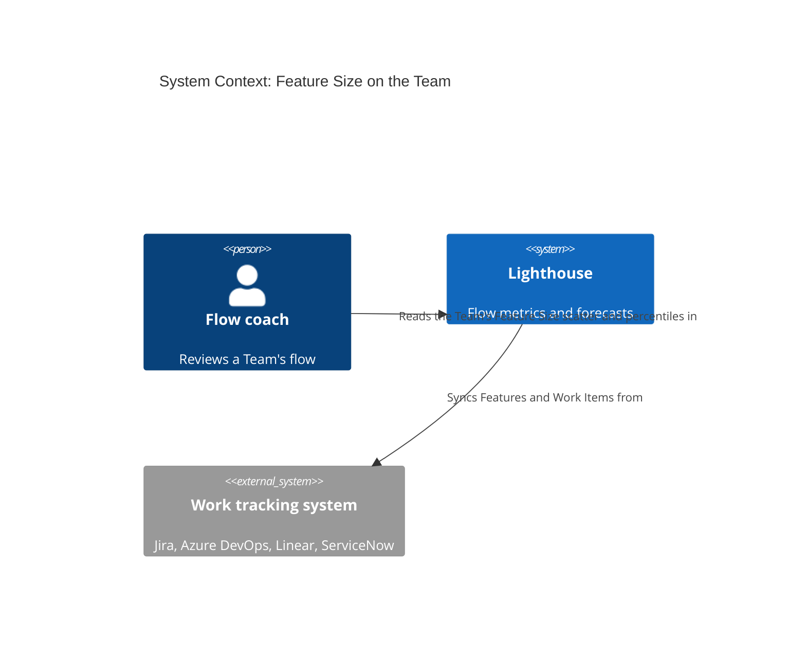
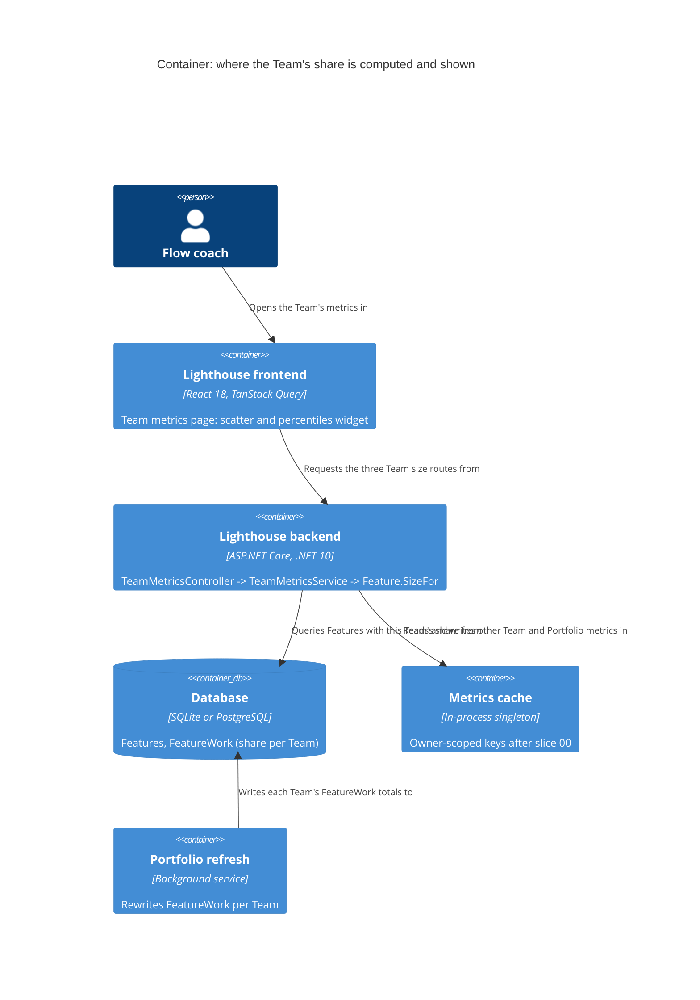

# Feature Delta — story-6251-team-feature-size

> ADO User Story #6251 "Feature Size and Feature Size Percentiles on the Team", raised by Steve Pereira
> (2026-10-06) while following up on Bug #6203. He looked for the Feature Size chart on his Team and could not
> find it. Both Feature Size (scatter) and Feature Size Percentiles (overview widget) exist only on a Portfolio.
> This story brings both to the Team metrics page, counting the Team's own share of each Feature.

## Wave: DISCUSS / [REF] Persona IDs

- **flow-coach**: runs the Team's flow reviews and refinement. Wants to know how big the Team's part of a
  Feature usually gets, next to the Team's Cycle Time and Work Item Age.

## Wave: DISCUSS / [REF] JTBD One-Liners

New job `job-flow-coach-know-how-much-of-a-feature-we-take-on` (`docs/product/jobs.yaml`): *When my team
reviews its flow or splits the next Feature, I want to see how many Work Items our part of each Feature
usually comes to, and which open Features are already bigger than usual, so I can tell when our share is
growing past what we normally finish and raise it before it drags.*

## Wave: DISCUSS / [REF] Pre-requisites

- Bug #6203 (a typed Jira link label sets which way parents are read) is on `main` (`92b0eb009`). Without it,
  link-based hierarchies counted children the wrong way round, and every size here would inherit that.
- No schema change is needed. A Team's share of each Feature is already stored:
  `FeatureWork.TotalWorkItems` per Team, refreshed by `WorkItemService.RefreshRemainingWork`
  (`WorkItemService.cs:576-604`). It counts this Team's child Work Items in any state. Rows with zero are removed.
- **Only Features that some Portfolio loads exist in Lighthouse.** A parent no Portfolio picks up shows up
  elsewhere as "(Item not tracked by Lighthouse)" (`TeamMetricsService.cs:44-56`). It has no state and no
  closed date. So a Team with no Portfolio around its hierarchy gets no Features here (D2).

## Wave: DISCUSS / [REF] Locked Decisions

| ID | Decision | Verdict |
|----|----------|---------|
| D1 | **Size on the Team is the Team's share.** A Feature's size on the Team is the number of this Team's child Work Items under it (`FeatureWork.TotalWorkItems` for this Team), in any state. It is not the whole Feature's `Size`. It answers "how much of a Feature do we usually take on" and pairs with the Team's own Cycle Time. | Locked by the maintainer, 2026-10-13 |
| D2 | **Which Features count:** every Feature that Lighthouse tracks (loaded by any Portfolio) in which this Team has at least one child Work Item. The Team does not have to be part of that Portfolio. A Team with no such Feature sees the empty state, worded so it says Features come from a Portfolio. Tracking parents that no Portfolio loads is out of scope. If wanted, it becomes its own Story. | Locked by the maintainer, 2026-10-13 |
| D3 | **Widgets:** the Feature Size scatter (Portfolio & Features category) and the Feature Size Percentiles overview widget, including its status rule. The Feature Size PBC, PBC Over Time and every other over-time chart stay Portfolio-only. | Locked by the maintainer, 2026-10-13 |
| D4 | **RBAC:** `TeamRead` on the Team is enough to see every Feature that counts under D2, even one from a Portfolio the reader cannot read. This matches the Team's existing Features In Progress, which already names such Features under `TeamRead`. | Locked by the maintainer, 2026-10-13 |
| D5 | **The Team's number must never pass for the Portfolio's.** Both widgets say plainly that they count this Team's Work Items only. A Feature's point or tooltip on the Team names the size as this Team's share. The exact copy and placement are sketched with the maintainer at the start of DISTILL. | Locked (principle). Copy is open for DISTILL |
| D6 | **Same rules as the Portfolio, applied to the share.** The scatter shows Done Features closed in the selected range plus every To Do and In Progress Feature with a share above zero. The percentiles (50th/70th/85th/95th) come from Features closed in the range. The trend compares against the previous period of the same length, with its direction taken from the 50th. Status: Act if any active Feature's share is above the 85th, Observe if any is above the 70th, Sustain otherwise. The closed date and Cycle Time are the Feature's own, not the date the Team finished its share. | Locked |
| D7 | **Default-sized Features are left out.** A Feature that a Portfolio sizes with its Default Feature Size (`IsUsingDefaultFeatureSize`) is not broken down, so it has no real share to count. It drops out on the Team just as it drops out of the Portfolio's percentiles. No Default Feature Size or size-target setting is added to the Team. | Locked |
| D8 | **No size target and no Estimation mode on the Team.** The size-target line comes from the Portfolio's `FeatureSizeTargetProbability/Range`, and a Feature's estimate is configured on the Portfolio. On the Team, the scatter offers the Cycle Time and Closed Date modes only. | Locked |
| D9 | **Terminology.** All copy uses the configurable terms (*Feature*, *Team*, *Portfolio*, *Work Item*), never "Epic". | Locked |

## Wave: DISCUSS / [REF] User Stories

### US-01: See how big our share of each Feature gets

As a **flow coach**, I want the Feature Size scatter on my Team, counting only my Team's Work Items under each
Feature, so I can see how much of a Feature we usually take on without opening a Portfolio and subtracting the
other Teams.

`job_id: job-flow-coach-know-how-much-of-a-feature-we-take-on`

#### Elevator Pitch
Before: on Team Gravity's metrics page there is no Feature Size chart. Seeing how big Gravity's part of OE-002 was means opening the Ocean Explorer Portfolio, where OE-002's size counts Equinox's and Zenith's Work Items too.
After: open **Teams → Gravity → Metrics → Portfolio & Features** and see the **Feature Size** scatter, labelled as counting Gravity's Work Items only. OE-002's point sits at Gravity's share, and its tooltip names that number as Gravity's.
Decision enabled: whether a Feature now in progress is already bigger, for this Team, than the Features it usually finishes, and so worth splitting or raising in refinement.

#### Acceptance Criteria
- **AC-1.1** On a Team, the Portfolio & Features category shows the Feature Size scatter. It plots every Feature under D2 and D6, sized by this Team's share (D1).
- **AC-1.2** A Feature shared by several Teams shows, on each Team, that Team's share. On demo data, OE-002 shows Gravity's count on Gravity, Zenith's on Zenith and Equinox's on Equinox, and the three add up to OE-002's size on the Ocean Explorer Portfolio.
- **AC-1.3** A Feature in which this Team has no child Work Item does not appear on the Team, even if it belongs to a Portfolio the Team is part of. A default-sized Feature does not appear either (D7).
- **AC-1.4** The scatter offers the Cycle Time and Closed Date modes. It offers no Estimation mode and draws no size-target line (D8). The state chips and date range behave as on the Portfolio.
- **AC-1.5** The scatter says it counts this Team's Work Items only, and a point's tooltip names the size as this Team's share (D5, copy from the DISTILL sketch).
- **AC-1.6** A Team with no Feature under D2 sees the empty state, which says Features come from a Portfolio.
- **AC-1.7** A reader with `TeamRead` on the Team, and no read on the Portfolio a plotted Feature belongs to, still sees that Feature (D4). A reader without `TeamRead` gets 403 from the endpoint.
- **AC-1.8** The scatter has a loading look and a could-not-load look, like every other Team widget (DESIGN pins which).

### US-02: Know when an open Feature is already bigger than usual for us

As a **flow coach**, I want the Feature Size Percentiles widget on my Team's overview, with its status, so a
Feature whose share has grown past what we usually finish shows up in our flow review without anyone opening the
scatter.

`job_id: job-flow-coach-know-how-much-of-a-feature-we-take-on`

#### Elevator Pitch
Before: the Team's Flow Overview has Cycle Time and Work Item Age percentiles but nothing on Feature size, so a Team-level share that has grown unusually large goes unnoticed until it drags.
After: open **Teams → Gravity → Metrics → Flow Overview** and see **Feature Size Percentiles** (50th/70th/85th/95th of Gravity's share in Features closed in the range), labelled as counting Gravity's Work Items. Its status reads **Act** when an open Feature's Gravity share is above the 85th.
Decision enabled: which open Feature to raise in the flow review because this Team's part of it is already outside its usual range.

#### Acceptance Criteria
- **AC-2.1** On a Team, Flow Overview shows Feature Size Percentiles. The four percentiles are computed from this Team's share in Features closed in the selected range, leaving out shares of zero and default-sized Features (D6, D7).
- **AC-2.2** The trend compares against the previous period of the same length, with its direction taken from the 50th (D6).
- **AC-2.3** Status is Act when any To Do or In Progress Feature's share is above the 85th, Observe when any is above the 70th, and Sustain otherwise, including when no Feature is open (D6).
- **AC-2.4** The widget says it counts this Team's Work Items only (D5).
- **AC-2.5** With no Feature closed in the range, the widget shows its existing no-data state, not zeros.
- **AC-2.6** A reader without `TeamRead` gets 403 from the endpoint (D4).

## Wave: DISCUSS / [REF] Out of Scope

- Tracking parents that no Portfolio loads, so that a Team with no Portfolio gets sizes (D2). This is its own Story if wanted.
- Feature Size PBC, PBC Over Time and Percentiles Over Time for Feature size on the Team (D3).
- An Estimation mode or size target on the Team (D8). A Team-level Default Feature Size.
- Showing the whole Feature's size next to the Team's share. D1 picked the share alone, and the tooltip copy is settled in DISTILL.
- Exposing the new Team endpoints in the CLI or MCP. The clients don't read the Portfolio's size endpoints either.

## Wave: DISCUSS / [REF] Cross-cutting Impact

- **RBAC**: **affected, no new rule.** The new Team endpoints sit on `TeamMetricsController`, whose class-level `[RbacGuard(TeamRead)]` covers them (D4). Nothing new reads `/authorization/my-summary`, and UI gating stays with `useRbac()`.
- **Lighthouse-Clients (CLI + MCP)**: **N/A, because** no client calls `allFeaturesForSizeChart`, `sizePercentiles` or `featureSizePercentilesInfo` today (grep of `packages/client`, `packages/cli`, `packages/mcp-core`). The only Feature Size mention is the PBC Over Time family, described there as Portfolio-only. That stays true under D3, so the wording is unchanged.
- **Website**: **N/A, because** the Lighthouse page describes Feature size under "one flight level up" (`website/src/pages/Lighthouse.tsx:393`). That is still true, and no screenshot it hot-links changes. DELIVER re-checks if a docs asset is regenerated.
- **Docs**: `docs/metrics/portfolio-features.md` (Feature Size: "Applies to" becomes Teams and Portfolios; a paragraph on the Team's share, its modes and why the number differs from the Portfolio) and `docs/metrics/flow-overview.md` (drop "only available for Portfolios"; say what the Team counts). Do this at finalization.
- **Screenshots**: one `@screenshot` of the Team's Feature Size scatter on demo data, if the docs page gets a Team image. DISTILL decides.
- **Usage data**: asked at DEVOPS.
- **E2E**: a thin check at most, on demo data. DISTILL decides.
- **Release notes**: the Story carries the `Release Notes` tag.

## Wave: DISCUSS / [REF] WS Strategy

Strategy **B (extend existing)**: no skeleton. Both widgets, the shared metrics view and the per-Team share
exist end to end. Each slice adds one Team endpoint pair behind an existing widget and lifts that widget's
Portfolio-only gate.

## Wave: DISCUSS / [REF] Driving Ports

- `GET /api/latest/teams/{teamId}/metrics/…`: new Team routes alongside `featuresInProgress`, mirroring the Portfolio's `allFeaturesForSizeChart`, `sizePercentiles` and `featureSizePercentilesInfo`. DESIGN names them and settles whether the share travels in `FeatureDto.Size` or a field of its own.
- UI: Team metrics page, Portfolio & Features category (scatter) and Flow Overview (percentiles widget).

## Wave: DISCUSS / [REF] Story Map and Slices

| Order | Slice | Story | Why this order |
|---|---|---|---|
| 1 | `slice-01-team-feature-size-scatter` | US-01 | The chart Steve looked for. It is also the data the status rule in slice 02 reads (active Features' sizes), and it carries the riskiest assumption: that a share reads as "ours" rather than as a wrong number. |
| 2 | `slice-02-team-feature-size-percentiles` | US-02 | Builds on slice 01's active-size data. It adds the percentiles and trend endpoints and the overview widget. |

Each slice ships on its own: slice 01 alone already serves the job's functional dimension.

## Wave: DISCUSS / [REF] Scope Assessment: PASS

Two stories and two slices, each under a day. One bounded context (metrics), with no schema change, no new setting
and no new widget type. No oversized signals.

## Wave: DISCUSS / [REF] Outcome KPIs

| KPI | Target | Measurement |
|---|---|---|
| `OUT-6251-share-adds-up` | For every multi-team Feature on demo data (OE-001, OE-002, OE-007), the Team shares sum to the Portfolio size | Acceptance test over demo data (AC-1.2) and a by-hand check on Ocean Explorer |
| `OUT-6251-not-read-as-a-bug` | 0 reports in the 60 days after release that a Feature's size on the Team "doesn't match" the Portfolio | Community channel and ADO Bugs mentioning Feature Size, reviewed at day 60; Steve's confirmation on #6251 |
| `OUT-6251-used` | Feature Size on a Team is opened on at least 10 % of instances that report usage data, within 60 days | The usage-data event DEVOPS decides on, if any |

## Wave: DISCUSS / [REF] Definition of Done

1. A Team's metrics page shows the Feature Size scatter and the Feature Size Percentiles widget, both counting the Team's share (US-01, US-02).
2. On demo data, OE-002's shares on Equinox, Gravity and Zenith add up to its Portfolio size.
3. Both widgets say they count this Team's Work Items only, in copy the maintainer approved at DISTILL.
4. Both have the loading and could-not-load looks DESIGN pins.
5. `docs/metrics/portfolio-features.md` and `docs/metrics/flow-overview.md` describe the Team variant in configurable terms.
6. The usage-data event from DEVOPS, if any, is emitted and listed in `docs/settings/usagedata.md`.
7. A release-notes line is drafted on #6251.
8. `dotnet build` (warnings as errors) and the filtered `dotnet test` are green, and so are `pnpm test` and `pnpm build`.
9. Stryker on the changed lines of both stacks is at least 80 %.

## Wave: DISCUSS / [REF] DoR Validation

| # | DoR item | Status | Evidence |
|---|---|---|---|
| 1 | Problem stated in user terms | ✅ | Steve could not find the chart on his Team (#6251) |
| 2 | Job traceability | ✅ | `job-flow-coach-know-how-much-of-a-feature-we-take-on` (both stories) |
| 3 | ACs testable | ✅ | AC-1.x and AC-2.x are observable at the Team endpoints and the widgets. AC-1.2 has concrete demo data |
| 4 | Dependencies known | ✅ | #6203 on `main`; `FeatureWork` already holds the share |
| 5 | Right-sized | ✅ | Two slices, each under a day |
| 6 | Elevator pitches concrete | ✅ | Both name a real UI path and what it shows |
| 7 | Out of scope explicit | ✅ | See Out of Scope |
| 8 | Cross-cutting answered | ✅ | RBAC, clients, website, docs, screenshots, usage data, E2E, release notes: each has an answer or names the wave that decides it |
| 9 | No blocking unknowns | ✅ | D1–D4 were taken by the maintainer. The open copy (D5) is a DISTILL sketch by rule, and the DTO shape is a DESIGN choice |

## Wave: DISCUSS / [REF] Wave Decisions Summary

- **Key decisions:** D1 (this Team's share), D2 (tracked Features with team work, any Portfolio), D3 (scatter and percentiles only), D4 (`TeamRead` suffices), D5 (never passes for the Portfolio's number), D7/D8 (no defaults, targets or Estimation mode on the Team).
- **Feature type:** user-facing, on both stacks.
- **Constraints:** no schema change; the Portfolio's widgets and numbers are unchanged; no new Team setting.
- **Upstream changes:** the Story text says Team metrics would also "cover teams that have no Portfolio around their hierarchy". The code facts (Pre-requisites) show they get nothing without tracking parents first, so D2 moves that out of scope. Update the ADO description to match.

## Wave: DISCUSS / [REF] Open questions for DESIGN

- Does the share travel in `FeatureDto.Size`, which means the Portfolio's whole size elsewhere, or in a field of its own? `FeatureDto` is a shared contract.
- How do the existing builders handle a Team owner? `BuildFeatureSizePercentilesInfoDto` and `BuildFeatureSizeEstimationResponse` already take `WorkTrackingSystemOptionsOwner`. The Portfolio's `GetFeaturesClosedInDateRange` filters on `f.Portfolios`.
- When a Feature's point is clicked on the Team, should its Work Items dialog list only this Team's children, so the list matches the number?
- What are the loading and could-not-load looks for both widgets?
- Is the Team variant in the same licence tier as the Portfolio's?

## Wave: DESIGN / [REF] Summary

DESIGN 2026-10-13, PROPOSE mode, application scope. Maintainer decisions taken the same day. Pattern unchanged:
the controller maps entities to DTOs, and the metrics services read through the existing repositories. The story
adds one domain method, three Team routes, one narrow frontend service interface, and a fix to the shared metrics
cache. ADR: [ADR-236](../../product/architecture/adr-236-on-a-teams-metrics-routes-a-features-size-is-that-teams-share.md).
DESIGN adds a slice 00 in front of the DISCUSS slices (see Changed Assumptions).

## Wave: DESIGN / [REF] Decisions

| ID | Decision | Why |
|----|----------|-----|
| DDD-1 | **The share travels in `FeatureDto.Size`.** On the three Team routes, `Size` is that Team's share. On every other route it stays the whole Feature's size. `Size` becomes init-only (`{ get; init; }`), and the Team actions set it in the object initializer, the way `Estimate` is already set (`PortfolioMetricsController.cs:291`). ADR-236. | The scatter (`FeatureSizeScatterPlotChart.tsx:199,204,271,285,431,493`), the status input (`BaseMetricsView.tsx:1854-1860`) and the dialog's Size column (`workItemColumns.tsx:455-463`) all read `size`. None of them changes. None of the 7 production `new FeatureDto(` sites sets `Size`, so none breaks. |
| DDD-2 | **One definition of the share:** a pure domain method `Feature.SizeFor(teamId)`. It returns 0 when `IsUsingDefaultFeatureSize`, and otherwise the sum of `TotalWorkItems` over this Team's `FeatureWork` rows. The DTO value and the percentiles both use it. | If the scatter and the percentiles each defined the share, they could drift apart, and AC-1.2 checks the number at the endpoint. |
| DDD-3 | **Backend shape: lift, then extend.** Move `WasClosedBetween` (`PortfolioMetricsService.cs:794-804`) and the size-chart window rule (`:586-594`: Done and closed in the range, or To Do, or Doing) into `BaseMetricsService` as `protected`. The Portfolio moves onto them in its own `refactor` commit, with no change in behaviour. Then `TeamMetricsService` gains the three Team methods. Reuse `BuildPercentiles` (`BaseMetricsService.cs:349`) and `BuildFeatureSizePercentilesInfoDto` (`:1148`). The latter takes no owner argument. | Copying the 40 lines would give two closed-in-range rules, which Bug #5567 already showed is dangerous. A separate collaborator class would add DI wiring for pure helpers. |
| DDD-4 | **Which Features count on the Team:** `featureRepository.GetAllByPredicate(f => !f.IsUsingDefaultFeatureSize && f.FeatureWork.Any(fw => fw.TeamId == team.Id && fw.TotalWorkItems > 0) && <state / window>)`. This runs in SQL, because `GetAllByPredicate` returns an `IQueryable` with the includes applied (`FeatureRepository.cs:24,44-56`). | **Excluding default-sized Features must be explicit.** `ExtrapolateNotBrokenDownFeatures` gives made-up `FeatureWork` rows to Teams with no child at all (`WorkItemService.cs:622-630,637-660`), so "share above zero" alone would let them in (D7). Do not copy `GetAll().Where(...)` (`TeamMetricsService.cs:85`), which filters in memory. |
| DDD-5 | **No server cache on the three Team routes.** | A Portfolio refresh rewrites `FeatureWork`, and `PortfolioFeaturesRefreshed` clears only that Portfolio's metrics (`PortfolioFeaturesRefreshedMetricsInvalidationHandler.cs:21`), so a Team cache would go stale. The Portfolio scatter is not cached either (`PortfolioMetricsService.cs:575`). Each request costs one or two indexed queries. |
| DDD-6 | **The metrics cache is scoped by owner (slice 00).** The cache key becomes owner kind + id + metric, for example `Team:3_ThroughputInfo_…` and `Portfolio:3_ThroughputInfo_…`. `InvalidateMetrics` removes by the same owner-scoped prefix. Both are built by one function, so a key and the prefix that invalidates it cannot disagree. The owner kind comes from the concrete owner type (Team or Portfolio). How it is derived is the crafter's choice, as long as the base type can never stand in for both owners. | Today the key is `{entityId}_{metric}` (`BaseMetricsService.cs:1360-1363`) in one process-wide singleton (`Program.cs:1381`). Teams and Portfolios are separate tables with their own ids, so Team 3 and Portfolio 3 share 20 key families (listed below). The same singleton already holds the Jira connector's entries under their own `area|id|key` namespace (`JiraWorkTrackingConnector.cs:2871`), so a namespace is the existing idiom. |
| DDD-7 | **Routes:** `GET /api/{v1,latest}/teams/{teamId}/metrics/allFeaturesForSizeChart`, `…/sizePercentiles`, `…/featureSizePercentilesInfo`, all with the same names and shapes as the Portfolio's. They are covered by the class-level `[RbacGuard(TeamRead)]` (D4). Each Feature names every Portfolio it belongs to (no `readablePortfolioIds`, as in `featuresInProgress`, `TeamMetricsController.cs:135`), uses the same blocked rule as that route, and carries no `Estimate`. | Same knowledge, same names, so the frontend implementations can be shared (DDD-8). |
| DDD-8 | **Frontend: the gate follows the service, not a guess.** A new interface `IFeatureSizeMetricsService` has `getAllFeaturesForSizeChart` and `getSizePercentiles` (slice 01), plus `getFeatureSizePercentilesInfo` (slice 02). Both `ITeamMetricsService` and `IProjectMetricsService` extend it (`MetricsService.ts:262,281`). The implementations move from `ProjectMetricsService.ts` into the shared `BaseMetricsService<T>`, which already builds paths from the owner segment. A predicate `providesFeatureSize(service)`, in the style of `providesSleRisk` (`useMetricsData.ts:146`), drives `featureSizeData` and `featureSizePercentilesInfo` (`:193,196`). `featureSizePbc` and `featureSizeEstimation` stay `isPortfolioShaped`, and `isProjectMetricsService` (`:128-137`) still requires them, so a Team never counts as a Portfolio. The `portfolioService` cast and its comment (`:640-641`) are replaced. | Duck typing on five method names happens to work today. It would break silently the day a Team gains one more of them. |
| DDD-9 | **Gate lifts:** remove `ownerFilter: "portfolio-only"` from `featureSize` (`categoryMetadata.ts:108`, slice 01) and from `featureSizePercentiles` (`:73-77`, slice 02). Correct the comment at `:237-238` ("a team service never populates `allFeaturesForSizeChart`"). `featureSizePbc` keeps its filter (D3). | — |
| DDD-10 | **The scatter frame is always placed, on both owners.** The `featureSize` node is never null. It is the chart when there are Features, and an owner-specific empty state when there are none. `featureSize` leaves `placedOnlyOnceTheirDataSaysSo` (`BaseMetricsView.tsx:1293-1296`), and `estimationVsCycleTime` stays in it. The frame then shows the lone spinner until the data arrives (`bodyOf`, `:1315-1321`) and the could-not-load note on failure (ADR-233). | Maintainer decision (Changed Assumptions). Today the Portfolio scatter has no loading look and no empty state, because the frame is not placed at all while it holds no Features (`:1192-1200`). |
| DDD-11 | **Work Items dialog:** it lists the Features of the clicked group, as it does today (`FeatureSizeScatterPlotChart.tsx:503-509,795-803`), with the `featureSize` context (`workItemsDialogContexts.ts:75`). Its Size column shows the share through DDD-1. It does not list any children. | Maintainer decision. A list of children would need a new endpoint and is outside D3. |
| DDD-12 | **Free tier on both owners.** No `LicenseGuard` on either metrics controller (only `RbacGuard`, `:18` in both). `isPremium` reaches only the PBC and over-time nodes (`BaseMetricsView.tsx:863-872,1073,1098`). | Same tier as the Portfolio (DISCUSS open question). |
| DDD-13 | **Accepted freshness lag.** The share changes on a Portfolio refresh, but the Team's query key carries the Team's `lastUpdated` (`useMetricsData.ts:236-243`). An open Team dashboard can show the previous share until its queries go stale or the page reloads. `featuresInProgress` already behaves this way. The finalize docs say so in one sentence. | No polling, and no new event fan-out for one figure. |
| DDD-14 | **The scatter offers no Estimation mode on the Team, and nothing needs to be built for it.** `featureSizeEstimation` is never asked for on the Team, so `estimationData` is undefined and the toggle hides itself (`FeatureSizeScatterPlotChart.tsx:364-365`). **AC-1.4's "draws no size-target line" is trivially true.** The scatter draws no size-target line on the Portfolio either: `featureSizeTarget` is computed (`useMetricsData.ts:712-723`) but no component reads it. DISTILL should not pin a line that never existed. | — |

### The colliding cache keys (slice 00)

Both services build each of these identifiers in the same shape, so Team N and Portfolio N share the entry
(Team line / Portfolio line):

| Identifier | Team | Portfolio |
|---|---|---|
| `Throughput_{start}_{end}` | `TeamMetricsService.cs:140` | `PortfolioMetricsService.cs:25` |
| `StartedItems_{start}_{end}` | `:227` | `:195` |
| `ForecastPredictabilityScore_{start}_{end}` | `:285` | `:218` |
| `CycleTimePercentiles_{start}_{end}` | `:314` | `:289` |
| `WorkItemAgePercentiles_{end}` | `:327` | `:313` |
| `NamedCycleTimePercentiles_{start}_{end}_Def_{id}` | `:415` | `:395` |
| `AgeInStatePercentiles_{start}_{end}` | `:458` | `:329` |
| `CumulativeStateTime_{start}_{end}{selection}{scope}` | `:477` | `:348` |
| `FlowEfficiencyInfo_{start}_{end}` | `:490` | `:761` |
| `CumulativeStateTime_Items_{state}_{start}_{end}{selection}` | `:505` | `:425` |
| `CumulativeStateTime_Candidates_{start}_{end}` | `:520` | `:440` |
| `EstimationVsCycleTime_{start}_{end}` | `:622` | `:601` |
| `TotalWorkItemAge_{end}` | `:633` | `:620` |
| `WipSnapshot_{day}` | `:652` | `:229` |
| `ThroughputInfo_{start}_{end}` | `:719` | `:637` |
| `ArrivalsInfo_{start}_{end}` | `:735` | `:653` |
| `WipOverviewInfo_{start}_{end}` | `:751` | `:685` |
| `TotalWorkItemAgeInfo_{start}_{end}` | `:775` | `:697` |
| `PredictabilityScoreInfo_{start}_{end}` | `:787` | `:709` |
| `CycleTimePercentilesInfo_{start}_{end}` and `…_Def_{id}` | `:805-806` | `:727-728` |

What a collision does depends on whether the two sides cache the same type:
- **Same type (most of the list, for example every `…Info` DTO, `RunChartData` and `InfoMetric`):** the other owner's numbers are served as this owner's.
- **Different types (for example `WipSnapshot`, which holds Work Items for a Team and Features for a Portfolio):** the `as` cast fails, so the entry is recomputed and overwritten. The cost is wasted work, not wrong data.

Invalidation removes every key starting with `{id}_` (`BaseMetricsService.cs:964`). So refreshing Team 3 also clears Portfolio 3, and the other way round. That is harmless, and the owner-scoped prefix removes it too.

Two families do not collide:
- The process behaviour chart keys differ by name (`ThroughputProcessBehaviour_` against `ThroughputProcessBehaviourChart_`, and so on).
- Owner-only identifiers, which also stay as they are:
  - Team: `FeatureWIP`, `ForecastThroughputStatus`, `BlackoutAwareThroughput`, `CreatedItems`, `WipOverTime`, `SleRisk`, `CycleTimeData`, `FeaturesWorkedOnInfo`, `ArrivalsProcessBehaviour`.
  - Portfolio: `FeatureSizeProcessBehaviourChart`, `FeaturesInProgressOverTime`, `SizePercentiles`, `FeatureSizePercentilesInfo`.

The only callers that remove entries do so through `InvalidateTeamMetrics` / `InvalidatePortfolioMetrics`:
- `OverTimeFillTarget.cs:59,84`
- `BlackoutConfigurationChangedMetricsInvalidationHandler.cs:19,24`
- `PercentilesOverTimeRecordingHandler.cs:57,72`
- `ProcessBehaviorRecordingHandler.cs:54,69`
- `PortfolioFeaturesRefreshedMetricsInvalidationHandler.cs:21`
- `TeamMetricsService.UpdateTeamMetrics` (`:842`)

No other code reads or writes a metric key directly. The cache lives only in memory, so nothing persisted needs migrating.

## Wave: DESIGN / [REF] Component Decomposition

| Path | Change | Slice |
|---|---|---|
| `Lighthouse.Backend/Services/Implementation/BaseMetricsService.cs` | EXTEND: owner-scoped `GetCacheKey` and invalidation prefix | 00 |
| same | REFACTOR: lift `WasClosedBetween` and the size-chart window rule (own `refactor` commit) | 01 |
| `Lighthouse.Backend/Services/Implementation/PortfolioMetricsService.cs` | REFACTOR: use the lifted helpers. Same numbers. | 01 |
| `Lighthouse.Backend/Models/Feature.cs` | EXTEND: `SizeFor(teamId)` | 01 |
| `Lighthouse.Backend/API/DTO/FeatureDto.cs` | EXTEND: `Size` init-only | 01 |
| `Lighthouse.Backend/Services/Interfaces/ITeamMetricsService.cs`, `…/Implementation/TeamMetricsService.cs` | EXTEND: Features for the size chart and size percentiles (01), percentiles info (02) | 01, 02 |
| `Lighthouse.Backend/API/TeamMetricsController.cs` | EXTEND: `allFeaturesForSizeChart`, `sizePercentiles` (01), `featureSizePercentilesInfo` (02). No new constructor parameter. | 01, 02 |
| `Lighthouse.Frontend/src/services/Api/MetricsService.ts` | EXTEND: `IFeatureSizeMetricsService`. The shared base gains the implementations. | 01, 02 |
| `Lighthouse.Frontend/src/services/Api/ProjectMetricsService.ts` | REFACTOR: its three size methods move to the base | 01, 02 |
| `Lighthouse.Frontend/src/tests/MockApiServiceProvider.ts` | EXTEND: Team mock gains the methods | 01, 02 |
| `Lighthouse.Frontend/src/hooks/useMetricsData.ts` | EXTEND: `providesFeatureSize`, applicability, cast | 01, 02 |
| `Lighthouse.Frontend/src/pages/Common/MetricsView/categoryMetadata.ts` | EXTEND: gate lifts, comment | 01, 02 |
| `Lighthouse.Frontend/src/pages/Common/MetricsView/BaseMetricsView.tsx` | EXTEND: `featureSize` node never null, owner-specific empty state, owner copy passed down | 01 |
| `Lighthouse.Frontend/src/components/Common/Charts/FeatureSizeScatterPlotChart.tsx` | EXTEND: owner-scoped label and tooltip copy (`ownerKind` is already a prop, `:221`) | 01 |
| `Lighthouse.Frontend/src/pages/Common/MetricsView/FeatureSizePercentilesWidget.tsx` | EXTEND: "this Team's Work Items only" caption | 02 |
| `Lighthouse.Frontend/src/pages/Common/MetricsView/widgetInfoMetadata.ts` | EXTEND: info text for the Team (`:249,362`) | 01, 02 |

No migration, no new dependency, no new DI registration, no RBAC change.

## Wave: DESIGN / [REF] Driving Ports

- `GET /api/{v1,latest}/teams/{teamId}/metrics/allFeaturesForSizeChart?startDate&endDate` returns `FeatureDto[]`, with `Size` = this Team's share (slice 01).
- `GET …/teams/{teamId}/metrics/sizePercentiles?startDate&endDate` returns `PercentileValue[]` (50/70/85/95, or empty) (slice 01).
- `GET …/teams/{teamId}/metrics/featureSizePercentilesInfo?startDate&endDate` returns `FeatureSizePercentilesInfoDto` (slice 02).
- All three return 400 when the start date is after the end date, 404 for an unknown Team, and 403 without `TeamRead`.
- All three are read-only. No route on this controller writes.
- UI: Team metrics page, Portfolio & Features (scatter) and Flow Overview (percentiles widget). On the Portfolio, the scatter frame changes (DDD-10).

## Wave: DESIGN / [REF] Driven Ports and Adapters

Reused as they are: `IRepository<Feature>` (`FeatureRepository`, EF Core over SQLite/Postgres) and the in-process
`Cache<string, object>` singleton, whose key format changes in slice 00. No new adapter and no external
integration, so there are no contract tests and no new probe.

**Contract shapes:**
- `Feature.SizeFor` and the lifted helpers are pure functions.
- The three Team service methods are read-only.
- The cache change bounds a change: only the key format moves, and the entries written stay the same.

## Wave: DESIGN / [REF] Technology Choices

None new. C# .NET 10 / EF Core, React 18 + TanStack Query, MUI X charts: all already in use.

## Wave: DESIGN / [REF] Reuse Analysis

| Component | Verdict | Justification |
|---|---|---|
| `Feature.SizeFor(teamId)` | **CREATE NEW** (method) | Nothing defines the share today. `GetForecastInputCandidates` inlines remaining work only (`TeamMetricsService.cs:91-93`). |
| `IFeatureSizeMetricsService` (TS) | **CREATE NEW** (interface) | Needed so that neither the gate nor the cast guesses the owner type (DDD-8). |
| `FeatureDto` | EXTEND | `Size` becomes init-only |
| `BaseMetricsService` (C#) | EXTEND | Owner-scoped key, lifted helpers |
| `BuildPercentiles`, `BuildFeatureSizePercentilesInfoDto` | REUSE as is | Owner-agnostic already |
| `PortfolioMetricsService` | REFACTOR | No behaviour change |
| `TeamMetricsService`, `ITeamMetricsService`, `TeamMetricsController` | EXTEND | Three methods and actions |
| `BaseMetricsService<T>` (TS), `ProjectMetricsService.ts`, `TeamMetricsService.ts`, mock | EXTEND / move | Same route shape, same knowledge |
| `useMetricsData`, `categoryMetadata`, `BaseMetricsView` | EXTEND | Gates, placement, empty state |
| `FeatureSizeScatterPlotChart`, `FeatureSizePercentilesWidget`, `widgetInfoMetadata` | EXTEND | Owner copy |
| `WidgetShell` status, `computeFeatureSizeRag`, `WorkItemsDialog` `featureSize` context | REUSE as is | ADR-233 looks, the D6 status rule, the dialog |

## Wave: DESIGN / [REF] C4

## Wave: DESIGN / [REF] Slow-connection States

The looks come from the existing `WidgetShell` `status` (ADR-233) and keyed TanStack queries, whose keys carry the
owner type and id (`useMetricsData.ts:280,319-321`), so a late answer for another owner or window never lands.
E2E page objects wait for `data-widget-status="ready"`.

| Widget | Owner | Loaded | Loading | Could not load | Empty |
|---|---|---|---|---|---|
| Feature Size scatter | Team | Points at this Team's share. The label and tooltip say it counts this Team's Work Items only. | Frame placed from first render: lone spinner, or the older chart dimmed under a small spinner once one exists. | `WidgetShell`'s could-not-load note | New: says Features come from a Portfolio (copy from the DISTILL sketch) |
| Feature Size scatter | Portfolio | Unchanged | **New:** same frame as the Team (today: no frame until data with Features arrives) | Unchanged (note) | **New:** no Features in the selected range (copy from the DISTILL sketch). Today the widget is absent. |
| Feature Size Percentiles | Team | Four percentiles, trend, status, "this Team's Work Items only" caption | As every Flow Overview widget (inputs `featureSizePercentilesInfo` + `featureSizeData`, `categoryMetadata.ts:290`) | Note | Existing "No data available" (`FeatureSizePercentilesWidget.tsx:70-80`), never zeros (AC-2.5) |
| Feature Size Percentiles | Portfolio | Unchanged | Unchanged | Unchanged | Unchanged |

## Wave: DESIGN / [REF] Slice Order

| Order | Slice | Story | Why this order |
|---|---|---|---|
| 0 | `slice-00-owner-scoped-metrics-cache` | US-00 | A Team metrics page that can show a Portfolio's numbers would undermine D5 before the Team gets its own Feature figures. It is backend-only and releasable alone. |
| 1 | `slice-01-team-feature-size-scatter` | US-01 | Adds the refactor commit (DDD-3), `SizeFor`, two routes, the gate lift, and the scatter frame and empty state on both owners. |
| 2 | `slice-02-team-feature-size-percentiles` | US-02 | Adds the info route and the widget gate lift. |

## Wave: DESIGN / [REF] Open Questions for DISTILL

- The sketches, with the maintainer at the start of DISTILL:
  - the scatter label and tooltip on the Team (D5);
  - the Team empty copy and the Portfolio empty copy;
  - the percentiles caption.
- Slice 00 reproduction: one test that caches a metric for Team N, then asks Portfolio N for the same metric and window, and gets the Team's value today. `ThroughputInfo` is a good candidate. Write it before the fix.
- Do not pin a size-target line (DDD-14).
- AC-1.2 at the endpoint: on demo data, the Gravity, Zenith and Equinox `Size` values for OE-002 add up to its `Size` on the Ocean Explorer Portfolio (`allFeaturesForSizeChart` on each owner).
- One AC with a default-sized Feature that carries made-up `FeatureWork` for the Team, which must not appear (DDD-4).

## Wave: DESIGN / [REF] Changed Assumptions

1. **The Portfolio's scatter frame changes.**
   - DISCUSS said: *"the Portfolio's widgets and numbers are unchanged"* (Wave Decisions Summary, Constraints).
   - The maintainer decided on 2026-10-13 that both owners get the always-placed scatter frame: a lone spinner while loading, the could-not-load note on failure, and an empty state when there are no Features (DDD-10).
   - The Portfolio's **numbers** stay unchanged. Its scatter **frame** does not.
   - Amended by this section: AC-1.6 and AC-1.8 also hold on the Portfolio, with its own empty copy. DoD item 4 covers both owners' scatter looks.
2. **New story US-00, "A Team never shows a Portfolio's numbers"** (slice 00, folded into #6251 by the maintainer, 2026-10-13).
   - AC-0.1: With a Team and a Portfolio that share an id, asking each for the same metric and window returns that owner's own value, whichever was asked first.
   - AC-0.2: Refreshing a Team clears that Team's cached metrics and no Portfolio's, and the reverse also holds.
   - AC-0.3: Every metric listed in "The colliding cache keys" is cached per owner. A test fails if a Team key and a Portfolio key can be equal.
   - AC-0.4: No change in any metric value for a single owner (the existing suites stay green).
   - DoD gains: slice 00 is shipped with its reproduction test written first.
3. **Slice 02 no longer owns `sizePercentiles`.** That route moves to slice 01, because the scatter's percentile lines and its status footer read it (`useMetricsData.ts:644-664`).
4. **DISCUSS open question 2:** `BuildFeatureSizePercentilesInfoDto` takes no owner argument (`BaseMetricsService.cs:1148-1154`). `BuildFeatureSizeEstimationResponse` is not used on the Team (D8).

Upstream note: the DISCUSS sections above are left as written. Read the stories, ACs and DoD together with
this section.
