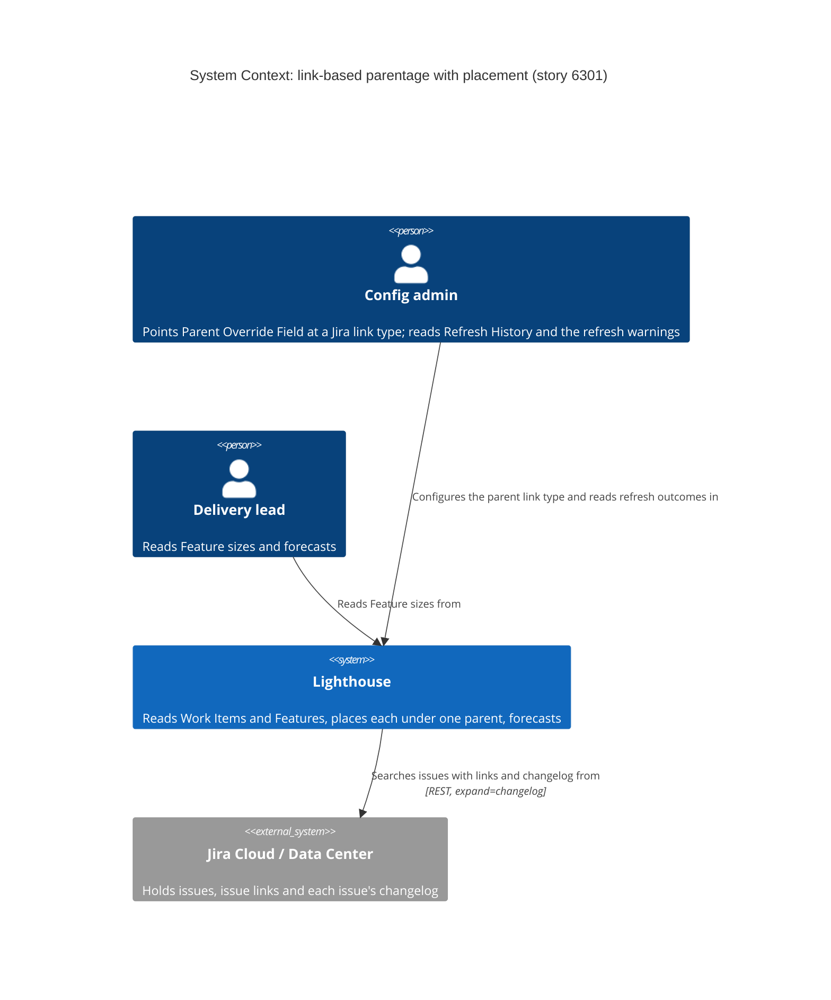
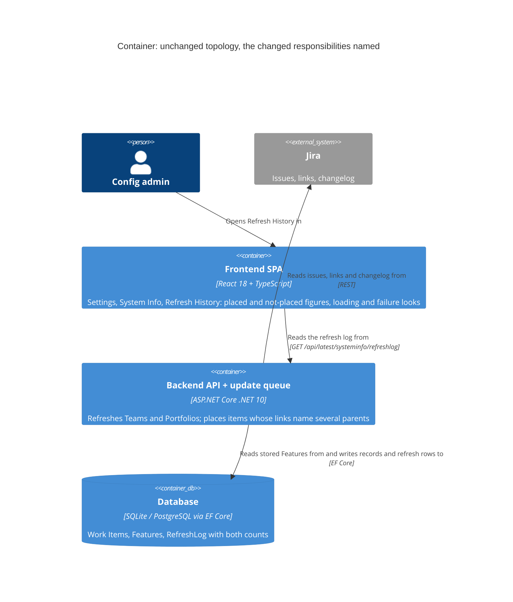
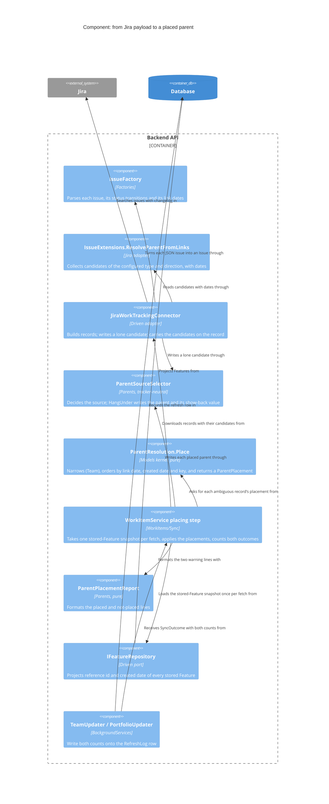

# Feature Delta — story-6301-only-features-as-parent-candidates

**Feature**: When an item's links name more than one possible parent, narrow the candidates to Features
Lighthouse knows, and if several remain, pick one deterministically, instead of refusing.
**ADO**: User Story #6301 "Only Features count as parent candidates", parent #6028 (Parentage from Jira
Issue Links), committed for the next release.
**Origin**: Steve Pereira (consultant), relaying a customer's Jira Data Center instance. Second follow-up
to #6028 after Bug #6203 (`docs/evolution/2026-10-09-fix-link-parent-direction.md`).
**Waves present**: DISCOVER, DIVERGE, DISCUSS.
**Evidence base**: one reporter's account of what one customer instance does, plus the shipped code.
No interviews were run and none are available. Every gate below is judged against that.

---

## Wave: DISCOVER / [REF] Persona ID

| Persona | Role here |
|---|---|
| `config-admin` | **Primary.** The customer's administrator who pointed Parent Override Field at the "caused by" / "results in" link type. Reads the refresh log warning today; is the one asked to "narrow the links down to one", which on this instance means deleting real cause links to incidents. |
| `delivery-lead-rte` | Reads the consequence: Features sized from the children they actually have rather than the Portfolio default. Never opens the setting. |
| `consultant-relay` (Steve) | Not a user persona. The only source of evidence; reports the customer's behaviour second hand. Recorded so the evidence chain is visible. |

Same personas as #6028 (`docs/feature/parent-from-issue-links/feature-delta.md`, Persona IDs). No new
persona.

---

## Wave: DISCOVER / [REF] Problem as reported (customer words, second hand)

- Every team on the customer's instance uses one link type, "caused by" / "results in", for the whole
  hierarchy (Steve, recorded during #6028 and #6203).
- "Many items are `is caused by` several issues", so "most items appear to ignore their parentage"
  (Steve, #6301). The other causes are things like incidents, not Features.
- The only signal is a warning in the refresh log.

Past behaviour, not intent: Steve describes what the instance's items carry and what Lighthouse showed
after the #6203 fix shipped. It is one instance, one reporter, and not yet backed by the refresh log he
offered to send.

---

## Wave: DISCOVER / [REF] What the shipped code does today (established 2026-10-15, `main` at `6089fe795`)

### 1. Several matching links: the item ends up with the tracker's own parent field from this reading, or none. It does NOT keep its previous parent.

| Step | Where | What happens |
|---|---|---|
| Candidates collected | `Jira/IssueExtensions.cs:104-114` | Every link of the configured type (and direction, since #6203) yields its counterpart key; duplicates collapse (`Distinct`, ordinal). Order is `issuelinks` array order. |
| Result | `Models/ParentResolution.cs:22-31` | 2+ keys → `IsAmbiguous`; `Key` is `""` unless exactly one candidate. |
| Selector | `Parents/ParentSourceSelector.cs:48-53` | Link-type source returns `fromTheMatchingLinks.Key`, i.e. `""` when ambiguous. |
| Connector | `Jira/JiraWorkTrackingConnector.cs:1655`, `:1706-1711` | The record was built with `ParentReferenceId = issue.ParentKey` (Jira's own `parent` field, `Factories/IssueFactory.cs:29,177-186`). An empty answer leaves that standing. |
| Field fallback | `JiraWorkTrackingConnector.cs:301`, `:1758-1761`, `:1775-1785` | The Epic Link style field is not read while an override is set, so it does not fill in. |
| Shown back | `JiraWorkTrackingConnector.cs:1713`, `:1725-1734` | The override's Additional Field value is set to `""`. |
| Persisted | `WorkItems/WorkItemService.cs:195`, `:496-509`; `Models/WorkItemBase.cs:152-155` | `existingItem.Update(item)` overwrites `ParentReferenceId` with whatever this reading produced. |

So an ambiguous item's stored parent becomes Jira's own `parent` field (normally empty on Data Center
above sub-task level, which is what Steve's instance looks like) or nothing. An item that was placed
yesterday and gains a second "caused by" link today **loses its Feature on the next refresh**.

The wording in two places claims otherwise and is wrong:
- the log line, `JiraWorkTrackingConnector.cs:1352-1357`: "Lighthouse left each of these where it was";
- the property doc, `Models/WorkItemBase.cs:60-66`: "the record kept whatever it already had".

Also inconsistent: `ParentSourceSelector`'s header (`:7-9`) says the tracker's own parent "is not
consulted at all while it is set", but in the ambiguous case it is what remains (`TheParentOf`'s own doc,
`:36-37`, admits this).

### 2. Where the set of known Feature keys becomes available

- **Not in the connector.** Reading an issue is static and gets only the owner and field references
  (`JiraWorkTrackingConnector.cs:1645`, `:1736-1740`). A connector is a leaf adapter that may not reach into
  the work item services (`ParentSourceSelector.cs:20-22`, enforced by architecture tests).
- **In `WorkItemService`, after the download and before the record is persisted.** `WorkItemService`
  already holds `IRepository<Feature>` (`WorkItemService.cs:20`). The earliest point is between the fetch
  (`FetchEverything` `:263-275`, `FetchOnlyWhatMoved` `:278-296`) and `SyncWorkItem` (`:195`).
- **What is there at that moment** is whatever the most recent Portfolio refreshes stored. A Feature that
  a Portfolio has not refreshed yet is unknown, and Team and Portfolio refreshes run independently
  (`TeamUpdater.cs:26-111`).
- **The candidates themselves do not survive to that point.** The record carries only the boolean
  `LinksNamedMoreThanOneParent` (`WorkItemBase.cs:67-68`, not stored); the keys stay inside the connector
  for its warning (`JiraWorkTrackingConnector.cs:1678-1684`). Narrowing later means carrying the candidate
  keys on the record the way that boolean already travels.
- **Delta refresh**: only records whose stamp moved are re-read (`WorkItemService.cs:278-296`). An item
  whose candidate Feature appears later is not re-evaluated until it moves or a full refresh runs.
- **Feature where it is used**: a Work Item counts toward a Feature purely by key match,
  `ParentReferenceId == feature.ReferenceId` (`WorkItemService.cs:583`), at Portfolio refresh time.

### 3. Native parent and override-field sources pointing at a non-Feature

- Nothing checks it, anywhere. The key is stored as-is (`WorkItemBase.cs:155`); it matches no Feature at
  `WorkItemService.cs:583` and silently counts for nothing. No warning, no count.
- Only Jira link-based parents can produce several candidates: `ParentResolution.From` is called only from
  `IssueExtensions.cs:113`. Native parent and field sources are single-valued everywhere (Jira
  `IssueFactory.cs:177-186`; Azure DevOps `GetParentReference`, `AzureDevOpsWorkTrackingConnector.cs:1241`).
- **The stored key is read by other features.** "Parent Reference ID" is a rule field for Work Items and
  Features (`WorkItemRules/WorkItemFieldProvider.cs:60`, `FeatureFieldProvider.cs:60`), feeding forecast
  filter, delivery and blocked-item rules. Blanking a non-Feature parent would change what those rules see.
- **At Portfolio grain the parent is, by design, not a Portfolio Feature.** A Feature's parent is the level
  above; `RefreshParentFeatures` fetches those by the keys the Features name and stores them flagged
  `IsParentFeature` (`WorkItemService.cs:1066-1088`). "Only keys Lighthouse knows as Features" applied to
  Portfolio grain would either be circular (they are known *because* a Feature named them) or wipe the
  level above for every Portfolio.

### 4. What Lighthouse holds that could define "oldest"

| Candidate definition | Data available today | Notes |
|---|---|---|
| Oldest **link** (Steve's "birth parent") | The `issuelinks` payload carries no timestamp. The **changelog is already fetched** on both deployments (`expand=changelog`: Data Center `JiraWorkTrackingConnector.cs:2194`, Cloud `:2443`; full re-read when truncated `:1389-1452`), but only status changes are parsed (`IssueFactory.cs:60-71`). | Jira records link additions in the changelog (field `Link`) as far as known; **unverified on Data Center and on Steve's instance**. Links created by import, migration or automation may have no entry, so a fallback is needed anyway. No extra request. |
| Oldest candidate **Feature** by created date | `CreatedDate` is stored on every Feature (`WorkItemBase.cs:39`), read from Jira (`IssueFactory.cs:27,41`). | Stable and deterministic, but means "the oldest Feature it is linked to", not the first parent it had. |
| `issuelinks` array order | What `IssueExtensions.cs:106-111` preserves. | Undocumented by Atlassian. Dropped, see below. |
| Lowest key | Always available. | Deterministic, carries no meaning. Usable only as a final tie-break when dates are equal or missing. |

### 5. What the user sees today

- One aggregated warning per refresh naming each item and its candidates
  (`JiraWorkTrackingConnector.cs:1339-1358`), emitted from the Team half (`:317`) and the Portfolio half
  (`:1258`).
- A count on the refresh log row (`TeamUpdater.cs:104`, `PortfolioUpdater.cs:167`), shown in
  **Settings → System Info → Refresh History** as "Max {Work Items} Fetched With Links Naming More Than One
  Parent" (`RefreshHistorySection.tsx:217,231`). Nothing on the Team, Portfolio or Work Item views.
- A Portfolio's parent sweep warns but does not count (slice 03 brief, "A Portfolio's parent sweep warns but
  does not count").

---

## Wave: DISCOVER / [REF] Opportunity statement

**Desired outcome**: on an instance that draws its hierarchy and its other cause relations with one link
type, a Work Item is counted under the Feature it belongs to, the same Feature every refresh, and an
administrator can still see which items had more than one candidate.

Outcome statement (JTBD form): *Minimise the number of Work Items that count toward no Feature only
because they are also linked to non-Feature issues by the same link type.*

### Opportunity Solution Tree

```
Work Items counted under their Feature, stably, with ambiguity still visible
  |
  +-- O1  Item linked to one Feature plus non-Features is left unplaced          (est. 17)
  |     +-- Narrow candidates to known Features after the download (the story's step 1)
  |     +-- Narrow by the counterpart's issue type inside the connector (slice 03's predicted remedy)
  |
  +-- O2  Item linked to two or more Features is left unplaced                    (est. 10, share unknown)
  |     +-- Deterministic tie-break: oldest link, from the changelog already fetched
  |     +-- Deterministic tie-break: oldest Feature by created date, lowest key last
  |
  +-- O3  An item that was placed loses its Feature when a second link appears    (est. 12)
  |     +-- Falls out of O1/O2; otherwise a separate decision whether to keep the stored parent
  |
  +-- O4  Unplaced or tie-broken items are visible only in a log and a System Info max  (est. 9)
  |     +-- Keep the count; add which Feature was chosen to the log line
  |     +-- Surface per item (Work Item view) — larger, UI, sketch first
  |
  +-- O5  Log line and property doc say "left where it was", which is untrue      (est. 8)
  |
  +-- O6  Native parent / field source names a non-Feature                        (est. 2, no evidence)
```

Scores use Importance + max(0, Importance − Satisfaction). **They are facilitator estimates from one
report and the code, not interview data**, and they should be read as an ordering, not a measurement.
O1 dominates because it is exactly what Steve reports and today's satisfaction is effectively zero
(refusal). O2's importance depends entirely on a share nobody has counted (Q6).

---

## Wave: DISCOVER / [REF] Validated assumptions

Risk score = Impact×3 + Uncertainty×2 + Ease×1 (scored before any test, highest first).

| # | Assumption | Category | Evidence | Confidence | Risk |
|---|---|---|---|---|---|
| V1 | Only Jira link-based parents can produce several candidates today. | Feasibility | `ParentResolution.From` sole caller `IssueExtensions.cs:113`; other sources single-valued (`IssueFactory.cs:177-186`, `AzureDevOpsWorkTrackingConnector.cs:1241`). | High (code) | 1×3+1×2+1 = 6 |
| V2 | The connector cannot narrow to known Features; the earliest point is `WorkItemService` between download and `SyncWorkItem`. | Feasibility | `ParentSourceSelector.cs:20-22`; `WorkItemService.cs:20,195,263-296`. | High (code) | 2×3+1×2+1 = 9 |
| V3 | No new Jira request is needed for either "oldest" definition. | Feasibility | Changelog already expanded (`:2194`, `:2443`); Feature `CreatedDate` already stored. | High for the request count; the *content* of link entries is A4 | 2×3+1×2+1 = 9 |
| V4 | Ambiguous items are not rare on Steve's customer's instance. | Value | Steve: "most items appear to ignore their parentage" (past behaviour, second hand). Consistent with #6203's report of one link type drawing the whole hierarchy. Slice 03 pre-registered exactly this as the case that sends the design back. | Medium (n=1 source, no log yet) | 3×3+2×2+1 = 14 → test first: Steve's refresh log |
| V5 | Nothing checks that any parent reference is a Feature. | Feasibility | `WorkItemBase.cs:155` stores as-is; `WorkItemService.cs:583` matches by key only. | High (code) | n/a (fact) |

## Wave: DISCOVER / [REF] Unvalidated assumptions (to test, ranked)

| # | Assumption | Category | Risk | Cheapest test |
|---|---|---|---|---|
| A3 | "Oldest link" is what the customer means by the right parent ("birth parent"). | Value | 3×3+3×2+2 = **17** | Maintainer decision (Q1); ask Steve for one real item linked to two Features and which one the customer calls its parent. |
| A2 | After narrowing to Features, almost every ambiguous item has exactly one Feature left. | Value | 3×3+3×2+1 = **16** | Steve's refresh log: the warning names every candidate; classify them against the stored Features. |
| A4 | Jira's changelog carries a dated entry for every link addition, on Data Center as on Cloud. | Feasibility | 2×3+3×2+2 = **14** | Read one changelog from the demo Cloud instance (`LGHTHSDMO-8430`..`8433`, link type *Causes*); Data Center stays unverified (no instance). |
| A6 | The counterpart's issue type is present on each `issuelinks` entry (Jira normally embeds `fields.issuetype` of the linked issue). | Feasibility | 2×3+2×2+1 = 11 | Inspect one live payload. Only matters if the issue-type option is kept. |
| A7 | A Team refresh usually runs after the Portfolio that owns the candidate Features has stored them. | Feasibility | 2×3+2×2+1 = 11 | Reason about refresh intervals; DESIGN to decide whether a Portfolio refresh re-resolves. |

## Wave: DISCOVER / [REF] Invalidated assumptions

| # | Assumption | Invalidated by |
|---|---|---|
| I1 | "Ambiguity is rare enough to refuse" (#6028 slice 03 learning hypothesis, ≥ 5% gate). | Steve's #6301 report. The slice 03 measurement passed at 0.02% but its own brief recorded it as unfalsifiable: 8 of 4843 issues carried any link, and among carriers 25–50% were ambiguous (`slices/slice-03-ambiguity-says-so.md`, "Measurement result"). Its pre-registered consequence was a design change narrowing "beyond the type name — by the counterpart's work item type, most likely". This story is that change. |
| I2 | "An ambiguous item keeps whatever parent it already had." (#6028 log text, `WorkItemBase.cs:60-66`, and the #6301 ticket text) | `WorkItemBase.Update` overwrites `ParentReferenceId` (`WorkItemBase.cs:155`, via `WorkItemService.cs:505`); the value is Jira's own `parent` field from this reading or empty (`JiraWorkTrackingConnector.cs:1655,1708`). |
| I3 | "Only keys Lighthouse knows as Features" can apply the same way at Team and Portfolio grain. | At Portfolio grain the parent is the level above, fetched because a Feature named it (`WorkItemService.cs:1066-1088`); it is a Feature in no Portfolio. |
| I4 | Narrowing native-parent and field sources to Features is free of side effects. | The stored key feeds the "Parent Reference ID" rule field (`WorkItemFieldProvider.cs:60`, `FeatureFieldProvider.cs:60`); blanking a non-Feature parent changes rule results, and at Portfolio grain it would erase the level above (I3). No user has reported a non-Feature native parent as a problem. |
| I5 | #6028 D4 "never a guess" still holds unchanged. | Revised, not discarded: the reason for D4 (a wrong parent looks exactly like correct data) stands, but refusing produced the very symptom it was meant to prevent: Features sized by the default because their children are unplaced. Any tie-break must therefore be deterministic and visible. Pending maintainer confirmation (Q1, Q7). |

---

## Wave: DISCOVER / [REF] Dropped options

| Option | Why dropped |
|---|---|
| `issuelinks` array order as the tie-break | Undocumented order; a reorder on Jira's side would move items between Features with nothing changed by anyone. Ticket already rules it out. |
| Most recent link wins | Moves items each time someone adds a link; the opposite of the birth-parent idea and of stability. |
| Narrowing inside the Jira connector against stored Features | The connector cannot see stored Features (V2), and the rule is meant to belong to the shared model. |
| Narrowing native-parent and field sources too | No evidence of a problem (O6 ≈ 2), real side effects (I3, I4). Recommended out unless the maintainer has a case (Q2). |
| True multi-parent support | Out of scope per the ticket; a Work Item counts toward one Feature everywhere in the product. |
| A per-item parent choice inside Lighthouse | Lighthouse never authors hierarchy (#6028 D8). |
| Asking the customer to delete their extra "caused by" links | That is today's advice in the warning, and it asks them to destroy true cause relations to satisfy a tool. |

Kept open, not dropped: **narrowing by the counterpart's issue type inside the connector** (slice 03's
predicted remedy). It avoids the "Feature not stored yet" and delta-staleness problems (A7), but it answers
"is it a Feature *type*" rather than "is it a Feature Lighthouse knows", and needs the Portfolios' work item
types on the connection. DIVERGE/DESIGN should weigh it against post-download narrowing.

---

## Wave: DISCOVER / [REF] Decision gate

| Gate | Threshold | Result | Honest note |
|---|---|---|---|
| G1 Problem | 5+ interviews, > 60% confirm, customer words, 3+ examples | **FAIL on threshold** | One second-hand source, zero interviews, zero concrete item examples yet. What does stand: the problem is past behaviour on a real instance, the code confirms the mechanism exactly (section 1), and it is the outcome #6028 pre-registered as the failure case (I1). Remediation: Steve's refresh log (gives concrete examples and the share, A2/V4); one question to Steve for an item with two Feature candidates (A3). |
| G2 Opportunities | OST complete, top 2-3 scored > 8, team aligned | **FAIL on evidence basis** | OST drawn, O1/O3/O2 score > 8, but scores are estimates, not interview data, and no maintainer alignment yet. Remediation: maintainer answers Q1–Q5. |
| G3 Solution tested | > 80% task completion, 5+ users | **FAIL / not applicable as written** | No prototype testing is meaningful for a resolution rule with no new UI. The real test is a refresh against the customer's instance or a replay of Steve's log against the chosen rule. Neither has happened. |
| G4 Viability | Lean Canvas, 4 risks | **FAIL / mostly not applicable** | Free, self-hosted, committed follow-up; no business-model question. Risks: value medium (A2, A3), usability low (no new UI unless Q7 adds some), feasibility medium (A4, A7), viability low. No stakeholder sign-off recorded. |

**Outcome: no gate passes by the book.** This is a narrow follow-up to a committed Feature with a single
reporter; the thresholds were never reachable and are recorded as a known gap rather than met with
invented interviews. Peer review and handoff were not run, since G4 is not met.

**Recommendation to the maintainer**: proceed to the next wave as a deliberate exception for O1 (narrow
to known Features, link-based sources only, Team grain), because the code evidence is strong and the
current behaviour actively loses placements. Hold O2's tie-break definition until Q1 is answered and,
ideally, until Steve's log shows how many items still have 2+ Feature candidates after narrowing.

---

## Wave: DISCOVER / [REF] Constraints established

- **Deterministic across refreshes, full and delta.** The same inputs place the same item under the same
  Feature every time; no dependence on `issuelinks` order.
- **The rule lives in the shared model** (`ParentResolution` / `ParentSourceSelector` or a tracker-neutral
  sibling), not in the Jira connector, so a future link-based source gets it for free.
- **The Feature check runs after the connector**, where stored Features are reachable (V2), which means the
  candidate keys must travel on the record, not just the `LinksNamedMoreThanOneParent` flag.
- **Known Features are only those stored at that moment** (A7), and a delta refresh does not revisit
  unmoved items. DESIGN must state how a late Feature gets picked up.
- **No additional Jira request** (#6028 `OUT-PFIL-no-extra-requests`).
- **Tie-broken items stay visible**: still counted, and the log names the candidates and the one chosen.
  #6028's KPI `OUT-PFIL-never-a-guessed-parent` ("zero items receive a parent chosen from more than one
  candidate") is retired or redefined by this story and must be rewritten deliberately, not left stale.
- **Portfolio grain is different** (I3) and needs its own answer (Q3).
- **Native-parent and field sources unchanged** unless the maintainer decides otherwise (I4).
- **Rule fields that read "Parent Reference ID"** must keep seeing a meaningful value (I4).
- Free; no licence gate (#6028 D5). Write the configurable terms (Feature, Work Item, Team, Portfolio) in
  docs and UI copy. Any stored column is expand-only, via `CreateMigration`. Any new UI is sketched first.

## Wave: DISCOVER / [REF] Pre-requisites

| # | Pre-requisite | State |
|---|---|---|
| P1 | Steve's refresh log, with the warning line naming items and their candidates | **Pending.** Settles V4 and A2; gives G1 its first concrete examples. |
| P2 | Maintainer answers to Q1–Q10 | **Pending.** |
| P3 | One look at a live changelog for a linked issue on the demo Cloud instance | Not done. Settles A4 on Cloud; Data Center stays unverified (no instance). |
| P4 | #6028 / #6203 shipped | Done. |

---

## Wave: DISCOVER / [REF] Questions only the maintainer can answer

1. **Q1 — What does "oldest" mean?** Oldest link (birth parent, from the changelog already fetched,
   needs a fallback where no entry exists), or oldest candidate Feature by created date (already stored,
   stable, but not "the first parent it had")? And the last-resort tie-break when dates are equal or
   missing: lowest key?
2. **Q2 — Does narrowing apply to native parent and field sources too,** or only to link-based candidates?
   Recommendation: link-based only (I4, O6).
3. **Q3 — What happens at Portfolio grain** (Feature → the level above), where the parent is never a
   Portfolio Feature? Keep refusing there, count stored parent Features as "known", or apply only the
   tie-break?
4. **Q4 — What counts as "a Feature Lighthouse knows"?** Any Feature on any Portfolio, only on the same
   connection, only Portfolios the Team feeds, and do parent Features (`IsParentFeature`) count?
5. **Q5 — A candidate Feature not stored yet** when the Team refreshes: accept the gap until the item moves
   or the next full refresh, or should a Portfolio refresh re-resolve affected items?
6. **Q6 — Has Steve's refresh log arrived,** and can he name one item linked to two Features and say which
   one the customer considers its parent?
7. **Q7 — How should a tie-broken item show?** Keep counting it under "Links Naming More Than One Parent"
   in Refresh History, split into "placed by tie-break" and "not placed", and is a per-Work-Item marker
   wanted now (UI, needs a sketch) or later?
8. **Q8 — If only non-Feature candidates remain** (all incidents): no parent and silent, like zero links,
   or still warned?
9. **Q9 — Fix the untrue wording in this story?** The log line and the property doc say an ambiguous item
   kept its previous parent; it does not (I2). Also, should an item that was placed keep its stored parent
   when its links become unresolvable, or is "no parent" right?
10. **Q10 — Fold in #6203's open follow-up?** The per-link matcher still counts a link of a different type
    whose phrase equals the resolved type's name; with narrowing in place it matters less, but it is the
    same code.

---

## Wave: DISCOVER / [REF] Journey touch point

`docs/product/journeys/parent-from-issue-links.yaml` already covers this flow. No new journey is seeded.
The touch point is its decision **D4** ("What happens when more than one link matches?", lines 118-131),
which this story revises: "no parent, never a first-one-wins" becomes "narrow to known Features, then a
deterministic pick, still reported". DISCUSS should amend D4 there, with the revision recorded rather than
folded in, the way that file records its D3 revision.

---

## Wave: DISCOVER / [REF] Wave decisions

- **[D1]** DISCOVER run proportionately on one second-hand source plus the code; every G1–G4 threshold is
  recorded as not met rather than filled with invented evidence: no interviews exist and the story is a
  committed follow-up (see: Decision gate).
- **[D2]** The problem is reframed from "the item keeps its previous parent" to "the item loses its
  Feature": the stored parent is overwritten on each reading (see: What the shipped code does today §1;
  `WorkItemBase.cs:155`).
- **[D3]** This story is treated as the design change #6028 pre-registered for ambiguity being common, not
  as a new idea (see: Invalidated I1; `slices/slice-03-ambiguity-says-so.md`).
- **[D4]** Narrowing is recommended for link-based candidates at Team grain only; native-parent and field
  sources stay as they are, pending Q2: no evidence of need, and real side effects (see: Invalidated I3,
  I4).
- **[D5]** `issuelinks` order and most-recent-wins are dropped as tie-breaks: neither is stable (see:
  Dropped options).
- **[D6]** Issue-type narrowing inside the connector is kept open as an alternative for DIVERGE/DESIGN: it
  sidesteps the "Feature not stored yet" problem (see: Dropped options, "Kept open"; A7).
- **[D7]** No new journey; the existing parentage journey's D4 is the touch point (see: Journey touch
  point).

## Wave: DISCOVER / [REF] Maintainer decisions (2026-10-15)

The maintainer answered the questions above. These decisions bind every later wave.

- **Gate exception.** G1–G4 do not pass by the book: there is one second-hand source and no interviews. The maintainer chose to proceed on the code evidence. Steve's refresh log has **not** arrived; checking against it is an open validation to do before release, not a blocker.
- **Q1, what "oldest" means: the oldest link** (Steve's "birth parent"), dated from the changelog Lighthouse already fetches (`expand=changelog`). **Fallback** when a candidate's link has no changelog entry: a dated link always beats an undated one. Among undated candidates, the oldest Feature by `CreatedDate` wins, then the lowest key. Never `issuelinks` array order.
- **Q2, scope: link-based candidates only.** A native parent and an override-field parent are stored as-is, as today. Nothing new checks them.
- **Q3, Portfolio grain: tie-break only.** A Feature's parent from the level above is never a Portfolio Feature, so the narrowing is skipped there. The oldest-link pick still applies, so a Feature linked to several parents gets one parent, deterministically.
- **Q4, "a Feature Lighthouse knows": any stored Feature**, from any Portfolio, matched by reference id. That is how a child already attaches to a Feature.
- **Q5, timing gap: accepted.** Resolve against the Features stored at the time. An item corrects itself the next time it is re-read (it changes, or a full refresh runs). Document this; no re-resolution after a Portfolio refresh.
- **Q7/Q8, visibility: split the refresh count.** Refresh History, both the log and the existing Refresh History section, reports items "placed by picking the oldest" separately from items "not placed". No per-Work-Item marker in this story. The maintainer did *not* pick "silent when only non-Features remain", so an item whose candidates are all non-Features is still reported, not silently left without a parent.
- **Q9, untrue wording** (the log line at `JiraWorkTrackingConnector.cs:1352-1357` and the property doc at `WorkItemBase.cs:60-66`): not picked as a separate change. The house rule still applies: a comment or message that this story's DELIVER touches must say what the code actually does. Whether a placed item keeps its stored parent when its links stop resolving was left open → DISCUSS (default: no change to today's behaviour).
- **Q10, #6203's follow-up** (a link of a different type whose phrase equals the resolved type's name): not folded in. It stays out of scope unless DISCUSS finds it blocks this story.
- **KPI `OUT-PFIL-never-a-guessed-parent`** from #6028 is redefined by this story: a parent is now chosen deterministically from several Feature candidates, never guessed. DISCUSS rewrites it.

---

## Wave: DIVERGE / [REF] Scope of this wave

The maintainer decisions above fix **what** the rule is. This wave diverges only on **how and where the
mechanism lives**: which part of Lighthouse learns each fact, where the narrowing and the pick run, who
reports the outcome, and how both grains and delta refresh are served. Research depth: lightweight. Code
read at `6089fe795`.

---

## Wave: DIVERGE / [REF] Job

### Raw request

"Only Features count as parent candidates" (#6301): when an item's links name more than one possible
parent, narrow the candidates to Features Lighthouse knows and, if several remain, pick one
deterministically, instead of refusing.

### Job extraction (why chain)

1. Why narrow candidates? Because items linked to one Feature and to incidents by the same link type are
   left without a parent.
2. Why does an item without a parent matter? Its Feature counts no children, so it is sized by the
   Portfolio default and the forecast restates a number somebody typed into settings.
3. Why does the customer not just remove the extra links? They are true cause relations; deleting them to
   suit a tool destroys information the instance relies on.
4. Why does it need to be the same Feature every refresh? A child that moves between Features with nobody
   changing anything makes every size and forecast drawn from them untrustworthy.
5. Why does it matter that the choice stays visible? A wrong parent looks exactly like correct data;
   only a report lets the administrator check the pick.

**Level reached: strategic.** Irreducible function: *read the hierarchy the tracker already holds, out of
links that carry more than the hierarchy, into exactly one stable parent per item, and say when a choice
was made.* A further "why" ends at the existing job: forecasts that rest on the team's own breakdown.

### Job statements

- **Functional** (config-admin): When the one link type our hierarchy lives in also carries other cause
  relations, I want Lighthouse to read the parent out of those links without my teams deleting real
  links, so the hierarchy we maintain is the hierarchy Lighthouse counts.
- **Emotional**: Trust that a refresh does not quietly move work between Features, and stop dreading the
  warning that tells me to destroy data.
- **Social**: Not be the administrator who tells every team to re-record their links to suit a tool.

This is the existing job `job-config-admin-name-the-link-our-hierarchy-lives-in`, not a new one: the same
person, the same situation, made worse by a case #6028 pre-registered (I1). Its consequence half is
`job-lead-size-features-from-real-children-not-a-default`.

**Disruption check**: a higher job that would make this unnecessary is "the tracker holds a single-valued
parent" (Jira's Parent / Parent Link, Azure DevOps' tree link). That is the customer's choice to make, not
Lighthouse's; #6028 exists because they did not.

### Outcome statements (ODI)

| # | Outcome statement | Why under-served today |
|---|---|---|
| ODI-1 | Minimise the number of Work Items that count toward no Feature only because the same link type also links them to non-Feature issues. | Every such item is refused (DISCOVER §1). |
| ODI-2 | Minimise the likelihood that a Work Item counts toward a different Feature on two refreshes when nothing on its links changed. | Not a problem today only because nothing is picked; any pick has to earn it. |
| ODI-3 | Minimise the time it takes an administrator to find which items were placed by picking the oldest link, and under which Feature. | Today the warning names candidates and claims, untruly, that nothing moved. |
| ODI-4 | Minimise the number of extra requests to the tracker that placing an ambiguous item costs. | Constraint carried from #6028 (`OUT-PFIL-no-extra-requests`). |
| ODI-5 | Minimise the number of refreshes between an ambiguous item being read and it counting toward its Feature. | The maintainer accepted a gap for Features not stored yet (Q5); within that, sooner is better. |

Opportunity order (facilitator estimates, carried from DISCOVER, not survey data): ODI-1 > ODI-2 > ODI-3 >
ODI-5 > ODI-4. ODI-4 is a hard constraint rather than an opportunity.

**Gate G1: pass.** Strategic level, no mechanism in the job statement, five outcome statements.

---

## Wave: DIVERGE / [REF] Prior art

Lightweight research: how comparable tools treat an item linked to several possible parents. The
question is not "which tool does it best" but which **mechanism** each one picks, because that is what
this wave chooses between.

| Tool | What it does with several possible parents | Mechanism | What it assumes | Where it fails this job |
|---|---|---|---|---|
| **Structure by Tempo** (Jira app), Linked Issues Extender | Builds the tree from a chosen link type and direction. An issue linked to two parents **appears under both**; Tempo staff say showing that hierarchy without duplicating the issue is not possible, and the built-in duplicate filter only removes inserter/extender duplicates, not two-parent ones. | Resolve at **view time**, keep every candidate. | Viewers want to see every relation; nothing is summed per parent. | Lighthouse sums children into a Feature size; one item under two Features counts twice. Structure's own forum shows the workaround (a formula filter) left the duplicate in place. |
| **Jira Plans / Advanced Roadmaps** | Ignores issue links for hierarchy entirely; only the single-valued Parent Link (and Epic Link) builds the tree. Parent Link only accepts a parent whose issue type sits directly above the child's in the hierarchy configuration. | **Constrain at write time** by **issue type level**. | The hierarchy is recorded in a dedicated field, and issue type says which level an issue is. | Reads nothing from "caused by" links, which is exactly the instance #6028 was built for. Its type-level rule is the model for option B below. |
| **Azure DevOps** Parent-Child link | Tree topology: a work item can have only one parent; the second parent is refused when the link is created. | **Refuse at write time**, in the tracker. | The tracker owns the rule, so readers never see ambiguity. | Lighthouse cannot write the rule into a customer's Jira (#6028 D8: never authors hierarchy). |
| **Git** `--first-parent` (non-obvious, different category, same job: one stable line through a graph whose nodes have several parents) | A merge commit has several parents; `git log --first-parent` follows only the first, giving one stable line of history. The docs note it is only meaningful when a team follows a consistent merging policy. | **Deterministic pick by an ordering recorded when the edge was made**, kept in the data itself. | The order edges were created in carries meaning ("which line this came from"). | Nothing; it is the closest analogue to "birth parent", and it carries the same warning: the pick is only as meaningful as the habit behind the order. |

What this tells the option space:

- Every tool that sums per parent (ADO, Plans) refuses at write time; the one that keeps every candidate
  (Structure) does so because it never sums. Lighthouse sums and cannot write, so it has to pick at read
  time, deterministically, which is what git does.
- The type-level rule (Plans) is real prior art for narrowing by counterpart issue type, but it answers
  "is this a Feature *type*" rather than "is this a Feature Lighthouse holds" (maintainer decision Q4).
- None of the four needs to ask anybody again later: they pick (or refuse) once, when the data is read or
  written. Re-resolution after the fact (options D, E below) has no precedent among them.

Two facts checked for the options (both unverified on a live payload, as in DISCOVER):
- A6, the counterpart's issue type on an `issuelinks` entry: Atlassian's Data Center issue-link reference
  shows the `inwardIssue` / `outwardIssue` object carrying `fields` with `issuetype`, `priority`,
  `status` and `summary` (placeholder values). It carries no created date.
- A4, a dated changelog entry per link addition: no public Atlassian page found that documents the `Link`
  item's shape. Remains the pre-release check (P3).

Sources (read 2026-10-15):
- Structure: [Linked Issues Extender (DC)](https://help.tempo.io/structure-dc/latest/linked-issues-extender),
  [Linked Items Extender (Cloud)](https://tempo-io.atlassian.net/wiki/spaces/HCSTRUCTURE/pages/3677880781/Linked+Items+Extender),
  [Community: removing two-parent duplicates](https://community.atlassian.com/forums/App-Central-questions/Structure-for-PPM-by-Tempo-How-to-remove-duplicates/qaa-p/3233697).
- Jira Plans: [Link work item to a parent in your plan](https://support.atlassian.com/jira-software-cloud/docs/link-issue-to-a-parent-in-advanced-roadmaps/),
  [Issue hierarchy is not respected (KB)](https://confluence.atlassian.com/display/PORTFOLIOKB/Advanced+Roadmaps+Issue+Hierarchy+is+not+respected),
  [Parent Link only between adjacent hierarchy levels (KB)](https://confluence.atlassian.com/jirakb/not-possible-to-link-2-jira-issues-together-via-the-the-parent-link-field-1188788368.html).
- Azure DevOps: [Link type reference](https://learn.microsoft.com/en-us/azure/devops/boards/queries/link-type-reference).
- Git: [git-log documentation, `--first-parent`](https://git-scm.com/docs/git-log).
- The Structure two-parent behaviour rests on Tempo's documentation plus a vendor reply on the Atlassian
  Community forum, which is a secondary source.
- Jira issue links: [issue linking model](https://developer.atlassian.com/cloud/jira/platform/issue-linking-model/),
  [issue link REST group (Data Center)](https://developer.atlassian.com/server/jira-servicedesk/rest/v1103/api-group-issuelink/).

Not covered at this depth: Nave and ActionableAgile; no public description of how either treats link-based
parents was found.

**Gate G2: pass.** Four real products named with cited behaviour, one from a different category.

---

## Wave: DIVERGE / [REF] Facts every option has to respect

Read from the code; these are the walls the options are built inside, not choices.

| # | Fact | Where |
|---|---|---|
| W1 | A connector (`WorkTrackingConnectors`, `Factories`) may not depend on the WorkItems/Sync module (namespaces WorkItems, TeamData, WorkItemRules), Forecasting (Forecast) or Portfolio/Delivery (BackgroundServices, Interfaces.Update). It **may** depend on Platform/Persistence and the Models kernel. | `ModuleBoundariesArchUnitTest.cs:16-23` (module namespaces), `:84-97` (the rule) |
| W2 | The changelog is on the raw issue JSON; `Issue` keeps only `Fields` and the status transitions. Link dates therefore have to be parsed in `IssueFactory` and carried on `Issue`, whichever option is chosen. | `IssueFactory.cs:19-72` |
| W3 | Only `WorkItemService` calls the connector's three record reads (`GetWorkItemsForTeam`, `GetFeaturesForProject`, `GetParentFeaturesDetails`), in six places (full and delta for each). | `WorkItemService.cs:265,287,838,920,1111,1180` |
| W4 | The count of ambiguous records is already taken in `WorkItemService`, inside the fetch, right after deduplication. The warning line is taken in the connector, once per refresh, from the Team half and the Portfolio half. | `WorkItemService.cs:273,294`; `JiraWorkTrackingConnector.cs:317,1258,1339-1358` |
| W5 | The pick has to be written in two places on the record: `ParentReferenceId`, and the override's Additional Field value that shows the resolved key back. Today the connector writes both via `ParentSourceSelector`. | `JiraWorkTrackingConnector.cs:1706-1734` |
| W6 | Adding a link changes the issue, so a delta refresh re-reads it (as far as known; same evidence class as A4). A Feature appearing later does not move the item. | `WorkItemService.cs:278-296` |
| W7 | At Portfolio grain the candidates are the level above. They are stored only once some Feature has named them (`IsParentFeature`), so their `CreatedDate` may not be known on the first reading; the fallback can end at lowest key there. | `WorkItemService.cs:1066-1088` |
| W8 | "Parent Reference ID" is read by rule fields, by the Feature's child match and by the Feature's work item list, all as a stored column. | `WorkItemFieldProvider.cs:60`, `FeatureFieldProvider.cs:60`, `WorkItemService.cs:583`, `FeaturesController.cs:117` |

---

## Wave: DIVERGE / [REF] Options

**HMW**: How might we have each item that a link type ties to several issues count toward one Feature,
the same one every refresh, while the administrator can still see where a choice was made?

Generated with all seven SCAMPER lenses plus Crazy 8s, then curated to six. No evaluation in this
section. All six share W2 (link dates parsed in `IssueFactory`); they differ in where the narrowing and the
pick run and who learns which fact.

### SCAMPER pass (raw)

| Lens | Idea |
|---|---|
| S Substitute | Substitute "stored Feature" with "Feature issue type" read off the link entry, so the connector can decide alone. |
| C Combine | Combine the pick with the count `WorkItemService` already takes after the download. |
| A Adapt | Adapt git's first-parent: the link's creation order, kept with the data, decides. (Shared by all options as the rule itself; not a mechanism.) |
| M Magnify | Magnify the connector's reading: hand it a snapshot of the stored Features so it decides once, completely. |
| P Put to other use | Put the dependency model to use: persist parent candidates as relations, the way Feature dependencies are reconciled, and resolve from them. |
| E Eliminate | Eliminate the stored parent as a decision: keep every candidate, derive the parent whenever it is read. |
| R Reverse | Reverse the direction: the Feature claims its children when the Portfolio refreshes, instead of the child naming its Feature. |
| Crazy 8s | Let the database do it: one set-based update over persisted candidates after the records are saved. |
| Crazy 8s | Write the pick back to Jira as the override field value. (Merged out: #6028 D8, never author hierarchy.) |
| Crazy 8s | Run the Portfolio JQL from the Team refresh to learn which candidates are Features. (Merged out: an extra request per refresh, ODI-4.) |

"P" and "E" both persist every candidate; they differ in when the parent is derived (at write time
through a reconciler, or at every read). "P" is folded into F below (write-time, persisted) and "E" stays D.

### Option A: Carry the candidates up, place them in WorkItemService

**Core idea**: the connector stops deciding when there are several candidates; it hands each record over
with its candidates and their link dates, and `WorkItemService` places it against the stored Features
right where it already counts ambiguous records, before anything is saved.
**Key mechanism**: `ParentResolution` carries `(key, linked at?)` pairs instead of bare keys and gains one
pure method, "pick", given which keys are known Features and their created dates (narrowing switched off
at Portfolio grain). The record carries the `ParentResolution` (not stored) where it carries the boolean
today. In each of the six fetches (W3), after deduplication, `WorkItemService` loads the stored Feature
keys and created dates once, calls the pick, writes the result through `ParentSourceSelector` (both
places, W5), and counts "placed by picking the oldest" and "not placed". The one warning line moves from
the connector to the service, which is the only place that knows the outcome.
**Key assumption**: a record leaving the connector half-decided is acceptable because only
`WorkItemService` ever receives it (W3).
**SCAMPER origin**: C (Combine).
**Closest competitor**: git `--first-parent` (deterministic pick on read).

### Option B: Narrow by the counterpart's issue type inside the connector

**Core idea**: the connector keeps every link whose counterpart's issue type is one of the Portfolio work
item types on that connection, then picks the oldest link, and decides completely on its own.
**Key mechanism**: read `fields.issuetype.name` off each `issuelinks` counterpart (A6); compare against the
union of `WorkItemTypes` of the Portfolios on the connection, which has to be handed to the reading; the
pick runs in the connector; the warning stays where it is.
At Portfolio grain the type filter is skipped and only the oldest-link pick runs, in the connector; with
no created date on the link entry, undated candidates fall straight to lowest key.
**Key assumption**: issue type identifies Features well enough, and the union of Portfolio types is
reachable from a Team's reading.
**SCAMPER origin**: S (Substitute).
**Closest competitor**: Jira Plans' Parent Link (hierarchy level by issue type).

### Option C: Hand a snapshot of the stored Features down into the connector's reading

**Core idea**: before each refresh downloads, `WorkItemService` takes a read-only snapshot of the stored
Feature keys and created dates and hands it to the connector, which narrows, picks and reports in the
same place it reads the links today.
**Key mechanism**: a tracker-neutral "Features Lighthouse holds" value in the Models kernel, passed with
the request (a new parameter on the three connector reads, or a transient value on the owner);
`ParentSourceSelector.TheParentOf` takes it and calls the same pure pick as A; the connector's warning
gains the split and names the pick. W1 is respected because the snapshot is a plain value, not a service.
At Portfolio grain the snapshot is used only for the created-date fallback (stored parent Features, W7);
the narrowing is switched off, exactly as in A.
**Key assumption**: widening the connector port (every connector, or the owner) is a smaller cost than
moving the warning out of the connector.
**SCAMPER origin**: M (Magnify).
**Closest competitor**: Azure DevOps (the reader decides completely at the moment the link is read).

### Option D: Store every candidate, derive the parent whenever it is read

**Core idea**: Lighthouse stores all link candidates with their dates and leaves `ParentReferenceId` as
the tracker reported it; whatever needs "the Feature this item counts toward" derives it from the
candidates against the Features stored at that moment.
**Key mechanism**: a new table of parent candidates per record (expand-only migration); the child match,
the Feature's work item list and the rule fields (W8) switch from the stored column to a derived value.
**Key assumption**: self-healing the timing gap is worth changing every reader of the parent.
**SCAMPER origin**: E (Eliminate the stored decision).
**Closest competitor**: Structure (keeps every relation, resolves on view).

### Option E: The Feature claims its children when the Portfolio refreshes

**Core idea**: the Team refresh stores each item's candidates; when a Portfolio refreshes (or on the
domain event it raises), every stored Feature claims the items whose candidates include it and whose
pick it wins, and their parent is rewritten.
**Key mechanism**: persisted candidates plus a handler on the Portfolio side that rewrites
`ParentReferenceId` for affected items; the Team side writes only unambiguous parents.
**Key assumption**: re-resolving after a Portfolio refresh is wanted, and Team and Portfolio writes to the
same column do not race across the update-queue lanes.
**SCAMPER origin**: R (Reverse).
**Closest competitor**: none of the four; closest is a reconciliation job.

### Option F: Persist candidates, let one set-based database update place them

**Core idea**: the Team and Portfolio refreshes save each record's candidates and dates; one SQL update
per refresh then sets each ambiguous record's parent to its oldest dated candidate that is a stored
Feature, falling back by created date and key.
**Key mechanism**: a candidate table written next to the record, and one provider-neutral update statement
(or one per provider) run after `Save`, with the split count read back from the affected rows. At
Portfolio grain a second statement runs without the stored-Feature join, so only the oldest-link pick
applies there (Q3).
**Key assumption**: the rule can be expressed as one portable statement on SQLite and Postgres, and the
change tracker does not later overwrite what the statement wrote.
**SCAMPER origin**: Crazy 8s (with P folded in).
**Closest competitor**: none; a database-native variant of A.

### Diversity test

| Option | Mechanism | Assumption | Cost profile |
|---|---|---|---|
| A | In-memory pick in the service, after the download | Half-decided record is safe (one caller) | Small: one record property, one pure method, warning moves |
| B | Type filter in the connector | Type equals Feature | Small code, new data on the reading, weaker rule |
| C | Snapshot handed down, connector decides | Widening the port beats moving the warning | Medium: port change across connectors |
| D | Read-time derivation over persisted candidates | Self-healing worth every reader changing | Large: table + every reader of the parent |
| E | Feature-side claim after Portfolio refresh | Re-resolution wanted; no lane race | Large: table + handler + cross-lane writes |
| F | Database set-based update over persisted candidates | Rule fits one portable statement | Medium-large: table + per-provider SQL |

B and E are kept as contrast options: B contradicts Q4 and E contradicts Q5, so they mark the part of the
space the maintainer decisions rule out rather than two more live designs. The four live designs are A, C,
D and F.

Each pair differs on at least two of the three. A and C share the pure pick but differ in who knows the
stored Features and who reports, which is the open question itself. A and F share "after download" but
differ in where the rule runs (C#, or SQL over a new table).

**Gate G3: pass.** Six curated options, all seven lenses applied, merged and dropped ideas recorded, no
evaluation above this line.

---

## Wave: DIVERGE / [REF] Taste evaluation

### DVF filter

Desirability is judged against the binding maintainer decisions and the ODI outcomes; a mechanism that
contradicts a decision scores low on desirability, because it delivers something the maintainer declined.

| Option | D | F | V | Total | Note |
|---|---|---|---|---|---|
| A | 5 | 4 | 5 | 14 | Meets every decision; placement lands on the same refresh. Feasibility: the warning has to move, and the six fetches need one shared step. |
| B | 2 | 3 | 4 | 9 | Contradicts Q4 (type, not stored Feature). The counterpart carries no created date, so Q1's fallback degrades to lowest key at both grains. A Team's reading has no Portfolio types today. A6 unverified. |
| C | 5 | 3 | 5 | 13 | Same outcome as A. Feasibility: widens the port of every connector (or adds transient state to the owner) for a Jira-only need. |
| D | 3 | 2 | 3 | 8 | Self-heals the gap the maintainer accepted, so little extra value; every reader of the parent (W8) changes, plus a table. |
| E | 2 | 2 | 3 | 7 | Re-resolution after a Portfolio refresh is what Q5 declined. Two lanes writing one column. |
| F | 4 | 2 | 3 | 9 | Same placement as A, but one point lower on desirability: a set-based statement returns how many rows it changed, not which item went under which Feature, so naming the pick in the log line (Q7) needs a second read. Portable SQL across two providers, a table, and a tracked entity that can overwrite the statement's write. |

Elimination rule (from the taste-evaluation skill): a DVF total below 6 of a possible 15, i.e. an average
below 2 on the three lenses, eliminates the option before taste scoring. **No option is eliminated**
(lowest is E at 7). All six are scored.

### Weights (locked before scoring)

Fixed before any DVF or taste score was entered; the sections follow the skill's order (filter, weights,
matrix), not the order of work. Developer-tool profile, because this is a backend mechanism with no new screen: what matters is how
little it adds for the maintainer reading the code and the administrator reading the log, and that a
refresh costs nothing extra. The four taste criteria are read as follows for a mechanism without UI:

| Criterion | Weight | Read here as |
|---|---|---|
| DVF (average) | 25% | as above |
| T1 Subtraction | 15% | moving parts needed to satisfy the decisions; could one be removed? |
| T2 Concept count | 20% | new concepts a maintainer or administrator must learn (types, tables, seams, two meanings of one word) |
| T3 Progressive disclosure | 15% | the administrator sees one truthful count first, the detail one step away in the log line |
| T4 Speed-as-trust | 25% | no extra requests, no per-item queries, placement visible on the same refresh |

### Scoring matrix

| Option | DVF avg | T1 | T2 | T3 | T4 | Weighted |
|---|---|---|---|---|---|---|
| **A** Carry up, place in the service | 4.67 | 4 | 4 | 4 | 5 | **4.42** |
| **C** Snapshot down, connector decides | 4.33 | 4 | 3 | 4 | 5 | **4.13** |
| B Type filter in the connector | 3.00 | 3 | 3 | 4 | 5 | 3.65 |
| F Set-based database update | 3.00 | 3 | 3 | 4 | 4 | 3.40 |
| D Derive on read | 2.67 | 2 | 2 | 3 | 3 | 2.57 |
| E Feature claims children | 2.33 | 2 | 2 | 3 | 3 | 2.48 |

Arithmetic, A: 4.67×0.25 + 4×0.15 + 4×0.20 + 4×0.15 + 5×0.25 = 1.17 + 0.60 + 0.80 + 0.60 + 1.25 = 4.42.

### Score reasons

- **A.** T1 4: one record property, one pure method, the split count; the warning moving is the one extra
  part. T2 4: one new concept (candidates with link dates travel on the record), anchored on the boolean
  that already travels exactly that way. T3 4: the split count in Refresh History, the line naming the
  pick. T4 5: one key set loaded per fetch, no requests, the Team refresh's own remaining-work pass
  already sees the placement.
- **C.** T1 4: snapshot plus selector extension; nothing moves. T2 3: a new seam that inverts what a
  connector is (a pure reader of the tracker becomes a reader that is told what Lighthouse holds), and it
  touches every connector for one tracker's need. T3 4, T4 5 as A.
- **B.** T1 3: type plumbing to the Team's reading, and the tie-break still needs link dates. T2 3: two
  meanings of "Feature" (a type and a stored record). T4 5: no storage access at all.
- **F.** T1 3, T2 3: a table and a statement outside the model where the rest of the rule lives. T4 4: one
  extra round trip per refresh.
- **D, E.** T1 2, T2 2: a table, a derivation or handler, and two meanings of "the parent" (as the tracker
  says, as Lighthouse counts). T3 3: the administrator sees the raw parent in the override field but a
  different one counted. T4 3: derivation per read (D) or placement only after the next Portfolio refresh
  (E).

**Gate G4 (scoring): pass.** DVF applied, weights locked before scoring, every survivor scored on every
criterion.

---

## Wave: DIVERGE / [REF] Recommendation

### Top three

**A: Carry the candidates up, place them in WorkItemService — 4.42**
- *Why it scores well*: the one fact the connector cannot have (W1, V2) is added where it already lives,
  at the one place that already counts ambiguous records (W4), with nothing new on the tracker side but
  the dates the changelog already holds (W2).
- *Core trade-off*: a record leaves the connector half-decided, and the warning line leaves the connector.
- *Key risk*: some future caller of the connector reads a record before the service places it. Today
  there is none (W3); DESIGN should make the pick impossible to skip (one shared step called from all six
  fetches, or one wrapper around them).
- *Hire criteria*: when the rule must use what Lighthouse has stored and the connector must stay a pure
  reader.

**C: Hand a snapshot down into the connector's reading — 4.13**
- *Why it scores well*: one place decides and reports, as today; the warning stays truthful where it is.
- *Core trade-off*: every connector's port (or the owner) carries Lighthouse's own data for one Jira
  feature.
- *Key risk*: the snapshot becomes a back door for more of Lighthouse's state into connectors.
- *Hire criteria*: if the warning's place in the connector is worth more than the port's purity.

**B: Narrow by issue type inside the connector — 3.65**
- *Why it scores well*: fastest and needs no stored data; immune to the timing gap.
- *Core trade-off*: answers a different question from Q4 and loses the created-date fallback.
- *Key risk*: an incident type that is also a Portfolio type elsewhere on the connection, or a Feature
  type in a Portfolio that does not exist yet.
- *Hire criteria*: only if the maintainer reopens Q4.

### Recommended: Option A

Place ambiguous records in `WorkItemService`, after the download and before `SyncWorkItem`, using the
pure pick on `ParentResolution`. It is the top score by 0.28 (4.42 against 4.13 as rounded). A and C tie on T1, T3 and T4, so the
whole margin comes from two places: concept count (A 4, C 3: +0.20, because A adds one concept anchored on
the boolean already travelling, while C turns the connector into a reader that is told what Lighthouse
holds) and feasibility within DVF (+0.08, because A changes no connector port). Under equal weights A still
leads (4.33 against 4.07). It is also the shape the DISCOVER constraints already pointed
at ("the Feature check runs after the connector", "the candidate keys must travel on the record"), now
with the reason written down against the alternatives.

What DESIGN inherits from this choice (not decided here):
1. `IssueFactory` parses `Link` changelog items into a date per counterpart key (W2). A link removed and
   re-added: whether "oldest" means its first or its current addition.
2. The pick is one pure method on the shared model, given "is this key a stored Feature" (always true at
   Portfolio grain) and "its created date"; dated beats undated, oldest date first, then oldest created
   date, then lowest key, never array order.
3. One shared placing step called from all six fetches (W3), writing both places through
   `ParentSourceSelector` (W5).
4. The warning line and the split count move to that step; the connector's line goes, and with it the
   untrue "left each of these where it was".
5. Portfolio grain: candidates are the level above (W7), so the created-date fallback uses stored parent
   Features where they exist and otherwise ends at lowest key.
6. The parent sweep (`GetParentFeaturesDetails`) reads Features whose own parents can be ambiguous; DESIGN
   decides whether the same step applies there (consistency says yes).

### Dissenting case: Option C

The scoring nearly chose C. Its case: today the connector reads the links, decides and reports in one
place, and A splits that across two modules, leaving a record in a half-decided state between them and
moving a warning that administrators already read. C keeps the whole decision where the links are read,
using exactly the same pure pick, at the cost of passing a plain snapshot down. If DESIGN finds that the
six fetch sites cannot share one placing step cleanly, or that the warning has to stay where the
connector can name the link type it looked for, C becomes the better choice, and the change is small,
because the pick itself is identical in both.

### Decision for DISCUSS

**Proceed with Option A**: the Jira connector carries each record's link candidates with their changelog
dates; `WorkItemService` narrows them against the stored Features (Team grain only) and picks the oldest
link (both grains), before the record is saved; the refresh log line and Refresh History count move there
and split into "placed by picking the oldest" and "not placed". When narrowing leaves no Feature (all
candidates are incidents or other non-Features), the oldest link is **not** taken: the item gets no parent
from its links and is counted and named under "not placed" (Q8). This assumes A4 (dated `Link` entries)
holds on Cloud; where it does not, the fallback already in the maintainer's rule takes over.

---

## Wave: DIVERGE / [REF] Open question for the maintainer

- **Does narrowing apply when there is exactly one link candidate?** The decision reads "narrow link
  candidates to any stored Feature". Today a single candidate is stored as-is, even when it is an
  incident (it then matches no Feature and counts for nothing, and the rule fields see that key). Applying
  the narrowing to a single candidate would blank those parents, which changes what the "Parent Reference
  ID" rule fields see (I4). This wave assumes **not**: narrowing only when two or more candidates exist,
  matching the story's title and Q2's caution. DISCUSS should confirm. It does not change the choice of
  option: A and C handle either answer in the same pure pick.

---

## Wave: DIVERGE / [REF] Wave decisions

- **[D1]** Diverged on the mechanism only; the rule is the maintainer's (see: Maintainer decisions
  (2026-10-15); Scope of this wave).
- **[D2]** The job is the existing `job-config-admin-name-the-link-our-hierarchy-lives-in`, extended with
  this story's outcomes in `docs/product/jobs.yaml`, not a new job (see: Job).
- **[D3]** Lighthouse has to pick at read time, deterministically, because it sums per parent and cannot
  write to the tracker; refusing at write time (Azure DevOps, Jira Plans) and keeping every candidate
  (Structure) are both unavailable to it (see: Prior art).
- **[D4]** Link dates are parsed in `IssueFactory` whatever the option, because the changelog is not on
  `Issue` today (see: Facts W2).
- **[D5]** Recommended Option A, carry the candidates up and place them in `WorkItemService` before the
  record is saved, at 4.42 against 4.13 for C (see: Taste evaluation; Recommendation).
- **[D6]** Options B, D and E are not carried forward: B answers "Feature type" rather than "stored
  Feature" (Q4); D and E buy back the timing gap the maintainer accepted (Q5) at the cost of every reader
  of the parent or a second writer (see: DVF filter).
- **[D7]** The refresh log line moves with the decision, so it can state the pick truthfully; the
  connector's current line goes (see: Recommendation, DESIGN inherits 4).
- **[D8]** Narrowing is assumed to apply only when there are two or more candidates; flagged for DISCUSS
  (see: Open question for the maintainer).

## Wave: DIVERGE / [REF] Maintainer decisions (2026-10-15)

- **Approach: Option A.** The Jira connector hands over every candidate with the date its current link was added. `WorkItemService` narrows the candidates to stored Features (Team grain), picks the oldest through `ParentResolution` (both grains) and reports the split Refresh History count, all before the record is saved.
- **One candidate: kept as today.** Narrowing only applies when there are two or more candidates. A lone candidate is stored as-is, even when it is not a Feature, so existing Parent Reference ID rules keep working (this confirms D8).
- **Re-added link: the current link's date counts.** A removed link is gone, so its earlier history does not count.
- Left to DESIGN: whether the parent-Feature sweep (`GetParentFeaturesDetails`) goes through the same placing step (the default, for consistency, is yes), and how the created-date fallback behaves at Portfolio grain when the candidates above are not stored.

---

## Wave: DISCUSS / [REF] Inputs read

Run 2026-10-15 on `main` at `6089fe795`, research depth lightweight. JTBD was **reused, not re-run**: the job
DIVERGE validated is taken as given.

- ✓ This file: DISCOVER and DIVERGE, both "Maintainer decisions (2026-10-15)" blocks (binding).
- ✓ `docs/product/jobs.yaml` — `job-config-admin-name-the-link-our-hierarchy-lives-in` (lines 6927-7006,
  with the DIVERGE revision and its five outcome statements) and its consequence half
  `job-lead-size-features-from-real-children-not-a-default` (line 7008).
- ✓ `docs/product/journeys/parent-from-issue-links.yaml` — D4 (the touch point; amended by this wave, see
  Journey revision) and the two error paths it governs.
- ✓ `docs/product/kpi-contracts.yaml` — #6028's `OUT-PFIL-*` outcomes were never appended there; they live
  only in #6028's delta. Nothing to rewrite in the contract file; DEVOPS appends this story's.
- ✓ `docs/product/personas/config-admin.yaml` (primary), `delivery-lead-rte.yaml` (consequence).
- ✓ `docs/feature/parent-from-issue-links/feature-delta.md` (DISCUSS: US-03, Outcome KPIs, DoR/DoD) and
  `slices/slice-03-ambiguity-says-so.md` (house slice style; how the count reaches the refresh log).
- ✓ Code touch points re-read: `RefreshHistorySection.tsx:206-235` (the label and its max-per-window rule),
  `JiraWorkTrackingConnector.cs:1339-1358` (the warning text), `SystemInfoController.cs:95-101`
  (`GET …/systeminfo/refreshlog`, `RbacGuard(SystemAdmin)`), `docs/teams/edit.md:403`,
  `docs/portfolios/edit.md:275`, `docs/settings/systeminfo.md:22-27`.
- ✓ `docs/ci-learnings.md` skimmed (expand-only migrations via `CreateMigration`; Sonar new-violation gate;
  analyzer rules that only fail in CI).

---

## Wave: DISCUSS / [REF] Persona ID

| Persona | Role in this story |
|---|---|
| `config-admin` | **Primary.** The customer's Jira administrator who set the Team's and Portfolio's Parent Override Field to the "caused by" / "results in" link type. Reads Settings → System Info → Refresh History and the refresh warning (also listed in the Task Manager). Today is told to delete true cause links; after this story is told which items were placed, under which Feature, and which were not. |
| `delivery-lead-rte` | Consequence reader. Sees Features sized by their real children instead of the Portfolio default. Never opens a setting. |
| `consultant-relay` (Steve) | Evidence source only, not a user persona. |

No new persona. Illustrative names below (Marta Lindqvist, the customer's Jira administrator; issue keys
`PAY-…`, `INC-…`, `OPS-…`) stand in for the customer's real data, which has not arrived (P1). Dogfood keys
(`LGHTHSDMO-…`) are real.

## Wave: DISCUSS / [REF] JTBD one-liner

`job-config-admin-name-the-link-our-hierarchy-lives-in` (revised 2026-10-15): *When the one link type our
hierarchy lives in also carries other cause relations, I want Lighthouse to read each Work Item's Feature
out of those links without my teams deleting real links, so the hierarchy we maintain is the hierarchy
Lighthouse counts, the same way every refresh, and I can see where it had to choose.*

Consequence job: `job-lead-size-features-from-real-children-not-a-default`.

---

## Wave: DISCUSS / [REF] Locked decisions

The maintainer decisions above are binding and are restated here as numbered, testable rules. D1–D9 come
from them; D10–D14 are this wave's own and carry their reason.

- **D1 — Narrowing, Team grain only, only with 2+ candidates.** When a Work Item's links of the configured
  type name two or more distinct issues, only those that are a stored Feature remain candidates. A lone
  candidate is stored as-is, even when it is not a Feature, exactly as today.
- **D2 — "A Feature Lighthouse knows" = any stored Feature**, from any Portfolio, matched by reference id,
  at the moment the Team refreshes.
- **D3 — The pick: the oldest link.** Among the remaining candidates, the one whose *current* link has the
  earliest changelog date wins. A dated link beats an undated one. Among undated candidates, the oldest
  Feature `CreatedDate` wins, then the lowest key. Never `issuelinks` array order. A removed-and-re-added
  link counts from its re-adding.
- **D4 — Links only.** A native parent and an override-field parent are stored as-is; nothing new checks
  them.
- **D5 — Portfolio grain: the pick only, no narrowing.** A Feature linked to several issues above it gets
  one of them by D3; nothing is filtered, because the level above is never a Portfolio Feature.
- **D6 — Timing gap accepted.** Resolution uses the Features stored at that moment. An item corrects itself
  the next time it is re-read (it changes, or a full refresh runs). No re-resolution after a Portfolio
  refresh. Documented in the user docs.
- **D7 — Split count.** The refresh log and the Refresh History section report items "placed" separately
  from items "not placed". An item whose candidates are all non-Features is reported under "not placed",
  never silently left without a parent.
- **D8 — No per-Work-Item marker** in this story.
- **D9 — Mechanism: Option A.** The connector carries the candidates and their link dates on the record;
  `WorkItemService` narrows, picks and reports, before saving.
- **D10 — "Placed" means "had 2+ candidates and ended with a parent from them"**, whether narrowing alone
  left one Feature or the oldest-link pick chose among several. *Why*: the administrator's decision is the
  same in both cases — "something other than a single link decided this item's Feature; do I agree?" — and
  one number per outcome keeps the panel to two figures. The log line says which of the two happened.
- **D11 — "Not placed" keeps today's parent behaviour** (Q9 left open; default taken): the record keeps
  what this reading gives it today, i.e. Jira's own `parent` field or nothing. The stored parent from an
  earlier refresh is **not** preserved. *Why*: preserving it would make a stale placement look current,
  which the "never show a previous answer as if current" rule forbids; and it would be a second behaviour
  change nobody asked for.
- **D12 — Every message this story touches says what the code does.** The connector's line "Lighthouse left
  each of these where it was" goes (it moves to the placing step, D9), and `WorkItemBase.cs:60-66`'s
  "kept whatever it already had" is corrected where DELIVER touches it. No separate wording story.
- **D13 — The placed log line names, per item: the chosen Feature, why (narrowing alone / oldest link with
  its date / created-date or key fallback), and the candidates set aside.** The not-placed line names the
  item and every candidate, and says why. Once US-02 ships, D3 always ends at lowest key, so the only
  not-placed reason left is "none is a Feature Lighthouse holds" (Team grain); Portfolio grain then has no
  not-placed case at all. *Why*: ODI-3 — the administrator finds the pick from one line, no Jira visit.
- **D14 — Refresh History keeps its max-per-window rule for both figures, and shows each only when it is
  above zero** (`RefreshHistorySection.tsx:206-212`, unchanged reasoning). Rows recorded before this story
  read as "not placed", which is what happened to them.

Q10 (#6203's same-phrase matcher) re-checked: with narrowing, a stray link of another type can only matter
if it names a stored Feature. Not blocking; stays out (see Out of scope).

---

## Wave: DISCUSS / [REF] Scope assessment

**PASS — 3 stories (+1 timeboxed spike), 2 bounded contexts (Jira connector reading; WorkItems/Sync placing
and reporting) plus one existing UI stat row, estimated 2.5 days.**

| Oversize signal | Here |
|---|---|
| > 10 stories | 3 |
| > 3 bounded contexts | 2 (+ a label in System Info) |
| Walking skeleton > 5 integration points | Brownfield: the #6028 pipeline already runs end to end; this changes one step in it |
| > 2 weeks | ~2.5 days |
| Independent outcomes shippable separately | Yes, by design: each slice ships alone (narrowing; Team pick; Portfolio pick) |

One ADO User Story (#6301), so the slices are delivery steps of one story, not sibling Epics.

---

## Wave: DISCUSS / [REF] Journey revision (amends the existing journey; no new journey)

`docs/product/journeys/parent-from-issue-links.yaml` D4 is amended in place with a recorded REVISION
paragraph (the way that file records its D3 revision), and the two error paths it governs ("more than one
link", "same link type on Team and Portfolio") gain their revised recovery. Emotional arc, revised at the
middle and end only:

```
[Team refresh runs]        [Settings → System Info →        [Refresh log / Task Manager]     [Feature view]
                            Refresh History → Team: Payments]
Feels: wary — "will it      Sees: Placed 41 · Not placed 2   Sees: PAY-420 under PAY-88         Sees: PAY-88 sized
 ask me to delete links      Feels: relieved — "it read       (oldest link, 2026-03-04;          from its 12 real
 again?"                      our links, and says where it     set aside PAY-91)                  children
                              chose"                          Feels: in control — "I can          Feels: trusted
                                                              check the pick in one line"
```

Shared artifacts (single source each):

| Artifact | Source of truth | Consumers |
|---|---|---|
| the parent reference | `WorkItemBase.ParentReferenceId`, written once per record by the placing step (D9) via `ParentSourceSelector` | Feature child match (`WorkItemService.cs:583`), Feature work item list, "Parent Reference ID" rule fields, the override's Additional Field value (written in the same step, W5) |
| the link date per candidate | the issue's changelog, parsed once in `IssueFactory` (W2) | the pick (D3), the placed log line (D13) |
| stored Features | `IRepository<Feature>` at the moment of the Team refresh (D2, D6) | narrowing (D1), created-date fallback (D3) |
| placed / not-placed counts | `SyncOutcome` → `RefreshLog` row (per refresh) | Refresh History stat row (max per window, D14) |

---

## Wave: DISCUSS / [REF] Story map

**User**: `config-admin` on an instance whose one link type carries hierarchy and causes.
**Goal**: every Work Item counts toward its Feature, the same one each refresh, with the choices visible.

### Backbone

| 1. Refresh reads the links | 2. Lighthouse sets aside what is not a Feature | 3. Lighthouse picks one when several remain | 4. Admin checks what happened | 5. Lead reads the Feature |
|---|---|---|---|---|
| Candidates travel on the record (US-01) | Team grain: keep stored Features only, 2+ candidates only (US-01) | Team grain: oldest dated link (US-02) | Refresh History: Placed / Not placed (US-01) | Feature sized from its real children (US-01) |
| Link dates parsed from the changelog (US-02) | Portfolio grain: nothing set aside (US-03) | Fallbacks: dated > undated > created date > key (US-02) | Log line names pick, reason, candidates (US-01, extended US-02, US-03) | Same Feature every refresh (US-02) |
| | | Portfolio grain: oldest link (US-03) | Portfolio row split too (US-03) | Feature's parent above is stable (US-03) |

### Walking skeleton

Brownfield (Strategy B): the #6028 pipeline — Jira read → `ParentResolution` → record → `WorkItemService`
→ `RefreshLog` → Refresh History → Feature size — already runs. The thinnest slice that touches every
backbone activity is **US-01**: candidates travel, non-Features are set aside, the lone remaining Feature is
placed, both counts reach Refresh History, the Feature gains the child. No new integration point beyond a
`RefreshLog` column.

### Releases (slices), by outcome

| # | Slice | Outcome it moves | KPI |
|---|---|---|---|
| 00 | Spike: does the Jira Cloud changelog date a "Link" addition? (≤ 2h, before slice 02) | de-risks A4 | — |
| 01 | Narrow to Features, Team grain, split count | Items linked to one Feature plus incidents count toward that Feature | `OUT-6301-ambiguous-items-placed` |
| 02 | Oldest-link pick, Team grain, with fallbacks | Items linked to 2+ Features count toward one, the same one every refresh | `OUT-PFIL-never-a-guessed-parent` (rewritten) |
| 03 | Oldest-link pick, Portfolio grain | Features linked to 2+ issues above get one parent, stably | `OUT-PFIL-never-a-guessed-parent` (Portfolio half) |

Briefs: `slices/slice-01-narrow-to-features.md`, `slices/slice-02-oldest-link-wins.md` (carries Spike 00 as
its pre-slice spike), `slices/slice-03-portfolio-oldest-link.md`.

## Wave: DISCUSS / [REF] Priority rationale

1. **Slice 01 first.** It answers the highest-leverage value question, A2 (risk 16): *after narrowing, does
   almost every ambiguous item have exactly one Feature left?* If yes, slice 01 alone delivers most of O1
   (score 17) and the customer's symptom; slices 02-03 become refinement. If no, slice 02's tie-break is
   the main value and its priority rises. It needs no new tracker data, so it cannot be blocked by A4.
   Until slice 02 ships, an item with 2+ Feature candidates stays "not placed" — still a refusal, never a
   guess, so 01 ships safely alone.
2. **Spike 00 before slice 02.** A4 (risk 14) decides whether "oldest link" has any data behind it or
   collapses to the created-date fallback; 2 hours on the dogfood instance settles Cloud.
3. **Slice 02** carries A3 (risk 17, "oldest link = what the customer calls the parent"). It is the riskiest
   assumption, but no slice can test it on our data — only Steve's customer can — so it goes after the
   slice whose hypothesis we *can* settle, and its brief names the confirming question to Steve.
4. **Slice 03 last.** Least evidence (no report names Portfolio-grain ambiguity), smallest audience, and it
   changes a diagnosis #6028 relied on (see Changed assumptions, CA-3).

---

## Wave: DISCUSS / [REF] User stories

<!-- markdownlint-disable MD024 -->

### US-01 — A Work Item linked to one Feature and to incidents counts toward that Feature

`job_id: job-config-admin-name-the-link-our-hierarchy-lives-in` · Slice 01 · ~1 day

#### Problem

Marta Lindqvist administers the customer's Jira Data Center instance, where every team records "is caused
by" links both to the Feature a Work Item belongs to and to the incidents that caused it. #6028 refuses any
Work Item whose links name two issues, so `PAY-311`, caused by Feature `PAY-88` and by incident `INC-5531`,
counts toward nothing, and `PAY-88` is sized by the Portfolio default. The warning tells her to narrow the
links down to one, which means deleting true cause links.

#### Who

- `config-admin` | owns the Team's Parent Override Field and reads System Info | wants the hierarchy her
  teams already keep to be counted, without destroying cause links.

#### Elevator Pitch

- **Before**: Team "Payments" refresh → Settings → System Info → Refresh History → Team: Payments → sees
  `Max Work Items Fetched With Links Naming More Than One Parent  43`, and `PAY-88` shows "no children
  found".
- **After**: Team "Payments" refresh → Settings → System Info → Refresh History → Team: Payments → sees
  `Max Work Items Placed From Links Naming More Than One Parent  41` and
  `Max Work Items Not Placed: Links Name More Than One Parent  2`; the log line reads
  `PAY-311 under PAY-88 (the only Feature among its links; set aside INC-5531)`.
- **Decision enabled**: whether the two not-placed items need fixing in Jira (they name no Feature
  Lighthouse holds, or several Features), instead of deleting cause links on all 43.

#### Domain examples

1. **Happy path** — `PAY-311` "is caused by" `PAY-88` (stored Feature, Portfolio "Payments Q4") and
   `INC-5531` (incident). Team refresh: `PAY-311` placed under `PAY-88`; Placed 1, Not placed 0.
2. **All non-Features** — `PAY-402` "is caused by" `INC-5602` and `INC-5610`. Not placed; named with both
   candidates and "none is a Feature Lighthouse holds"; its parent is what Jira's own parent field says
   (empty here), as today.
3. **Lone candidate untouched** — `PAY-415` "is caused by" `INC-5620` only. Stored as `INC-5620`, exactly as
   today; counted in neither figure; a "Parent Reference ID equals INC-5620" rule still matches.
4. **Two Features, before slice 02** — `PAY-420` caused by Features `PAY-88` and `PAY-91`. Not placed (no
   pick yet), named with both, never a guess.
5. **Dogfood** — `LGHTHSDMO-7` "blocks"-linked to two issues, one of which is a stored Feature on the demo
   Portfolio: placed under that Feature.

#### UAT scenarios

```gherkin
Scenario: A Work Item linked to one Feature and an incident counts toward the Feature
  Given Team "Payments" reads its parent from the "is caused by" link
  And Feature PAY-88 is stored for Portfolio "Payments Q4"
  And Work Item PAY-311 is caused by PAY-88 and by incident INC-5531
  When Team "Payments" refreshes
  Then PAY-311 counts toward Feature PAY-88
  And its Parent Override Field value shows PAY-88
  And the refresh records 1 Work Item placed and 0 not placed

Scenario: A Work Item linked only to non-Features is reported, not silently dropped
  Given Work Item PAY-402 is caused by incidents INC-5602 and INC-5610, neither a stored Feature
  When Team "Payments" refreshes
  Then PAY-402 counts toward no Feature
  And the refresh records 1 Work Item not placed
  And the refresh warning names PAY-402 with INC-5602 and INC-5610 and says none is a Feature Lighthouse holds

Scenario: A Work Item with a single link keeps it, Feature or not
  Given Work Item PAY-415 is caused by incident INC-5620 only
  When Team "Payments" refreshes
  Then PAY-415's parent reference is INC-5620
  And the refresh records 0 placed and 0 not placed

Scenario: Two Features left after narrowing are not guessed before the oldest-link rule exists
  Given Work Item PAY-420 is caused by Features PAY-88 and PAY-91
  When Team "Payments" refreshes
  Then PAY-420 counts toward no Feature
  And the refresh warning names PAY-420 with PAY-88 and PAY-91

Scenario: Refresh History shows placed and not placed separately
  Given the last 30 refreshes of Team "Payments" recorded at most 41 placed and at most 2 not placed
  When Marta opens Settings, System Info, Refresh History and selects Team "Payments"
  Then she sees "Max Work Items Placed From Links Naming More Than One Parent" reading 41
  And she sees "Max Work Items Not Placed: Links Name More Than One Parent" reading 2
  And a figure that is zero across the window is not shown

Scenario: A Feature stored after the Work Item was read is picked up when the Work Item is next read
  Given PAY-430 was refreshed while its Feature PAY-95 was not yet stored, and was not placed
  And Portfolio "Payments Q4" has since stored PAY-95
  When Team "Payments" next runs a full refresh
  Then PAY-430 counts toward Feature PAY-95
```

#### Acceptance criteria

- [ ] **AC-1.1** With 2+ distinct candidates at Team grain, only stored Features (any Portfolio, by
  reference id) remain; exactly one remaining → that is the parent, in `ParentReferenceId` and in the
  override's Additional Field value.
- [ ] **AC-1.2** Zero stored Features among 2+ candidates → not placed, counted, and named with every
  candidate and the reason; the record's parent is what this reading gives today (D11).
- [ ] **AC-1.3** One candidate → stored as-is, counted in neither figure (D1).
- [ ] **AC-1.4** Two or more stored Features remaining → not placed and named (until US-02).
- [ ] **AC-1.5** The Team refresh row records placed and not placed separately, full and delta refresh alike;
  delta counts cover only what it downloaded, as today.
- [ ] **AC-1.6** Refresh History shows each figure as the max across the window, only when above zero,
  using the configured Work Items term; rows recorded before this story read as "not placed".
- [ ] **AC-1.7** One placed line and one not-placed line per refresh (aggregated, not one per item), each
  naming item, pick (placed), candidates and reason; no line says the item "was left where it was".
- [ ] **AC-1.8** A late-stored Feature is picked up on the next reading of the item (D6), without any
  re-resolution after a Portfolio refresh.
- [ ] **AC-1.9** No additional Jira request per refresh.

#### Outcome KPIs

- **Who**: config-admin on an instance whose hierarchy link also carries causes · **Does what**: sees
  ambiguous Work Items counted toward their Feature · **By how much**: placed share ≥ 80% of ambiguous items
  on a full refresh (baseline 0%) · **Measured by**: placed / (placed + not placed) on the refresh row ·
  **Baseline**: 0% (all refused). See `OUT-6301-ambiguous-items-placed`.

#### Technical notes

- Option A (D9): `ParentResolution` carries candidates (keys now; link dates arrive in US-02); one shared
  placing step called from both Team fetches (`FetchEverything`, `FetchOnlyWhatMoved`), before `SyncWorkItem`;
  the stored-Feature key set is loaded once per fetch.
- `RefreshLog` gains one column, expand-only via `CreateMigration`. Recommendation for DESIGN: the existing
  `RecordsWhoseLinksNamedMoreThanOneParent` keeps meaning "could not place" (its code already calls it
  `CountTheRecordsNobodyCouldPlace`), and the new column holds "placed", so historical rows stay true.
- Must not break the module rule: the connector still reaches no WorkItems service (W1).
- Docs at finalize: `docs/teams/edit.md:403` (drop "narrow those links down to one"), `docs/settings/systeminfo.md`
  (Refresh History figures; the timing gap, D6).

---

### US-02 — A Work Item linked to several Features counts toward the oldest link's Feature, every refresh

`job_id: job-config-admin-name-the-link-our-hierarchy-lives-in` · Slice 02 · ~6h · after Spike 00

#### Problem

After US-01, Marta still has Work Items linked to two Features: `PAY-420` was split out of `PAY-88` into
`PAY-91`, and nobody removed the first link. Both are true in Jira, but a Work Item counts toward one Feature.
Lighthouse refuses it, so neither Feature counts it. She wants the Feature it was first linked to — Steve's
"birth parent" — and the same answer every refresh.

#### Who

- `config-admin` | sees the not-placed figure in Refresh History | wants a deterministic, explainable
  pick she can check, not another instruction to edit links.

#### Elevator Pitch

- **Before**: Team "Payments" refresh → Settings → System Info → Refresh History → Team: Payments → sees
  `Max Work Items Not Placed: Links Name More Than One Parent  2`, and the warning names `PAY-420 (linked to
  PAY-88, PAY-91)`.
- **After**: Team "Payments" refresh → Refresh History → sees `Max Work Items Placed From Links Naming More
  Than One Parent  43` and no not-placed figure; the log line reads
  `PAY-420 under PAY-88 (oldest link, 2026-03-04; also linked to PAY-91, 2026-06-17)`.
- **Decision enabled**: whether the oldest link is the right Feature for `PAY-420`; if not, she removes the
  one stale link in Jira — one link, not every cause link.

#### Domain examples

1. **Oldest dated link wins** — `PAY-420` linked to `PAY-88` on 2026-03-04 and to `PAY-91` on 2026-06-17 →
   `PAY-88`, on every refresh, whatever order Jira returns the links in.
2. **Dated beats undated** — `OPS-77` linked to `OPS-12` (migrated, no changelog entry) and to `OPS-19`
   (dated 2026-08-01) → `OPS-19`.
3. **Both undated** — `OPS-80` linked to `OPS-12` (Feature created 2025-11-02) and `OPS-14` (created
   2026-01-15), neither link dated → `OPS-12`; equal created dates → lowest key.
4. **Re-added link** — `PAY-425` linked to `PAY-88` on 2026-02-01, removed 2026-05-01, re-added 2026-07-01;
   linked to `PAY-91` on 2026-04-10 → `PAY-91` (the current link's date counts).
5. **Narrowing first** — `PAY-431` linked to incident `INC-5531` (2026-01-01) and Features `PAY-88`
   (2026-03-04), `PAY-91` (2026-06-17) → `PAY-88`; the older incident link never wins.

#### UAT scenarios

```gherkin
Scenario: A Work Item linked to two Features counts toward the one it was linked to first
  Given Work Item PAY-420 was linked to Feature PAY-88 on 2026-03-04 and to Feature PAY-91 on 2026-06-17
  When Team "Payments" refreshes
  Then PAY-420 counts toward Feature PAY-88
  And the refresh warning names PAY-420 under PAY-88 by the oldest link, with PAY-91 set aside

Scenario: The same Work Item stays under the same Feature however the tracker orders its links
  Given PAY-420's links are returned in a different order on the next refresh, with nothing changed
  When Team "Payments" refreshes again
  Then PAY-420 still counts toward Feature PAY-88

Scenario: A dated link wins over a link with no recorded date
  Given Work Item OPS-77 is linked to Feature OPS-12 with no recorded link date and to Feature OPS-19 on 2026-08-01
  When Team "Platform" refreshes
  Then OPS-77 counts toward Feature OPS-19

Scenario: With no link dates, the older Feature wins, then the lower key
  Given Work Item OPS-80 is linked without recorded dates to Feature OPS-12 created 2025-11-02 and Feature OPS-14 created 2026-01-15
  When Team "Platform" refreshes
  Then OPS-80 counts toward Feature OPS-12
  And when both Features had the same created date, OPS-80 counts toward OPS-12 as the lower key

Scenario: A link that was removed and added again counts from when it was added again
  Given PAY-425's link to PAY-88 was last added on 2026-07-01 and its link to PAY-91 on 2026-04-10
  When Team "Payments" refreshes
  Then PAY-425 counts toward Feature PAY-91
```

#### Acceptance criteria

- [ ] **AC-2.1** Among 2+ remaining Features, the one whose current link has the earliest changelog date
  is the parent (D3).
- [ ] **AC-2.2** Dated beats undated; among undated, earliest Feature `CreatedDate`, then lowest key
  (ordinal); never `issuelinks` order (property: any permutation of links gives the same parent).
- [ ] **AC-2.3** A link's date is the date of its latest addition still standing (re-added link → re-add
  date).
- [ ] **AC-2.4** The placed log line states which rule decided (oldest link with date / created date / key)
  and names the candidates set aside.
- [ ] **AC-2.5** Same links, same stored Features → same parent on every refresh, full or delta (0 flips).
- [ ] **AC-2.6** Link dates come from the changelog already fetched: no additional Jira request; a
  truncated changelog is handled by the existing full re-read.

#### Outcome KPIs

- **Who**: config-admin · **Does what**: sees Work Items with 2+ Feature candidates placed, stably · **By how
  much**: not placed at Team grain falls to items with no stored Feature only; 0 Feature flips between
  unchanged refreshes · **Measured by**: refresh row counts and the property test · **Baseline**: 100% of
  2+-Feature items not placed. See `OUT-PFIL-never-a-guessed-parent` (rewritten).

#### Technical notes

- `IssueFactory` parses the changelog's link items into a date per counterpart key (W2); format confirmed
  by Spike 00 on Cloud, Data Center assumed identical and unverified (risk R2).
- The pick is one pure method on the shared model (tracker-neutral), so a future link source inherits it.
- Docs at finalize: `docs/teams/edit.md:403` describes the rule and its fallbacks.

---

### US-03 — A Feature linked to several issues above it gets one parent, the oldest link's

`job_id: job-config-admin-name-the-link-our-hierarchy-lives-in` · Slice 03 · ~5h · after US-02

#### Problem

Marta's Portfolio "Payments Q4" reads each Feature's parent from the same "is caused by" link. Feature
`PAY-88` is caused by Initiative `PAY-7` and also by problem record `PRB-120`. #6028 refuses it, so `PAY-88`
has no parent above it. The level above is never a Portfolio Feature, so narrowing has nothing to narrow
against; the maintainer chose the oldest-link pick alone here.

#### Who

- `config-admin` | owns the Portfolio's Parent Override Field | wants Features to roll up to one parent
  above, stably, with the pick visible.

#### Elevator Pitch

- **Before**: Portfolio "Payments Q4" refresh → Settings → System Info → Refresh History → Portfolio:
  Payments Q4 → sees `Max Features Fetched With Links Naming More Than One Parent  6`. *(Label uses the
  Work Items term today for both grains; see Sketch, open point S-3.)*
- **After**: Portfolio "Payments Q4" refresh → Refresh History → Portfolio: Payments Q4 → sees
  `Max … Placed From Links Naming More Than One Parent  6`; the log line reads
  `PAY-88 under PAY-7 (oldest link, 2025-12-01; also linked to PRB-120, 2026-02-11)`.
- **Decision enabled**: whether a pick under a non-hierarchy issue means the Portfolio is pointed at a
  link that also reads downward (#6028's D7 misconfiguration) and should use the upward phrase instead.

#### Domain examples

1. **Oldest link above** — `PAY-88` linked to `PAY-7` 2025-12-01 and `PRB-120` 2026-02-11 → `PAY-7`.
2. **No narrowing** — `PAY-90` linked to `PRB-130` 2026-01-05 and Initiative `PAY-8` 2026-03-01 → `PRB-130`
   (oldest link; nothing is filtered at this grain), placed and named so Marta can see it.
3. **Undated, not stored above** — `PAY-92` linked without dates to `PAY-7` and `PAY-9`, neither stored yet →
   `PAY-7` by lowest key (W7).
4. **D7 misconfiguration** — Portfolio pointed at the type's own name, so `PAY-88` sees its 12 children
   below plus `PAY-7` above → the oldest of those links wins and the placed line names all 13 candidates.

#### UAT scenarios

```gherkin
Scenario: A Feature linked to two issues above it rolls up to the one it was linked to first
  Given Portfolio "Payments Q4" reads Feature parents from the "is caused by" link
  And Feature PAY-88 was linked to PAY-7 on 2025-12-01 and to PRB-120 on 2026-02-11
  When Portfolio "Payments Q4" refreshes
  Then PAY-88's parent is PAY-7
  And the refresh records 1 Feature placed

Scenario: At Portfolio level nothing is set aside before the oldest link is picked
  Given Feature PAY-90 was linked to PRB-130 on 2026-01-05 and to PAY-8 on 2026-03-01
  When Portfolio "Payments Q4" refreshes
  Then PAY-90's parent is PRB-130
  And the refresh warning names PAY-90 under PRB-130 with PAY-8 set aside

Scenario: Undated parents that are not stored fall back to the lowest key
  Given Feature PAY-92 is linked without recorded dates to PAY-7 and PAY-9, neither stored in Lighthouse
  When Portfolio "Payments Q4" refreshes
  Then PAY-92's parent is PAY-7

Scenario: A Portfolio pointed at a link that also reads downward is still visible
  Given Portfolio "Payments Q4" reads parents from a phrase both ends share
  And Feature PAY-88 has 12 child links and one link to PAY-7
  When Portfolio "Payments Q4" refreshes
  Then the refresh warning names PAY-88, the pick, and all 13 candidates
  And Refresh History shows the placed figure for Portfolio "Payments Q4"
```

#### Acceptance criteria

- [ ] **AC-3.1** At Portfolio grain, 2+ candidates → the D3 pick with no narrowing (D5).
- [ ] **AC-3.2** Created-date fallback uses stored parent Features where they exist; otherwise lowest key.
- [ ] **AC-3.3** The Portfolio refresh row records placed separately, full and delta alike.
- [ ] **AC-3.4** The placed line names item, pick, rule and every candidate, so a downward-reading
  configuration stays diagnosable from the log.
- [ ] **AC-3.5** Whether the parent sweep goes through the same step is DESIGN's call (default yes); either
  way its line says what it did, and its count behaviour (warns, does not count) is unchanged or stated.

#### Outcome KPIs

- **Who**: config-admin · **Does what**: sees Features with 2+ links above get one parent · **By how much**:
  0 not-placed Features at Portfolio grain (by construction) and 0 parent flips between unchanged
  refreshes · **Measured by**: Portfolio refresh row and the property test · **Baseline**: all refused.

#### Technical notes

- Applies the placing step to `FetchEveryFeature` and `FetchOnlyTheFeaturesThatMoved` (W3) with narrowing
  switched off; `GetParentFeaturesDetails` per DESIGN.
- Docs at finalize: `docs/portfolios/edit.md:275` — the D7 diagnosis changes from "refused" to "placed
  under one of its children, named in the log" (CA-3).

---

### Spike 00 — Does the Jira changelog date a link addition? (≤ 2h, before slice 02)

Not a user story; no `@infrastructure` slice is created for it. On `letpeoplework.atlassian.net`, project
`LGHTHSDMO`: add a "Blocks" link between two issues, remove one and re-add it, then read
`GET /rest/api/3/issue/{key}?expand=changelog` on **both** ends. Record: the item's `field`/`fieldtype`,
whether `to`/`from` carry the counterpart key, whether both issues get an entry, and the `created`
timestamp. **Gate**: if no dated entry exists on Cloud, slice 02 ships the undated fallback only (created
date, then key) and the "oldest link" wording is dropped from copy; the maintainer is told before DISTILL
pins it. Data Center stays unverified (no instance) and is recorded as risk R2.

---

## Wave: DISCUSS / [REF] Refresh History sketch (for maintainer approval at the start of DISTILL)

Reuses the existing per-entity stat row in `RefreshHistorySection` (caption over `h6` value, the same
`Box` flex row). No new control, no new column. Each figure shows only when above zero (unchanged rule).

```
Settings › System Info › Refresh History
┌───────────────────────────────────────────────────────────────────────────────────────────┐
│ Entity [ Team: Payments            ▾ ]                                                    │
│                                                                                           │
│  (RefreshHistoryChart — unchanged)                                                        │
│                                                                                           │
│  Total Runs   Success Rate   Max Work Items Placed From       Max Work Items Not Placed:  │
│  30           100%           Links Naming More Than One       Links Name More Than One    │
│                              Parent                           Parent                      │
│                              41                               2                           │
│                                                                                           │
│  Avg Items   Avg Duration   Min Duration   Max Duration   Last Run                        │
│  1180        4.12 s         3.80 s         6.02 s         15/10/2026, 09:14:02            │
└───────────────────────────────────────────────────────────────────────────────────────────┘
```

Today the single figure sits where the two now sit:
`Max Work Items Fetched With Links Naming More Than One Parent  43`.

Copy options (one decision for the maintainer):

| | Placed label | Not-placed label |
|---|---|---|
| **A** (maintainer's words) | `Max {Work Items} Placed By Picking The Oldest Link` | `Max {Work Items} Not Placed` |
| **B** (recommended) | `Max {Work Items} Placed From Links Naming More Than One Parent` | `Max {Work Items} Not Placed: Links Name More Than One Parent` |

B is recommended because "placed" also covers items narrowing alone settled (D10), where no oldest link
was picked, and it keeps the phrase administrators already know. Open points: **S-1** A or B; **S-2** keep
"Fetched" (today's label carries it to say a delta refresh only counts what it downloaded) — B drops it for
length, at the cost of that hint; **S-3** the Portfolio row today renders the Work Items term too (one label
for both grains) — use the Features term on a Portfolio entity, or leave as is.

Log lines (backend copy; also listed in the Task Manager):

```
Team "Payments" placed 2 Work Items whose links name more than one issue: PAY-311 under PAY-88 (the only
Feature among its links; set aside INC-5531); PAY-420 under PAY-88 (oldest link, 2026-03-04; set aside
PAY-91, 2026-06-17)

Team "Payments" could not place 1 Work Item whose links name more than one issue: PAY-402 (linked to
INC-5602, INC-5610; none is a Feature Lighthouse holds). It takes no parent from its links.
```

---

## Wave: DISCUSS / [REF] Outcome KPIs

Self-hosted, no vendor pipeline: every KPI is `per_instance` (the customer's own refresh log, shared out of
band) or `vendor_demo_only`.

**Objective**: on an instance whose hierarchy link also carries causes, Work Items count toward their
Feature, the same one every refresh, and every choice is visible.

| # | KPI | Who | Does what | Target | Baseline | Measured by | Scope | Type |
|---|---|---|---|---|---|---|---|---|
| 1 | `OUT-6301-ambiguous-items-placed` (**north star**) | config-admin, Steve's customer | sees Work Items whose links name 2+ issues counted toward a Feature | **≥ 80%** placed of all 2+-candidate items on a full Team refresh, within 30 days of the customer upgrading | **0%** (all refused) | placed / (placed + not placed) on the refresh row, or replayed from the customer's warning line | per_instance (n = 1, directional) | Leading |
| 2 | `OUT-PFIL-never-a-guessed-parent` (**rewritten**, see below) | any instance | gets a parent from 2+ candidates only by the stated rule, reproducibly, and named | **0** parent flips across 2 refreshes with unchanged links and stored Features; placed + not placed **=** items with 2+ candidates in every refresh; **100%** of placed items named with pick, rule and candidates | n/a (nothing was picked) | property-based acceptance tests (link order permuted, refresh repeated) + log/row equality check | per_instance | Guardrail |
| 3 | `OUT-6301-no-extra-requests` (carries `OUT-PFIL-no-extra-requests`) | — | — | Jira requests per refresh **unchanged** | pre-change count | request count in the acceptance suite, against the pre-change baseline | vendor_demo_only | Guardrail |
| 4 | `OUT-6301-lone-candidates-unchanged` | instances with single-link items | keep their Parent Reference ID rule results | **0** changed `ParentReferenceId` values for items with exactly one candidate | today's values | acceptance test over a mixed fixture | vendor_demo_only | Guardrail |
| 5 | `OUT-6301-features-off-the-default` (feeds `OUT-PFIL-hierarchy-recovered`) | delivery-lead-rte, Steve's customer | sees Features sized from real children | share of Features with `IsUsingDefaultFeatureSize` falls by **≥ 50%** relative to the pre-upgrade refresh | ~100% (Steve: "most items ignore their parentage") | Feature list before/after one full Portfolio refresh | per_instance (n = 1) | Lagging |

**Rewritten `OUT-PFIL-never-a-guessed-parent`.** Old (#6028): "**Zero** items receive a parent chosen from
more than one candidate." New: "**Zero** items receive a parent that cannot be reproduced from their links:
every item whose links name 2+ issues is either placed by the stated rule (narrow to stored Features at Team
grain, then oldest current link, then oldest Feature, then lowest key) or reported as not placed; the same
links and stored Features give the same parent on every refresh; and every placement is named in the
refresh log with its pick, the rule that decided, and the candidates set aside." The id is kept so
#6028's history stays traceable; #6028's delta should point here when it is next touched.

**Metric hierarchy**: north star KPI 1; leading KPI 2 (trust); guardrails 3 and 4; lagging KPI 5.
**Hypothesis**: we believe narrowing to stored Features, then picking the oldest link, will place ≥ 80% of
the customer's ambiguous Work Items; we know it when the first full refresh after the upgrade records
placed ≥ 4× not placed.

**Usage data (for DEVOPS)**: recommend **N/A**. Placement happens inside a refresh, with no user action to
count; the outcome is a ratio of counts, and usage-data properties may never be counts. The refresh row
already measures it per instance. DEVOPS confirms or proposes otherwise.

---

## Wave: DISCUSS / [REF] Out of scope

| Not built | Why |
|---|---|
| Narrowing native-parent or override-field parents | D4 / Q2; real side effects on rule fields (I4). |
| Narrowing at Portfolio grain | D5 / Q3; the level above is never a Portfolio Feature (I3). |
| Narrowing a lone candidate | D1; keeps existing "Parent Reference ID" rules working. |
| Re-resolving after a Portfolio refresh | D6 / Q5; accepted gap. |
| A per-Work-Item marker | D8; no UI beyond the Refresh History split. |
| Keeping a previously stored parent when links stop resolving | D11; would show a stale answer as current. |
| #6203's same-phrase matcher follow-up | Q10; not blocking with narrowing in place. |
| Issue-type narrowing in the connector (Option B) | Contradicts Q4. |
| Azure DevOps / Linear / ServiceNow / CSV | #6028 D6; only Jira links produce several candidates (V1). |
| Multi-parent support | A Work Item counts toward one Feature everywhere. |

## Wave: DISCUSS / [REF] Walking skeleton strategy

**Strategy B — extend the existing end-to-end path.** The #6028 path (Jira read → `ParentResolution` →
record → `WorkItemService` → `RefreshLog` → Refresh History → Feature size) already runs in production.
Slice 01 inserts one placing step in its middle and splits one figure at its end; slices 02-03 enrich the
step. No greenfield skeleton, no `@infrastructure` slice.

## Wave: DISCUSS / [REF] Driving ports

| Surface | Port | Guard |
|---|---|---|
| Team refresh (manual or scheduled) | existing Team update trigger → `TeamUpdater` → `WorkItemService` | unchanged |
| Portfolio refresh | existing Portfolio update trigger → `PortfolioUpdater` → `WorkItemService` | unchanged |
| Read the counts | `GET /api/latest/systeminfo/refreshlog` → Settings → System Info → Refresh History | unchanged: `RbacGuard(SystemAdmin)` |
| Read the pick | refresh log warning; Task Manager's recent warnings; Settings → System Info → Logs | unchanged |
| Check one item's parent | the override's Additional Field value on the Work Item / Feature | unchanged |

## Wave: DISCUSS / [REF] Pre-requisites

| # | Pre-requisite | State |
|---|---|---|
| P1 | Steve's refresh log | **Pending, not blocking** (maintainer). Needed to read KPI 1 and A2 before release notes claim the fix. |
| P2 | Spike 00 on the dogfood Cloud instance ("Blocks" link) | **Not done.** Gates slice 02's "oldest link" wording, not its existence. |
| P3 | A Data Center instance | **Unavailable.** DC changelog shape assumed equal to Cloud (R2). |
| P4 | #6028 / #6203 shipped | Done. |
| P5 | Maintainer approves the Refresh History copy (S-1..S-3) | At the start of DISTILL. |

## Wave: DISCUSS / [REF] Risks

| # | Risk | P | I | Response |
|---|---|---|---|---|
| R1 | A3 wrong: "oldest link" is not the customer's parent | M | M | Mitigate: the log names every pick; ask Steve for one item with two Feature links (slice 02 brief). |
| R2 | Data Center changelog dates links differently or not at all | M | M | Accept: the fallback (created date, key) still gives a deterministic pick; verify on Steve's instance. |
| R3 | Portfolio pick hides #6028's D7 misconfiguration (a Feature placed under one of its children) | M | M | Mitigate: placed line names all candidates (AC-3.4); docs say what it looks like. Maintainer question Q-M2. |
| R4 | A stored *parent* Feature (`IsParentFeature`, level above) counts as "a Feature" at Team grain and wins the pick | L | M | Accept per Q4's literal reading; maintainer question Q-M3. |
| R5 | Slice 01 > 1 day (record property, step, migration, label) | M | L | Split the migration + label off only if DELIVER overruns; no change to scope. |

---

## Wave: DISCUSS / [REF] House checklist

- **RBAC impact — none.** No new route, page, guard or permission. The counts travel on the existing
  `GET /api/latest/systeminfo/refreshlog`, already `RbacGuard(SystemAdmin)`; the Refresh History section
  sits under Settings → System Info, already gated through `useRbac()`. No component fetches
  `my-summary`.
- **Lighthouse-Clients CLI/MCP versioning — expected none; verify.** The `RefreshLog` payload gains one
  additive integer field (if DESIGN takes the add-a-column route); no field is removed or renamed, so it is
  non-breaking. Nothing in this repository shows the clients reading `refreshlog`, but the Lighthouse-Clients
  repository could not be read from this worktree. DESIGN greps it for `refreshlog` /
  `recordsWhoseLinksNamedMoreThanOneParent`: if no client reads it, N/A; if one does, it shows the new
  figure or ignores it, and a version bump is needed only if it shows it.
- **Website marketing surface — expected N/A; verify at finalize.** No marketing claim about link-based
  parentage is known. The `docs/assets/settings/RefreshHistory.png` screenshot is hot-linked from `@main`;
  the figures only appear when above zero, so the demo-data screenshot is expected to stay as it is.
  Finalize greps the website repo for "issue link" / "parent" and re-shoots only if a figure shows.
- **Usage data (DEVOPS)** — recommend N/A (see Outcome KPIs).
- **Terminology** — Feature, Work Item, Team, Portfolio written as the seeded defaults; UI copy uses
  `getTerm`. Literal Jira values stay literal: "is caused by", "Blocks", Jira issue types.
- **UI sketch** — given above; to be approved at the start of DISTILL.
- **Docs at finalize** — `docs/teams/edit.md:403`, `docs/portfolios/edit.md:275`,
  `docs/settings/systeminfo.md` (Refresh History figures, the timing gap), release notes vNext.

---

## Wave: DISCUSS / [REF] Changed assumptions

- **CA-1 — The tie-break is no longer held.** DISCOVER: *"Hold O2's tie-break definition until Q1 is
  answered and, ideally, until Steve's log shows how many items still have 2+ Feature candidates after
  narrowing."* Now: Q1 is answered (oldest link) and the maintainer made the log a pre-release check, not a
  blocker; the tie-break is slice 02.
- **CA-2 — A late Feature is not fetched back.** DISCOVER constraint: *"DESIGN must state how a late Feature
  gets picked up."* Now: answered by Q5 — on the next reading of the item; no re-resolution (D6).
- **CA-3 — Refusal is no longer the diagnosis of a downward-reading Portfolio.** #6028 journey error path:
  *"Every feature with children sees one match per child and is refused by D4, naming them. The refusal is
  the diagnosis."* Now: such a Feature is placed under the oldest of its links, often a child, and the
  placed line naming all candidates is the diagnosis (AC-3.4, R3).
- **CA-4 — "Never a first-one-wins" is revised.** #6028 D4: *"No parent, plus a warning naming the item and
  every candidate key. Never a first-one-wins, never a nearest-match."* Now: narrow, then a deterministic
  oldest-link pick, still reported. Recorded as a REVISION in the journey's D4, not folded in.
- **CA-5 — Issue-type narrowing is closed.** DISCOVER D6 kept it open; Q4 (stored Feature) and Option A close
  it.

---

## Wave: DISCUSS / [REF] Definition of Ready (9 items)

| # | Item | Status | Evidence |
|---|---|---|---|
| 1 | Problem statement clear, domain language | PASS | Each story opens from Marta's pain in Feature / Work Item / link terms; no mechanism in the problem. |
| 2 | Persona with specific characteristics | PASS | `config-admin`: Jira DC administrator, one "caused by" link for hierarchy and causes, reads System Info. |
| 3 | 3+ domain examples with real data | PASS | US-01: 5, US-02: 5, US-03: 4; dated keys and Features; dogfood keys `LGHTHSDMO-7/-9`. |
| 4 | UAT in Given/When/Then, 3-7 per story | PASS | US-01: 6, US-02: 5, US-03: 4. Titles are outcomes. |
| 5 | AC derived from UAT | PASS | AC-1.1-1.9, AC-2.1-2.6, AC-3.1-3.5 map to the scenarios; AC-1.9/2.6 carry the no-extra-request guardrail. |
| 6 | Right-sized | PASS | ~1 day, ~6h, ~5h; one brief per slice ≤ 100 lines. |
| 7 | Technical notes | PASS | Option A placement, expand-only column, module rule W1, changelog parse W2, docs to touch. |
| 8 | Dependencies resolved or tracked | PASS | P1-P5 with state; Spike 00 gates slice 02's wording; R2 accepted. |
| 9 | Outcome KPIs with measurable targets | PASS | 5 KPIs with numeric targets, baselines and methods; #6028 KPI rewritten. |

Also checked: every story has a real `job_id` (no `infrastructure-only`); every story has an Elevator Pitch
with a real entry point (Team / Portfolio refresh → Settings → System Info → Refresh History) and exact
text; no slice is `@infrastructure`-only. Open maintainer questions (Q-M1..Q-M3, S-1..S-3) are copy and
edge confirmations with stated defaults; none blocks DESIGN. **Verdict: READY.** Peer review skipped: DoR
surfaced no ambiguity that the defaults do not cover.

## Wave: DISCUSS / [REF] Definition of Done (9 items)

1. Slices 01-03 shipped (Spike 00 recorded in slice 02's brief), each with a focused commit and its
   hypothesis answered in its brief.
2. Backend `dotnet build` zero warnings; `dotnet test` green with the live-connector categories excluded.
3. Frontend `pnpm test` green; `pnpm build` zero errors, zero warnings; Biome clean.
4. Acceptance scenarios above green, including the link-order property (AC-2.2) and the lone-candidate
   guardrail (KPI 4).
5. Any `RefreshLog` column added expand-only through `CreateMigration`, both providers.
6. No message or comment touched says an item "was left where it was"; comments follow the house rule.
7. Docs updated at finalize: `teams/edit.md`, `portfolios/edit.md`, `settings/systeminfo.md`, release notes
   vNext (positioning copy: pain, then outcome).
8. Clients and website checks answered with evidence (grep results), not assumed.
9. Stryker.NET and Stryker (frontend label) ≥ 80% kill on the changed files, run last on frozen code.

---

## Wave: DISCUSS / [REF] Questions for the maintainer (defaults stated; none blocks DESIGN)

- **Q-M1** Refresh History copy: option A or B, keep "Fetched", Features term on Portfolio rows (S-1..S-3).
  Default: B, drop "Fetched", Features term on Portfolio rows.
- **Q-M2** Portfolio grain: is it acceptable that a Portfolio reading links in both directions now places a
  Feature under one of its own children (named in the log) instead of refusing it? Default: yes, per Q3,
  with the docs saying how to spot it.
- **Q-M3** Do stored parent Features (the level above, `IsParentFeature`) count as "a Feature Lighthouse
  knows" at Team grain? Default: yes, per Q4's "any stored Feature".

## Wave: DISCUSS / [REF] Wave decisions

- **[D1]** JTBD reused from DIVERGE, not re-run; every story traces to
  `job-config-admin-name-the-link-our-hierarchy-lives-in` (see: JTBD one-liner).
- **[D2]** No new journey: the existing journey's D4 and two error paths are amended with a recorded
  revision (see: Journey revision; CA-3, CA-4).
- **[D3]** Three slices plus a 2-hour spike, ordered by learning leverage: A2 first (testable, highest
  value), A4 spike before the pick, A3 carried by slice 02, Portfolio grain last (see: Priority rationale).
- **[D4]** "Placed" counts narrowing-only and picked items together; the log line distinguishes them
  (see: Locked decisions D10).
- **[D5]** Q9 default taken: a not-placed item gets today's reading, never a preserved stale parent
  (see: D11).
- **[D6]** The existing count column keeps meaning "not placed", so history stays true; a new column holds
  "placed" — a recommendation to DESIGN (see: US-01 technical notes).
- **[D7]** #6028's `OUT-PFIL-never-a-guessed-parent` kept by id and redefined (see: Outcome KPIs).
- **[D8]** Usage data: recommend N/A to DEVOPS (see: Outcome KPIs).
- **[D9]** Peer review skipped; DoR passed with stated defaults for three open questions (see: DoR).

## Wave: DISCUSS / [REF] Maintainer decisions (2026-10-15)

- **Q-M2: accepted, and documented.** A Portfolio misconfigured to read links in both directions will place a Feature under one of its own children rather than refuse it. The log names every candidate, which is the diagnosis, and the Portfolio docs explain the misconfiguration.
- **Q-M3: yes.** Stored parent Features (`IsParentFeature`, the level above) count as "a Feature Lighthouse knows" at Team grain. Q4 ("any stored Feature") is read literally.
- **Lighthouse-Clients CLI/MCP: N/A, verified.** A grep of `/storage/repos/lighthouse-clients` (excluding node_modules, dist and .git) finds no `refreshlog` / `refresh-log` / `MoreThanOneParent` reference. No client reads the Refresh History payload, so no client change or version bump is owed.
- The Refresh History copy (Q-M1, S-1..S-3) is decided at the start of DISTILL.

---

## Wave: DESIGN / [REF] Inputs read

Run 2026-10-15 at `6089fe795`. Morgan (Solution Architect), interaction mode PROPOSE, scope application and
components. Paradigm unchanged: OOP, ports-and-adapters (`CLAUDE.md`). The maintainer is AFK, so every
engineering fork below takes the recommended option and records it. Only a product decision with no safe
default would come back as a question, and none did.

- ✓ This file, in full: DISCOVER, DIVERGE and DISCUSS, all four "Maintainer decisions (2026-10-15)" blocks
  (binding). The maintainer decided the Refresh History labels and the two sketched log lines after DISCUSS
  (relayed by the orchestrator, 2026-10-15). They are used below as decided, and DISTILL records them in a
  maintainer-decision block. Everything else written here as copy or sketch is proposed, not approved:
  the fallback brackets and the loading and failure looks.
- ✓ `docs/product/architecture/brief.md`: `## Application Architecture — parent-from-issue-links` (7580-7682).
  ADR-193 in full. Bug #6203 added no ADR. Its decisions live in
  `docs/evolution/2026-10-09-fix-link-parent-direction.md` (read in full).
- ✓ `docs/product/journeys/parent-from-issue-links.yaml` D4, with the DISCUSS revision.
- ✓ `docs/feature/parent-from-issue-links/feature-delta.md` DESIGN, and `deliver/RESUME.md` "Traps already
  paid for".
- ✓ `docs/ci-learnings.md` standing checklist (155-225). Pre-applied in "Rules pre-applied".
- ✓ Code: `ParentResolution.cs`, `ParentSourceSelector.cs`, `IssueExtensions.cs:87-200`, `IssueFactory.cs`,
  `Jira/Issue.cs`, `JiraWorkTrackingConnector.cs:291-385, 1231-1358, 1383-1460, 1645-1800, 2174-2224`,
  `WorkItemService.cs:1-310, 759-940, 1040-1198`, `WorkItemBase.cs`, `RefreshLog.cs`, `SyncOutcome.cs`,
  `IFeatureRepository.cs`, `FeatureRepository.cs`, `Program.cs:1362-1363`, `SystemInfoController.cs:95-101`,
  `RefreshHistorySection.tsx`, `ThirdPartyPackagesSection.tsx:66-150`, `models/SystemInfo/RefreshLog.ts`,
  `ModuleBoundariesArchUnitTest.cs`.
- ⊘ `nwave-ai outcomes check-delta`: no shell tool in this session. The orchestrator runs it.

## Wave: DESIGN / [REF] What the code adds to the DISCUSS picture

Four facts from the code that the decisions below depend on:

1. **The two places a pick is written are already written by one helper, which is private to the connector.**
   `ShowBackWhatTheLinksSaid` (`JiraWorkTrackingConnector.cs:1725-1734`) writes the override's Additional
   Field value, and `SetTheParentTheOverrideNames` (`:1706-1711`) writes `ParentReferenceId`. The placing step
   has to write both. They move to the shared selector, so there is still one writer of the pair.
2. **The copy constructor drops anything it is not told about.** `WorkItemBase(WorkItemBase)` copies
   `LinksNamedMoreThanOneParent` by hand (`WorkItemBase.cs:16`), and the connector wraps each record in
   `new WorkItem(workItem, team)` / `new Feature(workItem, …)` (`:314`, `:1248`). A transient property it
   does not copy never reaches `WorkItemService`.
3. **A one-column projection over Features already exists.** `IFeatureRepository.GetAllReferenceIds()`
   (`FeatureRepository.cs:39-42`) exists because reading a Feature pulls in forecasts and simulation results.
   `WorkItemService` asks for `IRepository<Feature>`, but DI resolves both from one `IFeatureRepository`
   registration (`Program.cs:1362-1363`). Asking for `IFeatureRepository` instead touches neither
   `Program.cs` nor the constructor's parameter count.
4. **Refresh History shows "No refresh history available yet." while it loads, and the same text when the
   load fails** (`RefreshHistorySection.tsx:35-43, 68-74`: the error goes to `console.error` only). The house
   rule forbids both looks. The sibling `ThirdPartyPackagesSection` already has the look the rule asks for
   (`:140-150`).

## Wave: DESIGN / [REF] DDD list (DESIGN decisions)

- **DDD-1: The candidates travel on the record as a transient value, replacing the boolean.**
  `WorkItemBase.LinksNamedMoreThanOneParent` (bool) becomes `WorkItemBase.ParentCandidatesFromLinks`
  (`ParentResolution`), `[NotMapped]`, copied by the copy constructor. "Ambiguous" is read from it
  (`IsAmbiguous`), so the old boolean and the candidates can never disagree. It is not stored, so there is
  no EF impact. *Why*: one value says both "there were several" and "which ones", where the connector
  already holds it (`:1672`).
- **DDD-2: A candidate is a key plus an optional link date.** `ParentResolution` holds `ParentCandidate`
  values (`Key`, `LinkedAt?`) instead of bare strings. Duplicates still collapse on the key, ordinal.
  **A change in slice 01:** `From` sorts the candidates by key, ordinal. Today it keeps `issuelinks` order,
  and `Equals` is an order-sensitive `SequenceEqual`. After the sort, two readings of the same links are
  the same answer whatever order Jira lists them in, and `Equals` needs no change.
- **DDD-3: Link dates are parsed once, in `IssueFactory`, into `Issue.LinkAddedAt`** (counterpart key →
  instant of the most recent addition that still stands). The changelog's `Link` items are walked in
  chronological order, sorted by each history's `created` rather than trusting the array order. An addition
  records that instant for the counterpart key. A removal clears the key. Whatever remains is the current
  link's date (maintainer: re-added counts from the re-add).
  **Where the key sits in a `Link` item is not pinned in this repository**: no fixture holds one, and
  `IssueFactory` parses only status items today. It is commonly seen as `to` / `from` holding the
  counterpart key, with `toString` / `fromString` holding the sentence ("This issue is caused by
  PAY-88"). It may instead be a link id in `to` / `from`, with the key only in the sentence. The design
  takes the key from `to` / `from` when the value has the shape of an issue key (`PROJECT-123`). Otherwise
  it takes the one issue-key-shaped token in `toString` / `fromString`. An addition is a non-empty
  `to`-side, and a removal is a non-empty `from`-side with an empty `to`-side.
  Extracting a key-shaped token is not the phrase matching rejected below. It reads an identifier, never
  the renamable link phrase. Spike 00 records which shape Cloud uses, and its captured payload becomes the
  `IssueFactory` test fixture. The parse matches by key only, because the `Link` item names no link type
  in a structured field.
  `ResolveParentFromLinks` takes the dates and attaches one to each candidate it finds. A candidate with no
  entry is undated.
- **DDD-4: Spike 00 changes data, not code.** If Cloud's changelog has dated `Link` entries, the oldest-link
  rule decides. If it has none, `LinkAddedAt` is empty for every issue, every candidate is undated, and the
  same pick goes straight to created date and then key. The code is the same either way. The spike gates the
  *copy*: the "oldest link" bracket can only appear when a date exists, so it never shows in the no-entry
  world. Data Center is assumed to have the same shape (R2). If it does not, it degrades the same way.
- **DDD-5: The pick is one pure method on the shared kernel.**
  `ParentResolution.Place(StoredFeatures storedFeatures, ParentNarrowing narrowing)` → `ParentPlacement`.
  It reads no repository, writes nothing and logs nothing. `StoredFeatures` is a read-only snapshot
  (reference id → created date, or unknown), so a read-only question carries no write capability. The rule
  (D1, D3, D5) in order:
  1. Fewer than two candidates → `NotAsked` (the connector already wrote the lone key or nothing, as today).
  2. `Narrow` (Team grain): keep only candidates in `storedFeatures`. None left → not placed,
     `NoneIsAStoredFeature`. One left → placed, `OnlyFeatureAmongLinks`. `DoNotNarrow` (Portfolio grain)
     skips this step.
  3. Order what is left by: dated before undated; earliest `LinkedAt`; a known created date before an unknown
     one; earliest created date; lowest key, ordinal. The first is the parent.
  4. The rule named is the first criterion in that order on which the winner beats the runner-up:
     `OldestLink` if the dates decided it, `EarliestCreated` if the created dates did, otherwise `LowestKey`.
  5. `SetAside` lists every other original candidate with its date, if any. At Team grain that includes
     the non-Features.
  A created date that is null or `DateTime.MinValue` is *unknown*: `IssueFactory` writes `MinValue` for an
  empty `created` (`IssueFactory.cs:209-216`), and taken at face value that sentinel would always win.
- **DDD-6: Slice 01 ships the same method, without step 3.** When two or more stored Features remain it
  returns not placed, `MoreThanOneStoredFeature` (AC-1.4). Slice 02 adds step 3 and deletes that reason.
  The reason enum is not stored, so deleting a member is safe.
- **DDD-7: Placing runs in `WorkItemService`, in one private step called once per resolver, after its
  full/delta branch.** The step runs on the downloaded, deduplicated records, before anything is synced or
  saved. There are three call points, not six:
  - `ResolveRemoteFetch` (Team, `Narrow`)
  - `ResolveRemoteFeatureFetch` (Portfolio, `DoNotNarrow`)
  - `ResolveRemoteParentFeatureFetch` (the parent sweep, `DoNotNarrow`)
  Each resolver's two branches (full and delta) pass through the one call. The six fetch paths are covered
  by one test each, which checks that no branch bypasses it. The resolvers add the counts to the fetch's
  `SyncOutcome` with `with`. The full parent-sweep fetch has no dedup today (`WorkItemService.cs:1111`), so
  it is deduplicated before placing. The step does the following:
  - It reads nothing, and logs nothing, when no record has two or more candidates. That is the
    ordinary case, and it costs nothing.
  - Otherwise it takes one `StoredFeatures` snapshot per fetch, through
    `IFeatureRepository.GetStoredFeatureCreatedDates()`: one projection query, not one per item.
  - It calls `Place` per ambiguous record and applies each placed result through
    `ParentSourceSelector.HangUnder` (DDD-8).
  - It writes at most one placed line and one not-placed line (DDD-11).
  - It returns the two counts.
  The snapshot covers every stored Feature (all Portfolios and the stored parents, per Q-M3), so building
  it is O(stored Features), once per fetch. The pick is O(candidates). That is acceptable at today's scale,
  and nothing is cached across fetches, so no snapshot can go stale between refreshes.
- **DDD-8: The two places a parent is written move to the shared selector.** `ParentSourceSelector` gains
  `HangUnder(owner, record, key)`, which writes `ParentReferenceId` and, when the override names a link
  type, the override's Additional Field value. The connector's `ShowBackWhatTheLinksSaid` and its
  `ParentReferenceId` write become calls to it, so the connector (one candidate) and the placing step (two
  or more) write the pair the same way. The selector stays in `Services.Implementation.Parents`, which
  both modules may reach.
- **DDD-9: A record that is not placed keeps what the connector gave it** (D11): Jira's own `parent` field
  or nothing, plus an empty Additional Field value. The placing step does not touch it.
- **DDD-10: The parent sweep goes through the same step, and it is logged but not counted.** Its records
  (the level above) can have ambiguous parents of their own, so consistency says yes (DIVERGE
  recommendation 6, AC-3.5). Today's rule that the sweep stays out of `SyncOutcome`
  (`SyncOutcome.cs:17-20`) is kept. Its lines name the owner as "parents of {Portfolio}'s Features", so the
  admin can tell them apart from the Feature half's lines.
- **DDD-11: The connector's ambiguity warning is deleted. The placing step writes its two lines.**
  `ReportTheRecordsWhoseLinksNamedMoreThanOneParent` and its two calls (`:317`, `:1258`) go, and so does
  `AnItemAndWhatItsLinksOffered`, which existed only to feed that warning. `CreateWorkItemFromJiraIssue`
  returns the record.
  Both lines are Warning level. US-02's and US-03's UAT reads the placed line as "the refresh warning names
  PAY-420 under PAY-88", and the Task Manager, where the admin checks a pick (ODI-3), lists warnings. Placed
  is a decision the admin is asked to check, not a silent success. Moving the placed line to Information
  would take it out of the place DISCUSS sends the admin to.
  Each line is aggregated: at most one per outcome **per fetch**, never one per item. A Portfolio refresh
  has two fetches (its Features and the parent sweep), so it can write up to four lines. The two log lines
  and their shape are the maintainer's decision (relayed 2026-10-15):
  - placed: `{Owner} placed {n} {records} whose links name more than one issue: PAY-420 under PAY-88 (oldest
    link, 2026-03-04; set aside PAY-91, 2026-06-17); …`
  - not placed: `{Owner} could not place {n} {records} whose links name more than one issue: PAY-402 (linked
    to INC-5602, INC-5610; none is a Feature Lighthouse holds). It takes no parent from its links.`
  - The bracket names the rule that decided: `the only Feature among its links`, `oldest link, {date}`,
    `earliest created, {date}`, or `lowest key`. The first two are the maintainer's sketched copy. The last
    two are DESIGN's **proposed** wording for the fallbacks the sketch did not show, for the maintainer to
    confirm at the start of DISTILL. The slice-01-only not-placed
    reason reads `more than one is a Feature Lighthouse holds`.
  - `{Owner}` is `Team "X"`, `Portfolio "X"`, or `the parents of Portfolio "X"'s Features`. `{records}` is
    Work Item(s) or Feature(s), the seeded default terms. Backend log lines do not read Terminology today,
    and this story does not start.
  - Dates are the UTC calendar date of the instant, `yyyy-MM-dd`, formatted invariant. The date only helps
    the admin find the link in Jira's history. The ordering uses the full instant.
- **DDD-12: `RefreshLog` gains one column. The existing one keeps its name and now means "not placed".**
  `RecordsWhoseLinksNamedMoreThanOneParent` keeps its C# and column name, and its doc comment is corrected:
  every row recorded before this story was in fact "not placed", so history stays true (DISCUSS D6). New:
  `RecordsPlacedFromLinksNamingMoreThanOneParent` (int, not null, default 0), appended last. It is generated
  with `Lighthouse.Backend/Create-Migration.ps1 -MigrationName AddPlacedParentCountToRefreshLog`, for every
  provider the script covers. **Build the backend first**, because the migration DLLs are HintPath
  references. Expand-only. `SyncOutcome` gains the matching `init` member, and both updaters copy it to the
  row. The entity is serialised directly (`SystemInfoController.cs:98`), so the payload gains
  `recordsPlacedFromLinksNamingMoreThanOneParent` with no DTO change. Renaming the old property with a
  `[Column]` attribute was rejected: it moves the model snapshot, which forces a migration anyway, and it
  breaks the payload name for nothing.
- **DDD-13: Refresh History shows two figures, each the window's maximum, each only above zero.** The
  labels and the per-grain term are the maintainer's decision (relayed 2026-10-15; DISTILL records them): `Max {Records} Placed From Links Naming More Than One Parent` (the new field) and
  `Max {Records} Not Placed: Links Name More Than One Parent` (the existing field). `{Records}` is
  `getTerm(WORK_ITEMS)` on a Team entity and `getTerm(FEATURES)` on a Portfolio entity. "Fetched" is
  dropped. The new model field is optional, like its sibling, so a payload from an older backend still
  renders. The comment above the max explains why it is a max and not a sum. It stays, without the
  sentence about "Fetched".
- **DDD-14: Refresh History gets the loading look and the failure look its siblings use.** A lone
  `CircularProgress` while the request is in flight, and `Alert severity="error"`
  `Could not load refresh history.` when it fails. Both are reused from `ThirdPartyPackagesSection`.
  "No refresh history available yet." is kept only for a successful, empty answer. There is one request on
  mount, with no parameter, so no late answer for an old request can land, and no keyed query is needed.
  This is UI, so the sketch in "Loading and failure look" is **proposed** and goes to the maintainer at the
  start of DISTILL, before any test pins it.
- **DDD-15: No migration other than DDD-12. No new Jira request. No new dependency. No `Program.cs` edit.**
  `WorkItemService` asks for `IFeatureRepository` in place of `IRepository<Feature>`. The parameter count is
  unchanged.
- **DDD-16: Usage data: N/A, confirmed for DEVOPS to record.** Placement happens inside a refresh, with no
  user action, and its outcome is a ratio of counts, which a usage-data property may never carry. The
  refresh row already measures it per instance.
- **DDD-17: The timing gap is the documented behaviour, at both grains.** At Team grain, a Feature stored
  after the item was read is picked up on the item's next reading (D6). At Portfolio grain, there is a
  matching one-time change: undated candidates above that are not stored yet fall to lowest key. Once
  the sweep has stored them, the next reading of that Feature can move it to the earliest-created one
  (AC-3.2 as decided). It moves once, then holds. Docs say so (`docs/portfolios/edit.md`).
  This is D6 read literally, not a re-resolution after a Portfolio refresh. Within one Portfolio refresh
  the Feature half runs before the sweep (`WorkItemService.cs:52-53`), so the Feature keeps what that
  reading gave it. Nothing goes back to it after the sweep. It changes only when the Feature itself is next
  re-read, because it changed or a full refresh ran. That is exactly how D6 says an item corrects itself.
  It is listed for the maintainer's ratification, together with the other AFK choices. The alternative, no
  created-date fallback at Portfolio grain, would contradict AC-3.2.
- **DDD-18: A Work Item placed under another Portfolio's Feature counts there, as any child does today.**
  D2 reads "any stored Feature, from any Portfolio", and the Feature's child match is already by key
  alone, across Portfolios (`WorkItemService.cs:583`). A placed item therefore adds to that Feature's size
  in whichever Portfolio holds it, exactly as a lone link to it does today. Nothing new is introduced.

## Wave: DESIGN / [REF] Decisions table

| # | Decision | Alternatives rejected | Reason |
|---|---|---|---|
| DDD-1 | Transient `ParentResolution` on the record, replacing the bool | keep the bool and add the candidates (two fields that can disagree); a side list returned by the connector (widens the port) | One value, carried the way the bool already is; no port or schema change |
| DDD-2 | `ParentCandidate(Key, LinkedAt?)`, key-sorted equality | parallel dictionary of dates (two structures for one fact) | The pick needs both together; order-free equality is what AC-2.2 asks for |
| DDD-3 | Dates parsed in `IssueFactory`, sorted by `created`, removal clears | trust array order (Cloud and Data Center may differ); match by the link phrase in `toString` (free text, renamable) | Deterministic on both deployments; key-only is the one structured identity the entry carries |
| DDD-5 | Pure `Place` over a read-only snapshot | pick inside `WorkItemService` (untestable without the repository); pick in the connector (Option C, rejected in DIVERGE) | Functional core / imperative shell; the property test over permutations needs a pure function |
| DDD-7 | One private placing step in `WorkItemService`, called from all six fetches | a new injected collaborator (needs a `Program.cs` registration, which forces the full live-connector suite); placing inside `SyncWorkItem` (runs per item, so one query per item) | One query per fetch, before anything writes; no DI change |
| DDD-8 | `ParentSourceSelector.HangUnder` writes both places | duplicate the write in the service | One writer of the pair for one and for several candidates |
| DDD-10 | The parent sweep is placed, logged, not counted | skip the sweep (inconsistent: a parent above keeps refusing); count it (breaks the stated `SyncOutcome` rule and the Portfolio row's meaning) | Consistency at no new surface |
| DDD-12 | New "placed" column; old column means "not placed" | rename via `[Column]` (forces a migration anyway, renames the payload); no column, log only (Refresh History could not show the split) | History stays true; expand-only |
| DDD-14 | Reuse the sibling section's spinner and error alert | `WidgetShell` (dashboard widgets, not settings sections); leave as is (breaks the house rule) | The same System Info page already uses this look |

## Wave: DESIGN / [REF] Component decomposition

Root: `/storage/repos/Lighthouse/.claude/worktrees/resilient-wobbling-russell`.

| Component | Absolute path | Change | Slice | Summary |
|---|---|---|---|---|
| `ParentResolution` | `…/Lighthouse.Backend/Lighthouse.Backend/Models/ParentResolution.cs` | EXTEND | 01, 02 | Holds `ParentCandidate`s. `From` overloads stay adjacent. Gains the pure `Place`. Header rewritten: several candidates are now placed or reported, not refused. |
| `ParentCandidate` | `…/Lighthouse.Backend/Lighthouse.Backend/Models/ParentCandidate.cs` | CREATE NEW | 01 | `readonly record struct (string Key, DateTime? LinkedAt)`. |
| `ParentPlacement` (+ `ParentNarrowing`, `ParentPlacementRule`, `StoredFeatures`) | `…/Lighthouse.Backend/Lighthouse.Backend/Models/ParentPlacement.cs` | CREATE NEW | 01 | The plan value the pick returns: placed or not, key, the rule that decided, set-aside candidates. `StoredFeatures` is the read-only snapshot. |
| `WorkItemBase` | `…/Lighthouse.Backend/Lighthouse.Backend/Models/WorkItemBase.cs` | EXTEND | 01 | The bool becomes `[NotMapped] ParentResolution ParentCandidatesFromLinks`, copied by the copy constructor. The untrue "kept whatever it already had" doc is corrected. |
| `Issue` | `…/Lighthouse.Backend/Lighthouse.Backend/Services/Implementation/WorkTrackingConnectors/Jira/Issue.cs` | EXTEND | 02 | `IReadOnlyDictionary<string, DateTime> LinkAddedAt`, empty by default. |
| `IssueFactory` | `…/Lighthouse.Backend/Lighthouse.Backend/Factories/IssueFactory.cs` | EXTEND | 02 | Parses `Link` changelog items into `LinkAddedAt` (DDD-3), beside `StatusTransitionsIn`. |
| `IssueExtensions.ResolveParentFromLinks` | `…/Lighthouse.Backend/Lighthouse.Backend/Services/Implementation/WorkTrackingConnectors/Jira/IssueExtensions.cs` | EXTEND | 01 (keys), 02 (dates) | Builds candidates with dates. The direction and type matching from Bug #6203 are unchanged. |
| `JiraWorkTrackingConnector` | `…/Lighthouse.Backend/Lighthouse.Backend/Services/Implementation/WorkTrackingConnectors/Jira/JiraWorkTrackingConnector.cs` | EXTEND (and delete) | 01 | Sets `ParentCandidatesFromLinks`. Writes the parent through `ParentSourceSelector.HangUnder`. Deletes `ReportTheRecordsWhoseLinksNamedMoreThanOneParent`, its two calls and `AnItemAndWhatItsLinksOffered`. |
| `ParentSourceSelector` | `…/Lighthouse.Backend/Lighthouse.Backend/Services/Implementation/Parents/ParentSourceSelector.cs` | EXTEND | 01 | `HangUnder(owner, record, key)`. Header corrected (the tracker's own parent *is* what remains when links do not place). |
| Parent placement report | `…/Lighthouse.Backend/Lighthouse.Backend/Services/Implementation/Parents/ParentPlacementReport.cs` | CREATE NEW | 01 | Pure static formatter: placements → the two line bodies (DDD-11). Kept out of `WorkItemService`, which is 1198 lines, so the copy can be pinned without a logger. |
| `IFeatureRepository` / `FeatureRepository` | `…/Lighthouse.Backend/Lighthouse.Backend/Services/Interfaces/Repositories/IFeatureRepository.cs`, `…/Services/Implementation/Repositories/FeatureRepository.cs` | EXTEND | 01 | `GetStoredFeatureCreatedDates()` → `StoredFeatures`: one projection over `(ReferenceId, CreatedDate)`. A duplicated reference id keeps its earliest known date. Sibling of `GetAllReferenceIds`. |
| `WorkItemService` | `…/Lighthouse.Backend/Lighthouse.Backend/Services/Implementation/WorkItems/WorkItemService.cs` | EXTEND | 01 (Team), 03 (Portfolio, sweep) | Asks for `IFeatureRepository`. The private placing step (DDD-7) replaces `CountTheRecordsNobodyCouldPlace`, called once in each of the three resolvers, after their full/delta branch. Both counts go onto `SyncOutcome`. |
| `SyncOutcome` | `…/Lighthouse.Backend/Lighthouse.Backend/Models/SyncOutcome.cs` | EXTEND | 01 | `RecordsPlacedFromLinksNamingMoreThanOneParent` `init`. The existing member's doc now says "not placed". |
| `RefreshLog` | `…/Lighthouse.Backend/Lighthouse.Backend/Models/RefreshLog.cs` | EXTEND | 01 | New column appended last. The old column's doc is corrected. |
| EF migrations | `…/Lighthouse.Backend/Lighthouse.Migrations.Sqlite/Migrations/`, `…/Lighthouse.Migrations.Postgres/Migrations/` | GENERATED | 01 | `AddPlacedParentCountToRefreshLog`, via `Create-Migration.ps1`. |
| `TeamUpdater` / `PortfolioUpdater` | `…/Lighthouse.Backend/Lighthouse.Backend/Services/Implementation/BackgroundServices/Update/TeamUpdater.cs`, `…/PortfolioUpdater.cs` | EXTEND | 01 / 03 | Copy the new count onto the row (`:104`, `:167`). |
| `RefreshLog` model | `…/Lighthouse.Frontend/src/models/SystemInfo/RefreshLog.ts` | EXTEND | 01 | Optional `recordsPlacedFromLinksNamingMoreThanOneParent`. |
| `RefreshHistorySection` | `…/Lighthouse.Frontend/src/pages/Settings/SystemInfo/RefreshHistorySection.tsx` | EXTEND | 01 | Two figures, a per-grain term, loading and failure looks (DDD-13, DDD-14). |
| Live Jira dogfood test | `…/Lighthouse.Backend/Lighthouse.Backend.Tests/…/JiraParentLinkDirectionDogfoodTest.cs` | EXTEND | 02 | Reads only: `LGHTHSDMO-8430..8433` (*Causes*) carry dated `Link` entries, or the test records that none exist (Spike 00 outcome). |
| Docs (finalize) | `…/docs/teams/edit.md`, `…/docs/portfolios/edit.md`, `…/docs/settings/systeminfo.md` | EXTEND | finalize | Per DISCUSS, plus the Portfolio one-time move (DDD-17) and ordinal "lowest key". |

Not touched: `Program.cs`, every other connector, `IWorkTrackingConnector`, the Additional Field and Parent
Override settings, `WorkItemFieldProvider` / `FeatureFieldProvider` (rule fields keep reading the stored
column), and `c4-diagrams.md` (no topology change).

## Wave: DESIGN / [REF] Driving ports

Unchanged from DISCUSS "Driving ports": the Team and Portfolio refresh triggers (→ `TeamUpdater` /
`PortfolioUpdater` → `IWorkItemService`), and `GET /api/latest/systeminfo/refreshlog`
(`RbacGuard(SystemAdmin)`). There is no new route and no new guard. The refresh log payload gains one
additive integer.

## Wave: DESIGN / [REF] Driven ports and adapters

| Port | Adapter | Change | Contract shape |
|---|---|---|---|
| Work tracking read port (`IWorkTrackingConnector.GetWorkItemsForTeam` / `GetFeaturesForProject` / `GetParentFeaturesDetails`) | `JiraWorkTrackingConnector` | No signature change. Records now carry candidates with dates | Bounded change: builds new records only |
| Jira REST search with `expand=changelog` (Cloud `:2443`, Data Center `:2194`), the per-issue changelog re-read (`:1389-1454`) | existing calls | **Unchanged. No new request** (AC-1.9, AC-2.6). The `Link` items were already in the payload | — |
| Stored Features (`IFeatureRepository.GetStoredFeatureCreatedDates`) | `FeatureRepository` over `LighthouseAppContext` | One new read-only projection member | Pure read; the pick receives only the snapshot |
| Persistence of the refresh row (`IRefreshLogService.LogRefreshAsync`) | existing | One additive column | Bounded change: the row it already writes |
| Logging (`ILogger<WorkItemService>`) | existing sink, Task Manager's recent warnings | Two aggregated Warning lines replace one | — |

## Wave: DESIGN / [REF] Technology choices

None new. .NET 10 / ASP.NET Core, EF Core (SQLite, PostgreSQL), `System.Text.Json`, React 18 + TypeScript +
MUI, NUnit 4.6 + Moq, Vitest + RTL, ArchUnitNET (already in use). No package is added, so there is no
licence to record.

## Wave: DESIGN / [REF] Reuse Analysis

| Existing component | Overlap | Decision | Contract shape / universe / assertion |
|---|---|---|---|
| `ParentResolution` (`Models/ParentResolution.cs`) | Holds the candidates already | **EXTEND** | Pure function (`Place`). Universe: the candidates plus the snapshot. Assertion: return value only, plus a property test permuting candidate order and checking that the result does not change |
| `WorkItemBase.LinksNamedMoreThanOneParent` | Transient per-reading fact on the record | **EXTEND (replace)** | Transient value, `[NotMapped]`. Assertion: the copy constructor carries it, and an EF model test shows no new column |
| `IssueFactory.StatusTransitionsIn` | Walks the same changelog histories | **EXTEND (sibling)** | Pure over JSON. Assertion: dates per key for add / remove / re-add / unsorted histories / no entries |
| `IssueExtensions.ResolveParentFromLinks` | Builds the candidates | **EXTEND** | Pure. Assertion: the existing direction tests unchanged, plus dates attached |
| `ParentSourceSelector` + connector's `ShowBackWhatTheLinksSaid` | Writes the parent and the show-back value | **EXTEND (move the write in)** | Bounded change. Mutation set: `{record.ParentReferenceId, record.AdditionalFieldValues[override id]}`. Universe: the one record passed. Assertion: every other field on the record unchanged |
| `WorkItemService.CountTheRecordsNobodyCouldPlace` | The per-fetch count site | **EXTEND (becomes the placing step)** | Bounded change. Mutation set: the two fields above, on the downloaded records with 2+ candidates only. Universe: that fetch's downloaded list. Assertion: records with fewer than two candidates are byte-equal before and after, and placed + not placed = records with 2+ candidates |
| `IFeatureRepository.GetAllReferenceIds` | One-column projection over Features | **EXTEND (sibling member)** | Pure read. Assertion: one query per fetch (query-count test), none when no record is ambiguous |
| `ReportTheRecordsWhoseLinksNamedMoreThanOneParent` (connector) | The aggregated warning | **REPLACE** by `ParentPlacementReport` + the step | The connector cannot know the outcome (it cannot see stored Features). Pure formatter; the shell logs. Assertion: one line per outcome per refresh |
| `RefreshLog`, `SyncOutcome` | Per-refresh scalars | **EXTEND** | Precedent: the existing column, added by #6028 |
| `ThirdPartyPackagesSection` loading/error look | System Info section states | **REUSE** | — |
| `DependencySourceSelector` | Similar selector shape | **No reuse** | Different knowledge (0..n skip vs 0..1 place), as ADR-193 §2 argued |

**CREATE NEW, justified:**
- `ParentCandidate`: a key with no date cannot express D3. No existing type pairs an issue key with an
  instant.
- `ParentPlacement` and its two enums: the pure pick has to return a plan (what to write, and why) rather
  than write it. No existing result type carries "placed / not placed + rule + set aside".
- `ParentPlacementReport`: the line copy is approved text that tests pin. Keeping it pure and out of
  `WorkItemService` is what makes that possible without capturing logs.

## Wave: DESIGN / [REF] C4 System Context (L1)



## Wave: DESIGN / [REF] C4 Container (L2)



## Wave: DESIGN / [REF] C4 Component (L3): the parent-resolution path



Dependency direction holds. The connector reaches only `Models` and `Parents`. `WorkItemService` reaches
`Models`, `Parents` and the repository port. `ParentResolution` reaches nothing outside `Models`.

## Wave: DESIGN / [REF] Loading and failure look

Refresh History is an existing view, and this story changes it. It fetches, so it answers both questions
(DDD-14). Today the empty-history text stands in for both states, which is the forbidden look.

```
Loading (request in flight)                 Failed                                          Loaded, nothing yet
┌──────────────────────────────────┐        ┌──────────────────────────────────────────┐    ┌───────────────────────────────────┐
│ Refresh History                  │        │ Refresh History                          │    │ Refresh History                   │
│                                  │        │ ┌──────────────────────────────────────┐ │    │ No refresh history available yet. │
│              ◌                   │        │ │ (!) Could not load refresh history.   │ │    │                                   │
│      (CircularProgress, centred) │        │ └──────────────────────────────────────┘ │    │                                   │
└──────────────────────────────────┘        └──────────────────────────────────────────┘    └───────────────────────────────────┘
```

Reused as-is from `ThirdPartyPackagesSection` (spinner in a centred `Box`; MUI `Alert severity="error"`).
The entity selector and chart are not shown until the data has arrived, so no stale or partial figure is
ever on screen. The loaded state is the DISCUSS sketch with the approved labels. Check by hand with a
throttled connection. DISTILL pins all three states. It is a section, not a dashboard widget, so
`data-widget-status` does not apply. The E2E page object, if any touches it, waits for the entity selector.

## Wave: DESIGN / [REF] Quality attributes

- **Correctness and determinism** (ODI-2): the pure pick has a total order (key, ordinal, last), so any
  permutation of links gives one answer. A property test pins it (AC-2.2, KPI 2).
- **Performance** (ODI-4, ODI-5): no extra Jira request. At most one projection query per fetch, and none
  when nothing is ambiguous. Building the snapshot is O(stored Features), and the pick is O(candidates). Placement lands in the same refresh.
- **Observability**: at most two aggregated lines per fetch, and two figures on the row. The log budget
  holds: at most two lines, only when something happened.
- **Maintainability / testability**: the rule is a pure kernel method. The I/O is a thin shell in the
  service. Copy is pinned on a pure formatter.
- **Reliability (Earned Trust)**: the one dependency that can lie is Jira's changelog. The design survives
  every known lie without branching:
  - histories out of order: sorted by `created`
  - a truncated changelog: the existing re-read
  - links made by import, migration or automation, with no entry: undated, so the fallback decides
  - a removal whose addition was never seen: a no-op
  - Data Center differing from Cloud (R2): degrades to the fallback, still deterministic
  - no `Link` entries at all (Spike 00 negative): every candidate undated, so created date and then key
  The probe is Spike 00 before slice 02, then a live `JiraIntegration` dogfood assertion that reads only.
- **Security**: no new route, no guard change, no new data leaves the instance.

## Wave: DESIGN / [REF] Architectural enforcement

| Rule | Mechanism |
|---|---|
| Connector stays a leaf adapter | Existing ArchUnitNET `WorkTrackingIntegration_IsALeafInputAdapter`, unchanged; the new `HangUnder` lives in `Parents`, outside the forbidden set |
| The pick stays pure | New ArchUnitNET rule: `ParentResolution`, `ParentCandidate`, `ParentPlacement` do not depend on any `Lighthouse.Backend.Services` or `Lighthouse.Backend.Data` namespace |
| Placement cannot be skipped | One call per resolver (three), a unit test per fetch path (six), plus the invariant test: placed + not placed = records with 2+ candidates, in every fetch |
| Lone candidates untouched | Acceptance test over a mixed fixture: 0 changed `ParentReferenceId` for one-candidate items (KPI 4) |
| No extra request | Request-count test against the pre-change baseline (KPI 3) |
| One query per fetch | Query-count test in the pattern of `RealityCheckQueryCountTest` |
| Log budget | Logger-capturing test: at most one placed and one not-placed line per fetch (a Portfolio refresh's sweep is its own fetch) |

## Wave: DESIGN / [REF] Rules pre-applied from `docs/ci-learnings.md`

- **CA1859**: new private helpers return concrete `List<T>` / concrete types. The snapshot is a concrete
  sealed type, not `IReadOnlyDictionary`, wherever it is a private parameter.
- **S4136**: the new `ParentResolution.From` overload sits beside the existing one.
- **S107**: the `WorkItemService` constructor keeps its count (type swap only). No other constructor gains a
  parameter.
- **CS8524**: a discard-free `switch` over `ParentPlacementRule` in the formatter needs the narrow
  `#pragma warning disable CS8524` with its reason inline. CS8509 still applies.
- **S1192**: the formatter's repeated phrases ("whose links name more than one issue") go in a `const`.
- **S6618 / invariant culture**: dates are formatted with `CultureInfo.InvariantCulture`.
- **S3267**: the changelog walk and the narrowing are LINQ, not accumulating `foreach`.
- **S125**: no prose comment line ends in `;`.
- **Interface widening**: grep `IFeatureRepository` short and fully qualified, in production and test
  projects. `WorkItemServiceTest` moves from `Mock<IRepository<Feature>>` to `Mock<IFeatureRepository>`.
  Builders setting `LinksNamedMoreThanOneParent = true` (`WorkItemServiceTest.cs:1569, 1577`) move to
  candidates.
- **Tests pinning the refusal are superseded and rewritten, not deleted.**
  `Lighthouse.Backend.Tests/API/Integration/ParentFromIssueLinks/Slice03AmbiguityRefusalScenarios.cs`
  asserts the old count (`:165`, `:188`, `:212`). Its records name several *non-stored* candidates, so the
  count of 3 stays true as "not placed", but the scenarios and the warning text they read are rewritten to
  placed / not placed. `ParentSourceSelectorTest` ("two issues answer, yields nothing") still holds for the
  connector half. `IssueExtensionsParentLinkTest`'s equality test gains the key-order case.
  `RefreshHistorySection.test.tsx` (`:253-283`) moves to the two labels. DISTILL owns the rewrites.
- **Historical fixtures**: `HistoricalSchemaPatch` lists no `RefreshLog` columns, and no test seeds
  `RefreshLog` through it (grep of the test project for `RefreshLog` in `*Schema*`: no hits), so the new
  column needs no patch entry.
- **CA1861 / NUnit2045 / NUnit2046** in the new tests: hoist expected arrays, use `EnterMultipleScope`, and
  use `Has.Count`.
- **Migration**: `Create-Migration.ps1` after a backend build. Expand-only. Never `dotnet ef migrations
  add`.
- **Comments**: no internal references. The two untrue docs (`WorkItemBase.cs:60-66`, the connector's
  warning) are corrected where touched, and so is `ParentSourceSelector`'s header.

## Wave: DESIGN / [REF] Open questions

None blocks DISTILL. All have defaults taken under the AFK rule:

- **OQ-1 (copy, DISTILL):** the two fallback brackets, `earliest created, {date}` and `lowest key`, plus the
  slice-01-only reason `more than one is a Feature Lighthouse holds`. Default: as written in DDD-11.
- **OQ-2 (UI sketch, DISTILL):** the loading and failure looks for Refresh History (DDD-14). Default: reuse
  the sibling section's look.
- **OQ-3 (evidence, entry gate for slice 02):** Spike 00 is slice 02's entry gate, and its named output is
  the captured Cloud changelog payload for a link added, removed and re-added. That payload settles which
  field carries the key (DDD-3), and DISTILL consumes it as the fixture. Steve's log (P1) stays a
  pre-release check. Neither changes structure.
- **OQ-4 (ratification, AFK):** the placed line at Warning level (DDD-11) and the one-time Portfolio move
  (DDD-17). Both are the defaults taken, and the maintainer ratifies them with ADR-238.

## Wave: DESIGN / [REF] Changed assumptions

- **CA-D1: the parent sweep is placed, not left out.** DISCUSS US-03 technical notes: *"`GetParentFeaturesDetails`
  per DESIGN."* DIVERGE: *"consistency says yes."* Now: placed with narrowing off, logged and not counted
  (DDD-10).
- **CA-D2: Portfolio grain has a one-time move, not zero moves.** DISCUSS KPI 2 (US-03): *"0 parent flips
  between unchanged refreshes."* That holds while the stored parents are unchanged. But AC-3.2 (*"Created-date
  fallback uses stored parent Features where they exist; otherwise lowest key"*) means that once the sweep
  first stores the candidates above, an undated Feature can move once from lowest key to earliest created
  (DDD-17). The stored Features changed, so it is within KPI 2's "same links and stored Features" wording.
  It is documented, not hidden.
- **CA-D3: "No new control" in the Refresh History sketch gains two states.** DISCUSS sketch: *"No new
  control, no new column."* Still true for the loaded state. DESIGN adds the loading and failure looks the
  house rule requires, both reused (DDD-14).
- **CA-D4: the link date is per counterpart key, not per link type.** DISCUSS D3: *"the one whose *current*
  link has the earliest changelog date."* The changelog's `Link` item names no type in a structured field.
  Two links of different types to the same key share one date, and removing one of them leaves the key
  undated. Both are rare, and both fall to the deterministic fallback (DDD-3).

## Wave: DESIGN / [REF] Wave decisions

- **[D1]** Option A as decided. The connector carries candidates with dates on a transient record value,
  and `WorkItemService` places them in one step every fetch calls (see: DDD-1, DDD-7; ADR-238).
- **[D2]** The pick is a pure kernel method over a read-only snapshot. I/O, writes and logging stay in the
  service shell (see: DDD-5).
- **[D3]** One expand-only migration, a "placed" column. The existing column keeps its name and means "not
  placed" (see: DDD-12).
- **[D4]** The parent sweep is placed too, logged and not counted (see: DDD-10).
- **[D5]** Spike 00 changes data, not code. The fallback is the same code path (see: DDD-4).
- **[D6]** Refresh History gains reused loading and failure looks (see: DDD-14).
- **[D7]** Usage data N/A confirmed for DEVOPS. RBAC and Lighthouse-Clients N/A, unchanged from DISCUSS (see:
  DDD-16).
- **[D8]** No new dependency, no `Program.cs` edit, no topology change. `c4-diagrams.md` is untouched (see:
  DDD-15).

## Wave: DESIGN / [REF] Peer review

`nw-solution-architect-reviewer`, iteration 1: **conditionally approved**, with 0 critical, 3 high and 7
medium/low findings. Every finding was addressed in place. Iteration 2 was not run: the three high findings
are resolved by evidence the next wave produces (the Spike 00 payload) or by the maintainer's ratification.
Neither can be produced inside DESIGN.

| Finding | Resolution |
|---|---|
| H1: the field that carries the key in a `Link` item is assumed | DDD-3 now states that the shape is not pinned in this repository. It reads the key from `to` / `from` when key-shaped, otherwise the key-shaped token in `toString` / `fromString`. Spike 00 is slice 02's entry gate, and its captured payload is the fixture (OQ-3). ADR-238 Decision 1 says the same. |
| H2: copy labelled "approved" without provenance | The labels and the two sketched log lines are the maintainer's decision, relayed by the orchestrator on 2026-10-15. They are labelled as such, for DISTILL to record. The fallback brackets and the loading/failure sketch are labelled **proposed** (DDD-11, DDD-13, DDD-14, Inputs read). |
| H3: the Portfolio one-time move against D6 | Explained as D6 read literally: the Feature half runs before the sweep, and the move happens only on the Feature's next re-read (DDD-17). Listed for ratification (OQ-4, ADR-238 status). |
| ADR status self-contradictory | Status split into: product rule accepted, engineering choices provisional, the ratifier and when, following the ADR-237 precedent. |
| Placed line at Warning | Kept at Warning, with the reason (UAT wording; the Task Manager is where the admin checks a pick). Listed for ratification (OQ-4). |
| Log budget per refresh vs four lines | Restated per fetch everywhere (DDD-11, enforcement, ADR, brief). |
| Refusal acceptance tests not listed | Added under "Rules pre-applied", with their disposition. |
| Six call sites | Three call points, one per resolver after its branch, plus six path tests (DDD-7). |
| `From` / `Equals` order | `From` sorts by key, named as a slice-01 change (DDD-2). |
| Selector header rewrite | Already an explicit deliverable in the component table. |
| Snapshot size | Stated as O(stored Features) (DDD-7, Quality attributes). |
| `HistoricalSchemaPatch` | Checked: no `RefreshLog` columns and no seeding, so no patch entry. |
| Cross-Portfolio effect of D2 | DDD-18: the same by-key child match as today. |
| Injected-collaborator rejection reason | ADR-238 now leads with the structural reason. The test-cost reason is kept as secondary. |

---

## Wave: DEVOPS / [REF] Scope and prior-wave reading

**Agent**: Apex (`nw-platform-architect`) · **Date**: 2026-10-15 · **Mode**: autonomous subagent, maintainer
AFK, documents only (no code, no commit). Backend rule change inside the existing product: no new
infrastructure, no new workflow, no new job, no new dependency, no deployment change.

- ✓ This file: DISCUSS Outcome KPIs (1395-1427), Pre-requisites, Risks, House checklist; DESIGN in full
  (1603-2131).
- ✓ `docs/product/kpi-contracts.yaml` (header and entry shape); `docs/product/outcomes/registry.yaml`.
- ✓ `CLAUDE.md` usage-data rule; `docs/settings/usagedata.md` (event list, per-caller consent check);
  `UsageDataEventName.cs` (last member `ReportDeleted = 18`).
- ✓ `docs/ci-learnings.md`: the Program.cs rule (203), EF migrations (218-222), the standing checklist DESIGN
  pre-applied.
- ✓ `Scripts/test-selection/path-classifier.sh` and `.github/workflows/ci_backend.yml` (which live-connector
  category this change wakes up).
- ✓ `Program.cs:1362-1363, 1458`: verified that `IFeatureRepository` is registered and `IRepository<Feature>`
  forwards to it, so the `WorkItemService` parameter swap needs **no `Program.cs` edit** (DDD-15 holds).
- ✓ `RefreshLogService.cs:20-25`: rows are pruned by a run-count retention setting, not by age.

## Wave: DEVOPS / [REF] Pre-requisites

| # | Pre-requisite | State | Blocks |
|---|---|---|---|
| P1 | Steve's refresh log after the upgrade (KPI 1, A2) | Pending (maintainer) | Release-notes claim "places your ambiguous Work Items", not DELIVER |
| P2 | Spike 00 payload from the dogfood Cloud instance | Not done | Slice 02 entry (DESIGN OQ-3) |
| P3 | A Jira Data Center instance | Unavailable | Nothing. R2 accepted, and the fallback is deterministic |
| P4 | Backend built before `Create-Migration.ps1`, then the ordered second build pass | Procedure (ci-learnings 221) | Slice 01 migration verification |
| P5 | Premium licence fixture copied into the worktree | Procedure (2 Licensing tests otherwise red) | Local `dotnet test` only |

## Wave: DEVOPS / [REF] Environment matrix

| Axis | Values | What differs for this story | Covered by |
|---|---|---|---|
| OS (runtime) | linux, macos, windows; Docker image; Helm chart | Nothing. Pure business logic, no file system, process or path code | Existing `ci_verify{sqlite,postgres,windows,macos}` start the app; no new axis |
| Database provider | SQLite, PostgreSQL | One added `RefreshLog` column, one migration per provider project (`Lighthouse.Migrations.Sqlite`, `Lighthouse.Migrations.Postgres`). The new `GetStoredFeatureCreatedDates` projection translates on both | `verifysqlite` and `verifypostgres` start the migrated app ("Wait for Lighthouse to start" fails on `PendingModelChanges`); locally: throwaway `Database__Provider=sqlite` start with Kestrel keys overridden (ci-learnings 222) |
| Test provider | EF InMemory | Hides a missing migration and never warns | Not trusted for the migration; trusted for the pick and the counts |
| Jira deployment | Cloud, Data Center | Changelog `Link` item shape and ordering (DDD-3). Cloud search `:2443`, DC `:2194`; both already `expand=changelog` | Unit fixtures from the Spike 00 Cloud payload; DC assumed equal (R2). A DC that differs degrades to created date, then key, still deterministic |
| Live Jira | dogfood Cloud (`LGHTHSDMO-8430..8433`) | Slice 02 extends `JiraParentLinkDirectionDogfoodTest` (read-only) | `JiraIntegration` category, run in CI only because Jira paths change (see pipeline) |
| Other connectors | ADO, Linear, ServiceNow, CSV | None (only Jira links produce several candidates) | Their categories stay off: no shared path is touched |

## Wave: DEVOPS / [REF] CI/CD pipeline outline

No new workflow, no new job, no new step. What the existing `ci.yml` pipeline does with this change:

| Existing job | Triggered by | What it proves here |
|---|---|---|
| `ci_changes` → `path-classifier.sh` | every push | `JIRA_REGEX` matches `…/WorkTrackingConnectors/Jira/` (connector, `Issue.cs`, `IssueExtensions.cs`, their tests) → `jira_connector=true`. `SHARED_REGEX` does **not** match: `Program.cs`, csproj, `.sln` and `Services/Interfaces/WorkTrackingConnectors/I*.cs` are untouched; `IFeatureRepository` lives in `Services/Interfaces/Repositories/`; `IssueFactory` in `Factories/`; migrations projects add `.cs` files only. So **no force-full integration suite** |
| `ci_backend` | backend paths | Build with `TreatWarningsAsErrors`; unit + acceptance (`Category!=Integration`) plus `Category=JiraIntegration` (live dogfood Cloud). ADO/Linear/ServiceNow/GitHub stay off, so the Linear quota and GitHub rate limit are not exposed |
| `ci_frontend` | `RefreshHistorySection.tsx`, `RefreshLog.ts` | Vitest, `tsc -b`, `vite build`, Biome (prebuild runs `biome check --write`) |
| `ci_sonar_gates` | after backend + frontend | No new issue. Rules pre-applied in DESIGN; analyzer-promoted rules (CA1861, CA1859, NUnit2045/2046) fail the build earlier. A red backend job **skips** Sonar, so a red `JiraIntegration` run must be fixed or proven environmental before calling the push judged |
| `ci_verifysqlite`, `ci_verifypostgres` | every push to main | Real provider start against the new migration; E2E. No spec drives Refresh History today; DISTILL's DDD-14 states are pinned in Vitest, and `grep -r` of `Lighthouse.EndToEndTests/` for the changed label is required (ci-learnings 227) |
| `ci_verifywindows`, `ci_verifymacos`, `ci_docker`, packaging, `ci_chart` | as today | Unchanged. No chart change, so the Helm upgrade-path row-count check is not involved |

**CI-learnings rules this story's exposure triggers** (on top of DESIGN's pre-applied list):
- **Program.cs rule (ci-learnings 203): not triggered, verified.** Keep it so. If DELIVER finds it needs a
  DI line after all, that is a design change: it widens CI to every live connector and must be called out.
- **Jira live category is on** for every slice push (Jira paths). A 4xx/429 from the dogfood instance in
  `JiraIntegration` is environmental; only `JiraParentLinkDirectionDogfoodTest`'s own assertion is this
  story's.
- **EF migration (218-222)**: generate with `Create-Migration.ps1` after a backend build; do the ordered second
  pass (`dotnet build` each migrations csproj `--no-incremental`, then the solution); verify with a throwaway
  sqlite start grepping for `PendingModelChanges`. Generated migration files are advisory for CA1861.
- **Label change (227)**: the Refresh History label moves; grep the E2E project for the old label text.

**Local gates (mirror CI)**: `dotnet build` zero warnings; `dotnet test --filter "TestCategory!=Integration&
TestCategory!=JiraIntegration&TestCategory!=LinearIntegration&TestCategory!=AdoIntegration&TestCategory!=
ServiceNowIntegration"`; the dogfood test run deliberately once in slice 02 (it is a Jira change);
`pnpm test`; `pnpm build`. Existing pre-push hooks unchanged.

## Wave: DEVOPS / [REF] Monitoring contracts (KPI → instrument)

Self-hosted: no vendor dashboard, no automated alert to the vendor. The instrument is the customer's own
`RefreshLog` row (Settings → System Info → Refresh History; `GET /api/latest/systeminfo/refreshlog`,
`RbacGuard(SystemAdmin)`), the two aggregated Warning lines (Task Manager recent warnings; Settings →
System Info → Logs), and the test suite. Full contracts in `docs/product/kpi-contracts.yaml`.

| KPI | Instrument | Fields / signal | Method | Threshold |
|---|---|---|---|---|
| `OUT-6301-ambiguous-items-placed` (north star) | Team `RefreshLog` row | `RecordsPlacedFromLinksNamingMoreThanOneParent` (new), `RecordsWhoseLinksNamedMoreThanOneParent` (now "not placed"); fallback: `n` in the placed / not-placed Warning lines | placed / (placed + not placed) on the first full Team refresh after the upgrade, read from the customer's shared row or log | ≥ 80% (hypothesis: placed ≥ 4× not placed). Below → R1/A3 review before release notes claim it |
| `OUT-PFIL-never-a-guessed-parent` (redefined) | Test suite; row ↔ log | Property test (link order permuted, refresh repeated); invariant test placed + not placed = records with 2+ candidates per fetch; every placed line names pick, rule, set-aside | CI on every push; per instance, the row's figures equal the line counts | 0 flips, equality holds, 100% named. Any failure = build red |
| `OUT-6301-no-extra-requests` | Request-count test | Jira requests per refresh vs pre-change baseline | CI | Unchanged; any increase = red |
| `OUT-6301-lone-candidates-unchanged` | Mixed-fixture acceptance test | `ParentReferenceId` of one-candidate items | CI | 0 changed; any = red |
| `OUT-6301-features-off-the-default` (lagging) | Feature list | `IsUsingDefaultFeatureSize` share | Before/after one full Portfolio refresh on the customer's instance (shared out of band) | ≥ 50% relative drop. Advisory, no alert |

The `RefreshLog` retention is a run count, so per-instance readings must be taken (or the row exported)
before the customer's retention prunes the first post-upgrade refresh.

## Wave: DEVOPS / [REF] Observability stack

Existing, unchanged: Serilog/`ILogger<WorkItemService>` (two aggregated Warning lines replace the
connector's one; at most one placed and one not-placed line per fetch, so a Portfolio refresh writes at most
four), the `RefreshLog` table and Refresh History UI (one figure gains a sibling), Task Manager recent
warnings. No metric, trace, dashboard or alert is added. Log budget pinned by the logger-capturing test
(DESIGN enforcement). No new data leaves the instance.

## Wave: DEVOPS / [REF] Usage-data event

**N/A, confirmed.** Three reasons, any one sufficient:
1. **No user action to count.** Placement happens inside a refresh, scheduled or manual. A manual refresh is
   already counted (`TeamRefreshTriggered = 8`, `PortfolioRefreshTriggered = 9`).
2. **It could not be sent for the common case.** An event leaves only when the browser, `lh` or MCP caller
   that caused it holds live consent at that moment (`docs/settings/usagedata.md`). A scheduled refresh has
   no caller, so the placements it makes could never be reported.
3. **The outcome is a ratio of counts**, and a property may never carry a count. A closed enum
   (`placed` / `not_placed`) per refresh would say only that ambiguity existed, which the per-instance row
   already says more exactly.

Nothing appended to `UsageDataEventName`; `docs/settings/usagedata.md` unchanged. A "Refresh History
opened" event was considered and dropped: it measures an admin visiting a page, which no KPI asks.

## Wave: DEVOPS / [REF] Deployment strategy and rollback

Ships in the next ordinary release (standalone, Docker image, Helm chart appVersion); nothing in the release
process changes. No feature flag: the rule is the behaviour, and its guardrails are tests.

**Rollback first.** Roll back by installing the previous release. Safe because:
- The migration is **expand-only**: one `int not null default 0` column appended to `RefreshLog`. The previous
  binary maps no such column, never selects it, and its inserts omit it, so the database default fills it.
  Check in slice 01 that the generated migration carries `defaultValue: 0` on **both** providers (that is
  what makes an old binary's insert succeed).
- No other persisted state changes. Parents written by the new rule are ordinary `ParentReferenceId` and
  Additional Field values. The previous binary keeps each one until that item is next re-read, then refuses
  it again: the pre-story behaviour, not corruption. A full refresh after the rollback makes it immediate.
- The column is not dropped on rollback, and must not be (expand-only, house rule).

**Production validation** (per instance, advisory): after the first full Team refresh, Refresh History shows
the new figure only when above zero, and the two Warning lines appear only when something was ambiguous.
The demo-data instance shows neither, as expected.

## Wave: DEVOPS / [REF] Mutation testing strategy

`per-feature` (CLAUDE.md, unchanged), ≥ 80% kill rate, run **last on frozen code**, one survivor-kill round
plus one cheap re-run. One config per stack under `Lighthouse.Backend/Lighthouse.Backend.Tests/` following
`stryker.6094.backend.json` (whole-file `mutate` entries only: Stryker.NET silently ignores line spans; a
`test-case-filter` excluding `API.Integration` containers and live categories).

| Scope | Files (whole file) | Note |
|---|---|---|
| Backend, in | `Models/ParentResolution.cs`, `Models/ParentPlacement.cs`, `Models/ParentCandidate.cs`, `Services/Implementation/Parents/ParentPlacementReport.cs`, `Services/Implementation/Parents/ParentSourceSelector.cs`, `Factories/IssueFactory.cs`, `Services/Implementation/WorkTrackingConnectors/Jira/IssueExtensions.cs`, `Services/Implementation/Repositories/FeatureRepository.cs` | The rule, the copy, the writer pair and the changelog parse |
| Backend, in with triage | `Services/Implementation/WorkItems/WorkItemService.cs` | Whole file is mutated (1198 lines); score and triage only survivors in the placing step and the three resolver call points, read per line from `mutation-report.json` |
| Backend, out | `JiraWorkTrackingConnector.cs` (3343 lines; this story only deletes code and delegates to `HangUnder`), migrations, `RefreshLog.cs` / `SyncOutcome.cs` / `WorkItemBase.cs` (properties), updaters (one assignment each) | Covered by unit and acceptance tests; mutating them costs hours for no signal |
| Frontend | `src/pages/Settings/SystemInfo/RefreshHistorySection.tsx` | StrykerJS in place, `disableTypeChecks: false`, commit first; run after the backend, never concurrently |

Disbelieve any score whose per-file coverage is not checked in `mutation-report.json`.

## Wave: DEVOPS / [REF] Branching strategy

Trunk-based on `main`, unchanged: one focused commit per step, pushed to `origin main` only when green and
when the maintainer releases the hold. Releases cut from `main` by `/release`. No branch, no PR.

## Wave: DEVOPS / [REF] Coexistence matrix

| Existing thing | Must not break | Guard |
|---|---|---|
| Lone-candidate "Parent Reference ID" rules | yes | KPI 4 acceptance test |
| Bug #6203 link direction / type matching | yes | `IssueExtensionsParentLinkTest`, `JiraParentLinkDirectionDogfoodTest` |
| Native parent and override-field parent sources | yes | Out of scope (D4); `ParentSourceSelectorTest` |
| Refresh rows recorded before the upgrade | yes | Old column keeps name and now reads "not placed", which those rows always were (DDD-12) |
| Older frontend / clients reading `refreshlog` | yes | Additive field only; frontend field optional |
| Other connectors' live suites | yes | Not woken up (no shared path) |
| `ParentSourceSelector` writer of the pair | yes | One writer for one and several candidates (DDD-8) |
| SonarCloud gate | yes | DESIGN's pre-applied rules |
| E2E POMs touching Refresh History | yes | grep before the label change |

## Wave: DEVOPS / [REF] Changed assumptions

- **CA-O1: "The migration is safe to roll back" needs one concrete check.** DESIGN: *"Expand-only."* That is
  true of the schema, but an old binary's insert succeeds only if the column has a **database** default, not
  only an EF model default. Now: slice 01 verifies `defaultValue: 0` in both generated migrations.
- **CA-O2: the north-star reading has a shelf life.** DISCUSS: *"placed / (placed + not placed) on the refresh
  row."* Rows are pruned by run count, so the first post-upgrade row can be gone before P1 is collected.
  Now: ask for the row (or log) from the first full refresh, not "within 30 days" in general.

None changes a product decision.

## Wave: DEVOPS / [REF] Outcome registry check

`nwave-ai outcomes check-delta` (2026-10-15): **3 outcomes checked, 0 collisions.** Warnings only:
`OUT-PFIL` / `OUT-6301` are not in `docs/product/outcomes/registry.yaml`. Expected, and no action: that
registry holds `specification` / `operation` contracts of single artifacts (`OUT-1`..`OUT-5`); KPI ids live
in `docs/product/kpi-contracts.yaml`, as with `OUT-5878-*` (Epic 5878 DEVOPS, same warning, same
disposition). If DISTILL or DELIVER wants `ParentResolution.Place` registered as a `specification` outcome,
that is the registry's shape; not done here.

## Wave: DEVOPS / [REF] Wave decisions

- **[O1]** No new infrastructure, workflow, job, flag or dependency; existing pipeline exercises the change
  (see: CI/CD pipeline outline).
- **[O2]** `Program.cs` verified untouched, so only the Jira live category joins CI; keep it that way.
- **[O3]** Rollback = previous release; the expand-only column is left in place, with `defaultValue: 0`
  verified on both providers (CA-O1).
- **[O4]** Usage data **N/A** (no user action; scheduled refreshes have no consenting caller; counts are not
  allowed as properties).
- **[O5]** KPIs instrumented through the `RefreshLog` row, the Warning lines and the test suite; contracts
  appended to `kpi-contracts.yaml`; no automated alert (self-hosted).
- **[O6]** Mutation: per-feature, whole-file scope as tabled; `WorkItemService.cs` triaged by line;
  the connector excluded.
- **[O7]** KPI ids stay out of `outcomes/registry.yaml` (house pattern).
- Peer review skipped: no trigger (no infrastructure, no deployment change, no new SLO).

## Wave: DISTILL / [REF] Maintainer decisions: UI sketch review (2026-10-15)

The maintainer reviewed the sketches before any scenario was written, while still at the keyboard ahead of AFK mode.

- **Q-M1: copy B is approved.** Refresh History's one figure, `Max Work Items Fetched With Links Naming More Than One Parent`, becomes two figures in the existing caption-over-value stat row of `RefreshHistorySection`. No new control is added. Each figure shows only above zero and keeps the max-per-window rule.
  - `Max Work Items Placed From Links Naming More Than One Parent`
  - `Max Work Items Not Placed: Links Name More Than One Parent`
  - "Fetched" is dropped (S-1/S-2).
- **S-3: Features on Portfolio rows.** When the Entity is a Portfolio, the configurable Feature term (plural) replaces `Work Items` in both captions. Team rows keep the Work Item term. Both terms come from Terminology, never a hard-coded word.
- **Log lines approved as sketched:**
  - placed: `PAY-420 under PAY-88 (oldest link, 2026-03-04; set aside PAY-91, 2026-06-17)`. The bracket names the rule that decided, so it says something other than "oldest link" when narrowing alone left one Feature, or when the created-date or lowest-key fallback decided.
  - not placed: `PAY-402 (linked to INC-5602, INC-5610; none is a Feature Lighthouse holds). It takes no parent from its links.`
- Sketch (as approved):
```
Total Runs  Success Rate  Max Work Items Placed From         Max Work Items Not Placed:
30          100%          Links Naming More Than One          Links Name More Than One
                          Parent        41                    Parent        2
Avg Items  Avg Duration  Min Duration  Max Duration  Last Run   (unchanged)
```
- **Refresh History loading and failure looks: add both.** A centred spinner while loading and `Could not load refresh history.` on a failed load, reusing the `ThirdPartyPackagesSection` pattern. `No refresh history available yet.` now means only an empty, successful answer.
- **Fallback brackets approved:** `(oldest link, {date}; set aside …)`, `(earliest created, {date}; set aside …)`, `(lowest key; set aside …)`, `(only Feature; set aside …)`. The slice-01-only refusal reason is `more than one is a Feature Lighthouse holds`.
- **The placed log line is a Warning**, not Information, so it shows where admins check refresh warnings (e.g. Task Manager).
- Taken autonomously in AFK mode (engineering, default from DESIGN): accept the one-time move at Portfolio grain. An undated Feature first placed by lowest key may move once to the earliest-created candidate when the candidates above get stored and the Feature is re-read. KPI 2's "0 flips" is scoped to unchanged stored parents.
