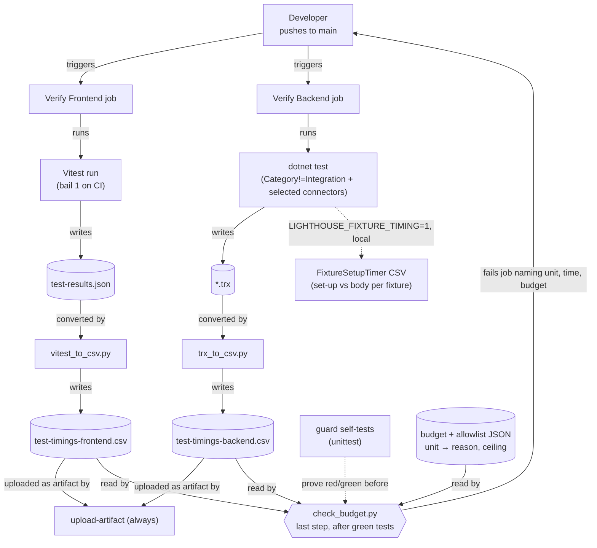

# Feature Delta — story-6302-ci-test-time

ADO source: [User Story #6302 — Investigate why the backend and frontend CI stages got slower](https://dev.azure.com/letpeoplework/Lighthouse/_workitems/edit/6302) (state: `Active`, no parent Epic, as of 2026-10-14)
Density: `lean` (DISCUSS hard default). No Tier-2 trigger fired: one persona, one context (CI test suites), no AC ambiguity, no compliance terms, no walking skeleton.
Waves complete: DISCUSS; DESIGN (all choices locked 2026-10-14 under the maintainer's AFK recommended-option rule; ADR-237).
Next wave: DEVOPS.

**Lineage:** follows `backend-test-speed` (#5258), which parallelised the backend suite and published per-test timing CSVs from both CI jobs (`Scripts/test-timings/`). This story uses those CSVs as its evidence and builds its guard on them.

**Prior waves:** DISCOVER and DIVERGE have no artifacts. For an investigation story the measurement below *is* the discovery; DIVERGE is not needed because the evidence points to one fix per cause rather than competing directions.

---

## Wave: DISCUSS / [REF] Persona ID

`lighthouse-developer`: the maintainer or a contributor pushing to `main` and waiting on `Build And Deploy Lighthouse`. In two weeks the wait went from ~11 to ~17 minutes per verify job, long enough to switch context, then come back to a result that is stale.

---

## Wave: DISCUSS / [REF] JTBD one-liner

**When** I push a change to `main`, **I want** the frontend and backend verify jobs to answer in about the time they took at the start of October, and to keep answering that fast as tests are added, **so I can** stay on the change instead of batching commits behind a slow signal.

Traces to the existing job `job-dev-test-feedback-velocity` in `docs/product/jobs.yaml`. No new job.

---

## Wave: DISCUSS / [REF] Evidence base (measured 2026-10-14)

Raw data: 157 runs of `Build And Deploy Lighthouse` on `main` since 24 Sep, 225 job logs and the `test-timings-{frontend,backend}` artifacts (analysis scratch, not committed). Jobs: `Verify Frontend / frontend` and `Verify Backend / backend`; only success and failure runs counted.

**Job duration, median minutes per day**

| Day | Frontend | Backend |
|---|---|---|
| 1–3 Oct | 11.2–11.4 | 13.1–13.2 |
| 5–6 Oct | 12.2–13.2 | 14.5–14.7 |
| 10–12 Oct | 12.1–14.0 | 14.6–15.8 |
| 13 Oct | 16.2 | 13.8 |
| 14 Oct | 16.8 | 15.3 |

**Where the time went**

| Fact | Evidence |
|---|---|
| Frontend growth is the test step and nothing else | `pnpm run sonarreport` (`vitest run --coverage`): ~9.0 min on 2 Oct, 13.9–14.7 min on 13–14 Oct. Sonar 1.5→1.7 min, build ~0.2, install ≤0.2. Vitest `Duration`: 541 s (run 36977323096, 403 files, 5,999 tests) → 832–882 s (38385736908, 38465699915, 38517425784; 459–478 files, 7,204–7,540 tests). The "tests" phase share rose 41 %→56 %; import and environment fell. |
| ~90 % of the frontend growth is 75 new test files | Summed per-file time 618 s → 1,376 s between 36977323096 and 38517425784. The 403 files that existed on 2 Oct: 618 → 696 s (+13 %). The 75 new files: **680 s**. |
| Eight new frontend files carry ~456 s | `RefinementView.paging` 115 s (11 tests, ~10 s each), `WorkItemsDialog.contexts` 105 s (108 tests; 0.7 s before story 6248), `BaseMetricsView.loading` 53 s, `ModifyTeamSettings.refinementNeed` 49 s, `ModifyTeamSettings.readiness` 39 s, `RefinementView.comments` 34 s, `DataGridBase.paging` 32 s, `RefinementView.votes` 29 s. From stories 6202, 6248, 6251 and the refinement work. |
| A further ~9 % uniform frontend slowdown from 13 Oct, cause open | Unchanged files ran at speed index 0.99–1.08 on 8–12 Oct, 1.05–1.13 after. Two runs with identical test sets (459 files, 7,204 tests): fc633d9dd 630 s vs 3377a2015 832 s. 3377a2015 is vite 8.3.2→8.3.4; MUI (641ac9c6f) and pnpm 12.10 (1bbde5105) bumps landed the same day. Runner variance (0.55–1.13 for the same commit) confounds it. **Inferred, not proven.** |
| Backend growth is the test step; +24–28 % tests | `Test Backend (with Coverage)` ~9.0 → 10.2–10.8 min; dotnet 8m46s / 7,959 tests (36977323096) → 11m46s / 10,198 tests (38570239004). Build ~2.0, Sonar end ~1.2, NuGet 0.4 min: flat. |
| Backend: about half the summed growth is new integration classes | Summed class time 1,991 → 2,653 s. New `API.Integration` classes: `Refinement.Slice13Readiness` 31 s, `TeamFeatureSize.Slice01` 25 s, `Refinement.Slice11CastAVote` 19 s, `Slice03StageRules` 19 s, `Slice04RefinementCadence` 18 s, `Reports.Slice01TeamReportScenarios` 18 s, `Slice12Comments` 18 s, … (these classes do not use `IntegrationTestBase`: their harness bases — `RefinementAcceptanceTest`, `ReportsAcceptanceTest`, `TeamFeatureSizeAcceptanceTest` — build a new `TestWebApplicationFactory` host and a fresh database in `[SetUp]` for every test; corrected in DESIGN). |
| Backend: the other half is a few old tests that now take 30–60 s alone | 38570239004: `S8_EmbedEntryPointTests…ReturnPathPointsOffHost("https://evil.example/steal")` 62 s, `CacheTest.ConcurrentReadersAndWriters…` 61 s, `BlockedCountSnapshotMigrationTests…OnPostgres` 51 s, `DataProtectionKeyRingTest…Redis` 43 s. Which of these are waits/timeouts vs container start-up is not yet known; the agent judged the per-run growers in old classes noisy. |
| Ruled out (measured) | Runner image (ubuntu-24.04, 20260927 → 20261004; unchanged files ran at index ~1.0 on the new image 8–12 Oct). NuGet and Sonar caches always hit; pnpm cache misses on lockfile changes but install stays ≤0.2 min. Vitest pool/worker/coverage config unchanged in the window. |

---

## Wave: DISCUSS / [REF] Locked decisions

| ID | Decision | Verdict | Rationale |
|---|---|---|---|
| D1 | Feature type | Cross-cutting (developer experience) | Test suites of both stacks plus the CI timing scripts. No product surface. |
| D2 | Walking skeleton | No | Brownfield optimisation. |
| D3 | UX research depth | Lightweight | One persona, the developer. |
| D4 | JTBD | Yes, reuse `job-dev-test-feedback-velocity` | The developer is the user; not the infrastructure-only escape valve. |
| D5 | Scope | **Fix both stacks** | Maintainer decision 2026-10-14 (offered: fix frontend + A/B vite only; fix both stacks; name the cause and file follow-ups). |
| D6 | Regression guard | **Per-file time budget read from the existing timing CSVs** | Maintainer decision 2026-10-14. A slow file is caught the day it lands, not two weeks later as a trend. Applies to both stacks (frontend per file, backend per class), because the CI jobs already write both CSVs (`vitest_to_csv.py` → `test-timings-frontend.csv`, `trx_to_csv.py` → `test-timings-backend.csv`; `summarise.py` only prints a top-N table from the raw reports — corrected in DESIGN); DESIGN may narrow it to frontend only if the backend budget proves too noisy. |
| D7 | Behaviour preserved | Same tests, same assertions | A faster test must still fail on the bug it guards. No test deleted, skipped or weakened; frontend and backend test counts do not drop; coverage on the touched areas does not drop. |
| D8 | The vite question is settled by an A/B, not by reverting on suspicion | Local A/B of vite 8.3.2 vs 8.3.4 on an unchanged test set, ≥3 runs each | CI runner variance (0.55–1.13 for one commit) is too large to judge a ~9 % effect from CI runs. |
| D9 | Measuring a win | Median of ≥5 `main` runs after a slice lands | Single runs swing by several minutes with the runner. |
| D10 | ADO shape | No child Stories | Mirrors #5258: slices tracked here and in slice briefs; #6302 is the one item. A cause we decide not to fix gets its own follow-up item (the story's "done when"). |

---

## Wave: DISCUSS / [REF] Cross-cutting impact checklist

- **RBAC**: N/A, because only tests and CI scripts change; no endpoint, role or `IRbacAdministrationService` path is touched.
- **Lighthouse-Clients (CLI + MCP)**: N/A, because no API contract or DTO changes.
- **Website**: N/A, because nothing user-visible or marketed changes.
- **Sketch UI before building**: N/A, because no screen changes.
- **Loading and failure looks (DESIGN)**: N/A, because no view fetches data differently.
- **Usage-data event (DEVOPS)**: expected N/A, because nothing a Lighthouse user does changes; DEVOPS answers it explicitly.
- **Configurable terminology**: N/A, because no docs or UI copy.
- **Each Epic ships on its own**: N/A, because this is a single Story.

---

## Wave: DISCUSS / [REF] User stories with elevator pitches

### US-01 — Settle whether the 13 Oct dependency bumps slowed every frontend test

**As** a Lighthouse developer **I want** to know whether vite 8.3.4 (or MUI / pnpm 12.10 from the same day) slowed the whole Vitest run **so that** I either reclaim ~9 % for free or stop suspecting it.
**Job traceability**: `job-dev-test-feedback-velocity`

#### Elevator Pitch
Before: a ~9 % slowdown of unchanged frontend tests from 13 Oct is visible in CI but buried in runner variance; nobody knows whether a dependency caused it.
After: run `pnpm vitest run` ≥3× on each side of the A/B → sees the median Vitest `Duration` for vite 8.3.2 and 8.3.4 (and, if vite is clean, the MUI and pnpm bumps) recorded in this delta.
Decision enabled: pin or report upstream if one bump costs time; otherwise drop the hypothesis and record it.

#### Acceptance criteria
- AC-01.1: Median Vitest `Duration` for each A/B arm, ≥3 runs each on the same machine and the same test set, is recorded with the commit it ran on.
- AC-01.2: If an arm is slower by more than its own run-to-run spread, the cause is fixed (pin, config, or upstream issue linked) and the fix is shown on the A/B; otherwise the hypothesis is recorded as disproved.

### US-02 — The two slowest new frontend files run in a fraction of their time

**As** a Lighthouse developer **I want** `RefinementView.paging.test.tsx` and `WorkItemsDialog.contexts.test.tsx` to stop costing 220 s of test time **so that** the frontend job sheds most of its new weight in one step.
**Job traceability**: `job-dev-test-feedback-velocity`

#### Elevator Pitch
Before: two files added this month take 115 s and 105 s; one paging test runs ~10 s on its own.
After: run `pnpm vitest run RefinementView.paging WorkItemsDialog.contexts` → sees both files pass with the same test names, together in ≤40 s locally, and the next CI `test-timings-frontend.csv` shows each under the per-file budget.
Decision enabled: whether the cause (large row counts through the real DataGrid, per-test full renders, `waitFor` timeouts) is the pattern to apply to the next six files.

#### Acceptance criteria
- AC-02.1: Both files keep every test name and assertion (diff reviewed for D7); test count per file unchanged or higher.
- AC-02.2: Summed time of the two files in CI drops from ~220 s to ≤40 s (median of ≥5 runs, D9).
- AC-02.3: The reason each was slow is written down (one line each) so slice 03 can reuse it.

### US-03 — The next six slow frontend files follow

**As** a Lighthouse developer **I want** the remaining slow new files sped up the same way **so that** the frontend test step is back near its early-October time.
**Job traceability**: `job-dev-test-feedback-velocity`

#### Elevator Pitch
Before: `BaseMetricsView.loading`, `ModifyTeamSettings.refinementNeed`, `ModifyTeamSettings.readiness`, `RefinementView.comments`, `DataGridBase.paging` and `RefinementView.votes` take ~236 s together.
After: run `pnpm test` → all green; the CI `Verify Frontend / frontend` job median is ≤12 min and the six files are each under the per-file budget in `test-timings-frontend.csv`.
Decision enabled: whether the frontend is fixed or a further cause remains (then named in a follow-up item).

#### Acceptance criteria
- AC-03.1: D7 holds for all six files.
- AC-03.2: Summed CI time of the six drops from ~236 s to ≤70 s.
- AC-03.3: After US-01..03, `Verify Frontend / frontend` median job time over ≥5 `main` runs is ≤12 min.

### US-04 — New backend integration classes stop paying full set-up per test

**As** a Lighthouse developer **I want** the new Refinement, Reports and TeamFeatureSize integration classes to share what they safely can **so that** backend growth stays proportional to the coverage added, not to the set-up repeated.
**Job traceability**: `job-dev-test-feedback-velocity`

#### Elevator Pitch
Before: ~15 new `API.Integration` classes add ~300 s of summed time; their harness bases (not `IntegrationTestBase`) build a whole new `TestWebApplicationFactory` host and a fresh database for every test, and nobody knows how much of that is set-up.
After: run `dotnet test --filter "FullyQualifiedName~API.Integration.Refinement|FullyQualifiedName~API.Integration.Reports|FullyQualifiedName~API.Integration.TeamFeatureSize"` → sees the same tests green, and the `FixtureSetupTimer` output plus `test-timings-backend.csv` show set-up share and summed time for those classes, down against the 14 Oct baseline.
Decision enabled: whether the fixture-reuse pattern from `backend-test-speed` slice 06 should become the default for new integration classes.

#### Acceptance criteria
- AC-04.1: For each class in scope, set-up vs body time is measured before any change (`FixtureSetupTimer`, first added to the three harness bases, which do not call it today).
- AC-04.2: Classes where set-up dominates adopt fixture reuse; parallel-safety rules from `docs/ci-learnings.md` and the `[NonParallelizable]` allowlist guard still hold.
- AC-04.3: D7 holds; summed time of the in-scope classes drops by at least a third, or the slice records why set-up is not the cost.

### US-05 — The 30–60 s single backend tests are explained, and fixed where they wait for nothing

**As** a Lighthouse developer **I want** to know why a handful of old backend tests each take 40–60 s **so that** time spent waiting on a timeout or a container is either removed or knowingly accepted.
**Job traceability**: `job-dev-test-feedback-velocity`

#### Elevator Pitch
Before: `S8_EmbedEntryPointTests` (one case 62 s), `CacheTest.ConcurrentReadersAndWriters…` (61 s), `BlockedCountSnapshotMigrationTests…OnPostgres` (51 s), `DataProtectionKeyRingTest…Redis` (43 s) dominate the slowest-test list, and it is unknown whether that is a timeout, a retry, or a container starting.
After: run `dotnet test --filter` on each class → sees each class's time with the cause noted in this delta, and the timeout- or wait-bound ones finishing in seconds.
Decision enabled: fix, or accept with a reason (container start-up is real work), recorded so the budget guard can allow it.

#### Acceptance criteria
- AC-05.1: Each of the four tests has a one-line cause, measured locally and confirmed against ≥3 CI timing CSVs.
- AC-05.2: Any test whose time is a wait or timeout that does not test the behaviour is fixed with D7 holding; the rest go on the guard's allowlist with that reason.

### US-06 — A slow test file fails the build the day it lands

**As** a Lighthouse developer **I want** CI to flag any test file (frontend) or class (backend) over a time budget **so that** this kind of drift is caught on the commit that causes it.
**Job traceability**: `job-dev-test-feedback-velocity`

#### Elevator Pitch
Before: a 115 s test file merged on 12 Oct and was noticed only as a two-week trend in job durations.
After: push a commit adding a file over budget → sees the verify job fail with a line naming the file, its time and the budget, and pointing to the allowlist; a commit under budget passes as today.
Decision enabled: speed the file up, or add it to the allowlist with a reason, before it merges.

#### Acceptance criteria
- AC-06.1: The check reads the `test-timings-*.csv` the jobs already produce (no second test run).
- AC-06.2: The budget is calibrated on the post-fix distribution with headroom for runner variance (the 0.55–1.13 spread), so a normal run never trips it; the number and its derivation are recorded.
- AC-06.3: A planted over-budget file turns the check red; an allowlisted one stays green; the allowlist carries a reason per entry.
- AC-06.4: `docs/ci-learnings.md` gains the rule: a new test file over the budget fails CI; speed it up or allowlist it with a reason.

---

## Wave: DISCUSS / [REF] Definition of Done (feature)

1. The cause of each stack's slowdown is named with evidence in this delta (done for the measured part; US-01 and US-05 settle the two open ones).
2. US-01..US-06 acceptance criteria met.
3. D7 held: no test deleted, skipped or weakened; per-stack test counts do not drop.
4. `pnpm test`, `pnpm build`, `dotnet build` and the filtered `dotnet test` all green; no new SonarCloud issues.
5. Mutation ≥80 % on any production file touched (expected: none; test and script changes only).
6. KPI medians below met over ≥5 `main` runs, or a follow-up ADO item records the remaining cause and why it is not fixed here.
7. `docs/ci-learnings.md` updated (US-06).
8. #6302 reaches `Resolved`; no child Stories (D10).

---

## Wave: DISCUSS / [REF] Out-of-scope

- Runner type, larger runners or sharding the Vitest run across jobs: the cost is in the tests, and runner variance is not the trend.
- Changing the Vitest pool, worker count or coverage provider: unchanged in the window, not the cause.
- The live-connector categories and the E2E / Playwright jobs.
- Rewriting older frontend files that did not grow (+13 % on the 2 Oct set is within the uniform slowdown US-01 checks).
- Splitting the backend test project or changing the database provider for tests.

---

## Wave: DISCUSS / [REF] WS strategy

Not applicable: D2 = no walking skeleton.

---

## Wave: DISCUSS / [REF] Driving ports

| Surface | Form | Stories |
|---|---|---|
| `pnpm test` / `pnpm vitest run <file>` | Local CLI | US-01, US-02, US-03 |
| `dotnet test --filter …` | Local CLI | US-04, US-05 |
| `Build And Deploy Lighthouse` → `Verify Frontend` / `Verify Backend` | GitHub Actions | all (KPIs), US-06 (guard) |
| `Scripts/test-timings/*.py` + `test-timings-*.csv` artifacts | CI scripts | US-06 |

No HTTP, UI or client surface changes.

---

## Wave: DISCUSS / [REF] Pre-requisites

- Timing CSVs already published by `ci_frontend.yml` and `ci_backend.yml` (verified).
- `FixtureSetupTimer` and the `[NonParallelizable]` allowlist guard from `backend-test-speed` are in place; US-04 must keep the guard green.
- Prior art: `backend-test-speed` slice 06 (per-fixture WAF reuse, read-API cluster).
- In a worktree, copy `valid_not_expired_license.json` from the main checkout before judging backend results.

---

## Wave: DISCUSS / [REF] Scope assessment

| Heuristic | Threshold | Observed | Verdict |
|---|---|---|---|
| User stories | >10 | 6 | Pass |
| Bounded contexts / modules | >3 | 2 test suites + CI scripts | Pass |
| Effort | >2 weeks | ~4 days | Pass |
| Independent outcomes | several → split | one outcome: CI verify time back down and kept down | Pass |

**Scope Assessment: PASS.**

---

## Wave: DISCUSS / [REF] Story map and slice plan

```
 settle the open cause → slim frontend tests → slim backend tests → guard against drift
      slice 01             slices 02, 03          slices 04, 05          slice 06
```

| Slice | Story | Effort | Disproves if it fails |
|---|---|---|---|
| 01 vite-ab | US-01 | ½ d | "A dependency bump slowed every test" |
| 02 frontend-two-worst | US-02 | 1 d | "The new files are slow for a fixable reason, not because their coverage is inherently expensive" |
| 03 frontend-next-six | US-03 | 1 d | "One pattern explains the slow new frontend files" |
| 04 backend-new-integration | US-04 | 1 d | "Set-up, not test bodies, is what the new integration classes pay for" |
| 05 backend-outliers | US-05 | ½ d | "The 40–60 s tests are waiting on nothing" |
| 06 budget-guard | US-06 | ½ d | "A budget can be set that catches a slow file without tripping on runner variance" |

**Order:** 01 first (cheapest, highest uncertainty, and its result changes the baseline the other slices are measured against); 02 then 03 (biggest win, and 02's finding sets 03's pattern); 04, 05; 06 last, because the budget is calibrated on the post-fix distribution.

Every slice has developer-visible output (a faster command, a recorded measurement, a red build); none is purely `@infrastructure`. All use production CI data, not synthetic timings.

---

## Wave: DISCUSS / [REF] Outcome KPIs

| KPI ID | Measure | Baseline (14 Oct) | Target | Method |
|---|---|---|---|---|
| OUT-6302-fe-job | `Verify Frontend / frontend` median job minutes | 16.8 | ≤12 | ≥5 success/failure runs on `main` after slice 03 |
| OUT-6302-be-job | `Verify Backend / backend` median job minutes | 15.3 | ≤13.5 | ≥5 runs on `main` after slice 05 |
| OUT-6302-fe-slow-files | Summed CI time of the eight named frontend files | ~456 s | ≤110 s | `test-timings-frontend.csv` |
| OUT-6302-coverage-kept | Frontend and backend test counts | 7,630 / 10,198 | not lower | CI logs |
| OUT-6302-guard | Over-budget file fails the build | none | red on a planted file | US-06 AC-06.3 |

---

## Wave: DISCUSS / [REF] Definition of Ready (9-item gate)

1. Persona: ✓ `lighthouse-developer`.
2. JTBD: ✓ `job-dev-test-feedback-velocity` (existing).
3. Stories sized: ✓ 6 stories, each ≤1 day.
4. ACs testable: ✓ each has a timing threshold, a recorded measurement or a binary gate.
5. Out-of-scope explicit: ✓ 5 items.
6. Pre-requisites: ✓ listed and verified.
7. KPIs measurable: ✓ baselines measured, targets numeric, method named.
8. Cross-cutting concerns: ✓ checklist above, each with a reason.
9. Handoff: ✓ DESIGN (light-touch).

---

## Wave: DISCUSS / [REF] Changed assumptions

The story assumed tooling might be the cause ("Dependency or tooling changes from Renovate … around 10–13 Oct", "Cache hits … runner type"). Measured: runner image, caches, install, build and Sonar are flat; the growth is test bodies. One tooling suspect remains (vite 8.3.4 and same-day bumps, ~9 %), carried as US-01.

## Wave: DESIGN / [REF] Changed assumptions

Corrected in place above (evidence table, D6, US-04 pitch, AC-04.1) so DISTILL does not inherit them.

| Original sentence (verbatim) | Corrected fact |
|---|---|
| "because `Scripts/test-timings/summarise.py` already produces both" (D6) | `summarise.py` does not produce the CSVs. `vitest_to_csv.py` writes `test-timings-frontend.csv` and `trx_to_csv.py` writes `test-timings-backend.csv`; `summarise.py` reads the raw TRX / Vitest JSON and prints a top-N table. |
| "each fixture builds its own `TestWebApplicationFactory` and gets a fresh database per test via `IntegrationTestBase`" (evidence table) and "each builds its own `TestWebApplicationFactory` and a fresh database per test" (US-04 pitch) | The new Refinement, Reports and TeamFeatureSize classes do not use `IntegrationTestBase`. Their harness bases build a whole new host (`TestWebApplicationFactory` + `WithWebHostBuilder`) in `[SetUp]` for every test. `IntegrationTestBase` itself already reuses one host per fixture. |
| "set-up vs body time is measured before any change (`FixtureSetupTimer`)" (AC-04.1) | `FixtureSetupTimer` is called only from `IntegrationTestBase`; the three harness bases need its calls added first (test-only change) before AC-04.1 can be met. |

---

## Wave: DISCUSS / [REF] Wave-decisions summary

- **Primary job:** `job-dev-test-feedback-velocity`.
- **Feature type:** cross-cutting, developer experience.
- **Decided:** fix both stacks (D5); per-file/per-class budget guard on the existing timing CSVs (D6); behaviour preserved (D7); A/B before acting on vite (D8); medians of ≥5 runs (D9); no child Stories (D10).
- **Handoff:** DESIGN, light-touch: the guard's shape (inside `summarise.py` or its own script; budget derivation; allowlist file) and whether fixture reuse becomes the default base for new integration classes.

---
---

# DESIGN

Density: `lean`, Tier-1 [REF] only. Scope: application / components (solution-architect, PROPOSE mode). The contested choices were first written as proposals; with the maintainer AFK, each was **locked under the recommended-option rule (none changes what a user sees); the maintainer may revisit**. ADR-237 records the budget guard.

Prior-wave reading: ✓ this DISCUSS delta + six slice briefs, ✓ journey `story-6302-ci-test-time.yaml`, ✓ `brief.md` backend-test-speed delta + ADR-074, ✓ `backend-test-speed` DESIGN, slices 04 and 06, ✓ `Scripts/test-timings/` (3 scripts, 3 test modules) and the two workflow steps that call them, ✓ `IntegrationTestBase`, `TestWebApplicationFactory`, `FixtureSetupTimer`/`FixtureTimingReporter`, `BackendTestParallelizationGuardTest`, ✓ the Refinement, Reports and TeamFeatureSize harness bases, ✓ `vitest.config.ts`, the two slowest frontend files and their test kits, ✓ `docs/ci-learnings.md` (timing, `[NonParallelizable]`, budget, timeout entries).

Outcome Collision Check: **skipped** — no product typed-contract surface (no endpoint, DTO or aggregate); the OUT-6302-* KPIs are internal developer-velocity measures, as for `backend-test-speed`.

## Wave: DESIGN / [REF] Code facts that shape the design

| # | Fact | Consequence |
|---|---|---|
| F1 | The CSVs come from `trx_to_csv.py` and `vitest_to_csv.py`; `summarise.py` reads the **raw** TRX / Vitest JSON and prints a top-N table for people. | The guard reads CSVs (AC-06.1). `summarise.py` is not the natural home for it. |
| F2 | `vitest.config.ts` sets `bail: 1` on CI. A failing run stops early and leaves a partial `test-results.json`. | The guard runs only after a green test run; a red one is already red, and its timings are partial. |
| F3 | Backend CI runs `Category!=Integration` plus whichever live-connector categories (`JiraIntegration`, `AdoIntegration`, …) the diff selected. The CSV's `category` column knows only `Integration`/`Unit`, so connector classes show as `Unit` on the runs that include them. | The set of backend classes differs from run to run; a backend allowlist cannot check for stale entries against one run, and network-bound connector classes appear only sometimes. |
| F4 | Backend `fully_qualified_name` = `class.method(args)`, and arguments can contain dots (`"https://evil.example/steal"`). | Class = the part before the last `.` once the `(…)` tail is removed. A fixture row pins this. |
| F5 | `IntegrationTestBase` already builds **one** host per fixture (constructor) and gives each test a fresh SQLite file. The Refinement, Reports and TeamFeatureSize classes do **not** use it: their harness bases build a new `TestWebApplicationFactory` + `WithWebHostBuilder` host in `[SetUp]` for **every test**, with a licence mock, a fake clock or a command interceptor captured per test. | "Adopt slice-06 reuse" here means moving host build to `[OneTimeSetUp]` in harnesses of exactly the kind slice 06 left alone as risky (per-test mocks). |
| F6 | `FixtureSetupTimer` is called only from `IntegrationTestBase`. | AC-04.1 needs the three harness bases instrumented first (test-only change). |
| F7 | `Scripts/test-timings/tests/` are stdlib `unittest` modules; no workflow runs them. | Whatever the guard adds there is not exercised in CI unless a step runs it. |
| F8 | Both slow frontend files already use a kit (`RefinementTabTestKit`, `WorkItemsDialogTestKit`) and a `RENDER_HEAVY = 20000` timeout. Paging: 143 rows through the real DataGrid per test, and `theRowsOnThisPage` runs `getAllByRole("row")` then `within(row)` per row. Contexts: 3 rows per test, 108 tests, each mounting the full dialog + DataGrid, and every kit helper starts from `screen.getByRole("dialog")`. | Two cost shapes share a DataGrid mount and repeated `*ByRole` scans over the grid's DOM. To be confirmed by profiling in slice 02, not assumed. |

## Wave: DESIGN / [REF] DDD list

| ID | Decision | Verdict | Status |
|---|---|---|---|
| DDD-1 | Guard input | The `test-timings-*.csv` files the jobs already write; column names come from the converters' `CSV_COLUMNS` (one source for the column contract) | Locked (AC-06.1, F1) |
| DDD-2 | Guard runs after a green test run only, as the **last** step of each verify job | Default `success()` condition. Placed after the Sonar end + metadata steps, so a budget breach never skips Sonar; the CSV upload keeps `if: always()` | Locked (F2; must not mask or pre-empt test failures) |
| DDD-3 | Guard shape: where it lives, the unit, the budget rule, the allowlist file | New `check_budget.py`; summed time per FE file / BE class; fixed seconds with recorded headroom; JSON allowlist with reason + ceiling; fail closed; self-tests in the step | **LOCKED** (AFK recommended-option rule; ADR-237) |
| DDD-4 | Backend stack in the guard | Both wired; frontend fails, backend warns until ≥5 runs show headroom, then fails | **LOCKED** (AFK recommended-option rule; ADR-237) |
| DDD-5 | Backend harness host lifetime | Option A: host once per fixture, per measured harness | **LOCKED** (AFK recommended-option rule) |
| DDD-6 | No new `[NonParallelizable]`; the allowlist guard and its seven entries stay as they are | Host reuse keeps fixture-level parallelism and a host per fixture | Locked (AC-04.2, ADR-074) |
| DDD-7 | Measure before changing: `FixtureSetupTimer` added to the three harness bases' set-up/tear-down | Test-only, reuses the existing timer | Locked (AC-04.1, F6) |
| DDD-8 | Frontend slow-file fixes | Option B: inside the existing kits, otherwise per file | **LOCKED** (AFK recommended-option rule) |
| DDD-9 | Behaviour kept (D7): no assertion moves to a cheaper level, no `*ByRole` used *as the assertion* becomes a CSS selector | A role query that is only *finding* an element may change; one that *is* the check stays | Locked (D7) |
| DDD-10 | Guard core is a pure function (rows + budget + allowlist → breaches); the script shell only reads files, prints, and sets the exit code | Functional core / imperative shell inside one script | Locked (testability; no side effects in the decision) |

## Wave: DESIGN / [REF] Locked choices (DS-Q1..Q3)

All three were written as proposals; the maintainer was AFK. **Locked under AFK by the recommended-option rule; maintainer may revisit.** None of them changes what a Lighthouse user sees.

### DS-Q1 — Budget guard (US-06, D6) — LOCKED, ADR-237

- **Where**: a new `Scripts/test-timings/check_budget.py` that reads the CSVs and takes its column names from the converters. Local and CI run the same command.
- **Unit**: summed test time per frontend file, and per backend class (class = the full name before the last `.` once the `(…)` argument tail is removed, F4).
- **Budget**: fixed seconds per stack. Budget ≥ 1.25 × the largest non-allowlisted unit over ≥5 post-fix `main` runs, and ≤ 0.55 × the regression it must catch (a 115 s file on the fastest runner is ~63 s). The calculation is recorded here and in `ci-learnings.md`, and re-derived if the runner population changes.
- **Allowlist**: one checked-in JSON beside the script, per stack, each entry with a reason and its own ceiling in seconds. Frontend fails on an entry whose file is absent from the CSV; backend checks only that the class still exists in source (F3).
- **Stacks**: both wired. Frontend fails the job; backend prints the same breach as a warning until ≥5 post-fix `main` runs show headroom, then a one-line switch makes it fail.
- **Missing or malformed CSV after a green run**: fail closed, with a message naming the file.
- **Self-proof**: the step runs `python3 -m unittest discover Scripts/test-timings/tests` before the check, which also brings the existing converter tests into CI (F7).

Rejected:
- Extend `summarise.py` — it reads raw reports, not the CSV, and is a display tool, not a gate.
- A check inside each suite (Vitest reporter / NUnit hook) — two mechanisms in two languages; NUnit has no clean point after all timings exist.
- Frontend file wall time from the Vitest JSON — needs a new column on a shared artifact and adds shared import/environment noise.
- Percentile of the run's own distribution — rises with uniform drift, and the offender inflates it.
- Speed index against the run's median file — the median is milliseconds, so the ratio is noisy and the message is hard to read.
- Inline allowlist in the script — every entry would edit the gate's code.
- Marker in the test file — needs a source scan and a comment that only cites a rule.
- Both stacks failing from day one — backend class sets vary per run and coverage slows CPU-bound classes ~7×; flake risk before calibration.
- Frontend only — leaves the backend outliers that started this story unwatched.
- Skip-with-warning on a missing CSV — a guard that passes on no data proves nothing.

### DS-Q2 — Host lifetime for the new backend harnesses (US-04) — LOCKED, option A

Per harness, after measuring: where `FixtureSetupTimer` shows set-up dominates, the harness base builds its host once per fixture in `[OneTimeSetUp]` and disposes it in `[OneTimeTearDown]`. Per-test inputs (licence answer, clock position, command counter) are reset in `[SetUp]` through objects the fixture owns, never through a DI registration that captures a per-test field. A harness where the body dominates is recorded and left alone. No new `[NonParallelizable]`; a host per fixture; parallel safety shown with 3 consecutive full-assembly runs. A reusable default base is considered later, only if these numbers show reuse pays.

Rejected:
- B, reusable host as the default base now — touches ~20 harnesses before any evidence, carries the host-outlives-test bleed risk, and a hook in `IntegrationTestBase`'s constructor is a virtual call in a constructor (Sonar S1699).
- C, keep a host per test and cut only database cost — changes `TestWebApplicationFactory` (~70 fixtures) for a share nobody has measured.

### DS-Q3 — Frontend slow-file pattern (US-02/03) — LOCKED, option B

Fix inside the existing kits (`RefinementTabTestKit`, `WorkItemsDialogTestKit`) where profiling shows the cost sits in a kit helper; per file otherwise. Causes to profile, not assume (F8): DataGrid mount per test, `*ByRole` scans over grid DOM, `user.type` keystroke delays, a `waitFor` running to its timeout.

Rejected:
- A, per-file only — sibling files on the same kit (`RefinementView.comments`, `.votes`) would repeat the fix.
- C, a new shared DataGrid helper across kits — only if slices 02 and 03 both find the same hotspot, in both kits and outside them.

## Wave: DESIGN / [REF] Component decomposition

| Component | Location | Change type | Slice |
|---|---|---|---|
| Budget check | `Scripts/test-timings/check_budget.py` (per DS-Q1a B) | **CREATE NEW** (justified in Reuse Analysis) | 06 |
| Budget + allowlist data | `Scripts/test-timings/` JSON (per DS-Q1d A) | **CREATE NEW** | 06 |
| Guard tests | `Scripts/test-timings/tests/` + fixtures (planted over-budget unit, allowlisted unit, dotted-argument backend row, missing/malformed CSV) | **EXTEND** | 06 |
| Verify Frontend job | `.github/workflows/ci_frontend.yml` — one last step | **EXTEND** | 06 |
| Verify Backend job | `.github/workflows/ci_backend.yml` — one last step | **EXTEND** | 06 |
| Refinement / Reports / TeamFeatureSize harness bases | `Lighthouse.Backend.Tests/API/Integration/{Refinement,Reports,TeamFeatureSize}/*AcceptanceTest.cs` | **EXTEND** — timer calls (DDD-7); host lifetime per DS-Q2 | 04 |
| Old outlier tests (four named) | their own files | **EXTEND** per cause, or allowlist entry with reason | 05 |
| Frontend kits / slow files | `src/tests/RefinementTabTestKit.tsx`, `src/tests/WorkItemsDialogTestKit.tsx`, the eight files | **EXTEND** per DS-Q3 | 02, 03 |
| `docs/ci-learnings.md` | — | **EXTEND** (AC-06.4; plus the US-02 "why it was slow" lines if a rule falls out) | 02, 06 |
| Vite A/B | none | measurement only, recorded here | 01 |

## Wave: DESIGN / [REF] Driving ports

| Surface | Form | Change |
|---|---|---|
| `Verify Frontend` / `Verify Backend` jobs | GitHub Actions | New last step: "Check test-time budget" — fails naming unit, time, budget and the allowlist file |
| `python3 Scripts/test-timings/check_budget.py --stack <frontend\|backend> --csv <file>` | Local CLI | Same command against a downloaded `test-timings-*` artifact (`gh run download`) |
| `pnpm vitest run <file>`, `dotnet test --filter …` with `LIGHTHOUSE_FIXTURE_TIMING=1` | Local CLI | Unchanged; the timer now covers the three harness bases |

## Wave: DESIGN / [REF] Driven ports + adapters

| Port | Adapter | Probe (what it must survive) |
|---|---|---|
| Timing rows | CSV file written by the converters | Missing file, empty file, header not matching `CSV_COLUMNS` → named error, non-zero exit (DS-Q1f) |
| Budget + allowlist | checked-in JSON | Unparseable file, entry without a reason, entry without a ceiling → named error, non-zero exit |
| Verdict | stdout + exit code | Exercised by the guard's own tests run in the step (DS-Q1g) |

No production port or adapter changes.

## Wave: DESIGN / [REF] Technology choices

| Choice | Pin | Licence | Rationale |
|---|---|---|---|
| Guard language | Python 3 stdlib (`csv`, `json`, `argparse`), as the sibling scripts | PSF | Already on the runner and in the folder; no new dependency (no PyYAML) |
| Guard tests | stdlib `unittest`, as the sibling tests | PSF | Existing convention |
| Backend measurement | `FixtureSetupTimer` (existing) | in-repo | Already writes the set-up/tear-down CSV |
| Frontend profiling | Vitest's own per-test durations + `--reporter=verbose` locally | MIT | No new tool |
| Guard placement | existing workflow files | — | Extend, no new workflow |

## Wave: DESIGN / [REF] Decisions table

| ID | Decision | Status |
|---|---|---|
| DDD-1 | Guard reads the CSVs, column names from the converters | Locked |
| DDD-2 | Guard is the last step, runs only after green tests | Locked |
| DDD-3 | New `check_budget.py`; summed time per FE file / BE class; fixed seconds with recorded headroom; JSON allowlist with reason + ceiling; fail closed; self-tests in the step | LOCKED (AFK rule) — ADR-237 |
| DDD-4 | Frontend fails; backend warns, then fails after ≥5 runs show headroom | LOCKED (AFK rule) — ADR-237 |
| DDD-5 | Host once per fixture, per measured harness (option A) | LOCKED (AFK rule) |
| DDD-6 | No new `[NonParallelizable]`; guard untouched | Locked |
| DDD-7 | Timer in the three harness bases before changing them | Locked |
| DDD-8 | Frontend fixes inside the existing kits, otherwise per file (option B) | LOCKED (AFK rule) |
| DDD-9 | D7 at query level: role queries that *are* the check stay | Locked |
| DDD-10 | Guard decision is a pure function inside the script | Locked |

## Wave: DESIGN / [REF] Reuse Analysis

| Existing component | File | Overlap | Decision | Contract shape / assertion | Justification |
|---|---|---|---|---|---|
| `summarise.py` | `Scripts/test-timings/` | Reads timing data, ranks slow tests | **REUSE AS-IS** | n/a | Its input is raw TRX/JSON and its job is a table for people; the guard's input is the CSV and its job is a gate (F1). Extending it would mix a display tool and a gate |
| `trx_to_csv.py`, `vitest_to_csv.py` | `Scripts/test-timings/` | Define the CSV columns | **REUSE AS-IS** — guard imports `CSV_COLUMNS` | pure | One source for the column contract; no new column needed |
| `Scripts/test-timings/tests/` | — | Fixtures + unittest layout | **EXTEND** | pure-function tests on the guard core | Same convention, same folder |
| `BackendTestParallelizationGuardTest` (the `[NonParallelizable]` allowlist guard) | `Lighthouse.Backend.Tests/Architecture/` | "Allowlist with a reason per entry + ratchet" | **REUSE AS-IS** (pattern borrowed, code untouched) | unchanged | It reflects over the test assembly at build time; the time budget needs post-run data, so it cannot live there. Its name→reason shape is copied into the JSON allowlist |
| `IntegrationTestBase` | `…/TestHelpers/` | Host + DB per test lifecycle | **REUSE AS-IS** | unchanged | Already reuses its host per fixture (F5); the slow classes do not derive from it |
| Refinement / Reports / TeamFeatureSize harness bases | `…/API/Integration/*/` | Host build per test | **EXTEND** | per-test state reset in `[SetUp]`; universe = the fixture's own host | Where the cost is (F5) |
| slice-06 per-fixture reuse | 11 read-API fixtures | `[OneTimeSetUp]` host + per-test DB reset | **REUSE (pattern)** | as slice 06 | Precedent for DS-Q2 A; no shared code exists to call — each fixture inlined it |
| `FixtureSetupTimer` / `FixtureTimingReporter` | `…/TestHelpers/` | Set-up vs body timing | **REUSE AS-IS** (new call sites only) | read-only measurement | Exactly the instrument AC-04.1 names (F6) |
| `TestWebApplicationFactory` | `…/TestHelpers/` | Unique SQLite file per host | **REUSE AS-IS** | unchanged | Already safe for a reused host (`UseFreshDatabase`) |
| `RefinementTabTestKit`, `WorkItemsDialogTestKit` | `src/tests/` | Render + read helpers for the slow files | **EXTEND** (DS-Q3 B) | helpers stay read-only over the DOM | Fix where the repeated cost lives |

CREATE NEW, with evidence: (1) `check_budget.py` — nothing in the repo compares timings to a limit; the only timing consumer (`summarise.py`) has different input and purpose (F1). (2) The budget/allowlist JSON — no existing data file holds per-file limits; the NUnit guard's allowlist is compiled into a test and only sees attributes.

## Wave: DESIGN / [REF] C4 — CI test-timing topology (Mermaid)

Product System Context and Container: **unchanged** (test suites and CI scripts only).



## Wave: DESIGN / [REF] Open questions (deferred to DISTILL / DELIVER)

- **The budget numbers** — derived in slice 06 from ≥5 post-fix `main` runs by the DS-Q1c rule; recorded here and in `ci-learnings.md`.
- **When the backend flips from warn to fail** — after ≥5 post-fix `main` runs stay under its budget; recorded with the numbers.
- **Which harnesses are set-up-bound** — slice 04 measures first (DDD-7); a harness where the body dominates is recorded and left alone.
- **The four outliers' causes** — slice 05; any accepted one becomes the first backend allowlist entries.
- **Whether DS-Q3 C is earned** — only if slice 02 finds the same hotspot in both kits and slice 03 finds it outside them.
- **Vite A/B outcome** — slice 01; it shifts the baseline every later slice is measured against.
- **DISTILL shape** — mostly script tests (guard core) plus "same test names, same counts" checks for D7; no UI, so no sketches.

## Wave: DESIGN / [REF] ADRs

- **[ADR-237](../../product/architecture/adr-237-test-time-budget-guard.md) — test-time budget guard** (DS-Q1). Written 2026-10-14.
- No ADR for DS-Q2: option A keeps the change inside each harness; a `ci-learnings.md` entry carries the rule. An ADR amending ADR-074 is due only if a reusable host later becomes the default.
- No ADR for DS-Q3 (test-kit internals).

## Wave: DESIGN / [REF] Wave-decisions summary (DESIGN)

- **Pattern**: product architecture unchanged; a small functional-core CI script beside the existing converters, plus test-harness changes (OOP, NUnit; Vitest kits).
- **Locked from DISCUSS / the code**: CSV input with the converters' column names (DDD-1); last step after green tests (DDD-2); no new `[NonParallelizable]` (DDD-6); measure before changing (DDD-7); D7 at query level (DDD-9); pure guard core (DDD-10).
- **Locked under AFK by the recommended-option rule (maintainer may revisit)**: DS-Q1 — new `check_budget.py`; summed time per frontend file / backend class; fixed seconds per stack with the recorded headroom rule; JSON allowlist with reason + ceiling; frontend fails, backend warns until ≥5 runs show headroom, then fails; fail closed; self-tests in the step (ADR-237). DS-Q2 — option A, per measured harness. DS-Q3 — option B, inside the existing kits.
- **Reuse**: two CREATE NEW (script, data file), everything else EXTEND or REUSE AS-IS.
- **Corrections to DISCUSS**: F1, F5, F6 back-propagated (see Changed assumptions, DESIGN); F3 is why the backend budget starts in warn mode.
- **Handoff**: DEVOPS (usage-data event expected N/A) → DISTILL.
