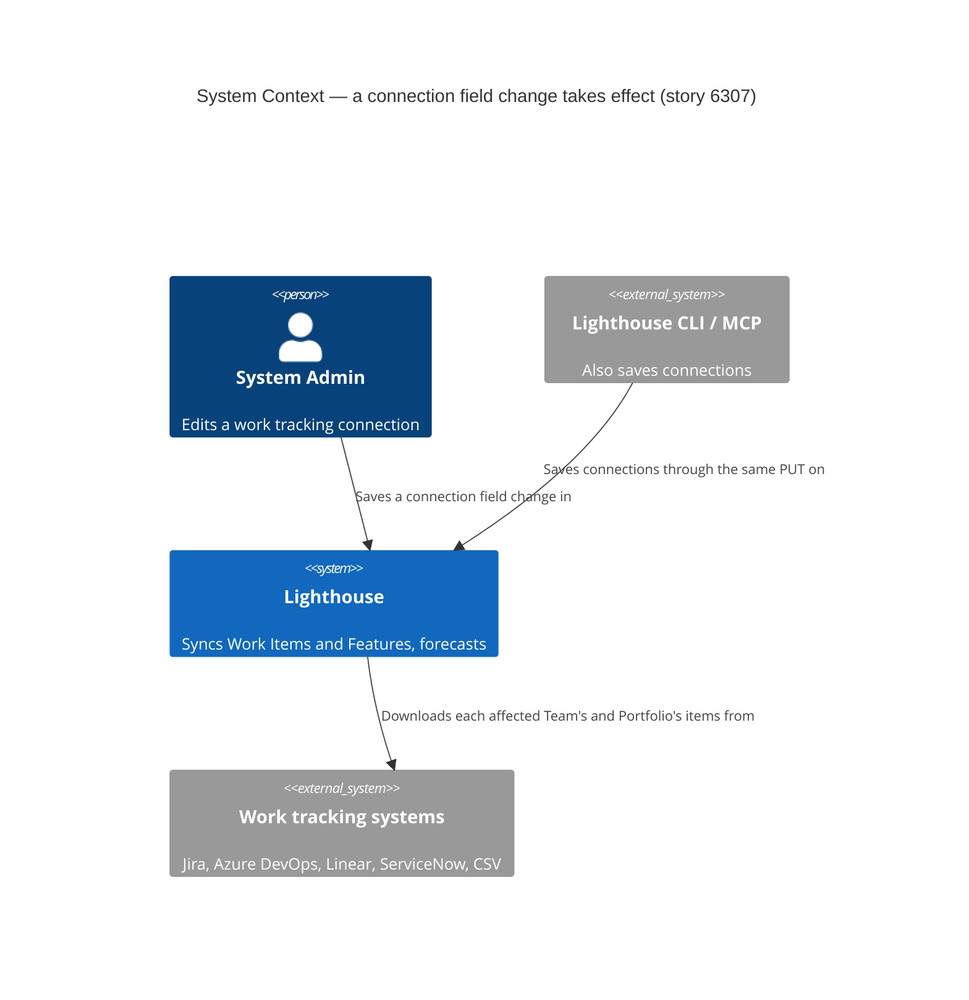
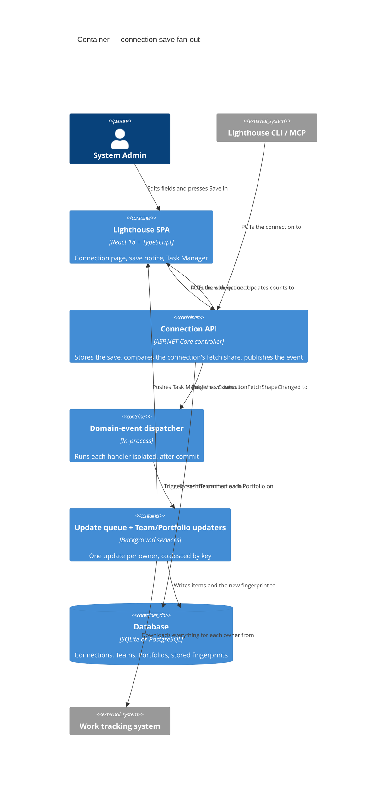
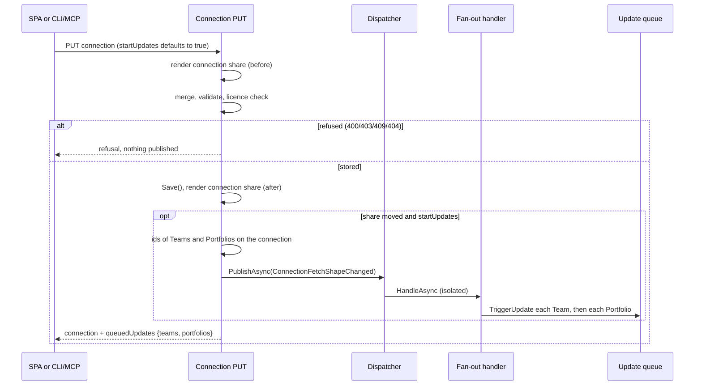

<!-- markdownlint-disable MD024 -->
# Feature Delta — story-6307-refresh-on-additional-fields-change

> ADO User Story #6307 (Active, tagged Release Notes, no parent Epic), split out of Bug #6306. Adding an
> additional field (for example `fixVersions`) to a connection does not fill it in on Work Items and Features
> that are already synced until each Team and Portfolio on that connection is updated. A rule on the new field
> then silently matches nothing. The docs said to run an update; the maintainer himself forgot. DIVERGE
> recommended Option 1, "update the connection's Teams and Portfolios on save", conditional on the maintainer
> setting ADR-030's "expensive ⇒ intentional" rule aside for a connection save. He did, on 2026-10-15 (D1).

## Wave: DISCUSS / [REF] Persona IDs

- **config-admin** (`docs/product/personas/config-admin.yaml`), acting as a **System Admin**: the only role that
  can edit a connection (`WorkTrackingSystemConnectionController.cs:76`). Adds or changes an additional field so
  that a rule-based Delivery, a forecast filter or a blocked rule can read it, and expects to build that rule
  straight away.

## Wave: DISCUSS / [REF] JTBD One-Liners

Job `job-config-admin-see-a-connection-field-change-take-effect` (`docs/product/jobs.yaml:8173`, validated by
DIVERGE, not re-run): *When I add or change a field on a work tracking connection, I want every Team and
Portfolio that reads through it to hold that field's values before I build on it, or to be told plainly that
they do not yet, so I can put a rule on the field and trust what it matches.* (US-01, US-02, US-03)

Complements `job-config-admin-know-which-settings-cost-a-refetch` (epic-5687), which decides the *mode* of the
next update. This story decides *when* it runs.

## Wave: DISCUSS / [REF] Pre-requisites

- **The full fetch is already owed.** A connection's additional field definitions are in the fetch fingerprint
  (`Services/Implementation/WorkItems/FetchFingerprint.cs:46`, rendered by `Id`, `Reference`, `DisplayName` and
  `IsPredefined` at `:118-130`), so every Team and Portfolio on the connection already downloads everything on
  its next update. This story moves that update to the moment of Save; it adds no fetch (ADR-140).
- **The update queue exists and coalesces.** `UpdateServiceBase.TriggerUpdate`
  (`Services/Implementation/BackgroundServices/Update/UpdateServiceBase.cs:35-49`) enqueues one owner;
  `UpdateQueueService` runs one update at a time, de-duplicates by key and turns a trigger raised while the same
  owner is updating into one follow-up (`docs/ci-learnings.md:683-687`).
- **The Task Manager exists** (Epic #5511, header icon popover, `components/App/Header/TaskManagerIcon`). Every
  queued update already shows there as its own row, and each row can be stopped.
- **Bug #6306** (Jira Releases on Server and Data Center) is on `main` (`17428144f`); the gap this story closes
  was found there.
- **No "update everything on this connection" path exists today.** "Update All" is per kind (every Team, every
  Portfolio), premium and SystemAdmin (`TeamsController.cs:71-84`, `PortfoliosController.cs:61-74`, per DIVERGE
  E10).
- **Slow-connection rule (DESIGN).** If the save notice or dialog fetches anything of its own before or after
  the save (for example the list of affected Teams and Portfolios), that view needs a loading look and a
  could-not-load look, sketched by DESIGN. If everything it shows comes back in the save response, it fetches
  nothing new and the rule does not apply.

## Wave: DISCUSS / [REF] Locked Decisions

| ID | Decision | Verdict |
|----|----------|---------|
| D1 | **A connection save follows the save-then-update precedent.** Team and Portfolio settings saves already start an update of their owner (`hooks/useModifySettings.ts:252`, `refreshOnSave`); a connection save now does the same for the Teams and Portfolios it affects. Recorded as an amendment to ADR-030 (or a new ADR that overrules it for this case), and ADR-140's "A connection change fans out … passive" consequence is amended accordingly. **DESIGN writes the ADR text; DISCUSS records the decision.** | Locked — maintainer, 2026-10-15 |
| D2 | **The updates start immediately on save**, queued through the existing update queue. Not on the next scheduler pass, and not behind a confirmation by default. | Locked — maintainer, 2026-10-15 |
| D3 | **A label-only rename still costs a full fetch.** Renaming an additional field's display name moves the fingerprint (`FetchFingerprint.cs:126`), so it queues every owner like any other field edit. The fingerprint is left as it is. | Locked — maintainer, 2026-10-15 |
| D4 | **Every licence.** The connection-scoped update is triggered on every licence; it is not premium-gated like "Update All". It only follows through on a save the edition already allows (the community edition has one additional field). | Locked — maintainer, 2026-10-15 |
| D5 | **No large-instance threshold.** No "ask first above N Teams and Portfolios". The Task Manager's per-row stop is the relief valve. | Locked — maintainer, 2026-10-15 |
| D6 | **The admin sees what the save started.** On save, either a notice next to the Save button or, when saving will start updates, a dialog. The dialog may offer to save **without** starting them (opt-out); the next scheduled update of each owner then picks the field up, because it already downloads everything, and the copy says so. **Placement and copy are sketched with the maintainer at the start of DISTILL**; the ACs here pin behaviour (what is queued, when, what the opt-out does), not pixels. The opt-out asks *when*, not *whether to download everything*: the mode stays derived from the fingerprint, so ADR-140's rejected "refetch everything? [Y/N]" prompt is not reintroduced. | Locked — maintainer, 2026-10-15 (placement open → DISTILL) |
| D7 | **Rules keep reading empty until each update finishes.** "Rules tell the truth about unfetched fields" is not in scope and not a follow-up. Accepted consequence of an edge case. | Locked — maintainer, 2026-10-15 |
| D8 | **Which owners are queued: those whose fetch fingerprint this save moved.** Every Team and Portfolio on the connection whose next update would ask for, or read, something different because of this save. A credential, URL-option, authentication-method, connection-name or write-back-only save moves no fingerprint and queues nothing (O6). Teams and Portfolios on other connections are never queued. An owner that already owed a full fetch for another reason (never updated since the upgrade, say) is **not** swept up by a save that did not change its fingerprint; DESIGN settles how "moved by this save" is computed (before vs after the save, rather than stored vs current). | Locked by DISCUSS (trigger scope set by the orchestrator, 2026-10-15) |
| D9 | **One update per owner per save, never two.** An owner already waiting in the queue is not queued twice; an owner updating at the moment of Save gets exactly one follow-up after it finishes (existing coalescing). One full fetch per owner per edit (O5) is a guardrail. | Locked by DISCUSS |
| D10 | **The save stands on its own.** The connection is saved first; each owner's update is then its own queue item and its own Task Manager row. If one update fails, the field stays saved, the other owners still update, and the failed owner's next scheduled update downloads everything again (its fingerprint is written only after its own fetch, `WorkItemService.cs:61-62`, per DIVERGE). A save the server refuses (licence 403, someone else saved first 409, validation 400) queues nothing. | Locked by DISCUSS |
| D11 | **Predefined fields registered when the connection is read do not start updates (proposed).** Opening a connection can register or correct a predefined field and save (`WorkTrackingSystemConnectionController.cs:34-73`). No admin pressed Save, so there is nobody to tell and no moment the admin chose; reading a page must not start fetches. Those owners pick the field up on their next scheduled update, as today. **DESIGN confirms** (open question Q2). | Proposed by DISCUSS → DESIGN |
| D12 | **Terminology.** All copy uses the configurable terms with their seeded defaults (*Team*, *Portfolio*, *Feature*, *Work Item*, *Connection*); never Epic or Story for a Lighthouse concept. | Locked |

## Wave: DISCUSS / [REF] User Stories

### US-01: A new connection field fills in within minutes of Save

As a **System Admin**, I want saving a field change on a connection to start an update of every Team and
Portfolio it affects, so the field's values are there by the time I build a rule on it, without my
remembering a step.

`job_id: job-config-admin-see-a-connection-field-change-take-effect`

#### Elevator Pitch

Before: Priya adds `Fix Versions` (`fixVersions`) to the "Nordwind Jira DC" connection and saves. A rule-based Delivery on Fix Versions in Portfolio "Fleet Platform" matches 0 Features for up to about four hours, and nothing says why.
After: on **/connections/{id}/edit**, add the field and press **Save** → the Task Manager in the header lists an update for each of the 4 Teams and 2 Portfolios on "Nordwind Jira DC"; once those rows finish, the Delivery's rule matches the Features whose Fix Versions is "2026.11".
Decision enabled: build the rule on the new field now, and trust what it matches, instead of waiting or pressing Update on six pages.

#### Problem

Priya Raman is the System Admin of Nordwind Logistics' Lighthouse, connected to an on-premise Jira Data Center
used by Teams Atlas, Borealis, Cobalt and Delta Ops and by Portfolios Fleet Platform and Customer Apps. She adds
a field so a rule can use it. Today the save changes nothing she can see; the only hint ("Additional Fields will
be loaded with the next refresh of data", `ModifyConnectionSettings.tsx:677`) does not say when, and the rule she
builds next silently matches nothing (Bug #6306).

#### Domain Examples

1. **Happy path.** Priya adds `Fix Versions` → `fixVersions` to "Nordwind Jira DC" at 10:02 and saves. Updates for
   Atlas, Borealis, Cobalt, Delta Ops, Fleet Platform and Customer Apps are queued at once and run one after
   another; by 10:20 every Feature in Fleet Platform carries its Fix Versions value.
2. **Edge — nothing to fetch.** Two weeks later Priya rotates the API token on the same connection and saves.
   Nothing is queued; no Team or Portfolio downloads anything.
3. **Edge — label-only rename (D3).** She renames the field's label from "Fix Versions" to "Release". All six
   owners are queued again, because the label is part of what each owner stores.
4. **Error.** Borealis's update fails (its Jira project now refuses the account, 403). Its Task Manager row says
   it failed; the other five finish; `Fix Versions` stays saved; Borealis downloads everything on its next
   scheduled update.

#### UAT Scenarios (BDD)

```gherkin
Scenario: Adding a field updates every Team and Portfolio on the connection
  Given "Nordwind Jira DC" is used by Teams Atlas, Borealis, Cobalt and Delta Ops and Portfolios Fleet Platform and Customer Apps
  And none of them is updating
  When Priya adds the field "Fix Versions" with reference "fixVersions" and saves the connection
  Then an update is queued for each of the 4 Teams and 2 Portfolios straight after the save
  And each appears as its own row in the Task Manager
  And once those updates finish, Fleet Platform's Features carry their Fix Versions values

Scenario: A save that changes nothing they fetch starts no update
  Given "Nordwind Jira DC" is used by 4 Teams and 2 Portfolios
  When Priya changes only the API token, or only the connection's name, and saves
  Then no update is queued for any of them

Scenario: Renaming a field's label still updates every owner
  Given "Nordwind Jira DC" has the field "Fix Versions"
  When Priya renames its label to "Release" and saves
  Then an update is queued for each of the 4 Teams and 2 Portfolios

Scenario: Teams and Portfolios on other connections are left alone
  Given Team Harbor reads from the connection "Nordwind Azure DevOps"
  When Priya adds a field to "Nordwind Jira DC" and saves
  Then no update is queued for Team Harbor

Scenario: A Team already updating is updated once more, not twice
  Given Team Atlas's update is running and Team Cobalt is waiting in the queue
  When Priya adds a field to "Nordwind Jira DC" and saves
  Then Atlas is updated exactly once more after its running update finishes
  And Cobalt is updated exactly once

Scenario: One failed update leaves the field saved and the others updating
  Given Borealis's Jira project refuses the connection's account
  When Priya adds a field to "Nordwind Jira DC" and saves
  Then the field is saved
  And Borealis's row in the Task Manager shows its update failed
  And the other 3 Teams and 2 Portfolios finish their updates

Scenario: A save the server refuses starts no update
  Given another admin saved "Nordwind Jira DC" after Priya opened it
  When Priya adds a field and saves
  Then her save is refused as today
  And no update is queued
```

#### Acceptance Criteria

- [ ] **AC-1.1** Saving a connection queues, straight after the save is stored, an update of every Team and Portfolio on that connection whose fetch fingerprint the save moved (D2, D8).
- [ ] **AC-1.2** A save that moves no fingerprint (credential, URL option, authentication method, name, write-back mapping only) queues nothing (D8, O6).
- [ ] **AC-1.3** A label-only rename of an additional field queues every owner on the connection (D3).
- [ ] **AC-1.4** No Team or Portfolio on another connection is queued (D8).
- [ ] **AC-1.5** An owner already queued is not queued twice; an owner updating at the moment of Save gets exactly one follow-up (D9).
- [ ] **AC-1.6** A failed update of one owner neither undoes the save nor stops the other owners' updates, and that owner's next scheduled update still downloads everything (D10).
- [ ] **AC-1.7** A refused save (403 licence, 409 concurrency, 400 validation) queues nothing (D10).
- [ ] **AC-1.8** The connection page no longer says the fields load "with the next refresh of data"; before Save, it says that saving updates the Teams and Portfolios that use the connection (copy and placement at DISTILL, D6).
- [ ] **AC-1.9** It works the same on every licence; no premium gate (D4).

#### Outcome KPIs

`OUT-6307-time-to-populated`, `OUT-6307-no-silent-empty-rule`, guardrails `OUT-6307-one-fetch-per-owner` and
`OUT-6307-no-fetch-for-non-shaping-save` (see Outcome KPIs).

#### Technical Notes

- The predicate needs the fingerprint, which only the server computes; DESIGN decides where the decision lives
  (controller, application service, or a domain event and handler — the project prefers domain events).
- The connection PUT is SystemAdmin-guarded and a SystemAdmin may already update every owner; queued updates run
  as today's scheduled ones do. No new permission.
- E2E specs that PUT a connection used by demo Teams (`OAuthConnection.spec.ts`) change credentials only, so under
  AC-1.2 they queue nothing; DISTILL confirms.

### US-02: The admin is told what the save started

As a **System Admin**, I want the save to tell me which updates it started and where to watch them, so I know
when the field is safe to build on.

`job_id: job-config-admin-see-a-connection-field-change-take-effect`

#### Elevator Pitch

Before: after Save the page jumps to the Overview with no word about updates (`EditConnection.tsx`, `saveAndNavigate` → `/`); Priya cannot tell whether the field is loading, loaded, or waiting hours.
After: on **/connections/{id}/edit**, add a field and press **Save** → sees a notice (or dialog, D6) saying the save is updating 4 Teams and 2 Portfolios, with the way to the Task Manager; a credential-only save shows no such message.
Decision enabled: wait for those rows and then build the rule, or move on knowing it is in hand.

#### Problem

Even with US-01, the updates start out of sight. Priya, like the maintainer in Bug #6306, will check a Team by
hand or rebuild the rule, unsure whether her field "took".

#### Domain Examples

1. **Happy path.** Priya saves `Fix Versions`; she is told 4 Teams and 2 Portfolios are updating and opens the
   Task Manager to watch them.
2. **Edge — renamed terms.** Nordwind renamed *Team* to *Squad*: the message says "4 Squads and 2 Portfolios".
3. **Edge — nobody uses the connection.** Priya adds a field to "Nordwind Jira Sandbox", which no Team or
   Portfolio reads: the save says nothing about updates.
4. **Edge — token rotation.** She rotates the token on "Nordwind Jira DC": no update message.

#### UAT Scenarios (BDD)

```gherkin
Scenario: The admin sees how many Teams and Portfolios her save is updating
  Given "Nordwind Jira DC" is used by 4 Teams and 2 Portfolios
  When Priya adds the field "Fix Versions" and saves
  Then she is told that 4 Teams and 2 Portfolios are being updated
  And she can reach the Task Manager from there

Scenario: The message speaks the instance's own words
  Given the instance calls Teams "Squads"
  When Priya adds a field to "Nordwind Jira DC" and saves
  Then the message says 4 Squads and 2 Portfolios are being updated

Scenario: A save that starts nothing says nothing about updates
  Given "Nordwind Jira DC" is used by 4 Teams and 2 Portfolios
  When Priya changes only the API token and saves
  Then she sees no message about updates

Scenario: A connection nobody uses says nothing about updates
  Given no Team or Portfolio reads "Nordwind Jira Sandbox"
  When Priya adds a field to it and saves
  Then she sees no message about updates
```

#### Acceptance Criteria

- [ ] **AC-2.1** After a save that queued updates, the admin is told how many Teams and how many Portfolios are being updated, counted from what was actually queued (not from what is on the connection).
- [ ] **AC-2.2** The message offers a way to the Task Manager, where each update is its own row.
- [ ] **AC-2.3** Counts and nouns use the configured Terminology, singular and plural (D12).
- [ ] **AC-2.4** A save that queued nothing shows no update message.
- [ ] **AC-2.5** The message is shown where the admin can read it: if the page still navigates away after Save, the message survives the navigation; DISTILL's sketch settles which.

#### Outcome KPIs

`OUT-6307-no-silent-empty-rule`.

#### Technical Notes

- If the counts come back with the save, the message fetches nothing and needs no loading look; if it fetches its
  own list, DESIGN sketches loading and could-not-load looks (Pre-requisites).
- Additive change to the connection PUT response if the counts travel there (shared contract: extend the test
  builder first, per CLAUDE.md).

### US-03: Save now, update later

As a **System Admin** saving a field change on a busy weekday, I want to save without starting the updates and
be told when they will happen instead, so I can keep a long round of downloads off the tracker during office
hours.

`job_id: job-config-admin-see-a-connection-field-change-take-effect`

**Conditional:** ships only if the DISTILL sketch session picks the dialog form of D6. If the maintainer picks the
notice-only form, this story and slice 03 are dropped and recorded as such.

#### Elevator Pitch

Before: with US-01, every field save on "Nordwind Jira DC" starts six full downloads at once, whether or not 10:00 on a Tuesday suits the tracker.
After: on **/connections/{id}/edit**, add a field, press **Save**, and choose to save without updating → the field is saved, nothing is queued, and the copy says each Team and Portfolio loads the field on its next scheduled update.
Decision enabled: take the downloads now, or leave them to the schedule with the delay stated, knowing which one she chose.

#### Problem

Priya's Jira DC slows noticeably under a round of full downloads. Most days she wants the field at once (D2); on
the day before a release she would rather let the schedule pick it up overnight.

#### Domain Examples

1. **Happy path.** At 10:02 on release eve Priya saves `Fix Versions` and chooses to save without updating. Nothing
   is queued; she is told the 4 Teams and 2 Portfolios load it on their next scheduled update.
2. **Follow-through.** At 13:00 Atlas's scheduled update runs and downloads everything; Atlas's Work Items carry
   Fix Versions afterwards.
3. **Default.** Ravi, another admin, saves a field change and accepts the dialog's default: the updates start at
   once, as in US-01.

#### UAT Scenarios (BDD)

```gherkin
Scenario: Saving without updating stores the field and queues nothing
  Given "Nordwind Jira DC" is used by 4 Teams and 2 Portfolios
  When Priya adds "Fix Versions" and chooses to save without updating
  Then the field is saved
  And no update is queued
  And she is told each Team and Portfolio loads the field on its next scheduled update

Scenario: The next scheduled update loads the field
  Given Priya saved "Fix Versions" without updating
  When Team Atlas's next scheduled update runs
  Then it downloads everything
  And Atlas's Work Items carry their Fix Versions values afterwards

Scenario: Updating straight away is the default
  Given "Nordwind Jira DC" is used by 4 Teams and 2 Portfolios
  When Ravi adds a field and saves with the default choice
  Then an update is queued for each of the 4 Teams and 2 Portfolios
```

#### Acceptance Criteria

- [ ] **AC-3.1** Saving without updating stores the connection exactly as a normal save and queues nothing.
- [ ] **AC-3.2** The copy for that choice says the field loads on each owner's next scheduled update.
- [ ] **AC-3.3** That next scheduled update downloads everything (already true through the fingerprint; pinned so it cannot regress).
- [ ] **AC-3.4** The default choice is "update now" (D2); the dialog appears only when saving would queue at least one update.

#### Outcome KPIs

`OUT-6307-opt-out-rate` (needs the usage-data event; DEVOPS).

#### Technical Notes

- Knowing *before* Save that the save will queue something needs either a client-side "fields changed" flag (the
  page tracks one today, `ModifyConnectionSettings.tsx:669`) plus the owner count, or a server preview. A preview
  is a new fetch and needs loading and could-not-load looks (DESIGN).

## Wave: DISCUSS / [REF] Out of Scope

- **Rules tell the truth about unfetched fields** (D7). Until each update finishes, a rule on the new field reads
  every value as empty. Not in scope and not a follow-up: the window shrinks from hours to minutes, and the
  maintainer accepts the rest as the consequence of an edge case.
- **Narrowing the fingerprint** so a label-only rename costs nothing (D3).
- **A large-instance threshold** or "ask first above N" (D5).
- **A "waiting for an update" marker** on Team and Portfolio pages (DIVERGE Option 2), now unnecessary.
- **Moving the Team and Portfolio save-then-update server-side** ("every fetch-shaping save takes effect at
  once", DIVERGE option P). Separate if wanted.
- **Updates started by reading a connection** that registers a predefined field (D11, pending DESIGN).
- **A per-field download** instead of a full update (ruled out by ADR-140 and "there is no partial mode").

## Wave: DISCUSS / [REF] Cross-cutting Impact

- **RBAC**: **affected, no new rule.** The connection PUT stays `[RbacGuard(RbacGuardRequirement.SystemAdmin)]`
  (`WorkTrackingSystemConnectionController.cs:76`); a System Admin may already update every Team and Portfolio.
  The queued updates run as the scheduler's do. The save message shows counts (and, if DISTILL wants them, names)
  of Teams and Portfolios, all readable by a System Admin. Nothing new reads `/authorization/my-summary`; UI gating
  stays with `useRbac()` (the edit page already uses `useRbacGate({ kind: "systemAdmin" })`).
- **Lighthouse-Clients (CLI + MCP)**: **N/A, because** this story adds no endpoint and changes no request; the only
  possible contract change is an additive field on the connection PUT response (US-02). The Lighthouse-Clients
  repository is outside this session's reach, so **DESIGN greps `packages/client`, `packages/cli` and
  `packages/mcp-core` for the connection PUT** and confirms; if a client saves connections, it gets the
  fan-out too (a server-side behaviour), which is the intended result and needs a line in its changelog only.
- **Website**: **N/A, because** no marketing page is known to describe when additional fields load; the website
  repository is outside this session's reach, so DELIVER greps it for "additional field" before finalizing.
- **Docs** (at finalization): `docs/settings/configuration.md:81` (say that saving a connection's additional fields
  starts the updates at once, instead of "the next update"), the Additional Fields sections of
  `docs/concepts/worktrackingsystems/jira.md:162-185` and `azuredevops.md:101-124` (what happens on Save, the Task
  Manager rows, and the opt-out if US-03 ships). `servicenow.md:282` offers no editor: **N/A**. Linear and CSV
  docs have no Additional Fields section: **N/A**. Retire the 2024 release-note advice where re-published.
- **Screenshots**: the connection page's notice/dialog if the docs gain an image; DISTILL decides with the sketch.
- **Usage data**: **DEVOPS answers.** Candidate: `ConnectionFieldChangeSaved` with one closed-enum property
  `updates: now | later` (later only if US-03 ships); emitted by the browser after a save that queued, or would
  have queued, updates. Name-only if US-03 is dropped. Never a connection name, field name, count or id.
- **Terminology**: Team, Portfolio, Feature, Work Item, Connection in their configured words (D12).
- **E2E**: a thin check at most, on demo data. DISTILL decides.
- **Release notes**: the Story carries the `Release Notes` tag.
- **ARCHITECTURE.md / ADRs**: ADR-030 amendment (or overruling ADR) and ADR-140 consequence amendment, written at
  DESIGN (D1).

## Wave: DISCUSS / [REF] WS Strategy

Strategy **B (extend existing)**: no skeleton. The connection save, the fingerprint, the per-owner update, the
coalescing queue and the Task Manager exist end to end. Slice 01 joins them at the save.

## Wave: DISCUSS / [REF] Driving Ports

- `PUT /api/latest/worktrackingsystemconnections/{id}` (SystemAdmin): the save that now queues updates (US-01);
  its response may say what was queued (US-02); it may take a "save without updating" choice (US-03). DESIGN names
  the shapes.
- UI: **/connections/:connectionId/edit**, the Save action and the hint at `ModifyConnectionSettings.tsx:674-680`.
- UI: the Task Manager (header), unchanged; it shows the queued rows.
- Not a driving port for this story: `GET …/worktrackingsystemconnections/{id}` (D11).

## Wave: DISCUSS / [REF] Story Map and Slices

Backbone (System Admin, goal: build a rule on a new field and trust it):

| Edit the connection's fields | Save | Learn what the save started | Watch the updates | Build on the field |
|---|---|---|---|---|
| add / rename / remove a field (existing) | owners whose fingerprint moved are queued (US-01) | told N Teams and M Portfolios are updating (US-02) | Task Manager rows (existing) | rule matches once rows finish (existing) |
| hint says saving updates them (US-01, AC-1.8) | save without updating (US-03, conditional) | told when they will load instead (US-03) | | |

| Order | Slice | Story | Hypothesis (disproves … if it fails) | Why this order |
|---|---|---|---|---|
| 1 | `slice-01-field-change-updates-its-owners` | US-01 | "Starting every owner's already-owed full fetch at Save is acceptable load": disproved if, on the dev instance (`:5169`, real history), one field save holds the queue long enough to delay a manual update by more than one scheduled interval (60 min), or the tracker throttles. Also disproves "the fingerprint picks exactly the right owners" if a credential save queues anything | Carries the riskiest assumption (load) and the whole value; ships alone |
| 2 | `slice-02-save-says-what-it-started` | US-02 | "Being told the count is enough to trust the field": disproved if, dogfooding, the maintainer still opens a Team to check the field before building the rule | Needs slice 01's queued set to report |
| 3 | `slice-03-save-now-update-later` (conditional, D6) | US-03 | "Admins want to pick the moment": disproved if the opt-out is chosen on (almost) no saves (usage event, if DEVOPS adds it) | Only if the DISTILL sketch picks the dialog |

Each slice ships on its own: slice 01 alone closes the time gap and the forgotten step; slice 02 adds the
visibility; slice 03 adds the choice. **One Story, no Epic split**: all three serve one job on one surface, about
two days in total.

## Wave: DISCUSS / [REF] Scope Assessment: PASS

Three stories (one conditional), three slices of a day or less (about 6 h, 5 h and 3 h). Two bounded contexts
(connection configuration, update pipeline), two stacks. No schema change expected, no new setting, no new
permission. US-01 holds 7 scenarios, US-02 4, US-03 3. No oversized signal. **PASS.**

## Wave: DISCUSS / [REF] Outcome KPIs

| KPI | Who / does what | Target | Baseline | Measured by |
|---|---|---|---|---|
| `OUT-6307-time-to-populated` | Every Team and Portfolio on a connection holds a newly added field's values | Each owner's update is queued within 5 s of Save; the field is present once its own update finishes | Up to ~4 h (60 min interval + 180 min "refresh after") | Acceptance tests; by hand on the dev instance with the Task Manager open |
| `OUT-6307-no-silent-empty-rule` | Admins report a rule on a newly added field matching nothing | 0 such reports in the 60 days after release | Bug #6306 (the maintainer himself) | The maintainer reviews ADO Bugs and the community channel at release + 60 days |
| `OUT-6307-one-fetch-per-owner` (guardrail, O5) | A field save causes full fetches | Exactly one per affected owner per save, never two | One per owner (deferred) | Acceptance tests (AC-1.5) |
| `OUT-6307-no-fetch-for-non-shaping-save` (guardrail, O6) | A credential or name save causes fetches | 0 | 0 | Acceptance tests (AC-1.2) |
| `OUT-6307-opt-out-rate` (only if US-03 ships) | Share of field saves that choose "later" | Informational; under 10 % suggests removing the choice | none | Usage-data event, if DEVOPS adds it |

## Wave: DISCUSS / [REF] Definition of Done

1. A field save on a connection queues an update of exactly the Teams and Portfolios whose fingerprint it moved, at once, on every licence (US-01).
2. A credential- or name-only save queues nothing; no owner is ever queued twice for one save.
3. The "next refresh of data" sentence is gone; the admin is told what the save started, in copy the maintainer approved at DISTILL (US-02).
4. If DISTILL picked the dialog: saving without updating works and says when the field will load (US-03); otherwise US-03 is recorded as dropped.
5. Any new view that fetches has the loading and could-not-load looks DESIGN pins.
6. ADR-030 amended (or overruled) and ADR-140's fan-out consequence amended, by DESIGN.
7. `docs/settings/configuration.md` and the Jira and Azure DevOps Additional Fields sections say what happens on Save, in configurable terms.
8. The usage-data event from DEVOPS, if any, is emitted and listed in `docs/settings/usagedata.md`.
9. `dotnet build` (warnings as errors) and the filtered `dotnet test` are green, and so are `pnpm test` and `pnpm build`; Stryker on the changed files of both stacks is at least 80 %; a release-notes line is drafted on #6307.

## Wave: DISCUSS / [REF] DoR Validation

| # | DoR item | Status | Evidence |
|---|---|---|---|
| 1 | Problem statement clear, in domain language | ✅ | Each story's Problem; Bug #6306 as the real case |
| 2 | User/persona with specific characteristics | ✅ | `config-admin` as System Admin; Priya Raman, Nordwind Logistics, on-prem Jira DC with 4 Teams and 2 Portfolios |
| 3 | 3+ domain examples with real data | ✅ | US-01 4, US-02 4, US-03 3, each with a happy path, an edge and an error or default |
| 4 | UAT in Given/When/Then (3–7) | ✅ | US-01 7, US-02 4, US-03 3 |
| 5 | AC derived from UAT | ✅ | AC-1.x, AC-2.x, AC-3.x map onto the scenarios; AC-1.8/1.9 and AC-2.5 pin D6/D4 |
| 6 | Right-sized | ✅ | Three slices ≤ 1 day each |
| 7 | Technical notes | ✅ | Per story; Pre-requisites cite file:line |
| 8 | Dependencies resolved or tracked | ✅ | All exist on `main`; ADR text owed by DESIGN (D1); Q1–Q5 below do not block |
| 9 | Outcome KPIs with measurable targets | ✅ | Outcome KPIs table |

No ambiguity surfaced; per-wave peer review skipped (optional). No expansion trigger fired: one persona, two
bounded contexts, two technologies, no regulatory terms, WS strategy B.

## Wave: DISCUSS / [REF] Wave Decisions Summary

- **Key decisions:** D1 (save-then-update, ADR-030/140 amended), D2 (immediately), D3 (label rename costs a
  fetch), D4 (every licence), D5 (no threshold), D6 (admin sees it; dialog may opt out; placement at DISTILL),
  D7 (rules read empty until done, out of scope), D8 (fingerprint moved by this save), D9 (once per owner), D10
  (save stands alone), D11 (GET does not fan out, proposed).
- **Feature type:** user-facing, backend fan-out plus a save message on the connection page.
- **Constraints:** one full fetch per owner per edit; no fetch for a non-shaping save; no new permission; no
  premium gate.
- **Upstream changes:** DIVERGE's flagged weakness ("rules tell the truth" as a possible follow-up) is closed as
  out of scope, not a follow-up (D7). DIVERGE's timing variants resolve to "now" by default, with an optional
  "later" (D2, D6).

## Wave: DISCUSS / [REF] Open questions for DESIGN

- **Q1** Where "moved by this save" is computed (fingerprint before vs after the save), and where the fan-out
  lives (controller, application service, or a domain event and handler).
- **Q2** Confirm D11: predefined-field registration on the connection GET (`:34-73`) and on the Jira sync path
  starts no update.
- **Q3** ADR text: amend ADR-030 or write a new ADR that overrules it for connection saves; amend ADR-140's
  "A connection change fans out" consequence.
- **Q4** Does the save message (or the US-03 dialog) need data the save response cannot carry? If so, its
  loading and could-not-load looks.
- **Q5** Does the page still navigate to `/` after Save (`EditConnection.tsx`), and if so how the message survives
  it (AC-2.5). Settle together with the DISTILL sketch.

## Wave: DISCUSS / [REF] Open items for the DISTILL sketch session

- **UI-1** Notice next to Save vs dialog when saving will start updates (D6). Decides whether US-03 ships.
- **UI-2** Replacement for the pre-save hint at `ModifyConnectionSettings.tsx:674-680` (AC-1.8).
- **UI-3** The message's copy: counts only, or names of the Teams and Portfolios; the way to the Task Manager.
- **UI-4** If a dialog: its two choices' wording, the "later" copy (AC-3.2), and which existing control it reuses.
- **UI-5** Stay on the page after Save or navigate as today (Q5).

## Wave: DESIGN / [REF] Inputs read

Morgan (nw-solution-architect), 2026-10-15, scope **application**, interaction mode **PROPOSE**, paradigm OOP
(CLAUDE.md), density lean. Every decision below is **proposed, pending maintainer approval**; the recommended
option is written into the design, the rejected ones are one line each in the Decisions table.

Read: this file's DISCUSS sections, `wave-decisions.md`, `recommendation.md`, the three slices, the journey
`docs/product/journeys/story-6307-connection-field-change-takes-effect.yaml`, ADR-030, ADR-140, ADR-027, ADR-076
(coalescing addendum), ADR-195 (reverted lanes), `ARCHITECTURE.md` §3/§5, `docs/ci-learnings.md` (the 2026-07-27
coalescing entry, S107, CA rules). Code read at `17428144f`: `WorkTrackingSystemConnectionController.cs`,
`FetchFingerprint.cs`, `UpdateServiceBase.cs`, `UpdateQueueService.cs` (`EnqueueUpdate` `:143-179`,
`RunUpdateAsync` `:415-483`), `DomainEventDispatcher.cs`, `TeamDeletedForecastRetriggerHandler.cs`,
`TeamsController.cs:71-84`, `JiraWorkTrackingConnector.cs:218,291`, `EditConnection.tsx`,
`WorkTrackingSystemService.ts:98-130`, `ModifyConnectionSettings.tsx:658-680`, `WorkTrackingSystemConnectionDto.cs`.
Not reachable from this session: the Lighthouse-Clients repository (outside the project root).

**Contradiction found with DISCUSS (resolved by an upstream change, not by changing the queue):** D9/AC-1.5 say an
owner *already waiting* in the queue "is not queued twice". The existing coalescing (`UpdateQueueService.cs:157-166`)
parks one follow-up for any admitted key, waiting or running alike, so a waiting owner runs twice: its waiting run
(which reads the saved connection and downloads everything) and one follow-up (cheap, because its fingerprint
already matches). The guardrail that matters (one *full* fetch per owner per save, O5) holds; the wording does not.
See DDD-10 and `design/upstream-changes.md`.

## Wave: DESIGN / [REF] Decisions

All **proposed, pending maintainer approval**.

| ID | Decision (recommended, written into the design) | Rejected options (one line each) |
|----|----|----|
| DDD-1 | **"Moved by this save" = the connection's share of the fingerprint, before vs after.** The PUT renders the connection-owned fingerprint inputs (`AdditionalFieldDefinitions`, `WorkTrackingSystem`) once on the stored connection before merging the request, and again after `Save()`. Different ⇒ every Team and Portfolio on the connection moved; equal ⇒ none did. A connection PUT changes no owner-owned input, so this is exactly "each owner's `For()` before vs after", without loading every owner before the merge. (Q1) | (a) Per-owner `FetchFingerprint.For` before/after: same answer, but loads every owner with its state mappings before the merge and must snapshot the shared tracked connection. (b) Stored vs current fingerprint: sweeps owners that owed a fetch for another reason, which D8 forbids. |
| DDD-2 | **The connection share is one function that `For` itself uses**, `FetchFingerprint.ForConnection(connection)`, so the two cannot drift. `For`'s rendered input stays **byte-identical**, so no stored fingerprint moves on upgrade; a pinned-digest test (literal hex for a fixed owner) is written *before* the refactor commit. `FetchShapingPropertyGuardTest` gains a connection-scoped subset: every registered property declared on `WorkTrackingSystemConnection` must be rendered by `ForConnection`. | (a) A second, hand-kept list of connection properties in the controller: the drift ADR-140 exists to prevent. (b) Change `For`'s rendering freely: every owner on every instance downloads everything after the upgrade. |
| DDD-3 | **Fan-out through the domain-event bus.** After a stored save whose connection share moved, the PUT publishes `ConnectionFetchShapeChanged(ConnectionId, TeamIds, PortfolioIds)` (record in `Models/Events`); a handler enqueues each id through `ITeamUpdater.TriggerUpdate` / `IPortfolioUpdater.TriggerUpdate`. The publisher computes the owner ids, as `TeamDeleted` carries `AffectedPortfolioIds`, so the PUT can report what it asked for (US-02). (Q1, maintainer's event-bus preference) | (a) Call `TriggerUpdate` inline in the controller: couples the API to the updaters, against the maintainer's stated preference. (b) Handler looks up the owners itself: the PUT could not report counts without asking a second time. (c) Frontend triggers the updates (as `refreshOnSave` does for Team saves): the CLI and MCP clients save connections too and would not get the behaviour. |
| DDD-4 | **The connection controller is the publisher (EXTEND)** and takes `IDomainEventDispatcher` as a sixth constructor parameter (S107 limit is 7). It already holds the merge, the repositories for Teams and Portfolios, and the save. | Extract an application service for the connection PUT now: right direction, larger change than this story needs; revisit when the controller next grows. |
| DDD-5 | **D11 confirmed.** Only the PUT publishes. The GET's predefined-field registration (`WorkTrackingSystemConnectionController.cs:34-73`) and the Jira sync-path registration (`JiraWorkTrackingConnector.cs:218,291`) publish nothing. Because the "before" is the connection as stored when the PUT runs, a predefined field registered by an earlier GET never counts as moved by a later PUT. (Q2) | Fan out from the GET too: reading a page would start downloads nobody chose and nobody is told about. |
| DDD-6 | **The PUT answers with what it queued.** New response type `WorkTrackingSystemConnectionSaveResultDto` (in `API/DTO`, controller-only) = the existing connection DTO plus `queuedUpdates: { teams, portfolios }`, always present, both 0 when nothing was queued. The request body, GET and POST shapes are unchanged. Additive for clients: an older client ignores the field. (Q4) | (a) Add the property to `WorkTrackingSystemConnectionDto`: it would appear on GET/list and as a silently ignored input on PUT. (b) A response header: invisible to typed clients. (c) Wrap the connection in an envelope: breaks the CLI and MCP `updateWorkTrackingConnection` callers. |
| DDD-7 | **No new fetch, so no new loading or could-not-load look.** The notice is drawn from the PUT response only. While the PUT is in flight the page shows the save state it shows today; a refused save shows today's error and no notice; the notice from a previous save is cleared when the next save starts or the form is edited, so an old count is never read as current. | A separate "affected owners" fetch: needs both looks and can disagree with what the save queued. |
| DDD-8 | **Opt-out travels as a query parameter**, `PUT …/worktrackingsystemconnections/{id}?startUpdates=false`, default `true`. With `false` the save is stored exactly as usual, no event is published, `queuedUpdates` is 0/0. CLI and MCP send nothing and therefore update now (D2). Built only in slice 03, only if the DISTILL sketch picks the dialog. (US-03) | (a) A body flag on the DTO: pollutes the resource and echoes on GET. (b) A separate "save without updating" endpoint: duplicates the merge. |
| DDD-9 | **US-03 dialog appears when the field definitions on the page differ from the ones it loaded** (a comparison, not the sticky `fieldsModified` flag at `ModifyConnectionSettings.tsx:669`). It may appear for a connection nobody uses; choosing "update now" there queues nothing and says nothing. If the sketch wants counts *before* Save, add `usedBy: { teams, portfolios }` to the connection read the page already makes (additive, no new fetch). | A server "preview" endpoint: a new fetch needing loading and could-not-load looks, for a conditional slice. |
| DDD-10 | **Reuse the queue's coalescing unchanged.** An owner updating at Save gets exactly one follow-up; an owner waiting at Save keeps its single Task Manager row and runs once more after its waiting run (that follow-up is incremental where the connector supports it). Only one run per owner is made a full download by the save. AC-1.5 and its scenario are reworded accordingly (upstream change). | Make the queue absorb a trigger on a key that is still waiting: correct in principle, but it changes behaviour for every trigger source, reverses a `docs/ci-learnings.md` rule ("never treat `TryAdmit` false as already covered"), and needs a cross-pod read of "waiting"; all to save one cheap run. |
| DDD-11 | **Teams are enqueued before Portfolios**, so a Portfolio's forecast in the same round runs over Team data that already carries the field. | Arbitrary order: harmless but can forecast a Portfolio once over stale Team data. |
| DDD-12 | **No licence gate, no new RBAC rule.** `TriggerUpdate` is ungated; the premium gate on "Update All" is an endpoint attribute (`[LicenseGuard(RequirePremium = true)]`, `TeamsController.cs:72`, `PortfoliosController.cs`) and the fan-out never passes through it. The PUT stays `[RbacGuard(SystemAdmin)]`; the existing `CheckLicensePermissions` refusal returns before `Save()`, so a refused save publishes nothing. (D4, D10) | — |
| DDD-13 | **Q5 (proposal, final at the DISTILL sketch, UI-5): stay on the edit page after Save** and show the notice beside the Save button. There is no app-wide notice mechanism (no snackbar provider; `SnackbarErrorHandler` is page-local), so surviving a navigation needs something new. Fallback if the sketch keeps the navigation: pass the counts in router navigation state and render the notice on the Overview. "A way to the Task Manager" is copy pointing at the header icon unless the sketch asks for a button; opening the popover from elsewhere has no hook today (`useTaskManagerPopover.ts`). | Keep navigating to `/` and drop the notice: fails AC-2.5. |
| DDD-14 | **ADR text: a new ADR-238** records the connection-save fan-out and narrows ADR-030's "expensive ⇒ intentional" rule for connection saves; ADR-030 and ADR-140 get dated amendment notes pointing at it (ADR-140's "passive fan-out" consequence is superseded for saves through the PUT). (Q3, D1) | Rewrite ADR-030 or ADR-140 in place: loses the record of why the earlier rule held. |
| DDD-15 | **One Information log line per fan-out** from the handler: connection id and the two counts, never field names. The per-owner rows and outcomes stay where they are (Task Manager, `RefreshLog`). | — |

## Wave: DESIGN / [REF] Component decomposition

| Component | Path | Change | Contract shape |
|---|---|---|---|
| `FetchFingerprint` | `Lighthouse.Backend/Services/Implementation/WorkItems/FetchFingerprint.cs` | EXTEND: `ForConnection(WorkTrackingSystemConnection)` (connection-owned inputs only), composed into `For` with byte-identical output; a connection-scoped property subset beside `RegisteredProperties` | Pure function (return-only) |
| `WorkTrackingSystemConnectionController` PUT | `Lighthouse.Backend/API/WorkTrackingSystemConnectionController.cs` | EXTEND: render the connection share before merging and after `Save()`; when it moved and `startUpdates` is not `false`, look up the owner ids and publish the event; answer with the save-result DTO | Bounded change: the connection row, plus one published event |
| `ConnectionFetchShapeChanged` | `Lighthouse.Backend/Models/Events/` | CREATE NEW: `record (int ConnectionId, IReadOnlyList<int> TeamIds, IReadOnlyList<int> PortfolioIds) : IDomainEvent`. No existing event says "a connection's fetch shape changed" | Data |
| Fan-out handler | `Lighthouse.Backend/Services/Implementation/BackgroundServices/Update/` (beside `TeamDeletedForecastRetriggerHandler`) | CREATE NEW: `IDomainEventHandler<ConnectionFetchShapeChanged>` that triggers Teams then Portfolios and logs one line. A handler per event type is the bus's extension point; there is nothing to extend | Bounded change: enqueues exactly the event's ids, writes nothing to the database |
| Composition root | `Program.cs` (handler registrations `~:1625-1648`) | EXTEND: one `AddScoped<IDomainEventHandler<…>, …>` line | — |
| `WorkTrackingSystemConnectionSaveResultDto` | `Lighthouse.Backend/API/DTO/` | CREATE NEW (slice 02): derives from `WorkTrackingSystemConnectionDto`, adds `QueuedUpdates { Teams, Portfolios }`. A response-only type keeps the shared resource DTO unchanged | Data |
| `UpdateServiceBase.TriggerUpdate`, `UpdateQueueService`, `IDomainEventDispatcher` | existing | REUSE AS-IS | — |
| `WorkTrackingSystemService.updateWorkTrackingSystemConnection` | `Lighthouse.Frontend/src/services/Api/WorkTrackingSystemService.ts:98` | EXTEND (slice 02): surface `queuedUpdates` to the caller. Today's `deserializeWorkTrackingSystemConnection` copies named fields only and would drop it. Extend `MockApiServiceProvider` and the service test builders first (shared contract) | Pure mapping |
| `EditConnection` save flow | `Lighthouse.Frontend/src/pages/Connections/Edit/EditConnection.tsx:79` | EXTEND (slice 02): keep the counts from the save and hand them to the notice; stay or navigate per UI-5 | — |
| `ModifyConnectionSettings` hint and notice | `Lighthouse.Frontend/src/components/Common/Connection/ModifyConnectionSettings.tsx:674-680` | EXTEND: slice 01 replaces the "next refresh of data" Alert (copy from UI-2); slice 02 adds the after-save notice in configured Terminology; slice 03 the dialog | Pure render from props |
| US-03 dialog | reuse the existing MUI confirmation-dialog pattern (`DeleteConfirmationDialog` is the nearest control; the sketch decides reuse vs a sibling) | EXTEND/REUSE (slice 03 only) | — |

## Wave: DESIGN / [REF] Driving ports

- `PUT /api/{v1|latest}/worktrackingsystemconnections/{id}` — SystemAdmin, unchanged request body. **Response**
  (slice 02): the connection as today plus `queuedUpdates: { teams: number, portfolios: number }`. **Query**
  (slice 03, conditional): `startUpdates` (boolean, default `true`). Refusals unchanged: 400 validation, 403 licence,
  409 concurrency, 404; none publishes an event.
- UI `/connections/:connectionId/edit`: the Save action, the pre-save hint, the after-save notice, the US-03 dialog.
- Not driving ports here: the connection GET and the list GET (D11/DDD-5), the Task Manager (unchanged consumer).

## Wave: DESIGN / [REF] Driven ports and adapters

| Port | Adapter | Use in this story |
|---|---|---|
| `IRepository<WorkTrackingSystemConnection>` | EF repository | load, update, save (unchanged) |
| `IRepository<Team>`, `IRepository<Portfolio>` | EF repositories | ids of owners on the connection (the delete path already asks the same question) |
| `IDomainEventDispatcher` | `DomainEventDispatcher` (in-process, fresh scope, per-handler isolation) | publish `ConnectionFetchShapeChanged` after commit |
| `ITeamUpdater`, `IPortfolioUpdater` (`IUpdateService.TriggerUpdate`) | `TeamUpdater`, `PortfolioUpdater` over `IUpdateQueueService` | one queued update per owner, coalesced by key |

**Earned trust: where the environment can lie, and what catches it.**

- *A handler that throws* is logged and skipped by the dispatcher; the save stands and each owner's next scheduled
  update still downloads everything, because its stored fingerprint was never rewritten (D10). The PUT's counts
  come from the event's ids, so they report what was asked for.
- *The database-maintenance gate* refuses enqueues silently (`UpdateQueueService.cs:147`). A save during a
  backup/restore window would report counts that were not queued. Accepted residual; recovery is the scheduled
  update for the same reason.
- *Multi-replica*: a follow-up parked on one pod for a key running on another is lost (ADR-076 Gap 1, not urgent
  while deployments are single-pod). Same recovery: the owner that ran on the old connection stored the old
  fingerprint, so its next cycle is full.
- *Fingerprint drift*: the pinned-digest test (upgrade safety), the property-based agreement test (for any edit
  to a connection's field definitions, `For(owner)` changes if and only if `ForConnection` changes), and the
  extended `FetchShapingPropertyGuardTest` (structural) are three independent checks.

## Wave: DESIGN / [REF] Technology choices

No new technology, package, migration, setting or permission. C# / .NET 10 / ASP.NET Core, EF Core, NUnit 4.6 + Moq +
`WebApplicationFactory`; React 18 + TypeScript, Vitest + RTL; Playwright only if DISTILL keeps a thin E2E. All
existing, all OSS (MIT/Apache-2.0).

## Wave: DESIGN / [REF] Reuse Analysis

| Existing Component | File | Overlap | Decision | Justification |
|---|---|---|---|---|
| `UpdateServiceBase.TriggerUpdate` | `Services/Implementation/BackgroundServices/Update/UpdateServiceBase.cs:35-49` | Enqueue one owner's update | REUSE AS-IS | The handler calls it per id; write-back flush and round summary come with it |
| `UpdateQueueService` | `…/Update/UpdateQueueService.cs` | De-dup, coalescing, Task Manager rows, cancel | REUSE AS-IS | Gives D9's "one follow-up" and D5's per-row stop; changing it was rejected (DDD-10) |
| `FetchFingerprint` | `Services/Implementation/WorkItems/FetchFingerprint.cs` | Decides what is fetch-shaping | EXTEND | `ForConnection` lifted out of `For`, byte-identical; no second list (DDD-2) |
| `FetchShapingPropertyGuardTest` | `Lighthouse.Backend.Tests/Architecture/FetchShapingPropertyGuardTest.cs` | Registry completeness | EXTEND | Connection-scoped subset must equal what `ForConnection` renders |
| Domain-event bus | `IDomainEventDispatcher`, `DomainEventDispatcher`, `IDomainEventHandler<T>` | Decouple "it happened" from reactions; per-handler isolation | REUSE AS-IS + new event and handler | Adding an event and a handler is how the bus is extended; `TeamDeleted` → `TeamDeletedForecastRetriggerHandler` is the precedent (publisher computes ids, handler triggers) |
| `WorkTrackingSystemConnectionController` PUT | `API/WorkTrackingSystemConnectionController.cs:75-122` | The save | EXTEND | Before/after render, publish, result DTO; sixth ctor parameter, under S107 |
| `WorkTrackingSystemConnectionDto` | `API/DTO/WorkTrackingSystemConnectionDto.cs` | Response shape | EXTEND by derivation | `WorkTrackingSystemConnectionSaveResultDto` derives from it; the shared DTO itself is untouched |
| Team/Portfolio refresh-on-save | `Lighthouse.Frontend/src/hooks/useModifySettings.ts` (`refreshOnSave`) | Save-then-update precedent | NOT REUSED (precedent only) | It is browser-driven; the connection fan-out must also serve CLI/MCP saves, so it lives on the server. Moving Team/Portfolio server-side stays out of scope |
| Update All (premium) | `TeamsController.cs:71-84`, `PortfoliosController.cs:61-74` | Triggers many owners | NOT REUSED | Premium-gated and per kind; this story is per connection and every licence (D4) |
| "Next refresh of data" Alert | `ModifyConnectionSettings.tsx:674-680` | Pre-save hint | EXTEND (replace copy) | Same slot, same `fieldsModified` condition, new copy from UI-2 |
| `EditConnection` save flow | `pages/Connections/Edit/EditConnection.tsx:52-82` | Save and navigate | EXTEND | Carries `queuedUpdates` to the notice; navigation per UI-5 |
| `WorkTrackingSystemService.updateWorkTrackingSystemConnection` | `services/Api/WorkTrackingSystemService.ts:98-109` | PUT client | EXTEND | Must stop dropping the new field |
| `DeleteConfirmationDialog` | `components/Common/DeleteConfirmationDialog/` | Confirmation dialog | REUSE or sibling (slice 03, sketch decides) | Nearest existing two-choice dialog |
| `TaskManager` popover | `components/App/Header/TaskManager/` | Shows the queued rows | REUSE AS-IS | Unchanged; the notice points to it |

CREATE NEW count: 3 (`ConnectionFetchShapeChanged` record, its handler, the save-result DTO), each justified above.

## Wave: DESIGN / [REF] C4 — System Context



## Wave: DESIGN / [REF] C4 — Container



## Wave: DESIGN / [REF] Save sequence



## Wave: DESIGN / [REF] Architectural enforcement

- Unit (pure): `ForConnection` changes for an added, removed, re-referenced or relabelled field (D3) and not for a
  re-ordered list; property-based agreement with `For` over random field-definition edits.
- Unit: pinned digest for a fixed owner, committed before the refactor.
- Architecture: `FetchShapingPropertyGuardTest` connection-scoped subset; the existing ArchUnit rule that handlers
  never call `GetRequiredService` covers the new handler.
- Acceptance (WebApplicationFactory, DISTILL owns): PUT → queue observations for AC-1.1…1.7 and AC-2.1/2.4, read
  through the queue's status store rather than mocks, so coalescing is exercised for real.
- `Program.cs` changes, so the full backend Integration suite runs in CI for this change (expected, not a regression).

## Wave: DESIGN / [REF] Open questions

For **DEVOPS**:
- Usage-data event: DISCUSS's candidate `ConnectionFieldChangeSaved` (`updates: now | later`, or name-only if US-03
  drops). DESIGN adds nothing that constrains it; the browser knows from `queuedUpdates` whether a save queued.
- Lighthouse-Clients: confirm by grep that `updateWorkTrackingConnection` (`packages/client/src/index.ts`) only
  passes the response through; add an optional `queuedUpdates` to its type and a changelog line. Not checked here
  (repository outside this session's root).

For **DISTILL** (sketch session, before scenarios):
- UI-1…UI-5 as listed by DISCUSS; DDD-13 is the proposal for UI-5, DDD-9 for the dialog trigger.
- Whether the US-03 "later" copy wants counts; if so, the `usedBy` addition in DDD-9.
- AC-1.5 / its scenario wording per `design/upstream-changes.md`.

For **DELIVER**:
- The pinned-digest test lands in its own commit before `ForConnection` is lifted (refactor commit separate from
  the feature commit).
- Comments in the new code explain the why in plain words (for example, why Teams go before Portfolios) and never
  cite D-, DDD- or ADR numbers.

## Wave: DEVOPS / [REF] Platform and delivery

Kept deliberately short, by maintainer request (2026-10-15): this Story adds no infrastructure.

| Item | Answer |
|---|---|
| CI/CD | No new or changed workflow. Slice 01 edits `Program.cs` (one handler registration), which makes CI run the full backend Integration suite; expect the longer run, not a regression. |
| Database / migrations | N/A, because nothing is stored: the fan-out queues existing updates and the save result is response-only. No `CreateMigration` run, no `HistoricalSchemaPatch` change. |
| Deployment / rollout | N/A, because there is no flag or staged rollout. The first save after upgrade behaves the new way; the fingerprint digest stays byte-identical (DESIGN's pinned-digest test), so the upgrade itself starts no downloads. |
| Observability | One Information log line per fan-out with the connection id and the two counts, never field names (DESIGN). The Task Manager rows are the user-visible trace. No new metric or dashboard. |
| Licensing / RBAC | N/A, because nothing new is gated (DESIGN). |
| Lighthouse-Clients | N/A for a release: the clients type the connection PUT response as `unknown`, so the additive `queuedUpdates` field breaks nothing. Revisit only if `?startUpdates=false` is to be offered in `lh`/MCP. |

## Wave: DEVOPS / [REF] Usage-data event

**`WorkTrackingSystemFieldsChanged = 19`**, name-only, appended to `UsageDataEventName` (next integer after `ReportDeleted = 18`).

- **Sent when:** the browser saves an existing connection whose additional field definitions differ from the ones the page loaded. Not on a new connection (that is `WorkTrackingSystemConnected`), and not on a credential- or name-only save — the same reasoning the existing `WorkTrackingSystemConnected` comment gives for not counting a password change.
- **Answers:** how often admins change what a connection fetches, i.e. whether the save-then-update path is exercised at all.
- **Carries:** nothing beyond the standard instance facts. Never a field name, reference or count.
- **Property, only if slice 03 ships:** a closed enum `Updates: Now | Later`, because `OUT-6307-opt-out-rate` cannot be counted without it. Decided at the DISTILL sketch session together with UI-1; if the notice form wins, the event stays name-only.
- **Emitted by:** the browser only, in `EditConnection.tsx` next to the existing `WorkTrackingSystemConnected` call. `lh`/MCP saves are not counted; acceptable for a usage signal.
- **DELIVER step:** emitted in slice 02 (the slice whose save result the browser reads), and listed in `docs/settings/usagedata.md`, including bumping the "other N events" counts in its field table.
