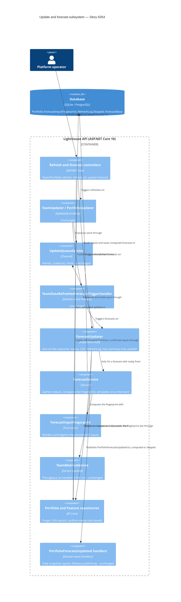

<!-- markdownlint-disable MD024 -->
# Feature Delta — story-6354-skip-unchanged-forecasts

> ADO User Story #6354 "Updates that change nothing skip the forecast", pulled out of the ideas listed on Epic 6321
> ("skip unchanged forecasts"). The evidence is the logs Steve Pereira sent from a large instance (Portfolios of 400 to
> 920 Features, 6 to 9 Teams). On that instance every Team or Portfolio refresh re-forecasts every Feature of the
> Teams involved, and each forecast takes 4 to 8 minutes even when the refresh found nothing new:
>
> `ForecastUpdater: Update completed | Team 'FSS' | mode=Delta | scanned=71 | fetched=0 | duration=16448ms | success=True | forecast=269719ms`
>
> While those forecasts run, Kestrel reports heartbeat delays of up to 49 s, so the whole app feels slow. The goal is
> to skip a forecast whose inputs have not changed since the last one, so a refresh that found nothing new costs
> seconds instead of minutes. Thread-pool starvation itself is analysed later, after this Story and Story 6351.

## Wave: DISCUSS / [REF] Prior-Wave Reading Confirmation

- ✓ `docs/product/jobs.yaml`: reused `job-operator-keep-lighthouse-usable-while-it-forecasts` (Epic 6311) and added
  a dated reuse note to it. No new job (see JTBD).
- ✓ `docs/product/personas/platform-operator.yaml` and `delivery-forecaster.yaml`, by reference. No persona or
  journey change: the existing personas fit, and no existing journey covers background refresh rounds closely
  enough to extend naturally.
- ⊘ DISCOVER / DIVERGE: none, skipped as for every Story-sized change. The ADO Story quotes the reporter's log
  lines, and those are the evidence.
- ✓ Code read (read-only investigation of 2026-10-23, cited from it; paths relative to
  `Lighthouse.Backend/Lighthouse.Backend/`): `Services/Implementation/RefreshRoundSummaryLine.cs:32`,
  `WriteBackRound.cs:51-54`, `TeamUpdater.cs:55`, `TeamData/TeamDataService.cs:22-25`,
  `TeamDataRefreshedForecastTriggerHandler.cs:14-16`, `PortfolioUpdater.cs:123`, `ForecastUpdater.cs:37-65,
  :88-92, :114-136, :153, :189-196, :205-223`, `Forecast/ForecastService.cs:72, :81, :342`,
  `UpdateQueueService.cs:231-241`, `ForecastController.cs:46, :69`, `TeamMetricsService.cs:110-167, :896-950`,
  `WorkItemService.cs:85-129, :144, :278-289, :681-859, :917-922`, `FeatureRepository.cs:19-21`,
  `SimulatedRun.cs:110-115`, `Dependencies/WhatTheForecastWaitsFor.cs:9-19`, `DrawStreamFactory.cs:14`,
  `API/DTO/WhenForecastDto.cs:25`, `API/DTO/FeatureDto.cs:25`, `Models/Feature.cs:289-317`, `ForecastBase.cs:19`,
  `Services/Implementation/WorkItems/FetchFingerprint.cs`.
- ✓ Frontend read (read-only): `pages/Settings/SystemInfo/RefreshHistorySection.tsx` (Refresh History: per-entity
  average, minimum and maximum duration), `services/Api/TeamService.ts:121-148` and `PortfolioService.ts:111-125`
  (the refresh and "update forecast" buttons' endpoints), `models/Feature.ts:15` (`lastUpdated`, carried but not
  rendered by any page).
- ✓ Docs read: `docs/settings/taskmanager.md` (the "Forecasting Portfolio '<name>'" row, stop semantics),
  `docs/settings/systeminfo.md`, ADR-249 (a cancelled forecast leaves `CreationTime` unchanged), ADR-197 (forecasts
  have no periodic refresh of their own).

## Wave: DISCUSS / [REF] Current-State Surface Inventory (brownfield)

| Surface | Today | Gap |
|---|---|---|
| Team refresh (periodic, `UpdateServiceBase.cs:262-316`, or the Team's refresh button) | Always publishes `TeamDataRefreshed`, which triggers a forecast of every Portfolio of the Team (`TeamDataService.cs:22-25`, `TeamDataRefreshedForecastTriggerHandler.cs:14-16`) | Forecasts even when nothing it reads changed |
| Portfolio refresh (periodic or button) | Triggers the Portfolio's forecast unconditionally (`PortfolioUpdater.cs:123`) | Same |
| One forecast | Every Feature of every Team in the Portfolio, including Features of other Portfolios (`ForecastService.cs:81`); a Team in N Portfolios causes N forecasts over overlapping Features | 4–8 min each on the large instance |
| Refresh summary log line (`RefreshRoundSummaryLine.cs:32`) | `forecast=269719ms` on the Team round that caused it | Cannot say "nothing changed, skipped" |
| Settings → Task Manager | Row "Forecasting Portfolio '<name>'" for the whole run | Sits there for minutes after a no-change refresh |
| Settings → System Info → Refresh History | Forecast rows from `RefreshLog` with their durations | Shows the minutes, with no way to tell a needed forecast from a wasted one |
| Feature `lastUpdated` (API, `FeatureDto.cs:25` = forecast `CreationTime`) | Time the forecast was last computed | Not rendered on any web page; read through the API (and the clients) |
| Existing coalescing (`ForecastUpdater.cs:37-53, :88-92, :114-136`; `UpdateQueueService.cs:231-241`) | Holds a Portfolio's forecast while its Teams are queued; turns duplicates into one follow-up | Still a full forecast per round |

**fetched=0 does not mean nothing changed.** A Delta refresh with `fetched=0` still removes items that left the
query (`WorkItemService.cs:144, :278-289`), recomputes remaining work for every Portfolio of the Team (`:85-93`),
moves automatic Feature WIP (`TeamMetricsService.cs:896, :901-910`), and a Portfolio delta can shrink Feature
membership (`WorkItemService.cs:917-922`). Throughput windows end today (`TeamMetricsService.cs:126, :919-924`).
Hence MD-1.

## Wave: DISCUSS / [REF] Persona IDs

- **platform-operator** (primary): runs the instance, reads the log and the Task Manager, gets the "Lighthouse is
  slow" complaint.
- **delivery-forecaster** (secondary): needs the forecast current after a real change, and the forecast to say
  when it was last confirmed.

## Wave: DISCUSS / [REF] JTBD One-Liners

- #6354 → reused `job-operator-keep-lighthouse-usable-while-it-forecasts`: when Lighthouse recalculates a
  Portfolio's forecasts in the background, I want every page to keep answering. Epic 6311 made a forecast share
  the machine; this Story removes the forecasts that compute nothing new. A reuse note is dated in `jobs.yaml`;
  the wording is unchanged.

## Wave: DISCUSS / [REF] Locked Decisions

| ID | Decision | Why |
|---|---|---|
| D1 | **Skip rule is a fingerprint of what the forecast reads** (MD-1). The members are: remaining work per Feature and Team (with the owning Team / Feature-owner split), Feature order, each Team's Feature WIP, dependencies as the forecast resolves them (licence included), each Team's throughput samples after the window, blackout removal and the forecast filter, Feature sizes including defaults and percentile sizes, the forecast settings and simulation limits, the set of Teams and Features in scope, and today's date. | One rule covers every input, including those no event announces. |
| D2 | The fingerprint is **per Portfolio**, because a forecast is per Portfolio. Comparing it never needs the simulation itself. | `TriggerUpdate(portfolioId)` is the unit everywhere |
| D3 | **A user-started refresh always forecasts** (MD-2). That covers the Portfolio's and Team's "update forecast" buttons (`ForecastController.cs:46, :69`), a Team's or Portfolio's refresh button, and the "refresh all" buttons. Only periodic and event-triggered rounds may skip. | Escape hatch if the rule is ever wrong. See the reading note under the MD block |
| D4 | **A skip still counts as a forecast round** (MD-3). The summary line says the forecast was skipped because nothing changed. A Forecast row is still written to `RefreshLog`, marked as skipped (MD-7): Refresh History and the Task Manager show it as a skip, and the forecast duration figures count only computed runs. The Features' forecast "last updated" becomes the time of confirmation. | Silence would look like a lost forecast; a confirmation the reader cannot see is not one |
| D5 | **Unchanged unseeded randomness is a feature, not a bug.** Skipping means the dates stop jittering between no-change rounds. Results are not "refreshed by luck". | `DrawStreamFactory.cs:14` is unseeded; seeding is out of scope |
| D6 | **Rank and ordering-policy triggers stay immediate** (`FeatureRankChangedForecastTriggerHandler.cs:26`, `FeatureOrderingPolicyChangedForecastTriggerHandler.cs:30`). They are not user-started in the MD-2 sense, but they change Feature order and so never match the old fingerprint. | No special case needed |
| D7 | **Fail towards forecasting.** No stored fingerprint, a fingerprint that cannot be computed, or a failed or cancelled last run all count as "changed". | The FetchFingerprint convention: null stored = changed |
| D8 | The fingerprint's member list is pinned by a guard test that names every member, as `FetchFingerprint`'s is, so a new forecast input cannot be added without deciding its place. | Prevents silent staleness later |

### Maintainer decisions — 2026-10-23, before DISCUSS

| ID | Decision | Options weighed |
|---|---|---|
| MD-1 | **Skip rule = input fingerprint.** Store a fingerprint of everything a Portfolio's forecast reads (remaining work per Feature and Team, Feature order, Feature WIP, dependencies, throughput samples incl. blackout removal and forecast filter, sizes incl. defaults, forecast settings / simulation limits, today's date) and skip when it matches the last run's. Mirrors the existing `FetchFingerprint` pattern. | Fingerprint (chosen) vs. the simple rule "every Team fetched 0, no settings change, forecast already from today" (rejected: fetched=0 still removes items, shrinks membership and moves automatic Feature WIP). |
| MD-2 | **Manual "Update forecast" and refresh buttons always forecast** and bypass the skip; only background and automatic refreshes skip. This is the escape hatch if the rule is ever wrong. | Bypass for anything user-started (chosen) vs. skipping everywhere (rejected: no way out if the fingerprint misses an input). |
| MD-3 | **A skipped run stamps the forecasts as confirmed now.** A Feature's forecast "last updated" shows when the forecast was confirmed current, not only when it was last computed. The refresh summary line says the forecast was skipped because nothing changed; DESIGN settles the exact wording. | Confirmed-now stamp (chosen) vs. keeping the compute time (rejected: an old stamp on a current forecast reads as stale). |
| MD-4 | **Coalescing back-to-back Team refreshes' forecasts is a follow-up, out of scope.** The fingerprint already turns repeated no-change runs into cheap skips, and the queue already holds forecasts while Teams are queued. | Follow-up (chosen) vs. in this Story (rejected: a second mechanism for a case the skip mostly covers). |
| MD-5 | **Today's date is part of the fingerprint**, so the first refresh of each day always forecasts. The daily Delivery snapshot (`PortfolioForecastsUpdated` → `GetOrCreateForDay`) and the forecast write-back still happen at least once a day. Settings changes that never triggered a forecast themselves (blackouts, Feature WIP, throughput window, forecast filter, dependency edits) are picked up at the next refresh, as today, because they change the fingerprint. *(Consequence recorded by the orchestrator.)* | Date in the fingerprint (chosen) vs. a date-free fingerprint plus a separate daily trigger (rejected: two mechanisms, and a day boundary is itself an input of the throughput window). |
| MD-6 | **Every refresh a user starts forecasts** (confirms the reading of MD-2): the two "update forecast" buttons, a Team's or Portfolio's refresh button, and "refresh all" for Teams or Portfolios. Only periodic and event-triggered rounds may skip. | Every user-started refresh (chosen) vs. only the two "update forecast" buttons (rejected: a user who presses a Team's refresh would see the forecast skipped). |
| MD-7 | **A skipped forecast keeps its own row in the refresh log, marked as skipped.** Refresh History and the Task Manager show it as a skip, and Refresh History's forecast duration figures count only forecasts that were computed. Showing the marker is a UI change: DISTILL sketches it with the maintainer before the scenarios are written. | Own row, marked skipped (chosen) vs. an ordinary short row (rejected: average, minimum and maximum forecast durations would drop sharply and stop saying how long a real forecast takes) vs. no row (rejected: no trace of the skip in the UI). |

## Wave: DISCUSS / [REF] Scope Assessment

PASS. 1 Story, 1 bounded context (update and forecast background services). Backend only, no new endpoint, no UI
change. 2 slices, each about a day. No walking skeleton, because this is brownfield work on an existing, isolated
path.

## Wave: DISCUSS / [REF] Story Map & Slices

Backbone (platform-operator, one background round): *a refresh runs* → *the forecast is triggered* → *the forecast
decides compute or confirm* → *the round is reported (log, Task Manager, Refresh History)* → *readers see the
forecast and its date*.

| Slice | Outcome | Brief | Est. |
|---|---|---|---|
| 01 | Automatic rounds with unchanged inputs skip the forecast and say so; the "update forecast" buttons still forecast | `slices/slice-01-automatic-rounds-skip-unchanged-forecasts.md` | 1 day |
| 02 | Every user-started refresh forecasts, and a skip stamps the forecasts "confirmed now" | `slices/slice-02-user-refresh-forecasts-and-confirmed-now.md` | ½–1 day |

### Priority Rationale

01 first. It carries all of the production value (the reporter's no-change rounds go from minutes to seconds) and
the riskiest assumption: that the fingerprint captures every input, so that no stale forecast survives a change.
It already keeps the cheapest escape hatch, the two explicit "update forecast" buttons through
`ForecastController`, so it can ship alone. 02 widens the escape hatch to every refresh button and makes the
forecast's date honest. It builds on 01 and is worth less without it.

### Slice taste tests

- 01 cannot be cut thinner safely: a skip that knows only part of the inputs ships stale forecasts. So all of D1 is
  in 01, and the "still re-forecasts" cases are its acceptance tests.
- Neither slice is infrastructure-only. Each changes what an operator sees: the Task Manager row and Refresh
  History durations in 01; a refresh button's result and the forecast date in 02.
- Each has a hypothesis that can fail (see briefs). Each is checked against production-shaped data on the dev
  instance (`:5169`, real history) with the periodic refresh running and nothing changing remotely.
- They are not scale variants of each other. A slice proven only on synthetic data: none.

## Wave: DISCUSS / [REF] User Stories

### US-01 — Automatic rounds that change nothing skip the forecast (slice 01, ADO #6354)

`job_id: job-operator-keep-lighthouse-usable-while-it-forecasts`

As a platform-operator on a large instance, I want a background refresh that changed nothing the forecast reads to
skip the forecast, so the app stays responsive and the round costs seconds instead of minutes.

#### Elevator Pitch
Before: the periodic refresh of Team "FSS" fetches 0 items, then forecasts its Portfolios for 4.5 minutes
(`forecast=269719ms`). Meanwhile "Forecasting Portfolio '…'" sits in the Task Manager and pages stall behind 49 s
heartbeat delays.
After: the next periodic refresh of "FSS" changes nothing the forecast reads. Its log line reads `forecast=skipped
(nothing changed)` (draft wording), the "Forecasting Portfolio" row in **Settings → Task Manager** is gone within
seconds, **Settings → System Info → Refresh History** shows that Portfolio's forecast run in seconds, and the pages
keep answering. Change one input (a blackout, a Feature's order, an item closed in the tracker) and the next round
forecasts as before.
Decision enabled: whether this instance's refresh interval is affordable, judged from forecasts that are needed
rather than from wasted ones.

#### Domain Examples
1. **Happy path.** At 10:15 the periodic refresh of Team "FSS" scans 71 items and fetches 0. Nothing else changed
   since the 10:00 forecast of Portfolio "Payments Platform" (412 Features). The forecast is skipped and the round
   completes in about 17 s instead of 4.5 min.
2. **fetched=0 that still changes something.** At 10:30 "FSS" fetches 0, but item FSS-2210 left the Team's query
   (closed and filtered out). Remaining work for Feature PAY-88 drops from 9 to 8, so "Payments Platform" is
   forecast in full.
3. **New day.** The first periodic round after midnight UTC on 2026-10-24 finds nothing new. The throughput window
   now ends a day later, so the forecast runs, and the day's Delivery snapshot is recorded.
4. **Setting changed between rounds.** Maria adds a blackout for 2026-12-24 to 2026-12-31 on Team "FSS" at 11:02.
   Saving starts no forecast, as today. The 11:15 periodic round fetches 0 but forecasts, because the throughput
   samples changed.
5. **Escape hatch.** At 11:20 the operator presses **Update forecast** on "Payments Platform". The forecast runs
   in full although nothing changed.

#### UAT Scenarios (BDD)

##### Scenario: A background round that changed nothing skips the forecast and says so
Given Portfolio "Payments Platform" was forecast at 10:00 today
And nothing the forecast reads has changed since
When the periodic refresh of Team "FSS" completes with fetched=0
Then no forecast of "Payments Platform" is computed
And the round's summary line says the forecast was skipped because nothing changed
And a Forecast entry for "Payments Platform" is recorded with the round's short duration

##### Scenario Outline: A background round re-forecasts when an input changed
Given Portfolio "Payments Platform" was forecast at 10:00 today
And since then <change>
When the next periodic refresh of a Team of "Payments Platform" completes with fetched=0
Then "Payments Platform" is forecast in full

Examples:
| change |
| the day has turned |
| an item left a Team's query |
| a Team's automatic Feature WIP moved from 2 to 3 |
| a Team's or the Portfolio's forecast settings were saved with a new value |
| a blackout period was added |
| a Feature gained a dependency |
| two Features swapped order |
| a Feature joined or left the Portfolio |
| a Team joined or left the Portfolio |

##### Scenario: A Portfolio forecast that was never stored, or whose last run did not finish, is computed
Given Portfolio "Payments Platform" has no stored fingerprint, or its last forecast failed or was stopped
When the periodic refresh completes with fetched=0
Then "Payments Platform" is forecast in full

##### Scenario: "Update forecast" always forecasts
Given nothing "Payments Platform" reads has changed since its last forecast
When the operator presses "Update forecast" for the Portfolio, or "Update forecasts" for one of its Teams
Then "Payments Platform" is forecast in full

##### Scenario: The day's Delivery snapshot is still recorded
Given it is the first background round of 2026-10-24 and nothing was fetched
When the round completes
Then the Portfolio is forecast and the Delivery snapshot for 2026-10-24 exists

#### Acceptance Criteria
- AC-1.1 A periodic or event-triggered forecast whose fingerprint (D1) equals the last completed run's fingerprint
  for that Portfolio computes nothing and leaves the stored forecasts as they are.
- AC-1.2 Each "still re-forecasts" case forecasts in full: new day, an item that left the query with fetched=0,
  automatic Feature WIP change, Team or Portfolio settings change, blackout change, dependency change, Feature
  order change, a Feature added to or removed from the Portfolio, a Team added or removed.
- AC-1.3 No stored fingerprint, or a failed or cancelled last run, means forecast (D7).
- AC-1.4 Both `ForecastController` "update forecast" endpoints always forecast (MD-2, explicit half).
- AC-1.5 The refresh summary line of a round whose forecast was skipped says so in place of a duration (wording in
  DESIGN). A `RefreshLog` Forecast row is written for the skipped run.
- AC-1.6 The first round of a UTC day forecasts, and the day's Delivery snapshot is recorded (MD-5).
- AC-1.7 A guard test lists every fingerprint member (D8).

#### Outcome KPIs
See K1–K3 under Outcome KPIs.

#### Technical Notes
- Driving ports: `TeamUpdater` / `PortfolioUpdater` / `ForecastUpdater` background services through
  `UpdateQueueService`, and the `ForecastController` endpoints. Assert through `RefreshLog`, the summary line and the
  persisted forecasts, not internals.
- The skip check sits after the inputs are gathered and before the simulation. Where it lives and where the
  fingerprint is stored (likely on the Portfolio, expand-only migration through `CreateMigration`) are DESIGN's call.
- `Clock.TodayAsUtcMidnight` is the date member; the percentile size window reads `DateTime.UtcNow`
  (`WorkItemService.cs:837-840`), which the date member covers.

### US-02 — Every refresh a user starts forecasts, and a skip says the forecast is confirmed now (slice 02, ADO #6354)

`job_id: job-operator-keep-lighthouse-usable-while-it-forecasts`

As a platform-operator, I want any refresh I start by hand to forecast, and I want a skipped forecast to carry the
time it was confirmed current, so I can always force a fresh forecast and never read a current forecast as stale.

#### Elevator Pitch
Before (after slice 01): Maria presses a Team's refresh on the Team page to "make sure", and the forecast is quietly
skipped. Meanwhile the Features' forecast `lastUpdated` stays at 06:00, although the forecast was confirmed at every
round since.
After: on the **Team** or **Portfolio** page, a press of **refresh** (or **refresh all** on the overview) ends in a
full forecast, shown as its "Forecasting Portfolio" row in **Settings → Task Manager** for the usual minutes. After
a skipped background round, each Feature's forecast `lastUpdated` (API, CLI/MCP) reads the round's time.
Decision enabled: whether to trust the forecast's date as "current as of", and when a forced refresh is worth its
minutes.

#### Domain Examples
1. **Team refresh button.** At 14:05 Maria presses refresh on Team "Atlas". It fetches 0, and the forecasts of
   "Payments Platform" and "Onboarding" both run in full.
2. **Refresh all.** At 14:20 the operator presses "refresh all" for Portfolios. Every Portfolio forecasts, whether or
   not its inputs changed.
3. **Confirmed-now stamp.** Feature PAY-88 was computed at 06:00. Background rounds at 06:15 through 09:45 skip. At
   09:46 its forecast `lastUpdated` reads 09:45, and the forecast dates are the 06:00 ones.
4. **A stopped skip-check run changes no stamp.** A round is stopped from the Task Manager before it finishes, so
   `lastUpdated` stays as it was (as ADR-249 does for a cancelled forecast).

#### UAT Scenarios (BDD)

##### Scenario: A Team refresh the user starts forecasts even when nothing changed
Given nothing "Payments Platform" reads has changed since its last forecast
When Maria presses refresh on Team "Atlas", a Team of "Payments Platform"
Then "Payments Platform" is forecast in full

##### Scenario: A Portfolio refresh or refresh-all the user starts forecasts
Given nothing "Onboarding" reads has changed since its last forecast
When the operator presses refresh on "Onboarding", or refresh all for Teams or Portfolios
Then "Onboarding" is forecast in full

##### Scenario: A skipped forecast is stamped as confirmed now
Given Feature PAY-88's forecast was computed at 06:00
When the 09:45 background round skips the forecast of "Payments Platform"
Then PAY-88's forecast reads last updated 09:45
And its forecast dates are unchanged

##### Scenario: A computed forecast still stamps the compute time
Given an input of "Payments Platform" changed
When the next background round forecasts it
Then each Feature's forecast reads last updated at that round's time, with new dates

#### Acceptance Criteria
- AC-2.1 Team refresh, Portfolio refresh and the refresh-all endpoints, when user-started, end in a full forecast of
  every Portfolio they trigger (MD-2, D3). Periodic rounds of the same entities may still skip.
- AC-2.2 A skipped forecast sets each in-scope Feature's forecast "last updated" (`FeatureDto.LastUpdated`) to the
  skip time and leaves the forecast values and histograms untouched (MD-3).
- AC-2.3 A stopped or failed round changes no stamp.
- AC-2.4 A computed forecast stamps as today.

#### Outcome KPIs
See K3 (guardrail) and K4 under Outcome KPIs.

#### Technical Notes
- A user-started refresh reaches the forecast today only through the queue and `TeamDataRefreshed` /
  `PortfolioUpdater.cs:123`. The "user-started" origin has to travel with it; how is DESIGN's call. Mind
  `UpdateQueueService.cs:231-241`: a manual request that merges into a queued automatic one must keep the bypass.
- `FeatureDto.LastUpdated` is read by the API clients. The payload shape does not change, but its meaning does
  (see Standing Checklist).

## Wave: DISCUSS / [REF] Outcome KPIs

| KPI | Target | Measure | Baseline |
|---|---|---|---|
| K1 Share of background rounds with unchanged forecast inputs whose forecast is skipped | ≥ 95 % (100 % by design) | Refresh summary lines and `RefreshLog` Forecast rows on the reporter's instance and the dev instance; DEVOPS instruments | 0 % |
| K2 Forecast wall clock on a skipped round, large instance | < 5 s | `forecast=` on the summary line | 4–8 min (`forecast=269719ms`) |
| K3 Guardrail: a forecast left stale after an input change | 0 (every input change → the next round forecasts) | Acceptance tests per D1 member; a maintainer spot check on the dev instance; no "forecast did not update" report in the 60 days after release | n/a |
| K4 Kestrel heartbeat warnings on a no-change day, large instance | Clear drop (direction, not a number: thread-pool starvation is analysed later) | The reporter's log excerpt after the release, compared with the one in the Story | up to 49 s delays during each forecast |

Usage-data event: left to DEVOPS. The expected answer is "N/A, because a skip is not a user action". The operator
already sees the effect in the log and Refresh History.

## Wave: DISCUSS / [REF] Definition of Done

1. ACs green as NUnit acceptance tests through the driving ports. No new E2E, because no UI changes. The existing
   Task Manager E2E keeps passing.
2. `dotnet build` (zero warnings) and the filtered `dotnet test` are clean. The frontend is untouched.
3. Sonar: no new issues; `docs/ci-learnings.md` pre-applied.
4. Docs at finalization: `docs/settings/taskmanager.md` says a forecast whose inputs did not change is confirmed in
   seconds rather than recomputed, and that a button press always recomputes. `docs/settings/systeminfo.md` gets a
   sentence on short Forecast runs in Refresh History if DESIGN keeps the row.
5. Screenshots: N/A, because no captured image shows a duration or a forecast's last-updated time; finalization
   checks this. Demo data: N/A, because no data shape changes.
6. Copy (log line) uses the configurable terms where it names entities (Portfolio, Feature, Team).
7. ADO: Story #6354 Active on first commit, Resolved on push, Closed on green CI. The Release Notes tag is for the
   maintainer to confirm (a user-noticeable speed-up).
8. Mutation testing (Stryker.NET) on touched backend files ≥ 80 %, run last on frozen code.
9. `ARCHITECTURE.md` updated if the forecast trigger concept changes.

## Wave: DISCUSS / [REF] Out of Scope

- Coalescing the forecasts of back-to-back Team refreshes (MD-4, follow-up).
- Thread-pool starvation analysis (after this Story and Story 6351).
- Story 6351 (Features list speed).
- Seeding the simulation (D5).
- Any UI change beyond what MD-3 changes about "last updated". No new control, badge or column.
- Making settings saves (blackouts, WIP, filter, dependencies) trigger a forecast themselves (MD-5: as today).
- Narrowing a forecast to the Features whose inputs changed (a partial forecast).

## Wave: DISCUSS / [REF] WS Strategy, Driving Ports, Pre-requisites

- **WS strategy**: A (no walking skeleton; brownfield, isolated path).
- **Driving ports**: the Team, Portfolio and Forecast update background services (through `UpdateQueueService`),
  the `ForecastController` endpoints (`forecast/update/{id}`, `update-portfolios-for-team/{teamId}`), and the
  Team/Portfolio refresh and refresh-all endpoints. The HTTP contracts do not change.
- **Pre-requisites**: none. Existing fixtures in `Tests/API/Integration/DependencyAwareForecasting/
  Slice00OneForecastPerBatchScenarios`, `FasterUpdates/*` and `ResponsiveDuringUpdates/*` are the natural homes.

## Wave: DISCUSS / [REF] Standing Checklist

- **RBAC**: N/A, because no endpoint, guard or gated control is added or changed. The refresh and "update forecast"
  endpoints keep their existing write guards, and the skip happens inside the background service.
- **Lighthouse-Clients (CLI + MCP)**: no version bump needed, because no payload shape changes. However, the meaning
  of a Feature's `lastUpdated` changes in slice 02, from "computed at" to "confirmed current at" (MD-3). DESIGN greps
  `lighthouse-clients` (outside this checkout, so not verified in this wave) for `lastUpdated` and adjusts any
  wording that says "computed" or "calculated". If none reads it, this item is N/A.
- **Website**: expected N/A, because no feature or copy the website names changes. A faster refresh is not
  advertised as a feature. The website repo is outside this checkout, so finalization confirms with a grep for
  "forecast" speed claims.
- **Usage data**: deferred to DEVOPS, as the standing rule requires. Expected "N/A, because a skip is not a user
  action".
- **Terminology**: the log line and docs use Portfolio, Feature and Team (the seeded defaults).
- **UI sketch**: needed, because MD-7 marks a skipped forecast in Refresh History and the Task Manager. DISTILL
  sketches that marker, and which duration figures exclude skips, with the maintainer before writing scenarios.
  The log-line wording is settled in DESIGN (MD-3).
- **Loading and failure looks**: N/A, because there is no new or changed view.

## Wave: DESIGN / [REF] Prior-Wave Reading Confirmation

- ✓ This feature delta (MD-1..MD-7, D1..D8, US-01/US-02, K1–K4, Out of Scope) and both slice briefs.
- ✓ `docs/product/architecture/brief.md` (delivery-metrics section: `PortfolioForecastsUpdated` once per forecast
  completion; Epic 6311 section) and ADR-197, ADR-248, ADR-249. Highest ADR in use: ADR-255; no feature folder
  claims 256+, so this wave takes **ADR-256**.
- ✓ Code opened (paths under `Lighthouse.Backend/Lighthouse.Backend/`): `ForecastUpdater.cs`, `UpdateServiceBase.cs`,
  `UpdateQueueService.cs:222-330`, `TeamUpdater.cs`, `PortfolioUpdater.cs:60-135`, `TeamDataService.cs`,
  `TeamDataRefreshedForecastTriggerHandler.cs`, `IForecastUpdater.cs`, `IUpdateService.cs`, `ForecastController.cs:37-73`,
  `TeamController.cs:75-90`, `Forecast/ForecastService.cs`, `ForecastRunPlan.cs`, `SimulatedRun.cs:112`,
  `Models/Dependencies/ForecastWaits.cs:41`, `WorkItems/FetchFingerprint.cs`, `Models/RefreshLog.cs`,
  `API/DTO/RefreshLogDto.cs`, `RefreshRoundSummaryLine.cs`, `FeatureRepository.cs`, `RepositoryBase.cs:96-100`,
  `FeatureRankingService.cs:93-113`, `DeliveryForecastPublishingHandler.cs`, `DeliveryMetricSnapshotRecordingHandler.cs`,
  `WriteBackTriggerService.cs:62-103`, `TeamMetricsService.cs:105-134`, `UpdateProgress.cs`, `LighthouseClock.cs`,
  `Program.cs:1586-1600` (Redis status store when a Redis connection is configured). Frontend (read-only):
  `pages/Settings/SystemInfo/RefreshHistorySection.tsx`, `components/Common/Charts/RefreshHistoryChart.tsx`,
  `models/SystemInfo/RefreshLog.ts`, `components/App/Header/TaskManager/ActivitySection.tsx`, `RecentProblemsSection.tsx`.
- ✓ Codebase facts of 2026-10-23 (orchestrator scratchpad), cited not re-derived.
- ✓ `CLAUDE.md` DESIGN rules, `docs/ci-learnings.md` (S107 ≤ 7 parameters; a persisted property needs a migration
  through `CreateMigration`; InMemory never catches it).
- ⊘ `lighthouse-clients`: outside this checkout and outside the tools' allowed root, so not grepped here (DDD-12 makes
  the grep a slice-02 gate).
- ⊘ `nwave-ai outcomes check-delta`: no shell in this wave; not run.

## Wave: DESIGN / [REF] Scope and Mode

Application scope (`nw-solution-architect`), PROPOSE mode, run AFK. The recommended option is taken at every point
except those that change what a user sees (Open Questions). Ports-and-adapters as established. No new style, no new
container, no new external call. The L1 and L2 C4 views are unchanged; an L3 of the update-and-forecast subsystem is
below. Revised once after the review gate (see Review below).

The invariant this design rests on: **a skip happens only when a computed run would have been handed exactly the same
inputs as the forecasts now stored** (randomness aside, D5). The fingerprint is therefore taken at the simulation's input
boundary, from the very values the run is about to be handed, not from the settings upstream of them. A skip is
possible only within one instance day, because the first round of each day always computes (MD-5).

## Wave: DESIGN / [REF] Reuse Analysis

| Existing component | File | Overlap | Decision | Justification |
|---|---|---|---|---|
| `FetchFingerprint` | `Services/Implementation/WorkItems/FetchFingerprint.cs` | Registered member list, rendered → sorted → SHA-256, stored on the owner, null = changed, guard test | **REUSE THE PATTERN, not the class** | Different members and a different question ("what does the query ask" vs "what does the simulation get"). One class for both would couple the fetch to the forecast. The rendering rules (invariant culture, ordinal sort, separators, 128-bit hex digest) are copied as a convention. |
| `ForecastService.ForecastFeatures` | `Forecast/ForecastService.cs:90-103` | Already gathers every input (Features in order, rows, throughput + chip status, waits) before the simulation | **EXTEND** | The comparison sits between the gathering and `RunMonteCarloSimulation`, so there is no second reading path and no extra query. |
| `ForecastUpdater.Update` | `BackgroundServices/Update/ForecastUpdater.cs:153-223` | The effect shell: `RefreshLog` row, round summary, write-back staging, publish | **EXTEND** | Acts on the outcome: stamps a confirmation, records the fingerprint last, marks the row and the line. |
| `IPortfolioRepository` | `Services/Interfaces/Repositories/IPortfolioRepository.cs` | Portfolio persistence | **EXTEND** with two set-based methods | The fingerprint is written only through these (DDD-3). |
| `IFeatureRepository` | `Services/Interfaces/Repositories/IFeatureRepository.cs` | Feature persistence; set-based update precedent in `FeatureRankingService` | **EXTEND** with a confirm-stamp method | One statement instead of loading and saving thousands of forecast rows. |
| `RefreshLog` / `RefreshLogDto` | `Models/RefreshLog.cs`, `API/DTO/RefreshLogDto.cs` | Forecast rows; `Cancelled` flag precedent | **EXTEND** with `Skipped` | MD-7: own row, marked. |
| `RefreshRoundSummary(Line)` | `RefreshRoundSummaryLine.cs` | `forecast=cancelled after Nms` precedent | **EXTEND** | One more wording branch. |
| Refresh and forecast controllers | `API/ForecastController.cs`, `TeamController.cs`, `TeamsController.cs`, `PortfolioController.cs`, `PortfoliosController.cs` | The user-started entry points | **EXTEND** | Each forgets the confirmed inputs of the Portfolios it touches before queuing (DDD-9). |
| `RefreshHistorySection` | `pages/Settings/SystemInfo/RefreshHistorySection.tsx` | Duration figures; "Cancelled" count line precedent | **EXTEND** | MD-7. |
| `PortfolioForecastsUpdated` + its two handlers, `UpdateQueueService`, `UpdateServiceBase`, `TeamDataRefreshed` | as named | Publishing, queueing, the Team → forecast road | **REUSE AS-IS** | A skip publishes like a compute (DDD-6). The user bypass needs no origin on the queue or the event (DDD-9). |

CREATE NEW (each justified by "no existing alternative"):
- `ForecastInputFingerprint` (static, `Services/Implementation/Forecast/ForecastInputFingerprint.cs`): no existing type
  renders the simulation's inputs.
- `ForecastRunOutcome` (value type beside `IForecastService`): the port's answer, either `Computed(readFingerprint,
  freshFingerprint)` or `ConfirmedUnchanged(featureIds)`. A bare `bool` cannot carry what the shell needs to act on.
- One expand-only migration (`Portfolio.ForecastInputFingerprint` nullable, `RefreshLog.Skipped` default `false`),
  generated with `CreateMigration` for every provider.

## Wave: DESIGN / [REF] Decisions

| ID | Decision | Rejected |
|---|---|---|
| DDD-1 | **The fingerprint is a pure function of what the simulation is handed.** `ForecastInputFingerprint.Of(...)` renders these members, in order. (1) A format version. (2) Today, the instance day from `ILighthouseClock.Today` (MD-5). (3) The simulation limits: `Trials`, `MostDaysOneSimulatedRunMayCover`, `MostRunsAtOnce`. (4) The Features in scope **in forecast order**, as ids, so one member covers order and membership. (5) The Teams of those Features, which are the keys of the run's chip-status map (`ForecastService.cs:107`), not `portfolio.Teams`, as ids sorted. (6) Every row: Feature id, Team id and remaining items. Remaining items already carries sizes, defaults, percentile sizes and the owner split. (7) Per Team, the throughput as handed (the day counts after window, blackout removal and forecast filter). (8) Per Team, its chip status (`FilterApplied`, `ExcludedSummary`, `HasSufficientData`), which lands on the stored forecast. (9) Per Team, its `FeatureWIP` (`SimulatedRun.cs:112`). (10) Per in-scope Feature reference id, `ForecastWaits.Of(referenceId)`: the reference ids it waits for, sorted. That list is the only thing the plan reads from waits (`ForecastRunPlan.cs:184`), so `IgnoreDependencies`, `CanBeForecast`, Portfolio membership and the licence are covered through it. Order is kept only where it carries meaning (Features); everything else is sorted ordinally. Rendering follows `FetchFingerprint`: invariant culture, control-character separators, never `GetHashCode` or identity, SHA-256 truncated to 128 bits, lower-case hex. A `RegisteredMembers` list names each member for the guard test (D8). | Fingerprinting the upstream settings (blackouts, filter rules, size settings, forecast settings) as D1 lists them: a second list of the same knowledge that drifts from what the run reads, and it misses anything a later change adds to the run. Hashing the `ForecastRunPlan` object graph by reflection: unstable across EF materialisations, and silent about what it covers. |
| DDD-2 | **Cost: no extra reads, and only the simulation is saved.** The fingerprint is computed from values `ForecastFeatures` already gathers. Throughput comes from the same cached `TeamMetricsService.GetForecastThroughputStatus` call the run makes. A skip still pays for the Feature graph load (`FeatureRepository.GetFeatures` includes the forecast histograms), the hash, the confirm-stamp, the write-back staging and the Delivery publishing, which makes one remote call per Delivery source, as every round does today. **K2 risk, measured in DELIVER on the dev instance (`:5169`, real history):** if a skipped round's `forecast=` exceeds 5 s, the check moves to a lighter read (Features without histograms), and the full graph is loaded only to compute. Not built up front. | A separate component that reads the inputs again: twice the input cost, and a second reading path. |
| DDD-3 | **Stored on the Portfolio, written only by set-based updates.** `Portfolio.ForecastInputFingerprint` is a `string?`; null means changed (D7). It is mapped with `PropertySaveBehavior.Ignore` after insert, so a full-entity `Update` of a stale Portfolio (`RepositoryBase.cs:99` marks every column modified) can never write an old value back. It is written through two `IPortfolioRepository` methods. `TryRecordForecastInputs(portfolioId, readAtGather, fresh)` is a CAS: an `ExecuteUpdateAsync` whose WHERE requires the column to still hold the value read at gathering, with the affected-row count as the answer (the repo's CAS idiom). `ForgetForecastInputs(portfolioIds)` sets the column to null. **Write order:** `ForecastService` saves the forecasts; `ForecastUpdater` stages write-back and publishes, then records the fingerprint **last**. A crash, cancel or failure anywhere earlier leaves the old value. That old value no longer matches the new inputs, or is null, so the next run computes. A forget that lands during a run makes the CAS miss, so the forget wins. Stored forecasts can therefore be newer than the fingerprint, never older. One expand-only migration adds the column and `RefreshLog.Skipped`. | Writing the fingerprint in the same `SaveChanges` as the forecasts (the first version of this design): a stale full-entity `Update` could write an old value back, and a "user asked" forget during the run would be overwritten. A separate `PortfolioForecastState` table: one value per Portfolio, a join for nothing. An in-memory map: across replicas a stale match could survive, and every restart recomputes everything. A JSON column: one string needs no JSON. |
| DDD-4 | **The comparison sits inside `ForecastService.UpdateForecastsForPortfolio`, between the gathering and the simulation**, not in `ForecastUpdater.Update` before `ForecastPortfolio` as the facts suggested, because the inputs exist only there. The port becomes `Task<ForecastRunOutcome> UpdateForecastsForPortfolio(Portfolio portfolio, DateTime today, CancellationToken cancellationToken)`. It compares the fresh value with `portfolio.ForecastInputFingerprint` as loaded. On a match it returns `ConfirmedUnchanged` **without writing anything**. Otherwise it simulates, saves the forecasts as today, and returns `Computed`. Every other effect (stamp, fingerprint, row, line, staging, publish) is `ForecastUpdater`'s, the imperative shell. `today` is a parameter because `ForecastService` already has 7 constructor parameters (S107), and its constructor stays unchanged. The manual `When`, multi-team and probe paths are untouched. | The check in `ForecastUpdater` with its own fingerprinter: a second reading path, the drift `FetchFingerprint`'s own comment warns of. Splitting the port into prepare and run, with a plan value in between: two new port methods for one decision. That split stays the refactoring route if a second consumer of the prepared inputs appears. |
| DDD-5 | **D7, failed or cancelled last run.** A failed or cancelled compute never reaches the CAS (DDD-3), so it is covered by construction. For a skip that fails (stamp or publish), `ForecastUpdater` calls `ForgetForecastInputs` best-effort, the same as it does on any failed or cancelled run. It runs in its own scope with `CancellationToken.None`, because the run's token is the cancelled one, and it is logged and never fails the round (the `RecordConnectionHealth` precedent). This protects a recompute after a failed round, not correctness: the stored forecasts are never older than the fingerprint (DDD-3). If the forget itself fails, the next instance day repairs it through the date member. | Reading the latest `RefreshLog` Forecast row as the "last run went well" signal: it ties a forecast decision to a log table with its own retention. |
| DDD-6 | **What a skip does.** It runs no simulation, rewrites no forecast rows or histograms, and writes no fingerprint. **Slice 02:** `ForecastUpdater` stamps `CreationTime = now` on every `ForecastBase` row (When and Start forecasts) of the Features in scope. It uses one set-based `IFeatureRepository.ConfirmForecastsAsOf(featureIds, confirmedAt, cancellationToken)` (`ExecuteUpdateAsync`, `OfType<>` per derived type as needed; the `FeatureRankingService` precedent), resolved in the updater's scope. This is a plain bulk update, not a CAS, because no competing writer can be lost: if a concurrent forecast of another Portfolio rewrote shared Features, those rows are newer, and "confirmed now" is true of them. A cancel before the stamp changes nothing (AC-2.3). **Both slices:** the skip stages the forecast write-back and publishes `PortfolioForecastsUpdated` exactly as a computed run does. The daily snapshot is an upsert on `GetOrCreateForDay`, so it gets no duplicate. Delivery publishing re-reads target dates the Portfolio refresh just re-synced, and both handlers' best-effort retries rely on "the next forecast asks again". Keeping them on every round keeps today's cadence for everything but the simulation. | A skip that publishes nothing: today's snapshot would stop following intra-day Delivery target-date and done-work changes, a Release's published likelihood would lag a target-date move, and retries would wait up to a day. Stamping by loading and saving the tracked rows: thousands of UPDATE statements per skip on the large instance. |
| DDD-7 | **`RefreshLog.Skipped` (bool, default false), and `RefreshLogDto.Skipped`.** A skipped row has `Success = true`, `Cancelled = false` and its short duration. `UpdateNotificationHub.WhatTheLastRunSaysHappened` keeps answering `Completed`. | `SyncMode.Skipped`: `Mode` says how much a fetch downloaded, and the frontend mirrors it as a string. A new `RefreshType`: a skip is still a Forecast. No row at all: ruled out by MD-7. |
| DDD-8 | **Summary line:** ` \| forecast=skipped after {N}ms (inputs unchanged)`, in the shape of `cancelled after` and `failed after`. The duration stays because K2 reads it. `RefreshRoundSummary` gains `ForecastSkipped`; `WriteBackRound` keeps the last reported forecast, as today. | `forecast=skipped (nothing changed)`, the DISCUSS draft: it drops the K2 figure, and "nothing changed" is untrue when the fetch moved data the forecast does not read. |
| DDD-9 | **A user-started refresh forgets the confirmed inputs of the Portfolios it touches, in the database, before it queues anything.** The six user entry points call `IPortfolioRepository.ForgetForecastInputs(...)` and then trigger exactly as today. They are: `ForecastController` `update/{id}` (that Portfolio) and `update-portfolios-for-team/{teamId}` (the Team's Portfolios), both slice 01; `TeamController.UpdateTeamData` (the Team's Portfolios), `TeamsController.UpdateAllTeams` (the Portfolios of every Team it queues), `PortfolioController.UpdateFeaturesForPortfolio` (that Portfolio) and `PortfoliosController.UpdateAllPortfolios` (every Portfolio it queues), all slice 02. The next forecast of each of those Portfolios, on whichever replica and through whichever coalescing path, finds no fingerprint and computes in full. A forecast already running when the button is pressed cannot record its own fingerprint over the forget, because its CAS misses (DDD-3). **No signature changes** on `IUpdateService`, `IForecastUpdater`, `UpdateServiceBase`, `ITeamDataService` or `TeamDataRefreshed`. The rank and ordering-policy triggers stay as they are (D6). Before adding `IPortfolioRepository` to a controller constructor, DELIVER checks S107; at 8 it splits the controller rather than suppressing (house rule). | An in-memory "user asked" mark carried through the updaters with an `UpdateOrigin` (the first version of this design). The review showed it is lost when Redis admission parks the request on another replica (`UpdateQueueService.cs:239, :312`, `Program.cs:1593`), and before queuing when `ForecastUpdater.TriggerUpdate` returns early on an owed or held forecast (`ForecastUpdater.cs:39-49`). Carrying the origin in the queued closure: the follow-up slot keeps only the newest closure. Treating `TriggerImmediateUpdate` as "user": the rank and policy handlers use it too. |
| DDD-10 | **Concurrency.** Same Portfolio: the queue admits one forecast key at a time, so two runs of one Portfolio never interleave. A Team refresh during a forecast queues a follow-up that gathers afresh: its fingerprint differs if the Team changed anything, and matches (skip) if not. Overlapping Portfolios (a Team in N Portfolios): each stores its own fingerprint over its own scope, and each scope holds every Feature of its Teams. A change in a shared Team therefore moves every one of their fingerprints, and last-writer-wins on shared Features stays exactly as today. A forget racing a run is settled by the CAS: the forget wins. | — |
| DDD-11 | **Frontend (MD-7).** `models/SystemInfo/RefreshLog.ts` gains `skipped?: boolean`, optional because an older backend omits it. `RefreshHistorySection` computes every duration figure over computed runs only: per entity Avg, Min and Max, and in the All view Avg, Max and the per-entity bar series. It adds a "Skipped" count line, shown only when it is non-zero, following the `Cancelled` precedent. Skipped runs count as successful in the success rate. The chart treatment and any Task Manager change are maintainer decisions at the start of DISTILL (Open Questions, sketches below). | A separate "Forecast" panel: one marker suffices. |
| DDD-12 | **Lighthouse-Clients.** No payload shape changes: `lastUpdated` keeps its type and name. So **no version bump**. The meaning of `lastUpdated` moves from "computed at" to "confirmed current at" in slice 02. This is unverified, because the clients checkout is outside this wave's tools. **Gate before slice 02 ships:** DELIVER runs `grep -rn "lastUpdated\|last updated\|computed\|calculated"` over the clients' source, MCP tool descriptions and skills. It rewords any text that says the forecast was computed or calculated at that time, and records the result in this delta. If nothing reads it, the item is N/A. | — |
| DDD-13 | Usage data and RBAC: unchanged from DISCUSS. DEVOPS answers the event question. No guard changes: the same endpoints only forget before queuing, under their existing write guards. | — |

## Wave: DESIGN / [REF] Component Decomposition

Paths under `Lighthouse.Backend/Lighthouse.Backend/` unless marked `FE:` (`Lighthouse.Frontend/src/`).

| Component | Path | Change | Slice |
|---|---|---|---|
| ForecastInputFingerprint | `Services/Implementation/Forecast/ForecastInputFingerprint.cs` | NEW, pure static | 01 |
| ForecastRunOutcome | `Services/Interfaces/Forecast/` (beside `IForecastService`) | NEW value type | 01 |
| IForecastService / ForecastService | `Services/Interfaces/Forecast/IForecastService.cs`, `Services/Implementation/Forecast/ForecastService.cs` | MODIFIED: new signature, the comparison, no writes on a match; constructor unchanged | 01 |
| Portfolio + model config | `Models/Portfolio.cs`, `Data/LighthouseAppContext.cs` | MODIFIED: `ForecastInputFingerprint`, save behaviour Ignore after insert | 01 |
| IPortfolioRepository / PortfolioRepository | `Services/Interfaces/Repositories/IPortfolioRepository.cs`, implementation | MODIFIED: `TryRecordForecastInputs` (CAS), `ForgetForecastInputs` | 01 |
| RefreshLog / RefreshLogDto | `Models/RefreshLog.cs`, `API/DTO/RefreshLogDto.cs` | MODIFIED: `Skipped` | 01 |
| Migration | `Migrations/*` through `CreateMigration` | NEW, expand-only, both providers | 01 |
| ForecastUpdater | `Services/Implementation/BackgroundServices/Update/ForecastUpdater.cs` | MODIFIED: acts on the outcome; records the fingerprint last; forgets on failure or cancel; marks the row and the line | 01 (stamp in 02) |
| RefreshRoundSummary / Line | `Services/Implementation/RefreshRoundSummary*.cs`, `UpdateServiceBase.ReportForecastSummary` | MODIFIED: `ForecastSkipped` wording | 01 |
| ForecastController | `API/ForecastController.cs:46, :69` | MODIFIED: forget, then trigger as today | 01 |
| TeamController, TeamsController, PortfolioController, PortfoliosController | `API/*.cs` | MODIFIED: forget, then trigger as today | 02 |
| IFeatureRepository / FeatureRepository | `Services/Interfaces/Repositories/IFeatureRepository.cs`, `Services/Implementation/Repositories/FeatureRepository.cs` | MODIFIED: `ConfirmForecastsAsOf` | 02 |
| RefreshLog model, RefreshHistorySection, RefreshHistoryChart | `FE: models/SystemInfo/RefreshLog.ts`, `FE: pages/Settings/SystemInfo/RefreshHistorySection.tsx`, `FE: components/Common/Charts/RefreshHistoryChart.tsx` | MODIFIED (per the DISTILL sketch) | 01 |
| Task Manager | `FE: components/App/Header/TaskManager/ActivitySection.tsx` (+ `UpdateProgress.cs` under T-B) | UNCHANGED under T-A, MODIFIED under T-B | 01 |

Unchanged: `UpdateQueueService`, `UpdateServiceBase` (apart from the summary wording), `TeamUpdater`, `PortfolioUpdater`,
`TeamDataService`, `TeamDataRefreshed` and its handler, `WorkItemService`, `TeamMetricsService`, the simulation
(`ForecastRunPlan`, `SimulatedRun`, draws), the two `PortfolioForecastsUpdated` handlers, write-back, connectors, HTTP
contracts.

### Contract shapes (crafter assertions)

| Component | Shape | Universe and assertion |
|---|---|---|
| `ForecastInputFingerprint.Of` | pure function | Return-only. The same inputs give the same string across a fresh `DbContext`, a restart (golden value) and the `tr-TR` culture. Changing any one registered member alone changes it. |
| `ForecastService.UpdateForecastsForPortfolio` → `Computed` | bounded change | Mutates only the in-scope Features' When and Start forecasts, in one save, exactly as today. The fingerprint column is untouched. |
| `ForecastService.UpdateForecastsForPortfolio` → `ConfirmedUnchanged` | pure read | Mutates nothing: every `ForecastBase` row, every histogram and the fingerprint are byte-equal before and after. |
| `ForecastUpdater` after `Computed` | bounded change | Its `RefreshLog` row, staging, the publish, then exactly one CAS on `Portfolio.ForecastInputFingerprint`. |
| `ForecastUpdater` after `ConfirmedUnchanged` | bounded change | Slice 02: `CreationTime` of the in-scope `ForecastBase` rows only. Plus the row (`Skipped = true`), staging and the publish. |
| `ForecastUpdater` on failure or cancel | bounded change | `Portfolio.ForecastInputFingerprint := null` and the `RefreshLog` row. |
| User entry points | bounded change | `ForecastInputFingerprint := null` for exactly the Portfolios they touch, then today's triggers. |

## Wave: DESIGN / [REF] Driving and Driven Ports

- **Driving (HTTP contracts unchanged):** `POST api/forecast/update/{id}`, `POST api/forecast/update-portfolios-for-team/{teamId}`,
  the Team and Portfolio refresh endpoints, and both refresh-all endpoints. Each now forgets the confirmed inputs of
  the Portfolios it touches before it queues. The background updaters, which run the periodic rounds through
  `UpdateQueueService`, are unchanged. `GET` refresh logs gains `skipped` (additive).
- **Driven:** persistence only. `IFeatureRepository` gains `ConfirmForecastsAsOf`, `IPortfolioRepository` gains
  `TryRecordForecastInputs` and `ForgetForecastInputs`, and `IRefreshLogService` stores the new column. **No new external
  call.** A skip contacts the tracker only for the write-back and Delivery publishing that a computed run already does.

## Wave: DESIGN / [REF] C4 Component (update and forecast subsystem)



## Wave: DESIGN / [REF] Loading and Failure Looks, and Sketch Options for DISTILL

Refresh History loads once on mount and keeps its existing looks: a centred `CircularProgress` while loading, and an
`Alert severity="error"` reading "Could not load refresh history." on failure. The skip marker exists only in the
loaded look, and no figure is drawn before the rows arrive. The Task Manager keeps its live list and fetches nothing new.

**R-A: a count line, with durations over computed runs** (recommended)
```
Entity: [Forecast: Payments Platform v]
 Duration (s) line ─ computed runs only; skipped runs leave a gap in the line, bars (items) still drawn
 Total Runs 40 | Success Rate 100% | Skipped 31 | Avg Items 412
 Avg Duration 271.40 s | Min Duration 240.10 s | Max Duration 305.90 s | Last Run 23/10/2026, 10:15:02
 loading: (spinner)          failure: [!] Could not load refresh history.
```

**R-B: skipped runs drawn as their own series**
```
 Duration (s): ── computed   ○ skipped (inputs unchanged), plotted at their own short duration
 Total Runs 40 | Computed 9 | Skipped 31 | Success Rate 100% | Avg Items 412
 Avg Duration (computed) 271.40 s | Min 240.10 s | Max 305.90 s | Last Run …
 loading / failure: as R-A
```

**Task Manager.** The list holds running and queued work only, so a finished skip leaves no row today.
```
T-A (recommended, no change)              T-B (append UpdateProgress.Skipped)
◌ Forecasting Portfolio 'Payments' —      ◌ Forecasting Portfolio 'Payments' — Running
  Running   (gone within seconds)           then, briefly: Forecasting Portfolio 'Payments' —
                                            Skipped, nothing changed
```

## Wave: DESIGN / [REF] Architecture Enforcement

Style: hexagonal. Language: C#. Tools: ArchUnitNET (existing) plus guard tests.
- **Guard test (D8):** `ForecastInputFingerprint.RegisteredMembers` equals the expected list. One test case per member
  shows that changing only that member changes the fingerprint. The dependency member gets separate cases for
  `IgnoreDependencies`, `CanBeForecast` and a changed reference target, each reaching the fingerprint through
  `ForecastWaits`.
- **Structural guard:** a reflection test requires every public property of `ForecastSimulationLimits` to be a
  registered member, so a new limit cannot slip past.
- **Earned trust:**
  - A golden fingerprint for a fixed input catches `GetHashCode`, culture and ordering slips across restarts and
    upgrades.
  - The same Portfolio, re-read through a fresh `DbContext`, must fingerprint the same on SQLite **and** on Postgres,
    because EF returns collections in provider-dependent order.
  - A stale Portfolio entity saved through `Update` after a recorded fingerprint must leave the column unchanged.
  - A forget during a run must leave the column null after the run.
  - The set-based tests run on a relational provider, because EF InMemory does not support `ExecuteUpdateAsync`.
- **ArchUnitNET:** `ForecastInputFingerprint` depends on nothing in `Services.Implementation.BackgroundServices` or
  `Data`. `Lighthouse.Backend.Models` stays independent of `BackgroundServices.Update` (existing rule).
- **DELIVER pre-checks:** whether `HistoricalSchemaPatch` needs the new `Portfolios` or `RefreshLogs` column (memory says
  it needs every new Deliveries column). Generate the migration with `CreateMigration`.

## Wave: DESIGN / [REF] Open Questions (maintainer, at DISTILL start)

- **OQ-1 Task Manager marker (changes what the user sees).** MD-7 says the Task Manager shows a skip as a skip, but
  the Task Manager lists only running and queued work.
  - T-A (recommended): no Task Manager change. The row leaves within seconds, and the skip is visible in Refresh
    History. It adds no new terminal state and nothing to unlearn.
  - T-B: append `UpdateProgress.Skipped`, so the row briefly reads "Skipped, nothing changed". This needs an
    append-only enum member, the frontend `UpdateProgress` type and `ActivitySection` wording.
- **OQ-2 Refresh History chart (changes what the user sees).** R-A or R-B above (recommended: R-A).
- **OQ-3 What "a refresh you start always forecasts" promises (changes what the user is told; recommendation
  taken, confirm).** Pressing a button forgets the Portfolios' confirmed inputs, so the next forecast of each one
  computes in full (DDD-9).
  - The ordinary case: a forecast was already queued or held when the button was pressed, so it is that forecast that
    computes.
  - The rare case: a forecast is still running from before the press. Its own fingerprint is discarded, so the
    forecast the press causes computes.
  - Either way the user sees a full "Forecasting Portfolio" run after the press, and the docs can keep saying "a
    button press always recomputes".

Settled in DESIGN and not open: the log wording (DDD-8; MD-3 delegated it), publishing on a skip (DDD-6, which keeps
today's behaviour).

## Wave: DESIGN / [REF] Changed Assumptions

- **D1 / MD-1 member list.** The members are taken at the simulation's input boundary (DDD-1). Sizes, defaults and
  percentile sizes are covered through remaining work. Blackouts, the throughput window and the forecast filter are
  covered through the throughput as handed. Dependency settings are covered through `ForecastWaits`.
  Consequence for DISTILL: a Team setting saved without a refresh reaches the forecast only after that Team's next
  refresh, which invalidates the metrics cache. That is exactly what a computed run would see. AC-1.2's settings and
  blackout examples are therefore driven through a Team refresh, as the scenario already words them.
- **AC-1.5, "in place of a duration".** The line keeps the duration (`forecast=skipped after Nms (inputs unchanged)`),
  because K2 is read from it.
- **AC-2.1, "user-started ... end in a full forecast".** This is read as "the next forecast of every Portfolio the
  press touches computes in full" (DDD-9, OQ-3).
- **D3 / MD-6 mechanism.** The bypass is a database forget at the entry point, not an origin carried through the
  queue. Slice 02's brief ("carry the user-started origin ... through the update queue and `TeamDataRefreshed`") is
  superseded: no queue, updater or event change is needed.
- **D7.** A failed or cancelled compute is covered by recording the fingerprint last, with a CAS. A failed skip is
  covered by a best-effort forget (DDD-5).
- **The daily snapshot.** MD-5 made it safe through the date member. DESIGN also publishes `PortfolioForecastsUpdated`
  on every skip (DDD-6), so the snapshot and Delivery publishing keep their every-round cadence. The brief's
  "dispatched exactly once per portfolio-forecast-completion" still holds, because a skip completes the round.
- **UI scope.** This supersedes four DISCUSS items: the Scope line, DoD items 1–2, the Out of Scope line "any UI
  change" and the Standing Checklist line "Loading and failure looks: N/A". MD-7 is a UI change. The frontend is
  touched (Refresh History, plus the Task Manager only under T-B), so the `pnpm test`, `pnpm build` and Biome gates
  apply, and so do the loading and failure looks above. No new E2E: the existing Refresh History and Task Manager
  coverage stays the thin sanity check.
- **Where the skip check sits.** Inside `ForecastService`, not in `ForecastUpdater` before `ForecastPortfolio` (DDD-4).

## Wave: DESIGN / [REF] Review

Peer review by `nw-solution-architect-reviewer`, iteration 1: **approved with notes**, with 0 critical, 3 high, 5 medium
and 3 low issues. The design was revised as follows:

| Finding | Severity | Resolution |
|---|---|---|
| The in-memory "user asked" mark is lost across replicas when Redis admission parks the request on another replica | high | DDD-9 rewritten: a database forget at the entry points, shared by every replica |
| The mark is never recorded when `ForecastUpdater.TriggerUpdate` returns early (owed or held) | high | Gone with the mark: the forget happens before any trigger |
| A stale full-entity `Update` can write an old fingerprint back | high | DDD-3: save behaviour Ignore, written only by set-based updates, recorded last by CAS |
| The Team set was ambiguous | medium | DDD-1(5): the Teams of the simulated Features |
| Dependency inputs were covered only implicitly | medium | DDD-1(10) names `ForecastWaits.Of`; guard cases added |
| D7 was over-claimed; "next computed run repairs it"; the cancel token | medium | DDD-5 restated; the forget uses `CancellationToken.None`; the next instance day repairs a failed forget |
| How `ForecastService` reaches the stamp | medium | The stamp moved to `ForecastUpdater` (shell); `ForecastService`'s constructor is unchanged |
| The clients' meaning change is unverified | medium | DDD-12 makes the grep a gate before slice 02 ships |
| The skip cost was overstated | low | DDD-2 states that only the simulation is saved |
| A skip is only possible within one day | low | Stated in Scope and Mode |
| `HistoricalSchemaPatch` and seeding were unchecked | low | `HistoricalSchemaPatch` is a DELIVER pre-check. `DrawStreamFactory.cs:14` is unseeded (`Random.Shared`), so the fingerprint omits it (D5) |

All three high findings were resolved in the text, so no second iteration was run.

## Wave: DESIGN / [REF] Handoff

- ADR: [ADR-256](../../product/architecture/adr-256-an-unchanged-portfolio-forecast-is-confirmed-not-recomputed-unless-a-person-asked.md).
  `brief.md` gains a short section for this Story.
- External integrations: none new, so no contract-test annotation is needed.
- Development paradigm: OOP (C#), functional-leaning React.
- `nwave-ai outcomes check-delta` was not run (no shell in this wave); DISTILL or the orchestrator runs it.
