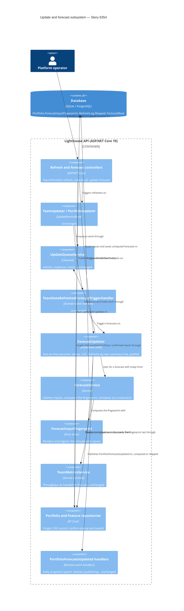

<!-- markdownlint-disable MD024 -->
# Feature Delta — story-6354-skip-unchanged-forecasts

> ADO User Story #6354 "Updates that change nothing skip the forecast", pulled out of the ideas listed on Epic 6321
> ("skip unchanged forecasts"). The evidence is the logs Steve Pereira sent from a large instance (Portfolios of 400 to
> 920 Features, 6 to 9 Teams). On that instance every Team or Portfolio refresh re-forecasts every Feature of the
> Teams involved, and each forecast takes 4 to 8 minutes even when the refresh found nothing new:
>
> `ForecastUpdater: Update completed | Team 'FSS' | mode=Delta | scanned=71 | fetched=0 | duration=16448ms | success=True | forecast=269719ms`
>
> While those forecasts run, Kestrel reports heartbeat delays of up to 49 s, so the whole app feels slow. The goal is
> to skip a forecast whose inputs have not changed since the last one, so a refresh that found nothing new costs
> seconds instead of minutes. Thread-pool starvation itself is analysed later, after this Story and Story 6351.

## Wave: DISCUSS / [REF] Prior-Wave Reading Confirmation

- ✓ `docs/product/jobs.yaml`: reused `job-operator-keep-lighthouse-usable-while-it-forecasts` (Epic 6311) and added
  a dated reuse note to it. No new job (see JTBD).
- ✓ `docs/product/personas/platform-operator.yaml` and `delivery-forecaster.yaml`, by reference. No persona or
  journey change: the existing personas fit, and no existing journey covers background refresh rounds closely
  enough to extend naturally.
- ⊘ DISCOVER / DIVERGE: none, skipped as for every Story-sized change. The ADO Story quotes the reporter's log
  lines, and those are the evidence.
- ✓ Code read (read-only investigation of 2026-10-23, cited from it; paths relative to
  `Lighthouse.Backend/Lighthouse.Backend/`): `Services/Implementation/RefreshRoundSummaryLine.cs:32`,
  `WriteBackRound.cs:51-54`, `TeamUpdater.cs:55`, `TeamData/TeamDataService.cs:22-25`,
  `TeamDataRefreshedForecastTriggerHandler.cs:14-16`, `PortfolioUpdater.cs:123`, `ForecastUpdater.cs:37-65,
  :88-92, :114-136, :153, :189-196, :205-223`, `Forecast/ForecastService.cs:72, :81, :342`,
  `UpdateQueueService.cs:231-241`, `ForecastController.cs:46, :69`, `TeamMetricsService.cs:110-167, :896-950`,
  `WorkItemService.cs:85-129, :144, :278-289, :681-859, :917-922`, `FeatureRepository.cs:19-21`,
  `SimulatedRun.cs:110-115`, `Dependencies/WhatTheForecastWaitsFor.cs:9-19`, `DrawStreamFactory.cs:14`,
  `API/DTO/WhenForecastDto.cs:25`, `API/DTO/FeatureDto.cs:25`, `Models/Feature.cs:289-317`, `ForecastBase.cs:19`,
  `Services/Implementation/WorkItems/FetchFingerprint.cs`.
- ✓ Frontend read (read-only): `pages/Settings/SystemInfo/RefreshHistorySection.tsx` (Refresh History: per-entity
  average, minimum and maximum duration), `services/Api/TeamService.ts:121-148` and `PortfolioService.ts:111-125`
  (the refresh and "update forecast" buttons' endpoints), `models/Feature.ts:15` (`lastUpdated`, carried but not
  rendered by any page).
- ✓ Docs read: `docs/settings/taskmanager.md` (the "Forecasting Portfolio '<name>'" row, stop semantics),
  `docs/settings/systeminfo.md`, ADR-249 (a cancelled forecast leaves `CreationTime` unchanged), ADR-197 (forecasts
  have no periodic refresh of their own).

## Wave: DISCUSS / [REF] Current-State Surface Inventory (brownfield)

| Surface | Today | Gap |
|---|---|---|
| Team refresh (periodic, `UpdateServiceBase.cs:262-316`, or the Team's refresh button) | Always publishes `TeamDataRefreshed`, which triggers a forecast of every Portfolio of the Team (`TeamDataService.cs:22-25`, `TeamDataRefreshedForecastTriggerHandler.cs:14-16`) | Forecasts even when nothing it reads changed |
| Portfolio refresh (periodic or button) | Triggers the Portfolio's forecast unconditionally (`PortfolioUpdater.cs:123`) | Same |
| One forecast | Every Feature of every Team in the Portfolio, including Features of other Portfolios (`ForecastService.cs:81`); a Team in N Portfolios causes N forecasts over overlapping Features | 4–8 min each on the large instance |
| Refresh summary log line (`RefreshRoundSummaryLine.cs:32`) | `forecast=269719ms` on the Team round that caused it | Cannot say "nothing changed, skipped" |
| Settings → Task Manager | Row "Forecasting Portfolio '<name>'" for the whole run | Sits there for minutes after a no-change refresh |
| Settings → System Info → Refresh History | Forecast rows from `RefreshLog` with their durations | Shows the minutes, with no way to tell a needed forecast from a wasted one |
| Feature `lastUpdated` (API, `FeatureDto.cs:25` = forecast `CreationTime`) | Time the forecast was last computed | Not rendered on any web page; read through the API (and the clients) |
| Existing coalescing (`ForecastUpdater.cs:37-53, :88-92, :114-136`; `UpdateQueueService.cs:231-241`) | Holds a Portfolio's forecast while its Teams are queued; turns duplicates into one follow-up | Still a full forecast per round |

**fetched=0 does not mean nothing changed.** A Delta refresh with `fetched=0` still removes items that left the
query (`WorkItemService.cs:144, :278-289`), recomputes remaining work for every Portfolio of the Team (`:85-93`),
moves automatic Feature WIP (`TeamMetricsService.cs:896, :901-910`), and a Portfolio delta can shrink Feature
membership (`WorkItemService.cs:917-922`). Throughput windows end today (`TeamMetricsService.cs:126, :919-924`).
Hence MD-1.

## Wave: DISCUSS / [REF] Persona IDs

- **platform-operator** (primary): runs the instance, reads the log and the Task Manager, gets the "Lighthouse is
  slow" complaint.
- **delivery-forecaster** (secondary): needs the forecast current after a real change, and the forecast to say
  when it was last confirmed.

## Wave: DISCUSS / [REF] JTBD One-Liners

- #6354 → reused `job-operator-keep-lighthouse-usable-while-it-forecasts`: when Lighthouse recalculates a
  Portfolio's forecasts in the background, I want every page to keep answering. Epic 6311 made a forecast share
  the machine; this Story removes the forecasts that compute nothing new. A reuse note is dated in `jobs.yaml`;
  the wording is unchanged.

## Wave: DISCUSS / [REF] Locked Decisions

| ID | Decision | Why |
|---|---|---|
| D1 | **Skip rule is a fingerprint of what the forecast reads** (MD-1). The members are: remaining work per Feature and Team (with the owning Team / Feature-owner split), Feature order, each Team's Feature WIP, dependencies as the forecast resolves them (licence included), each Team's throughput samples after the window, blackout removal and the forecast filter, Feature sizes including defaults and percentile sizes, the forecast settings and simulation limits, the set of Teams and Features in scope, and today's date. | One rule covers every input, including those no event announces. |
| D2 | The fingerprint is **per Portfolio**, because a forecast is per Portfolio. Comparing it never needs the simulation itself. | `TriggerUpdate(portfolioId)` is the unit everywhere |
| D3 | **A user-started refresh always forecasts** (MD-2). That covers the Portfolio's and Team's "update forecast" buttons (`ForecastController.cs:46, :69`), a Team's or Portfolio's refresh button, and the "refresh all" buttons. Only periodic and event-triggered rounds may skip. | Escape hatch if the rule is ever wrong. See the reading note under the MD block |
| D4 | **A skip still counts as a forecast round** (MD-3). The summary line says the forecast was skipped because nothing changed. A Forecast row is still written to `RefreshLog`, marked as skipped (MD-7): Refresh History shows it as a skip, and the forecast duration figures count only computed runs. The Task Manager shows the row as it shows any finished forecast, only for seconds instead of minutes (MD-8, amended at DISTILL). The Features' forecast "last updated" becomes the time of confirmation. | Silence would look like a lost forecast; a confirmation the reader cannot see is not one |
| D5 | **Unchanged unseeded randomness is a feature, not a bug.** Skipping means the dates stop jittering between no-change rounds. Results are not "refreshed by luck". | `DrawStreamFactory.cs:14` is unseeded; seeding is out of scope |
| D6 | **Rank and ordering-policy triggers stay immediate** (`FeatureRankChangedForecastTriggerHandler.cs:26`, `FeatureOrderingPolicyChangedForecastTriggerHandler.cs:30`). They are not user-started in the MD-2 sense, but they change Feature order and so never match the old fingerprint. | No special case needed |
| D7 | **Fail towards forecasting.** No stored fingerprint, a fingerprint that cannot be computed, or a failed or cancelled last run all count as "changed". | The FetchFingerprint convention: null stored = changed |
| D8 | The fingerprint's member list is pinned by a guard test that names every member, as `FetchFingerprint`'s is, so a new forecast input cannot be added without deciding its place. | Prevents silent staleness later |

### Maintainer decisions — 2026-10-23, before DISCUSS

| ID | Decision | Options weighed |
|---|---|---|
| MD-1 | **Skip rule = input fingerprint.** Store a fingerprint of everything a Portfolio's forecast reads (remaining work per Feature and Team, Feature order, Feature WIP, dependencies, throughput samples incl. blackout removal and forecast filter, sizes incl. defaults, forecast settings / simulation limits, today's date) and skip when it matches the last run's. Mirrors the existing `FetchFingerprint` pattern. | Fingerprint (chosen) vs. the simple rule "every Team fetched 0, no settings change, forecast already from today" (rejected: fetched=0 still removes items, shrinks membership and moves automatic Feature WIP). |
| MD-2 | **Manual "Update forecast" and refresh buttons always forecast** and bypass the skip; only background and automatic refreshes skip. This is the escape hatch if the rule is ever wrong. | Bypass for anything user-started (chosen) vs. skipping everywhere (rejected: no way out if the fingerprint misses an input). |
| MD-3 | **A skipped run stamps the forecasts as confirmed now.** A Feature's forecast "last updated" shows when the forecast was confirmed current, not only when it was last computed. The refresh summary line says the forecast was skipped because nothing changed; DESIGN settles the exact wording. | Confirmed-now stamp (chosen) vs. keeping the compute time (rejected: an old stamp on a current forecast reads as stale). |
| MD-4 | **Coalescing back-to-back Team refreshes' forecasts is a follow-up, out of scope.** The fingerprint already turns repeated no-change runs into cheap skips, and the queue already holds forecasts while Teams are queued. | Follow-up (chosen) vs. in this Story (rejected: a second mechanism for a case the skip mostly covers). |
| MD-5 | **Today's date is part of the fingerprint**, so the first refresh of each day always forecasts. The daily Delivery snapshot (`PortfolioForecastsUpdated` → `GetOrCreateForDay`) and the forecast write-back still happen at least once a day. Settings changes that never triggered a forecast themselves (blackouts, Feature WIP, throughput window, forecast filter, dependency edits) are picked up at the next refresh, as today, because they change the fingerprint. *(Consequence recorded by the orchestrator.)* | Date in the fingerprint (chosen) vs. a date-free fingerprint plus a separate daily trigger (rejected: two mechanisms, and a day boundary is itself an input of the throughput window). |
| MD-6 | **Every refresh a user starts forecasts** (confirms the reading of MD-2): the two "update forecast" buttons, a Team's or Portfolio's refresh button, and "refresh all" for Teams or Portfolios. Only periodic and event-triggered rounds may skip. *(Amended at the DISTILL review gate: the two "update forecast" buttons guarantee it; the four refresh buttons forget what was confirmed at the press, which a forecast running in between can use up. See MD-10, an autonomous reading for the maintainer to revisit.)* | Every user-started refresh (chosen) vs. only the two "update forecast" buttons (rejected: a user who presses a Team's refresh would see the forecast skipped). |
| MD-7 | **A skipped forecast keeps its own row in the refresh log, marked as skipped.** Refresh History shows it as a skip, and Refresh History's forecast duration figures count only forecasts that were computed. *(Amended in place for MD-8: the Task Manager shows no skip marker; its row leaves within seconds, as any finished forecast's does.)* Showing the marker is a UI change: DISTILL sketches it with the maintainer before the scenarios are written. | Own row, marked skipped (chosen) vs. an ordinary short row (rejected: average, minimum and maximum forecast durations would drop sharply and stop saying how long a real forecast takes) vs. no row (rejected: no trace of the skip in the UI). |

## Wave: DISCUSS / [REF] Scope Assessment

PASS. 1 Story, 1 bounded context (update and forecast background services). No new endpoint. One UI change: the
skip marker in Refresh History (MD-7, MD-9; this line read "backend only, no UI change" before DESIGN made MD-7 a UI
change). 2 slices: 01 about a day and a half, 02 about half a day (re-cut at the DISTILL review gate). One walking
skeleton, added at DISTILL (this line said none): the quiet round that skips, through the production host.

## Wave: DISCUSS / [REF] Story Map & Slices

Backbone (platform-operator, one background round): *a refresh runs* → *the forecast is triggered* → *the forecast
decides compute or confirm* → *the round is reported (log, Task Manager, Refresh History)* → *readers see the
forecast and its date*.

| Slice | Outcome | Brief | Est. |
|---|---|---|---|
| 01 | Automatic rounds with unchanged inputs skip the forecast and say so (summary line, Refresh History); every button a person presses forgets what was confirmed, so "Update forecast" always recomputes and a refresh recomputes unless a forecast of the Portfolio ran in between (MD-10) | `slices/slice-01-automatic-rounds-skip-unchanged-forecasts.md` | 1½ days |
| 02 | A skipped forecast stamps its Features' forecasts "confirmed now" | `slices/slice-02-user-refresh-forecasts-and-confirmed-now.md` | ½ day |

*(Re-cut at the DISTILL review gate: all six button forgets moved from 02 into 01, so slice 01 shipped alone already
honours MD-6 as far as MD-10 reads it. 02 keeps only the confirmed-now stamp.)*

### Priority Rationale

01 first. It carries all of the production value (the reporter's no-change rounds go from minutes to seconds) and
the riskiest assumption: that the fingerprint captures every input, so that no stale forecast survives a change.
It carries every escape hatch too: all six buttons forget what was confirmed, so it can ship alone without taking
away a way to force a forecast. 02 makes the forecast's date honest. It builds on 01 and is worth nothing without it.

### Slice taste tests

- 01 cannot be cut thinner safely: a skip that knows only part of the inputs ships stale forecasts. So all of D1 is
  in 01, and the "still re-forecasts" cases are its acceptance tests.
- Neither slice is infrastructure-only. Each changes what an operator sees: the summary line, the Task Manager row's
  length, Refresh History's skip marker and durations, and a button's result in 01; the forecast's date in 02.
- Each has a hypothesis that can fail (see briefs). Each is checked against production-shaped data on the dev
  instance (`:5169`, real history) with the periodic refresh running and nothing changing remotely.
- They are not scale variants of each other. A slice proven only on synthetic data: none.

## Wave: DISCUSS / [REF] User Stories

### US-01 — Automatic rounds that change nothing skip the forecast (slice 01, ADO #6354)

`job_id: job-operator-keep-lighthouse-usable-while-it-forecasts`

As a platform-operator on a large instance, I want a background refresh that changed nothing the forecast reads to
skip the forecast, so the app stays responsive and the round costs seconds instead of minutes.

#### Elevator Pitch
Before: the periodic refresh of Team "FSS" fetches 0 items, then forecasts its Portfolios for 4.5 minutes
(`forecast=269719ms`). Meanwhile "Forecasting Portfolio '…'" sits in the Task Manager and pages stall behind 49 s
heartbeat delays.
After: the next periodic refresh of "FSS" changes nothing the forecast reads. Its log line ends `forecast=skipped
after 812ms (inputs unchanged)` (DDD-8), the "Forecasting Portfolio" row in **Settings → Task Manager** is gone within
seconds, **Settings → System Info → Refresh History** shows that Portfolio's last run as `… · skipped (nothing
changed)` and keeps its duration figures to the forecasts that computed, and the pages keep answering. Change one input (a blackout, a Feature's order, an item closed in the tracker) and the next round
forecasts as before.
Decision enabled: whether this instance's refresh interval is affordable, judged from forecasts that are needed
rather than from wasted ones.

#### Domain Examples
1. **Happy path.** At 10:15 the periodic refresh of Team "FSS" scans 71 items and downloads none. Nothing else
   changed since the 10:00 forecast of Portfolio "Payments Platform" (412 Features). The forecast is skipped and the
   round completes in about 17 s (16.4 s refresh plus a skip of under a second) instead of about 4 min 46 s (16.4 s
   refresh plus the 4 min 30 s forecast of the reporter's line).
2. **A refresh that downloads nothing and still changes something.** At 10:30 "FSS" downloads nothing, but item
   FSS-2210 left the Team's query
   (closed and filtered out). Remaining work for Feature PAY-88 drops from 9 to 8, so "Payments Platform" is
   forecast in full.
3. **New day.** The first periodic round after midnight on 2026-10-24, in the instance's time zone, finds nothing new. The throughput window
   now ends a day later, so the forecast runs, and the day's Delivery snapshot is recorded.
4. **Setting changed between rounds.** Maria adds a blackout for 2026-12-24 to 2026-12-31 on Team "FSS" at 11:02.
   Saving starts no forecast, as today. The 11:15 periodic round downloads nothing but forecasts, because the
   throughput samples changed.
5. **Escape hatch.** At 11:20 the operator presses **Update forecast** on "Payments Platform". The forecast runs
   in full although nothing changed.

#### UAT Scenarios (BDD)

##### Scenario: A background round that changed nothing skips the forecast and says so
Given Portfolio "Payments Platform" was forecast at 10:00 today
And nothing the forecast reads has changed since
When the periodic refresh of Team "FSS" completes, having downloaded nothing
Then no forecast of "Payments Platform" is computed
And the round's summary line says the forecast was skipped because nothing changed, with the round's short duration
And Refresh History records the skipped forecast of "Payments Platform", marked as skipped

##### Scenario Outline: A background round re-forecasts when an input changed
Given Portfolio "Payments Platform" was forecast at 10:00 today
And since then <change>
When the next periodic refresh of a Team of "Payments Platform" completes, having downloaded nothing
Then "Payments Platform" is forecast in full

Examples:
| change |
| the day has turned |
| an item left a Team's query |
| a Team's automatic Feature WIP moved from 2 to 3 |
| a Team's or the Portfolio's forecast settings were saved with a new value |
| a blackout period was added |
| a Feature gained a dependency |
| two Features swapped order |
| a Feature joined or left the Portfolio |
| a Team joined or left the Portfolio |

##### Scenario: A Portfolio with nothing confirmed, whose last run did not finish, or on an instance just started, is computed
Given Portfolio "Payments Platform" has nothing confirmed yet, or its last forecast failed or was stopped, or the
  instance was started again since its last forecast
When the periodic refresh completes, having downloaded nothing
Then "Payments Platform" is forecast in full

##### Scenario: "Update forecast" always forecasts
Given nothing "Payments Platform" reads has changed since its last forecast
When the operator presses "Update forecast" for the Portfolio, or "Update forecasts" for one of its Teams
Then "Payments Platform" is forecast in full

##### Scenario: The day's Delivery snapshot is still recorded
Given it is the first background round of 2026-10-24 and nothing was fetched
When the round completes
Then the Portfolio is forecast and the Delivery snapshot for 2026-10-24 exists

#### Acceptance Criteria
- AC-1.1 A periodic or event-triggered round in which nothing the Portfolio's forecast reads has changed since its
  last completed forecast computes no forecast, and the stored forecasts stay exactly as they were.
- AC-1.2 Each "still re-forecasts" case forecasts in full: new day, an item that left the query in a refresh that
  downloaded nothing, Feature WIP change, Team or Portfolio settings change, blackout change, dependency change,
  Feature order change, a Feature added to or removed from the Portfolio, a Team added or removed, and a change to a
  Feature of another Portfolio that one of its Teams works on.
- AC-1.3 A Portfolio with nothing confirmed yet, one whose last forecast failed or was stopped, and every Portfolio
  after the instance starts again, is forecast in full on its next round (D7, DDD-14).
- AC-1.4 Both "Update forecast" buttons always end in a computed forecast, even with a forecast of the Portfolio
  already running or waiting (MD-2, MD-10). The four refresh buttons make the next forecast of each Portfolio they touch
  compute (MD-10; moved here from AC-2.1 when slice 01 took every button).
- AC-1.5 The summary line of a round whose forecast was skipped says so, with the round's short duration. Refresh
  History records the skipped run, marked as skipped, and keeps its duration figures to the forecasts that computed.
- AC-1.6 The first round of each instance day forecasts in full, and that day's Delivery snapshot is recorded (MD-5).
- AC-1.7 No input can be added to the forecast without the skip taking it into account: the build fails until it does
  (D8).

#### Outcome KPIs
See K1–K3 under Outcome KPIs.

#### Technical Notes
- Driving ports: `TeamUpdater` / `PortfolioUpdater` / `ForecastUpdater` background services through
  `UpdateQueueService`, and the `ForecastController` endpoints. Assert through `RefreshLog`, the summary line and the
  persisted forecasts, not internals.
- The skip check sits after the inputs are gathered and before the simulation. Where it lives and where the
  fingerprint is stored (likely on the Portfolio, expand-only migration through `CreateMigration`) are DESIGN's call.
- "Nothing the forecast reads has changed" is decided by a fingerprint of the forecast's inputs (D1, DDD-1) compared
  with the one recorded at the last completed forecast (AC-1.1), and pinned by a guard test that lists every member
  (AC-1.7, D8). "Downloaded nothing" is the summary line's `mode=Delta | fetched=0`: such a round still removes items
  that left the query and recomputes remaining work, which is why it is not a skip rule (MD-1).
- The date member is the instance day, `ILighthouseClock.Today` (a `DateOnly` in the instance's configured time
  zone), and that is what "day" means in AC-1.6 and Domain Example 3. The percentile size window reads `DateTime.UtcNow`
  (`WorkItemService.cs:837-840`), which the date member covers. *(This note named `Clock.TodayAsUtcMidnight` and
  AC-1.6 said "UTC day" until the DISTILL review gate; one definition everywhere now.)*

### US-02 — Every refresh a user starts forecasts, and a skip says the forecast is confirmed now (AC-2.1 in slice 01, the rest in slice 02, ADO #6354)

`job_id: job-operator-keep-lighthouse-usable-while-it-forecasts`

As a platform-operator, I want any refresh I start by hand to forecast, and I want a skipped forecast to carry the
time it was confirmed current, so I can always force a fresh forecast and never read a current forecast as stale.

#### Elevator Pitch
Before (a skip with no button bypass): Maria presses a Team's refresh on the Team page to "make sure", and the
forecast is quietly skipped. Meanwhile the Features' forecast `lastUpdated` stays at 06:00, although the forecast was
confirmed at every round since.
After: **Update forecast** on the Portfolio or Team page always ends in a full forecast, shown as its "Forecasting
Portfolio" row in **Settings → Task Manager** for the usual minutes. A press of **refresh** (or **refresh all** on the
overview) does too, unless a forecast of that Portfolio ran between the press and the refreshed data (MD-10). After a
skipped background round, each Feature's forecast `lastUpdated` reads the round's time in the API, for example
`GET /api/latest/features` → `{"referenceId":"PAY-88", …, "lastUpdated":"2026-10-23T09:45:03Z", …}` with the
same `forecasts` as at 06:00. No `lh` command prints a Feature's `lastUpdated` (the clients read it only for Teams and
Portfolios), so the API is where it is read.
Decision enabled: whether to trust the forecast's date as "current as of", and when a forced refresh is worth its
minutes.

#### Domain Examples
1. **Team refresh button.** At 14:05 Maria presses refresh on Team "Atlas". It downloads nothing, and the forecasts of
   "Payments Platform" and "Onboarding" both run in full.
2. **Refresh all.** At 14:20 the operator presses "refresh all" for Portfolios. Every Portfolio forecasts (unless a
   forecast of it ran between the press and its refreshed data, MD-10), whether or
   not its inputs changed.
3. **Confirmed-now stamp.** Feature PAY-88 was computed at 06:00. Background rounds at 06:15 through 09:45 skip. At
   09:46 its forecast `lastUpdated` reads 09:45, and the forecast dates are the 06:00 ones.
4. **A stopped skip-check run changes no stamp.** A round is stopped from the Task Manager before it finishes, so
   `lastUpdated` stays as it was (as ADR-249 does for a cancelled forecast).

#### UAT Scenarios (BDD)

##### Scenario: A Team refresh the user starts forecasts even when nothing changed
Given nothing "Payments Platform" reads has changed since its last forecast
When Maria presses refresh on Team "Atlas", a Team of "Payments Platform"
Then "Payments Platform" is forecast in full

##### Scenario: A Portfolio refresh or refresh-all the user starts forecasts
Given nothing "Onboarding" reads has changed since its last forecast
When the operator presses refresh on "Onboarding", or refresh all for Teams or Portfolios
Then "Onboarding" is forecast in full

##### Scenario: A skipped forecast is stamped as confirmed now
Given Feature PAY-88's forecast was computed at 06:00
When the 09:45 background round skips the forecast of "Payments Platform"
Then PAY-88's forecast reads last updated 09:45
And its forecast dates are unchanged

##### Scenario: A computed forecast still stamps the compute time
Given an input of "Payments Platform" changed
When the next background round forecasts it
Then each Feature's forecast reads last updated at that round's time, with new dates

#### Acceptance Criteria
- AC-2.1 *(Ships in slice 01, as part of AC-1.4.)* A Team refresh, a Portfolio refresh or a refresh-all a person
  starts makes the next forecast of every Portfolio it touches compute in full (MD-2, D3, MD-10). A forecast of that
  Portfolio that runs between the press and the refreshed data counts as that next forecast. Periodic rounds of the
  same entities may still skip.
- AC-2.2 A skipped forecast sets each in-scope Feature's forecast "last updated" (`FeatureDto.LastUpdated`) to the
  skip time and leaves the forecast values and histograms untouched (MD-3).
- AC-2.3 A stopped or failed round changes no stamp.
- AC-2.4 A computed forecast stamps as today.

#### Outcome KPIs
See K3 (guardrail) and K4 under Outcome KPIs.

#### Technical Notes
- A user-started refresh reaches the forecast today only through the queue and `TeamDataRefreshed` /
  `PortfolioUpdater.cs:123`. DESIGN settled it without carrying an origin: each button forgets what was confirmed, in
  the database, before it queues (DDD-9). `UpdateQueueService.cs:231-241` therefore needs no change.
- `FeatureDto.LastUpdated` is read by the API clients. The payload shape does not change, but its meaning does
  (see Standing Checklist).

## Wave: DISCUSS / [REF] Outcome KPIs

| KPI | Target | Measure | Baseline |
|---|---|---|---|
| K1 Share of background rounds with unchanged forecast inputs whose forecast is skipped | ≥ 95 % (100 % by design) | The per-Portfolio `RefreshLog` Forecast rows (Refresh History, or the query under DEVOPS) on the reporter's instance and the dev instance; a Team's summary line folds several forecasts into one and is not a per-Portfolio count | 0 % |
| K2 Forecast wall clock on a skipped round, large instance | < 5 s | `DurationMs` of the skipped per-Portfolio `RefreshLog` rows, the same figure as `forecast=skipped after {N}ms` | 4–8 min (`forecast=269719ms`) |
| K3 Guardrail: a forecast left stale after an input change | 0 (every input change → the next round forecasts) | Acceptance tests per D1 member; a maintainer spot check on the dev instance; no "forecast did not update" report in the 60 days after release | n/a |
| K4 Kestrel heartbeat warnings on a no-change day, large instance | Clear drop (direction, not a number: thread-pool starvation is analysed later); soft | A named comparison: the count of Kestrel "Heartbeat took longer than" warnings and the largest delay in one no-change day's excerpt after the release, against the same two figures in the Story's excerpt | up to 49 s delays during each forecast |

Usage-data event: left to DEVOPS. The expected answer is "N/A, because a skip is not a user action". The operator
already sees the effect in the log and Refresh History.

## Wave: DISCUSS / [REF] Definition of Done

1. ACs green as NUnit acceptance tests through the driving ports, and the Refresh History marker as Vitest
   scenarios. No new E2E: the existing Refresh History and Task Manager coverage stays the thin sanity check, and
   keeps passing. *(Amended in place: this said "no UI changes" before MD-7 became one.)*
2. `dotnet build` (zero warnings) and the filtered `dotnet test` are clean; `pnpm test` and `pnpm build` (Biome) are
   clean, because the frontend is touched (Refresh History).
3. Sonar: no new issues; `docs/ci-learnings.md` pre-applied.
4. Docs at finalization: `docs/settings/taskmanager.md` says a forecast whose inputs did not change is confirmed in
   seconds rather than recomputed, that **Update forecast always recomputes**, and that a refresh you start
   recomputes unless a forecast of that Portfolio ran in between (MD-10). `docs/settings/systeminfo.md` says how
   Refresh History shows a skipped forecast (the "Skipped (nothing changed)" line, the last-run marker, durations over
   computed runs only, a dash when none computed).
5. Screenshots: regenerate `settings/systeminfo.png` at finalize, because the System Info @screenshot
   (`Screenshots.spec.ts`, "system info settings page") captures the page that holds Refresh History, whose figures
   and lines this Story changes. `settings/RefreshHistory.png`, used by `systeminfo.md`, is produced by no
   @screenshot test, so finalize recaptures it by hand or records why the old one still fits. Demo data: N/A, because
   no data shape changes.
6. Copy (log line) uses the configurable terms where it names entities (Portfolio, Feature, Team).
7. ADO: Story #6354 Active on first commit, Resolved on push, Closed on green CI. The Release Notes tag is for the
   maintainer to confirm (a user-noticeable speed-up).
8. Mutation testing (Stryker.NET) on touched backend files ≥ 80 %, run last on frozen code.
9. `ARCHITECTURE.md` updated if the forecast trigger concept changes.

## Wave: DISCUSS / [REF] Out of Scope

- Coalescing the forecasts of back-to-back Team refreshes (MD-4, follow-up).
- Thread-pool starvation analysis (after this Story and Story 6351).
- Story 6351 (Features list speed).
- Seeding the simulation (D5).
- Any UI change beyond the Refresh History marker (MD-7, MD-9) and what MD-3 changes about "last updated". No new
  control, badge or column.
- Making settings saves (blackouts, WIP, filter, dependencies) trigger a forecast themselves (MD-5: as today).
- Narrowing a forecast to the Features whose inputs changed (a partial forecast).

## Wave: DISCUSS / [REF] WS Strategy, Driving Ports, Pre-requisites

- **WS strategy**: one walking skeleton, the quiet round that skips, through the production host (changed at
  DISTILL; this line said "A, no walking skeleton").
- **Driving ports**: the Team, Portfolio and Forecast update background services (through `UpdateQueueService`),
  the `ForecastController` endpoints (`forecast/update/{id}`, `update-portfolios-for-team/{teamId}`), and the
  Team/Portfolio refresh and refresh-all endpoints. The HTTP contracts do not change.
- **Pre-requisites**: none. Existing fixtures in `Tests/API/Integration/DependencyAwareForecasting/
  Slice00OneForecastPerBatchScenarios`, `FasterUpdates/*` and `ResponsiveDuringUpdates/*` are the natural homes.

## Wave: DISCUSS / [REF] Standing Checklist

- **RBAC**: N/A, because no endpoint, guard or gated control is added or changed. The refresh and "update forecast"
  endpoints keep their existing write guards, and the skip happens inside the background service.
- **Lighthouse-Clients (CLI + MCP)**: no version bump needed, because no payload shape changes. However, the meaning
  of a Feature's `lastUpdated` changes in slice 02, from "computed at" to "confirmed current at" (MD-3). DESIGN greps
  `lighthouse-clients` (outside this checkout, so not verified in this wave) for `lastUpdated` and adjusts any
  wording that says "computed" or "calculated". If none reads it, this item is N/A.
- **Website**: expected N/A, because no feature or copy the website names changes. A faster refresh is not
  advertised as a feature. The website repo is outside this checkout, so finalization confirms with a grep for
  "forecast" speed claims.
- **Usage data**: deferred to DEVOPS, as the standing rule requires. Expected "N/A, because a skip is not a user
  action".
- **Terminology**: the log line and docs use Portfolio, Feature and Team (the seeded defaults).
- **UI sketch**: needed, because MD-7 marks a skipped forecast in Refresh History (the Task Manager is unchanged, MD-8). DISTILL
  sketches that marker, and which duration figures exclude skips, with the maintainer before writing scenarios.
  The log-line wording is settled in DESIGN (MD-3).
- **Loading and failure looks**: Refresh History keeps its existing spinner and "Could not load refresh history."
  (MD-9). *(This line said N/A before MD-7 became a UI change.)*

## Wave: DESIGN / [REF] Prior-Wave Reading Confirmation

- ✓ This feature delta (MD-1..MD-7, D1..D8, US-01/US-02, K1–K4, Out of Scope) and both slice briefs.
- ✓ `docs/product/architecture/brief.md` (delivery-metrics section: `PortfolioForecastsUpdated` once per forecast
  completion; Epic 6311 section) and ADR-197, ADR-248, ADR-249. Highest ADR in use: ADR-255; no feature folder
  claims 256+, so this wave takes **ADR-256**.
- ✓ Code opened (paths under `Lighthouse.Backend/Lighthouse.Backend/`): `ForecastUpdater.cs`, `UpdateServiceBase.cs`,
  `UpdateQueueService.cs:222-330`, `TeamUpdater.cs`, `PortfolioUpdater.cs:60-135`, `TeamDataService.cs`,
  `TeamDataRefreshedForecastTriggerHandler.cs`, `IForecastUpdater.cs`, `IUpdateService.cs`, `ForecastController.cs:37-73`,
  `TeamController.cs:75-90`, `Forecast/ForecastService.cs`, `ForecastRunPlan.cs`, `SimulatedRun.cs:112`,
  `Models/Dependencies/ForecastWaits.cs:41`, `WorkItems/FetchFingerprint.cs`, `Models/RefreshLog.cs`,
  `API/DTO/RefreshLogDto.cs`, `RefreshRoundSummaryLine.cs`, `FeatureRepository.cs`, `RepositoryBase.cs:96-100`,
  `FeatureRankingService.cs:93-113`, `DeliveryForecastPublishingHandler.cs`, `DeliveryMetricSnapshotRecordingHandler.cs`,
  `WriteBackTriggerService.cs:62-103`, `TeamMetricsService.cs:105-134`, `UpdateProgress.cs`, `LighthouseClock.cs`,
  `Program.cs:1586-1600` (Redis status store when a Redis connection is configured). Frontend (read-only):
  `pages/Settings/SystemInfo/RefreshHistorySection.tsx`, `components/Common/Charts/RefreshHistoryChart.tsx`,
  `models/SystemInfo/RefreshLog.ts`, `components/App/Header/TaskManager/ActivitySection.tsx`, `RecentProblemsSection.tsx`.
- ✓ Codebase facts of 2026-10-23 (orchestrator scratchpad), cited not re-derived.
- ✓ `CLAUDE.md` DESIGN rules, `docs/ci-learnings.md` (S107 ≤ 7 parameters; a persisted property needs a migration
  through `CreateMigration`; InMemory never catches it).
- ⊘ `lighthouse-clients`: outside this checkout and outside the tools' allowed root, so not grepped here (DDD-12 makes
  the grep a slice-02 gate).
- ⊘ `nwave-ai outcomes check-delta`: no shell in this wave; not run.

## Wave: DESIGN / [REF] Scope and Mode

Application scope (`nw-solution-architect`), PROPOSE mode, run AFK. The recommended option is taken at every point
except those that change what a user sees (Open Questions). Ports-and-adapters as established. No new style, no new
container, no new external call. The L1 and L2 C4 views are unchanged; an L3 of the update-and-forecast subsystem is
below. Revised once after the review gate (see Review below).

The invariant this design rests on: **a skip happens only when a computed run would have been handed exactly the same
inputs as the forecasts now stored** (randomness aside, D5). The fingerprint is therefore taken at the simulation's input
boundary, from the very values the run is about to be handed, not from the settings upstream of them. A skip is
possible only within one instance day, because the first round of each day always computes (MD-5).

## Wave: DESIGN / [REF] Reuse Analysis

| Existing component | File | Overlap | Decision | Justification |
|---|---|---|---|---|
| `FetchFingerprint` | `Services/Implementation/WorkItems/FetchFingerprint.cs` | Registered member list, rendered → sorted → SHA-256, stored on the owner, null = changed, guard test | **REUSE THE PATTERN, not the class** | Different members and a different question ("what does the query ask" vs "what does the simulation get"). One class for both would couple the fetch to the forecast. The rendering rules (invariant culture, ordinal sort, separators, 128-bit hex digest) are copied as a convention. |
| `ForecastService.ForecastFeatures` | `Forecast/ForecastService.cs:90-103` | Already gathers every input (Features in order, rows, throughput + chip status, waits) before the simulation | **EXTEND** | The comparison sits between the gathering and `RunMonteCarloSimulation`, so there is no second reading path and no extra query. |
| `ForecastUpdater.Update` | `BackgroundServices/Update/ForecastUpdater.cs:153-223` | The effect shell: `RefreshLog` row, round summary, write-back staging, publish | **EXTEND** | Acts on the outcome: stamps a confirmation, records the fingerprint last, marks the row and the line. |
| `IPortfolioRepository` | `Services/Interfaces/Repositories/IPortfolioRepository.cs` | Portfolio persistence | **EXTEND** with three set-based methods (the third, forget-all at start, added at the DISTILL review gate) | The fingerprint is written only through these (DDD-3, DDD-14). |
| `IFeatureRepository` | `Services/Interfaces/Repositories/IFeatureRepository.cs` | Feature persistence; set-based update precedent in `FeatureRankingService` | **EXTEND** with a confirm-stamp method | One statement instead of loading and saving thousands of forecast rows. |
| `RefreshLog` / `RefreshLogDto` | `Models/RefreshLog.cs`, `API/DTO/RefreshLogDto.cs` | Forecast rows; `Cancelled` flag precedent | **EXTEND** with `Skipped` | MD-7: own row, marked. |
| `RefreshRoundSummary(Line)` | `RefreshRoundSummaryLine.cs` | `forecast=cancelled after Nms` precedent | **EXTEND** | One more wording branch. |
| Refresh and forecast controllers | `API/ForecastController.cs`, `TeamController.cs`, `TeamsController.cs`, `PortfolioController.cs`, `PortfoliosController.cs` | The user-started entry points | **EXTEND** | Each forgets the confirmed inputs of the Portfolios it touches before queuing (DDD-9). |
| `RefreshHistorySection` | `pages/Settings/SystemInfo/RefreshHistorySection.tsx` | Duration figures; "Cancelled" count line precedent | **EXTEND** | MD-7. |
| `PortfolioForecastsUpdated` + its two handlers, `UpdateQueueService`, `UpdateServiceBase`, `TeamDataRefreshed` | as named | Publishing, queueing, the Team → forecast road | **REUSE AS-IS** | A skip publishes like a compute (DDD-6). The user bypass needs no origin on the queue or the event (DDD-9). |

CREATE NEW (each justified by "no existing alternative"):
- `ForecastInputFingerprint` (static, `Services/Implementation/Forecast/ForecastInputFingerprint.cs`): no existing type
  renders the simulation's inputs.
- `ForecastRunOutcome` (value type beside `IForecastService`): the port's answer, either `Computed(readFingerprint,
  freshFingerprint)` or `ConfirmedUnchanged(featureIds)`. A bare `bool` cannot carry what the shell needs to act on.
- One expand-only migration (`Portfolio.ForecastInputFingerprint` nullable, `RefreshLog.Skipped` default `false`),
  generated with `CreateMigration` for every provider.

## Wave: DESIGN / [REF] Decisions

| ID | Decision | Rejected |
|---|---|---|
| DDD-1 | **The fingerprint is a pure function of what the simulation is handed.** `ForecastInputFingerprint.Of(...)` renders these members, in order. (1) A format version. (2) Today, the instance day: a `DateOnly` from `ILighthouseClock.Today`, in the instance's configured time zone (MD-5; the one definition of "day" everywhere in this Story). (3) The simulation limits that change what a run computes: `Trials`, `MostDaysOneSimulatedRunMayCover`. `CoresSeen` and `MostRunsAtOnce` are left out, because they decide how many runs go at once, not what any run computes (amended at the DISTILL review gate; it listed `MostRunsAtOnce`). (4) The Features in scope **in forecast order**, as ids, so one member covers order and membership. (5) The Teams of those Features, which are the keys of the run's chip-status map (`ForecastService.cs:107`), not `portfolio.Teams`, as ids sorted. (6) Every row: Feature id, Team id and remaining items. Remaining items already carries sizes, defaults, percentile sizes and the owner split. (7) Per Team, the throughput as handed (the day counts after window, blackout removal and forecast filter). (8) Per Team, its chip status (`FilterApplied`, `ExcludedSummary`, `HasSufficientData`), which lands on the stored forecast. (9) Per Team, its `FeatureWIP` (`SimulatedRun.cs:112`). (10) Per in-scope Feature reference id, `ForecastWaits.Of(referenceId)`: the reference ids it waits for, sorted. That list is the only thing the plan reads from waits (`ForecastRunPlan.cs:184`), so `IgnoreDependencies`, `CanBeForecast`, Portfolio membership and the licence are covered through it. Order is kept only where it carries meaning (Features); everything else is sorted ordinally. Rendering follows `FetchFingerprint`: invariant culture, control-character separators, never `GetHashCode` or identity, SHA-256 truncated to 128 bits, lower-case hex. A `RegisteredMembers` list names each member for the guard test (D8). | Fingerprinting the upstream settings (blackouts, filter rules, size settings, forecast settings) as D1 lists them: a second list of the same knowledge that drifts from what the run reads, and it misses anything a later change adds to the run. Hashing the `ForecastRunPlan` object graph by reflection: unstable across EF materialisations, and silent about what it covers. |
| DDD-2 | **Cost: no extra reads, and only the simulation is saved.** The fingerprint is computed from values `ForecastFeatures` already gathers. Throughput comes from the same cached `TeamMetricsService.GetForecastThroughputStatus` call the run makes. A skip still pays for the Feature graph load (`FeatureRepository.GetFeatures` includes the forecast histograms), the hash, the confirm-stamp, the write-back staging and the Delivery publishing, which makes one remote call per Delivery source, as every round does today. **Narrowed read (amended at the DISTILL review gate):** today `ForecastService` reads every Feature of the instance through `FeatureRepository.GetAll()` (materialised and ordered) and keeps those of the Portfolio's Teams in memory. DELIVER narrows that read at query level to the Features with work for the Portfolio's Team ids, then orders them as today, so a skip on an instance with many Portfolios does not load all of them. **Timing, settling DEVOPS flag 2:** the `forecast=` stopwatch keeps spanning the whole round, publish included, because that is what an operator waits for; `ForecastUpdater` also writes one Debug line per forecast, `Forecast round timings \| Portfolio '<name>' \| gather={G}ms \| publish={P}ms`, so the gather and the publish can be told apart when a reading needs it. **K2 risk:** if, on the dev instance (`:5169`, real history), a skip costs more than a third of a computed run of the same Portfolio, or if a skip reads 5 s or more on the reporter's lines, the check moves to a lighter read (Features without histograms), and the full graph is loaded only to compute. The 5 s figure is claimed only from the reporter's lines, because the dev instance's forecasts take under 2 s (amended from "if `forecast=` exceeds 5 s" on the dev instance, which could never fire there). Not built up front. | A separate component that reads the inputs again: twice the input cost, and a second reading path. |
| DDD-3 | **Stored on the Portfolio, written only by set-based updates.** `Portfolio.ForecastInputFingerprint` is a `string?`; null means nothing was ever recorded (every row right after the migration), which counts as changed (D7). It is mapped with `PropertySaveBehavior.Ignore` after insert, so a full-entity `Update` of a stale Portfolio (`RepositoryBase.cs:99` marks every column modified) can never write an old value back. It is written through two `IPortfolioRepository` methods. `TryRecordForecastInputs(portfolioId, readAtGather, fresh)` is a CAS: an `ExecuteUpdateAsync` whose WHERE requires the column to still hold the value read at gathering, null-safely (`IS NULL` when the run read null), with the affected-row count as the answer (the repo's CAS idiom). `ForgetForecastInputs(portfolioIds)` writes a **forget token**, `"forgotten:" + Guid.NewGuid().ToString("N")`, new on every call, never null (amended at the DISTILL review gate: it wrote null). A forget therefore changes the stored value whatever it was, so a run that read null, an older fingerprint or an earlier forget's token loses its CAS to any later forget; with null, a run that read null after one press would have recorded over a second press. The token can never equal a fingerprint (those are 32 hex characters), so the next run computes and then records from the token. **Write order:** `ForecastService` saves the forecasts; `ForecastUpdater` stages write-back and publishes, then records the fingerprint **last**. A crash, cancel or failure anywhere earlier leaves the old value. That old value no longer matches the new inputs, or is null or a forget token, so the next run computes. A forget that lands during a run makes the CAS miss, whatever the run read, so the forget wins. Stored forecasts can therefore be newer than the fingerprint, never older. One expand-only migration adds the column and `RefreshLog.Skipped`. | Writing the fingerprint in the same `SaveChanges` as the forecasts (the first version of this design): a stale full-entity `Update` could write an old value back, and a "user asked" forget during the run would be overwritten. A separate `PortfolioForecastState` table: one value per Portfolio, a join for nothing. An in-memory map: across replicas a stale match could survive, and every restart recomputes everything. A JSON column: one string needs no JSON. |
| DDD-4 | **The comparison sits inside `ForecastService.UpdateForecastsForPortfolio`, between the gathering and the simulation**, not in `ForecastUpdater.Update` before `ForecastPortfolio` as the facts suggested, because the inputs exist only there. The port becomes `Task<ForecastRunOutcome> UpdateForecastsForPortfolio(Portfolio portfolio, DateOnly today, CancellationToken cancellationToken)`, with `today` from `ILighthouseClock.Today` (amended at the DISTILL review gate: it read `DateTime today`). **If `ForecastInputFingerprint.Of` throws**, `ForecastService` logs a warning and simulates as on a mismatch, and returns `Computed` with no fresh fingerprint, so `ForecastUpdater` records nothing: the round is a computed one, not a failed one, and the next round computes again until the cause is fixed (D7). It compares the fresh value with `portfolio.ForecastInputFingerprint` as loaded. On a match it returns `ConfirmedUnchanged` **without writing anything**. Otherwise it simulates, saves the forecasts as today, and returns `Computed`. Every other effect (stamp, fingerprint, row, line, staging, publish) is `ForecastUpdater`'s, the imperative shell. `today` is a parameter because `ForecastService` already has 7 constructor parameters (S107), and its constructor stays unchanged. The manual `When`, multi-team and probe paths are untouched. | The check in `ForecastUpdater` with its own fingerprinter: a second reading path, the drift `FetchFingerprint`'s own comment warns of. Splitting the port into prepare and run, with a plan value in between: two new port methods for one decision. That split stays the refactoring route if a second consumer of the prepared inputs appears. |
| DDD-5 | **D7, failed or cancelled last run.** A failed or cancelled compute never reaches the CAS (DDD-3), so it is covered by construction. For a skip that fails (stamp or publish), `ForecastUpdater` calls `ForgetForecastInputs` best-effort, the same as it does on any failed or cancelled run. It runs in its own scope with `CancellationToken.None`, because the run's token is the cancelled one, and it is logged and never fails the round (the `RecordConnectionHealth` precedent). This protects a recompute after a failed round, not correctness: the stored forecasts are never older than the fingerprint (DDD-3). If the forget itself fails, the next instance day repairs it through the date member. | Reading the latest `RefreshLog` Forecast row as the "last run went well" signal: it ties a forecast decision to a log table with its own retention. |
| DDD-6 | **What a skip does.** It runs no simulation, rewrites no forecast rows or histograms, and writes no fingerprint. **Slice 02:** `ForecastUpdater` stamps `CreationTime = now` on every `ForecastBase` row (When and Start forecasts) of the Features in scope. It uses one set-based `IFeatureRepository.ConfirmForecastsAsOf(featureIds, confirmedAt, cancellationToken)` (`ExecuteUpdateAsync`, `OfType<>` per derived type as needed; the `FeatureRankingService` precedent), resolved in the updater's scope. This is a plain bulk update, not a CAS, because no competing writer can be lost: if a concurrent forecast of another Portfolio rewrote shared Features, those rows are newer, and "confirmed now" is true of them. A cancel before the stamp changes nothing (AC-2.3). **Both slices:** the skip stages the forecast write-back and publishes `PortfolioForecastsUpdated` exactly as a computed run does. The daily snapshot is an upsert on `GetOrCreateForDay`, so it gets no duplicate. Delivery publishing re-reads target dates the Portfolio refresh just re-synced, and both handlers' best-effort retries rely on "the next forecast asks again". Keeping them on every round keeps today's cadence for everything but the simulation. | A skip that publishes nothing: today's snapshot would stop following intra-day Delivery target-date and done-work changes, a Release's published likelihood would lag a target-date move, and retries would wait up to a day. Stamping by loading and saving the tracked rows: thousands of UPDATE statements per skip on the large instance. |
| DDD-7 | **`RefreshLog.Skipped` (bool, default false), and `RefreshLogDto.Skipped`.** A skipped row has `Success = true`, `Cancelled = false` and its short duration. `UpdateNotificationHub.WhatTheLastRunSaysHappened` keeps answering `Completed`. | `SyncMode.Skipped`: `Mode` says how much a fetch downloaded, and the frontend mirrors it as a string. A new `RefreshType`: a skip is still a Forecast. No row at all: ruled out by MD-7. |
| DDD-8 | **Summary line:** ` \| forecast=skipped after {N}ms (inputs unchanged)`, in the shape of `cancelled after` and `failed after`. The duration stays because K2 reads it. `RefreshRoundSummary` gains `ForecastSkipped`; `WriteBackRound` keeps the last computed forecast; the round reads skipped only if every forecast in it was skipped. | `forecast=skipped (nothing changed)`, the DISCUSS draft: it drops the K2 figure, and "nothing changed" is untrue when the fetch moved data the forecast does not read. |
| DDD-9 | **A user-started refresh forgets the confirmed inputs of the Portfolios it touches, in the database, before it queues anything.** The six user entry points call `IPortfolioRepository.ForgetForecastInputs(...)` and then trigger exactly as today. They are: `ForecastController` `update/{id}` (that Portfolio) and `update-portfolios-for-team/{teamId}` (the Team's Portfolios); `TeamController.UpdateTeamData` (the Team's Portfolios), `TeamsController.UpdateAllTeams` (the Portfolios of every Team it queues), `PortfolioController.UpdateFeaturesForPortfolio` (that Portfolio) and `PortfoliosController.UpdateAllPortfolios` (every Portfolio it queues). **All six are slice 01** (amended at the DISTILL review gate; the last four were slice 02). **What each promises (MD-10, amended):** the two "update forecast" buttons queue the forecast itself, so the forecast after the press computes, and a run already in flight loses its CAS: a guarantee. The four refresh buttons forget at the press and queue a refresh; a forecast of that Portfolio that runs between the press and the refreshed data (one already queued, or one another Team's round causes) computes and uses the forget up, and the forecast the refresh causes may then be confirmed. That is correct whenever the fingerprint is, because the refreshed data either moved an input (it computes) or did not (the confirmed forecast is current), so it is best effort, not a guarantee. The next forecast of each of those Portfolios, on whichever replica and through whichever coalescing path, finds the forget token and computes in full. A forecast already running when the button is pressed cannot record its own fingerprint over the forget, because its CAS misses (DDD-3). **No signature changes** on `IUpdateService`, `IForecastUpdater`, `UpdateServiceBase`, `ITeamDataService` or `TeamDataRefreshed`. The rank and ordering-policy triggers stay as they are (D6). No controller gains a parameter: `ForecastController` and `TeamController` already take `IPortfolioRepository`, and `TeamsController`, `PortfolioController` and `PortfoliosController` change their existing `IRepository<Portfolio>` parameter to `IPortfolioRepository`, which DI resolves to the same `PortfolioRepository` (`Program.cs:1347-1348`). No split is needed (amended at the DISTILL review gate; this said "split at 8"). | An in-memory "user asked" mark carried through the updaters with an `UpdateOrigin` (the first version of this design). The review showed it is lost when Redis admission parks the request on another replica (`UpdateQueueService.cs:239, :312`, `Program.cs:1593`), and before queuing when `ForecastUpdater.TriggerUpdate` returns early on an owed or held forecast (`ForecastUpdater.cs:39-49`). Carrying the origin in the queued closure: the follow-up slot keeps only the newest closure. Treating `TriggerImmediateUpdate` as "user": the rank and policy handlers use it too. |
| DDD-10 | **Concurrency.** Same Portfolio: the queue admits one forecast key at a time, so two runs of one Portfolio never interleave. A Team refresh during a forecast queues a follow-up that gathers afresh: its fingerprint differs if the Team changed anything, and matches (skip) if not. Overlapping Portfolios (a Team in N Portfolios): each stores its own fingerprint over its own scope, and each scope holds every Feature of its Teams. A change in a shared Team therefore moves every one of their fingerprints, and last-writer-wins on shared Features stays exactly as today. A forget racing a run is settled by the CAS: the forget wins, whatever the run read, because every forget writes a new token (DDD-3). | — |
| DDD-11 | **Frontend (MD-7).** `models/SystemInfo/RefreshLog.ts` gains `skipped?: boolean`, optional because an older backend omits it. `RefreshHistorySection` computes every duration figure over computed runs only: per entity Avg, Min and Max, and in the All view Avg, Max and the per-entity bar series. It adds a "Skipped" count line, shown only when it is non-zero, following the `Cancelled` precedent. Skipped runs count as successful in the success rate. The chart treatment and any Task Manager change are maintainer decisions at the start of DISTILL (Open Questions, sketches below). | A separate "Forecast" panel: one marker suffices. |
| DDD-12 | **Lighthouse-Clients.** No payload shape changes: `lastUpdated` keeps its type and name. So **no version bump**. The meaning of `lastUpdated` moves from "computed at" to "confirmed current at" in slice 02. This is unverified, because the clients checkout is outside this wave's tools. **Gate before slice 02 ships:** DELIVER runs `grep -rn "lastUpdated\|last updated\|computed\|calculated"` over the clients' source, MCP tool descriptions and skills. It rewords any text that says the forecast was computed or calculated at that time, and records the result in this delta. If nothing reads it, the item is N/A. | — |
| DDD-14 | **Every app start forgets every Portfolio's recorded inputs** (added at the DISTILL review gate). `IPortfolioRepository.ForgetAllForecastInputs(cancellationToken)` writes one forget token to every row in one `ExecuteUpdateAsync`. It runs from a new `ISeeder`, `ForecastInputsForgottenAtStartSeeder`, registered after the existing seeders in `Program.cs`. Seeders run at every start (`Program.cs:1671`) and after a database restore (`DatabaseManagementService.MigrateAndSeedDatabase`). So the first round after an upgrade, a rollback and same-day roll-forward, a restart or a restore always computes, and K3's "0" holds without a release-note step: another build may have computed forecasts in between without recording what from. Cost: the first round of each Portfolio after a start computes, as every round does before this Story. **Program.cs is touched** (one registration line), so that push runs every live-connector category (`docs/ci-learnings.md`). | Forgetting only when the build version changed: needs a stored version, and a restore keeps the old one. A release-note step ("press refresh all after rolling forward"): relies on a person reading it. |
| DDD-13 | Usage data and RBAC: unchanged from DISCUSS. DEVOPS answers the event question. No guard changes: the same endpoints only forget before queuing, under their existing write guards. | — |

## Wave: DESIGN / [REF] Component Decomposition

Paths under `Lighthouse.Backend/Lighthouse.Backend/` unless marked `FE:` (`Lighthouse.Frontend/src/`).

| Component | Path | Change | Slice |
|---|---|---|---|
| ForecastInputFingerprint | `Services/Implementation/Forecast/ForecastInputFingerprint.cs` | NEW, pure static | 01 |
| ForecastRunOutcome | `Services/Interfaces/Forecast/` (beside `IForecastService`) | NEW value type | 01 |
| IForecastService / ForecastService | `Services/Interfaces/Forecast/IForecastService.cs`, `Services/Implementation/Forecast/ForecastService.cs` | MODIFIED: new signature, the comparison, no writes on a match; constructor unchanged | 01 |
| Portfolio + model config | `Models/Portfolio.cs`, `Data/LighthouseAppContext.cs` | MODIFIED: `ForecastInputFingerprint`, save behaviour Ignore after insert | 01 |
| IPortfolioRepository / PortfolioRepository | `Services/Interfaces/Repositories/IPortfolioRepository.cs`, implementation | MODIFIED: `TryRecordForecastInputs` (CAS), `ForgetForecastInputs` (forget token), `ForgetAllForecastInputs` | 01 |
| ForecastInputsForgottenAtStartSeeder | `Services/Implementation/Seeding/` + one registration in `Program.cs` | NEW `ISeeder` (DDD-14) | 01 |
| RefreshLog / RefreshLogDto | `Models/RefreshLog.cs`, `API/DTO/RefreshLogDto.cs` | MODIFIED: `Skipped` | 01 |
| Migration | `Migrations/*` through `CreateMigration` | NEW, expand-only, both providers | 01 |
| ForecastUpdater | `Services/Implementation/BackgroundServices/Update/ForecastUpdater.cs` | MODIFIED: acts on the outcome; records the fingerprint last; forgets on failure or cancel; marks the row and the line | 01 (stamp in 02) |
| RefreshRoundSummary / Line | `Services/Implementation/RefreshRoundSummary*.cs`, `UpdateServiceBase.ReportForecastSummary` | MODIFIED: `ForecastSkipped` wording | 01 |
| ForecastController | `API/ForecastController.cs:46, :69` | MODIFIED: forget, then trigger as today | 01 |
| TeamController, TeamsController, PortfolioController, PortfoliosController | `API/*.cs` | MODIFIED: forget, then trigger as today; the last three change their `IRepository<Portfolio>` parameter to `IPortfolioRepository` | 01 (was 02) |
| IFeatureRepository / FeatureRepository | `Services/Interfaces/Repositories/IFeatureRepository.cs`, `Services/Implementation/Repositories/FeatureRepository.cs` | MODIFIED: `ConfirmForecastsAsOf` | 02 |
| RefreshLog model, RefreshHistorySection, RefreshHistoryChart | `FE: models/SystemInfo/RefreshLog.ts`, `FE: pages/Settings/SystemInfo/RefreshHistorySection.tsx`, `FE: components/Common/Charts/RefreshHistoryChart.tsx` | MODIFIED (per the DISTILL sketch) | 01 |
| Task Manager | `FE: components/App/Header/TaskManager/ActivitySection.tsx` (+ `UpdateProgress.cs` under T-B) | UNCHANGED (MD-8) | 01 |

Unchanged: `UpdateQueueService`, `UpdateServiceBase` (apart from the summary wording), `TeamUpdater`, `PortfolioUpdater`,
`TeamDataService`, `TeamDataRefreshed` and its handler, `WorkItemService`, `TeamMetricsService`, the simulation
(`ForecastRunPlan`, `SimulatedRun`, draws), the two `PortfolioForecastsUpdated` handlers, write-back, connectors, HTTP
contracts.

### Contract shapes (crafter assertions)

| Component | Shape | Universe and assertion |
|---|---|---|
| `ForecastInputFingerprint.Of` | pure function | Return-only. The same inputs give the same string across a fresh `DbContext`, a restart (golden value) and the `tr-TR` culture. Changing any one registered member alone changes it. |
| `ForecastService.UpdateForecastsForPortfolio` → `Computed` | bounded change | Mutates only the in-scope Features' When and Start forecasts, in one save, exactly as today. The fingerprint column is untouched. |
| `ForecastService.UpdateForecastsForPortfolio` → `ConfirmedUnchanged` | pure read | Mutates nothing: every `ForecastBase` row, every histogram and the fingerprint are byte-equal before and after. |
| `ForecastUpdater` after `Computed` | bounded change | Its `RefreshLog` row, staging, the publish, then exactly one CAS on `Portfolio.ForecastInputFingerprint`. |
| `ForecastUpdater` after `ConfirmedUnchanged` | bounded change | Slice 02: `CreationTime` of the in-scope `ForecastBase` rows only. Plus the row (`Skipped = true`), staging and the publish. |
| `ForecastUpdater` on failure or cancel | bounded change | `Portfolio.ForecastInputFingerprint := a new forget token` and the `RefreshLog` row. |
| User entry points | bounded change | `ForecastInputFingerprint := a new forget token` for exactly the Portfolios they touch, then today's triggers. |
| App start (seeder) | bounded change | `ForecastInputFingerprint := a forget token` on every Portfolio row; nothing else. |

## Wave: DESIGN / [REF] Driving and Driven Ports

- **Driving (HTTP contracts unchanged):** `POST api/forecast/update/{id}`, `POST api/forecast/update-portfolios-for-team/{teamId}`,
  the Team and Portfolio refresh endpoints, and both refresh-all endpoints. Each now forgets the confirmed inputs of
  the Portfolios it touches before it queues. The background updaters, which run the periodic rounds through
  `UpdateQueueService`, are unchanged. `GET` refresh logs gains `skipped` (additive).
- **Driven:** persistence only. `IFeatureRepository` gains `ConfirmForecastsAsOf`, `IPortfolioRepository` gains
  `TryRecordForecastInputs`, `ForgetForecastInputs` and `ForgetAllForecastInputs`, and `IRefreshLogService` stores the new column. **No new external
  call.** A skip contacts the tracker only for the write-back and Delivery publishing that a computed run already does.

## Wave: DESIGN / [REF] C4 Component (update and forecast subsystem)



## Wave: DESIGN / [REF] Loading and Failure Looks, and Sketch Options for DISTILL

Refresh History loads once on mount and keeps its existing looks: a centred `CircularProgress` while loading, and an
`Alert severity="error"` reading "Could not load refresh history." on failure. The skip marker exists only in the
loaded look, and no figure is drawn before the rows arrive. The Task Manager keeps its live list and fetches nothing new.

**R-A: a count line, with durations over computed runs** (recommended; this is the version the maintainer approved
at DISTILL as MD-9, replacing DESIGN's first draft, which showed a "Skipped 31" figure and no marker on Last Run)
```
Entity: [Forecast: Payments Platform v]
 Duration (s) line ─ computed runs only; skipped runs leave a gap in the line, bars (items) still drawn
 Total Runs 40 | Success Rate 100% | Avg Items 412
 Skipped (nothing changed): 31 of the last 40 runs
 Avg Duration 271.40 s | Min Duration 240.10 s | Max Duration 305.90 s
 Last Run 23/10/2026, 10:15:02 · skipped (nothing changed)
 every run skipped: Avg Duration — | Min Duration — | Max Duration —
 loading: (spinner)          failure: [!] Could not load refresh history.
```

**R-B: skipped runs drawn as their own series**
```
 Duration (s): ── computed   ○ skipped (inputs unchanged), plotted at their own short duration
 Total Runs 40 | Computed 9 | Skipped 31 | Success Rate 100% | Avg Items 412
 Avg Duration (computed) 271.40 s | Min 240.10 s | Max 305.90 s | Last Run …
 loading / failure: as R-A
```

**Task Manager.** The list holds running and queued work only, so a finished skip leaves no row today.
```
T-A (recommended, no change)              T-B (append UpdateProgress.Skipped)
◌ Forecasting Portfolio 'Payments' —      ◌ Forecasting Portfolio 'Payments' — Running
  Running   (gone within seconds)           then, briefly: Forecasting Portfolio 'Payments' —
                                            Skipped, nothing changed
```

## Wave: DESIGN / [REF] Architecture Enforcement

Style: hexagonal. Language: C#. Tools: ArchUnitNET (existing) plus guard tests.
- **Guard test (D8):** `ForecastInputFingerprint.RegisteredMembers` equals the expected list. One test case per member
  shows that changing only that member changes the fingerprint. The dependency member gets separate cases for
  `IgnoreDependencies`, `CanBeForecast` and a changed reference target, each reaching the fingerprint through
  `ForecastWaits`.
- **Structural guard:** a reflection test requires every public property of `ForecastSimulationLimits` except
  `CoresSeen` and `MostRunsAtOnce` (they decide how many runs go at once, not what a run computes) to be a registered
  member, so a new limit cannot slip past.
- **Earned trust:**
  - A golden fingerprint for a fixed input catches `GetHashCode`, culture and ordering slips across restarts and
    upgrades.
  - The same Portfolio, re-read through a fresh `DbContext`, must fingerprint the same on SQLite **and** on Postgres,
    because EF returns collections in provider-dependent order.
  - A stale Portfolio entity saved through `Update` after a recorded fingerprint must leave the column unchanged.
  - A forget during a run must leave the forget token, not the run's fingerprint, after the run.
  - The set-based tests run on a relational provider, because EF InMemory does not support `ExecuteUpdateAsync`.
- **ArchUnitNET:** `ForecastInputFingerprint` depends on nothing in `Services.Implementation.BackgroundServices` or
  `Data`. `Lighthouse.Backend.Models` stays independent of `BackgroundServices.Update` (existing rule).
- **DELIVER pre-checks:** whether `HistoricalSchemaPatch` needs the new `Portfolios` or `RefreshLogs` column (memory says
  it needs every new Deliveries column). Generate the migration with `CreateMigration`.

## Wave: DESIGN / [REF] Open Questions (maintainer, at DISTILL start)

- **OQ-1 Task Manager marker (changes what the user sees).** MD-7 says the Task Manager shows a skip as a skip, but
  the Task Manager lists only running and queued work.
  - T-A (recommended): no Task Manager change. The row leaves within seconds, and the skip is visible in Refresh
    History. It adds no new terminal state and nothing to unlearn.
  - T-B: append `UpdateProgress.Skipped`, so the row briefly reads "Skipped, nothing changed". This needs an
    append-only enum member, the frontend `UpdateProgress` type and `ActivitySection` wording.
- **OQ-2 Refresh History chart (changes what the user sees).** R-A or R-B above (recommended: R-A).
- **OQ-3 What "a refresh you start always forecasts" promises (changes what the user is told; recommendation
  taken, confirm).** Pressing a button forgets the Portfolios' confirmed inputs, so the next forecast of each one
  computes in full (DDD-9).
  - The ordinary case: a forecast was already queued or held when the button was pressed, so it is that forecast that
    computes.
  - The rare case: a forecast is still running from before the press. Its own fingerprint is discarded, so the
    forecast the press causes computes.
  - Superseded by MD-10: only "Update forecast" is a guaranteed recompute; the refresh buttons are best effort.

Settled in DESIGN and not open: the log wording (DDD-8; MD-3 delegated it), publishing on a skip (DDD-6, which keeps
today's behaviour).

## Wave: DESIGN / [REF] Changed Assumptions

- **D1 / MD-1 member list.** The members are taken at the simulation's input boundary (DDD-1). Sizes, defaults and
  percentile sizes are covered through remaining work. Blackouts, the throughput window and the forecast filter are
  covered through the throughput as handed. Dependency settings are covered through `ForecastWaits`.
  Consequence for DISTILL: a Team setting saved without a refresh reaches the forecast only after that Team's next
  refresh, which invalidates the metrics cache. That is exactly what a computed run would see. AC-1.2's settings and
  blackout examples are therefore driven through a Team refresh, as the scenario already words them.
- **AC-1.5, "in place of a duration".** The line keeps the duration (`forecast=skipped after Nms (inputs unchanged)`),
  because K2 is read from it.
- **AC-2.1, "user-started ... end in a full forecast".** This is read as "the next forecast of every Portfolio the
  press touches computes in full" (DDD-9, OQ-3). For the four refresh buttons that next forecast can be one that runs
  before the refreshed data, so the guarantee belongs to "Update forecast" alone (MD-10, amended at the DISTILL review
  gate).
- **D3 / MD-6 mechanism.** The bypass is a database forget at the entry point, not an origin carried through the
  queue. Slice 02's brief ("carry the user-started origin ... through the update queue and `TeamDataRefreshed`") is
  superseded: no queue, updater or event change is needed.
- **D7.** A failed or cancelled compute is covered by recording the fingerprint last, with a CAS. A failed skip is
  covered by a best-effort forget (DDD-5).
- **The daily snapshot.** MD-5 made it safe through the date member. DESIGN also publishes `PortfolioForecastsUpdated`
  on every skip (DDD-6), so the snapshot and Delivery publishing keep their every-round cadence. The brief's
  "dispatched exactly once per portfolio-forecast-completion" still holds, because a skip completes the round.
- **UI scope.** This supersedes four DISCUSS items: the Scope line, DoD items 1–2, the Out of Scope line "any UI
  change" and the Standing Checklist line "Loading and failure looks: N/A". MD-7 is a UI change. The frontend is
  touched (Refresh History, plus the Task Manager only under T-B), so the `pnpm test`, `pnpm build` and Biome gates
  apply, and so do the loading and failure looks above. No new E2E: the existing Refresh History and Task Manager
  coverage stays the thin sanity check.
- **Where the skip check sits.** Inside `ForecastService`, not in `ForecastUpdater` before `ForecastPortfolio` (DDD-4).

## Wave: DESIGN / [REF] Review

Peer review by `nw-solution-architect-reviewer`, iteration 1: **approved with notes**, with 0 critical, 3 high, 5 medium
and 3 low issues. The design was revised as follows:

| Finding | Severity | Resolution |
|---|---|---|
| The in-memory "user asked" mark is lost across replicas when Redis admission parks the request on another replica | high | DDD-9 rewritten: a database forget at the entry points, shared by every replica |
| The mark is never recorded when `ForecastUpdater.TriggerUpdate` returns early (owed or held) | high | Gone with the mark: the forget happens before any trigger |
| A stale full-entity `Update` can write an old fingerprint back | high | DDD-3: save behaviour Ignore, written only by set-based updates, recorded last by CAS |
| The Team set was ambiguous | medium | DDD-1(5): the Teams of the simulated Features |
| Dependency inputs were covered only implicitly | medium | DDD-1(10) names `ForecastWaits.Of`; guard cases added |
| D7 was over-claimed; "next computed run repairs it"; the cancel token | medium | DDD-5 restated; the forget uses `CancellationToken.None`; the next instance day repairs a failed forget |
| How `ForecastService` reaches the stamp | medium | The stamp moved to `ForecastUpdater` (shell); `ForecastService`'s constructor is unchanged |
| The clients' meaning change is unverified | medium | DDD-12 makes the grep a gate before slice 02 ships |
| The skip cost was overstated | low | DDD-2 states that only the simulation is saved |
| A skip is only possible within one day | low | Stated in Scope and Mode |
| `HistoricalSchemaPatch` and seeding were unchecked | low | `HistoricalSchemaPatch` is a DELIVER pre-check. `DrawStreamFactory.cs:14` is unseeded (`Random.Shared`), so the fingerprint omits it (D5) |

All three high findings were resolved in the text, so no second iteration was run.

## Wave: DESIGN / [REF] Handoff

- ADR: [ADR-256](../../product/architecture/adr-256-an-unchanged-portfolio-forecast-is-confirmed-not-recomputed-unless-a-person-asked.md).
  `brief.md` gains a short section for this Story.
- External integrations: none new, so no contract-test annotation is needed.
- Development paradigm: OOP (C#), functional-leaning React.
- `nwave-ai outcomes check-delta` was not run (no shell in this wave); DISTILL or the orchestrator runs it.

## Wave: DEVOPS / [REF] Scope and Prior-Wave Reading

**Agent**: Apex (`nw-platform-architect`) · **Date**: 2026-10-23 · **Mode**: autonomous subagent, lean, documents only
(no code, no build, no commit). Application change inside the existing product: one expand-only migration, no new
workflow, job, dependency, configuration key, chart value or external call.

- ✓ This file: DISCUSS (MD-1..MD-7, D1..D8, K1–K4, DoD, Standing Checklist), DESIGN (DDD-1..14, component
  decomposition, OQ-1..3, Changed Assumptions).
- ✓ `CLAUDE.md` (gates, usage-data rule, Program.cs and connector filter), `docs/ci-learnings.md` (CreateMigration rule
  :222, Program.cs force-full :203, test-time budget :455-463).
- ✓ `docs/product/kpi-contracts.yaml` (`OUT-6311-*` style), `docs/settings/usagedata.md` (event list, consent per
  browser / `lh` / MCP), `Models/UsageData/UsageDataEventName.cs` (last member `ReportPdfExportStarted = 20`).
- ✓ House style: DEVOPS of `stories-6348-6352-6355-say-what-it-does` and its `environments.yaml`. Precedent: DEVOPS of
  `epic-6311-responsive-during-updates` (feature folder still present) and
  `docs/evolution/2026-10-19-epic-6311-responsive-during-updates.md`.
- ✓ Code read for CI facts: `Tests/TestHelpers/HistoricalSchemaPatch.cs`, the three migration fixtures that call it,
  `Scripts/test-selection/path-classifier.sh`, `Scripts/test-timings/test-time-budget.json`, `Program.cs:1347-1348`,
  `Lighthouse.Backend/Create-Migration.ps1`, `ForecastUpdater.cs:153-223`, `Models/RefreshLog.cs`.
- ⊘ `lighthouse-clients`: not read here; the orchestrator's verification is recorded under Coexistence.

## Wave: DEVOPS / [REF] Platform Readiness

| Item | Answer |
|---|---|
| Deployment targets | Existing: on-premise / self-hosted, Docker images, Helm chart, Standalone builds. No image, chart or packaging change. |
| CI/CD | Existing `ci.yml` "Build And Deploy Lighthouse" (`ci_backend`, `ci_frontend`, `ci_verifysqlite`, `ci_verifypostgres`, sonar gates). Extended by tests only; no new workflow, job or step. |
| Branching | Trunk-based on `main`. |
| Release | Existing release pipeline, unchanged. No flag. Slices 01 and 02 may ship in one release or apart. |
| Observability | Existing Serilog structured logs (the refresh summary line) and `RefreshLog` / Settings → System Info → Refresh History. No metric, trace, dashboard or alert added; nothing new leaves the instance. |
| Mutation testing | per-feature: Stryker.NET (backend) and StrykerJS (frontend touch), ≥ 80 %, run last on frozen code; the acceptance suite stays out of the backend `test-case-filter`. Scope below. |
| Environment matrix | `environments.yaml`: clean SQLite, clean Postgres, upgraded with Portfolios, restored dev instance, multi-replica with Redis, Standalone. |
| Pre-requisites | P1 restored dev instance (`Restore-DbBackup.ps1`, `:5169`) for K1/K2/K3 readings; P2 premium licence fixture in a worktree (local `dotnet test` only); P3 Docker for Testcontainers Postgres. |

## Wave: DEVOPS / [REF] Usage-Data Event

**N/A, because a skip is not a user action.** It is a background decision of `ForecastService` with no browser, `lh`
or MCP caller behind it, and usage data is only ever sent from a caller holding live consent at that moment
(`usagedata.md`, "What is sent"). There is nothing a person did to count, and counting skips server-side would invent
a send path the catalogue does not have. The parts a person does do are already counted: the escape hatch (MD-2/MD-6)
is a press of refresh or "update forecast", reported today as `TeamRefreshTriggered`, `PortfolioRefreshTriggered` and
`TeamManualForecastRun`. Whether the feature works is answered on the instance by K1 (summary lines and `RefreshLog`
rows), not by telemetry. `UsageDataEventName` and `docs/settings/usagedata.md` stay unchanged.

## Wave: DEVOPS / [REF] Monitoring Contracts (KPI → signal)

Contracts appended to `docs/product/kpi-contracts.yaml` as `OUT-6354-*`. Self-hosted: no vendor dashboard and no
runtime alert. Signals, all on the instance:

- **Summary line (DDD-8):** `ForecastUpdater: Update completed | Portfolio '<name>' | … | forecast=skipped after {N}ms (inputs unchanged)`
  against `forecast={N}ms` for a computed run.
- **`RefreshLog` row (DDD-7):** `Type = 2` (Forecast), `Skipped`, `Success`, `Cancelled`, `DurationMs`, `ExecutedAt`.
- **Refresh History:** the "Skipped" count line, and duration figures over computed runs only (DDD-11).

| KPI | Signal | How it is read | Threshold | Contract |
|---|---|---|---|---|
| K1 share of unchanged background rounds that skip | Per-Portfolio `RefreshLog` rows `Type = 2` with `Skipped` (not the Team summary lines: a Team round folds several forecasts into one line, which reads skipped only when all of them skipped) | **Dev instance (P1), slice 01 DELIVER:** periodic refresh on, nothing changed remotely, one quiet hour after the day's first round. **Reporter's instance, after release:** the operator sends the query result below for one quiet day, with the number of buttons they pressed that day | ≥ 95 % of the query's ratio after subtracting the day's presses from its denominator (100 % by design) | `OUT-6354-unchanged-rounds-skip` |
| K2 skipped forecast < 5 s on a large instance | `DurationMs` of the per-Portfolio rows with `Skipped`, the same figure as `{N}` in `forecast=skipped after {N}ms` | **Claimed only from the reporter's rows or lines.** Before that, DELIVER measures on the dev instance (below) | < 5 s on the reporter's instance; locally, a skip costs at most a third of a computed run of the same Portfolio | `OUT-6354-skipped-round-is-fast` |
| K3 guardrail: no stale forecast after an input change | CI: D8 guard test and the AC-1.2 cases (one per member, plus the item-left and other-Portfolio cases); `Skipped = false` on the round after a change | **Gate (hard): every push**, a red build. **Readings (not gates):** once in DELIVER, the maintainer changes one input at a time on the dev instance and reads the next row; for 60 days after release, GitHub issues and community Slack for "forecast did not update" | 0 | `OUT-6354-no-stale-forecast` |
| K4 Kestrel heartbeat warnings on a quiet day | Kestrel `Heartbeat took longer than …` warnings in the reporter's log | A named comparison, soft: the count of those warnings and the largest delay in one no-change day's excerpt after the release, against the same two figures in the Story's excerpt | Clear drop (direction) | `OUT-6354-fewer-heartbeat-warnings` |

K1 query, valid on SQLite (3.25 and later, for the window function) and PostgreSQL. `ExecutedAt` is stored in UTC,
so the instance day's bounds are converted first: `:from` is midnight of the day in the instance's time zone, as UTC,
and `:to` the next midnight, as UTC. For example, an instance on Europe/Zurich reading 2026-10-24 uses
`:from = '2026-10-23 22:00:00'` and `:to = '2026-10-24 22:00:00'`. The ratio it gives is honestly labelled: **skipped
Forecast rows, out of all Forecast rows of the day minus the first row per Portfolio** (that one always computes,
MD-5). Presses are not in the table, so the operator subtracts the number of buttons they pressed that day from
`counted` (each press causes at least one computed row), and on a day with a restart subtracts one more per Portfolio
(DDD-14).

```sql
WITH day_rows AS (
  SELECT "EntityId", "Skipped",
         ROW_NUMBER() OVER (PARTITION BY "EntityId" ORDER BY "ExecutedAt") AS nth
  FROM "RefreshLogs"
  WHERE "Type" = 2 AND "ExecutedAt" >= :from AND "ExecutedAt" < :to
)
SELECT SUM(CASE WHEN "Skipped" THEN 1 ELSE 0 END) AS skipped,
       COUNT(*) AS counted
FROM day_rows
WHERE nth > 1;
```

**K2 and the DDD-2 risk.** A skip still loads the Feature graph with its forecast histograms, hashes, stamps (slice
02), stages write-back and publishes `PortfolioForecastsUpdated`. The `forecast=` stopwatch (`ForecastUpdater.cs:163-183`)
spans all of `ForecastPortfolio`, including the awaited publish, so if the dispatcher runs the Delivery-publishing
handler inline, `{N}` includes one tracker round-trip per Delivery source. DELIVER measures, on the dev instance at
`:5169` restored with `Restore-DbBackup.ps1` (throwaway copy, credentials never printed): the slowest Portfolio, one
computed run (a button press) and three skipped runs (quiet periodic rounds). It records the four `DurationMs` values
and whether the publish is inside the timed span here, before K2 is claimed. That backup's forecasts take under 2 s
(Epic 6311 baseline: 1,766 ms cold), so the local reading cannot show the 400–920-Feature cost. It checks the
relative cost only: a skip above a third of the computed run triggers DDD-2's fallback (Features read without
histograms; full graph only to compute) before release, not after.

## Wave: DEVOPS / [REF] CI Impact

No new workflow, job or step. What the existing pipeline does with this change:

| Existing job | What it proves here |
|---|---|
| `ci_changes` → `path-classifier.sh` | `Program.cs` (the start-up forget seeder) matches `SHARED_REGEX`: **the push runs every live-connector suite** |
| `ci_backend` | Build (`TreatWarningsAsErrors`), unit + acceptance, `Integration/Containers/*` (Testcontainers Postgres) incl. the migration fixtures; ends with the test-time budget check (`--warn-only`) |
| `ci_frontend` | Touched (Refresh History, DDD-11): Vitest, `tsc -b`, `vite build`, Biome |
| sonar gates | No new issue; a red backend job skips Sonar |
| `ci_verifysqlite`, `ci_verifypostgres` | App start on a clean database **applies the new migration on both providers**, then the existing E2E. No new spec |

- **Migration.** Expand-only, one migration adding `Portfolios.ForecastInputFingerprint` (nullable text) and
  `RefreshLogs.Skipped` (bool, NOT NULL, **default `false` in the database**, so an older build's inserts still
  succeed). Generated with `Lighthouse.Backend/Create-Migration.ps1 -MigrationName <Name>` for SQLite and PostgreSQL
  (`Lighthouse.Migrations.Sqlite/`, `Lighthouse.Migrations.Postgres/`), never `dotnet ef migrations add`. Build the
  backend first; the migration projects reference its DLL by HintPath, and a stale DLL reports PendingModelChanges.
- **`HistoricalSchemaPatch` applies to Portfolios, not to RefreshLogs.** It already lists Portfolios columns
  (`FetchFingerprint`, `IgnoreDependencies`, …), and all three fixtures that call it seed Portfolios through the current
  model (`BlockedRuleSetMigrationTests:182`, `ConnectionDefaultsUpgradeMigrationTests:250`,
  `DeliveryMetricSnapshotDayKeyMigrationTests:376-386`). `PropertySaveBehavior.Ignore` applies after insert, so the
  INSERT still names the column. Add `new("Portfolios", "ForecastInputFingerprint", "TEXT", "<migration suffix>")` in
  the same commit as the migration. No fixture seeds RefreshLogs, so `Skipped` needs no entry.
- **Program.cs: one registration line, in slice 01** (amended at the DISTILL review gate; this said untouched). The
  start-up forget (DDD-14) is a new `ISeeder`, registered beside the existing ones. `IPortfolioRepository` and
  `IFeatureRepository` are already registered (`Program.cs:1347-1348`); `ForecastInputFingerprint` is static and
  `ForecastRunOutcome` a value; no controller is split (DDD-9). That push therefore runs every live-connector
  category: budget the full run plus one flake re-run, and call it out.
- **Test-time budget (warn-only; backend 34 s per class).** `ForecastServiceTest` sits at a 36 s ceiling: put the
  fingerprint cases in a new pure `ForecastInputFingerprintTest`, not in it. A new acceptance class running real
  forecasts tends to land over 34 s (the `Slice00OneForecastPerBatchScenarios` ceiling is 59 s), which is why DISTILL
  split slice 01's acceptance scenarios into five classes by theme. The step only warns today (`--warn-only` on both
  stacks), so a breach shows as a warning on a green job and has to be looked for. Read each class's CI time on the
  slice-01 push, and if it is over, speed it up first or add an allowlist entry with a reason and a ceiling of at least
  2.1 × CI time. Postgres cases (fresh-DbContext equality) reuse `SharedPostgresContainer` with a fresh database per
  case. Never `StartFreshAsync` per case. No wall-clock assertion; K2 stays a reading.
- **Local gates (mirror CI)** before each commit: `dotnet build` (zero warnings), the filtered `dotnet test` from
  `CLAUDE.md`, `pnpm test`, `pnpm build` (runs `biome check --write`).

## Wave: DEVOPS / [REF] Coexistence

- **Docker images, Helm chart, Standalone:** no change beyond the migration, which runs at start as every migration does.
- **Lighthouse-Clients (CLI + MCP):** verified by the orchestrator on 2026-10-23. The clients read `lastUpdated` only as
  a Team's or Portfolio's update time, never a Feature forecast's, so slice 02's change in meaning reaches no client
  text. **DDD-12's gate is cleared:** no version bump, no wording change, nothing to do at finalize. `RefreshLogDto.skipped`
  is additive, and no client reads refresh logs for it.
- **Older web bundle against a new server:** ignores `skipped`; a skipped row reads as a short successful Forecast run.
- **Multi-replica (Redis admission):** the bypass is a database forget (DDD-9), so every replica reads the same forget
  token and Redis carries nothing new. No new container test.
- **Standalone:** every start forgets every fingerprint (DDD-14), so the first round after the desktop app starts
  computes, then skips are possible. Amended at the DISTILL review gate (a restart used to keep the fingerprint).

## Wave: DEVOPS / [REF] Deployment Strategy and Rollback

Ships in an ordinary release through the existing pipeline. No flag.

**Rollback first.** Install the previous release (re-pin the image tag, `helm rollback`, or reinstall Standalone).
- The migration is additive. An older build does not map `ForecastInputFingerprint` (nullable, ignored) and inserts
  `RefreshLog` rows without `Skipped`, which the database default fills with `false`. DELIVER checks that the generated
  migration carries `defaultValue: false` on both providers.
- An older frontend (or an older build's Refresh History) shows a skipped row as a short successful Forecast run, so
  the duration figures dip until the skipped rows age out. This is cosmetic.
- The old build forecasts on every round again, so forecasts stay correct. Feature `lastUpdated` reads the compute time
  again.
- **Rolling forward the same day:** the old build never touched the stored fingerprints, so the new build's stored
  value could match inputs the old build computed other forecasts from. Closed by DDD-14 (amended at the DISTILL
  review gate): every start forgets every fingerprint, so the first round after rolling forward computes. No
  release-note step is needed (this said "press refresh all after rolling forward").
- **Rolling upgrade (multi-replica):** an old replica does not forget on a button press, so for the seconds of the
  overlap a new replica may skip that forecast. Accepted; the next press or the next day clears it.

**Production validation** (per instance, advisory): after the upgrade each Portfolio computes once. The next quiet
round shows `forecast=skipped after …ms (inputs unchanged)` and a "Skipped" count in Refresh History. A press of
"Update forecast" shows a full run.

## Wave: DEVOPS / [REF] Mutation Scope (for DELIVER, run last on frozen code)

Stryker.NET silently ignores line spans, so backend entries are whole files only. A large file whose change is a line
or two would score its pre-existing suite rather than this change, so it is excluded, and its changed lines are covered
as named. Gate ≥ 80 % over the included set; read the per-file table in `mutation-report.json` before believing a score.

| File (`Lighthouse.Backend/Lighthouse.Backend/` unless `FE:`) | Slice | Scope | Covered by |
|---|---|---|---|
| `Services/Implementation/Forecast/ForecastInputFingerprint.cs` (new) | 01 | whole file | D8 guard + per-member cases, golden value |
| `Services/Interfaces/Forecast/ForecastRunOutcome.cs` (new) | 01 | whole file | outcome tests |
| `Services/Implementation/Forecast/ForecastService.cs` (357 lines) | 01 | whole file (mutated whole in Epic 6311; its unit suite is broad) | `ForecastServiceTest` + new compare cases |
| `Services/Implementation/BackgroundServices/Update/ForecastUpdater.cs` (226) | 01, 02 | whole file | updater unit tests (outcome → row, line, CAS, forget, stamp) |
| `Services/Implementation/Repositories/PortfolioRepository.cs` (80) | 01 | whole file | relational tests of `TryRecordForecastInputs` / `ForgetForecastInputs` / `ForgetAllForecastInputs` (see note) |
| `Services/Implementation/Seeding/ForecastInputsForgottenAtStartSeeder.cs` (new) | 01 | whole file | `ForecastInputsForgottenAtStartSeederTests` (calls the forget-all once) |
| `Services/Implementation/Repositories/FeatureRepository.cs` (70) | 02 | whole file | relational test of `ConfirmForecastsAsOf` |
| `Services/Implementation/RefreshRoundSummary.cs` (30), `RefreshRoundSummaryLine.cs` (53) | 01 | whole file | summary-line tests (the `skipped after` branch) |
| `API/DTO/RefreshLogDto.cs` (80) | 01 | whole file | DTO mapping test |
| `Data/LighthouseAppContext.cs` (922) | 01 | **excluded** | stale full-entity `Update` guard test; migration applied in verify workflows |
| `Models/Portfolio.cs`, `Models/RefreshLog.cs` | 01 | **excluded** (auto-properties) | — |
| `API/ForecastController.cs` (239), `TeamController.cs` (291), `TeamsController.cs` (217), `PortfolioController.cs` (196), `PortfoliosController.cs` (152) | 01 / 02 | **excluded** (one forget call each) | controller unit tests verifying `ForgetForecastInputs` with exactly the touched Portfolio ids before the trigger; acceptance ATs |
| `Services/Implementation/BackgroundServices/Update/UpdateServiceBase.cs` (318) | 01 | **excluded**; keep the wording branch in `RefreshRoundSummaryLine` | summary-line tests |
| Migrations | 01 | **excluded** (generated) | verify workflows |
| `FE: pages/Settings/SystemInfo/RefreshHistorySection.tsx` (330) | 01 | StrykerJS line spans of the changed regions, **one span per entry** | `RefreshHistorySection` Vitest |
| `FE: components/Common/Charts/RefreshHistoryChart.tsx` (68) | 01 | whole file if OQ-2 changes it (R-B), else spans | chart Vitest |
| `FE: models/SystemInfo/RefreshLog.ts` | 01 | excluded (types only) | — |
| `FE: components/App/Header/TaskManager/ActivitySection.tsx` + `UpdateProgress.cs` | 01 | none: unchanged (MD-8) | Task Manager Vitest |

Backend `test-case-filter` shape: `(FullyQualifiedName~Services.Implementation.Forecast|FullyQualifiedName~BackgroundServices.Update|FullyQualifiedName~Repositories|FullyQualifiedName~RefreshRoundSummary|FullyQualifiedName~API.DTO)&FullyQualifiedName!~API.Integration&FullyQualifiedName!~Integration.Containers&TestCategory!=Integration&…`.
**Note for DISTILL:** if the CAS, forget and confirm-stamp tests live only in `Integration.Containers` (Postgres), this
filter leaves the repository mutants uncovered. Give them a relational SQLite (in-memory connection) class in a unit
namespace too; `ExecuteUpdateAsync` runs there. StrykerJS: `inPlace`, `disableTypeChecks: false`, commit first; run the
two stacks one after the other, never together. Configs are committed under `mutation/` as in prior features.

## Wave: DEVOPS / [REF] Flags Against DESIGN (not silently fixed)

1. **DDD-2's K2 trigger cannot fire on the restored backup.** DDD-2 says "if a skipped round's `forecast=` exceeds
   5 s" on the dev instance; that database's computed forecasts take under 2 s, so a skip there never reaches 5 s
   however costly the graph load is at scale. DEVOPS reads it as a relative threshold locally (a third of a computed run)
   and claims K2 only from the reporter's lines. DESIGN may prefer another ratio.
2. **K2 may include tracker round-trips.** The `forecast=` stopwatch spans the awaited `PortfolioForecastsUpdated`
   publish, which DDD-6 keeps on every skip (one remote call per Delivery source). If the handler runs inline, a skip's
   `{N}` depends on tracker latency, and K2 reads more than the skip. DELIVER confirms the span. If it is inline, either
   accept it or time the publish separately; DESIGN decides. *(Settled at the DISTILL review gate, DDD-2: `forecast=`
   keeps the whole span, and a Debug line times the gather and the publish apart.)*
3. **Migration default.** DDD-3/DDD-7 call the migration expand-only. A safe rollback also needs `RefreshLogs.Skipped` to
   carry a database default of `false`, because older builds insert rows without it. EF normally generates that; DELIVER
   checks it.
4. **Same-day roll-forward edge** (see Rollback): not covered by DDD-3's "stored forecasts are never older than the
   fingerprint", which holds only while every writer is the new build. *(Closed at the DISTILL review gate by DDD-14:
   every start forgets every fingerprint. No release-note step.)*
5. **DDD-12** is cleared (Coexistence). DESIGN's "gate before slice 02 ships" needs no further DELIVER action.

## Wave: DISTILL / [REF] Maintainer Decisions — 2026-10-23, before scenarios

Sketches for DESIGN's open questions were walked through with the maintainer before any scenario was written.

| # | Decision | Options weighed |
|---|----------|-----------------|
| MD-8 | **Task Manager unchanged (OQ-1, T-A).** A skipped forecast's row appears and leaves as today, only faster. The skip is shown in Refresh History. Loading and failure looks unchanged. | T-A no change (chosen) vs. T-B a brief "Skipped, nothing changed" state (rejected: new enum value and copy for a row that is gone in seconds). |
| MD-9 | **Refresh History shows a count line (OQ-2, R-A).** The last-run line reads "skipped (nothing changed)" for a skip; duration figures (average, minimum, maximum and the duration line) count computed runs only, and skipped runs leave a gap in the line; a line reads "Skipped (nothing changed): N of the last M runs". The existing spinner and "Could not load refresh history." stay as the loading and failure looks. The maintainer approved the orchestrator's preview, which matches this wording; the R-A sketch in DESIGN now shows that preview. | R-A count line (chosen) vs. R-B skipped runs as their own series (rejected: more chart work for the same information). |
| MD-10 | **AUTONOMOUS — revisit.** *(Reworded at the DISTILL review gate; this read "a press guarantees the next forecast computes", which holds only for the two "Update forecast" buttons.)* The two "Update forecast" buttons guarantee a recompute: the press forgets the fingerprint, and the forecast it starts (or the follow-up queued behind a running one) computes. The four refresh buttons forget on a best-effort basis: a forecast of the same Portfolio that starts between the forget and the refresh's own forecast computes and records afresh, so the refresh's later forecast may confirm. Docs say: "Update forecast always recomputes; a refresh you start recomputes unless a forecast of that Portfolio ran in between." | As designed (chosen) vs. a new computing run per press (rejected: needs a "user started" mark through the queue, lost across replicas and on early returns). |
| MD-11 | **AUTONOMOUS — maintainer asked, default taken, revisit.** When every run of a Forecast entity in the history was skipped, Avg, Min and Max Duration each show `—` (there is no computed run to measure). | `—` (taken) vs. the last computed run's figures (rejected: they would read as current) vs. hiding the three (rejected: the layout would jump). |
| MD-12 | **AUTONOMOUS — maintainer asked, default taken, revisit.** The Last Run figure of a skip reads `<time> · skipped (nothing changed)`, with ` · ` between the run's time and the marker. | ` · ` (taken; the separator the app already uses between facts on one line) vs. a line break (rejected: the card grows) vs. parentheses (rejected: they nest with "(nothing changed)"). |
| MD-13 | **AUTONOMOUS — revisit. Every app start forgets all fingerprints (DDD-14).** The first forecast of each Portfolio after a restart, an upgrade or a rollback always computes, so a Standalone launch computes once per Portfolio and K1 subtracts restarts. | Forget at start (chosen) vs. a build id stored beside the fingerprint (rejected: does not cover a same-version roll-forward after a rollback) vs. a release-note step (rejected: depends on a person reading it). |

Sketch for MD-11 and MD-12 (Refresh History, one Forecast entity whose runs in the window were all skipped):

```
Forecast · Payments Platform
  Total Runs      8           Success Rate   100%
  Avg Duration    —           Min Duration   —        Max Duration  —
  Last Run        23/10/2026, 10:15:02 · skipped (nothing changed)
  Skipped (nothing changed): 8 of the last 8 runs
```

DEVOPS flags taken as recommended: locally a skip may cost at most a third of a computed run, and K2's 5 s is claimed
only from the reporter's rows or lines; a skip's timing includes the Delivery publishing call, and a Debug line times
the gather and the publish apart (DDD-2); `RefreshLogs.Skipped` carries a database default of false on both providers,
pinned by a migration test; a same-day roll-forward after a rollback is closed by the start-up forget (DDD-14), so no
release-note step.

## Wave: DISTILL / [REF] Prior-Wave Reading Confirmation

- ✓ This file: DISCUSS (MD-1..7, D1..8, US-01/US-02 and their ACs, K1–K4, DoD, Standing Checklist), DESIGN (DDD-1..14,
  component decomposition, contract shapes, Architecture Enforcement, OQ-1..3, Changed Assumptions), DEVOPS (CI impact,
  mutation scope and its note for DISTILL, coexistence, flags), DISTILL maintainer decisions MD-8..12.
- ✓ `slices/slice-01-…md`, `slices/slice-02-…md`, `environments.yaml`.
- ✓ `docs/product/architecture/brief.md` (Story 6354 section) and ADR-256.
- ✓ `CLAUDE.md`, `docs/ci-learnings.md` (S1192 const for scaffold messages, instance-derived scaffold messages,
  CA1861, NUnit2045 via `Assert.EnterMultipleScope`, S6608, the `dotnet format analyzers` pass), and
  `docs/architecture/atdd-infrastructure-policy.md` (inherited; one row appended, see Adapter coverage).
- ✓ House style: DISTILL of `stories-6348-6352-6355-say-what-it-does`; precedent harnesses `ResponsiveDuringUpdates/*`,
  `TaskManager/TaskManagerAcceptanceTest`, `DependencyAwareForecasting/Slice00OneForecastPerBatchScenarios`,
  `FasterUpdates/*`.
- ⊘ No `discuss/`, `design/`, `devops/` `wave-decisions.md` files: every decision lives in this delta, read above.
- ⊘ `docs/product/journeys/`: no journey covers background rounds (DISCUSS). KPI contracts read through DEVOPS's
  `OUT-6354-*` names; scenarios carry `kpi-OUT-6354-*` categories.

## Wave: DISTILL / [REF] Reconciliation

Reconciliation passed — 0 contradictions between DISCUSS, DESIGN, DEVOPS and the DISTILL maintainer decisions. DESIGN's
Changed Assumptions are read as amendments, not contradictions, and the scenarios follow them:

| Earlier wording | What the scenarios follow |
|---|---|
| DISCUSS "no UI change", "no new E2E" | MD-7/MD-9: Refresh History changes; Vitest scenarios, no E2E (existing coverage stays the sanity check) |
| D4 and MD-7 "marked in the Task Manager" | MD-8: Task Manager unchanged; D4 and MD-7 amended in place; the walking skeleton asserts only that the forecast's row finishes |
| AC-1.5 "says so in place of a duration", draft `forecast=skipped (nothing changed)` | DDD-8: ` \| forecast=skipped after {N}ms (inputs unchanged)`, pinned word for word |
| Slice 02 brief: carry a user-started origin through the queue; the four refresh buttons in slice 02 | DDD-9/MD-10: each entry point forgets the fingerprint, all six in slice 01; slice 02 is the stamp alone |
| D1 lists upstream settings (blackouts, window, filter, sizes) | DDD-1: the fingerprint reads what the simulation is handed; those examples change the throughput or the remaining work as handed |
| DISCUSS walking-skeleton strategy "one skeleton per slice" | One walking skeleton, slice 01's; slice 02's stamp is observed on top of it, as a focused scenario (F11) |
| DEVOPS "Program.cs untouched", "release-note step after roll-forward" | DDD-14: one seeder registration in Program.cs, and the start-up forget closes the roll-forward edge |

## Wave: DISTILL / [REF] Test placement

- Backend acceptance: `Lighthouse.Backend.Tests/API/Integration/SkipUnchangedForecasts/`, split by theme so each class
  stays near the test-time budget. Harness `SkipUnchangedForecastsAcceptanceTest` (extends `TaskManagerAcceptanceTest`:
  real host, queue, updaters, work item refresh, `ForecastService`, refresh log, domain events, controllers, seeders;
  SQLite). Slice 01: `Slice01QuietRoundsSkipScenarios`, `Slice01InputChangeScenarios`,
  `Slice01UnfinishedRunsAndRestartScenarios`, `Slice01UserPressScenarios`, `Slice01AnnouncedAndDailyScenarios`.
  Slice 02: `Slice02ConfirmedNowScenarios`. Precedent: `ResponsiveDuringUpdates/ForecastWhileItUpdatesAcceptanceTest`.
- Backend unit namespaces (inside the DEVOPS mutation filter, outside `API.Integration`):
  `Services/Implementation/Forecast/ForecastInputFingerprintTest` (pure; new class, as DEVOPS asked, so
  `ForecastServiceTest`'s time budget is untouched), `Services/Implementation/Repositories/ForecastConfirmationRepositoryRelationalTest`
  (SQLite in-memory connection, one disposed context per step: CAS, forget token, forget-all, stale whole-entity save,
  confirm-stamp), `Services/Implementation/RefreshRoundSummaryLineSkippedForecastTest`.
- Migration: `Integration/Containers/RefreshLogSkippedColumnMigrationTests`, SQLite file database and Postgres on
  `SharedPostgresContainer` with a fresh database. It inserts a refresh row the way the previous release does (no
  `Skipped`) and reads `false`. The column is read through a table alias, because SQLite reads an unknown double-quoted
  name on its own as a string literal and would pass before the migration exists.
- Frontend: `Lighthouse.Frontend/src/pages/Settings/SystemInfo/RefreshHistorySection.skippedForecasts.test.tsx`, colocated
  with the component, real component tree, `it.skip` per pending case.
- DESIGN's "same Portfolio fingerprints the same after a fresh `DbContext` on SQLite and Postgres" is a DELIVER test
  once `ForecastService` computes the fingerprint (it needs the production gathering, which is DELIVER's); it goes in
  `Integration/Containers` on `SharedPostgresContainer` with a fresh database per case. Listed under Pre-requisites.
- Step-reuse ratio: N/A (NUnit/Vitest, no Gherkin). Mandate-12 equivalent: typed driving vocabulary in the harness
  (`UserPress`, `InputChange` enums, `TheTeamRoundAt` / `ThePortfolioRoundAt` / `TheBackgroundCycleAt` /
  `WhenTheOperatorPresses` / `WhenTheInstanceStartsAgain`, `ThenNothingWasSimulated` /
  `ThenPaymentsPlatformWasForecastInFull` / `ThenTheForecastOfTheRoundFailed`), scenarios carry no logic.

## Wave: DISTILL / [REF] Scenarios

Status: P = pending (`[Ignore]` / `it.skip`), G = active guard (green today). E = error/edge/guard. Shape = `contract-shape`.

### Slice 01 (shippable alone: skip, its marker, its line, all six buttons, the CAS, the start-up forget)

| Scenario (driving port) | AC | Status | E | Shape |
|---|---|---|---|---|
| `A_background_round_that_changed_nothing_skips_the_forecast_and_says_so` (periodic Team refresh in Delta mode against a scannable tracker; WS, `driving_port`, `kpi-OUT-6354-unchanged-rounds-skip`): line carries ` \| mode=Delta \| ` and ` \| fetched=0 \| `, nothing simulated, row `skipped=true success=true cancelled=false`, ` \| forecast=skipped after Nms (inputs unchanged)`, forecast values unchanged, the Task Manager reports the forecast `Completed` (polled with a deadline) | 1.1, 1.5, MD-8 | P | | unbounded-preservation |
| `A_Portfolio_with_nothing_confirmed_yet_is_forecast_in_full_and_the_next_quiet_round_skips` (clean or upgraded) | 1.3 | P | E | bounded-change |
| `A_background_round_after_an_input_changed_forecasts_in_full` ×13 (`kpi-OUT-6354-no-stale-forecast`): day turned; a Team's Feature WIP setting 2→3; throughput window grew; blackout took a day out; forecast filter now excludes items; Team no longer has enough data; Portfolio default Feature size changed; Feature gained a dependency; two Features swapped order; Feature joined; Feature left; Team joined; Team left | 1.2 | P | E ×13 | bounded-change |
| `A_background_round_after_an_item_left_a_Teams_query_forecasts_in_full_though_it_downloaded_nothing` (Delta mode, `fetched=0`) | 1.2 | P | E | bounded-change |
| `A_background_round_after_a_Feature_of_another_Portfolio_its_Teams_work_on_changed_forecasts_in_full` (Loyalty's Feature, FSS items) | 1.2 | P | E | bounded-change |
| `After_a_forecast_that_failed_the_next_quiet_round_forecasts_in_full` | 1.3, DDD-5 | P | E | bounded-change |
| `After_a_forecast_that_was_stopped_the_next_quiet_round_forecasts_in_full` (stop via the Task Manager route) | 1.3 | P | E | bounded-change |
| `After_the_instance_starts_again_the_next_quiet_round_forecasts_in_full` (seeders run as at start) | 1.3, DDD-14 | P | E | bounded-change |
| `A_press_forecasts_in_full_even_when_nothing_changed` ×6 (`forecast/update/{id}`, `update-portfolios-for-team/{teamId}`, `POST teams/{id}`, `teams/update-all`, `portfolios/{id}/refresh`, `portfolios/refresh-all`) | 1.4, 2.1, MD-10 | P | | bounded-change |
| `Update_forecast_pressed_while_a_forecast_runs_still_ends_in_a_computed_forecast` ×2 (running; running with another already waiting) — the CAS at acceptance level | 1.4, DDD-3 | P | E ×2 | bounded-change |
| `Update_forecast_pressed_again_while_the_forecast_of_the_first_press_runs_ends_in_a_computed_forecast` (the forget token) | 1.4, DDD-3 | P | E | bounded-change |
| `Refresh_all_with_forecasts_already_under_way_computes_the_next_forecast_to_start_and_may_confirm_the_later_ones` (the best-effort promise) | 2.1, MD-10 | P | E | bounded-change |
| `A_skipped_forecast_is_still_announced_and_the_days_snapshot_is_not_doubled` | 1.1, DDD-6 | P | | bounded-change |
| `The_first_round_of_a_day_forecasts_in_full_and_records_that_days_snapshot` | 1.6, MD-5 | P | E | bounded-change |
| `ForecastInputFingerprintTest`: member list (13 members, `Is.EquivalentTo`), every `ForecastSimulationLimits` property registered except `CoresSeen` and `MostRunsAtOnce` (reflection guard), same inputs twice equal, 32 lower-case hex for 403 Features, order-insensitivity, `tr-TR` culture, one input changed alone changes it (every member, incl. the premium licence), and 5 "too sensitive" cases (cores, a Feature renamed, the Portfolio renamed, stored forecast dates, their computed time) that must leave it alone | 1.7, DDD-1 | P ×32 | E ×30 | pure-function |
| `ForecastInputFingerprintTest.The_dependency_the_cases_start_from_is_one_the_forecast_waits_on` (fixture validity; without premium the waits are empty) | DDD-1(10) | G | E | pure-function |
| `ForecastConfirmationRepositoryRelationalTest`: first record then CAS; a forget wins over a running forecast; a forecast that read what an earlier forget left loses to the next forget; one that read nothing recorded loses to a forget; a forget clears exactly the named Portfolios; starting the app forgets every Portfolio; a stale whole-entity save leaves the value; recording for a gone Portfolio records nothing | DDD-3, DDD-9, DDD-14 | P ×8 | E ×6 | bounded-change |
| `RefreshRoundSummaryLineSkippedForecastTest`: Team line ends with the skip; forecast-only line; a skip folded into a round stays a skip; a round in which one forecast computed and a later one was skipped reads as computed; a round in which every forecast was skipped reads as skipped | 1.5, DDD-8 | P ×5 | E ×2 | pure-function |
| `RefreshRoundSummaryLineSkippedForecastTest.A_computed_forecast_still_reads_as_its_time_alone` | DDD-8 | G | E | pure-function |
| `RefreshLogSkippedColumnMigrationTests` ×2 (SQLite, Postgres): a row the previous release writes reads as computed | DDD-7, rollback | P ×2 | E ×2 | bounded-change |
| Refresh History: Avg/Min/Max over computed runs (271.40 / 240.10 / 305.90 s); count line `Skipped (nothing changed): 5 of the last 8 runs`; Last Run reads `<time> · skipped (nothing changed)` (MD-12); `—` for Avg/Min/Max when every run was skipped (MD-11); duration line gap at each skip, items still drawn; All view Avg/Max over computed runs (Avg 169.64 s); per-entity bar average over computed runs | 1.5, MD-9, MD-11, MD-12, DDD-11 | P ×7 | E | pure-function |
| Refresh History guards ("reads as before wherever nothing was skipped"): no "Skipped" line and no "skipped" in Last Run when every run computed; a skip counts as a successful run; an older server's rows without `skipped` read as computed | MD-9, coexistence | G ×3 | E ×3 | pure-function |
| Existing `RefreshHistorySection.test.tsx` "shows a spinner while the history is on its way…" and "says it could not load the history…" | MD-9 (looks unchanged) | G (existing) | E | — |

### Slice 02 (builds on 01: the stamp alone)

| Scenario (driving port) | AC | Status | E | Shape |
|---|---|---|---|---|
| `A_skipped_forecast_reads_as_confirmed_at_that_round_with_its_dates_unchanged` (Features API `lastUpdated` in the round's window, `forecasts` unchanged; every stored completion and start forecast stamped; a Feature of Onboarding, no shared Team, untouched) | 2.2, DDD-6 | P | | bounded-change |
| `A_skipped_forecast_also_confirms_a_Feature_of_another_Portfolio_its_Teams_work_on` (Loyalty's Feature, confirmed with Payments Platform) | 2.2, DDD-6 | P | E | bounded-change |
| `ForecastConfirmationRepositoryRelationalTest.Confirming_stamps_every_forecast_of_the_named_Features_and_changes_no_value` | 2.2, DDD-6 | P | | bounded-change |
| `A_round_whose_forecast_failed_changes_no_Features_time_or_dates` (asserts the round did fail) | 2.3 | G | E | unbounded-preservation |
| `A_round_whose_forecast_was_stopped_changes_no_Features_time_or_dates` | 2.3 | G | E | unbounded-preservation |
| `A_computed_forecast_reads_as_last_updated_at_its_round_with_its_new_dates` | 2.4 | G | E | bounded-change |

Totals: 97 tests — 89 pending (slice 01: 86 = backend 79 + frontend 7; slice 02: 3), 8 new active guards (slice 01:
5, slice 02: 3), plus 2 existing frontend guards referenced. Error/edge/guard: about 73 of 97 (75 %).
Fail-for-the-right-reason: `distill/red-classification.md`.

## Wave: DISTILL / [REF] WS strategy

One walking skeleton, `A_background_round_that_changed_nothing_skips_the_forecast_and_says_so`, through the real
production host (`TestWebApplicationFactory<Program>`), entered at the periodic Team refresh (`ITeamUpdater.TriggerUpdate`,
what the scheduler calls) against a tracker that can be scanned, so the round runs in Delta mode and downloads nothing,
as the reporter's quiet rounds do. It is read back through the operator's surfaces: the summary line, `GET
/api/latest/systeminfo/refreshlog` (Refresh History's source), the stored forecasts and the Task Manager status, polled
with a deadline. Pending like everything else: it needs the skip to exist. Slice 02 has no skeleton of its own; its
stamp is a focused scenario on top of slice 01's (F11 reconciliation). Environment matrix: clean SQLite per case; the
upgraded-database case is the "nothing confirmed yet" scenario (a null fingerprint is the upgraded state) plus the
migration test; a restart is `After_the_instance_starts_again…`; multi-replica is covered by the database-level forget
scenarios, as `environments.yaml` says, with no Redis test.

## Wave: DISTILL / [REF] Adapter coverage

| Driven port | Treatment | Covered by |
|---|---|---|
| EF repositories (`IPortfolioRepository` CAS, forget and forget-all, `IFeatureRepository` confirm-stamp, `IRefreshLogService`, `IDeliveryMetricSnapshotRepository`) | Real, SQLite (relational, so `ExecuteUpdateAsync` runs) | `ForecastConfirmationRepositoryRelationalTest`; every acceptance scenario |
| EF migrations (`RefreshLogs.Skipped` default) | Real, SQLite file and Postgres container | `RefreshLogSkippedColumnMigrationTests` |
| `IWorkTrackingConnector` | Fake: `WhatTheTrackerHolds` behind the existing `ConnectorMock` (Features per Portfolio, items per Team, changed as someone in the tracker would, each change stamped). `GivenTheTrackerCanBeScanned` wires the incremental sweeps and by-id fetches, so a round runs in Delta mode | every acceptance scenario; Delta in the WS and the item-left case |
| `IDrawStreamFactory` | Fake: `DrawsCountedAndHeld` (counts draws; holds a computing run) — **policy row appended** | every acceptance scenario |
| `ITeamMetricsService` | Fake (`Mock`), the epic-6033 waiver: throughput as handed is the fingerprint member | throughput-change cases |
| `ILighthouseClock` | `FakeLighthouseClock` | day-turn, first round of the day, snapshot day |
| `ILicenseService` | Mock, premium | dependency case, refresh-all buttons |
| `IDomainEventDispatcher` + handlers | Real, plus a capturing handler for `PortfolioForecastsUpdated` | skip-announced scenario |
| Seeders (`ISeeder`) | Real, run again through `DatabaseConfigurator.SeedDatabase` | restart scenario |

What the fakes cannot model: the real throughput derivation (blackouts, window, filter) — owned and tested by
`TeamMetricsService`'s suite; Postgres collection order — DELIVER's container test (Pre-requisites).

## Wave: DISTILL / [REF] Driving adapter coverage

| Driving port (DESIGN) | Scenario(s) |
|---|---|
| Periodic Team refresh (`ITeamUpdater`) → `TeamDataRefreshed` → forecast | WS, re-forecast cases, failed/stopped/restart, snapshot, stamp |
| Periodic Portfolio refresh (`IPortfolioUpdater`) → forecast | re-forecast cases (size, order, Feature/Team joined/left), first cycle |
| Event-triggered forecast (`IForecastUpdater.TriggerUpdate`) | press-while-running with another waiting |
| `POST api/latest/forecast/update/{id}` | press ×1, press-while-running ×2, press-again |
| `POST api/latest/forecast/update-portfolios-for-team/{teamId}` | press ×1 |
| `POST api/latest/teams/{teamId}` | press ×1 |
| `POST api/latest/teams/update-all` | press ×1 |
| `POST api/latest/portfolios/{id}/refresh` | press ×1 |
| `POST api/latest/portfolios/refresh-all` | press ×1, refresh-all with forecasts under way |
| App start (seeders) | restart scenario |
| `POST api/latest/update/tasks/Forecasts/{id}/cancel` (stop) | stopped scenarios (both slices) |
| `GET api/latest/systeminfo/refreshlog` (Refresh History) | every scenario's `skipped`/`success` reads |
| Task Manager status push (`UpdateProgress` of the forecast) | WS |
| `GET api/latest/features` (`lastUpdated`, `forecasts`) | slice 02 stamps + guards |
| `RefreshHistorySection` (UI) | frontend file |

## Wave: DISTILL / [REF] Scaffolds

All compile; none changes behaviour; no schema change (the migration is DELIVER's, through `Create-Migration.ps1`).
`grep -rn "__SCAFFOLD__" Lighthouse.Backend/Lighthouse.Backend` lists them.

| File | Scaffold |
|---|---|
| `Services/Implementation/Forecast/ForecastInputFingerprint.cs` (new) | `ForecastInputs(DateOnly Today, ForecastSimulationLimits Limits, IReadOnlyList<Feature> FeaturesInForecastOrder, IReadOnlyDictionary<int, ForecastThroughputStatus> ThroughputByTeam, ForecastWaits Waits)`; `ForecastInputFingerprint.RegisteredMembers` (empty) and `Of(ForecastInputs)` (throws `NotImplementedException`). The day is a `DateOnly` instance day (`ILighthouseClock.Today`), on the port too (DDD-4, amended). |
| `IPortfolioRepository` / `PortfolioRepository` | `Task<bool> TryRecordForecastInputs(int portfolioId, string? readAtGather, string fresh, CancellationToken)`, `Task ForgetForecastInputs(IReadOnlyCollection<int> portfolioIds, CancellationToken)` (writes a unique forget token, DDD-3), `Task ForgetAllForecastInputs(CancellationToken)` (DDD-14); bodies throw. `Portfolio.ForecastInputFingerprint` is **not** added (needs the migration); tests read the column by raw SQL or through the CAS's answer. |
| `IFeatureRepository` / `FeatureRepository` | `Task ConfirmForecastsAsOf(IReadOnlyCollection<int> featureIds, DateTime confirmedAt, CancellationToken)`; body throws. |
| `RefreshRoundSummary` | `bool ForecastSkipped { get; init; }`, read and set by nothing yet. |
| `FE: models/SystemInfo/RefreshLog.ts` | `skipped?: boolean` (type only). |

Not scaffolded, because no test imports them: `ForecastRunOutcome`, the new `IForecastService` signature,
`RefreshLog.Skipped` / `RefreshLogDto.Skipped` (both need the migration; acceptance reads the JSON `skipped`), and
`ForecastInputsForgottenAtStartSeeder` (the restart scenario reaches it through the real seeders).

## Wave: DISTILL / [REF] Pre-requisites for DELIVER

- Slice 01 migration (`Portfolios.ForecastInputFingerprint`, `RefreshLogs.Skipped` default `false` on both providers) and
  the `HistoricalSchemaPatch` row, as DEVOPS lists. `RefreshLogDto.Skipped` must serialise as `skipped` and be present on
  every row (the acceptance reads an explicit `false` for a computed forecast).
- **Ordered migration build pass** before calling the migration done: `dotnet build` each migrations project with
  `--no-incremental` (`Lighthouse.Migrations.Sqlite`, then `Lighthouse.Migrations.Postgres`),
  then the solution, then a throwaway SQLite start whose log is grepped for `PendingModelChanges` (none
  expected). The migration DLLs are hint-path references, so building the solution alone can test against stale ones.
- **Unit tests DELIVER writes with the code**, named so mutation finds them:
  - `ForecastUpdaterTest`: outcome → row (`Skipped`), outcome → line, CAS last and only after a computed run, forget on
    failure or cancel, an exception from `ForecastInputFingerprint.Of` means compute with no CAS and not a failed round
    (DDD-4), stamp on a skip (slice 02).
  - `ForecastServiceTest`: the compare cases (stored equals fresh → skip; differs, null or a forget token → compute).
  - `ForecastControllerTest`, `TeamControllerTest`, `TeamsControllerTest`, `PortfolioControllerTest`,
    `PortfoliosControllerTest`: each verifies `ForgetForecastInputs` is called with exactly the touched Portfolio ids,
    and before the trigger.
  - a `RefreshLogDto` mapping test (`Skipped` → `skipped`).
  - `ForecastInputsForgottenAtStartSeederTests`: calls `ForgetAllForecastInputs` once.
  - the golden fingerprint value once `Of` exists, and the fresh-`DbContext` fingerprint equality on SQLite and on
    Postgres (`SharedPostgresContainer`, fresh database per case).
- **Who guards the controller forgets.** In CI, the press scenarios in `Slice01UserPressScenarios` (an acceptance test
  goes red if a button stops forgetting). Under mutation, the controller unit tests above, because Stryker skips the
  acceptance suite. Neither alone is enough.
- The restart scenario relies on the start-up forget being an `ISeeder`: `WhenTheInstanceStartsAgain` runs the seeders as
  the host does at start and after a database restore.
- The Feature read for a forecast is narrowed at query level to the Features of the Portfolio's Teams (DDD-2), so a skip
  on a large instance does not load every Feature. The acceptance does not observe it; the K2 reading does.
- `confirmedAt` uses the clock a computed forecast's `CreationTime` uses (`DateTime.UtcNow` today): the slice 02
  scenarios assert the stamp falls inside the round's wall-clock window.
- The duration line's gap is `durationS: null` in the dataset handed to the chart (MUI draws `null` as a gap).
- The queue answers a press during a running forecast with one follow-up (`pendingReruns`), which is what the
  press-while-running cases rely on.
- Observed while probing, unchanged by this Story: a Team that leaves a Portfolio triggers no forecast from its own
  round (after its remaining work is recomputed it no longer belongs to the Portfolio); the Portfolio's next round
  forecasts. The "Team left" case therefore runs Atlas's round and then the Portfolio's.
- Test-time: the acceptance classes are split by theme so each can be read against the 34 s budget on the slice-01
  push (warn-only today, see `docs/ci-learnings.md`).

## Wave: DISTILL / [REF] Open product questions (non-blocking)

Both questions this section held are answered by defaults the maintainer can revisit: MD-11 (`—` when every run was
skipped) and MD-12 (` · ` between the run's time and the marker). Both are pinned by Refresh History scenarios, so a
change of mind rewrites one assertion each.

## Wave: DISTILL / [REF] Review-gate revisions — 2026-10-23

After the four-reviewer DISTILL gate. Rows above were amended in place; this lists every change with its finding.

| Finding | Change | Status |
|---|---|---|
| A (forget vs. a run that read null) | `ForgetForecastInputs` writes a unique `forgotten:` + Guid token; null still means never recorded. DDD-3, DDD-10, contract shapes, ADR-256. Tests: relational "a forecast that read nothing recorded loses to a forget", "…read what an earlier forget left…"; acceptance "Update forecast pressed again while the first press's forecast runs" | done |
| B (what a press promises) | MD-10 reworded as AUTONOMOUS — revisit: "Update forecast" guarantees, the refresh buttons are best effort; docs sentence fixed; DDD-9, ADR-256, brief. Test: refresh-all with forecasts under way | done |
| C, F12, F13 (slice cut) | All six forget call sites in slice 01; slice 02 is the stamp alone. Both slice briefs rewritten; slice 01's IN scope names the Refresh History marker, the count line and the duration exclusion, and its Dogfood reads Refresh History | done |
| D (roll-forward, restarts) | DDD-14: every start forgets every fingerprint (`ForecastInputsForgottenAtStartSeeder`); relational and acceptance tests; release-note step removed (Rollback, DEVOPS flag 4) | done |
| E (cost of a skip) | Feature read narrowed to the Portfolio's Teams at query level; Debug line times gather and publish apart; K2 trigger amended (a third of a computed run locally, 5 s only from the reporter) | done |
| F | `MostRunsAtOnce` out of the fingerprint (tests and reflection guard); `DateOnly` instance day on the port (AC-1.6, DISCUSS note, DDD-1, DDD-4); no controller split (DDD-9, ADR); an exception from `Of` means compute, no CAS, not a failed round (DDD-4, Pre-requisites) | done |
| G | A round's line reads computed if any forecast computed, skipped only if all skipped (two summary cases); K1/K2 read per-Portfolio rows (DEVOPS K table, KPI contracts) | done |
| H | K1 query: UTC bounds from the instance day, the first row per Portfolio per day dropped in SQL, presses from the operator's record, target matches the query; K3 gate vs. readings separated; K4 a named soft comparison | done |
| I | `RefreshLogSkippedColumnMigrationTests` (SQLite + Postgres), pending | done |
| J | Slice-01 acceptance split into five themed classes; `docs/ci-learnings.md` corrected: both test-time budget steps are warn-only today | done |
| K | Pre-requisites name the `ForecastUpdaterTest`, `ForecastServiceTest` and five controller unit tests, and say who guards the controller forgets in CI and under mutation | done |
| L HIGH | All-view average `169.65` → `169.64` (848.20 s over 5 computed runs) | done |
| L M1 | MD-11 (`—`) and MD-12 (` · `) pinned, with a sketch | done |
| L M2 | WS and item-left case run in Delta mode against a scannable tracker | done |
| L M3 | Other-Portfolio Feature: re-forecast case (slice 01) and its stamp (slice 02) | done |
| L M4 | Task Manager status polled with a deadline | done |
| L M5 | Slice-02 stopped-round guard added; the failed guard asserts the round failed | done |
| L M7 | `contract-shape:*` category on every backend test class or case | done |
| L L1 | WIP case renamed `ATeamsFeatureWipSettingMovedFromTwoToThree` | done |
| L L3 | Premium licence flip changes the fingerprint | done |
| L L4 | Member guard uses `Is.EquivalentTo` | done |
| L L5 | Five "too sensitive" cases | done |
| L L6 | Relational helpers dispose their contexts | done |
| L L7 | Frontend guard describe renamed "…reads as before wherever nothing was skipped" | done |
| M F1, F8 | AC-1.1, AC-1.5 and AC-1.7 written as outcomes | done |
| M F4 | The reporter's name stays: the project rule keeps company, host and instance names out of git, not a reporter's name, and reporters are credited | done (kept, noted) |
| M F5 | D4 and MD-7 amended for MD-8; reconciliation row | done |
| M F6 | Why two words: the UI says "(nothing changed)", the maintainer's approved copy in the reader's word; the log says "(inputs unchanged)", the precise reason an operator diagnosing a round needs (the forecast's inputs were compared, and the fetch may still have moved data the forecast does not read) | done |
| M F7 | MD-9 notes the approved preview; DESIGN's R-A sketch replaced with it | done |
| M F11 | WS strategy reconciled (one skeleton; slice 02 focused) | done |
| M F14 | US-02 After uses `GET /api/latest/features`, API only, with a sample line | done |
| M F15 | Jargon moved from ACs into Technical Notes | done |
| M F16 | K4 a named soft comparison | done |
| M F20 | DoD 4 unconditional: `systeminfo.png` regenerated by the @screenshot run, `RefreshHistory.png` (hand-made, used by `docs/settings/systeminfo.md`) retaken by hand | done |
| M F21, F22, F23 | Scope lines, recount, the example arithmetic (17 s vs. about 4 min 46 s) | done |
| N | Docs wording per B; ordered migration build pass and the `PendingModelChanges` grep in Pre-requisites (DELIVER checklist) | done |

## Wave: DELIVER / [REF] Review fixes

- A computed forecast now marks the recorded inputs as `"computing:"` plus a new Guid, by compare-and-set from the value it read, just before it saves, and swaps that mark for the fresh fingerprint only at the end, so a failure or crash after the save can no longer leave the old fingerprint next to the new forecasts. The best-effort forget on failure stays only where no computed outcome came back (a failure or stop inside the forecast, or a skipped run that fails part way).
- The Debug timing line reads `Forecast round timings | Portfolio '<name>' | forecast={F}ms | publish={P}ms`: gathering happens inside the forecast service and cannot be timed apart from the outside, so the first figure covers the whole forecast, the confirmation stamp included.
