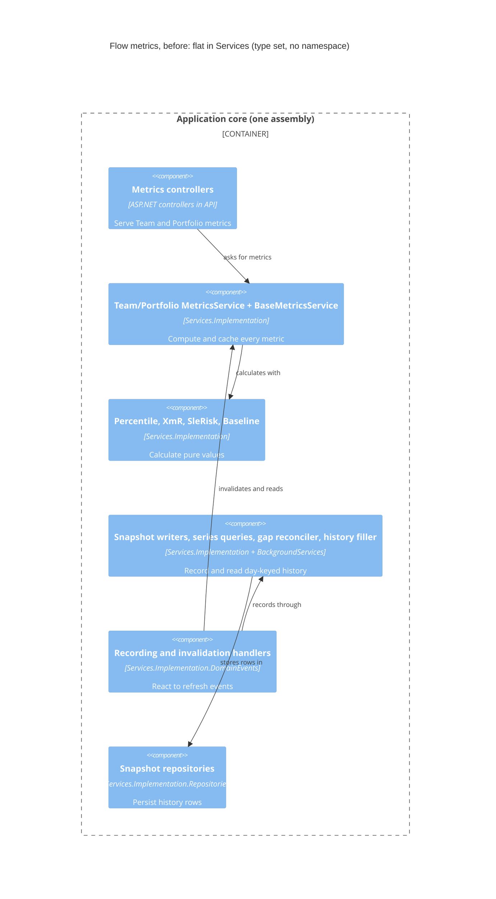
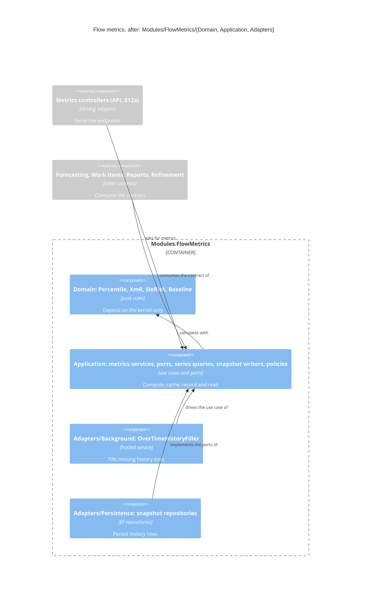

# Feature: story-6358-s02-metrics-pilot

Story #6358 · S02 Metrics pilot (go/no-go gate) · Epic #6510 (Modules: package the bounded contexts)

- Catalogue: [`docs/feature/epic-6264-modular-monolith/feature-delta.md`](../epic-6264-modular-monolith/feature-delta.md)
- Brief: [`slices/slice-02-s02-metrics-pilot.md`](../epic-6264-modular-monolith/slices/slice-02-s02-metrics-pilot.md)
- ADR: [`adr-270-bounded-contexts-context-map-and-module-layout.md`](../../product/architecture/adr-270-bounded-contexts-context-map-and-module-layout.md)

DISCUSS: covered at Epic level (see the Epic's Wave Decisions D-6264-3, D-6264-4); waves start at DESIGN.

**Maintainer, 2026-11-08:** hold before DELIVER starts. T9 #6536 counts as finished by the time this lands.

## Wave: DESIGN / [REF] Inherited

Linked, not copied. The catalogue is the single source of truth.

- Catalogue: DDD vocabulary · Story Map (pick-up groups, dependency graph, priority rationale) · How to pick up a
  Story · Stories → S02, S05f, S07b, S12a, S12c · Cross-Cutting Impact Checklist · Outcome KPIs + guardrails ·
  Wave Decisions (D-6264-11: S02's DESIGN decides whether it absorbs S05f and records it; D-6264-16: eleven
  contexts) · Risks 1, 2, 5, 8 · Improvement log (S04a: use `IlDependencies` for dependency ratchets; S05a: the
  `GetAllByPredicate` guard; S01: ADR-270 accepted, S02 settles the folder spelling).
- ADR-270: the Flow metrics context, the context map, the glossary, `Modules/<Context>/{Domain, Application, Adapters}`.
- ADR-268 (ratchet convention: inline file lists, never loosened).

## Wave: DESIGN / [REF] DoR re-run (2026-11-08)

| DoR item | Status | Evidence |
|---|---|---|
| 1 Problem statement | PASS | Metrics is a type-set rule with no namespace (`MetricsArchitectureTests.cs`), and the two services hold 27 `GetAllByPredicate` calls. |
| 2 Persona | PASS | `lighthouse-maintainer` plus the CI build; `@infrastructure`. |
| 3 Domain examples | PASS | Real files below (re-count) and the S05a allow-list entries. |
| 4 UAT | PASS (catalogue) | Four testable AC in the brief, CI-observable; Given/When/Then scenarios are written at DISTILL. |
| 5 AC from UAT | PASS | AC map to the brief's Elevator Pitch "After". |
| 6 Right-sized | PASS by waiver | Size L; DESIGN cuts it into slices of a day or less (D-6264-4). |
| 7 Technical notes and cross-cutting | PASS | Catalogue checklist; re-answered for this Story at DESIGN. |
| 8 Dependencies | PASS | Hard: S01 #6357 Closed. Soft: S05a #6369 Closed; S12c #6388 New (Metrics DTOs stay in `Models`, out of scope); S05f #6374 New (absorb or not is decided at DESIGN); S07b #6378 and S12a #6386 New, out of scope. |
| 9 Outcome KPIs | PASS | KPIs 1, 2, 4, 12 from the catalogue. |

## Wave: DESIGN / [REF] Baseline re-count (old → new, 2026-11-08)

| Measure | Brief / catalogue | Today |
|---|---|---|
| `GetAllByPredicate` calls in the two metrics services | 27 | **27** (Team 14, Portfolio 13; `BaseMetricsService` 0) |
| S05a `GetAllByPredicate` allow-list (KPI 4) | 15 files at landing | **15** files; Metrics-related: `TeamMetricsService`, `PortfolioMetricsService`, `BlockedCountSeriesBuilder`, `BackgroundServices/OverTimeFillTarget`, `DomainEvents/DemoBlockedHistoryBackfillHandler`, `DomainEvents/DemoPercentilesBackfillHandler` (the last three: membership decided at DESIGN) |
| Loose files in `Services/Interfaces` + `Services/Implementation` (KPI 1) | 42 + 58 top level; 507 total (2026-10-22) → 41/61 (S01) | **41 + 61** top level; **527** total |
| `Models` files (KPI 3) | 254 (S01) | **261** |
| Contexts packaged with namespace rules (KPI 2) | 0 of 9 → 0 of 11 (ADR-270) | **0 of 11**; `Modules/` does not exist yet |
| Metrics files flat in `Services/Implementation` | brief's list | 17: `BaseMetricsService`, `TeamMetricsService`, `PortfolioMetricsService`, `PercentileCalculator`, `PercentileFamilies`, `XmRCalculator`, `SleRiskCalculator`, `BaselineValidationService`, `BlockedCountSeriesBuilder`, `MetricsCacheKey`, `PercentileSnapshotWriter`, `ProcessBehaviorSnapshotWriter`, `PercentilesOverTimeSeriesQuery`, `ProcessBehaviorSeriesQuery`, `GapAsking*SeriesQuery` (2), `DeliveryMetricValuesProjector` (context to be confirmed against ADR-270) |
| Metrics interfaces in `Services/Interfaces` | — | 6: `ITeamMetricsService`, `IPortfolioMetricsService`, `IPercentileSnapshotWriter`, `IPercentilesOverTimeSeriesQuery`, `IProcessBehaviorSeriesQuery`, `IProcessBehaviorSnapshotWriter` |
| Metrics type-set rule | "a type-set rule today" | `Lighthouse.Backend.Tests/Architecture/MetricsArchitectureTests.cs` |
| S107 suppressions in Metrics (KPI 6) | — | `TeamMetricsService` (plus both Metrics controllers, which are S12a's) |

## Wave: DESIGN / [REF] Checklist (ticked through DELIVER)

- [ ] **Behaviour-free**: routes, DTO shapes, serialized responses, UI pixels and topologies are unchanged. The existing API, E2E and response tests stay green unmodified, apart from tests that move along with their code.
- [ ] **Ratchet in the same change**: the namespace-based Metrics rule replaces the type-set rule in the same commit range; baselines are inline file lists; no rule loosened.
- [ ] **Moves separate from edits**: `refactor(metrics): move …` commits apart from edit commits.
- [ ] **Re-count before designing**: done above; DESIGN confirms the membership against ADR-270.
- [ ] **Mutation last, on frozen code**: the Metrics score is not lower.
- [ ] **Architecture docs in the same change**: ADR-270 amended (lessons + go / go-with-changes / stop), `ARCHITECTURE.md` §4 Metrics row (and §6 if read ports land).
- [ ] **Payoff measured where claimed**: N/A unless DESIGN claims a performance payoff for the read ports.
- [ ] **No user-facing release notes** unless the maintainer says so.
- [ ] **One context at a time**: old and new layouts coexist.
- [ ] **Terminology**: names follow ADR-270's glossary.
- [ ] **Cross-cutting re-check**: RBAC, Lighthouse-Clients, Website, usage-data event, UI sketch, each answered with no silent N/A.
- [x] **S05f decision recorded**: kept separate (maintainer, 2026-11-08, D-7). ADO #6374 moved to Next with a comment by the maintainer; this Story touches no ADO item.
- [ ] **Read ports proven on a provider-backed test** (EF InMemory translates nothing).
- [ ] **`IlDependencies`** for the new dependency rules.
- [ ] **ADR number from `origin/main`** at write time, if an ADR is added rather than ADR-270 amended.

## Wave: DESIGN / [REF] Context-map placement (2026-11-08)

- **Context touched**: Flow metrics (packaged from today's code; this Story is the pilot of the ADR-270 layout).
- **Neighbours whose edge becomes visible** (no behaviour change): Forecasting, Work Items, Reports, Refinement, Platform lane, Promises (nothing moves out of it).
- **New terms / concepts**: none. The folder takes the ADR glossary name, `FlowMetrics`.
- **Domain events**: publishes none. Reacts to `TeamDataRefreshed`, `PortfolioFeaturesRefreshed`, `BlackoutConfigurationChanged` (policies and recorders, unchanged).
- **UI surface**: none (no view is added or changed).
- **ADR-270 / `ARCHITECTURE.md` §4 edits**: listed in "SSOT edits pending"; written in the last slice, not now.
- **Improvement backlog check** (`/continuous-improvement before 6510`): this Story is a child of #6510, not a new feature Epic, so the check ran at Epic level; N/A here, stated.

## Wave: DESIGN / [REF] Evidence from the design-time measurements (2026-11-08, ROOT = this worktree)

| # | Finding | Consequence for the design |
|---|---|---|
| E1 | Entity names are baked into the EF model snapshots of both migration assemblies (`modelBuilder.Entity("Lighthouse.Backend.Models.BlockedCountSnapshot", ...)` and the other snapshot entities, in 10+ Postgres designer files; the Sqlite assembly mirrors them). | Entities (`PercentilesOverTimeSnapshot`, `ProcessBehaviorSnapshot`, `BlockedCountSnapshot`) and the `Models/Metrics` DTO folder **stay in `Models`**. Moving them changes the EF model and needs a migration. Out of scope; belongs to S04b / S12c. |
| E2 | The existing dependency rules key on `Services.*` namespaces, as subject or as forbidden target (`ServiceLayerPattern` ×2 and `ParentPlacementKernel` in `ModuleBoundariesArchUnitTest`, `KernelRules.TheServices`, `ServiceNamespacePattern` in `ArchivedDeliveryReadPathArchUnitTest`) or on a name fragment `.Services.Implementation.DomainEvents` (two rules in `DomainEventDispatcherSeamArchUnitTest`). | A type that leaves `Services` **silently leaves those rules**. Moving 7 handlers would drop them from "no service locator" and "await saves". The rules must be widened first (slice 1). This is the pilot's most important lesson for S03*. |
| E3 | `DomainEventDispatcher` runs handlers sequentially in **registration order** (`GetServices`, `foreach`, errors isolated). Program.cs registers `PortfolioFeaturesRefreshedMetricsInvalidationHandler` (line 1618) before the three recorders (1627, 1629, 1631) that read the cached metrics; `ReconstructionMemo` (1418) and `TeamDataRefreshedForecastTriggerHandler` (1623) interleave with the Metrics handlers. No test pins the order. | Registration order is behaviour. Extracting an `AddFlowMetrics` extension would reorder it. Slice 1 adds an order pin; D-5 keeps the lines where they are. |
| E4 | Source-path strings of moved files sit in tests: `OverTimeReconstructionSeamArchUnitTest` (7 paths), `RepositoryLeakRatchetArchUnitTest` allow-list (6 Metrics-related entries), `CategoryListOwnershipGuardTest` (1). | 14 string edits in 3 files, mechanical but real "edits beyond namespaces"; counted below. |
| E5 | Flow metrics and Forecasting depend on each other: `ForecastService`, `ForecastInputFingerprint`, `ForecastRealityCheckService` use `ITeamMetricsService` / `ForecastThroughputStatus`, while `TeamMetricsService` takes `IForecastFilterRuleService` and `BaseMetricsService` resolves `IForecastService` through the service locator (`HowMany`, line 19 and 547), which no IL or ArchUnit rule sees. ADR-270 draws neither edge (it routes throughput through Work Items). Work Items also calls Flow metrics (`TeamDataService` → `UpdateTeamMetrics`, the ADR's ratchet candidate 1; `WorkItemService` → `IPortfolioMetricsService`, `PercentileCalculator`). | The module's inbound and outbound edges get inline baseline lists (ADR-268 shape); the undeclared edges are reported to ADR-270's edge table, not fixed here. |
| E6 | There are **no response snapshots** in the repository (no verified-file tooling; only in-test byte comparisons). The brief's "response snapshots" do not exist. | Behaviour-free proof needs a one-off before/after capture of every Metrics endpoint on demo data (slice 0), plus the existing `*ReadApiIntegrationTest`s. |
| E7 | The brief's file list is wrong in two places: it misses `OverTimeGapReconciler` and `IOverTimeGapReconciler` (Metrics), and includes `DeliveryMetricValuesProjector` (a Delivery projection used only by Delivery code: `DeliveriesController`, `DeliveryForecastPublishingService`, `DeliveryMetricSnapshotRecordingHandler`; it reads no Metrics type). The hosted `OverTimeHistoryFiller`, `OverTimeFillTarget`, `ReconstructionMemo`, `RetentionEdge` (in `BackgroundServices`), `IOverTimeHistoryFiller` (in `Interfaces/BackgroundServices`) and five handlers are Metrics too. | Membership below. KPI 1 payoff re-measured: 17 implementation + 7 interface top-level files leave (102 → 78 loose files). |
| E8 | `workItemRepository.Save()` is called inside `TeamMetricsService.UpdateTeamMetrics`, and `TeamMetricsService` also calls `featureRepository.GetAll()` (not predicate) in `GetForecastInputCandidates`. The 27 `GetAllByPredicate` calls are confirmed (Team 14, Portfolio 13), plus one more in `BlockedCountSeriesBuilder`. | A "read port" for Metrics is not purely read: the service also writes through the Team's item repository. Recorded for S05f and S07b. |

### Hypothesis measurement ("widespread edits beyond namespaces")

Counts from searches over the whole backend (floors where a search hit its cap):

| Edit kind | Files | Note |
|---|---|---|
| Moved production files (they change namespace, gain `using`s for what used to be same-namespace siblings) | 43 (17 impl + 7 interfaces + 5 handlers + 2 demo handlers + 4 background + 3 repos + 3 repo ports + `IOverTimeHistoryFiller`, with D-2 and D-3 as recommended) | inherent in a move |
| Production files outside the module needing only a `using` | **23**: Program.cs; 9 in `API` (Team/Portfolio MetricsControllers, TeamFeatureSizeMetricsController, Forecast and ForecastRealityCheck controllers, Team/Teams/Portfolio/Portfolios controllers for `BaselineValidationService`); 13 in `Services` (3 Forecast, `TeamDataService`, `WorkItemService`, `WriteBackTriggerService`, `FeatureListActiveWork`, 2 Refinement, 3 Reports, `DatabaseMaintenanceGate`) | mechanical |
| Production edits that are **not** a `using` | **1 file, 2 lines**: `OverTimeFillTarget` writes `Implementation.PercentileFamilies.For(...)` through the parent namespace (moves with the module, so it is inside the moved set) | the only qualified-name break found |
| Test files naming a moved type | **at least 119** (search capped; 64 name `ITeamMetricsService` / `IPortfolioMetricsService`, 35 name a concrete service or the base, the rest the helpers). About 35 of them are unit tests of moved types. | `using` per file, mechanical; IDE refactoring does it |
| Test edits that are not a `using` | **7 files**: the 3 path-string files (E4), the 4 rule files of E2 | rule expectations, not behaviour |
| Behavioural assertions edited | **0 expected** | pass criterion |
| Config touched | none: no namespace-keyed logging override or serialization setting names a Metrics type (checked appsettings, Serilog set-up, JSON converters); no committed Stryker config names Metrics; migration assemblies untouched (E1) | |

**Reading for the gate (recommended in D-10)**: the file count is large (about 140 files) but every edit outside the moved set is one `using` line, except 7 rule and path files and 0 behavioural assertions. That is "edits beyond namespaces" only in the 7 rule files, which the ratchet owns anyway.

## Wave: DESIGN / [REF] Decisions

Status after the DESIGN hold (2026-11-08): **Decided by the maintainer** = D-4, D-6, D-7, D-9. **Recommended, reviewed at the DESIGN hold** (DESIGN's proposal, not maintainer-decided) = D-5, D-8, D-10, D-11, D-12. **Decided (brief/ADR)** = D-1 to D-3. The option tables below are kept as the record of what was weighed.

### Decided by the brief / ADR-270 (no change proposed)

- **D-1 Layout**: `Modules/<Context>/{Domain, Application, Adapters}` inside the existing assembly; interfaces co-located with the use case that needs them; old and new layouts coexist; one context per Story; behaviour-free; moves in commits apart from edits; mutation last.
- **D-2 Not in scope**: `BaseMetricsService` → composition (S07b), the three Metrics controllers (S12a), Metrics DTOs and the entities (E1; S12c, S04b), controllers' `IRepository` use.
- **D-3 `IlDependencies`** answers every dependency question of the new rules (ArchUnitNET's graph drops edges written inside `async` bodies in a Release build).

### D-4 Folder and namespace spelling for every context — **DECIDED (maintainer, 2026-11-08): option a**

Final: ADR-270 glossary names in PascalCase, one word (`Modules/FlowMetrics`, `OrganisationSetup`, and so on); existing identifiers keep their spelling (`License*`).

The brief says S02 settles this. ADR-270 names contexts in British prose; the code writes `License*` and `Organization` in places (wire fields, ADO's own word) and `Organisation` in newer identifiers.

| Option | Folders |
|---|---|
| **a (recommended)** | The ADR glossary name in PascalCase, one word: `FlowMetrics`, `WorkItems`, `TrackerIntegration`, `OrganisationSetup`, `Forecasting`, `Promises`, `Refinement`, `Reports`, `Access`, `Licensing`. `Signals` is not created (target only). Platform is not a module and stays outside `Modules/`. Existing identifiers keep their spelling (`License*`). Namespace = `Lighthouse.Backend.Modules.<Context>.<Layer>`. |
| b | Same, American: `OrganizationSetup`. Matches `License`, `Organization` fields; contradicts ADR-270, the Terminology defaults and newer identifiers. |
| c | Short names (`Metrics`, `Organisation`, `Tracker`). Rejected: `Metrics` collides with `Models.Metrics` and `Reports/Metrics` and the brief's own "Modules/Metrics" would make `Metrics.X` ambiguous in half the files. |

Why a: it follows the ADR so S03* never re-decide, and keeps `Licensing` equal to today's folder. Weakest point: the British spelling will sit next to American `LicenseService`; the ADR already accepted that for the glossary.

### D-5 Membership (borderline types) — **RECOMMENDED, reviewed at the DESIGN hold (2026-11-08)**

Recommendations, one line of why each; the full table is "Component decomposition".

| Type(s) | Recommended home | Why | Alternative |
|---|---|---|---|
| `DeliveryMetricValuesProjector`, `DeliveryMetricSnapshotRecordingHandler`, `DeliveryMetricSnapshotRepository` | **stay** (Promises, S03d) | Delivery projection; reads no Metrics type; the brief's "context to be confirmed" resolves to Promises | none |
| `Demo*BackfillHandler` ×2 | **move**, Application | They write the module's own snapshot tables (ADR-270 Decision 8: no context writes another's tables) and use only its services | stay with the Platform demo lane: Platform would keep writing Flow metrics' tables |
| `*BlockedTransitionCapture/CloseHandler` ×4, `*BlockedTransition` repos | **stay** (Work Items, S03b) | They capture blocked periods, which ADR-270 gives to Work Items; `BlockedCountSnapshot*` (day-keyed history) is Flow metrics | move all blocked code: splits Work Items' own facts |
| `OverTimeHistoryFiller` (hosted `BackgroundService`) | **move**, Adapters/Background; its ports `IOverTimeHistoryFiller`, `IOverTimeHistoryFillActivity`, `OverTimeFillRequest` in Application | Host-driven entry point is a driving adapter; the class also holds fill logic, split later (S07 area) | Application (whole class) |
| `ReconstructionMemo`, `RetentionEdge`, `OverTimeFillTarget`, `OverTimeGapReconciler` | **move**, Application | Policy/helper; `OverTimeFillTarget` is the only type in the three S05a-listed handler/target files that is Metrics' own | none |
| `PercentileCalculator`, `XmRCalculator` (+`XmRResult`), `SleRiskCalculator`, `BaselineValidationService` (+Result) | **move**, Domain | Pure, depend on the kernel only. Used from outside by `WorkItemService`, `DailySeriesSummary` and four Team/Portfolio controllers: an inbound baseline list (R3) | Application contract; rejected, Domain would then hold nothing |
| `MetricsCacheKey`, `PercentileFamilies`, `BlockedCountSeriesBuilder` | **move**, Application | Cache key helper; maps owners to services; queries a repository port | Domain only for the cache key |
| `ForecastThroughputStatus`, `CycleTimeWorkItem`, `CycleTimeFeature` (records inside the two service interfaces) | **move with the ports**, Application | They are the service contract; Forecasting consumes them | Domain; rejected, they carry `WorkItem` / `Feature` entities |
| `BaseMetricsService` | **move**, Application, unchanged | S07b deletes it; moving is not redesigning | none |
| Three snapshot repositories + ports | see D-6 | | |
| Entities, `Models/Metrics` DTOs, `MetricType`, `ProcessBehaviorMetricType`, `ThroughputSettings`, `CycleTimeDefinition` | **stay in `Models`** | E1, S12c | none |

### D-6 Persistence adapters of Flow metrics — **DECIDED (maintainer, 2026-11-08): option a**

Final: the 3 snapshot repositories move to `Modules/FlowMetrics/Adapters/Persistence` and their ports to `Application`; the repository rules are widened first (slice 1). EF entities and `Models/Metrics` DTOs stay.

| Option | What moves | Cost | Learning |
|---|---|---|---|
| **a (recommended)** | The three snapshot repositories to `Adapters/Persistence`, their interfaces to `Application` (ports next to the use case). DI lines keep their place. The GetAllByPredicate guard's folder exemption, the repository-detection rule and `StoredRecordsPattern` / `PlatformPersistencePattern` become "repositories folder **or** a module's `Adapters/Persistence`". | +1 slice, 3 rule constants, 3 repository test files | Every S03* has repositories; the pilot is the cheapest place to learn this |
| b | Leave them in Platform until the persistence-port work (S05) settles | 0 | Adapters would hold one hosted service; the gate would say "go" on layers it did not test |

Why a: the gate is about the layout for the most entangled context. Weakest point: S05b-d later reshape these repository interfaces, so they move twice if S05 reshapes the interface files; it is a rename-only conflict.

### D-7 S05f: absorb, keep, or partial — **DECIDED (maintainer, 2026-11-08): option b, S05f stays separate**

Final: S05f #6374 is kept separate; the maintainer moved it to Next with a comment (no ADO action from this Story). The two services leave the S05a allow-list only when S05f lands; S02 only edits the allow-list paths. The AC's second box ticks as "S05f explicitly keeps that".

Measured: 27 calls = Team 14, Portfolio 13; roughly 8 distinct shapes per service (closed in range ×2, all of the owner ×2, in-flight ×4, started, transitions for ids ×2, blocked-eligible, features the Team has a real share of, forecast-input candidates), so the Story's hypothesis (27 collapse to about 10) looks plausible: about 12 to 14 methods across two ports. Not yet proven on a provider.

| Option | Scope | Size | Risk |
|---|---|---|---|
| a Absorb | Named read-port methods for all 27 (+ the `GetAll()` one), each proven translatable on SQLite and on Postgres (`.Any()` per Feature included), 27 call sites rewritten | +7 to 8 slices (Team 4, Portfolio 3, one for the provider-backed harness) ≈ +7 days | It changes SQL (runtime cost, result identity) inside the pilot: a regression in the gate's "move" cannot be told from a regression in the queries. S05f's measured-payoff risk applies. |
| **b (recommended)** Keep | S02 records "S05f keeps this", as the AC allows. S05f #6374 stays New in #6507; its ADO note says "the module exists; ports land in `Modules/FlowMetrics/Application`". Both services leave the S05a list only then. S02 edits the 4 to 6 allow-list paths (E4). | 0 | none for the gate; the AC's second box ticks as "S05f explicitly keeps that" |
| c Partial | Only `PortfolioMetricsService` (13 calls, 7 shapes) as proving ground, including the provider-backed harness; Team stays | +3 to 4 slices | Pilots the pattern without touching the heavier Team service; still mixes SQL change into the gate |

Why b: the hypothesis under test is the layout, not the queries; mixing them doubles the size (L → XL) and blurs a go / no-go signal. Weakest point: the catalogue's split table says "S02's DESIGN is told [S05f] is done", but #6374 is New and 27 calls remain: that line is stale or optimistic, so the maintainer should confirm that the order is not "S05f first" (then S02 moves a thinner file and the allow-list loses two entries).
**ADO change to show the maintainer if b**: comment on #6374, no state change. If a or c: S02 gets the added slices; #6374 closes or shrinks.

### D-8 Registration and handler order — **RECOMMENDED, reviewed at the DESIGN hold (2026-11-08)**

| Option | Detail |
|---|---|
| **a (recommended)** | Registration lines stay in Program.cs, in the same positions, with edited `using`s. Slice 1 adds a pin of the resolved handler order for `TeamDataRefreshed` and `PortfolioFeaturesRefreshed` (E3), green before and after. An `AddFlowMetrics` extension is left to S09a (context contracts) with the pin as its safety net. |
| b | Extract `Modules/FlowMetrics/FlowMetricsModule.cs` (`AddFlowMetrics`) now. Needs the module's handler registrations split in two calls to keep the interleaving with the Forecast trigger, or proof that the interleaving is irrelevant. Program.cs edits also force the full Integration suite. |

Why a: extraction is a separate mechanism with its own hazard; the pilot's hypothesis is about namespaces. Weakest point: Program.cs keeps its length; S09a pays that.

### D-9 Where the unit tests live — **DECIDED (maintainer, 2026-11-08): option a**

Final: unit tests of moved types relocate to `Lighthouse.Backend.Tests/Modules/FlowMetrics/{Domain,Application,Adapters}/` as a pure-move slice (slice 7).

| Option | Detail |
|---|---|
| **a (recommended)** | Last move slice: unit tests of moved types relocate to `Lighthouse.Backend.Tests/Modules/FlowMetrics/{Domain,Application,Adapters}/` (about 35 files, pure move, class names unchanged so Stryker `FullyQualifiedName~` filters keep working). Consumers' tests only get `using`s. |
| b | Tests stay under `Tests/Services/Implementation`; only `using`s change. |

Why a: a module's tests next to its name is what a later per-module CI selection (S09) needs, and the pilot should price it. Weakest point: 35 more renames in the diff; if the maintainer prefers a smaller diff, b costs nothing in S02 and S03* can decide.

### D-10 How the hypothesis is read at the gate — **RECOMMENDED, reviewed at the DESIGN hold (2026-11-08)**

Proposed thresholds, written before DELIVER so the result cannot be shaded: **go** if no behavioural assertion changed, non-`using` edits outside the moved set stay in rule and path files (7 files measured here), and the Metrics inbound baseline (R3) names fewer than 15 outside types; **go-with-changes** if a lesson changes the layout or the rules (expected, see "Provisional lessons"); **stop** if a behavioural test had to change, or the boundary is no clearer (R3's list is not shorter than the 4 unlisted undeclared edges plus the legal ones).

### D-11 Behaviour-free proof — **RECOMMENDED, reviewed at the DESIGN hold (2026-11-08)**

Recommended: (1) existing tests unmodified apart from moved tests and `using`s; (2) a one-off before/after capture of every Metrics endpoint body on the demo data (script in the workspace, outputs compared by `diff`, not committed as a test) because no response snapshots exist (E6); (3) the handler-order pin (D-8). Alternative: a committed JSON golden-file test; rejected for S02, it would be the first of its kind and has its own upkeep.

### D-12 Answer to ADR-270's open question "do the persistence-port and connector-capability Stories run before packaging?" — **RECOMMENDED, reviewed at the DESIGN hold (2026-11-08)**

Recommended: **no hard order**. S02 moved the code without touching a query; S05* and S06 can land before or after each S03*, and landing after puts the new ports straight into the module's `Application` folder. The only hard precondition S02 found is S12c before a context's DTOs move (E1). Stated here, written into ADR-270 in the last slice.

### Provisional lessons (for the gate; the decision is the maintainer's, not final)

1. Namespace-keyed rules must be widened before a context leaves `Services` (E2); define one `ApplicationCore` pattern (`Services` or `Modules`) and find handlers by interface, not by namespace fragment.
2. Handler registration order is behaviour (E3); pin it before extracting any registration.
3. Entities and DTOs cannot leave `Models` with the first move (E1); the layout's "Domain" holds only pure rules until S04b and S12c.
4. A module's inbound edges expose undeclared ADR edges immediately (E5): Flow metrics ↔ Forecasting, Work Items → Flow metrics.
5. Source-path lists in tests are keyed by folder; a folder move is 14 string edits today.
Provisional lean: **go-with-changes** (the changes being 1, 2 and the 3 inbound/outbound baselines).

## Wave: DESIGN / [REF] Component decomposition

`Modules/FlowMetrics` root = `Lighthouse.Backend/Lighthouse.Backend/Modules/FlowMetrics/`. Change types: **MOVE** (namespace and folder only, in a pure-move commit), **EDIT** (separate commit), **STAY**. Paths are relative to `Lighthouse.Backend/Lighthouse.Backend/`. Namespace of each folder = `Lighthouse.Backend.Modules.FlowMetrics.<Layer>[.<Sub>]`.

| Type | From | To (under `Modules/FlowMetrics/`) | Change |
|---|---|---|---|
| `PercentileCalculator` | `Services/Implementation/` | `Domain/` | MOVE |
| `XmRCalculator`, `XmRResult` | `Services/Implementation/` | `Domain/` | MOVE |
| `SleRiskCalculator` | `Services/Implementation/` | `Domain/` | MOVE |
| `BaselineValidationService`, `BaselineValidationResult` | `Services/Implementation/` | `Domain/` | MOVE (role rename to `*Validator` is a later EDIT, ADR-270 role names) |
| `ITeamMetricsService` (+ `ForecastThroughputStatus`, `CycleTimeWorkItem`) | `Services/Interfaces/` | `Application/` | MOVE |
| `IPortfolioMetricsService` (+ `CycleTimeFeature`) | `Services/Interfaces/` | `Application/` | MOVE |
| `BaseMetricsService`, `TeamMetricsService`, `PortfolioMetricsService` | `Services/Implementation/` | `Application/` | MOVE |
| `MetricsCacheKey`, `PercentileFamilies`, `BlockedCountSeriesBuilder` | `Services/Implementation/` | `Application/` | MOVE |
| `IPercentileSnapshotWriter` (+ `PercentileFamilyReader`), `PercentileSnapshotWriter` | `Services/Interfaces/`, `Services/Implementation/` | `Application/` | MOVE |
| `IProcessBehaviorSnapshotWriter` (+ `ProcessBehaviorFamilyReader`), `ProcessBehaviorSnapshotWriter` | same | `Application/` | MOVE |
| `IPercentilesOverTimeSeriesQuery`, `PercentilesOverTimeSeriesQuery`, `GapAskingPercentilesOverTimeSeriesQuery` | same | `Application/` | MOVE |
| `IProcessBehaviorSeriesQuery`, `ProcessBehaviorSeriesQuery`, `GapAskingProcessBehaviorSeriesQuery` | same | `Application/` | MOVE |
| `IOverTimeGapReconciler`, `OverTimeGapReconciler` | same | `Application/` | MOVE |
| `IOverTimeHistoryFiller`, `IOverTimeHistoryFillActivity`, `OverTimeFillRequest` | `Services/Interfaces/BackgroundServices/` | `Application/` | MOVE |
| `ReconstructionMemo`, `RetentionEdge`, `OverTimeFillTarget` | `Services/Implementation/BackgroundServices/` | `Application/` | MOVE (`OverTimeFillTarget`: EDIT the two `Implementation.PercentileFamilies` references) |
| `OverTimeHistoryFiller` | `Services/Implementation/BackgroundServices/` | `Adapters/Background/` | MOVE |
| `BlockedCountSnapshotRecordingHandler`, `PercentilesOverTimeRecordingHandler`, `ProcessBehaviorRecordingHandler` | `Services/Implementation/DomainEvents/` | `Application/Policies/` | MOVE |
| `PortfolioFeaturesRefreshedMetricsInvalidationHandler`, `BlackoutConfigurationChangedMetricsInvalidationHandler` | `Services/Implementation/DomainEvents/` | `Application/Policies/` | MOVE |
| `DemoBlockedHistoryBackfillHandler`, `DemoPercentilesBackfillHandler` | `Services/Implementation/DomainEvents/` | `Application/Policies/` | MOVE (D-5) |
| `IBlockedCountSnapshotRepository`, `IPercentilesOverTimeSnapshotRepository`, `IProcessBehaviorSnapshotRepository` | `Services/Interfaces/Repositories/` | `Application/` | MOVE (D-6 a) |
| `BlockedCountSnapshotRepository`, `PercentilesOverTimeSnapshotRepository`, `ProcessBehaviorSnapshotRepository` | `Services/Implementation/Repositories/` | `Adapters/Persistence/` | MOVE (D-6 a) |
| `TeamMetricsController`, `PortfolioMetricsController`, `TeamFeatureSizeMetricsController` | `API/` | stay | STAY (S12a) |
| Entities `PercentilesOverTimeSnapshot`, `ProcessBehaviorSnapshot`, `BlockedCountSnapshot`; `Models/Metrics/*` (17 files); `MetricType`, `ProcessBehaviorMetricType`, `ThroughputSettings`, `CycleTimeDefinition` | `Models/` | stay | STAY (E1) |
| `DeliveryMetric*`, `DeliveryMetricSnapshotDayCollisionGuard`, blocked-transition handlers and repositories | various | stay | STAY (D-5) |
| Program.cs registrations (lines 1360-1364, 1397-1422, 1618-1619, 1626-1635) | `Program.cs` | same lines | EDIT (`using`s only, D-8 a) |

Totals: 43 files move (24 top-level loose files leave `Services`, KPI 1 102 → 78), 0 entities, 0 DTOs.

### C4 Component diagram, Flow metrics module (before → after)





## Wave: DESIGN / [REF] Driving ports

Unchanged. HTTP: `TeamMetricsController`, `PortfolioMetricsController`, `TeamFeatureSizeMetricsController` (routes, `RbacGuard`s, response shapes untouched; they stay in `API` until S12a). Events: `TeamDataRefreshed`, `PortfolioFeaturesRefreshed`, `BlackoutConfigurationChanged` reach the module's policies through the dispatcher, in the registration order pinned by slice 1. Host: `OverTimeHistoryFiller` is started as a hosted service.

## Wave: DESIGN / [REF] Driven ports + adapters

| Port (in module `Application` unless noted) | Adapter | Status |
|---|---|---|
| `IBlockedCountSnapshotRepository`, `IPercentilesOverTimeSnapshotRepository`, `IProcessBehaviorSnapshotRepository` | `Adapters/Persistence` repositories over `LighthouseAppContext` | moved (D-6 a) |
| `IWorkItemRepository`, `IFeatureRepository`, `IWorkItemStateTransitionRepository`, `IFeatureStateTransitionRepository` (read, plus one `Save`) | Platform repositories | unchanged; S05f later |
| `IBlackoutPeriodService`, `IAppSettingService`, `ILighthouseClock` | Platform / Organisation set-up services | unchanged |
| `IForecastFilterRuleService`; `IForecastService` resolved by service locator in `BaseMetricsService` | Forecasting | undeclared outward edge, baseline list R5, flagged for ADR-270 |
| `IDomainEventHandler<TEvent>` | dispatcher | unchanged order |
| No new external call. Metrics talks to no tracker. | | |

Earned Trust: no new adapter or external dependency is introduced, so no new `probe()` is specified; the existing repository substrates keep the probes they have. Stated, not silent.

## Wave: DESIGN / [REF] Technology choices

None new. ArchUnitNET (Apache-2.0) and `IlDependencies` over Mono.Cecil (MIT), both already in the test project; NUnit; Stryker.NET (Apache-2.0) for the last-slice mutation run. No proprietary component.

## Wave: DESIGN / [REF] Reuse Analysis

Contract shape per principle 12 is cited where a component is reused or rewritten.

| Existing component | Overlap | Decision | Contract shape and assertion |
|---|---|---|---|
| `IlDependencies` (`TypesIn`, `DependentsIn`, `ResidesInNamespaceMatching`) | All new dependency rules | **EXTEND** (no change expected) | read-only scan, returns lists |
| `KernelRules` + `KernelRulesCatchANewOffenderArchUnitTest` (rule defined once, run on real and made-up types) | Shape of the module rules | **EXTEND** the shape; **CREATE NEW** `FlowMetricsModuleRules` and a catch-a-new-offender test | Justification: `KernelRules` is specific to `Models`; S03a-i need the same shape, so the new class takes subject and forbidden patterns as parameters |
| `RepositoryLeakRatchetArchUnitTest.AssertMatchesBaseline` (private) | Two-way inline baseline comparison | **EXTEND**: lift into a shared helper, not copy | pure comparison; its own tests stay |
| `ProductionSource` | Path-keyed scans | **EXTEND** unchanged; 14 path strings edited | read-only |
| Hand-written opcode scanner in `MetricsArchitectureTests` (about 120 lines, `MetricsServicesReadingTransitions`) | "Metrics reads transitions only through ports" | **REPLACE** by `IlDependencies` over the module's Domain and Application: no reference to `Microsoft.EntityFrameworkCore` at all (stricter, simpler) | read-only |
| `NoPerStateAggregationServiceExists…`, `ComputeAgeInStatePercentiles_IsProtected…` | name rules | **KEEP** until S07b deletes `BaseMetricsService`; edit only a `using` | |
| `ModuleBoundariesArchUnitTest.NamedModules_AreNonEmpty` | non-empty canary | **EXTEND** with the module's namespaces | |
| Reports module rules (`ReportsModuleArchUnitTest`) | Module-style rules | **EXTEND**: only `using`s; its "only the series adapters reach the metrics services" rule keeps working on the moved port types | |
| Handler-order pin | none exists (searched `GetServices<IDomainEventHandler` in tests: only Delivery tests) | **CREATE NEW**, one test | bounded read of the built provider |
| Module registration extension | none exists | **not created** (D-8 a) | |

Contract shapes of the moved code: `Domain` calculators are pure-function; series queries and the services' read methods are return-only; `UpdateTeamMetrics` and the recording handlers are bounded-change (they write only the module's snapshot tables and the Team's refreshed metrics); `Adapters/Persistence` writes are bounded to their own table.

## Wave: DESIGN / [REF] Ratchet design

All rules read the compiled IL through `IlDependencies`; every baseline is an inline file or type list compared in both directions (ADR-268), never loosened.

| # | Rule | Replaces / adds | Baseline |
|---|---|---|---|
| R0 | `ApplicationCore` pattern = `^Lighthouse\.Backend\.(Services\|Modules)(\.\|$)` replaces the `Services` pattern in the four rule files of E2; handler rules find handlers by `IDomainEventHandler<>`, not by `.Services.Implementation.DomainEvents` | keeps old rules whole when types move; slice 1, **before** any move | none; each rule's examined set must not shrink (canary) |
| R1 | Placement canary: the module's namespaces are non-empty, and a type-set check that every type named in the old rule now sits under `Modules.FlowMetrics` | replaces the type-set rule | none |
| R2 | `Domain` depends only on the kernel (`Models.*`) and the BCL; not on `Application`, `Adapters`, `Services`, `Data`, EF, `Microsoft.Extensions.*` | new | empty |
| R3 | Outside types reach the module's `Domain` only from the listed types (6 today: `WorkItemService`, `DailySeriesSummary`, `PortfolioController`, `PortfoliosController`, `TeamController`, `TeamsController`); nothing outside reaches `Adapters` except the composition root | new | inline, 6 entries, shrinks |
| R4 | Outside types reach the module's `Application` contract only from `API`, the composition root, Reports, Refinement (legal per ADR-270), plus the undeclared inbound baseline: Forecasting (`ForecastService`, `ForecastInputFingerprint`, `ForecastRealityCheckService`), Work Items (`TeamDataService`, `WorkItemService`), `WriteBackTriggerService`, `FeatureListActiveWork`, `DatabaseMaintenanceGate` | new | inline, 8 entries, shrinks |
| R5 | `Application` depends on no EF type, no `Data`, no `Adapters`, no `API`; outward edges to Forecasting only for the listed types (`IForecastFilterRuleService`; `IForecastService` is seen only if the locator call is replaced, so it is also named in prose) | replaces the transition `DbSet` rule | inline, 1 entry (+1 invisible, noted) |
| R6 | Handler order pin for the two refresh events | new | the order itself |
| R7 | S05a `GetAllByPredicate` allow-list: the Metrics-related paths follow the move; folder exemption widened per D-6 a; count stays 15 if S05f is kept | edit | 15 entries |

Each of R2 to R5 ships with a made-up-types fixture test proving it fails on a newcomer and on a stale entry.

## Wave: DESIGN / [REF] Slices

Each at most a day. Moves and edits are separate commits; `refactor(flow-metrics): move …` apart from edit commits; mutation last on frozen code. No `roadmap.json` here (DELIVER).

| Id | Delivers | Size |
|---|---|---|
| 0 | Safety net: before-capture of all Metrics endpoint bodies on demo data into the workspace; baseline mutation run of the Metrics files on `main` started in the background (compare later) | 0.5 day |
| 1 | Rules first (R0, R6): `ApplicationCore` pattern in the four rule files, handlers found by interface, handler-order pin, canary of examined types. Green before any move. | 1 day |
| 2 | Move `Domain` (5 pure types) + R2; fix qualified references; consumers' `using`s (~10 prod, ~25 test files) | 0.5 day |
| 3a | Move the contract: both service interfaces with their records, writer, query and reconciler ports, filler ports, snapshot-repository ports (D-6 a) to `Application`; 23 outside production files and the consumer tests get `using`s | 1 day |
| 3b | Move implementations to `Application` (services, base class, helpers, writers, queries, reconciler, memo, retention edge, fill target); fix `OverTimeFillTarget`'s qualified name (edit commit) | 1 day |
| 4 | Move the 7 policies to `Application/Policies`; Program.cs `using`s; order pin stays green | 0.5 day |
| 5 | Move `OverTimeHistoryFiller` to `Adapters/Background`, repositories to `Adapters/Persistence`; widen R7 and the repository patterns; DI `using`s | 1 day |
| 6 | Replace the type-set rule: delete the opcode scanner, add R1 and R3 to R5 with baselines and catch-a-new-offender tests; update the three path-string tests | 1 day |
| 7 | (D-9 a) Relocate about 35 unit-test files under `Tests/Modules/FlowMetrics` | 0.5 day |
| 8 | Mutation on frozen code: `mutate` glob on the module folder, test filter naming the module's tests, compare with slice 0; kill survivors only where the per-file score fell | 0.5 day plus background |
| 9 | Docs and gate: ADR-270 amendment (Decision 6 names, edge-table additions, lessons, go / go-with-changes / stop, S05/S06 order), `ARCHITECTURE.md` §4 row and diagram line and rules bullet (§6 untouched: S05f is separate), Epic Improvement log, architecture summary in chat | 0.5 day |

**Final slice table (2026-11-08)**: eleven slices (0, 1, 2, 3a, 3b, 4, 5, 6, 7, 8, 9), about 8 days (Size L), with D-6 a (repositories move) and D-9 a (tests relocate) decided and S05f kept separate (D-7 b), so no read-port slices. Slices 0 to 9 stand as listed above; the order is the delivery order.

## Wave: DESIGN / [REF] Cross-cutting

| Item | Answer |
|---|---|
| Behaviour-free | Routes, DTO shapes, serialized responses, UI, topologies unchanged; pinned by D-11. Provider SQL unchanged because no query is touched (D-7 b). |
| RBAC | N/A, because no endpoint, guard or authorisation call changes: the three controllers and their `RbacGuard`s stay in `API`; nothing fetches `/api/latest/authorization/my-summary`. |
| Lighthouse-Clients (CLI, MCP) | N/A, because the wire contract is untouched (no route, DTO or enum change); no client release or version bump. |
| Website | N/A, because nothing user-visible changes. |
| Usage-data event | N/A, because no feature becomes usable or used differently; nothing to append to `UsageDataEventName` or `docs/settings/usagedata.md`. |
| UI sketch | N/A, because no view is added or changed. |
| Terminology | No user-facing text. Code names take the ADR-270 glossary (`FlowMetrics`); the generic `*Service` suffix is not renamed here (ADR-270 role names; later edit). Comments touched while moving lose any internal-reference explanations. |
| Loading and failure look | N/A, because no screen, chart or widget fetches differently; stated per the slow-connection rule. |
| ADO | This Story touches no ADO item. S05f #6374 was moved to Next with a comment by the maintainer (D-7 b, 2026-11-08). |
| Mutation | Per-feature rule: last, frozen code, not lower than slice 0's baseline. |
| Docs at finalize | ADR-270 and `ARCHITECTURE.md` §4 in this Story (slice 9); user docs: none. |

## Wave: DESIGN / [REF] SSOT edits pending

Not made yet. Slice 9 makes them.

- **ADR-270**: Decision 6 gets the settled folder names (D-4); "Every edge" table gets the derived edges E5 (Flow metrics → Forecasting not legal; Work Items → Flow metrics beyond the event; Platform `DatabaseMaintenanceGate` → Flow metrics); glossary row "Flow metric" code name becomes `Modules/FlowMetrics`; "Answers to the brief's open questions" gets D-12; a dated "lessons from the pilot" block and the gate decision.
- **ARCHITECTURE.md**: §4 row 5 (anchor namespaces `Modules.FlowMetrics.*`, no longer a type set), the enforced-rules list (module rules R2 to R5 and the widened `ApplicationCore` rules), mermaid line for Metrics; §6 only if read ports land.
- **brief.md**: a new `## Application Architecture — story-6358 s02 metrics pilot` section (module layout, rule shapes), without touching earlier sections.
- **Epic catalogue**: Improvement log entry; S03*/S09a notes from the lessons; the split-table sentence about S05f (corrected 2026-11-08, D-7).
- **No new ADR** is proposed; if the maintainer wants one for the ratchet shape, the next number is read from `origin/main` at write time (ADR-281 is the latest in this worktree).

## Wave: DESIGN / [REF] Open questions

1. D-4 to D-12 above.
2. Is "S02's DESIGN is told it is done" in the catalogue's split table a typo or a sequencing intent (S05f first)? Evidence says S05f is New and the 27 calls remain.
3. `Models/Metrics` and the entities stay in `Models`: should S04b (reduce `Models` to the kernel) record a hard dependency on a migration spike for the three snapshot entities (E1)?
4. `UpdateTeamMetrics` writes through `IWorkItemRepository.Save`: leave to S07b / S05f, or note it for the Work Items context (S03b)?
5. The service-locator edge `BaseMetricsService` → `IForecastService` is invisible to every rule; accept as noted, or add a source scan for `GetRequiredService<IForecastService>` in the module?

Update 2026-11-08: questions 1 and 2 are closed (D-4, D-6, D-7, D-9 decided; D-5, D-8, D-10 to D-12 recommended at the DESIGN hold; S05f kept separate). Questions 3 to 5 remain open for later waves.

## Wave: DESIGN / [REF] Architecture summary

A learning aid for the maintainer, not a replacement for `brief.md` or the ADRs.

**1. The shape in hexagonal terms (N = new, M = moved, U = unchanged).**

- Driving adapters: the three Metrics controllers (U, stay in `API` until S12a); the refresh-event policies, 7 handlers (M, to `Application/Policies`, registration order U and pinned by a new test, N); the hosted `OverTimeHistoryFiller` (M, to `Adapters/Background`).
- Application: the two metrics-service ports with their records, the services and `BaseMetricsService`, snapshot writers, series queries, gap reconciler, history-filler ports (all M, to `Application`); the three snapshot-repository ports (M, ports sit next to the use case).
- Domain: `PercentileCalculator`, `XmRCalculator`, `SleRiskCalculator`, `BaselineValidationService` (M, to `Domain`). Entities and `Models/Metrics` DTOs (U, stay in the kernel).
- Driven adapters: the three snapshot repositories (M, to `Adapters/Persistence`); work-item and feature repositories (U, Platform); no tracker call, no new external call.
- Depends on what, today: everything sits flat in `Services`; the services reach Platform repositories and Forecasting (`IForecastFilterRuleService`, plus `IForecastService` by service locator); Forecasting, Work Items, Reports, Refinement, write-back, the feature list and the controllers reach the services; nothing says which of those is legal.
- After: the same edges, now visible by namespace: Domain depends on the kernel only; Application on Platform ports and the listed Forecasting edge; Adapters implement Application's ports; outside types reach Domain from 6 listed places and Application from API, Reports, Refinement and 8 listed undeclared edges.

```text
 BEFORE                                    AFTER
 API controllers                           API controllers (U)
   |                                         | asks
   v                                         v
 Services.Implementation (flat)            Modules/FlowMetrics
   services, calculators, writers,           Application  (ports, services, queries, writers, Policies/)
   queries, handlers, repositories             |  uses            ^ implements
   |            ^                              v                  |
   v            | Forecasting, Work Items,   Domain (pure)     Adapters/{Background, Persistence}
 Platform repos  Reports, Refinement ...
                                           others (Forecasting, Work Items, Reports, Refinement)
                                             -> Application only; Domain from 6 listed types
```

**2. Patterns weighed.**

- Ports-and-adapters module layout, `Domain/Application/Adapters`: chosen (ADR-270); flat role folders and vertical slices were rejected there.
- Namespace ratchet read from the compiled IL (`IlDependencies`): chosen; ArchUnitNET's graph alone drops edges written inside `async` bodies in Release builds.
- Inline two-way baselines (ADR-268): chosen for the inbound and outbound edge lists; a bare count was rejected, it lets one offender leave and another arrive unseen.
- One `ApplicationCore` pattern and handlers found by interface: chosen; per-namespace fragments silently lose a type when it moves.
- Handler-order pin: chosen; the dispatcher runs handlers in registration order, so order is behaviour.
- DI extension method (`AddFlowMetrics`): deferred to S09a; it would reorder handlers and Program.cs edits force the full integration suite.
- Read ports for the 27 `GetAllByPredicate` calls: deferred to S05f (kept separate); mixing query rewrites into a layout pilot would blur the go/no-go signal.
- Entity and DTO relocation: deferred (S04b, S12c); entity names are baked into the migration snapshots of both providers, so moving them changes the EF model.
- Persistence adapters moving with the module: chosen; every later context has repositories, so the pilot prices it.
- Test relocation as a pure-move slice: chosen; module-named test folders serve later per-module test selection.
- Extra patterns not needed: events and outbox (no new cross-context reaction), unit of work, value objects, optimistic concurrency (no data change), strategy (no new variation).

## Wave: DEVOPS / [REF] Platform lens (AFK, 2026-11-08)

Platform risk is low: S02 moves code between namespaces and changes no route, schema, configuration, environment or
deployment. The lens is applied item by item so nothing is skipped silently; no platform-architect dispatch or
operational review was run, because nothing below needs a design decision.

| Item | Answer |
|---|---|
| Environments and toolchain | Unchanged: .NET 10 SDK, the existing `Lighthouse.Backend.Tests` project, no new package. The new folder `Lighthouse.Backend/Lighthouse.Backend/Modules/FlowMetrics/` (and `Lighthouse.Backend.Tests/Modules/FlowMetrics/`) matches `BACKEND_REGEX` in `Scripts/test-selection/path-classifier.sh`, so CI's backend selection sees every moved file. It matches no connector regex, as intended. |
| Deployment and rollback | No migration, no `appsettings` key, no Docker or installer change. The three snapshot entities stay in `Models` and only their repositories move, so the EF model does not change. Slice 5 checks that with `dotnet ef migrations has-pending-model-changes` (after a build, per the migration-DLL build order) and records "no changes". Rollback is a plain revert of the commit range. |
| Observability | Log categories follow the type's full name, so log lines from the moved services, the filler and the repositories carry `Lighthouse.Backend.Modules.FlowMetrics.*` instead of `Lighthouse.Backend.Services.*`. No `Logging:LogLevel` key in `appsettings*.json` names a moved type (only `…Auth.DisabledAuthenticationHandler`, which stays), and no code, script or workflow names a Flow-metrics namespace as a string. Accepted as the one visible change: it is log text, not behaviour. It goes into the gate's lessons. |
| Recovery and failure modes | Unchanged: the hosted `OverTimeHistoryFiller` keeps its registration, start order and failure handling, only its namespace moves. The handler-order pin (R6) proves the two refresh events keep their order. |
| CI cost | Slices 4 and 5 edit `Program.cs`. That file is on `SHARED_REGEX`, so the push that carries them runs the whole backend suite, live connectors included. Nothing is pushed in this AFK run (`push: never`), so this lands once, on the maintainer's push. Expect the longer job and check the known live-connector flakes in `docs/ci-learnings.md` before reading a red run as a regression. |
| Release-build rules | CI runs `dotnet test -c Release`. The new rules (R1 to R5) use `IlDependencies`, which sees async edges in Release. Slice 6 runs the Architecture tests once with `-c Release` and includes an async-only offender fixture. |
| Test-time budgets and test lists | `Scripts/test-timings/test-time-budget.json` lists no Flow-metrics class, and `TestHostUseGuardTest.HostUsersStillToMove` names none of the unit tests slice 7 relocates (it lists only `API.Integration.*` metrics tests, which stay, and the `DeliveryMetric*` tests, which stay per D-5). So slice 7 edits neither list. If a relocated class turns out to be on either list, its key moves with it in the same commit. |
| Mutation (slices 0 and 8) | Stryker.NET with whole-file `mutate` entries, never line spans. A `test-case-filter` that names the metrics unit tests and excludes `API.Integration` and `Integration.Containers`, and `coverageAnalysis: perTest` with incremental mode for cheap re-runs. Slice 0 runs on the old paths and slice 8 on `Modules/FlowMetrics/**`, so the per-file comparison maps old path to new path by type name. Prove the scope from `reports/mutation-report.json`, not from the created-count. Long runs go through `nohup`, not a 60-minute background cap. |
| Usage-data event | N/A, because no feature becomes usable or used differently (same as the DESIGN cross-cutting row). |
| Verification commands | `Lighthouse.Backend/Test-Fast.ps1` (fast loop); `dotnet build` (zero warnings); the filtered `dotnet test` from CLAUDE.md (gate); `dotnet test -c Release --filter FullyQualifiedName~Architecture` (rules in CI's configuration); `dotnet ef migrations has-pending-model-changes` (slice 5). No frontend command: no frontend file changes. |

DEVOPS hands DISTILL no new constraint beyond the Release-build rule check, the EF no-change check, and the
old-path to new-path mapping of the mutation comparison.
