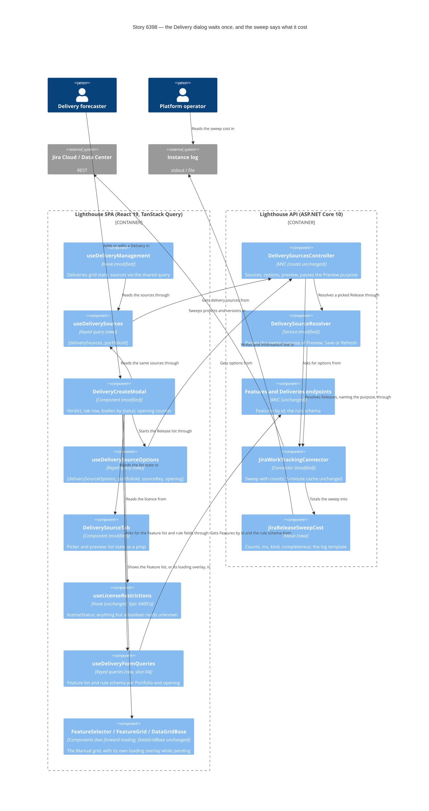

<!-- markdownlint-disable MD024 -->
# Feature Delta — story-6398-jira-release-loads-once

> ADO User Story #6398 "Choosing a Jira Release for a Delivery loads once, and never shows a guess as the answer"
> (Active, no parent Epic). Feedback from a user on Jira Data Center who ties a Delivery to a Jira Release every day.
> Opening the "Add Delivery" dialog and choosing a Jira Release costs three waits of 3 to 5 s each, one after
> another, and none of them looks like loading:
>
> 1. The Jira Release tab is missing at first, and the dialog's only message says the Delivery needs a name. The
>    Portfolio's delivery sources are still loading.
> 2. The tab appears, but says a premium licence is needed. The licence is still unknown, and unknown is treated as
>    "not premium".
> 3. Only then does the Release list start loading, because it is fetched when the tab is drawn. The slowest call
>    starts last.
>
> Wanted: never show a guess as the answer; load sources, licence and Release list together so the user waits once;
> measure why listing Jira Releases takes 3 to 5 s on Data Center, and decide on caching only after measuring.

## Wave: DISCUSS / [REF] Prior-Wave Reading Confirmation

- ⊘ DISCOVER: skipped by maintainer. The evidence is the user's feedback quoted in ADO #6398.
- ⊘ DIVERGE: skipped by maintainer. The Story names the wanted outcome (one wait, no guesses, measure first).
- ✓ `docs/product/jobs.yaml`: reused `job-forecaster-bind-a-delivery-to-the-release-it-tracks` (Epic 5565) and added
  a dated reuse note to it. No new job (see JTBD).
- ✓ `docs/product/personas/delivery-forecaster.yaml`, by reference. No persona change. No journey file exists under
  `docs/product/` that covers creating a Delivery, so none is extended; the light journey lives in this file.
- ✓ Code read (read-only, 2026-10-24). Frontend, relative to `Lighthouse.Frontend/src/`:
  `pages/Portfolios/Detail/Components/DeliveryGrid/DeliveryCreateModal.tsx:105-109, :283-363, :383-393, :471-592,
  :713-771, :773-780, :836-881, :895-899`, `DeliverySourceTab.tsx:51-60, :148-185, :335-415` (the failure Alert at
  `:388-395`, its text at `:391-392`), `deliverySelectionTabs.ts:171-254`, `useDeliveryManagement.ts:222-234,
  :504-508`, `DeliveryModals.tsx:90`, `hooks/useLicenseRestrictions.ts:18-54`,
  `components/Common/LicenseStatus/LicenseStatusIcon.tsx:23-32`, `App.tsx:237`, `services/Api/DeliveryService.ts:297-319`.
  Backend, relative to `Lighthouse.Backend/Lighthouse.Backend/`: `API/DeliverySourcesController.cs:29-55, :60-89,
  :182-197`, `Services/Implementation/Repositories/PortfolioRepository.cs:74-80, :114-125`,
  `Services/Implementation/WorkTrackingConnectors/Jira/JiraWorkTrackingConnector.cs:2985-3062, :3074-3181,
  :3204-3265`, `.../Jira/JiraRestRoutes.cs:79-127`.
- ✓ Related feature read: `docs/feature/epic-6400-fast-with-many-features/feature-delta.md` (facts W3, W3b; DESIGN
  component decomposition, slice 02 row; DEVOPS mutation scope, slice 02 row) and `design/upstream-changes.md` (UC-1,
  DDD-11). Epic 6400 runs in parallel and owns the licence hook and `GetById` (MD-11, MD-12).
- ✓ `CLAUDE.md` (loading and failure looks, sketch before UI, terminology) and `docs/ci-learnings.md` (skimmed; to be
  pre-applied at DELIVER).

## Wave: DISCUSS / [REF] Current-State Surface Inventory (brownfield)

| Surface | Today | Gap |
|---|---|---|
| Delivery sources for the dialog's tab row | Fetched again on every dialog open (`DeliveryCreateModal.tsx:558-567`), although the Deliveries grid already fetched the same list on page load (`useDeliveryManagement.ts:226-234, :504-508`). Until it answers, `sources` is `[]`, so the row shows only Manual and Rule-Based. A failure is also turned into `[]` (`:566`) | Loading and failure both look like "this connection offers no Jira Release" |
| `GET /portfolios/{id}/delivery-sources` | Makes no call to Jira (`DeliverySourcesController.cs:29-55`, `JiraWorkTrackingConnector.cs:3023-3026`), but `portfolioRepository.GetById` loads every Portfolio with its Features, forecasts and simulation results and filters in memory (`PortfolioRepository.cs:74-80, :114-125`; Epic 6400 fact W3b) | A call that should be instant takes seconds on a large instance. Owned by Epic 6400 (MD-11) |
| Licence in the dialog | `useLicenseRestrictions()` (`DeliveryCreateModal.tsx:481`) waits for `/license`, `/teams` and `/portfolios` together (`useLicenseRestrictions.ts:28-54`). It returns `licenseStatus: null` both while loading and after a failure. The dialog reads `isPremium = licenseStatus?.canUsePremiumFeatures ?? false` (`:482`) | Unknown and failed both read as "not premium". The hook and its speed are owned by Epic 6400 slice 02 (MD-12) |
| Jira Release tab body while licence unknown | `SelectionModeContent` shows `PremiumFeatureNotice` whenever `!isPremium` (`DeliveryCreateModal.tsx:303-306`): "Taking a delivery date from a Jira Release is a premium feature…" (`deliverySelectionTabs.ts:219-222`) | A guess shown as the answer |
| Rule-Based tab while licence unknown | Disabled, with the tooltip "Please obtain a premium license…" (`DeliveryCreateModal.tsx:336-362`, `deliverySelectionTabs.ts:177-181`); the rule schema loads only when `isPremium` (`:569-592`) | Same guess, on the other premium tab |
| Message under the form | The first blocking error, e.g. "Delivery name is required" on the Manual tab (`DeliveryCreateModal.tsx:773-780, :895-899`) | What the user reads as the dialog's "tip" while the tab row is incomplete |
| Release list (`useSourceOptions`) | Plain `useEffect` + module-level `Map` cache (`DeliverySourceTab.tsx:51-60, :148-185`), started only when the tab body mounts (`:351`), cleared when the dialog closes (`DeliveryCreateModal.tsx:728`). Loading is a centred spinner (`:398-402`), failure an Alert "The list of {sourceName} entries could not be loaded. Check this {portfolioTerm}'s connection and try again." (`:388-395`) | Starts last; not TanStack Query; "try again" names no way to do it |
| `GET …/delivery-sources/{key}/options` | `LicenseGuard(RequirePremium)` + `RbacGuard(PortfolioWrite)`; also runs `GetById` (`DeliverySourcesController.cs:60-89`) | Pays the `GetById` cost again before Jira is asked (Epic 6400) |
| Jira Release sweep | One call for the project list, then one paged call per project, 8 projects at a time, 50 versions per page (`JiraWorkTrackingConnector.cs:2988-3009, :3074-3093, :3225-3265`). On Data Center the version route cannot filter by status (`JiraRestRoutes.cs:107-110`), so every archived, released and unreleased version of every visible project is paged in and filtered afterwards. The only log line is a Debug count of projects (`:3079`) | Nobody can tell how long the sweep takes, or whether its time goes to projects, pages or `GetById` |
| Backend cache of the sweep | Already exists: process-wide, 5 minutes, only for a complete sweep (`JiraWorkTrackingConnector.cs:3011-3016, :3044-3059`) | "Add a short-lived cache" is not the open question; whether the existing one is long, warm or narrow enough is |
| Edit-Delivery dialog | The same component in edit mode (`DeliveryModals.tsx:90`, `editingDelivery`). A Delivery bound to a Jira Release opens on the Manual tab with its Feature grid until the sources arrive, then switches (`DeliveryCreateModal.tsx:731-765`, `:383-393`) | The same guess, shown when editing. In scope (MD-6) |
| Other source types | Only the Jira connector offers delivery sources (`AvailableSources` exists only in `JiraWorkTrackingConnector.cs:3023`). ADO, Linear, ServiceNow and CSV offer none | Nothing else to fix today; the fix should not be Jira-specific in the frontend |

**Where the three waits come from.** Wait 1 is `GetById` reading every Portfolio, not Jira. Wait 2 is the slowest of
`/license`, `/teams` and `/portfolios`, the last two also reading every Portfolio (Epic 6400 fact W3). Wait 3 is
`GetById` again plus the Jira sweep. Epic 6400, running in parallel, makes `GetById` and the licence cheap; this Story
makes the dialog honest and stops it waiting in series, without touching anything 6400 changes, and measures the Jira
part on its own (US-03).

## Wave: DISCUSS / [REF] Persona IDs

- **delivery-forecaster** (primary). Lena Hoffmann, delivery manager on a Jira Data Center instance with about 200
  projects. Most mornings she adds a Delivery to Portfolio "Payments Platform" and points it at the next Jira
  Release, such as "PAY 2026.11" in project PAY. She has a premium licence and write rights on the Portfolio.
- **platform-operator** (secondary, US-03). Runs the instance, reads the log, gets the "picking a Release is slow"
  complaint and has to say whether Jira or Lighthouse is slow.

## Wave: DISCUSS / [REF] JTBD One-Liners

- #6398 US-01, US-02, US-04 → reused `job-forecaster-bind-a-delivery-to-the-release-it-tracks`: when the thing I
  forecast already exists as a Jira Release, I want to point a Delivery at it instead of describing it again. Its habit
  force says the picker has to be visibly the same act as typing, one step shorter; 10 to 15 s of guesses breaks that.
  A reuse note is dated in `jobs.yaml`; the wording is unchanged.
- #6398 US-03 → reused `job-operator-read-an-update-log-that-says-something` *(re-pointed in the re-review, NF-03;
  first pointed at `job-operator-sync-without-hammering-the-tracker`)*: the platform-operator wants one legible line
  saying how long and how much, read from the log, to tell a healthy operation from a slow one; the sweep line does
  that for the Release sweep. A reuse note is dated in `jobs.yaml`; the wording is unchanged.

## Wave: DISCUSS / [REF] Journey (light)

Lena, on Portfolio "Payments Platform" → Deliveries → **Add Delivery** → Jira Release tab → picks "PAY 2026.11
(Payments)" → sees the preview → **Save**.

Emotional arc: *expectant* (she does this daily) → *patient, because she can see it is loading* → *confident* (the
list is there, once). Today it runs *expectant → puzzled (no tab) → alarmed (premium notice, "did our licence
lapse?") → impatient*.

### Sketch: the dialog while it loads (superseded as the reference by DISTILL sketches A–F, MD-21; this DISCUSS draft is kept for the record)

Reuses the existing `ButtonGroup` tab row, the tab body's `CircularProgress` (`DeliverySourceTab.tsx:398-402`) and
`Alert`. ~~The only new control is the "Try again" button of the sources failure look.~~ No new control: MD-23 dropped
the sources Try again.

```text
State A: the tab row is not known yet (rare once the page's list is reused)
+-- Add Delivery ---------------------------------------------------+
| Delivery Name  [                                ]                 |
| Delivery Date  [ dd.mm.yyyy ]                                     |
| Selection Mode                                                    |
| [ Manual ] [ Rule-Based ] [ (o) Loading… ]   <- disabled, busy    |
|                                                                   |
| (Manual tab body as today)                                        |
+-------------------------------------------------------------------+

State B: a premium tab chosen (Jira Release or Rule-Based), licence or Release list still on its way
| [ Manual ] [ Rule-Based ] [*Jira Release*]   <- Rule-Based enabled, no tooltip
|                                                                   |
|                (o)  Getting the Jira Releases…                    |
|                     (Rule-Based body: the same spinner)           |
   no premium notice, no locked Rule-Based tab, no premium tooltip

State C: loaded (as today)
| Preview a Jira Release                                            |
| [ Type to search Jira Releases                         v ]        |

Failure looks
- Sources failed:  [ Manual ] [ Rule-Based ]
                   (!) Couldn't check what this Portfolio's connection offers. Close this
                   dialog and open it again to retry.          <- no button (MD-23)
                   Manual and Rule-Based stay usable.
- List failed:     (!) The list of Jira Release entries could not be loaded. Close this
                   dialog and open it again to retry.          <- no button (MD-13)
- Licence failed:  no look of its own in this Story: state B stays on screen while the dialog
                   is open (known limit, follow-up F1 once Epic 6400 slice 02 has shipped)
```

DISTILL sketch point (MD-13): the two failure looks differ on purpose, one with Try again (sources) and one asking
to reopen the dialog (Release list). The maintainer confirms that difference when the sketches are walked through.
*(superseded by MD-23)* The maintainer made the two looks consistent: both ask to reopen the dialog, neither has a button.

### Shared artifacts

| Artifact | Single source | Consumers | Risk |
|---|---|---|---|
| Licence status | `useLicenseRestrictions()` (unchanged here; Epic 6400 slice 02 rewrites it) | Header, Overview, the dialog's premium tabs | HIGH: the dialog must read it exactly as today, so 6400's rewrite reaches it without a merge |
| Delivery sources of a Portfolio | `GET /portfolios/{id}/delivery-sources`, fetched once by the Deliveries page | Deliveries grid (source names), the dialog's tab row | MEDIUM: grid and dialog disagreeing on which tab exists |
| Jira Release list | `GET …/delivery-sources/jira-release/options`, backend 5-minute cache | Release picker | MEDIUM: a late answer for another Portfolio landing in this dialog |

## Wave: DISCUSS / [REF] Locked Decisions

| ID | Decision | Why |
|---|---|---|
| D1 | **Unknown is never shown as an answer.** While the sources or the licence are unknown, the dialog shows a loading look; the premium notice, the locked Rule-Based tab and its premium tooltip appear only once the licence is known not to be premium. The dialog reads `licenseStatus === null` from the unchanged hook as "not known yet". | The Story's first ask; CLAUDE.md's loading-look rule; MD-12 |
| D2 | **Failure is never shown as "no" either, where this Story can tell.** A failed sources call and a failed Release list each have their own failure look; neither falls back to "no tab" or "premium needed". A failed licence cannot be told from a loading one through today's hook, so it shows the loading look (known limit, F1). | MD-8, MD-12, MD-13 |
| D3 | **The server keeps deciding.** `LicenseGuard` and `RbacGuard` on the options and preview routes are unchanged; the frontend only stops guessing. | The UI is not the gate |
| D4 | **The dialog reuses the sources the Deliveries page already fetched** (`useDeliveryManagement`), asking only when the page has no **successful** answer yet, and **asking again on opening when the page's last answer failed** *(superseded by MD-23; amended after the final-wave review, F-H1; was "asking again only when the page has none yet")*. How (props or a keyed query) is DESIGN's call, inside the Deliveries folder. | Removes wait 1 for the common case without any backend change; reopening is the one retry path (MD-23) |
| D5 | **The Release list starts while the dialog is open, as soon as the sources include the source and the licence is known premium** (MD-7, MD-15), not when the tab is drawn and not on page load. | The slowest call starts as early as it can; a page visit without the dialog costs Jira nothing; no request the server would refuse |
| D6 | **A late answer never lands in the wrong dialog.** An answer for a Portfolio or dialog no longer on screen is dropped. | CLAUDE.md: keyed queries |
| D7 | **Caching is decided from measurement** (MD-9). A 5-minute process-wide cache already exists; US-03 measures the sweep, and the gate says whether a follow-up Story changes it. | The Story's third ask |
| D8 | **The fix is not Jira-specific in the frontend.** It works for any source the server lists. | Only Jira offers a source today, but the tab row is built from the server's list |
| D9 | **Nothing Epic 6400 changes is touched** (MD-12): not `hooks/useLicenseRestrictions.ts`, no `["licenseStatus"]` query read or created, no call to `licensingService.getLicenseStatus`, not `PortfolioRepository` or the Portfolio and Team controllers. | 6400 runs in parallel; its slice 02 adds a source-tree test that only the shared query calls `getLicenseStatus` |

### Maintainer decisions — before DISCUSS

| ID | Decision |
|---|---|
| MD-1 | DISCOVER and DIVERGE skipped by the maintainer. |
| MD-2 | Feature type: user-facing. |
| MD-3 | Walking skeleton: brownfield, evaluate (answered under WS Strategy). |
| MD-4 | UX depth: lightweight (one journey, one sketch set, in this file). |
| MD-5 | JTBD: yes (reused job above). |

### Maintainer decisions — 2026-10-24, end of DISCUSS

| ID | Decision | Was |
|---|---|---|
| MD-6 | **The edit-Delivery dialog is in scope** (same component). | Q1, recommended (a) |
| MD-7 | **The Release list starts when the dialog opens**, not on page load or hover. | Q2, recommended (a) |
| MD-8 | **A failed sources call shows a notice under the tab row with Try again**; Manual and Rule-Based stay usable. *(superseded by MD-23)*: no Try again; reopening the dialog is the retry. | Q4, recommended (a) |
| MD-9 | **Cache gate as recommended**: if the sweep's median with a cold cache on the reporter's connection is over 2 s, a follow-up Story chooses between a longer cache lifetime and narrowing the sweep to the projects the Portfolio's query names; otherwise close with no change. | Q7, recommended (a) |
| MD-10 | **Release Notes tag: yes.** | Q9 |
| MD-11 | **`PortfolioRepository.GetById` (wait 1) belongs entirely to Epic 6400**, which runs in parallel. | New |
| MD-12 | "epic 6400 is ongoing in parallel. leave all that could interfere out of this story." This Story does not touch `hooks/useLicenseRestrictions.ts`, does not read or create a `["licenseStatus"]` query, and does not call `licensingService.getLicenseStatus`. The dialog keeps reading `licenseStatus` from `useLicenseRestrictions()` as today and treats `null` as "not known yet". Reusing the header's licence is dropped; the licence speed-up comes from 6400 slice 02. The licence failure look ("Couldn't check your licence.") is dropped and becomes follow-up F1. | Q6 (and Q3, superseded) |
| MD-13 | **No Try again button on the Release-list error.** Keep the Alert and fix only its wording so the retry path is honest: "The list of {sourceName} entries could not be loaded. Close this dialog and open it again to retry." Today's text (`DeliverySourceTab.tsx:391-392`) uses `{sourceName}` and `{portfolioTerm}`; both stay the terms in use, and DISTILL decides whether the connection hint with `{portfolioTerm}` stays in the new wording. The sources failure look keeps its Try again (MD-8), so the two looks differ; a DISTILL sketch point. | Q8, option (b) |
| MD-14 | **Rule-Based stays enabled while the licence is unknown, and its body shows a loading look.** | Q5, recommended (a) |
| MD-15 | "assume that by the time this feature is done (or certainly when released), the epic 6400 is in too". **N1 resolved as (b): the Release list waits until the licence is known premium.** By release the licence is one fast shared query, so waiting costs almost nothing and sends no refused requests. MD-12 still stands: this Story does not touch the hook; 6400 shipping changes only the timing assumption. | N1, option (b) |

**Known limit (MD-12).** Until Epic 6400 slice 02 has shipped, a licence check that fails shows the loading look for
as long as the dialog is open: the hook returns `null` for both, and this Story may not change the hook. Only the
premium tabs are affected; Manual stays usable, and the server's `LicenseGuard` still decides.

**Follow-ups recorded.**
- **F1** Once Epic 6400 slice 02 has shipped, give the dialog's premium tabs a licence failure look ("Couldn't check
  your licence.", matching 6400's DDD-11) using the hook's new loading/ready/failed status. A new Story, not part of
  #6398. Assuming 6400 slice 02 lands before 6398 is released (MD-15), F1 can follow right after; it stays out of
  this Story's slices (MD-12). The look covers a failure of any of the hook's three calls (`/license`, `/teams`,
  `/portfolios`), all of which leave the premium tabs on the loading look until then (MD-28a, DESIGN final-wave review M-3).
- **F2** The follow-up Story the MD-9 gate may open (cache lifetime or narrower sweep).
- **F3** Review the existing Jira Release log lines that name project keys, and the could-not-ask line whose exception
  text may carry a host, against the no-customer-identifiers rule (CA-8), and the Debug line that writes the site
  address (`JiraWorkTrackingConnector.cs:2945`). Outside this Story.
- **F4** *(open; trigger set after the DEVOPS review, F-04)* A Delivery-saved usage event (MD-18). **Trigger: the first
  slice touching the Delivery save path after Epic 6400 slice 02 ships** takes up the event design, or answers "N/A,
  because …" there. Not part of #6398.

### Overlap check with Epic 6400 slice 02

6400 slice 02 modifies (DESIGN component decomposition, slice 02 row; DEVOPS mutation scope, slice 02 row):
`PortfolioRepository`, `IPortfolioRepository`, `PortfoliosController`, `TeamsController`, `TeamController`,
`PortfolioController`, `hooks/useLicenseRestrictions.ts`, `OverviewDashboard.tsx`; it names as unchanged `LicenseGuard`,
`useRbac`, `PortfolioDetail`, `ModifyProjectSettings`, `TeamDetail`, `EditTeam`.

This Story changes: `DeliveryCreateModal.tsx`, `DeliverySourceTab.tsx`, possibly `deliverySelectionTabs.ts`,
`DeliveryModals.tsx` and `useDeliveryManagement.ts` (slices 01, 02); `JiraWorkTrackingConnector.cs` (slice 03);
`components/Common/FeatureSelector/FeatureSelector.tsx` and `components/Common/FeatureGrid/FeatureGrid.tsx` (one optional
`loading` prop each, slice 04, MD-29); `docs/settings/systeminfo.md` (the sweep line's subsection, AC-3.4).

- **File overlap: none.** No file is on both lists. Slice 05 of 6400 touches `PortfolioRepository` and slice 04
  touches `PortfolioDetail`; this Story touches neither.
- **Behavioural overlap 1 (read, not edit):** the dialog calls `useLicenseRestrictions()`. When 6400 rewrites the hook
  onto shared TanStack queries, rendering the dialog in tests needs a `QueryClientProvider`. Mitigation: render the
  dialog's new Vitest scenarios through the existing `tests/renderWithQueryClient.tsx` wrapper from the start, and
  drive the licence through the mocked `licensingService` as today, so 6400's rewrite does not break them.
- **Behavioural overlap 2 (read, not edit):** `DeliverySourcesController` calls `GetById`, which 6400 slice 02 changes
  to filter in the database. Slice 03's log line is written in the connector, after `GetById`, so the two
  measurements do not mix; slice 03's reading notes which release of 6400 the instance runs.
- **Test-source rule:** 6400's source-tree test that only the shared query calls `getLicenseStatus` is not affected;
  this Story adds no such call.

## Wave: DISCUSS / [REF] Scope Assessment

PASS. 4 Stories, 2 contexts (the Deliveries frontend; the Jira connector's Release sweep). No new endpoint, no payload
change. One UI change (loading and failure looks in the add and edit dialog, the reworded Release-list error; the
sources Try again was dropped by MD-23). 4 slices: 01 about a day, 02 about ¾ day, 04 about 1 day (MD-26, NF-05), 03
about ½ day; about 3¼ days in all.

## Wave: DISCUSS / [REF] Story Map & Slices

Backbone (delivery-forecaster, one Delivery): *open the dialog* → *see which ways to pick are offered* → *learn
whether the licence allows the Jira Release way* → *see the Releases* → *pick and preview* → *save*.

| Slice | Outcome | Brief | Est. |
|---|---|---|---|
| 01 | The dialog never shows a guess: a busy tab while sources are unknown, a loading look in both premium tabs while the licence is unknown (Rule-Based enabled), the premium notice only when the licence is known not premium, the sources failure look, the Release-list error reworded; add and edit mode. *(The sources Try again was superseded by MD-23: both failure looks ask to reopen the dialog.)* | `slices/slice-01-the-dialog-never-shows-a-guess.md` | 1 day |
| 02 | No more waiting in series: the dialog reuses the sources the Deliveries page already fetched, and the Release list starts when the dialog opens; late answers dropped | `slices/slice-02-the-release-list-loads-once.md` | ¾ day |
| 04 | The Manual Feature list and the rule fields never show a stale or empty answer: a loading and a failure look for each (MD-29, MD-30), keyed per Portfolio and opening, add and edit mode (MD-26) | `slices/slice-04-feature-list-and-rule-fields-never-stale.md` | about 1 day (NF-05; if it overruns, split: the Feature list and the `loading` prop first, the schema second) |
| 03 | The operator can tell from one log line whether a slow Release list is Jira's time or Lighthouse's (every sweep purpose logs); the maintainer's cache gate (MD-9) reads the same line after release | `slices/slice-03-the-release-list-says-what-it-cost.md` | ½ day |

### Priority Rationale

01 first: it removes the alarming premium notice, the part of the feedback that can make a customer think their
licence lapsed, and it is right whatever the calls cost. 02 next: it removes the wait for the sources and starts the
Release list first, with no backend change. 02 is technically independent of 01; it is ordered after it as a
sequencing preference only, because shipped first it would show today's guesses for a shorter time (F-L1). 04 third:
it finishes the dialog's honesty for the two tabs the reporter did not name (Manual and Rule-Based), and it edits the
same component as 01 and 02, so it goes right after them while that code is fresh; it is independent of 01–03 and could
ship alone in any order. 03 last: it touches only the backend, needs a reading on the reporter's instance after release
and feeds a decision rather than a screen.

### Slice taste tests (re-run after MD-6..MD-28)

- **Does slice 02 still stand alone?** It shrank: the licence reuse is gone (MD-12), leaving the page's sources and the
  early Release list. It still stands alone and is kept separate from 01. It ships a different outcome (speed, not
  honesty) with its own falsifiable hypothesis. Shipped without 01, it already removes wait 1 and moves the Release
  list to the front. Merged with 01 it would be about 1¾ days, past the one-day slice cap, and one slice would test
  two hypotheses at once.
- **What 02 can promise now.** The Release list waits for the licence (MD-15, N1 (b)). That costs little only because
  Epic 6400 slice 02 is assumed in by release, making the licence one fast shared query; until then the licence wait
  and the Release list run in series. K1a and K1b are restated to say so, as an assumption rather than a dependency.
- **Slice 03 stays a slice** *(F-B1, ruled by MD-25)*: an operator reading the documented sweep line
  (`docs/settings/systeminfo.md`, `### Jira Release sweeps`, at Information level) to tell whether Jira or Lighthouse is
  slow counts as value of its own. US-03 traces to the operator's job, not the forecaster's.
- **Slice 04 stands alone** *(MD-26)*: it changes only the Manual and Rule-Based bodies, which none of 01–03 touches
  for their fetches, and shipped alone it removes the empty-list-reads-as-none and the stale-reopen answers. It is not
  infrastructure-only: Lena sees a loading and a failure look where she saw an empty grid or last opening's list.
- No slice is infrastructure-only. 01, 02 and 04 change what Lena sees. 03 adds an Information log line the operator
  reads.
- Each slice has a hypothesis that can fail (see briefs).
- Each is checked against production-shaped data: 01, 02 and 04 on the maintainer's dev instance (`:5169`, a Jira Cloud
  Portfolio, MD-24) with the browser throttled to "Slow 4G"; ~~a Jira Data Center connection where available~~
  *(superseded by MD-19 and MD-24: no Data Center is available before release)*; 03 on the dev instance and, after
  release, on the reporter's Data Center connection.
- Not scale variants of each other. Not cut by layer.
- None touches a file Epic 6400 changes (overlap check above; slice 04 leaves `DataGridBase` and the licence hook
  alone, MD-12).

## Wave: DISCUSS / [REF] User Stories

### US-01 — The Delivery dialog never shows a guess as the answer (slice 01, ADO #6398)

`job_id: job-forecaster-bind-a-delivery-to-the-release-it-tracks`

As a delivery-forecaster binding a Delivery to a Jira Release, I want the dialog to show that it is still loading
while it does not know yet, so I never read "no Jira Release" or "premium needed" when neither is true.

#### Elevator Pitch
Before: Lena opens **Add Delivery** on "Payments Platform". For 4 s there is no Jira Release tab and the form says
"Delivery name is required"; then the tab appears and says "Taking a delivery date from a Jira Release is a premium
feature" although her licence is premium.
After: Lena opens **Add Delivery** → sees the tab row with a busy "Loading…" tab, then the Jira Release tab with a
spinner reading "Getting the Jira Releases…", then the picker. The premium notice appears only on an instance whose
licence is known not to be premium. If the sources cannot be loaded she reads "Couldn't check what this Portfolio's
connection offers. Close this dialog and open it again to retry." (no button, MD-23; was **Try again**); if the Release
list cannot be loaded, the message tells her to close and reopen the dialog.
Decision enabled: whether to wait for the picker or type the Delivery by hand, made from what is true rather than from
a guess.

#### Domain Examples
1. **Premium, slow sources.** Lena opens the dialog; the sources take 4 s. The row shows Manual, Rule-Based and a busy
   "Loading…" tab, then "Jira Release". No premium notice appears at any point.
2. **Community licence.** Tom Becker on a Community instance opens the dialog. Once his licence is known, the Jira
   Release tab says "Taking a delivery date from a Jira Release is a premium feature…" and Rule-Based is locked, as
   today. Before it is known, Rule-Based is enabled and either premium tab shows the loading look, not the notice.
3. **Sources fail.** The sources call answers 500. The row shows Manual and Rule-Based and, under it, "Couldn't check
   what this Portfolio's connection offers. Close this dialog and open it again to retry." (MD-23; was with **Try
   again**); reopening the dialog after the backend recovers brings the Jira Release tab.
4. **Release list fails.** Jira is down. The Jira Release tab reads "The list of Jira Release entries could not be
   loaded. Close this dialog and open it again to retry." Lena reopens the dialog a minute later and the list loads.
5. **Editing a bound Delivery.** Lena edits "PAY 2026.10", bound to that Release. The dialog opens with a loading look,
   never on Manual with a Feature grid.
6. **Licence check fails (known limit).** `/license` times out. The premium tabs keep the loading look while the
   dialog is open; Manual stays usable. No premium notice is shown.

#### UAT Scenarios (BDD)

##### Scenario: While the ways to pick are still loading, the dialog says so
Given Lena has a premium licence and "Payments Platform" offers Jira Releases
And the Portfolio's delivery sources have not answered yet
When Lena opens Add Delivery
Then the tab row shows a busy tab in place of the ones still loading
And no premium notice is shown

##### Scenario: The premium notice appears only once the licence is known not to be premium
Given the licence has not answered yet
When Lena opens the Jira Release tab, or the Rule-Based tab
Then she sees a loading look
And neither the premium notice nor a locked Rule-Based tab nor a premium tooltip is shown
When the licence answers that premium features are not available
Then the Jira Release tab shows the premium notice and Rule-Based is locked, as today

##### Scenario: A failed list of ways to pick says so and how to retry (amended by MD-23)
Given the Portfolio's delivery sources fail when Lena opens Add Delivery
Then the dialog shows "Couldn't check what this Portfolio's connection offers. Close this dialog and open it again to retry." with no button
And Manual and Rule-Based stay usable
When she closes and reopens the dialog and the sources answer
Then the Jira Release tab appears

##### Scenario: A failed Release list says how to retry
Given the Jira Release list fails
When Lena opens the Jira Release tab
Then she reads "The list of Jira Release entries could not be loaded. Close this dialog and open it again to retry."
And when she closes and reopens the dialog, the Release list is asked for again

##### Scenario: Editing a Delivery bound to a Jira Release opens on its own tab
Given Delivery "PAY 2026.10" follows Jira Release "PAY 2026.10"
And the Portfolio's delivery sources have not answered yet
When Lena opens it for editing
Then the dialog shows a loading look and never the Manual tab's Feature list

##### Scenario: Nothing under the form reads as the answer while the dialog does not know yet (F-M1)
Given the Portfolio's delivery sources or the licence have not answered yet
When Lena opens Add Delivery and has typed nothing
Then no message such as "Delivery name is required" is shown under the form
And Save is disabled

##### Scenario: A licence check that fails leaves the premium tabs on the loading look (known limit, NF-09, MD-28a)
Given Lena's licence check fails, whichever of `/license`, `/teams` or `/portfolios` failed
When Lena opens Add Delivery and chooses the Jira Release tab, or the Rule-Based tab
Then the tab shows the loading look for as long as the dialog is open
And no premium notice is shown
And the Manual tab stays usable

#### Acceptance Criteria
- AC-1.1 While the delivery sources are unknown, the tab row shows a busy placeholder tab: a disabled `button` named
  exactly "Loading…" with `aria-busy="true"`, inside the `Selection Mode` group (DESIGN's and DISTILL's definition,
  F-L3). Manual and Rule-Based are shown as today, and the source tabs appear when the sources answer.
- AC-1.2 While `useLicenseRestrictions()` returns no licence, Rule-Based is enabled, no premium notice, no locked
  Rule-Based tab and no premium tooltip are shown, and a premium tab chosen meanwhile shows a loading look. The rule
  schema is not requested until the licence is known premium, as today.
- AC-1.3 Once the licence is known not to be premium, today's premium notice, lock and tooltip appear unchanged.
- AC-1.4 *(amended by MD-22, MD-23)* A failed sources call shows a `warning` notice "Couldn't check what this
  Portfolio's connection offers. Close this dialog and open it again to retry." under the tab row, with no button;
  Manual and Rule-Based stay usable, and opening the dialog again asks for the sources again. (Was: a Try again button
  that repeats only that call.)
- AC-1.5 A failed Release list shows "The list of {sourceName} entries could not be loaded. Close this dialog and open
  it again to retry." with no button, and reopening the dialog asks for the list again (today's cache clear on close).
- AC-1.6 Editing a Delivery bound to a source never shows another tab's body while the sources load.
- AC-1.7 *(narrowed after the final-wave review, F-M4, MD-28b)* `hooks/useLicenseRestrictions.ts` is
  unchanged, and a source-tree check shows that no file of the dialog calls `getLicenseStatus` nor reads a licence
  query itself (D9). A count of licence requests on dialog open is out of scope: the Manual body's `DataGridBase`
  reads the licence on every opening today, through the hook this Story may not touch.
- AC-1.8 A refused request (`403` from the server's guards) still ends in the Release-list failure look.
- AC-1.9 *(added after the final-wave review, F-M1, N2 (a))* While the sources or the licence are unknown, the form
  shows no blocking message under it ("Delivery name is required" and the like), so nothing reads as the dialog's
  answer; Save stays disabled as DDD-4 says. Once both are known, the message appears as today.

#### Outcome KPIs
See K2 under Outcome KPIs.

#### Technical Notes
- Driving port: the `DeliveryCreateModal` rendered through `DeliveryModals`, with the API services mocked (Vitest +
  React Testing Library), rendered through `tests/renderWithQueryClient.tsx` so Epic 6400's hook rewrite does not
  break the scenarios. No backend change.
- The change to the licence is local to `DeliveryCreateModal`: `licenseStatus === null` reads as "not known yet"
  instead of "not premium" (`:482`, `:303-306`, `:336-362`). Known limit: a failed check looks the same (F1).
- Copy uses the configurable terms (Delivery, Portfolio). "Jira Release" is the source's display name from the server.

### US-02 — Choosing a Jira Release no longer waits in series (slice 02, ADO #6398)

`job_id: job-forecaster-bind-a-delivery-to-the-release-it-tracks`

As a delivery-forecaster, I want the dialog to use what the page already knows and to start the Release list first,
so I no longer wait for the ways to pick, then the licence, then the Releases, one after another.

#### Elevator Pitch
Before: Add Delivery → three waits of 3 to 5 s in a row (tab row, then licence, then Release list) before Lena can
type "PAY 2026.11".
After: Add Delivery → the Jira Release tab is there at once, because the Deliveries page already loaded the sources,
and the Release list request starts as soon as the licence is known premium, before Lena clicks the tab. She types
into the picker after about the Release list's own time (with Epic 6400 slice 02 assumed in by release, MD-15).
Decision enabled: binding to the Release instead of falling back to typing name and date by hand.

#### Domain Examples
1. **Daily case.** The Deliveries page of "Payments Platform" has loaded its sources. Lena opens Add Delivery: the
   Jira Release tab is there immediately, and the Release list request starts as soon as her licence is known premium,
   a moment later. She clicks the tab 1 s later and the picker is ready when the list has answered, not 12 s after
   opening.
2. **Reopening.** Lena cancels and reopens the dialog within a minute. The Release list is asked again (the dialog
   still forgets it on close, so a date just set in Jira shows), and the backend's 5-minute cache answers quickly.
3. **Community licence.** Tom Becker's licence is not premium. No Release list request is sent (MD-15); he sees the
   premium notice once his licence is known, never a list, and the server is never asked for something it would
   refuse.
4. **Lena never picks a Release.** She opens the dialog to add a Manual Delivery. One Release list request is made on
   open (MD-7); visiting the Deliveries page without opening the dialog makes none.

#### UAT Scenarios (BDD)

##### Scenario: The dialog opens with the ways to pick the page already knows
Given the Deliveries page of "Payments Platform" has loaded its delivery sources
When Lena opens Add Delivery
Then the Jira Release tab is shown without a new request for the sources

##### Scenario: The Release list starts when the dialog opens, not when the tab is drawn
Given "Payments Platform" offers Jira Releases and Lena's licence is premium
When Lena opens Add Delivery and stays on the Manual tab
Then the Jira Releases are already being fetched
And when she then opens the Jira Release tab, the picker is ready as soon as that answer has arrived

##### Scenario: Nothing is fetched that nobody asked for or the server would refuse
Given Lena visits the Deliveries page of "Payments Platform"
When she does not open Add Delivery
Then no Release list is requested
And when Tom Becker, whose licence is not premium, opens Add Delivery, no Release list is requested either

##### Scenario: A late answer for another Portfolio never lands
Given Lena opened Add Delivery on "Payments Platform" and closed it before its Release list answered
When she opens Add Delivery on "Onboarding"
Then the picker shows only the Releases answered for "Onboarding"

#### Acceptance Criteria
- AC-2.1 *(superseded by MD-23; amended after the final-wave review, F-H1)* Opening the dialog does not request the
  sources again when the Deliveries page already holds a **successful** answer. It asks only if the page has no
  successful answer yet, and it **asks again on opening when the page's last answer failed**, because reopening the
  dialog is the one retry path (MD-23). The sources failure look of AC-1.4 applies to that request. (Was: "asks only
  if the page has no answer yet".)
- AC-2.2 The Release list request starts while the dialog is open, as soon as the sources include the source and the
  licence is known premium, whichever tab is on screen, never later because a tab is drawn (MD-7, MD-15).
- AC-2.3 No Release list request is sent on page load, for a Portfolio that offers no source, or for a licence that is
  unknown or known not to be premium.
- AC-2.4 An answer for a Portfolio or dialog no longer on screen is dropped.
- AC-2.5 Closing the dialog still forgets the Release list, so the next open asks again (`DeliveryCreateModal.tsx:728`).
- AC-2.6 No file Epic 6400 changes is touched (D9); the licence is read through `useLicenseRestrictions()` as today.
  **Verified at review** by `git diff --stat` of this Story's commits against this list (Epic 6400 slice 02's
  modified files, plus the files MD-12 rules out): `Lighthouse.Backend/Lighthouse.Backend/Services/Implementation/
  Repositories/PortfolioRepository.cs`, `.../Services/Interfaces/Repositories/IPortfolioRepository.cs`,
  `.../API/PortfoliosController.cs`, `.../API/TeamsController.cs`, `.../API/TeamController.cs`,
  `.../API/PortfolioController.cs`, `Lighthouse.Frontend/src/hooks/useLicenseRestrictions.ts`,
  `.../src/pages/Overview/OverviewDashboard.tsx`, `.../src/components/Common/DataGrid/DataGridBase.tsx`,
  `.../src/components/Common/LicenseStatus/LicenseStatusIcon.tsx`. Any hit fails the review.

#### Outcome KPIs
See K1, K3 and the guardrail K5 under Outcome KPIs.

#### Technical Notes
- Driving ports: the Deliveries page (`useDeliveryManagement` + `DeliveryModals`) for Vitest, and the existing
  Deliveries E2E flow, which must stay green and wait for the picker rather than for mere visibility.
- How the sources reach the dialog (props from `useDeliveryManagement` or a keyed query in the Deliveries folder) and
  where the Release list request lives once lifted out of the tab body are DESIGN's call. CLAUDE.md asks for keyed
  TanStack queries so a late answer never lands; moving `useSourceOptions` off its module-level `Map` is a likely
  consequence. No `["licenseStatus"]` query is read or created (D9).
- No backend change. The sources and options calls still pay `GetById`, and the licence still waits for `/teams` and
  `/portfolios`, until Epic 6400 slice 02 lands. This slice removes the waiting in series, not the cost of each call.

### US-03 — The Release list says what it cost, and caching is decided from it (slice 03, ADO #6398)

`job_id: job-operator-read-an-update-log-that-says-something` *(re-pointed in the re-review, NF-03: that job asks for
one legible Information line per operation saying how long and how much, read from the log, which is exactly what this
slice adds; it fits better than `job-operator-sync-without-hammering-the-tracker`, which is about narrowing a fetch, and
this slice changes no fetch. MD-25's value ruling holds against it: reading the line to tell Jira's time from
Lighthouse's is that job's "is Lighthouse healthy?" answered for the Release sweep. Dated note in `jobs.yaml`.
*Accepted reuse (final gate, F-03):* the job's "update" is read to cover a Jira Release sweep, one line per sweep
whatever its purpose.)*

As a platform-operator who gets "picking a Release is slow", I want each Jira Release sweep to log how long it took
and how much it read, so I can tell Jira's time from Lighthouse's and know whom to tell.

#### Elevator Pitch
Before: the log says nothing about the sweep at Information level; the operator cannot say whether 4 s went to
200 projects, to thousands of old versions, or to Lighthouse itself.
After: when Lena opens the Jira Release list in Add Delivery (or a bound Delivery refreshes in the background, or a
Release is previewed or a binding saved), that sweep writes one Information line to the application log, for example
`Listed 37 unreleased Jira Releases from 212 projects (1,480 versions over 260 pages) in 3,912 ms on this Data Center
connection`; a request answered from the cache writes nothing new. The operator reads it in **Settings → System Info →
Logs**: the built-in Log Viewer (with Search; refresh it for the latest lines) or the downloaded log file, as described
in `docs/settings/systeminfo.md` under "Jira Release sweeps". The log level has to be *Information* or lower for the
line to appear.
Decision enabled: whether a slow Release picker is Jira's time (many projects, thousands of versions: tell the Jira
administrator, or narrow what the credential sees) or Lighthouse's (a short sweep inside a long request: report it to
the Lighthouse maintainer).

#### Domain Examples
1. **Data Center, cold cache.** Lena opens the dialog at 08:05. The log gains the line above: 3.9 s of a 4.6 s
   options call. The remaining 0.7 s is the request's own cost, `GetById` included.
2. **Cache hit.** Lena reopens at 08:07. No sweep line, and the options call answers in well under a second plus the
   request's own cost.
3. **One project refused.** Project HR answers 403. The line still appears and says the list is incomplete (one
   project skipped), and the incomplete list is not cached, as today.

#### UAT Scenarios (BDD)

##### Scenario: A sweep logs its duration and size
Given the Jira connection of "Payments Platform" has 212 visible projects
When the Release list is fetched with nothing cached
Then one Information line names the number of Releases offered, projects, versions read, pages, the duration and the
kind of Jira

##### Scenario: A remembered list logs no sweep
Given the Release list was fetched completely two minutes ago
When it is fetched again
Then no sweep line is written

##### Scenario: An incomplete sweep says so
Given one project refuses to list its versions
When the Release list is fetched
Then the sweep line says the list is incomplete and how many projects were skipped

#### Acceptance Criteria
- AC-3.1 *(widened in the re-review: NF-07, DESIGN re-review F-3)* Every Jira Release sweep, whatever called it, writes
  exactly one sweep line at Information with its purpose (`Picker`, `Refresh`, `Preview` or `Save`), Releases offered,
  projects, versions read, pages, duration in ms, the deployment kind, whether it was complete and, **when incomplete,
  how many projects were skipped**. No URL, credential, project name or Release name is logged.
- AC-3.2 A picker request answered from the 5-minute cache makes no sweep and writes no sweep line; every sweep that
  does run, for any of the four purposes, writes its line (AC-3.1).
- ~~AC-3.3~~ *(moved to the Definition of Done as release checklist item 10, F-L4: the post-release reading of the
  sweep line and the MD-9 gate are a release step, not a test of this Story.)*
- AC-3.4 *(added at the final gate, F-02)* `docs/settings/systeminfo.md` has a `### Jira Release sweeps` subsection under
  `## Logs` that shows one sample sweep line, names the four purposes (`Picker`, `Preview`, `Save`, `Refresh`) and says
  the line is written at Information.

#### Outcome KPIs
See K4 under Outcome KPIs.

#### Technical Notes
- Driving port: the connector's public `GetOptions` and `ResolveMany` with Jira's HTTP stubbed (CA-2, the
  `JiraDeliverySourceProviderTest` pattern); assert through a captured logger.
- The line is written in `JiraWorkTrackingConnector.cs` only; the controller and `GetById` are not touched (D9).
- Every caller of the sweep logs the same line with its `SweepPurpose` (Picker, Refresh, Preview, Save): MD-17 decided
  the refresh logs too, and the DESIGN re-review (F-3) widens it to every caller.
- **The maintainer's cache gate (MD-9)** reads the same line after release: if the sweep's median with a cold cache on
  the reporter's connection is over 2 s, a follow-up Story (F2) chooses between a longer cache lifetime and narrowing
  the sweep; otherwise no change. It is a release checklist item (DoD 10), not this story's decision.
- Not part of this slice: any change to the cache or the sweep (F2).

### US-04 — The Manual Feature list and the rule fields never show a stale or empty answer (slice 04, ADO #6398, MD-26)

`job_id: job-forecaster-bind-a-delivery-to-the-release-it-tracks` *(NF-04: none of the delivery-forecaster persona's
jobs is about choosing a Delivery's Features or rules by hand; a dated reuse note in `jobs.yaml` says why the binding
job covers it: its functional dimension names Manual and Rules as the other ways to define a Delivery, and its anxiety
"will it actually find my Features?" is the worry an empty list raises.)*

As a delivery-forecaster adding or editing a Delivery by hand or by rules, I want the dialog's Feature list and rule
fields to show that they are loading, or that they could not be loaded, so I never read an empty list as "this
Portfolio has no Features" and never pick from the list of an earlier opening.

#### Elevator Pitch
Before: Lena opens **Add Delivery** on "Payments Platform" (412 Features). If the Feature request fails, the Manual tab
shows an empty grid, which reads as "no Features"; the error goes only to the browser console. If she closes and
reopens the dialog, the Manual tab first shows the previous opening's list until the new one lands. On Rule-Based, a
late schema answer from a closed opening can fill the next form.
After: Add Delivery → Manual tab → sees the grid's own loading overlay until the Features of this opening arrive, then
the grid; if they cannot be loaded she reads "Couldn't load this Portfolio's Features. Close this dialog and open it
again to retry." in place of the grid (MD-29). Rule-Based shows today's spinner and, on failure, today's schema error,
asked once per opening (MD-30). A reopen or another Portfolio never shows an earlier answer.
Decision enabled: which Features to put in the Delivery, chosen from the list that is true now, or a deliberate wait or
reopen when it is not there.

#### Domain Examples
1. **Happy path.** Lena opens Add Delivery on "Payments Platform". The Manual tab shows a loading look for 2 s, then
   the grid of its 412 Features.
2. **Feature list fails.** The Feature request answers 500. The Manual tab shows the failure look, not an empty grid;
   Lena closes and reopens the dialog and the list loads.
3. **Reopen.** Lena closes the dialog after picking nothing and reopens it a minute later, after a Feature was added to
   the Portfolio. She sees the loading look, then the list with 413 Features, never the 412 of the first opening.
4. **Another Portfolio.** Lena opens Add Delivery on "Payments Platform" and closes it before the Feature list and the
   rule schema answer, then opens it on "Onboarding". Only Onboarding's Features and fields appear.
5. **Editing a hand-picked Delivery.** Lena edits "Q4 Onboarding cut", a Manual Delivery of 12 Features. While the
   list loads, the Manual tab shows the loading look, not a grid with nothing ticked, and Save stays disabled (DDD-4),
   so the selection cannot be saved half-read.

#### UAT Scenarios (BDD)

##### Scenario: The Feature list says it is loading
Given "Payments Platform" has 412 Features and their list has not answered yet
When Lena opens Add Delivery on the Manual tab
Then she sees a loading look, not an empty grid

##### Scenario: A Feature list that cannot be loaded says so
Given the Feature list of "Payments Platform" fails
When Lena opens Add Delivery on the Manual tab
Then she sees a failure message that asks her to close and reopen the dialog, and no empty grid
And reopening the dialog asks for the list again

##### Scenario: A reopen never shows the previous opening's answer
Given Lena opened Add Delivery on "Payments Platform" and saw its Feature list
When she closes and reopens the dialog
Then she sees the loading look until this opening's list answers

##### Scenario: A late answer never lands in another opening or Portfolio
Given Lena closed Add Delivery on "Payments Platform" before its Feature list and rule schema answered
When she opens Add Delivery on "Onboarding"
Then the Manual tab and the Rule-Based tab show only what was answered for "Onboarding" in this opening

##### Scenario: The rule fields say when they cannot be loaded, once
Given Lena's licence is premium and the rule schema of "Payments Platform" fails
When she opens the Rule-Based tab
Then she sees the schema's failure look, and the schema is not asked for again until she reopens the dialog

##### Scenario: A Portfolio with no Features shows its empty list at once (NF-06, AC-4.1)
Given Portfolio "Onboarding Pilot" has no Features
When Lena opens Add Delivery on the Manual tab
Then she sees the empty Feature list straight away, without a loading look
And no Feature list is requested

##### Scenario: Editing a hand-picked Delivery waits for its Feature list before it can be saved (NF-06, AC-4.5)
Given Delivery "Q4 Onboarding cut" on "Payments Platform" holds 12 hand-picked Features
And the Portfolio's Feature list has not answered yet
When Lena opens the Delivery for editing
Then the Manual tab shows the grid's loading look, not a grid with nothing ticked
And Update is disabled until the list has answered
When the list answers
Then the 12 Features are shown ticked and Update is enabled

#### Acceptance Criteria
- AC-4.1 While the Feature list of this opening is on its way, the Manual tab shows a loading look, never an empty
  grid. A Portfolio with no Features shows its true empty grid at once, as today (no request is made).
- AC-4.2 A reopen or another Portfolio never shows an earlier opening's Feature list or rule schema; an answer for an
  opening or Portfolio no longer on screen is dropped (keyed per Portfolio and opening).
- AC-4.3 A failed Feature list shows, in place of the grid, an amber `warning` notice with no button: "Couldn't load
  this {Portfolio}'s {Features}. Close this dialog and open it again to retry." (MD-29; no Try again, MD-23), and no
  empty grid; reopening asks again.
- AC-4.4 The rule schema shows today's `LoadingSpinner` while it is on its way and today's `SchemaLoadError`, copy
  unchanged, when it failed (MD-30), never the failure look before the first answer; it is asked for once per opening
  (N3, MD-30: no loop of re-asks), and reopening asks again.
- AC-4.5 Editing a Manual or Rule-Based Delivery shows the loading look while its list or schema loads, and Save stays
  disabled until it has answered (DDD-4).
- AC-4.6 Neither `components/Common/DataGrid/DataGridBase.tsx` nor `hooks/useLicenseRestrictions.ts` is changed
  (MD-12); the rule schema is still requested only once the licence is known premium, as today.

#### Outcome KPIs
See K6 (guardrail) under Outcome KPIs.

#### Technical Notes
- Code today: the Feature list is `featureService.getFeaturesByIds` in a `useEffect` on `open`
  (`DeliveryCreateModal.tsx:546-554`); a failure only logs, and `allFeatures` is not reset in `resetForm`
  (`:713-729`), so a reopen shows the previous list. The rule schema is `getRuleSchema` in a `useEffect`
  (`:569-592`) with no key and no late-answer guard; `RuleBasedContent` shows `SchemaLoadError` whenever the schema is
  null and not loading (`:227-232`), which can flash before the first request starts, and after a failure the guard
  holds again, so it likely re-asks in a loop (N3).
- Driving port: `DeliveryCreateModal` through `DeliveryModals`, services mocked, licence hook mocked at the module
  (CA-3). Keyed TanStack queries per Portfolio and opening, the house pattern (DDD-3 for the Release list).
- The Manual grid renders through `FeatureSelector` → `FeatureGrid` → `DataGridBase`. `FeatureSelector` and
  `FeatureGrid` gain an additive, optional `loading` prop that they pass straight down to `DataGridBase`'s existing
  `loading` prop (MD-29); `DataGridBase` itself stays untouched (MD-12).
- Looks decided by the maintainer: MD-29 (Feature list) and MD-30 (rule fields), drawn as sketch S6 and its siblings in
  the DESIGN section. They reuse the grid's own loading overlay, `LoadingSpinner`, `SchemaLoadError` and `Alert`.

## Wave: DISCUSS / [REF] Outcome KPIs

*(K1, K3 restated after the final-wave review, F-H3 and F-L4. K6 added with slice 04, MD-26.)*

| KPI | Target | Measure | Baseline |
|---|---|---|---|
| K1a Click on Add Delivery → usable Release picker, **Jira Cloud, dev instance `:5169`, before release** (premium, licence already answered, Release-list cache warm) | **Pre-release threshold: ≤ 1.2 s** (the list's own ~0.7 s + 0.5 s), read on the dev instance throttled to "Slow 4G" | DevTools waterfall on `:5169` (MD-24), the CA-6 script | **2.70 s**, from the CA-6 reading (DISTILL wave, `## Wave: DISTILL / [REF] CA-6 Waterfall Reading`), in sub-timings that add up: click → the dialog's sources request starts 0.12 s · sources request 1.31 s · tab rendered 0.45 s later (visible at 1.88 s) · tab click 0.07 s · Release list 0.71 s · picker render 0.04 s = 2.70 s. This is the **licence-answered, warm-cache case only**; the click-before-licence and cold-cache readings are taken at DELIVER's throttled hand check. *(Final gate, F-01:)* **Pre-release threshold for the click-before-licence case: ≤ 2.0 s with the licence still in flight at the click**, measured at that hand check. The formula behind it, kept as explanation: the measured licence remainder after the click + the measured list + 0.5 s |
| K1b Same, **Jira Data Center, the reporter's instance, after release** (cold cache) | **≤ 5 s**, a post-release target. Assumption (MD-15, not a dependency): Epic 6400 slice 02 has shipped by release | The reporter's own reading after the release (MD-19: no Data Center is available before it) | 3 waits of 3–5 s in series, about 10–15 s, as reported; no sub-timings exist |
| K2 Guesses shown: a missing source tab, premium notice, locked Rule-Based tab or premium tooltip while sources or licence are unknown or failed; a blocking message under the form while they are unknown (AC-1.9) | 0 | Vitest scenarios for each state; one throttled check by hand | Shown on every slow open |
| K3 Requests on the critical path between the click and a usable picker | **Exactly 1** (the Release list) and **0** sources requests from the dialog when the page holds a good answer; the options request starts ≤ 100 ms after the licence is known premium | Vitest call counts (hard); the waterfall | 2 in CA-6 (sources, then list); 3 waits as reported |
| K4 Jira sweeps whose cost is visible | 100 % of sweeps log duration and size; the MD-9 gate applied within 2 weeks of the reporter's reading | The new log line; the gate outcome in this file | 0 % (Debug project count only) |
| K5 Guardrail: Release list requests per dialog open | ≤ 1, and 0 per page visit without the dialog (MD-27: one per opening is intended, also when the user stays on Manual) | Waterfall; backend sweep lines per open | 1 per Jira Release tab mount |
| K6 Guardrail (slice 04): openings that show a previous opening's Feature list or schema, or an empty Feature list while it loads or after it failed | 0 | Vitest scenarios with held and failed answers, reopen and Portfolio switch | A reopen shows the last opening's list until the new one lands; a failure shows an empty grid |

Usage-data event: left to DEVOPS. Expected "N/A, because opening a dialog faster is not a new action, and saving a
bound Delivery is the use, which DEVOPS can check against the existing catalog". *(DEVOPS answered N/A; F4 below.)*

## Wave: DISCUSS / [REF] Definition of Done

1. ACs green: US-01, US-02 and US-04 as Vitest + React Testing Library scenarios through the dialog and the Deliveries
   page; US-03 as NUnit tests through the connector (CA-2). The binding walking skeleton (MD-28) stays green and waits
   for `data-widget-status="ready"`, not mere visibility.
2. `pnpm test` and `pnpm build` (Biome) clean; `dotnet build` zero warnings and the filtered `dotnet test` clean
   (slice 03 only).
3. Sonar: no new issues; `docs/ci-learnings.md` pre-applied.
4. Checked by hand on the dev instance (`:5169`, Jira Cloud, MD-19, MD-24) with the browser throttled to "Slow 4G":
   the busy tab, both premium tabs' loading look, the sources failure look and the Release-list failure look each seen
   once; slice 04's Feature-list and schema looks each seen once; the waterfall shows no repeated sources request and
   the options request at dialog open; the click-before-licence and cold-cache K1a readings are taken and recorded.
5. No file Epic 6400 changes is in the diff (D9, AC-2.6): checked at review by `git diff --stat` against the named list
   under AC-2.6.
6. Docs at finalization: `docs/portfolios/detail.md` (Deliveries, following a Jira Release) says the dialog shows when
   it is still loading and that reopening the dialog retries both the list of ways to pick and the Release list
   (MD-23), and that the Manual Feature list and the rule fields show when they are loading or could not be loaded
   (slice 04). The `docs/settings/systeminfo.md` subsection `### Jira Release sweeps` under `## Logs` is **written in
   slice 03 itself** (NF-13), not deferred to finalization: it shows the sweep line, says what each figure and each
   purpose (Picker, Refresh, Preview, Save) mean, where to read it (the built-in Log Viewer or the downloaded log
   file), and that the line is written at **Information**, so it appears only with the log level at Information or
   lower (`## Log Level`) *(F-07 of the DEVOPS review)*; finalization only checks it still matches the code.
   Screenshots: N/A unless a Deliveries @screenshot captures the dialog mid-load (it does not today; finalize
   confirms). Demo data: N/A, because no data shape changes.
7. Copy uses the configurable terms (Delivery, Portfolio, Feature); "Jira Release" stays the source's own name.
8. ADO: Story #6398 Active (already), Resolved on push, Closed on green CI. Release Notes tag: yes (MD-10).
9. Mutation testing (Stryker for the touched frontend files, Stryker.NET for slice 03) ≥ 80 %, run last on frozen
   code.
10. Release checklist *(moved here from AC-3.3, F-L4)*: after the release, the maintainer reads the sweep line on the
    reporter's instance (asked through the reporter) and on the dev instance, notes which Epic 6400 release the
    instance runs, applies the MD-9 gate and records the outcome in this file. The Story may close on green CI before
    that reading; the gate's outcome opens or closes F2.

## Wave: DISCUSS / [REF] Out of Scope

- `PortfolioRepository.GetById` (wait 1) and the cost of `GET /delivery-sources`, `/teams` and `/portfolios`: owned
  entirely by Epic 6400, which runs in parallel (MD-11).
- Anything Epic 6400 changes (MD-12): `hooks/useLicenseRestrictions.ts`, any `["licenseStatus"]` query, any call to
  `licensingService.getLicenseStatus`, reusing the header's licence. The licence speed-up comes from 6400 slice 02.
- `components/Common/DataGrid/DataGridBase.tsx` (it reads the licence hook, and the Manual Feature grid renders
  through it): not touched by slice 04 (MD-12). Its own licence requests on each opening stay as they are.
- A request count of licence calls on dialog open (MD-28b): the Manual body's `DataGridBase` reads the
  licence on every opening today, through the hook this Story may not touch.
- A licence failure look in the dialog: follow-up F1, once Epic 6400 slice 02 has shipped.
- A Try again button on any failure look (MD-13, MD-23; slice 04 follows the same rule).
- Changing the backend cache's lifetime, warming it, or narrowing the sweep: follow-up F2, if the MD-9 gate says so.
- Fetching the Release list on page load or on hover (MD-7).
- The preview's own speed after a Release is picked.
- Any other dialog's loading looks. The Feature list's and the rule schema's own speed (slice 04 adds looks and keys,
  not a faster call).

## Wave: DISCUSS / [REF] WS Strategy, Driving Ports, Pre-requisites

- **WS strategy**: brownfield, evaluated: no new walking skeleton. The existing binding skeleton (create a Delivery
  bound to a source, with demo data) is the thin sanity check; the new Playwright steps are folded into it (MD-28) and
  it waits for `data-widget-status="ready"`.
- **Driving ports**: the Deliveries page and `DeliveryCreateModal` (frontend); the Jira connector's `GetOptions` and
  `ResolveMany` (backend, slice 03, CA-2). No HTTP contract changes.
- **Pre-requisites**: none blocking. Epic 6400 runs in parallel with no file overlap (see the overlap check). ~~A Jira
  Data Center connection for the hand check~~ *(superseded by MD-19 and MD-24: no Data Center is available; the hand
  check runs on the maintainer's `:5169` with a Jira Cloud Portfolio, and the Data Center figure comes from the
  reporter after the release.)*

## Wave: DISCUSS / [REF] Standing Checklist

- **RBAC**: N/A, because no endpoint, guard or gated control changes. The options and preview routes keep
  `RbacGuard(PortfolioWrite)` and `LicenseGuard(RequirePremium)`; gating stays derived from `useRbac()` as today, and
  no component starts fetching `my-summary`.
- **Lighthouse-Clients (CLI + MCP)**: N/A, because no payload, route or meaning changes; the clients do not drive this
  dialog. The log line of slice 03 is not an API.
- **Website**: N/A, because no feature or claim the website makes changes; the Jira Release binding is advertised and
  stays as it is. Finalization confirms with a grep of the website repo for "Jira Release".
- **Usage data**: deferred to DEVOPS, as the standing rule requires; DEVOPS answered N/A (MD-18). F4 stays an open
  follow-up with a trigger (see Follow-ups).
- **Terminology**: Delivery, Portfolio, Feature in all copy and docs; "Jira Release" is the server's display name of
  the source and stays literal. The reworded Release-list error keeps `{sourceName}` (MD-13, MD-16).
- **UI sketch**: done for slices 01 and 02: DISTILL sketches A–F, MD-21, walked with the maintainer before scenarios
  (MD-22, MD-23 answered S3 and S5). Slice 04's looks were chosen by the maintainer (MD-29 for the Feature list, MD-30
  for the rule fields) and drawn as decided sketches in the DESIGN section; they are no longer a sketch point.
- **Slice 03 value** *(F-B1, MD-25; re-checked in the re-review, NF-03)*: slice 03 stays a slice of its own. The
  operator's reading of the documented sweep line (Settings → System Info → Logs, `docs/settings/systeminfo.md`
  "Jira Release sweeps", at Information level) counts as value: it tells whether Jira or Lighthouse is slow, and so
  whom to tell. US-03 traces to `job-operator-read-an-update-log-that-says-something`, whose outcome is exactly one
  legible line read from the log; the ruling holds against that job.
- **Loading and failure looks**: this Story is about them. Loading: busy tab (sources), tab-body spinner (licence,
  Release list) in both premium tabs; slice 04 adds a loading look for the Manual Feature list and the rule schema.
  Failure: sources notice asking to reopen the dialog (MD-23); Release-list Alert asking to reopen the dialog; slice
  04's failure looks follow the same rule. Never the previous opening's answer: AC-2.4, AC-4.2.
  **Exception, accepted by the maintainer** *(F-H2)*: the licence has no failure look of its own. When any of the
  licence hook's three calls fails (`/license`, `/teams` or `/portfolios`, MD-28a), the premium tabs stay
  on the loading look for as long as the dialog is open. This is a deliberate, maintainer-accepted deviation from the
  CLAUDE.md rule that every fetching view has a failure look (MD-12), and it ends with F1. **Note for DISTILL**: pin
  the known-limit behaviour with one scenario (a failed licence call leaves the premium tabs on the loading look, no
  premium notice, Manual usable), so that F1 later changes a pinned behaviour on purpose rather than an unpinned one.

## Wave: DISCUSS / [REF] Open Questions for the maintainer

Q1–Q9 were answered on 2026-10-24 (MD-6 to MD-14). N1, which followed from MD-12, was answered the same day (MD-15).

- N1 *(answered, MD-15: option (b))* Does the Release list wait for the licence? (a) start it on dialog open without
  waiting; a Community licence's request is refused by `LicenseGuard` and dropped · **(b) wait until the licence is
  known premium**. Chosen because by release Epic 6400 slice 02 makes the licence one fast shared query, so waiting
  costs almost nothing and no refused request is ever sent.
- N2 *(new, F-M1; proceeds on (a) unless the maintainer objects)* The message under the form while the dialog does not
  know yet. (a) **AC-1.9**: while the sources or the licence are unknown, no blocking message ("Delivery name is
  required" and the like) is shown under the form; Save stays disabled as DDD-4 says (recommended: the reporter read
  that message as the dialog's answer, and hiding it costs one render condition) · (b) out of scope: the message is
  true on the Manual tab.
- N3 *(answered by MD-30: option (a))* The rule schema's failure today likely asks again in a loop: after a failure the
  effect's guard (`!ruleSchema && !loadingSchema`, `DeliveryCreateModal.tsx:569-592`) holds again, so it re-requests.
  (a) slice 04 asks once per opening and shows the failure look until reopening, as MD-23 does for the other calls ·
  (b) keep re-asking. MD-30: "asked once per opening … reopening is the retry, with no loop of re-asks".

## Wave: DISCUSS / [REF] Definition of Ready Validation (re-run after MD-16..MD-31)

*(Re-run after the final-wave review, covering MD-16..MD-28, the DISTILL amendments R-1..R-9 and slice 04; re-run again
in the re-review for US-03 (new job, widened ACs, operator decision) and US-04 (MD-29/MD-30 copy, two new scenarios),
covering MD-28a..MD-28e and MD-29..MD-31.)*

| DoR item | US-01 | US-02 | US-03 | US-04 |
|---|---|---|---|---|
| 1 Problem in domain language | PASS: missing tab, premium notice shown on a premium licence | PASS: waits in series | PASS: operator cannot tell Jira's time from Lighthouse's | PASS: an empty Feature list reads as "none"; a reopen shows the last opening's list |
| 2 Persona with specifics | PASS: Lena, delivery manager, Jira DC, ~200 projects, premium, daily | PASS: same | PASS: platform-operator of a Jira Data Center instance with about 200 projects, reading the log after the "picking a Release is slow" complaint, in Settings → System Info → Logs | PASS: Lena on the Manual and Rule-Based tabs |
| 3 ≥ 3 domain examples, real data | PASS: 6 | PASS: 4 | PASS: 3 (212 projects, 1,480 versions, 3,912 ms) | PASS: 5 ("Payments Platform" 412 Features, "Onboarding", "Q4 Onboarding cut") |
| 4 UAT in G/W/T, 3–7 | PASS: 7 | PASS: 4 | PASS: 3 | PASS: 7 |
| 5 AC derived from UAT | PASS: AC-1.1–1.9 | PASS: AC-2.1–2.6 | PASS: AC-3.1–3.2, widened to the four sweep purposes (3.3 moved to DoD 10) | PASS: AC-4.1–4.6, copy from MD-29/MD-30 |
| 6 Right-sized | PASS: 1 day | PASS: ¾ day | PASS: ½ day | PASS: about 1 day, with a named split if it overruns |
| 7 Technical notes | PASS: verdict helper, local to the dialog; hook mocked at the module (CA-3) | PASS: sharing is DESIGN's; `GetById` and licence cost stay (6400) | PASS: connector only; every `SweepPurpose` logs; MD-9 gate as a release step | PASS: keyed queries; additive `loading` prop on `FeatureSelector`/`FeatureGrid`; `DataGridBase` and the hook untouched |
| 8 Dependencies tracked | PASS: none blocking; no file overlap with 6400; F1 recorded | PASS: technically independent of 01, ordered after it by preference; Epic 6400 at release is an assumption for K1b, not a dependency | PASS: reporter's reading is a release checklist item (DoD 10), not a story dependency | PASS: technically independent of 01–03; shares the `resetForm` region with slice 02, which lands first; looks decided (MD-29, MD-30) |
| 9 Outcome KPIs, measurable | PASS: K2 = 0 | PASS: K1a ≤ 1.2 s, K1b ≤ 5 s, K3 = 1, K5 | PASS: K4 | PASS: K6 = 0 |

DoR status: PASSED for all four. N2 proceeds on its recommended option unless the maintainer objects; it does not block
DESIGN. N3 is answered by MD-30.

## Wave: DISCUSS / [REF] Wave Decisions Summary

- Prior waves: DISCOVER and DIVERGE ⊘ skipped by maintainer (MD-1).
- Jobs: US-01, US-02, US-04 trace to `job-forecaster-bind-a-delivery-to-the-release-it-tracks` (US-04 with its own
  dated reuse note, NF-04); US-03 to `job-operator-read-an-update-log-that-says-something` (re-pointed in the
  re-review, NF-03; MD-25 re-checked against it). Dated notes in `jobs.yaml`.
- Scope: PASS, 4 Stories / 4 slices, about 3¼ days; edit dialog included (MD-6); slice 04 added by MD-26.
- Key finding: waits 1 and 2 are not Jira but `GetById` and the licence hook's `/teams` + `/portfolios` (Epic 6400's
  W3/W3b), both left to Epic 6400 (MD-11, MD-12). Wait 3 is `GetById` plus a Data Center sweep that pages every
  version of every project. A 5-minute backend cache already exists.
- Maintainer decisions: MD-6 to MD-15 at DISCUSS, MD-16..MD-31 in later waves (MD-28a..MD-28e named in the re-review;
  MD-29..MD-31 sit in the DESIGN section), all 2026-10-24. Known limit, accepted as an exception to the failure-look
  rule: a failed licence-hook call shows the loading look while the dialog is open, until F1 (MD-28a).
- Follow-ups: F1 (licence failure look, right after 6400 slice 02), F2 (cache, if the gate says so), F3 (existing
  Jira Release log lines against the no-customer-identifiers rule, CA-8), F4 (Delivery-saved usage event; trigger
  under Follow-ups).
- Assumption (MD-15, not a dependency): Epic 6400 slice 02 is in by the time this Story is released.
- Overlap with Epic 6400 slice 02: no file overlap; two read-only behavioural overlaps, both mitigated.
- Locked: D1–D9 (D4 amended by MD-23). Open: N2 (proceeds on (a)). N3 answered by MD-30.
- Handoff to DESIGN (slice 04 only; slices 01–03 are past DESIGN): keyed queries for the Feature list and the rule
  schema per Portfolio and opening, their loading and failure looks sketched for the maintainer, and N3's loop.

## Wave: DESIGN / [REF] Prior-Wave Reading Confirmation

- ✓ This feature delta in full (MD-1..MD-15, D1..D9, US-01..US-03, AC-1.1..AC-3.3, K1..K5, Out of Scope, F1, F2) and the
  three slice briefs.
- ✓ `CLAUDE.md` (loading and failure look for every view that fetches; reuse `WidgetShell`'s status and keyed TanStack
  queries; sketch before UI; comments for a stranger; the architecture summary at the end of DESIGN).
- ✓ `docs/ci-learnings.md`, the frontend and logging rules that apply here: S3776 (cognitive complexity ≤ 15, with
  `DeliveryCreateModal.tsx` named as a past offender), S3358 (no nested ternary, also inside `${…}`), S6759 (`Readonly<>`
  props on every JSX-returning helper), S7770, S6667 (a logging `catch` passes the exception first), S2139.
- ✓ `docs/product/architecture/brief.md` (the Epic 5565 delivery-date-sync section, the Epic 6400 section) and ADR-259
  (Epic 6400's shared licence query; its hook keeps `licenseStatus: null` while loading or failed and adds a `status`).
- ✓ Epic 6400 DESIGN component decomposition (slice 02 row, `feature-delta.md:1552`) and DEVOPS mutation scope (slice 02
  row, `:2224`). Neither names any file this design changes (see Component Decomposition).
- ✓ Code read 2026-10-24 (frontend under `Lighthouse.Frontend/src/`): `DeliveryGrid/DeliveryCreateModal.tsx` (whole),
  `DeliverySourceTab.tsx` (whole), `deliverySelectionTabs.ts:160-267`, `useDeliveryManagement.ts` (whole),
  `DeliveryModals.tsx` (whole), `DeliverySourceTabFixture.tsx` (whole), `pages/Portfolios/Detail/PortfolioDeliveryView.tsx`,
  `App.tsx:72-83` (QueryClient defaults: stale 5 min, gc 30 min, retry 2), `tests/renderWithQueryClient.tsx`,
  `components/Common/FeatureListDataGrid/useFeatureChildItems.ts` (the per-opening query precedent),
  `components/Common/DataOverviewTable/DeliveriesChips.tsx:111-118`, `pages/Common/MetricsView/WidgetShell.tsx:564` and
  `pages/Common/Reports/ReportsTab.tsx:100` (`data-widget-status`), the E2E walking skeleton
  `Lighthouse.EndToEndTests/tests/specs/portfolios/DeliverySourcePicker.spec.ts`. Backend under
  `Lighthouse.Backend/Lighthouse.Backend/`: `API/DeliverySourcesController.cs:1-100`,
  `.../Jira/JiraWorkTrackingConnector.cs:20-45, :2975-3400` (`GetOptions`, `SweepReleases`, `ReadReleasesOf`,
  `WalkReleasePages`, `ResolveMany`, `SweepReleasesWithoutThrowing`), `.../Jira/JiraRestRoutes.cs:3` (`JiraDeployment {
  Unknown, Cloud, DataCenter }`). Tests: `JiraDeliverySourceProviderTest.cs:1-120` (the connector built from mocks with
  a stubbed `HttpMessageHandler`), `TestHelpers/RecordingLogger.cs`, `Microsoft.Extensions.TimeProvider.Testing` in the
  test project.
- ✓ ADR numbering: highest in `docs/product/architecture/` is ADR-262 (Epic 6400). This wave takes **ADR-263 and
  ADR-264**. Epic 6400 runs in parallel and may claim numbers too, so the numbers are re-checked at push and renamed if
  taken.

## Wave: DESIGN / [REF] Scope and Mode

Application scope (`nw-solution-architect`), PROPOSE mode, autonomous: the recommended option is taken at every point,
and every point that changes what a user sees is listed under Open Questions for the start of DISTILL. Ports-and-adapters
as established; no new container, no new endpoint, no payload change, **no new external call** (the Release list
request already exists; it only starts earlier). L1 and L2 are unchanged; an L3 of the dialog and of the sweep is below.

The invariant this design rests on: **what the dialog shows is derived from the state of keyed queries, never from a
default standing in for an answer**. `[]` is no longer "no sources", `null` is no longer "not premium", and a list
fetched for one opening of the dialog is never shown in another.

## Wave: DESIGN / [REF] Reuse Analysis

| Existing component | File | Overlap | Decision | Justification |
|---|---|---|---|---|
| TanStack Query + the app `QueryClient` | `App.tsx:72-83` | Keyed, de-duplicated server state | **REUSE** | The house pattern CLAUDE.md asks for; already provided at the root |
| `useFeatureChildItems` options (`staleTime 0`, `gcTime 0`, `retry false`, no refetch on focus or reconnect) | `components/Common/FeatureListDataGrid/useFeatureChildItems.ts:10-16` | "Every open asks again, so a reopen after a failure is a retry" | **REUSE THE PATTERN** | Exactly MD-13's retry path; copied as options, not imported (a different question about different data) |
| `fetchDeliverySources` in `useDeliveryManagement` | `useDeliveryManagement.ts:226-234, :504-508` | The page already fetches the sources | **EXTEND**: replaced by the shared query; the hook still returns `deliverySources` as `data ?? []` | The grid's behaviour (key shown when the call fails) stays; the dialog reads the same answer |
| The dialog's own sources `useEffect` | `DeliveryCreateModal.tsx:558-567` | A second request for the same answer | **REPLACE** with the shared query | Removes wait 1 (AC-2.1) |
| `useSourceOptions` + module `Map` + `clearDeliverySourceOptionsCache` | `DeliverySourceTab.tsx:51-60, :148-185`; `DeliveryCreateModal.tsx:728` | Fetch, cache, drop-late-answers by hand | **REPLACE** with a keyed query owned by the dialog | Keys make the late answer, the Portfolio switch and the reopen retry structural instead of hand-written |
| `DeliverySourceTab` picker, preview, publish switch | `DeliverySourceTab.tsx:187-528` | Shows the list | **EXTEND**: receives the list's state as a prop; preview logic untouched | The tab no longer decides when the list is fetched |
| `LoadingSpinner`, `ValidationButton`'s inline `CircularProgress`, `PremiumFeatureNotice`, MUI `Alert` | `DeliveryCreateModal.tsx:93-124` | Loading and failure looks already in this dialog | **REUSE** | No new look; the busy tab is a disabled `Button` with the same small spinner `ValidationButton` uses |
| `data-widget-status` attribute | `WidgetShell.tsx:564`, `ReportsTab.tsx:100` | E2E waits on `ready` | **REUSE** on the source tab body | One waiting convention for page objects |
| `deliverySelectionTabs.ts` (tab model, `deliveryTabForDelivery`, premium gates) | as named | Which tabs exist and their gates | **REUSE AS-IS** | The gates keep their copy; only *when* they apply changes, in the dialog |
| `useLicenseRestrictions()` | `hooks/useLicenseRestrictions.ts` | The licence | **REUSE AS-IS, read only** (D9, MD-12) | Read exactly as today; `null` is interpreted, not changed |
| The Jira sweep, its 5-minute process-wide cache | `JiraWorkTrackingConnector.cs:3040-3093, :3359-3376` | The thing to measure | **EXTEND**: counts travel back from the per-project reads; one line written per sweep | No change to what is read, cached or returned (F2 owns that) |
| `TimeProvider` already injected into the connector | `JiraWorkTrackingConnector.cs:30` | A clock | **REUSE** for the elapsed time | Deterministic in tests through `FakeTimeProvider`; no `Stopwatch` |
| `RecordingLogger<T>`, the connector-with-stubbed-handler test pattern | `TestHelpers/RecordingLogger.cs`, `JiraDeliverySourceProviderTest.cs` | Captured log lines, Jira HTTP stubbed | **REUSE** | The DISTILL seam for slice 03 |
| Source-tree enforcement test pattern | `DeliveryGrid/timeline/ganttAdapterBoundary.enforcement.test.ts` | A Vitest test over source files | **REUSE THE PATTERN** | Enforcement below |
| The dialog's Feature-list `useEffect` and `allFeatures` state | `DeliveryCreateModal.tsx:492, :546-554` | Fetches the Manual list on open; a failure only logs; never reset on close | **REPLACE** with a keyed query per Portfolio and opening (slice 04, DDD-9) | Same keying as the Release list; the empty-on-failure and previous-opening reads become impossible |
| The dialog's rule-schema `useEffect`, `ruleSchema` and `loadingSchema` state | `DeliveryCreateModal.tsx:499-502, :569-592` | Fetches the schema on choosing Rule-Based; loops after a failure (N3) | **REPLACE** with a latched keyed query (DDD-9) | Once per opening; a `pending` state from the first render |
| `SchemaLoadError`, `LoadingSpinner` | `DeliveryCreateModal.tsx:93-103` | The Rule-Based loading and failure looks | **REUSE AS-IS**, copy unchanged (MD-30) | No new look |
| `DataGridBase`'s `loading` prop (the MUI grid's own overlay) | `components/Common/DataGrid/DataGridBase.tsx:167, :363` | The Manual grid's loading look | **REUSE**, file untouched (MD-29) | The grid's own existing look; no spinner box of our own |
| `FeatureSelector` → `FeatureGrid` | `components/Common/FeatureSelector/FeatureSelector.tsx`, `components/Common/FeatureGrid/FeatureGrid.tsx` | Render the Manual grid; neither forwards `loading` | **EXTEND** additively: optional `loading` (default `false`) forwarded to `DataGridBase` | The only way to reach the existing overlay without touching `DataGridBase`; not on Epic 6400's list |
| `WidgetStatus` (type); `queryStatusOf` | `pages/Common/MetricsView/widgetStatus.ts:7, :39-45` | Query → `loading/error/ready` | **REUSE the type; do NOT use `queryStatusOf`** (revision cycle 2, F-2) | One status vocabulary; but `queryStatusOf` reads a not-yet-started query as `ready`, so the dialog's bodies use `dialogQueryStatusOf` (DDD-5) |
| The preview's ref guard | `DeliverySourceTab.tsx:357-385` | Drops an out-of-order preview | **REUSE AS-IS**, the one named exception (DDD-10) | Correct and pinned (`DeliverySourceTab.preview.test.tsx:184`) |

CREATE NEW (each justified by "no existing alternative"):
- `useDeliverySources(portfolioId)` (FE, `DeliveryGrid/useDeliverySources.ts`): the one keyed query both the page and the
  dialog read. No shared query for this answer exists.
- `useDeliverySourceOptions(...)` (FE, `DeliveryGrid/useDeliverySourceOptions.ts`): the keyed Release-list queries for
  one opening of the dialog. Replaces `useSourceOptions` and its `Map`; a hook of its own so the tab fixture and the
  dialog share it and Stryker can mutate it whole.
- `premiumVerdictOf(licenseStatus)` (FE, pure, in or beside the dialog): `unknown | premium | notPremium`. Nothing
  turns the hook's `null` into "not known yet" today.
- `useDeliveryFormQueries.ts` (FE, slice 04): `useDialogFeatureList` and `useDialogRuleSchema`, the two keyed queries
  of DDD-9. No keyed query for either answer exists; one file so Stryker can mutate both whole.
- `JiraReleaseSweepCost` (BE, `.../Jira/JiraReleaseSweepCost.cs`, internal): the counts and time of one sweep and the
  one place its log template lives. The connector is 3,640 lines and excluded from whole-file mutation; a small file
  keeps the line's wording mutation-covered.

## Wave: DESIGN / [REF] Decisions

| ID | Decision | Rejected |
|---|---|---|
| DDD-1 | **The dialog reads the licence as three answers.** A pure `premiumVerdictOf(licenseStatus)` returns `premium` or `notPremium` only when it is handed an object whose `canUsePremiumFeatures` is a boolean, and `unknown` for anything else (`null`, `undefined`, a loading shape without the field), with early returns (no nested ternary, S3358). *(Amended after the final-wave review, H-3, MD-28c: it read "`unknown` when the hook gives `null`".)* The premium notice, the Rule-Based lock and its tooltip apply only on `notPremium`; on `unknown` both premium tabs' bodies show the loading look and Rule-Based stays enabled (MD-14); the rule schema and the Release list are requested only on `premium` (AC-1.2, MD-15). `useLicenseRestrictions` is read exactly as today (D9). ADR-259 adds a `status` to the hook but does **not** promise that `licenseStatus` stays `null` while loading or failed (this design first said it did); the only assumption made is that a known licence arrives as an object with a boolean `canUsePremiumFeatures`, so whatever loading shape 6400's hook returns reads as `unknown`, never as "not premium". F1 later splits `unknown` using the hook's new `status`. | A boolean `isPremium ?? false` (today: the guess). Reading 6400's new `status` now (MD-12 forbids depending on it). A licence request of the dialog's own (D9). |
| DDD-2 | **The sources are one shared keyed query, `["deliverySources", portfolioId]`, read by the page and by the dialog** through `useDeliverySources(portfolioId)`. `useDeliveryManagement` keeps returning `deliverySources` (`data ?? []`, so the grid still names the key on failure, as today); the dialog reads `status`, `data` and `refetch`. Both observers mount with the page whenever it is editable: `PortfolioDeliveryView` mounts `DeliveryModals`, and so the dialog, only under `canEdit` (`PortfolioDeliveryView.tsx:94-95`), and the dialog then stays mounted while closed (revision cycle 2, F-7: "always mounted" was wrong), so TanStack sends **one** request per page visit and opening the dialog sends none (AC-2.1). Options: `staleTime 0`, `gcTime 0` (one page visit = one answer, as today; nothing is carried across visits), `retry false` (the failure look shows at once and reopening the dialog is the retry, MD-23; the App default would triple a failing call), no refetch on focus or reconnect. ~~Try again = `refetch()`, which also repairs the grid's source names.~~ *(superseded by MD-23)*: an opening after a failed answer asks again (DISTILL Reconciliation R-2). **The one mechanism (final-wave review H-2):** the observer lives in the dialog's own body, which never remounts on reopen, so the dialog asks itself: an effect on `open` keeps a ref of the opening number it last handled; when the dialog is open and that opening has not been handled yet, it records it and, only if the shared query's `status` is `'error'`, calls `refetch()` once. After a good answer (`success`) or while the page's request is still in flight (`pending`) it asks nothing; a refetch that fails again does not re-trigger it (the ref already holds this opening), so there is no loop. The refetch also repairs the grid's source names. `refetchOnMount` is not used: it would only matter if the observer moved into the `Dialog`'s children, which this design rules out. **Test pair that pins it:** (1) the page's sources answer fails → open the dialog → exactly one more `getDeliverySources` call; close and reopen while it still fails → exactly one more again. (2) the page's sources answer succeeds → open, close, reopen → no `getDeliverySources` call beyond the page's one. The "one request" holds when both observers mount in one commit; `DeliveryModals` mounts under `canEdit`, so if `canEdit` turns true after the sources have settled, the dialog's late mount refetches once (staleTime 0). Accepted: at most one extra GET per page visit, and the call-count tests toggle `canEdit` to pin it. | **Props threaded down** (`PortfolioDeliveryView` → `DeliveryModals` → dialog, plus a status and a retry callback): two copies of one state, three files and a callback climbing back into the hook for what a shared key gives for free. **The dialog keeps its own request, seeded with the page's answer**: two requests whenever the page's is still in flight, and two failure paths. **App default stale time** (5 min across visits): a Portfolio whose connection just changed would show the old tabs as current. |
| DDD-3 | **The Release list is one keyed query per offered source and per opening of the dialog, owned by the dialog** (`useDeliverySourceOptions`): key `["deliverySourceOptions", portfolioId, sourceKey, opening]`, enabled when the dialog is open, the sources are loaded and offer that source, and the verdict is `premium` (D5, MD-7, MD-15), whichever tab is on screen. `opening` is a counter the dialog increments **when it closes** (in `resetForm`), so the next opening starts on a fresh key and the closed opening's key loses its last observer and is collected (`gcTime 0`). Consequences, each by construction: a late answer for a closed opening or another Portfolio lands on a key nobody observes and is dropped (D6, AC-2.4); a failed list is never served on reopen, so reopening is the retry (MD-13, AC-1.5, AC-2.5); a reopen within five minutes is answered by the backend's existing cache. Options as in `useFeatureChildItems`: `staleTime 0`, `gcTime 0`, `retry false` (a `403` from the guards ends in the failure look at once, AC-1.8), no refetch on focus or reconnect. The tab receives the query's state as a prop and no longer fetches the list; the module `Map` and `clearDeliverySourceOptionsCache` go. The request is not aborted on close: `deliveryService` takes no signal, the server's sweep would run to its end anyway, and its complete answer lands in the backend cache for a reopen that comes **after** it finished. A close and reopen *while* the sweep is still running starts a second full sweep (the connector has no single-flight; it stores only on completion). Today's tab does the same (closing clears the `Map`), so this is not a regression; it is recorded as a consequence, made visible by the sweep line (two lines close together), and left to F2 with the cache decision (OQ-6). The bound-entry merge (`withCurrentSelection`) stays in `DeliverySourceTab`, applied on the way out of the query state, so a binding to a shipped Release is still offered. **Edit mode** works the same: `offeredTabs` restricts a bound Delivery to its own tab, whose list starts on open (MD-6). | **Lift the `useEffect` and the `Map` into the dialog**: re-implements keying, de-duplication and the "still mounted" flag by hand, the bug class CLAUDE.md's keyed-queries rule exists for. **`prefetchQuery` on open, `useQuery` in the tab**: two places must spell the key, and with `gcTime 0` a prefetched answer with no observer is collected before the tab mounts (a real loss, not a theory). **One key per Portfolio and `removeQueries` on close**: works, but imperative; kept as the fallback if the counter proves awkward. **Start on page load or hover**: MD-7. |
| DDD-4 | **The tab row's loading and failure looks.** While the sources are loading the row shows Manual, Rule-Based and one disabled, `aria-busy` placeholder `Button` reading "Loading…" with the small `CircularProgress` `ValidationButton` already uses (sketch state A). When they failed, the row shows Manual and Rule-Based, and under it a `warning` `Alert` "Couldn't check what this {Portfolio}'s connection offers. Close this dialog and open it again to retry." with no button (MD-22, MD-23, AC-1.4 as amended; this design first had a **Try again** in the Alert's `action` slot). **Editing a bound Delivery** (stored as source-bound, with a `sourceKey`) while the sources are loading shows the busy tab and the `LoadingSpinner` body, never the Manual body (AC-1.6), **and Save stays disabled until the sources have answered**: while they are unknown, `deliveryTabForDelivery` falls back to Manual, whose payload carries no `sourceKey`, so a Save then would drop the binding. When they failed, the body shows nothing but the notice and Save stays disabled (OQ-2). **Save while a body shows a loading look** (licence unknown on a premium tab, or the list pending) is disabled by the same rule, so a Save can never meet `LicenseGuard`'s `403`. **A premium tab chosen while the licence was unknown that resolves to `notPremium`** stays selected and shows its premium notice (Rule-Based also locks), which is the honest answer to what was chosen. All three rules live in the pure "which body" helper. The tab row moves into its own small component (`SelectionTabRow`), and the "which body" choice into a pure helper, to keep `DeliveryCreateModal` under S3776. | An MUI `Skeleton` in place of the tab: no screen in the app uses `Skeleton` today (a new look). Hiding the row behind one spinner: hides Manual, which works without the sources. |
| DDD-5 | **The source tab body's looks.** While the licence is `unknown` or the list is pending: the existing centred `CircularProgress` with the caption "Getting the {sourceName}s…" (sketch state B). Failed: the existing `Alert` reworded (MD-13, OQ-4). Loaded: as today. Rule-Based while `unknown`: the existing `LoadingSpinner`. The source tab body carries `data-widget-status="loading|ready|failed"` *(superseded by MD-20 and R-4: the values are `loading|error|ready`, typed `WidgetStatus`, on `data-testid="delivery-source-tab-body"`)* (the `WidgetShell`/`ReportsTab` convention) so the E2E page object's `switchToSource` waits for `ready`, not visibility. **Where `WidgetStatus` comes from (final-wave review L-3):** import the `WidgetStatus` **type** from `pages/Common/MetricsView/widgetStatus.ts`, as `ReportsTab` already does (`ReportsTab.tsx:12`). *(Revision cycle 2, F-2: not `queryStatusOf`. It reads only `isFetching` and `isError` (`widgetStatus.ts:39-45`), so a query that has not started (`enabled: false`, no data, not fetching) reads `ready`, which is exactly the guess this Story removes. Every body of this dialog derives its status through one local pure `dialogQueryStatusOf({ data, isError, isFetching })` in `useDeliveryFormQueries.ts`: **`error`** when `isError` and not fetching; **`loading`** when fetching, or when there is no data and no error (this covers a query still disabled because the licence, the sources or the open flag are not in yet); **`ready`** only with data and not fetching. A Portfolio with no Features is an explicit `ready` branch taken **before** `dialogQueryStatusOf`: its query is never enabled (no request, no data), so `useDialogFeatureList` returns `ready` with `[]` itself, and the Manual grid shows its existing empty state, never the overlay; a test pins it (no `getFeaturesByIds` call, status `ready`). Pinned per query (Release list, Feature list, rule schema): while it is still disabled (licence unknown, or Rule-Based not latched yet with the tab shown), `data-widget-status` stays `loading`, and on the Rule-Based body `SchemaLoadError` is never rendered in that state (the flash at `DeliveryCreateModal.tsx:227-232` today). A unit table over `dialogQueryStatusOf` covers the six combinations.)* Moving `WidgetStatus` to a neutral module is a refactor for the day a third non-dashboard screen needs it, not part of this Story. | A status attribute of its own name: a second waiting convention for page objects. |
| DDD-6 | **One Information line per Jira Release sweep, written by the connector, naming no customer.** Emitted once from `SweepReleasesWithoutThrowing`, after the sweep ends or fails, so both the picker (`GetOptions`) and a refresh (`ResolveMany`) are measured, and a cache hit (which returns before the sweep) writes nothing (AC-3.2). Template, held in `JiraReleaseSweepCost`: `"Jira Release sweep for the {SweepPurpose} took {ElapsedMs} ms on this {Deployment} connection: kept {ReleasesKept} of {VersionsRead} versions read over {VersionPages} pages from {ProjectCount} projects; complete: {Complete}, projects skipped: {ProjectsSkipped}"`. Fields: `SweepPurpose` ∈ {`Picker`, `Preview`, `Save`, `Refresh`} *(widened in revision cycle 2, F-3: it read {`Picker`, `Refresh`}; see DDD-11)*; `ElapsedMs` (integer, from the injected `TimeProvider`, spanning client acquisition, kind detection, the project list and every version page, which is "Jira's time" as the operator means it); `Deployment` ∈ {`Unknown`, `Cloud`, `DataCenter`} (`Unknown` when Jira could not be reached before the kind was known); `ReleasesKept`, `VersionsRead` (before the Data Center status filter, so the paging cost is visible), `VersionPages`, `ProjectCount`, `ProjectsSkipped` (projects whose read failed or was refused); `Complete` (bool: the existing "saw everything"). **Nothing that names the customer**: no URL or host, no connection name, no project key or name, no Release name or id, no credential (AC-3.1; the project rule "no customer identifiers"). ~~Counts are carried back with each project's read and summed after `Parallel.ForAsync`, so no counter is shared between threads.~~ *(Superseded at DESIGN approval, M-1: `SweepReleases` returns only `(Releases, SawEverything)` (`JiraWorkTrackingConnector.cs:3074`), so counts summed after the loop are lost when an exception escapes `Parallel.ForAsync` (`:3083`).)* **The tally**: `SweepReleasesWithoutThrowing` creates one small internal accumulator per sweep, `JiraReleaseSweepTally`, beside `JiraReleaseSweepCost`, and passes it into `SweepReleases` and on to the per-project reads, which update it as each count becomes known: `Deployment` when the kind is detected and `ProjectCount` when the project list is read (both written once, before the parallel loop, on one thread); `VersionPages` and `VersionsRead` as each version page is parsed; `ReleasesKept` and `ProjectsSkipped` when a project's read finishes or is skipped. Every update inside the loop is an `Interlocked.Add`/`Increment` on an `int` field, so concurrent project reads never lose one; the `finally` reads the tally after the loop has ended or thrown, and turns it into the immutable `JiraReleaseSweepCost` it logs. No counter lives in a tuple that an exception can drop. The Debug "Getting Releases of N projects" line is folded into this one. **The failure path** *(amended after the final-wave review, M-1)*: the counts live in the tally above, each set as soon as it is known, and the connector writes the line in a **`finally`** around the guard's `try`/`catch`, so it is written on success, on the four exceptions the guard catches (`HttpRequestException`, `TaskCanceledException`, `JsonException`, `UriFormatException`) and on any exception that escapes the filter, which then still propagates. This is MD-20's "once after the `try`/`catch`", made to hold for an escaping exception too; a test for an escaping exception is required. The line carries what was learned, never invented numbers. **The escaping-exception test, exact values**: a Data Center connection with one visible project whose versions span two pages; page 1 answers with 3 versions, and the stub throws an `InvalidOperationException` (outside the guard's filter) on page 2. Asserted: exactly one sweep line with `Deployment = DataCenter`, `ProjectCount = 1`, `VersionPages = 1`, `VersionsRead = 3`, `ReleasesKept = 0` (the project's read never finished), `ProjectsSkipped = 0`, `Complete = false`, `SweepPurpose` as passed; and the `InvalidOperationException` reaches the caller. One project keeps the test deterministic, since `Parallel.ForAsync` gives no order across projects. A failure caught inside `ReadReleasesOf` counts that project as skipped and the loop keeps the others' counts, as before. **Scope of "names no customer"**: it holds for this line. The existing per-project Information lines (which name the project key) and the could-not-ask line (whose exception text may carry a host) stay as they are; reviewing them is follow-up F3, outside this Story. AC-3.1's "exactly one Information line" reads "exactly one sweep line" (CA-7). | Logging in `DeliverySourcesController` around `GetOptions`: mixes `GetById` into the number (6400's, MD-11) and cannot see pages or completeness. A metric (counter or histogram) instead of a line: no metrics pipe exists for an operator of a self-hosted instance; the log is what the reporter can send. A line per project: hundreds of lines per sweep. Including the connection id: not needed to read one reporter's log, and the line stays free of anything an operator might redact. |
| DDD-7 | *(Superseded by DDD-11 in revision cycle 2: the refresh is one of four callers of the full sweep, not the only other one.)* **The refresh's sweep writes the same line, with `SweepPurpose = Refresh`** (DISCUSS technical note, recommended): it is the same walk at the same cost, and on Data Center it reads every status, so it is the larger of the two. Volume: one line per refresh of a Portfolio with bound Deliveries, beside the round summary that refresh already writes. Listed as OQ-3 because it adds lines to every refresh. | Picker only: the refresh's cost, which an operator is as likely to ask about, stays invisible. |
| DDD-9 | **Slice 04 (MD-26): the Manual Feature list and the Rule-Based schema are keyed queries per Portfolio and opening, owned by the dialog**, in one new file `useDeliveryFormQueries.ts` (two hooks). **Feature list**: key `["deliveryDialogFeatures", portfolioId, opening]`, `queryFn` = `featureService.getFeaturesByIds(portfolio.features ids)` as today, enabled while the dialog is open and the Portfolio has Features; a Portfolio with no Features makes no request and reads as a ready, empty list at once (AC-4.1). **Rule schema**: key `["deliveryRuleSchema", portfolioId, opening]`, `queryFn` = `deliveryService.getRuleSchema(portfolioId)`, enabled by a **latch** derived from state, not from a click *(revision cycle 2, F-1: it read "set the first time the Rule-Based tab is chosen", which misses every way the tab becomes active without a click: hydration of a Rule-Based Delivery selects it at `DeliveryCreateModal.tsx:746/:751`, and a tab chosen while the licence was unknown becomes eligible only when the verdict arrives)*. One effect sets it whenever **the dialog is open, the verdict is `premium` and the active tab is Rule-Based**, whatever made them so; once set it stays set for the opening and is reset on close with the opening counter (in `resetForm`). Two test pairs pin it: (1) editing a Rule-Based Delivery with the licence premium → exactly one `getRuleSchema` call without any tab click, and the rule fields show (the Rule-Based body carries no status attribute); switch to Manual and back → still one call. (2) open, choose Rule-Based while the licence is unknown → no `getRuleSchema` call and the body shows `LoadingSpinner` (no `SchemaLoadError`); the licence turns premium → exactly one call; and the counterpart: the licence turns `notPremium` instead → no call, the premium notice. The latch keeps the request where it is today (only when Rule-Based is chosen) and stops the tab switch from re-asking: with `staleTime 0` a query without data is stale, so toggling `enabled` with the tab would re-ask after every switch back. Both use the DDD-3 options (`staleTime 0`, `gcTime 0`, `retry false`, no refetch on focus or reconnect) and the same `opening` counter, so a late answer for a closed opening or another Portfolio is dropped, a reopen shows the loading look, never the earlier list (AC-4.2), and reopening is the only retry (MD-23, AC-4.3). The `allFeatures`, `ruleSchema` and `loadingSchema` state and their two effects go. **Looks (MD-29, MD-30)**: the body helper gains the two statuses. The Manual body keeps the grid while its list is pending and shows the grid's own loading overlay through `DataGridBase`'s existing `loading` prop (`DataGridBase.tsx:167, :363`); `FeatureSelector` and `FeatureGrid` do not forward that prop today, so each gains one optional `loading?: boolean` (default `false`) passed straight down. `DataGridBase.tsx` itself is untouched (MD-12, AC-4.6), and every other `FeatureGrid` user renders as today. When the list failed, an amber `warning` `Alert` stands in place of the grid, no button: "Couldn't load this {Portfolio}'s {Features}. Close this dialog and open it again to retry." The Rule-Based body shows today's `LoadingSpinner` while pending and today's `SchemaLoadError` with its copy unchanged when failed, never before the first answer. **Edit mode**: the same; and Save is disabled while the active body is not ready (the DDD-4 rule, AC-4.5), so a Manual Delivery is never saved from a half-read list. **N3 confirmed in code**: today's schema `useEffect` (`DeliveryCreateModal.tsx:569-592`) re-asks in a loop after a failure. Its guard is `!ruleSchema && !loadingSchema`, and `loadingSchema` is in its dependencies, so the `finally` that sets `loadingSchema` back to `false` re-runs the effect, finds no schema and asks again, one request after another for as long as Rule-Based is on screen. It also renders `SchemaLoadError` for one frame before the first request, because the effect sets `loadingSchema` only after that render (`:227-232`). The latched, keyed query asks once per opening and has a `pending` state from the first render. | **Fix the two effects in place** (reset `allFeatures` in `resetForm`, drop `loadingSchema` from the dependencies, add a "still this opening" flag): smallest diff, but it hand-writes the keying, the late-answer drop and the once-per-opening rule a third time beside two keyed queries. **One `useDeliveryFormData` hook returning all four answers**: one place, but four unrelated lifetimes in one return value, and Stryker would mutate the sources and Release-list logic twice. **Ask for the schema on every opening, like the Release list**: simpler `enabled`, but it adds a request (to the connection's field list) for every Manual Delivery, which no one asked for. **A new loading look added inside `DataGridBase`**: MD-12 keeps that file untouched; its existing `loading` prop is enough (MD-29). **A spinner box in place of the grid**: a second loading look for one grid, where the grid's own overlay already exists. |
| DDD-10 | **The preview keeps its hand-written late-answer guard, recorded as the one exception to "keyed queries"** (final-wave review M-2). `DeliverySourceTab.tsx:357-385` drops any preview answer but the one for the entry still picked, through a ref of the awaited option id. It is correct for the only race left: two picks inside one mounted tab. A closed opening or another Portfolio cannot reach it, because the tab is a child of MUI's `Dialog` and unmounts on close. It is pinned by the existing test "shows the Release that is selected when an earlier preview arrives after a later one" (`DeliverySourceTab.preview.test.tsx:184`), which must stay green unchanged. The OQ-7 spinner reads the same state. The enforcement test allows exactly this one ref guard, named. | **Key the preview as a query** `["deliverySourcePreview", portfolioId, sourceKey, optionId]`: structural, but it wraps a `POST` in a query, rewrites two suites and changes no behaviour a user can see. Worth doing the day the preview gains a second consumer. |
| DDD-11 | **Every caller of the sweep names its purpose, explicitly, through the two interfaces it crosses** (revision cycle 2, F-3; US-03's four purposes). Verified call chain: the full sweep of `ResolveMany` (`JiraWorkTrackingConnector.cs:3289`, sweeping at `:3301` through `SweepReleasesWithoutThrowing` `:3359-3366`) is reached only through `DeliverySourceResolver.ResolveForPortfolio` (`DeliverySourceResolver.cs:25`), which has three callers: **Preview**, `DeliverySourcesController.Preview` (`DeliverySourcesController.cs:114`), the `POST …/preview` sent on **every pick** in the picker; **Save**, `DeliveriesController.ResolveBoundSource` (`:576`), reached from `CreateDelivery` (`:154`) and, through `ResolveSourceForUpdate` (`:307`), from `UpdateDelivery`, for a source-bound Delivery; **Refresh**, `DeliverySourceSyncService` (`:104`). `GetOptions` is **Picker** and sweeps without crossing either interface. The closed set is a new public enum `DeliverySourceSweepPurpose { Picker, Preview, Save, Refresh }` in `Models/DeliverySources/` (not the internal `SweepPurpose` the DISTILL scaffold put in `JiraReleaseSweepCost.cs`: an internal Jira type cannot appear on a public interface; the log field keeps the name `SweepPurpose`). One value `Save` for create and update, because they are one code path and the operator's question ("a save swept Jira") is the same. **Signatures that change** (each gains one required trailing parameter `DeliverySourceSweepPurpose purpose`): `IDeliverySourceResolver.ResolveForPortfolio`, `DeliverySourceResolver.ResolveForPortfolio`, `IDeliverySourceProvider.ResolveMany`, `JiraWorkTrackingConnector.ResolveMany`, and the private `JiraWorkTrackingConnector.SweepReleasesWithoutThrowing(connection, statuses, purpose)`. **Unchanged**: `IDeliverySourceProvider.GetOptions` (passes `Picker` inside the connector), `AvailableSources`, `OffersSource`, every controller action signature, `ResolveBoundSource` and `ResolveSourceForUpdate` (they pass the constant `Save`), every HTTP contract. **Blast radius**: one implementer of `IDeliverySourceProvider` (the Jira connector, through `IJiraWorkTrackingConnector`); one of `IDeliverySourceResolver`. Test call sites that must add the argument: `DeliverySourceSyncServiceTest` (setups and verifies of `ResolveForPortfolio`), `DeliverySourceResolverTest` (`ResolveForPortfolio`, `ResolveMany` setups and verifies), `DeliverySourcesControllerTest`, `DeliveriesControllerTest`, `JiraDeliverySourceProviderTest` (direct `ResolveMany` calls), `JiraReleaseSweepLineTest` (`:114`), and `DeliverySourcesAcceptanceTest`, whose `ResolveMany` setups at `:243`, `:250` and `:262` must add the argument; `Mock.Of<IDeliverySourceResolver>()` in `DeliveriesControllerArchiveTest` and `DeliveriesControllerUtcTest` is unaffected. Each caller's verify asserts the purpose it passes, so a wrong constant fails a test. **Tests per purpose** (captured logger through the connector, DDD-8): `GetOptions` → one line `Picker`; `ResolveMany(…, Preview)`, `(…, Save)`, `(…, Refresh)` → one line each with that purpose; plus at the callers, a verify that `Preview` passes `Preview`, `CreateDelivery` and `UpdateDelivery` pass `Save`, and the sync service passes `Refresh`. | **An optional parameter with a default**: Moq setups are expression trees, which cannot omit an optional argument (CS0854), so every test call site changes anyway, and a default would let a forgotten caller log the wrong purpose silently. **An ambient scope** (`AsyncLocal` set by each caller): no signature change, but an implicit channel nobody sees at the call site. **Two purposes only** (Picker, Refresh, as first designed): Preview and Save sweeps, the per-pick cost, would be logged as Refresh and the operator's reading would be wrong. **Separate Create and Update values**: one code path; a distinction the operator does not need. |
| DDD-8 | **Testing seams.** Frontend (Vitest + RTL): the driving ports are `DeliveryCreateModal` (through the fixture's `renderModal`) and the page's `useDeliveryManagement` + `DeliveryModals`; the driven ports faked are `deliveryService` (`getDeliverySources`, `getDeliverySourceOptions`, `getRuleSchema`, `previewDeliverySource`) and, for slice 04, `featureService.getFeaturesByIds`, through `createMockApiServiceContext`, and `useLicenseRestrictions` mocked at the module, as the five existing dialog suites already do. Mocking the hook (not `licensingService`) keeps the scenarios independent of 6400's rewrite of the hook's insides; its return contract (`licenseStatus`) is what this Story reads. Every render goes through a fresh `QueryClient` (`renderWithQueryClient`, or the fixture's helpers wrapping one), and closing then reopening is a re-render with `open` toggled under the **same** client, so the per-opening key is what is tested. Backend (NUnit): the connector built as `JiraDeliverySourceProviderTest` builds it (stubbed `HttpMessageHandler`, mocked auth), with a `RecordingLogger<JiraWorkTrackingConnector>` and a `FakeTimeProvider` the stub advances per request, driven through `GetOptions` and `ResolveMany`. | `WebApplicationFactory` through `DeliverySourcesController.GetOptions` (DISCUSS's note): the controller is not changed, and replacing the connector's HTTP handler inside the host is heavier than the existing pattern for the same assertion (Changed Assumptions CA-2). |

## Wave: DESIGN / [REF] Component Decomposition

Paths under `Lighthouse.Frontend/src/pages/Portfolios/Detail/Components/DeliveryGrid/` unless marked `BE:`
(`Lighthouse.Backend/Lighthouse.Backend/Services/Implementation/WorkTrackingConnectors/Jira/`).

| Component | Path | Change | Slice |
|---|---|---|---|
| `premiumVerdictOf` | `DeliveryCreateModal.tsx` or a sibling file (crafter's call) | NEW, pure | 01 |
| `DeliveryCreateModal` | `DeliveryCreateModal.tsx` | MODIFIED: reads the verdict; tab row and body by status; sources failure notice asking to reopen the dialog (MD-23; was with Try again); edit-mode wait (01). Reads `useDeliverySources`; owns `useDeliverySourceOptions` and the opening counter; passes the list state down; drops its sources `useEffect` and the cache clear (02). | 01, 02 |
| `SelectionTabRow` | `DeliveryCreateModal.tsx` (private) | NEW, presentational: the row, the busy placeholder, the failure notice | 01 |
| `DeliverySourceTab` | `DeliverySourceTab.tsx` | MODIFIED: reworded failure Alert, caption under the spinner, `data-widget-status` (01); takes the list state as a prop, `useSourceOptions`, the `Map` and `clearDeliverySourceOptionsCache` removed (02). Preview, picker, publish switch unchanged | 01, 02 |
| `useDeliverySources` | `useDeliverySources.ts` | NEW, keyed query | 02 |
| `useDeliverySourceOptions` | `useDeliverySourceOptions.ts` | NEW, keyed queries per source and opening | 02 |
| `useDeliveryManagement` | `useDeliveryManagement.ts` | MODIFIED: `fetchDeliverySources` and its effect replaced by `useDeliverySources`; return shape unchanged | 02 |
| Test fixture | `DeliverySourceTabFixture.tsx` | MODIFIED: `renderTab` and `renderModal` render inside a fresh `QueryClientProvider`; `renderTab` hosts the tab with the options hook so existing tab suites keep calling it unchanged | 01, 02 |
| E2E page object | `Lighthouse.EndToEndTests` Delivery dialog page object used by `DeliverySourcePicker.spec.ts` | MODIFIED: `switchToSource` waits for `data-widget-status="ready"` | 01 |
| `useDialogFeatureList`, `useDialogRuleSchema` | `useDeliveryFormQueries.ts` | NEW, keyed queries per Portfolio and opening; the schema behind a per-opening latch | 04 |
| `DeliveryCreateModal` (slice 04 part) | `DeliveryCreateModal.tsx` | MODIFIED: drops `allFeatures`, `ruleSchema`, `loadingSchema` and their two effects; sets the schema latch; the body helper and Save rule read the two statuses; `ManualSelectionContent` passes `loading` to `FeatureSelector` while pending and shows the MD-29 `warning` `Alert` in the grid's place when failed; `SchemaLoadError` and `LoadingSpinner` unchanged (MD-30) | 04 |
| `FeatureSelector`, `FeatureGrid` | `components/Common/FeatureSelector/` (props in `types`), `components/Common/FeatureGrid/FeatureGrid.tsx` | MODIFIED, additive: optional `loading` forwarded to `DataGridBase`; default `false`, so every other user is unchanged | 04 |
| `JiraReleaseSweepCost` | `BE: JiraReleaseSweepCost.cs` | NEW, internal immutable value + the template | 03 |
| `JiraWorkTrackingConnector` | `BE: JiraWorkTrackingConnector.cs` | MODIFIED: per-project reads return their page and version counts; `SweepReleases` returns the sums; `SweepReleasesWithoutThrowing` takes the purpose, times the sweep and writes the line; `GetOptions` passes `Picker`; `ResolveMany` takes and passes the purpose (DDD-11); the Debug line goes | 03 |
| `DeliverySourceSweepPurpose` | `BE: Lighthouse.Backend/Models/DeliverySources/DeliverySourceSweepPurpose.cs` | NEW, public closed enum `{ Picker, Preview, Save, Refresh }` (DDD-11) | 03 |
| `IDeliverySourceProvider`, `IDeliverySourceResolver`, `DeliverySourceResolver` | `BE: Services/Interfaces/DeliverySources/`, `Services/Implementation/DeliverySources/` | MODIFIED: `ResolveMany` and `ResolveForPortfolio` gain the required trailing `purpose`; the resolver passes it through | 03 |
| Callers of the resolver | `BE: API/DeliverySourcesController.cs` (Preview), `API/DeliveriesController.cs` (`ResolveBoundSource`), `DeliverySourceSyncService.cs` | MODIFIED: each passes its constant (`Preview`, `Save`, `Refresh`); no action or method signature changes | 03 |

**Unchanged** (named because a reader might expect a change): `components/Common/DataGrid/DataGridBase.tsx`,
`DeliveryRuleBuilder`, `SchemaLoadError`'s copy, `services/Api/FeatureService.ts`, `PortfolioDeliveryView.tsx`, `DeliveryModals.tsx`,
`deliverySelectionTabs.ts`, `DeliverySection.tsx`, `hooks/useLicenseRestrictions.ts`, `LicenseTooltip`,
`services/Api/DeliveryService.ts`, `DeliverySourcesController.cs`'s actions and routes (only the purpose constant is added, DDD-11), `PortfolioRepository`, `LicenseGuard`, `RbacGuard`, the
Jira sweep's reads, cache key, lifetime and "only a complete sweep is kept" rule, every HTTP contract.

**Overlap with Epic 6400 (re-checked against its slice 02 rows):** none of the files above is on 6400's list
(`PortfolioRepository`, `IPortfolioRepository`, the four Portfolio and Team controllers, `useLicenseRestrictions.ts`,
`OverviewDashboard.tsx`; slice 04's `PortfolioDetail`, `TeamDetail`, `FeatureService`). No `["licenseStatus"]` key and no
`getLicenseStatus` call are added, so 6400's source-tree rule holds. DISCUSS listed `DeliveryModals.tsx` as possibly
touched; DDD-2 leaves it unchanged. **`DataGridBase.tsx` (revision cycle 2, F-4):** Epic 6400's DESIGN marks it **EXTEND** (its component decomposition, around `:1470` of its feature delta), so it *is* a shared file even though this Story leaves it untouched. The contract this Story relies on is one line: `DataGridBase`'s `loading` prop keeps its name, its type (optional boolean, default `false`) and its meaning (the MUI grid's own loading overlay over the rows). 6400 adding props or reading the licence differently does not affect it. Re-checked at merge or push: if 6400 has landed first, grep `DataGridBase.tsx` for the `loading` prop and run the slice 04 Manual-body tests before pushing; if it renamed or re-meant the prop, stop and report rather than adapt silently.

**Test blast radius (bounded up front, per the shared-contract rule).** Rendering a component that now calls
`useQuery` needs a `QueryClientProvider`. *(Restated from the current tree in revision cycle 2, F-6: it read "five
`DeliveryCreateModal*` suites" and "six tab suites import the cache clear".)* The **nine** `DeliveryCreateModal*.test.tsx`
suites: `DeliveryCreateModal.test.tsx`, `.edit`, `.featureListAndRuleFields`, `.licenceNeverKnown`, `.loadsOnce`,
`.neverAGuess`, `.rulebased`, `.sourceBinding`, `.sourceValidation`; the eight `DeliverySourceTab*.test.tsx` suites
(through the fixture where they use it, directly otherwise); and `useDeliveryManagement.test.ts` (`renderHook` with a
wrapper). **Fourteen** suites import or call `clearDeliverySourceOptionsCache`, and each loses it, because a fresh client
per render already starts empty: six dialog suites (`DeliveryCreateModal.featureListAndRuleFields`, `.licenceNeverKnown`,
`.loadsOnce`, `.neverAGuess`, `.sourceBinding`, `.sourceValidation`) and the eight tab suites (`DeliverySourceTab.test.tsx`,
`.nameAndDate`, `.optionList`, `.picker`, `.preview`, `.previewFailure`, `.publishForecast`, `.whyAndSearch`). Removing the
export without editing all fourteen fails the TypeScript build, which is the check that none is missed. Extend the fixture first, then
the suites. `DeliveryCreateModal.sourceBinding.test.tsx:451` asserts one `getDeliverySourceOptions` call: under
DDD-3 it stays exactly one per opening (and zero before the licence is premium); keep the assertion exact, do not
loosen it. The opening counter also ticks on the first, closed mount; the first open still sends exactly one request,
which a test pins.

### Contract shapes (crafter assertions)

| Component | Shape | Universe and assertion |
|---|---|---|
| `premiumVerdictOf` | pure function | Return-only: `{canUsePremiumFeatures: true}` → `premium`; `false` → `notPremium`; anything else (`null`, `undefined`, `{}`, `{canUsePremiumFeatures: undefined}`, a `status`-only object) → `unknown`. Table test. |
| `useDialogFeatureList` | read (query), no writes | No `getFeaturesByIds` while closed or for a Portfolio with no Features; exactly one per opening otherwise; a late answer for a closed opening or another Portfolio never reaches the grid. Call counts across open, close, reopen, Portfolio switch. |
| `useDialogRuleSchema` | read (query), no writes | No `getRuleSchema` while closed, before the latch is set, or while the verdict is not `premium`; the latch is set by state (open, `premium`, active tab Rule-Based, however the tab became active: click, hydration of a Rule-Based Delivery, or a verdict arriving after the tab was chosen; F-1); exactly one per opening after that, failure included (N3), however often the tab is switched. |
| `dialogQueryStatusOf` | pure function | Return-only over (`data` present, `isError`, `isFetching`): `error` only when erred and not fetching; `loading` when fetching or when neither data nor error (a query not yet enabled); `ready` only with data and not fetching. Six-row table test. Never `queryStatusOf` (F-2). |
| Sweep callers (`DeliverySourcesController.Preview`, `DeliveriesController.ResolveBoundSource`, `DeliverySourceSyncService`) | bounded change | Their only change is the purpose constant they pass (`Preview`, `Save`, `Refresh`); a verify on the mocked resolver asserts it. Behaviour, payloads and status codes unchanged (DDD-11). |
| "Which body does the dialog show" helper | pure function | Return-only over (active tab, verdict, sources status, list status, editing a bound Delivery). Table test per row of the sketch states. |
| `useDeliverySources` | read (query), no writes | Issues at most one `getDeliverySources` per key per page visit for any number of observers; `refetch` issues exactly one more. Asserted by call counts on the mocked service. |
| `useDeliverySourceOptions` | read (query), no writes | Issues no `getDeliverySourceOptions` while closed, while the verdict is not `premium`, or for a source not offered; exactly one per offered source per opening otherwise. Asserted by call counts across open, close, reopen and a Portfolio switch. |
| `DeliveryCreateModal` | effect shell (UI) | Writes only its own form state, the opening counter, the schema latch and the sources-asked-this-opening ref; reads the licence through the unchanged hook. AC-1.7 (as narrowed under MD-28b: the dialog never calls `getLicenseStatus` nor reads a licence query itself) is held by the source-tree rule alone; the request-count check first proposed here is dropped, because the Manual body's `DataGridBase` reads the licence on every opening through the hook this Story may not touch (DQ-1). |
| `DeliverySourceTab` | presentational over the list state | Merges the bound entry into the offered list on the way out (`withCurrentSelection`), never into the query's data; preview fetch unchanged. |
| `JiraReleaseSweepCost` | pure value | Return-only; its rendered properties are exactly the allowlist of DDD-6 (asserted by name). |
| `JiraWorkTrackingConnector` sweep | bounded change | Its only new effect is one log entry per sweep. What it reads from Jira, what it returns and what it caches are byte-equal to today (existing `JiraDeliverySourceProviderTest` stays green, changed only by the added purpose argument, DDD-11). |

## Wave: DESIGN / [REF] Driving and Driven Ports

- **Driving (unchanged contracts):** the Deliveries page (`PortfolioDeliveryView` → `useDeliveryManagement` →
  `DeliveryModals` → `DeliveryCreateModal`), Add and Edit Delivery. Backend: `GET …/delivery-sources/{key}/options`
  (`DeliverySourcesController.GetOptions`), `POST …/preview` (`DeliverySourcesController.Preview`), create and update of a
  source-bound Delivery (`DeliveriesController`) and the delivery-source refresh (`DeliverySourceSyncService`), all
  unchanged as HTTP contracts. Inward, `IDeliverySourceResolver.ResolveForPortfolio` and
  `IDeliverySourceProvider.ResolveMany` each gain one required `DeliverySourceSweepPurpose purpose` (DDD-11).
- **Driven:** `deliveryService.getDeliverySources` and `getDeliverySourceOptions` (existing HTTP calls, now behind keyed
  queries); slice 04: `featureService.getFeaturesByIds` and `deliveryService.getRuleSchema` (existing calls, now behind
  keyed queries per opening; same requests, the schema's endless re-ask after a failure removed); `useLicenseRestrictions` (read only); the Jira REST API (unchanged requests); `ILogger` (one new line);
  `TimeProvider` (already injected). **No new external call.**
- **External integrations:** Jira Cloud and Jira Data Center REST, unchanged in this Story. Contract tests are not
  newly recommended; the existing captured-payload tests in `JiraDeliverySourceProviderTest` remain the guard.
- **Earned trust, what the environment can lie about:** the elapsed time is only as honest as its clock, so it comes
  from the injected `TimeProvider` (the host's `System` provider in production, the fake in tests), never from
  wall-clock subtraction; and Data Center ignores the status filter, which is why `VersionsRead` is counted before the
  filter is applied in memory, so the line shows the real paging cost rather than the kept count.

## Wave: DESIGN / [REF] C4 Component (the dialog and the sweep)

L1 (System Context) and L2 (Container) are unchanged: same SPA, same API, same Jira. Changed components only.



## Wave: DESIGN / [REF] Loading and Failure Looks, and Sketch Options for DISTILL

Every surface that fetches, its three looks, and what is reused. Nothing shows a previous opening's answer, an empty
area that reads as "none", or a guessed licence.

| Surface | Loading | Failed | Reused |
|---|---|---|---|
| Tab row (sources) | Busy placeholder tab | `warning` notice under the row asking to reopen the dialog, no button (MD-22, MD-23; was + Try again); Manual and Rule-Based usable | `Button` + `CircularProgress size≈16` (as `ValidationButton`), `Alert` |
| Jira Release body (licence unknown or list pending) | Spinner + caption | Reworded `Alert`, no button (MD-13) | `CircularProgress` (`DeliverySourceTab.tsx:398-402`), `Alert` |
| Rule-Based body (licence unknown) | `LoadingSpinner` | Licence failure: stays loading (known limit, F1); schema failure: `SchemaLoadError` as today | `LoadingSpinner`, `SchemaLoadError` |
| Edit, bound Delivery, sources pending | Busy tab + `LoadingSpinner` body, Save disabled | Notice (no button, MD-23), empty body, Save disabled (OQ-2) | as above |
| Preview of a picked Release (unchanged fetch) | Today: nothing under the picker until it answers (OQ-7) | Existing "could not be previewed" `Alert` | `Alert`; OQ-7 proposes the small `CircularProgress` |
| Licence itself | Loading look of the premium tabs | None of its own: stays the loading look while the dialog is open, whichever of the hook's three calls (`/license`, `/teams`, `/portfolios`) failed (MD-28a, review M-3). Signed off by the maintainer as a known limit (MD-12), a deliberate deviation from the failure-look rule until F1 | — |
| Manual Feature list, add and edit (slice 04, **MD-29**) | The grid's own loading overlay (`DataGridBase` `loading`, forwarded by `FeatureSelector`/`FeatureGrid`), Save disabled | Amber `warning` `Alert` in place of the grid, no button: "Couldn't load this {Portfolio}'s {Features}. Close this dialog and open it again to retry." Never an empty grid; a reopen never shows the previous opening's list | `DataGridBase` overlay, `Alert` |
| Rule-Based fields (slice 04, **MD-30**) | Today's `LoadingSpinner`, from the first render (never `SchemaLoadError` first) | Today's `SchemaLoadError`, copy unchanged; asked once per opening, no re-ask loop (N3); reopening is the retry | `LoadingSpinner`, `SchemaLoadError` |

**Slice 04 looks: chosen by the maintainer** (2026-10-24, before going AFK). They are drawn as decided sketches, not
open options; `{Features}`, `{Portfolio}` are the configured terms.

| ID | Decision |
|---|---|
| MD-29 | **Manual tab's Feature list, add and edit.** Loading: the grid's own existing loading overlay, through `DataGridBase`'s `loading` prop (`DataGridBase.tsx` untouched; `FeatureSelector` and `FeatureGrid` forward the prop, which they do not do today). Failed: an amber `warning` `Alert` in place of the grid, no button: "Couldn't load this {Portfolio}'s {Features}. Close this dialog and open it again to retry." No empty grid ever reads as "no Features", and a reopen never shows the previous opening's list. |
| MD-30 | **Rule-Based fields (schema).** Loading: today's `LoadingSpinner`. Failed: today's `SchemaLoadError`, copy unchanged. Asked once per opening; a late answer from an earlier opening or another Portfolio never fills the form; reopening is the retry, with no loop of re-asks. |
| MD-31 | **For later waves:** mutation testing stays feature-scoped and fast (unit and component suites only, ≥ 80 % per stack, survivors recorded), with no widening to the acceptance suites. |

```text
S6 Manual list loading, add and edit (MD-29, chosen)
[*Manual*] [ Rule-Based ] [ Jira Release ]
Select Features
+------------------------------------------------+
| [ ] Name            Team        State          |   <- the grid's header, as today
|                                                |
|            ~~~~~~ (grid loading bar) ~~~~~~     |   <- DataGridBase's own loading overlay
|                                                |
+------------------------------------------------+
                                [ Cancel ] [ Save ]  <- Save disabled until the list is ready
Edit mode: the same; the Delivery's ticks appear with the list, never on an empty grid.

S7 Manual list failed (MD-29, chosen)
[*Manual*] [ Rule-Based ] [ Jira Release ]
Select Features
(!) Couldn't load this Portfolio's Features. Close this dialog and open it again to retry.   <- amber warning, no button
                                [ Cancel ] [ Save ]  <- Save disabled

S8 Rule fields loading (MD-30, chosen: today's look)
[ Manual ] [*Rule-Based*] [ Jira Release ]
                (o)                          <- LoadingSpinner, from the first render

S9 Rule fields failed (MD-30, chosen: today's look and copy)
[ Manual ] [*Rule-Based*] [ Jira Release ]
(!) Failed to load rule schema. Please try again.   <- SchemaLoadError unchanged; asked once per
                                                       opening, reopening is the retry
```

```text
A  sources loading                      B  premium tab chosen, licence or list pending
[ Manual ] [ Rule-Based ] [ (o) Loading… ]   [ Manual ] [ Rule-Based ] [*Jira Release*]
(Manual body as today)                              (o)
                                              Getting the Jira Releases…

C  loaded (as today)                    D  sources failed
Preview a Jira Release                  [ Manual ] [ Rule-Based ]
[ Type to search Jira Releases  v ]     (!) Couldn't check what this Portfolio's
                                            connection offers. Close this dialog
                                            and open it again to retry. (MD-23)

E  list failed (MD-13)                  F  edit, bound Delivery, sources pending
(!) The list of Jira Release entries    [ (o) Loading… ]
    could not be loaded. Close this               (o)
    dialog and open it again to retry.  (no Manual body, no Feature grid)
```

Sketch options for the maintainer at the start of DISTILL (one decision at a time; recommended first):
- **S1 busy tab**: (a) disabled tab "Loading…" with a small spinner, state A · (b) Manual and Rule-Based only, plus a
  caption "Checking what this connection offers…" under the row · (c) the whole row replaced by one spinner (hides
  Manual; not recommended).
- **S2 caption in state B**: (a) "Getting the {sourceName}s…" under the spinner, which tells Lena the wait is the
  Release list · (b) the spinner alone, as today.
- **S3 sources notice severity**: (a) `warning` (Manual still works, nothing is lost) · (b) `error` (matches the list's
  Alert).
- **S4 list failure copy** (MD-13 left the connection hint to DISTILL): (a) "…could not be loaded. Close this dialog and
  open it again to retry. If it keeps failing, check this {Portfolio}'s connection." · (b) without the second sentence.
- **S5 the two failure looks differ on purpose** (Try again on D, reopen on E): confirm, as MD-13 asked. *Answered by
  MD-23: made consistent, no Try again on either.*

## Wave: DESIGN / [REF] Architecture Enforcement

- **Frontend source-tree test** (Vitest, the `ganttAdapterBoundary.enforcement.test.ts` pattern), in the DeliveryGrid
  folder: (1) `getDeliverySourceOptions` is called only from `useDeliverySourceOptions.ts`, and `getDeliverySources`
  only from `useDeliverySources.ts`; (2) no DeliveryGrid file declares a module-level `Map` or object used as a cache of
  server answers (the bug class this Story removes); (3) no DeliveryGrid file calls `getLicenseStatus` or spells the
  `licenseStatus` query key (D9; complements 6400's own rule); (4) slice 04: `getFeaturesByIds` and `getRuleSchema`
  are called in the DeliveryGrid folder only from `useDeliveryFormQueries.ts`; (5) the preview's ref guard in
  `DeliverySourceTab.tsx` is the one allowed hand-written late-answer guard (DDD-10), named in the test.
- **Behavioural probes:** call-count assertions on the mocked `deliveryService` for every row of the contract-shape
  table; a late-answer test (a deferred promise resolved after close and reopen, or after a Portfolio switch, never
  reaches the picker).
- **Backend:** a `RecordingLogger` test asserts the sweep entry's structured property names equal the DDD-6 allowlist,
  and that no property value equals the stubbed host, a project key, a project name or a Release name used in the
  fixture. The existing `JiraDeliverySourceProviderTest` stays green unchanged (the reads are untouched).
- **Sonar pre-applied:** `Readonly<>` props on every new JSX helper (S6759); the verdict and the body choice as helpers
  with early returns (S3358, S3776); a logging `catch` passes the exception first (S6667).
- **Mutation (≥ 80 %, run last on frozen code):** whole files `useDeliverySources.ts`, `useDeliverySourceOptions.ts`,
  `useDeliveryFormQueries.ts` (slice 04), `JiraReleaseSweepCost.cs`; unit and component suites only, survivors recorded,
  never the acceptance suites (MD-31); `FE:` changed spans of `DeliveryCreateModal.tsx` and `DeliverySourceTab.tsx`;
  `JiraWorkTrackingConnector.cs` excluded (3,640 lines; its changed lines covered by the sweep-line tests). DEVOPS
  confirms.

## Wave: DESIGN / [REF] Open Questions (maintainer, at DISTILL start)

Recommended option first; the design proceeds on it unless the maintainer says otherwise.
- **OQ-1 Busy tab look**: S1 (a). See the sketch options.
- **OQ-2 Editing a bound Delivery when the sources failed**: (a) body shows only the notice (its Try again later dropped by MD-23), Save
  disabled until the sources load, so the binding can never be lost by saving from another tab · (b) today's fall-back
  to the Manual body (a save from there drops what the server would ignore, and reads as an edit that vanished).
- **OQ-3 Does the refresh's sweep log too** (DDD-7): (a) yes, the same line with `SweepPurpose = Refresh` · (b) the
  picker only.
- **OQ-4 List failure copy**: S4 (a).
- **OQ-5 Caption under the spinner**: S2 (a).
- **OQ-6 Close and reopen during a running sweep starts a second sweep** (DDD-3): (a) accept for this Story (today's
  behaviour too); the sweep line shows how often it happens and F2 decides single-flight together with the cache · (b)
  add single-flight to `GetOptions` now (an in-flight task per connection and source; a bounded connector change
  slice 03 otherwise avoids).
- **OQ-7 The preview's loading look**: the preview fetch shows nothing while it runs (DISCUSS put its speed out of
  scope, not its look). (a) show the small `CircularProgress` under the picker while the preview is pending, in slice
  01 · (b) leave as today.

### Maintainer decisions — 2026-10-24, end of DESIGN

| ID | Decision | Answers |
|---|---|---|
| MD-16 | **OQ-4 / S4: no extra hint.** The Release-list failure reads "The list of {sourceName} entries could not be loaded. Close this dialog and open it again to retry." and nothing more: no connection hint. | OQ-4, option (b) |
| MD-17 | **The rest as recommended:** OQ-1 S1 (a) busy tab; OQ-2 (a) notice (its Try again superseded by MD-23), Save disabled; OQ-3 (a) the refresh sweep logs the same line with `SweepPurpose = Refresh`; OQ-5 S2 (a) caption "Getting the {sourceName}s…"; OQ-6 (a) accept the second sweep, F2 decides single-flight; OQ-7 (a) small spinner while the preview loads, in slice 01. | OQ-1..OQ-3, OQ-5..OQ-7 |

S3 (the sources notice severity) and S5 (the two failure looks differ on purpose) stay open for the sketch walk-through at
the start of DISTILL. *(Answered: MD-22, MD-23.)*

## Wave: DESIGN / [REF] Changed Assumptions

- **CA-1 (AC-1.5, AC-2.5)**: "today's cache clear on close" is replaced by a fresh query key per opening (DDD-3). The
  behaviour the ACs describe is unchanged: reopening asks again; the mechanism moves from a module `Map` to the key.
- **CA-2 (US-03 technical note)**: the driving port for slice 03's tests is the connector's public `GetOptions` and
  `ResolveMany` with Jira's HTTP stubbed (the `JiraDeliverySourceProviderTest` pattern), not `WebApplicationFactory`
  through `DeliverySourcesController`. The controller is unchanged, the line is written in the connector, and the
  existing pattern already stubs Jira. AC-3.1/3.2 are unchanged.
- **CA-3 (US-01 technical note)**: the licence is driven in Vitest by mocking `useLicenseRestrictions` at the module, as
  the existing dialog suites do, not through a mocked `licensingService`; it is the hook's return contract this Story
  reads, and mocking it keeps the scenarios independent of 6400's rewrite of the hook's insides. AC-1.7 ("no licence
  request of its own") is asserted on a mocked `licensingService` seeing no call from the dialog.
- **CA-4 (overlap list)**: `DeliveryModals.tsx` and `PortfolioDeliveryView.tsx` are not touched (DDD-2). New files:
  `useDeliverySources.ts`, `useDeliverySourceOptions.ts`, `JiraReleaseSweepCost.cs`.
- **CA-5 (AC-3.1 wording)**: "every sweep made for the picker" widens to every sweep, refresh included, if OQ-3 (a)
  stands.
- **CA-6 (the wait model, K1 baseline)**: the dialog is mounted with the page, so its `useLicenseRestrictions()`
  instance asks for the licence when the Deliveries tab opens, not when Add Delivery is clicked. Wait 2 is paid only
  when Lena clicks before the licence has answered (likely on the reporter's instance, where `/teams` and `/portfolios`
  are slow, and the reason she saw the premium notice). The K1 baseline is restated from a measured trace: before
  DISTILL scenarios are written, take a Slow 4G waterfall on the dev instance from opening the Deliveries tab with the
  click at 1 s, 5 s and 15 s, and record it here. *Taken at DISTILL (MD-24); the reading and the corrected wait model are
  under `## Wave: DISTILL / [REF] CA-6 Waterfall Reading and the Corrected Wait Model`.* Slice 02's early list start matters exactly when the click comes
  before the licence answers or when the list is the longest call; both hold on the reporter's instance.
- **CA-7 (AC-1.7, AC-3.1 wording)**: ~~AC-1.7 reads "no licence request beyond the hook's existing one, and none on
  dialog open".~~ *(Superseded under MD-28b, DQ-1, review M-4)*: AC-1.7 is the source-tree rule alone (the dialog never
  calls `getLicenseStatus` nor reads a licence query itself); no request count is asserted, because the Manual body's
  `DataGridBase` reads the licence on every opening through the hook this Story may not touch. AC-3.1's "exactly one Information line" reads
  "exactly one sweep line"; the existing per-project and could-not-ask lines stay.
- **CA-8 (follow-ups)**: F3 recorded: review the existing Jira Release Information lines that name project keys and the
  could-not-ask line whose exception text may carry a host, against the no-customer-identifiers rule. Outside this
  Story. *(Widened after the final-wave review, L-4)*: F3 also covers the Debug line "Getting Deployment Type of Jira
  Instance for {Url}" (`JiraWorkTrackingConnector.cs:2945`), which writes the site address.
- **CA-9 (slice 04, MD-26)**: the Story gains DDD-9 and DDD-10, the chosen slice 04 looks (MD-29, MD-30; sketches S6..S9) and ADR-263
  decision 4. `FeatureSelector` and `FeatureGrid` gain an optional, forwarded `loading` prop (`DataGridBase` untouched). N3
  is confirmed in code (DDD-9): the schema effect re-asks without end after a failure.

## Wave: DESIGN / [REF] Review

`nw-solution-architect-reviewer`, iteration 1 (2026-10-24): **conditionally approved**, 0 critical, 3 high, 5 medium,
4 low. MD-12 confirmed met (no overlap with Epic 6400 slice 02; no licence key or call added). Probes: the per-opening
key shows no previous answer or failure on reopen and drops late answers (TanStack v5 gives an enabled, empty key a
fetching result on the first open render, so there is no "no Releases" frame); the shared sources query is one request
per visit when both observers mount together; the log template carries no customer identifier and its emission point
is right for both callers and the cache hit.

Revisions, issue by issue:
- **H-1 Save in edit mode while sources pending could drop the binding** → DDD-4: Save disabled until the sources have
  answered, and while any body shows a loading look; rules in the pure body helper.
- **H-2 Reopen during a running sweep starts a second sweep; the cache claim was too broad** → DDD-3 corrected (cache
  answers only a reopen after completion), stated as a consequence (also today's behaviour), OQ-6 added; ADR-263
  consequences updated.
- **H-3 The licence is already requested at page mount, so wait 2 is not an on-open wait** → CA-6: the wait model and
  K1 baseline are restated from a measured Slow 4G waterfall before DISTILL scenarios are written.
- **M-1 AC-1.7's assertion was vacuous with the hook mocked** → contract-shape row and CA-7: source-tree rule plus an
  unchanged `getLicenseStatus` count across opening the dialog.
- **M-2 Late `canEdit` mount refetches once** → DDD-2 states and accepts it; tests toggle `canEdit`.
- **M-3 Failure-path values of the sweep line** → DDD-6 specifies them; kind and project count held in locals.
- **M-4 "Exactly one line" and "names no customer" overclaimed** → scoped to the sweep line (CA-7); existing lines are
  follow-up F3 (CA-8); ADR-264 consequences updated.
- **M-5 Looks gaps** → preview row and licence row added to the looks table, OQ-7 for the preview spinner; Save while
  unknown and the tab staying on a `notPremium` verdict specified in DDD-4; the licence's missing failure look is
  recorded as signed off by MD-12 (no new question: the maintainer already decided it).
- **L-1** first-open request count pinned; **L-2** bound-entry merge named in DDD-3 and the contract shapes; **L-3**
  ADR-259 dependency kept as a note; **L-4** `sourceBinding.test.tsx:451` named in the blast radius, kept exact.

Iteration 2 not run: no critical issue, every high issue resolved in the text or turned into a maintainer question
(OQ-6) or a measurement step (CA-6).

**Final-wave review (after DISTILL, 2026-10-24), revisions:**
- **H-1 → slice 04 (MD-26)**: DDD-9 (Feature list and rule schema as keyed queries per Portfolio and opening, the
  schema behind a per-opening latch), looks chosen by the maintainer (MD-29, MD-30), ADR-263 decision 4. N3 confirmed.
- **H-2**: one mechanism in DDD-2 and ADR-263 (an on-open effect with a per-opening ref that refetches only when the
  shared query's status is `error`), with its test pair.
- **H-3**: DDD-1 and ADR-263's "Relies on" read anything but a boolean `canUsePremiumFeatures` as unknown; the claim
  that ADR-259 guarantees `null` is withdrawn.
- **M-1**: the sweep line is written in a `finally`, with locals this change introduces; an escaping-exception test is
  required (DDD-6, ADR-264).
- **M-2**: the preview's ref guard is kept as the one named exception, pinned by `DeliverySourceTab.preview.test.tsx:184`
  (DDD-10).
- **M-3**: the known limit covers all three hook calls (looks table, F1, ADR-263). **M-4**: CA-7 and the contract shape
  follow the narrowed AC-1.7. **M-5**: ADR-263 records the per-opening sweep cost (MD-27), ADR-264 the line volume.
- **M-6**: brief.md no longer promises Try again. **L-1**: DDD-5's `failed` marked superseded by `error`. **L-3**:
  `WidgetStatus` imported from `MetricsView/widgetStatus.ts`, as `ReportsTab` does. **L-4**: F3 covers the Debug site-URL
  line at `JiraWorkTrackingConnector.cs:2945`.

**Re-review, revision cycle 2 (2026-10-24), each verified in code first:**
- **F-1 (high)**: the schema latch is derived from state (open, verdict `premium`, active tab Rule-Based), set by one
  effect, reset per opening; hydration selects the tab at `DeliveryCreateModal.tsx:746/:751` without a click. Two test
  pairs (DDD-9, contract shapes, ADR-263 decision 4).
- **F-2 (high)**: `queryStatusOf` (`widgetStatus.ts:39-45`) reads a not-started query as `ready`; it is no longer used.
  `dialogQueryStatusOf` defines pending (no data and no error, or fetching); the empty Portfolio is an explicit `ready`
  branch; the disabled-before-enable state is pinned per query (DDD-5, reuse row, contract shapes, ADR-263).
- **F-3 (high)**: four sweep purposes `{Picker, Preview, Save, Refresh}` in a public enum passed explicitly as a required
  trailing parameter of `ResolveForPortfolio` and `ResolveMany`; signatures, blast radius and a test per purpose in
  DDD-11; DDD-6 widened, DDD-7 superseded; ADR-264 restates the per-caller volume. The DEVOPS (`Monitoring Contracts`) and
  DISTILL scaffold mentions of `SweepPurpose { Picker, Refresh }` are superseded by DDD-11; the scaffold's internal enum in
  `JiraReleaseSweepCost.cs` gives way to `DeliverySourceSweepPurpose`.
- **F-4 (medium)**: `DataGridBase.tsx` added to the Epic 6400 overlap check (6400 marks it EXTEND); the `loading`-prop
  contract is re-checked at merge or push.
- **F-5**: DESIGN citations of MD-28 now name MD-28a (known limit), MD-28b (AC-1.7) or MD-28c (the verdict); MD-28 itself
  (the folded skeleton) is cited only for the E2E.
- **F-6**: test blast radius restated from the tree: nine `DeliveryCreateModal*` suites, fourteen suites using
  `clearDeliverySourceOptionsCache`, each listed.
- **F-7**: DDD-2 says the dialog is mounted whenever the page is editable (`canEdit`); a superseding note sits on MD-23.

## Wave: DESIGN / [REF] Handoff

- **To DEVOPS**: no new container, configuration, migration or external call. One new Information log line (DDD-6),
  for the operator docs if any list log lines. Usage-data event: expected "N/A" (DISCUSS). Mutation scope as above.
  External integrations: Jira Cloud and Data Center REST, unchanged; no new contract test recommended.
- **To DISTILL**: the Slow 4G waterfall of CA-6 first, then the sketch options S1..S5 and OQ-1..OQ-7; then scenarios through the seams of DDD-8. Pin the
  per-opening behaviour (close and reopen under one `QueryClient`), the call counts of the contract-shape table, the
  late answer, the `403` path, the edit-mode wait, the E2E page object's wait on `data-widget-status="ready"`, and the
  sweep line's allowlist.
- **ADRs**: ADR-263 (the dialog's server state is keyed queries: shared sources, a Release list per opening, and from
  slice 04 the Feature list and rule schema per opening), ADR-264
  (one sweep-cost line per Jira Release sweep, naming no customer). Both Proposed; numbers re-checked at push against
  Epic 6400.
- **Development paradigm**: OOP project; the frontend pieces are hooks and pure helpers, the backend piece a value type
  and a log call in the existing connector.

## Wave: DEVOPS / [REF] Scope and Prior-Wave Reading

**Agent**: Apex (`nw-platform-architect`) · **Date**: 2026-10-24 · **Mode**: autonomous subagent, documents only (no
code, no build, no commit, no ADO). An application change inside the existing product: no migration, no workflow, job,
dependency, configuration key, chart value, image change or external call. One Information log line is added (DDD-6).

*(Amended after the final-wave review, 2026-10-24, DEVOPS review F-01..F-06 and the new slice 04.)* Re-read fresh:
MD-21..MD-31 and the bullets taken as recommended at the end of this file, US-04 and the slice-04 brief, DDD-9, DDD-10,
ADR-263 decision 4, K1a/K1b, K3 and K6 in DISCUSS, the DISTILL test placement and the CA-6 reading. Each amended
passage below carries *(amended, F-0x)* or *(superseded, …)*; earlier wording is kept only where a marker says what
replaced it.

- ✓ This file: DISCUSS (MD-1..MD-15, D1..D9, US-01..US-03, K1..K5, DoD, Standing Checklist), DESIGN (DDD-1..DDD-8,
  Component Decomposition, contract shapes, Architecture Enforcement, OQ-1..OQ-7, MD-16, MD-17, CA-1..CA-8, Review,
  Handoff) and the three slice briefs. ADR-263 and ADR-264.
- ✓ `CLAUDE.md` (the usage-data rule, Quality Gates and the connector filter, E2E waits on
  `data-widget-status="ready"`, loading and failure looks). `docs/ci-learnings.md`: the preflight rules (CA1859, CA1861,
  S107, S2139, S6667, NUnit1028/2045/2046/2056/4002), the per-connector path classifier (2026-05-18), the test-time
  budget (2026-10-15), Vitest `5000ms` timeouts in render-heavy files (2026-08-21, which names a DeliveryGrid modal spec),
  the keyed-query rule (2026-10-09), the Stryker.NET span and filter traps (2026-08-16, 2026-09-17), the StrykerJS
  exit-0 trap (2026-09-19), and the frontend Sonar entries (S3776, S3358, S6759, S4624, S6754, S6767, S7718, S7735, S4144).
- ✓ `docs/product/kpi-contracts.yaml` (`OUT-6354-*` and `OUT-6400-*` style), `docs/settings/usagedata.md`,
  `Models/UsageData/UsageDataEventName.cs` (last member `ReportPdfExportStarted = 20`), `docs/settings/systeminfo.md`
  (`## Logs`, `### Connection default changes`: the precedent for documenting an Information line, and `## Log Level`).
- ✓ Code read for CI facts: `Scripts/test-selection/path-classifier.sh` (`JIRA_REGEX`, `SHARED_REGEX`),
  `Scripts/test-timings/test-time-budget.json` (no DeliveryGrid file on the frontend allowlist; backend allowlist holds
  `JiraWorkTrackingConnectorTest`, `Slice03BrokenSourceTest`, `Slice04ForecastPublishingTest`),
  `JiraWorkTrackingConnector.cs:3074-3093, :3204-3232, :3355-3376`, `JiraDeliverySourceProviderTest.cs:28-40`
  (`[Category("acceptance")]`, stubbed handler, not a live category), `TestHelpers/RecordingLogger.cs` (keeps the
  formatted message and the exception only), `pages/Common/MetricsView/widgetStatus.ts:7`, the E2E page objects
  `ModifyDeliveriesDialog.ts:96-105`, `DeliverySourceTab.ts` and the spec `DeliverySourcePicker.spec.ts:56-100`,
  `ci_verifysqlite.yml` / `ci_verifypostgres.yml` (Jira demo tokens), `Lighthouse.Backend/.editorconfig` (CA1873 off).
- ✓ Dev backup `Lighthouse.Backend/Lighthouse.Backend/DB_Backup/LighthouseAppContext.db` in the main checkout, read
  read-only for connection kinds only (no value printed): one Azure DevOps connection and **one Jira connection, Jira
  Cloud**. No Data Center connection exists there or in any test (all Jira tests use the `letpeoplework` Cloud site).
- ✓ Epic 6400 DEVOPS (`docs/feature/epic-6400-fast-with-many-features/feature-delta.md`, usage-data D24, mutation and
  test-time rows) for shared CI-time risks.

## Wave: DEVOPS / [REF] Platform Readiness

| Item | Answer |
|---|---|
| Deployment targets | Existing: self-hosted Standalone builds, Docker images, Kubernetes through the existing Helm chart. No image, chart or packaging change. |
| CI/CD | Existing `ci.yml` (`ci_changes`, `ci_frontend`, `ci_backend`, `ci_verifysqlite`, `ci_verifypostgres`, sonar gates). Extended by tests only; no new workflow, job or step. |
| Branching | Trunk-based on `main`. |
| Release | Existing release pipeline, unchanged. No flag (see Deployment Strategy). Slices may ship in one release or apart. |
| Observability | Existing structured logging (`ILogger`, Serilog sinks: the instance log, Settings → System Info → Logs, the downloadable log file). One new Information line per Jira Release sweep (DDD-6, ADR-264). No metric, trace, dashboard or alert; nothing new leaves the instance. |
| Mutation testing | per-feature, StrykerJS (frontend) and Stryker.NET (slice 03), ≥ 80 % per stack, run last on frozen code; unit and component suites only, survivors recorded, never widened to the acceptance suites (MD-31). Configs `stryker.6398.frontend.json`, `stryker.6398.backend.json`, `vitest.stryker.6398.ts`. Scope below. |
| Environment matrix | `environments.yaml`: auth off and on, premium and Community licence, licence unknown or failing, Jira Cloud and Data Center, single and multi-replica, Standalone. Database axis N/A (no persistence change). |
| Pre-requisites | P1 the dev instance on `:5169` with a **premium licence imported** and a Portfolio on its Jira Cloud connection that offers Jira Releases (K1, K3, K5 readings, CA-6). P2 the premium licence fixture in this worktree for any local `dotnet test` (two Licensing tests fail without it). P3 a Data Center reading can only come from the reporter (no DC connection exists locally; see Flags 6). |

## Wave: DEVOPS / [REF] Usage-Data Event

**N/A, because this Story adds no action a person can take; it makes an existing one honest and faster.** Opening Add
or Edit Delivery and picking a Jira Release work the same before and after, so an event emitted here would count the
Deliveries feature, not this Story. What the catalogue already counts covers the part that is used: a visit to the
Deliveries tab is `PortfolioTabOpened` (1) with the tab `/portfolios/:id/deliveries`. No Delivery event exists in
`UsageDataEventName` (0..20) or in `docs/settings/usagedata.md`. Whether the Story worked is answered on the instance by
K1, K3, K4 and K5 and in CI by K2, not by telemetry.

The use that would show the Jira Release binding is worth having, *a Delivery was saved, and how it was chosen*, is a
new event about Epic 5565's feature: for example `DeliveryCreated = 21` with one closed enum `Selection` ∈ {`Manual`,
`RuleBased`, `Source`}, and never the source's name, the Portfolio or a date. It is not added here, for two reasons. It
measures a different feature, and Epic 6400 is changing `UsageDataEventShapes`, the tab-opened events and
`usagedata.md` in parallel (D24), so a new event now would touch the files MD-12 keeps this Story away from. Recorded
for the maintainer as candidate **F4**. `UsageDataEventName` and `docs/settings/usagedata.md` stay unchanged here.

*(Amended, F-04.)* MD-18 settled F4 as "later", and its trigger is set in DISCUSS (Follow-ups, F4): **the first slice
that touches the Delivery save path after Epic 6400 slice 02 ships** takes up the event design, or answers "N/A,
because …" there. Slice 04 changes how the dialog reads its Feature list and schema, not the save path, so it does not
fire the trigger. Not part of #6398.

## Wave: DEVOPS / [REF] Monitoring Contracts (KPI → signal)

Contracts appended to `docs/product/kpi-contracts.yaml` as `OUT-6398-*`. Self-hosted: no vendor dashboard and no
runtime alert. The signals:

- **Waterfall:** Chrome DevTools Network panel with the **"Slow 4G"** throttling preset and the cache disabled, on the
  dev instance (P1), from opening the Deliveries tab. Read: `GET …/delivery-sources` (count and start), `GET /license`,
  `/teams`, `/portfolios` (end), `GET …/delivery-sources/jira-release/options` (start, end) and the moment the source
  tab body carries `data-widget-status="ready"` (Elements panel, or a scratch Playwright script, below).
- **The sweep line (DDD-6, ADR-264).** Level **Information**, once per sweep, never on a cache hit. Template, held as a
  `const string` in `JiraReleaseSweepCost` and passed to `LogInformation` with its values as arguments (structured
  properties, never a pre-formatted string):
  `Jira Release sweep for the {SweepPurpose} took {ElapsedMs} ms on this {Deployment} connection: kept {ReleasesKept}
  of {VersionsRead} versions read over {VersionPages} pages from {ProjectCount} projects; complete: {Complete}, projects
  skipped: {ProjectsSkipped}`. Fields, all closed or countable: `SweepPurpose` ∈ {`Picker`, `Refresh`} *(superseded by DDD-11: {`Picker`, `Preview`, `Save`, `Refresh`})*, `ElapsedMs`,
  `Deployment` ∈ {`Unknown`, `Cloud`, `DataCenter`}, `ReleasesKept`, `VersionsRead`, `VersionPages`, `ProjectCount`,
  `ProjectsSkipped`, `Complete`. It names no customer: no URL or host, no connection name, no project key or name, no
  Release name or id, no credential, and no exception text (see Flags 2). The logger category is the connector's
  (`Lighthouse.Backend.Services.Implementation.WorkTrackingConnectors.Jira.JiraWorkTrackingConnector`).
- **How an operator reads it.** The app's default level is Information (`appsettings.json`), but `systeminfo.md`
  recommends "Warning or Information"; **at Warning the line is not written**. The operator sets the level to
  Information under Settings → System Info → Log Level, opens Add Delivery, then searches the Log Viewer for
  `Jira Release sweep` or downloads the log file (Settings → System Info → Logs → Download). Documented at finalize as a
  new `### Jira Release sweeps` subsection under `## Logs` in `docs/settings/systeminfo.md`, beside `### Connection
  default changes`, the existing precedent for documenting an Information line: the example line, what each field
  means, that a cache hit writes nothing, that `VersionsRead` much larger than `ReleasesKept` is the Data Center paging
  cost, and that the level must be Information.
- **How the reporter's reading is taken (AC-3.3, MD-9).** Ask the reporter, through the maintainer, for: the level set
  to Information; five cold picker sweeps over a day, each the first Add Delivery more than 5 minutes after the last
  sweep, or the first after a restart (the backend cache lives 5 minutes per process); the five `SweepPurpose = Picker`
  lines only, plus the Lighthouse version and whether that version carries Epic 6400 slice 02. The gate uses the median
  `ElapsedMs` of those Picker lines (Refresh lines read every status and measure a different walk). The surrounding log
  carries customer identifiers (per-project lines with project keys, F3): only the sweep lines and the version are
  copied into this file; never a host, a project key or the company.

| KPI | Signal | How it is read | Threshold | Contract |
|---|---|---|---|---|
| K1a time to a usable picker, Jira Cloud, dev instance, before release *(amended, F-02 and F-05)* | Waterfall: from the Add Delivery click to the source tab body's `ready` | **CA-6 (taken in DISTILL, MD-24):** the licence-answered, warm-cache case only, 2.70 s. **DELIVER's throttled hand check, after slice 02:** the same case again, plus the two readings CA-6 could not take: a click before the licence has answered, and a cold Release-list cache (restart the backend or wait 5 min) | **≤ 1.2 s** for the licence-answered, warm case (the list's own ~0.7 s + 0.5 s). For the other two: the measured remainder of the licence call after the click + the measured list + 0.5 s. *(superseded: "≤ licence end + options duration + 0.5 s"; "the licence call" now reads "what is left of it after the click")* | `OUT-6398-one-wait-to-the-picker` |
| K1b the same, Jira Data Center, the reporter's instance, after release | The reporter's own time to a usable picker, and the sweep lines | Once after the release (MD-19: no Data Center reading exists before it) | ≤ 5 s (Epic 6400 slice 02 assumed in, MD-15) | `OUT-6398-one-wait-to-the-picker` |
| K2 guesses shown | Vitest scenarios, one per state (sources loading or failed, licence unknown, `notPremium`, list failed, edit bound while sources pending, `403`), and the pure-helper table tests | **Gate (hard): every push.** Reading, not gate: the slice-01 dogfood once on the dev instance throttled to Slow 4G with DevTools request blocking on the sources, options and `/license` routes | 0 | `OUT-6398-no-guess-shown` |
| K3 requests on the critical path between the click and a usable picker *(restated in DISCUSS: exactly 1, the Release list)* | Waterfall: sources GETs per dialog open; gap from `/license` end to options start | **CI (hard):** the call-count assertions of the contract-shape table (no sources request on open when the page holds them; options issued on the render the verdict becomes `premium`). **Reading:** the waterfall, as K1 | 0 sources requests on open; options start ≤ 100 ms after the licence answers (reading only, never a CI wall-clock assertion) | `OUT-6398-no-waits-in-series` |
| K4 sweeps whose cost is visible | The sweep line | **CI (hard):** `RecordingLogger` tests through `GetOptions` and `ResolveMany`: one line per sweep, none on a cache hit, the allowlist of property names, no fixture host or key or name in any value, the failure path. **Reading:** the dev-instance dogfood (two opens within 5 min, one line) and the reporter's five lines, then the MD-9 gate within 2 weeks of the reading | 100 % of sweeps; gate outcome recorded here | `OUT-6398-sweep-cost-visible` |
| K5 guardrail: Release list requests per dialog open | Waterfall options GETs; backend sweep lines per open | **CI (hard):** options calls: 0 while closed, 0 while not `premium`, 0 for a source not offered, 1 per offered source per opening, across open, close, reopen and a Portfolio switch. **Reading:** the waterfall; a page visit without the dialog shows no options GET | ≤ 1 per open; 0 per page visit without the dialog (MD-27: one per opening is intended, also when the user stays on Manual) | `OUT-6398-one-list-request-per-open` |
| K6 guardrail (slice 04): openings that show an earlier opening's Feature list or schema, or an empty Feature list while it loads or after it failed | Vitest scenarios with held, failed and late answers, reopen and Portfolio switch, through the dialog; `getFeaturesByIds` and `getRuleSchema` call counts | **CI (hard):** every push. **Reading:** the slice-04 dogfood on the throttled dev instance (block `features/ids` and the schema route; one failure look, no repeated schema requests in the waterfall, N3) | 0 | `OUT-6398-no-stale-form-answer` |

*(Superseded by the DISTILL reading, F-02.)* CA-6 was taken in DISTILL on the maintainer's `:5169` (MD-24) by the
DISTILL agent's scratch script, and the record is under `## Wave: DISTILL / [REF] CA-6 Waterfall Reading`. Under the
throttling Add Delivery appeared only about 21 s after navigation, so every planned click (1, 5, 15 s) landed at about
21.2 s, after the licence had answered, with the Release-list cache probably warm. It is therefore restated (decided,
DISCUSS K1a) as **the licence-answered, warm-cache case only**: 2.70 s to a usable picker. The click-before-licence
and cold-cache readings move to DELIVER's throttled hand check (K1a above). **The maintainer's by-eye check of one run
in DevTools did not happen**; the figures rest on the script's CDP timings alone. DELIVER's hand check is taken in
DevTools by eye, so the two kinds of reading can be compared once. The plan as first written follows, kept for the
method.

**CA-6, the pre-DISTILL Slow 4G waterfall: who and how (as planned).** The agent that runs DISTILL takes it first, before scenarios
are written, as DESIGN's handoff asks; the maintainer looks at one run in DevTools by eye, because a scratch script
could disagree with the browser's own panel. How: start the dev instance (`Lighthouse.Backend/Start-DevServer.ps1`, port
`:5169`, auth off, premium licence imported); pick a Portfolio on the Jira Cloud connection whose Deliveries offer the
Jira Release tab; run a scratch Playwright script (in the scratchpad, never committed) that opens Chromium, applies the
Slow 4G network conditions through CDP (`Network.emulateNetworkConditions`), opens the Portfolio's Deliveries tab,
clicks Add Delivery at 1 s, 5 s and 15 s in three runs each, and records each request's start and end and the moment the
source tab body reaches `data-widget-status` `ready`. Before slice 02 ships that attribute does not exist yet, so the
baseline records the picker becoming visible instead and says so. Record the table and the instance's Epic 6400 state
in this file under DISTILL. Keep runs few: the dev instance's Jira connection is the `letpeoplework` Cloud site the CI
Jira tests also use. **Data Center:** no local connection exists, so the K1 Data Center figure and the MD-9 gate come
from the reporter only (Flags 6).

## Wave: DEVOPS / [REF] CI Impact

No new workflow, job or step. What the existing pipeline does with each slice:

| Existing job | Slice 01, 02 (frontend + E2E page object) | Slice 03 (Jira connector) |
|---|---|---|
| `ci_changes` → `path-classifier.sh` | `frontend` and `e2e` paths; no backend path | `JIRA_REGEX` matches `…/WorkTrackingConnectors/Jira/`, so **`jira_connector=true`: the `JiraIntegration` live category runs** against the `letpeoplework` Cloud site. `SHARED_REGEX` does not match (no `Program.cs`, csproj or top-level `WorkTrackingConnectors/*.cs`), so the ADO, Linear and ServiceNow live categories **do not run**. Keep `JiraReleaseSweepCost.cs` inside `Jira/`; at the top level of `WorkTrackingConnectors/` it would force every live connector suite. **Boundary (amended, F-03, decided under MD-28): the shared Jira test helpers live in `Lighthouse.Backend.Tests/TestHelpers/` (`FakeJiraDataCenter.cs`, `JiraConnectorTestSetup.cs`, `RecordingLogger.cs`), which `JIRA_REGEX` does not match, although the live `JiraWorkTrackingConnectorTest` uses `JiraConnectorTestSetup`. A commit that touches only those helpers therefore runs no Jira live category in CI; it runs `TestCategory=JiraIntegration` locally before push. No classifier change** |
| `ci_frontend` | Vitest, `tsc -b`, `vite build`, Biome, then the test-time budget check (`--warn-only`) | not triggered |
| `ci_backend` | not triggered | Build (`TreatWarningsAsErrors`), unit + acceptance (the stubbed `JiraDeliverySourceProviderTest` is `[Category("acceptance")]`, not live), the Jira live category, then the budget check (`--warn-only`) |
| sonar gates | Frontend project: no new issue | Backend project: no new issue; a red backend job skips Sonar, so read the gate after a red run |
| `ci_verifysqlite`, `ci_verifypostgres` | *(Amended, F-05: "run the walking skeleton" was too narrow.)* Each job uploads the premium licence and runs **the whole Playwright suite** (`pnpm run test` in `Lighthouse.EndToEndTests`), on SQLite and on PostgreSQL. For this Story that means the binding skeleton `DeliverySourcePicker.spec.ts`, which reaches the live Jira Cloud demo through the app, and every other spec that opens the Delivery dialog (`ModifyDeliveriesDialog` users). Page objects change (below) | Same suite; the sweep line is written into the app's log, nothing asserts it there |

**Suites that gain tests.** *(Amended, F-05 and F-06: the names are DISTILL's placement, checked with `ls` on
2026-10-24.)*
- **Vitest (slices 01, 02),** in `DeliveryGrid/`: `DeliveryCreateModal.neverAGuess.test.tsx` (slice 01),
  `DeliveryCreateModal.loadsOnce.test.tsx` (slice 02, page and dialog), `premiumVerdict.test.ts` (pure),
  **`useDeliverySources.test.tsx`** (`.tsx`, not `.ts` as first written here), `deliveryGridServerState.enforcement.test.ts`,
  and the shared kit `DeliveryDialogTestKit.tsx` (no tests of its own). **There is no `useDeliverySourceOptions` suite**:
  DISTILL drives the options hook only through the dialog (its scaffold note: "no test imports it"), so its mutants
  are killed by `DeliveryCreateModal.loadsOnce.test.tsx` and `DeliveryCreateModal.neverAGuess.test.tsx`. Moved under a
  `QueryClientProvider` at slice 02: the five older `DeliveryCreateModal*.test.tsx` suites, the eight
  `DeliverySourceTab*.test.tsx` suites (through `DeliverySourceTabFixture.tsx`) and `useDeliveryManagement.test.ts`;
  eight suites drop the `clearDeliverySourceOptionsCache` call (DISTILL counted eight, not six).
- **NUnit (slice 03),** in `…Tests/Services/Implementation/WorkTrackingConnectors/Jira/`: `JiraReleaseSweepCostTest`
  (pure) and `JiraReleaseSweepLineTest` (`[Category("acceptance")]`, the connector in process over
  `FakeJiraDataCenter`, a `FakeTimeProvider` and `RecordingLogger` with `Entry.Properties`). Not in the live
  `JiraWorkTrackingConnectorTest`; neither on the budget allowlist.
- **Playwright.** *(Superseded, F-05: DISTILL had added a second skeleton, `DeliveryDialogLoadsOnce.spec.ts`; MD-28
  folds it into the existing binding skeleton, so the Story ends with **no new spec file**.)* DELIVER moves its two
  assertions (the source tab body reaches `ready` through `DeliverySourceTab.waitUntilLoaded()`, and no premium notice
  through `ModifyDeliveriesDialog.premiumNotice`) into `DeliverySourcePicker.spec.ts`, replacing that spec's
  `toBeVisible({ timeout: RELEASES_ARRIVE_FROM_JIRA })` wait, and deletes `DeliveryDialogLoadsOnce.spec.ts` in the
  same commit. The page objects keep their DISTILL additions. The "Loading…" busy tab is a `button` whose name does
  not contain "Jira Release", so `sourceTab("Jira Release")` (substring, case-insensitive) cannot match it; keep it
  so. Run the spec locally against a running instance before committing (CI learning 2026-05-17).

**Test-time budget (warn-only today).** Frontend 63 s per file, backend 34 s per class; no DeliveryGrid file is on the
frontend allowlist. The dialog suites render a real MUI dialog, the class of file that goes red on `Test timed out in
5000ms` under a loaded run (the 2026-08-23 recurrence names a DeliveryGrid modal spec): keep the per-opening and
late-answer tests on deferred promises resolved by hand, never on real timers, and if a modal suite grows past about
half the budget, split it by theme rather than adding to the allowlist. Read each touched file's CI time on the slice
push. Backend: the stubbed connector tests take well under a second each; no wall-clock assertion anywhere (K1 and K3's
100 ms are readings). If DISTILL renames or deletes a test class or file, grep `test-time-budget.json` for it first.

**Sonar and analyzer rules to pre-apply (from the ledger).**
- Frontend: S3776 (≤ 15; `DeliveryCreateModal.tsx` is a past offender, hence `SelectionTabRow` and the pure body
  helper), S3358 (no nested ternary, also inside `${…}`), S4624 (no template literal inside another, which the caption
  "Getting the {sourceName}s…" invites), S6759 (`Readonly<>` props on every JSX helper), S6767 (no declared prop that is
  never drawn, likely when the list state replaces the tab's own fetch), S6754 (`[thing, setThing]`, for the opening
  counter), S7735 (no negated condition in a ternary), S7718 (catch parameter naming), S4144 (no two byte-identical mock
  factories for the two hooks). Biome mirrors the Sonar TS profile; `pnpm build` runs `biome check --write`.
- Backend: S6667 (a logging `catch` passes the exception first; this decides where the sweep line is written, Flags 2),
  CA2254 (a constant template: the `const string` in `JiraReleaseSweepCost`), S2139 (no log-and-rethrow), CA1859 (new
  private members, parameters and locals typed concrete, which matters when the per-project read returns its tally),
  S107 (`WalkReleasePages` has five parameters: carry the counts back in the return value, not as extra parameters),
  S2325/S1144 on new private members. Tests: NUnit2045 and NUnit2056 (`Assert.EnterMultipleScope`), NUnit4002
  (`Is.Zero`), NUnit2046 (`Has.Count`), NUnit1028 (private `TestCaseSource`), CA1861 (hoist constant arrays such as the
  property-name allowlist into a `static readonly`).

**Slice 04 (the Manual Feature list and the rule schema, MD-26).** Frontend only; it runs `ci_frontend` and the verify
jobs, no backend job (no backend file changes: `getFeaturesByIds` and `getRuleSchema` call existing routes).
- **Files:** `DeliveryCreateModal.tsx` (drops `allFeatures`, `ruleSchema`, `loadingSchema` and their two effects; the
  latch; the looks), the new `DeliveryGrid/useDeliveryFormQueries.ts` (two keyed hooks, DDD-9), and two shared
  components gaining one optional `loading?: boolean` (default `false`) passed straight to `DataGridBase`:
  `components/Common/FeatureSelector/` (`FeatureSelector.tsx`, 26 lines, and its props in `types.ts`) and
  `components/Common/FeatureGrid/FeatureGrid.tsx` (245 lines, props in `types.ts`).
- **Who else renders them (blast radius, checked by import):** `FeatureSelector` is rendered only by
  `DeliveryCreateModal.tsx`; `FeatureGrid` by `FeatureSelector`, `DeliverySourceTab.tsx` and
  `ArchivedDeliveriesSection.tsx`, all in the Deliveries folder. Suites that cover them: `FeatureGrid.test.tsx` (284
  lines), `FeatureSelector.test.tsx` (683 lines), `ArchivedFeatureGrid.test.tsx`, and the dialog and tab suites that
  import the real components (`DeliveryCreateModal.rulebased`, `.sourceBinding`, `.sourceValidation` and five
  `DeliverySourceTab*` suites). Each gains, at most, one "forwards `loading`" case per component; with the default
  `false`, every existing suite must stay green unchanged, which is the guard on the other users.
- **Test-time allowlist:** neither `FeatureGrid.test.tsx`, `FeatureSelector.test.tsx` nor any DeliveryGrid suite is on
  the frontend allowlist of `test-time-budget.json` (checked). The slice-04 dialog scenarios render the real dialog with
  the Feature grid mocked, as the existing dialog suites do; keep held answers resolved by hand.
- **Epic 6400:** neither `FeatureSelector` nor `FeatureGrid` is in 6400's file lists (checked against its component
  decomposition and mutation rows). But 6400 slice 04 **extends `DataGridBase`** (empty and all-hidden messages,
  `data-widget-status` on its container), the component this slice forwards `loading` into and must not touch
  (AC-4.6). Shared CI-time risk, not a file overlap: if 6400 changes how `loading` renders, the slice-04 assertions
  should read the grid's loading state by its role or `aria-busy`, not by an overlay's class, so either order of
  merging stays green. A `data-widget-status` on `DataGridBase` would also sit inside the Delivery dialog: the E2E
  waits stay scoped to `data-testid="delivery-source-tab-body"`, never a page-wide `[data-widget-status]`.
- **Sonar:** S6767 (the new `loading` prop must be drawn, i.e. passed on, in both components), S6759, S3776 on the
  dialog's body helper as it gains two statuses.

**Local gates (mirror CI) before each commit.** Slices 01, 02 and 04: `pnpm test`, `pnpm build` (zero warnings; runs
`biome check --write`), and `DeliverySourcePicker.spec.ts` against a running instance. Slice 03: `dotnet build` (zero
warnings), the filtered `dotnet test` from `CLAUDE.md`, and the Jira live category once
(`TestCategory=JiraIntegration`), because CI will run it on this path. A commit touching only the shared Jira test
helpers in `TestHelpers/` runs that category locally too, because CI will not (F-03).

**Shared CI-time risks with Epic 6400 (MD-12).** No file overlap in code (re-checked: nothing in this scope is
`useLicenseRestrictions.ts`, a `["licenseStatus"]` key, `getLicenseStatus`, `PortfolioRepository` or the Portfolio and
Team controllers; the frontend mutate globs and the backend `test-case-filter` below name none of them). Shared at CI
time:
- Both stories add Vitest suites that render real components, so the frontend job's wall clock and the
  `5000ms`-timeout contention rise together; a timeout in a file neither touched is the 2026-08-21 entry, not a
  regression.
- Both may add entries to `Scripts/test-timings/test-time-budget.json`; an entry naming a file the other renamed fails
  the step. Grep it before each push.
- Text-level merge points: `docs/product/kpi-contracts.yaml` (both append at the end), `docs/settings/systeminfo.md` and
  `docs/portfolios/detail.md` at finalize, the vNext release notes, and the ADR numbers 263 and 264 (re-check at push).
  6400 also edits `WidgetShell.tsx`; this Story only reuses the `data-widget-status` convention and, at most, imports the
  `WidgetStatus` type from `widgetStatus.ts`, read only.
- `DeliverySourcesController` calls `GetById`, which 6400 slice 02 changes. Slice 03's tests drive the connector
  directly (CA-2), so 6400's change cannot redden them.
- Never run the two stories' Stryker runs at the same time on one machine (memory: concurrent runs end 100 % `Timeout`).

## Wave: DEVOPS / [REF] Coexistence

- **Docker images, Helm chart, Standalone:** no change.
- **Lighthouse-Clients (CLI + MCP):** N/A, because no route, payload or meaning changes and the clients do not drive
  this dialog. The sweep line is not an API.
- **Older web bundle against a new server, or the reverse:** no contract changes, so both work; an old bundle keeps
  today's behaviour.
- **Log readers:** one new Information line; the Debug "Getting Releases of N Jira projects" line goes (DDD-6). An
  operator who grepped that Debug line, rare by nature, reads `ProjectCount` in the new line instead. Release-note text:
  not needed for it.
- **Multi-replica:** the sweep cache is process-wide per replica, so on a multi-replica install a reopen within 5
  minutes may reach a replica with a cold cache and write a second line. Correct behaviour, but readers of K4 and K5
  count per replica.

## Wave: DEVOPS / [REF] Deployment Strategy and Rollback

Ships in the next ordinary release through the existing pipeline. **No feature flag**: the change is the dialog's own
state handling plus one log line; the server's `LicenseGuard` and `RbacGuard` stay the gate, so nothing a flag could
protect is at risk, and a flag would add a second branch to the exact state the K2 scenarios pin.

**Rollback first.** Revert the slice's commit(s) on `main`, or install the previous release (re-pin the image tag,
`helm rollback`, or reinstall Standalone).
- No migration, configuration or contract change, so either direction is safe at any time.
- Slices 01, 02 and 04 edit the same component and ship in that order: revert in reverse (04, then 02, then 01).
  Slice 03 is independent and reverts alone.
- What a rollback brings back: the guesses (01), the waits in series (02), the empty or earlier Feature list and the
  schema re-ask loop (04), no sweep line (03). Nothing stored is lost.

**Production validation** (per instance, advisory). After the upgrade, on a premium instance: open Add Delivery with the
connection slow, and no premium notice and no missing tab appear before the answer; the log shows one
`Jira Release sweep for the Picker …` line on the first open and none on a reopen within 5 minutes.

## Wave: DEVOPS / [REF] Mutation Scope (for DELIVER, run last on frozen code)

*(Amended, F-01 and MD-31.)* **Feature-scoped and fast:** unit and component suites only, ≥ 80 % per stack (frontend
and backend each on their own), survivors recorded one by one in `mutation/results.md`, and never widened to the
acceptance suites. "Acceptance suites" here means the WebApplicationFactory suites under `Tests.API.Integration` and
the Playwright specs; the in-process stubbed connector classes that carry `[Category("acceptance")]`
(`JiraDeliverySourceProviderTest`, `JiraReleaseSweepLineTest`) are component tests by this definition and stay in,
because they are the only tests that reach the sweep. Read the per-file table in the report before believing a score;
a run that shows no mutants for a listed file is broken, not clean. Commit before each run; run the two stacks one
after the other, never together, and never while Epic 6400 runs its own.

**Configs (F-01).** In `docs/feature/story-6398-jira-release-loads-once/mutation/`: `stryker.6398.frontend.json`,
`stryker.6398.backend.json`, `vitest.stryker.6398.ts` and, after the runs, `results.md`. **No force-add is needed**:
`.gitignore:463` ignores `**/mutation/stryker-*.json` (with a dash, the reports), and `git check-ignore` confirms the
dotted config names escape it; `.gitignore:453` re-includes `docs/feature/*/mutation/vitest.stryker*.ts`. To run,
copy `vitest.stryker.6398.ts` to `Lighthouse.Frontend/` (ignored there by `.gitignore:450`, so it never gets committed
twice) and `stryker.6398.frontend.json` names it by bare filename (`"vitest": { "configFile": "vitest.stryker.6398.ts",
"related": false }`); the backend config goes to `Lighthouse.Backend/Lighthouse.Backend.Tests/` for the run, as the
6354 one did. Its `include:` list is filled from `ls` of the real suites (below); a suite left out makes its mutants
survive for want of a run. **Cheap re-runs:** frontend `coverageAnalysis: "perTest"` with an `incrementalFile`, so a
kill round re-tests only the mutants whose code or covering tests changed; backend `coverage-analysis: "perTest"`.
The backend's incremental mode (`--with-baseline`) is **not** used: it tests 0 mutants after a test-only kill round and
diffs the main checkout from a worktree (memory, Stryker config traps); the backend scope is three spans and one
small file, so a fresh re-run stays a few minutes.

The committed configs hold what can be named before the code is frozen: the new files whole (`premiumVerdict.ts`,
`useDeliverySources.ts`, `useDeliverySourceOptions.ts`, `useDeliveryFormQueries.ts` once slice 04 creates it;
`JiraReleaseSweepCost.cs`) and the full `test-case-filter`. DELIVER appends the changed-span entries (frontend
`file:N-M` from `git diff -U0` on the frozen commit; backend `{a..b}` byte offsets of the four sweep methods) just
before the run, and commits the configs as run. A copy of the vitest config already sits in `Lighthouse.Frontend/`
(ignored).

`vitest.stryker.6398.ts` `include:` (from `ls` on 2026-10-24, plus slice 04's suites once DISTILL names them):
`DeliveryGrid/`: `DeliveryCreateModal.test.tsx`, `.edit`, `.rulebased`, `.sourceBinding`, `.sourceValidation`,
`.neverAGuess`, `.loadsOnce` (each `.test.tsx`); `DeliverySourceTab.test.tsx`, `.nameAndDate`, `.optionList`,
`.picker`, `.preview`, `.previewFailure`, `.publishForecast`, `.whyAndSearch` (each `.test.tsx`);
`premiumVerdict.test.ts`, `useDeliverySources.test.tsx`, `useDeliveryManagement.test.ts`,
`deliverySelectionTabs.test.ts`; and `components/Common/FeatureGrid/FeatureGrid.test.tsx`,
`components/Common/FeatureSelector/FeatureSelector.test.tsx`, `DeliveryGrid/ArchivedFeatureGrid.test.tsx` (slice 04).
The enforcement test is left out: it reads source text, so it kills nothing and only costs time per mutant.

| File (`FE:` under `Lighthouse.Frontend/src/pages/Portfolios/Detail/Components/DeliveryGrid/`, `BE:` under `Lighthouse.Backend/Lighthouse.Backend/Services/Implementation/WorkTrackingConnectors/Jira/`) | Slice | Scope | Covered by |
|---|---|---|---|
| `FE: useDeliverySources.ts` (new) | 02 | whole file | hook call-count tests, the page and dialog scenarios |
| `FE: useDeliverySourceOptions.ts` (new) | 02 | whole file | open / close / reopen / Portfolio-switch call counts, late-answer test, `403` |
| `FE:` `premiumVerdictOf` and the "which body" helper (new; whole file if the crafter puts them in a sibling file, else spans) | 01 | whole file or spans | table tests |
| `FE: DeliveryCreateModal.tsx` | 01, 02 | StrykerJS line spans of the changed regions only, **one span per entry**, a one-line span written `N-N`; computed from `git diff -U0` on the frozen commit | modal suites |
| `FE: DeliverySourceTab.tsx` | 01, 02 | changed spans only (caption, reworded Alert, status attribute, the list-state prop path); preview logic unchanged and not mutated | tab suites |
| `FE: useDeliveryManagement.ts` | 02 | changed span (the shared query replacing `fetchDeliverySources`) | `useDeliveryManagement.test.ts` |
| `FE: DeliverySourceTabFixture.tsx`, the enforcement test, `deliverySelectionTabs.ts` | — | excluded (test code; `deliverySelectionTabs.ts` unchanged) | — |
| `FE: useDeliveryFormQueries.ts` (new, DDD-9) | 04 | whole file | slice-04 dialog scenarios: held, failed and late answers, reopen, Portfolio switch, the schema latch (one request per opening) |
| `FE: DeliveryCreateModal.tsx` (slice 04 part) | 04 | changed spans only, added to the slice 01/02 entries (removed effects leave nothing to mutate; the latch, the two statuses in the body helper, the Save rule, the Manual failure Alert) | slice-04 dialog scenarios, modal suites |
| `FE: components/Common/FeatureSelector/FeatureSelector.tsx`, `components/Common/FeatureGrid/FeatureGrid.tsx` | 04 | the changed span in each (the `loading` forward), one entry each, `N-N` if one line; `types.ts` excluded (types only) | `FeatureSelector.test.tsx`, `FeatureGrid.test.tsx` |
| `BE: JiraReleaseSweepCost.cs` (new) | 03 | whole file | value tests (allowlist of property names, rendering) |
| `BE: JiraWorkTrackingConnector.cs` (3,639 lines) | 03 | **character-offset spans** of `SweepReleases`, `ReadReleasesOf`, `WalkReleasePages` and `SweepReleasesWithoutThrowing` only (`"…/JiraWorkTrackingConnector.cs{a..b}"`, `a` and `b` byte offsets into the frozen file, never line numbers); fallback: excluded, as DESIGN has it (Flags 4) | sweep-line tests through `GetOptions` and `ResolveMany`; `JiraDeliverySourceProviderTest` |
| `E2E: ModifyDeliveriesDialog.ts`, `DeliverySourceTab.ts` | 01 | excluded (test code) | the walking skeleton |

**Stryker.NET traps.** Line-number spans `{65..102}` silently match nothing, because the numbers are character offsets
(ci-learnings 2026-09-17; memory says "ignores line spans", same cause). Compute offsets against the frozen file's bytes
and recompute after any edit; confirm in the report that the connector shows mutants, else drop it to the fallback. A
whole-file entry beside a muted span masks the mute. The "N mutants created" line is a pre-filter count; scope is the
later "will be tested" line. `test-case-filter` (required, or the initial run takes all 4,000+ tests):
`(FullyQualifiedName~WorkTrackingConnectors.Jira.JiraDeliverySourceProviderTest|FullyQualifiedName~WorkTrackingConnectors.Jira.JiraReleaseSweep)&FullyQualifiedName!~API.Integration&FullyQualifiedName!~Integration.Containers&TestCategory!=Integration&TestCategory!=JiraIntegration`.
`JiraDeliverySourceProviderTest` carries `[Category("acceptance")]` but is a stubbed, in-process class, so it stays in;
the WebApplicationFactory suites (`API.Integration`, 80 minutes instead of 3) and the live `JiraWorkTrackingConnectorTest`
stay out. **DISTILL names the new slice-03 classes so they match `JiraReleaseSweep`** (for example
`JiraReleaseSweepCostTest`, `JiraReleaseSweepLineTest`), or the filter fragment changes with them; check the names
against the filter before believing the score. `--with-baseline` after a test-only kill round tests 0 mutants; run fresh.

**StrykerJS traps.** `inPlace: true` (sandbox mode fails here), `"disableTypeChecks": false`, commit first (a dead run
leaves files modified), `"plugins": ["@stryker-mutator/vitest-runner"]`, `"related": false`, the setup file
`./setupTests.ts`, and a standalone `pnpm exec vitest run --config vitest.stryker.6398.ts` (from `Lighthouse.Frontend/`)
printing a test count before the first Stryker run (Stryker exits 0 on a config error). The configs and `results.md`
are committed under this feature's `mutation/` folder (F-01).

## Wave: DEVOPS / [REF] Flags Against DESIGN (not silently fixed)

1. **`data-widget-status` values (DDD-5).** DESIGN writes `loading|ready|failed`. The house convention is
   `WidgetStatus = "loading" | "error" | "ready"` (`pages/Common/MetricsView/widgetStatus.ts:7`), and `MetricsPage.ts`
   waits on `ready` or `error`. `failed` would be the second waiting convention DDD-5 itself rejects. Proposed: `error`,
   typed with `WidgetStatus`.
2. **The sweep line cannot be written inside the guard's `catch` (DDD-6, failure path).** S6667 requires a logging call
   inside a `catch` to pass the exception first, and the exception's text may carry the host, which AC-3.1 and ADR-264
   forbid in this line. Proposed: write the line once, after the `try`/`catch` (or in a `finally`), from the locals
   DDD-6 already holds; the existing could-not-ask line keeps the exception.
3. **`RecordingLogger` cannot see structured properties (DDD-8, ADR-264 enforcement).** It keeps only the formatted
   message and the exception, so "the property names equal the allowlist" cannot be asserted with it today. It is shared
   by 15 test files. Proposed: extend it additively (keep `Entry`'s positional shape, add the state's key-value pairs
   beside it) in its own commit before the slice-03 tests, or capture in a local logger inside the new test class.
4. **Mutation of the connector (Architecture Enforcement).** DESIGN excludes `JiraWorkTrackingConnector.cs`. Character-
   offset spans work in Stryker.NET (ci-learnings 2026-09-17), so DEVOPS includes the four sweep methods by offset and
   keeps DESIGN's exclusion as the fallback. DESIGN may prefer the plain exclusion.
5. **The late `canEdit` mount is the usual case with auth on (DDD-2).** `canEdit` comes from `useRbac()`, which answers
   after the page mounts, so on an auth-on instance the dialog usually mounts after the sources settled and sends the
   one extra sources GET DDD-2 accepted as an edge. Opening the dialog still sends none (K3 holds), but a K5-style count
   per page visit is 2 there, and the auth-off dev instance hides it. Accept and record, or let the dialog mount its
   observer regardless of `canEdit`; DESIGN decides.
6. **K1 and CA-6 on Data Center cannot be read locally.** The dev backup's only Jira connection is Cloud, and every Jira
   test uses the `letpeoplework` Cloud site. CA-6's waterfall is a Cloud reading; the Data Center figure, and so the MD-9
   gate, come only from the reporter. Option for the maintainer: a local Jira Data Center container on a trial licence
   for one reading (Open Question 2).
7. **The log level decides whether K4 can be read.** At Warning, a level `systeminfo.md` recommends, the line is not
   written. Not a design error; the finalize docs and the request to the reporter must say "Information".

## Wave: DEVOPS / [REF] Open Questions for the maintainer

1. **F4, a Delivery-saved usage-data event** (`DeliveryCreated` with a closed `Selection` enum): record it as a
   candidate for after Epic 6400 has shipped (recommended), or add it to this Story (it would touch `usagedata.md` and the
   event shapes 6400 is changing).
2. **A Data Center reading before release:** rely on the reporter's reading after the release (recommended; MD-9
   already says so), or run a local Jira Data Center container on a trial licence once.
3. **Flags 1, 2, 3, 5:** confirm the proposals, at the DISTILL review gate at the latest.

### Maintainer decisions — 2026-10-24, end of DEVOPS

| ID | Decision | Answers |
|---|---|---|
| MD-18 | **F4 later.** No usage-data event in this Story; a Delivery-saved event stays a candidate for after Epic 6400. | Open Question 1 |
| MD-19 | **No local Jira Data Center is available; do without it.** CA-6 and the pre-release K1 reading are Jira Cloud readings; the Data Center figure and the MD-9 gate come from the reporter after the release. | Open Question 2 |
| MD-20 | **Flags 1–5 as proposed, the maintainer not objecting:** `data-widget-status` uses `error` typed with `WidgetStatus`; the sweep line is written once after the `try`/`catch`; `RecordingLogger` is extended additively in its own commit before slice 03's tests; the connector's four sweep methods are mutated by offset spans, exclusion as fallback; the second sources GET with auth on is accepted, recorded, and pinned by a DISTILL scenario (opening the dialog still sends none). | Open Question 3 |

## Wave: DEVOPS / [REF] Wave Decisions Summary

- Usage data: N/A (no new action; `PortfolioTabOpened` already counts the Deliveries tab). F4 later (MD-18), its
  trigger set in DISCUSS (F-04).
- KPIs: K1, K3, K5 from a Slow 4G waterfall on the dev instance (Cloud) and the reporter's reading; K2, K3, K5 call
  counts and states pinned in Vitest (hard); K4 from the new Information sweep line, pinned by captured-logger tests
  (hard) and read by the reporter at Information level for the MD-9 gate; K1a and K1b split (the CA-6 reading is the
  licence-answered, warm case; the rest at DELIVER's hand check, F-02); K6 pinned in Vitest (slice 04). Six
  `OUT-6398-*` contracts.
- CI: no new job. Slices 01 and 02 run the frontend job and the verify E2E (page object waits on `ready`); slice 03
  runs the backend job plus the `JiraIntegration` live category only (a helper-only commit runs it locally, F-03);
  slice 04 runs the frontend job and the verify jobs, which run the whole Playwright suite. No new spec (MD-28). No
  migration, no Program.cs.
- Mutation: new hooks and `JiraReleaseSweepCost.cs` whole; spans of `DeliveryCreateModal.tsx`,
  `DeliverySourceTab.tsx`, `useDeliveryManagement.ts`; the connector's four sweep methods by character offset, fallback
  excluded; slice 04's `useDeliveryFormQueries.ts` whole and the `loading` spans of `FeatureSelector` and `FeatureGrid`.
  Configs `stryker.6398.{frontend,backend}.json` and `vitest.stryker.6398.ts`, unit and component suites only (MD-31).
- Rollback: revert the commit or the release (04, 02, 01 in that order; 03 alone); no flag, no stored state.
- Flags against DESIGN: seven, none silently fixed.
- Files: this section, `environments.yaml`, `docs/product/kpi-contracts.yaml` (`OUT-6398-*`).

## Wave: DISTILL / [REF] Maintainer Decisions — 2026-10-24, before scenarios

| ID | Decision | Answers |
|---|---|---|
| MD-21 | **Sketches A–F approved as shown** (with S1, S2, S4 as already decided by MD-16/MD-17, and the preview spinner of OQ-7). Scenarios pin this copy and layout. | Sketch walk-through |
| MD-22 | **S3: the sources notice is a `warning` Alert** (amber): Manual and Rule-Based still work and nothing is lost. | S3 (a) |
| MD-23 | **S5: the failure looks are made consistent, with no Try again button anywhere.** The sources notice (look D) loses its Try again and reads like the list's: "Couldn't check what this Portfolio's connection offers. Close this dialog and open it again to retry." This supersedes the Try again of MD-8 (Q4); the Story now adds no new control. Reopening the dialog is the one retry path for both failures, so opening the dialog must ask again for the sources when their last answer failed: the dialog is always mounted (`DeliveryModals.tsx:90`) and reads the page's shared sources query, so a reopen alone does not refetch it. *(Note added by the DESIGN re-review, revision cycle 2, F-7; the decision itself stands: "always mounted" is too strong. `PortfolioDeliveryView` mounts `DeliveryModals`, and so the dialog, only under `canEdit` (`PortfolioDeliveryView.tsx:94-95`), and from then on it stays mounted while closed; on a read-only page there is no dialog. DDD-2 carries the corrected wording.)* | S5, the maintainer's words: "Make consistent, no try again buttons" |
| MD-24 | **The CA-6 Slow 4G waterfall runs on the maintainer's own `:5169`** (premium licence, a Jira Cloud Portfolio offering Releases); its readings restate K1's baseline. | Dev instance |


## Wave: DISTILL / [REF] Prior-Wave Reading Confirmation

- ✓ This file in full: DISCUSS (MD-1..MD-15, D1..D9, US-01..US-03, AC-1.1..AC-3.3, K1..K5, DoD, Out of Scope, Standing
  Checklist), DESIGN (DDD-1..DDD-8, Component Decomposition, contract shapes, looks table and sketches A–F, Architecture
  Enforcement, OQ-1..OQ-7, MD-16, MD-17, CA-1..CA-8, Review, Handoff), DEVOPS (CI impact, test-time budget, Sonar
  preflight, mutation scope and its naming rule for slice 03, Flags 1–7, MD-18..MD-20) and the DISTILL decisions
  MD-21..MD-24, which override earlier text where they differ.
- ✓ `slices/slice-01-…md`, `slices/slice-02-…md`, `slices/slice-03-…md`, `environments.yaml`, ADR-263, ADR-264,
  `docs/product/kpi-contracts.yaml` (`OUT-6398-*`).
- ✓ `CLAUDE.md` (loading and failure looks, `data-widget-status`, E2E through the page objects, comments for a stranger),
  `docs/ci-learnings.md` (Biome `useAwait` on scaffolds, which is why the TS scaffolds are plain functions that throw;
  RTL name matchers are substrings, so the busy tab is held to its exact name; `describe.skip` evaluates its body, so no
  scaffold is called outside an `it`; NUnit4002, NUnit2045, CA1861; the `5000ms` render-heavy class; S1192 in scaffolds),
  `docs/architecture/atdd-infrastructure-policy.md` (inherited; two rows appended, see Adapter coverage).
- ✓ Code read for the seams: `DeliveryCreateModal.tsx` (whole), `DeliverySourceTab.tsx` (whole), `deliverySelectionTabs.ts:160-267`,
  `DeliveryModals.tsx`, `PortfolioDeliveryView.tsx:40-110`, `useDeliveryManagement.ts:215-541`, `useLicenseRestrictions.ts`,
  `DataGridBase.tsx:179-182`, `DeliverySourceTabFixture.tsx`, `renderWithQueryClient.tsx`, `MockApiServiceProvider.ts`,
  `DeliveryCreateModal.sourceBinding.test.tsx:1-140`, `PortfolioDeliveryView.test.tsx`, `ganttAdapterBoundary.enforcement.test.ts`;
  backend `JiraWorkTrackingConnector.cs:3020-3100, :3200-3310, :3355-3385`, `JiraRestRoutes.cs:1-20`, `RecordingLogger.cs`,
  `FakeJiraDataCenter.cs`, `JiraConnectorTestSetup.cs:20-60`, `JiraDeliverySourceProviderTest.cs` (setup and helpers);
  E2E `DeliverySourceTab.ts`, `ModifyDeliveriesDialog.ts:80-115`, `DeliverySourcePicker.spec.ts`, `MetricsPage.ts:45-75`.
- ⊘ No `discuss/`, `design/`, `devops/` `wave-decisions.md`: every decision lives in this delta. ⊘ No journey file covers
  creating a Delivery (DISCUSS). ⊘ No SPIKE.

## Wave: DISTILL / [REF] CA-6 Waterfall Reading and the Corrected Wait Model

Taken on 2026-10-24 on the maintainer's `:5169` (MD-24): auth off, premium licence, Jira Cloud Portfolio 4 "Demo
Dependencies". **Jira Cloud only** (MD-19: no Data Center reading exists before release). CDP throttling 562.5 ms
latency, 1.6 Mbit/s down, 750 kbit/s up. Nine runs, all within ±25 ms of each other. The clicks were planned at 1, 5 and
15 s, but under this throttling Add Delivery appears only about 21 s after navigation, so every click landed at about
21.2 s. The Release-list backend cache was probably warm (the cold call measured 0.93 s unthrottled right before, warm
0.02 s). The instance's usage-data prompt was answered "No, thank you" by the script. Script and raw runs:
the session scratchpad's `waterfall/waterfall.cjs` and `waterfall/runs.jsonl` (not committed).

| Reading | Value |
|---|---|
| Click → Jira Release tab visible | 1.88 s |
| Click → picker usable (tab clicked as soon as it showed) | 2.70 s |
| Premium notice shown | never: the licence had answered (20.9 s) before the click (21.2 s) |
| One run, ms after navigation | click 21186; the dialog's `GET …/delivery-sources` 21302 → 22616; `/license`, `/teams`, `/portfolios` 21302 → ~22660–22895; options `GET` starts 23133 (on the tab click), ends 23847 |
| Waits in series after the click | sources ~1.3 s, then the Release list ~0.7 s |
| Page load | four rounds of `/license` + `/teams` + `/portfolios` (Epic 6400's W3, out of scope) |

**Why the licence is asked again at the click (verified in code).** The coordinator's reading suggested the dialog's
hooks mount on open. They do not: `DeliveryCreateModal` is rendered with the page (`PortfolioDeliveryView.tsx:94`,
`DeliveryModals.tsx:90`) and calls `useLicenseRestrictions()` in its own body (`DeliveryCreateModal.tsx:481`), so the
dialog's licence is asked at page load, as CA-6 and the DESIGN review's H-3 say. What MUI's `Dialog` mounts only while
open is its **children**. The Manual tab's body is one of them: `FeatureSelector` → `FeatureGrid` → `DataGridBase`, and
`DataGridBase` calls `useLicenseRestrictions()` itself (`DataGridBase.tsx:181`). That is the licence triple fired at the
click. The sources request at the click is the dialog's own `useEffect` on `open` (`DeliveryCreateModal.tsx:558-567`).

Consequences, each recorded rather than fixed here:
- **Wait 2 stays off the critical path for the verdict** when the page's licence has answered, which it had in every run.
  It is on the critical path only when Lena clicks before the page's licence answers (the reporter's instance, where
  `/teams` and `/portfolios` are slow). CA-6 stands.
- **The Manual body's own licence triple competes for the throttled bandwidth on every opening.** It is pre-existing,
  outside the Deliveries folder (`DataGridBase` is shared), and its hook is Epic 6400's (MD-12); once 6400 slice 02 turns
  the hook into one shared query, the triple collapses into a cache read. This also means CA-7's suggested check, "the
  `getLicenseStatus` count is equal before and after opening the dialog", would fail on today's Manual body for a reason
  this Story may not touch, so AC-1.7 is held by the source-tree rule alone (DQ-1, decided under MD-28).
- **MD-23's premise holds where DESIGN puts the observer.** The sources observer of DDD-2 lives in the dialog's own body,
  which does not remount on reopen, so a reopen after a failed answer does not refetch by itself and the dialog has to ask
  (MD-23). If DELIVER placed the observer inside the `Dialog`'s children instead, every opening would remount it and,
  with `staleTime 0` and TanStack's default `refetchOnMount`, ask again even after a good answer, which breaks AC-2.1.
  Either way works only with one more decision (for example `refetchOnMount` as a function that answers true when the
  query's status is `error`, or a refetch on open when it is). The scenarios pin both behaviours, not the mechanism:
  "reopening after a failure asks again" (two guards, green today) and "opening and reopening after a good answer asks
  nothing more" (pending).

**The corrected wait model and K1.** Today, after the click: the dialog's own sources request (~1.3 s on this setup),
then the tab click, then the Release list (~0.7 s): 2.70 s to a usable picker. After slice 02: the sources come from the
page (0 s), and the Release list starts at the opening as soon as the licence is known premium, so the picker is usable
after about max(what is left of the licence call after the click, 0) + the list's own time + render. On the CA-6 setup
that is about 0.7 s + render, against a K1 ceiling of 1.2 s. K1's target "≤ the licence call + the Release list call +
0.5 s" still reads right once "the licence call" is read as **what is left of it after the click**; it is restated that
way in K1 and in `OUT-6398-one-wait-to-the-picker`. The baseline is a warm-cache Cloud reading, so the cold-cache K1
and the Data Center figure still come from the reporter (MD-19).

## Wave: DISTILL / [REF] Reconciliation

Reconciliation passed — 0 blocking contradictions between DISCUSS, DESIGN, DEVOPS and MD-21..MD-24. The amendments the
scenarios follow:

| ID | Earlier wording | What the scenarios follow |
|---|---|---|
| R-1 | MD-8, AC-1.4, US-01 example 3 and its UAT scenario, sketches (DISCUSS and DESIGN look D), DDD-2, DDD-4, the looks table, S5, OQ-2, MD-17, the slice-01 brief, ADR-263 decision 1, the DoD's docs line: the sources failure look has **Try again** | MD-22 + MD-23: a `warning` Alert "Couldn't check what this {Portfolio}'s connection offers. Close this dialog and open it again to retry.", no button; reopening is the retry. Each place is amended in place and marked *superseded by MD-23* (back-propagation applied this wave) |
| R-2 | DDD-2 "Try again = `refetch()`" | Reopening the dialog after a failed sources answer asks again; after a good one it asks nothing (CA-6 reading above). Mechanism left to DELIVER |
| R-3 | MD-13 / DESIGN sketch point "the two failure looks differ on purpose" | MD-23: consistent, both reopen-to-retry |
| R-4 | DDD-5 `data-widget-status="loading\|ready\|failed"` | MD-20: `loading\|error\|ready`, typed `WidgetStatus`, on `data-testid="delivery-source-tab-body"` |
| R-5 | DDD-8 "five dialog suites mock `useLicenseRestrictions`"; CA-7 "AC-1.7 via an unchanged `getLicenseStatus` count across opening" | Hook mocked at the module in the two new suites; AC-1.7 held by the source-tree rule only (the Manual body's `DataGridBase` reads the licence on every opening today, see CA-6 reading; DQ-1, decided under MD-28) |
| R-6 | DEVOPS Flags 5 / MD-20: the auth-on second sources GET "pinned by a DISTILL scenario" | Pinned: editing granted after the page's answer → exactly 2 sources requests, and still 2 after opening |
| R-7 | CA-6 "the dialog's licence is asked at page load" vs the waterfall's licence requests at the click | Both true: the dialog's own hook at page load, the Manual body's `DataGridBase` at each opening. K1 restated, not contradicted |
| R-8 | MD-20 "extend `RecordingLogger` additively in its own commit before slice 03's tests" | Extended additively (`Entry.Properties`, an init property; `Entry`'s positional shape unchanged; 739 tests over its 14 other users green). Not committed here: the hand-off commit puts the helper changes first |
| R-9 | DISCUSS WS strategy "no new walking skeleton" | *(Superseded by MD-28.)* No new skeleton: the binding skeleton `DeliverySourcePicker.spec.ts` gains the `data-widget-status` wait and the no-premium-notice check; the thin one first added is deleted |

## Wave: DISTILL / [REF] Review-driven rows (after the final-wave review)

DQ-1 and DQ-2 are gone: MD-28 decided both (AC-1.7 narrowed; one skeleton per flow).

| AC | How it is verified | Where |
|---|---|---|
| AC-2.6 (no file Epic 6400 changes is touched) | **At review**, by `LEAN_CTX_DISABLED=1 git diff --stat` of this Story's commits against the ten files named under AC-2.6; any hit fails the review. Not a test: a test cannot see which commit changed a file | review checklist; checked on the DISTILL working tree on 2026-10-24: 0 hits |
| AC-1.7, hook clause (`useLicenseRestrictions.ts` unchanged) | **At review**, the same `git diff --stat` (the hook is one of the ten) | review checklist |
| AC-1.7, otherwise (the dialog never calls `getLicenseStatus` nor reads a licence query itself) | The source-tree rule, as narrowed under MD-28; no request count on open | `deliveryGridServerState.enforcement.test.ts`, "never asks for the licence itself…" (G) |
| AC-3.4 (the sweep line documented in `docs/settings/systeminfo.md`) | **At review**, a doc check: the `### Jira Release sweeps` subsection sits under `## Logs` with one sample line, the four purposes and the Information level. Not a test: docs are written at finalization | review checklist (DELIVER finalization) |
| AC-4.6 (`DataGridBase.tsx`, `useLicenseRestrictions.ts` unchanged) | **At review**, the same `git diff --stat` (both are among the ten); the schema still asked only on `premium` is pinned by slice 01's "Rule-Based stays open…" | review checklist; slice 01 suite |

**Port-contract exception (F-10).** The scenarios assert on the user's screen, except for one family: how many times the
server was asked (`sourcesAskedFor`, `releaseListsAskedFor`, `featureListsAskedFor`, `ruleFieldsAskedFor`, a licence call
having been made). These read the driven port's double directly, because the request count is itself the outcome
(K1a, K5: one request per opening, no waits in series, no re-ask loop) and nothing on screen tells a second request from
none. Every such assertion counts calls at the port's boundary (the service interface the dialog is handed), never an
internal function, and none asserts call arguments beyond what identifies the request: the Portfolio and, for a
Release list, the source key.

## Wave: DISTILL / [REF] Test placement

- Frontend, colocated in `Lighthouse.Frontend/src/pages/Portfolios/Detail/Components/DeliveryGrid/` (the precedent of
  the five `DeliveryCreateModal*.test.tsx` and eight `DeliverySourceTab*.test.tsx` suites):
  `DeliveryCreateModal.neverAGuess.test.tsx` (slice 01), `DeliveryCreateModal.licenceNeverKnown.test.tsx` (slice 01, the
  real licence hook, the known limit), `premiumVerdict.test.ts` (slice 01, pure), `DeliveryCreateModal.loadsOnce.test.tsx`
  (slice 02, page and dialog), `useDeliverySources.test.tsx` (slice 02, unit-level contract test of the hook),
  `DeliveryCreateModal.featureListAndRuleFields.test.tsx` (slice 04), `dialogQueryStatus.test.ts` (slice 04, pure),
  `deliveryGridServerState.enforcement.test.ts`
  (slices 01, 02 and 04, source tree, the `ganttAdapterBoundary` pattern). Shared driving vocabulary:
  `DeliveryDialogTestKit.tsx` (held answers, the page and the dialog under one query cache, the read helpers, the
  approved copy, and the answer states the suites drive). Mocks are per suite, because `vi.mock` is hoisted only in the
  file declaring it. Every suite builds its query cache with `retry: false` (`renderWithQueryClient`, or its own client
  in the hook suite).
- Backend, in `Lighthouse.Backend.Tests/Services/Implementation/WorkTrackingConnectors/Jira/`, named so DEVOPS's Stryker
  `test-case-filter` fragment `FullyQualifiedName~WorkTrackingConnectors.Jira.JiraReleaseSweep` matches:
  `JiraReleaseSweepCostTest` (pure value) and `JiraReleaseSweepLineTest` (`[Category("acceptance")]`, the connector through
  `GetOptions` and `ResolveMany`). Both read the allowed names from `JiraReleaseSweepCost.PropertyNames`, held once next to
  `Template`, and both read the purpose as the public `DeliverySourceSweepPurpose`. The three resolve purposes are driven
  through `ResolveMany(…, purpose)`: the connector does not take a purpose yet, and DESIGN leaves the interface change to
  DELIVER, so the test file holds an extension method `ConnectorTakingASweepPurpose.ResolveMany` with that signature
  which fails with an `AssertionException` (RED). Once DELIVER adds the parameter, the compiler picks the connector's own
  method over the extension and the class is deleted; no production interface changes in DISTILL. Neither class is in
  the live `JiraWorkTrackingConnectorTest`; neither is on the budget allowlist.
- E2E (MD-28): the existing binding skeleton `Lighthouse.EndToEndTests/tests/specs/portfolios/DeliverySourcePicker.spec.ts`
  now waits with `DeliverySourceTab.waitUntilLoaded(RELEASES_ARRIVE_FROM_JIRA)` on `data-widget-status="ready"` and asserts
  no premium notice; `DeliveryDialogLoadsOnce.spec.ts` is deleted. Page objects: `ModifyDeliveriesDialog` (gains
  `premiumNotice`; `sourceTab`, `deliveryNameInput` and `deliveryDateInput` now match the name exactly) and
  `DeliverySourceTab` (its `picker` matches exactly; gains `body` and
  `waitUntilLoaded(timeout)`, the `MetricsPage.waitUntilLoaded` pattern).
- Step-reuse ratio: N/A (Vitest and NUnit, no Gherkin). Mandate-12 equivalent: the typed kit vocabulary
  (`openTheDialog`, `visitTheDeliveriesPage`, `aConnectionOffering`, `aPortfolioHolding`, `aFeature`,
  `aRuleSchemaOffering`, `anAnswerNotGivenYet`, `whenTheServerAnswers` / `whenTheServerFails`, `theBusyTab`,
  `theSourceTabBody`, `untilThePickerIsReady`, the four `…AskedFor` counters, `COPY`) and `PaymentsOnDataCenter`,
  `TheOneSweepLine`; scenario bodies hold no logic.

## Wave: DISTILL / [REF] Scenarios

Status: P = pending (`it.skip` / `[Ignore]` with a plain reason), G = active guard, green today. E = error, edge or
guard. Shape = `contract-shape`. Copy pinned word for word with renamed terms (Launch, Value Stream, Deliverables) so a
hardcoded noun fails: busy tab "Loading…" (exact name, disabled, `aria-busy`), caption "Getting the Jira Releases…", the
sources notice of MD-23 and the Feature-list notice of MD-29 in a `warning` Alert with no button, the list notice of
MD-13/MD-16 with no button, today's `SchemaLoadError` copy (MD-30).

### Slice 01 — the dialog never shows a guess (32 tests)

| Scenario (driving port: `DeliveryCreateModal` via `openTheDialog`, unless named) | AC | Status | E | Shape |
|---|---|---|---|---|
| shows a busy tab in place of the ones still loading, and the Jira Release tab once they answer (state A; `kpi-OUT-6398-no-guess-shown`) | 1.1 | P | | bounded-change |
| the Jira Release tab says it is getting the Releases, never that they are premium (state B, `loading`) | 1.2, DDD-5 | P | E | bounded-change |
| Rule-Based stays open to her and shows a loading look, with no lock and no premium tooltip; no rule schema asked | 1.2, MD-14 | P | E | bounded-change |
| Save stays off while the Rule-Based body is still loading | DDD-4 | P | E | bounded-change |
| once the licence answers not premium, the tab she chose stays chosen and shows the premium notice, and Rule-Based locks | 1.3, DDD-4 | P | E | bounded-change |
| a licence check that never answers keeps the loading look, and the Manual tab stays open to her (known limit) | MD-12, F1 | P | E | bounded-change |
| a Community licence shows today's premium notice, lock and tooltip | 1.3 | G | E | unbounded-preservation |
| a premium licence shows the Release picker, ready (`ready`) | 1.2, DDD-5 | P | | bounded-change |
| the ways to pick could not be checked: amber notice with no button, Manual and Rule-Based still work (state D) | 1.4 as amended, MD-22, MD-23 | P | E | bounded-change |
| reopening the dialog after that asks again, and the Jira Release tab appears | MD-23 | G | E | bounded-change |
| the Release list could not be loaded: the tab says so and tells her to reopen, no button (`error`, state E) | 1.5, MD-16 | P | E | bounded-change |
| a list the server refuses (`403`) ends in the same look | 1.8 | P | E | bounded-change |
| reopening the dialog asks for the list again and shows it | 1.5, 2.5 | G | E | bounded-change |
| editing PAY 2026.10 while the ways to pick load: a loading look, never the Manual tab's list, Update off (state F) | 1.6, DDD-4 | P | E | bounded-change |
| editing PAY 2026.10 when they could not be checked: the notice alone, Update off | OQ-2, DDD-4 | P | E | bounded-change |
| while the ways to pick are still loading, no "Launch name is required" under the form, Save off | **1.9** | P | E | bounded-change |
| while the licence has not answered, no "Launch name is required" under the form, Save off | **1.9** | P | E | bounded-change |
| once both have answered, the message stands under the form as today | **1.9** | G | E | unbounded-preservation |
| a small spinner under the picker while the preview is on its way, gone once it arrives | OQ-7, MD-17 | P | | bounded-change |
| **real licence hook** (`licenceNeverKnown`), ×4: a check that never answers, or fails on `/license`, `/teams` or `/portfolios`, leaves both premium tabs loading with no premium notice, Rule-Based open and the Manual tab usable | MD-12 known limit, MD-28a | P ×4 | E ×4 | bounded-change |
| `premiumVerdictOf` ×8: null, `undefined`, an answer without `canUsePremiumFeatures`, a non-boolean `canUsePremiumFeatures`, `{}` → unknown; premium → premium; not premium → notPremium; an expired licence naming its holder → notPremium | DDD-1 as amended (H-3) | P ×8 | E ×6 | pure-function |
| source tree: the Deliveries folder never asks for the licence and never spells its query key (comments stripped, any mention of the name counts) | 1.7 as narrowed, D9 | G | E | unbounded-preservation |

### Slice 02 — the Release list loads once (23 tests)

| Scenario (driving port: the Deliveries page `PortfolioDeliveryView` via `visitTheDeliveriesPage`, or the dialog) | AC | Status | E | Shape |
|---|---|---|---|---|
| opening Add Launch asks nothing more, and the Jira Release tab is there at once (`kpi-OUT-6398-no-waits-in-series`) | 2.1 | P | | bounded-change |
| opened before the page's answer arrived, it shows the busy tab and waits for that same answer | 2.1 | P | E | bounded-change |
| closing and opening it again still asks nothing more (DDD-2: a good answer, then a reopen, asks none) | 2.1, DDD-2 | P | E | bounded-change |
| editing allowed only after the page's answer arrived (sign-in on): once more then, never on opening | MD-20, Flags 5 | P | E | bounded-change |
| after the page's answer failed, opening the dialog asks again and offers the tab | 2.1, MD-23 | G | E | bounded-change |
| while the server keeps failing, each opening asks exactly once more and never in a loop (DDD-2: a failed answer, then a reopen, asks once per reopen) | 2.1, DDD-2 | G | E | bounded-change |
| with the licence premium, the Releases are asked for while Lena is still on Manual (`kpi-OUT-6398-one-list-request-per-open`) | 2.2 | P | | bounded-change |
| opening the tab then shows the picker from that answer without asking again | 2.2 | P | | bounded-change |
| with the licence not known yet nothing is asked until it answers premium, then once | 2.3, MD-15 | P | E | bounded-change |
| moving between the tabs within one opening asks once | K5 | P | E | bounded-change |
| closing and opening the dialog again asks exactly once more, on opening | 2.5, K5 | P | E | bounded-change |
| a visit to the page without opening the dialog asks for no Release list | 2.3, MD-7 | G | E | unbounded-preservation |
| a Community licence asks for no Release list, even with the tab open | 2.3 | G | E | unbounded-preservation |
| a Value Stream whose connection offers no source asks for no Release list | 2.3 | G | E | unbounded-preservation |
| an answer for an opening Lena closed never reaches the picker | 2.4, D6 | G | E | unbounded-preservation |
| an answer for Payments Platform never lands in the dialog opened on Onboarding | 2.4 | G | E | unbounded-preservation |
| a failed answer for a closed opening is not what the next opening shows | 2.4, 1.5 | P | E | bounded-change |
| `useDeliverySources` (unit-level contract test): one request for any number of readers; asking again asks once more; a failure reads as failed, not as "offers nothing"; another Portfolio has its own answer | DDD-2 contract shape | P ×4 | E ×2 | bounded-change |
| source tree: only the two hooks name `getDeliverySources` / `getDeliverySourceOptions`; no module-wide store of server answers | DDD-2, DDD-3, ADR-263 | P ×2 | E ×2 | unbounded-preservation |

### Slice 03 — the Release list says what it cost (24 tests)

| Scenario (driving port: `JiraWorkTrackingConnector.GetOptions` / `ResolveMany`, or the value) | AC | Status | E | Shape |
|---|---|---|---|---|
| a picker sweep on Data Center writes one Information line with counts and time (`ReleasesKept` 3, `VersionsRead` 5 before the status filter, `VersionPages` 3, `ProjectCount` 2, `ElapsedMs` = requests × 125 ms; `kpi-OUT-6398-sweep-cost-visible`) | 3.1 | P | | bounded-change |
| a list remembered from the last sweep writes no second line | 3.2 | P | E | bounded-change |
| every sweep to resolve bound Releases writes one line per call named for its caller, ×3: `Preview`, `Save`, `Refresh` (two calls, two lines; through `ResolveMany(…, purpose)`) | 3.1, 3.2, DDD-11 | P ×3 | | bounded-change |
| a project that refuses its versions makes the line say incomplete, one skipped | 3.1 | P | E | bounded-change |
| a Jira that cannot be reached still gets its line, nothing invented (`Unknown`, zeros, no exception, no host) | 3.1, DDD-6, MD-20 | P | E | bounded-change |
| a sweep that ends in an unexpected failure still writes what it had counted, and the failure goes on to the caller: one Data Center project, a first page of 3 versions, an `InvalidOperationException` on page 2 → `Picker`, `DataCenter`, 1 project, 1 page, 3 read, 0 kept, 0 skipped, complete false | DDD-6 (the tally, `finally`), review M-1 | P | E | bounded-change |
| a Jira that will not say which kind it is is named `Unknown` | DDD-6 | P | E | bounded-change |
| the line names no host, connection, user name, API token, project or Release (property names equal `PropertyNames`; no value or word of the sentence is the customer's) | 3.1, ADR-264, F-04 | P | E | unbounded-preservation |
| the sweep writes its project count in its line and nowhere else: no other entry, at any level, carries `ProjectCount` or speaks of projects | DDD-6, F-07 | P | E | bounded-change |
| `JiraReleaseSweepCost`: the sentence word for word; exactly the allowed names; a refresh that lost a project; Cloud named as Cloud | DDD-6 | P ×4 | E ×2 | pure-function |
| `JiraReleaseSweepCost`: the line opens with the caller it was swept for, ×4: `Picker`, `Preview`, `Save`, `Refresh` | 3.1, DDD-11 | P ×4 | | pure-function |
| **callers** (driving port: each caller with the resolver mocked): a preview tells the resolver its sweep is for `Preview` (`DeliverySourcesControllerTest`); creating and updating a Delivery that follows a source tell it `Save`, ×2 (`DeliveriesControllerTest`); the refresh tells it `Refresh` (`DeliverySourceSyncServiceTest`). Each verifies the four-argument call once through `VerifyThePurposeIn` | 3.1, DDD-11 (final gate F-1) | P ×4 | | bounded-change |
| `JiraReleaseSweepCost`: the wording asks for exactly the allowed names (template placeholders against `PropertyNames`) | ADR-264 | G | E | pure-function |

### Slice 04 — the Manual Feature list and the rule fields never stale (27 tests)

Driving port: `DeliveryCreateModal` via `openTheDialog`, with `featureService.getFeaturesByIds` and
`deliveryService.getRuleSchema` held by hand. `FeatureGrid` is mocked to say through `aria-busy` whether it was told it
is loading (the `loading` prop `FeatureSelector` and `FeatureGrid` gain in DELIVER, MD-29), with each row's
`aria-selected` from the ticked ids; `DeliveryRuleBuilder` is mocked to list its field names.

| Scenario | AC | Status | E | Shape |
|---|---|---|---|---|
| while the list is on its way the grid says it is busy, from the first render on, and it fills once the list arrives | 4.1, MD-29, ADR-263 d5 | P | | bounded-change |
| a list that could not be loaded is an amber notice in her words ("Couldn't load this Value Stream's Deliverables. Close this dialog and open it again to retry."), with no button and no empty grid | 4.3, MD-29 | P | E | bounded-change |
| reopening the dialog after that asks again and shows the list | 4.3 | G | E | bounded-change |
| reopening never shows the last opening's list, only the busy grid until this opening's list arrives | 4.2 | P | E | bounded-change |
| an answer for an opening she closed never fills the list, ×2: reopened on the same Value Stream, on another | 4.2 | P ×2 | E ×2 | unbounded-preservation |
| a Value Stream with no Deliverables asks for nothing and shows its empty grid at once | 4.1 | G | E | unbounded-preservation |
| editing Autumn launch, Update stays off until the list arrives, and her ticks arrive with it | 4.5, DDD-4 | P | E | bounded-change |
| choosing Rule-Based: the spinner shows from the first moment, never the could-not-load notice, until the fields arrive (watched for even one frame) | 4.4, MD-30 | P | E | bounded-change |
| nothing is asked while she stays on Manual; once she has chosen Rule-Based, moving between the tabs never asks again (the latch) | 4.4, DDD-9 | G | E | bounded-change |
| fields that could not be loaded show today's notice and are not asked again in that opening, whichever tab she moves to (the N3 loop: asked 4 times today) | 4.4, N3 | P | E | bounded-change |
| reopening the dialog is the retry: the next opening asks once more and shows the fields | 4.4, MD-30 | P | E | bounded-change |
| an answer for an opening she closed never fills the rule builder, ×2: same Value Stream, another | 4.2, MD-30 | P ×2 | E ×2 | unbounded-preservation |
| editing a Rule-Based Launch: the spinner while its fields load, never the notice, Update off | 4.5 | G | E | bounded-change |
| editing a Rule-Based Launch asks for its fields once without a click; Manual and back asks no more (latch pair 1) | 4.4, 4.5, DDD-9 (F-1) | G | E | bounded-change |
| chosen before the licence has answered: the spinner, no request, never the notice; the licence answers premium → exactly one request (latch pair 2) | 4.4, DDD-9 (F-1), ADR-263 d5 | P | E | bounded-change |
| chosen before the licence has answered, then not premium: no request, the premium notice (latch pair 2, counterpart) | 4.6, DDD-9 (F-1) | P | E | bounded-change |
| `dialogQueryStatusOf` ×8: not sent yet → loading; first request on its way → loading; answered → ready; asked again → loading; failed → error; failed and asked again → loading; failed after an answer → error; an empty answer → ready | DDD-5 (F-2), ADR-263 d5 | P ×8 | E ×6 | pure-function |
| source tree: only `useDeliveryFormQueries.ts` names `getRuleSchema`, and the dialog no longer names `getFeaturesByIds` | DDD-9 | P | E | unbounded-preservation |

### Walking skeleton (1, folded, MD-28)

| Scenario | Status | Shape |
|---|---|---|
| `@walking_skeleton` a dated Jira Release picked in the form becomes a Delivery … (`DeliverySourcePicker.spec.ts`, existing), now waiting for the source tab body's `ready` and asserting no premium notice | active, **not run** in this wave | bounded-change |

Totals *(final gate)*: **106** Vitest and NUnit tests, plus the folded skeleton step — slice 01: 32, slice 02: 23,
slice 03: 24, slice 04: 27. Pending 88, active guards 18 (slice 01: 5, slice 02: 7, slice 03: 1, slice 04: 5). Error, edge
or guard: 27 + 18 + 10 + 23 = **78 of 106 (74 %)**; of these, scenarios about a failed, refused, unreachable or late answer
alone: 32 of 106 (30 %).

## Wave: DISTILL / [REF] WS strategy

One walking skeleton per flow (MD-28): the binding skeleton `DeliverySourcePicker.spec.ts` is the flow's end-to-end proof
and gains the slice-01 wait (`waitUntilLoaded` on `data-widget-status`; on `error` it fails once the expect timeout runs
out, not at once) and the
no-premium-notice check; the thin skeleton DISTILL had added is deleted. The skeleton type-checks (`tsc --noEmit`),
passes Biome and is listed by `playwright test --list`; **it has not been run**: no instance was started in this wave.
**It is not skipped, and it cannot pass until slice 01 gives the body its status**, so the fold must be committed with
slice 01, never ahead of it (see Pre-requisites). Environment matrix: auth off (CI's verify jobs); auth on is covered by
the late-`canEdit` Vitest scenario; Community, licence unknown and failing are Vitest scenarios; Data Center is the
stubbed slice-03 class; multi-replica needs no test (per-process cache, `environments.yaml`).

## Wave: DISTILL / [REF] Adapter coverage

| Driven port | Treatment | Covered by |
|---|---|---|
| `deliveryService.getDeliverySources` / `getDeliverySourceOptions` / `previewDeliverySource` / `getRuleSchema` | Fake: `createMockDeliveryService()` through `DeliveryDialogTestKit`, answers held by hand — **policy row appended** | every Vitest scenario |
| `featureService.getFeaturesByIds` | Fake: `createMockFeatureService()`; the kit's default answers an empty list at once, slice 04 holds each answer by hand — same row | slice 04 suite |
| `useLicenseRestrictions` (read only, Epic 6400's) | Module mock with a hoisted `licence.status` (`null` = not known yet) — same row | slice 01, 02 and 04 suites |
| `licensingService` / `teamService` / `portfolioService` under the **real** licence hook | Fakes held or failing per call (`aLicenceCheckWhere`) — same row | `licenceNeverKnown` (×4) |
| `FeatureGrid`, `DeliveryRuleBuilder` (UI collaborators) | Per-suite mocks: the grid reports `aria-busy` and `aria-selected`, the builder lists its fields | slice 04 suite (the other suites keep the plain grid mock) |
| Jira REST (Data Center routes) under the real connector | `FakeJiraDataCenter` (+ `WithProjectRefusingItsVersions`, additive) behind `ClockMovingOnPerRequest`; an always-throwing handler for "unreachable"; one throwing `InvalidOperationException` for "unexpected" — **policy row appended** | `JiraReleaseSweepLineTest` |
| Jira REST (Cloud routes) | Not driven by the new classes (the private Cloud stub lives inside `JiraDeliverySourceProviderTest`); `Deployment = Cloud` is pinned on the value, and the existing provider suite still pins Cloud reads | `JiraReleaseSweepCostTest.A_Cloud_connection_is_named_as_Cloud` |
| `TimeProvider` | `FakeTimeProvider`, advanced 125 ms per request | `JiraReleaseSweepLineTest` |
| `ILogger` | `RecordingLogger<JiraWorkTrackingConnector>` with `Entry.Properties` (additive) | slice-03 classes |
| The live Jira Cloud demo board | Real, through the running app | the binding skeleton |

What the fakes cannot model: real Data Center paging latency (the reporter's reading, MD-19); MUI X DataGrid's own
loading overlay inside the Manual body (the mocked grid reports the `loading` it is handed; that `DataGridBase` turns it
into the overlay is MUI's and the untouched file's); the shared-query rewrite of the licence hook (Epic 6400), against
which the module mock is deliberately blind.

## Wave: DISTILL / [REF] Driving adapter coverage

| Driving port (DESIGN) | Scenario(s) |
|---|---|
| Deliveries page `PortfolioDeliveryView` → `useDeliveryManagement` → `DeliveryModals` → `DeliveryCreateModal` (Add) | slice 02 page scenarios (14 of 17) |
| `DeliveryCreateModal` open / close / reopen / another Portfolio, under one query cache | slice 01 and slice 04 suites; slice 02 late-answer scenarios |
| `DeliveryCreateModal` in edit mode | bound Delivery: the two "editing PAY 2026.10" scenarios; Manual: "editing Autumn launch"; Rule-Based: "editing a Rule-Based Launch" |
| `useDeliverySources` | unit-level contract test of the hook (4), not a driving port of its own |
| `JiraWorkTrackingConnector.GetOptions` (picker) / `ResolveMany` (refresh) | `JiraReleaseSweepLineTest` |
| The browser through the app, Add Delivery → Jira Release | `DeliverySourcePicker.spec.ts` (folded, not run) |

## Wave: DISTILL / [REF] Scaffolds

Every scaffold compiles and changes no behaviour; none is wired into production yet. `grep -rn "__SCAFFOLD__"` lists them.

| File | Scaffold |
|---|---|
| `FE: DeliveryGrid/premiumVerdict.ts` (new) | `type PremiumVerdict = "unknown" \| "premium" \| "notPremium"`; `premiumVerdictOf(licenseStatus)` takes `ILicenseStatus \| null \| undefined \| Partial<ILicenseStatus>` (H-3) and throws |
| `FE: DeliveryGrid/useDeliverySources.ts` (new) | `DeliverySourcesQuery { status: "pending" \| "error" \| "success"; data; refetch }`; `useDeliverySources(portfolioId)` throws |
| `FE: DeliveryGrid/useDeliverySourceOptions.ts` (new) | `DeliverySourceOptionsRequest { portfolioId, isOpen, opening, offeredSources, verdict }`, `DeliverySourceOptionsState { status: WidgetStatus; options }`; the hook throws. No test imports it (driven through the dialog); its signature is a proposal DELIVER may change |
| `FE: DeliveryGrid/useDeliveryFormQueries.ts` (new, DDD-9, DDD-5) | `dialogQueryStatusOf({ data, isError, isFetching }): WidgetStatus` throws (table-tested in `dialogQueryStatus.test.ts`); `DeliveryFormAnswer<T> { status: WidgetStatus; data }`; `useDialogFeatureList({ portfolio, isOpen, opening })` and `useDialogRuleSchema({ portfolioId, isOpen, opening, verdict, latched })` throw, the latch derived from state by the dialog (F-1). The hooks are driven through the dialog only; their signatures are a proposal |
| `BE: Jira/JiraReleaseSweepCost.cs` (new, internal, inside `Jira/` so only the Jira live category runs) | `record JiraReleaseSweepCost(DeliverySourceSweepPurpose Purpose, ElapsedMs, Deployment, ReleasesKept, VersionsRead, VersionPages, ProjectCount, ProjectsSkipped, Complete)` with the DDD-6 `Template` const and `PropertyNames` (the allowed names, held once, F-12); `WriteTo(ILogger)` throws. *(Revision cycle 2: the internal `enum SweepPurpose { Picker, Refresh }` first scaffolded here is superseded by DDD-11 and removed.)* |
| `BE: Models/DeliverySources/DeliverySourceSweepPurpose.cs` (new, public, DDD-11) | `enum DeliverySourceSweepPurpose { Picker, Preview, Save, Refresh }`, complete as designed (a closed set, no behaviour to scaffold); nothing in production references it yet. `IDeliverySourceResolver.ResolveForPortfolio` and `IDeliverySourceProvider.ResolveMany` are **not** changed in DISTILL: their purpose parameter is DELIVER's. The caller verifies (`Preview` passes `Preview`, create and update pass `Save`, the sync service passes `Refresh`) are written now as pending tests in the existing caller suites, through `ResolverTakingASweepPurpose` (final gate F-1) |
| `BE test: JiraReleaseSweepLineTest.cs`, `ConnectorTakingASweepPurpose` | Extension `ResolveMany(connector, connection, sourceKey, references, purpose)` that throws `AssertionException`; deleted when the connector takes the purpose |
| `BE test: TestHelpers/ResolverTakingASweepPurpose.cs` (final gate F-1) | Extension `ResolveForPortfolio(resolver, portfolio, sourceKey, references, purpose)` that throws `AssertionException`, and `VerifyThePurposeIn(mock, call)`, a `Verify(call, Times.Once())` that reports Moq's `NotSupportedException` for a call to the stand-in as an `AssertionException`. Each caller test writes its verify against the four-argument call it expects, so once the interface takes the purpose the same expression binds to the real method and needs no rewrite; DELIVER then deletes the class. No production interface changes in DISTILL |
| `JiraReleaseSweepTally` (DDD-6) | **No scaffold**: no test references it; the escaping-exception test reads the partial counts through the line, as the operator does |

Test-helper changes (additive, test code only): `RecordingLogger.Entry.Properties`; `FakeJiraDataCenter.WithProjectRefusingItsVersions`;
`JiraConnectorTestSetup.AConnectorOver(handler, logger, cache, timeProvider)` made public; the kit's `openTheDialog` takes
a `featureService` and `otherServices`, and gains `aFeature`, `aPortfolioHolding`, `aRuleSchemaOffering`,
`aFeatureServiceListingNothing`, `featureListsAskedFor`, `ruleFieldsAskedFor`; E2E `DeliverySourceTab.body` /
`waitUntilLoaded(timeout)` and `ModifyDeliveriesDialog.premiumNotice`. The dialog suites call today's
`clearDeliverySourceOptionsCache()` in `beforeEach` so their guards are green against today's module-wide store; the
import goes with the store in slice 02 (blast radius: ten suites now).

## Wave: DISTILL / [REF] RED classification (each pending test unskipped once, 2026-10-24, re-run after the review)

| Suite | Pending | RED | BROKEN | How it fails |
|---|---|---|---|---|
| `DeliveryCreateModal.neverAGuess.test.tsx` | 15 | 15 | 0 | assertions: no busy tab (`expected null not to be null`), no `data-widget-status` (`expected null to be 'loading'`), Rule-Based disabled while unknown (`toBeEnabled`), premium notice shown while unknown, notice copy not found, Update enabled; AC-1.9: "Launch name is required" shown while unknown |
| `DeliveryCreateModal.licenceNeverKnown.test.tsx` | 4 | 4 | 0 | `expected null to be 'loading'`: the tab body has no `data-widget-status` yet (the premium notice stands in its place) |
| `premiumVerdict.test.ts` | 8 | 8 | 0 | the scaffold's `Error("… is not built yet")` |
| `DeliveryCreateModal.loadsOnce.test.tsx` | 10 | 10 | 0 | call counts: sources asked 2 or 3 times where 1 is expected; Release list asked 0 times on opening; late `canEdit` asked 1 where 2 is pinned |
| `useDeliverySources.test.tsx` | 4 | 4 | 0 | the scaffold's `Error` |
| `DeliveryCreateModal.featureListAndRuleFields.test.tsx` | 13 | 13 | 0 | latch pair 2: Rule-Based is locked while the licence is unknown (`toBeEnabled`, asserted before the click so the failure is the product's, not the click's); `aria-busy` never `true` (the grid is not told it is loading); the Feature-list notice is not found (a failure only logs); the closed opening's Features and fields appear; the could-not-load notice flashes before the first answer; the schema is asked 4 times after one failure (the N3 loop) |
| `deliveryGridServerState.enforcement.test.ts` | 3 | 3 | 0 | `DeliveryCreateModal.tsx` and `useDeliveryManagement.ts` name `getDeliverySources`; `DeliverySourceTab.tsx` holds a module `Map`; `DeliveryCreateModal.tsx` names `getRuleSchema` |
| `dialogQueryStatus.test.ts` | 8 | 8 | 0 | the scaffold's `Error("… is not built yet")` |
| `JiraReleaseSweepCostTest` | 8 | 8 | 0 | the scaffold's `NotImplementedException` (the test compiles and reaches the call) |
| `DeliverySourcesControllerTest`, `DeliveriesControllerTest` (×2), `DeliverySourceSyncServiceTest`: the purpose callers | 4 | 4 | 0 | `AssertionException` "The resolver cannot be told the sweep's purpose yet: Unsupported expression: … ResolveForPortfolio(…, DeliverySourceSweepPurpose.Preview)" (and `Save`, `Save`, `Refresh`) |
| `JiraReleaseSweepLineTest` | 11 | 11 | 0 | "one sweep, one line": `Has.Count.EqualTo(1)` against 0 lines; for the unexpected failure, the exception does escape today and no line is written; the three resolve purposes: the extension's `AssertionException` ("cannot be told yet that a sweep … is for the Preview") |
| `DeliverySourcePicker.spec.ts` (folded) | — | — | — | not run (no instance) |

88 of 88 runnable pending tests RED, 0 BROKEN (re-run at the final gate; the escaping-exception test with its tally values still fails on "one sweep, one line" after the exception has reached the caller). The 18 guards pass today and must stay green
through DELIVER; latch pair 1 was written as a guard and passes today. One
scenario first written as pending passed when unskipped and was made a guard instead: "editing a Rule-Based Launch…"
(today's edit path never flashes the notice; adding the latch must not start it).

## Wave: DISTILL / [REF] Pre-requisites for DELIVER

- **Names the scenarios read**: the source tab body carries `data-testid="delivery-source-tab-body"` and
  `data-widget-status` typed `WidgetStatus`; the busy tab is a disabled `button` named exactly "Loading…" with
  `aria-busy="true"`, inside the `Selection Mode` group; the premium notice keeps `data-testid="premium-feature-notice"`;
  the Save button reads "Save" (add) and "Update" (edit); `FeatureSelector` and `FeatureGrid` take an optional
  `loading?: boolean` passed straight down (MD-29, DELIVER only); the Feature-list notice is a `warning` `Alert`.
- **The E2E fold goes in with slice 01.** `DeliverySourcePicker.spec.ts` is active and now waits for
  `data-widget-status="ready"`, which no build has yet: committed or pushed ahead of slice 01's body attribute it reds both
  verify jobs. Keep the spec and page-object changes out of the DISTILL commit, or commit them with slice 01, and run the
  skeleton locally against a running instance before that push (CI learning 2026-05-17).
- **Where the sources observer lives decides MD-23** (CA-6 reading): in the dialog's own body (not remounted on reopen)
  it asks on opening only when the last answer failed (DDD-2); both scenario sets pin the outcome.
- **The Release list per opening** (DDD-3): the slice-02 scenarios count requests per opening and drop late answers by
  Portfolio and by opening; with `retry false` a refused (`403`) list ends in the failure look at once.
- **Slice 04** (DDD-9): the Feature list and the schema keyed by Portfolio and opening; the schema behind the latch; the
  flash of `SchemaLoadError` before the first answer and the N3 loop are the two RED reasons to remove.
- **Slice 03, purposes (DDD-11)**: add the required `DeliverySourceSweepPurpose purpose` to `IDeliverySourceResolver.ResolveForPortfolio`,
  `IDeliverySourceProvider.ResolveMany` and their implementations, pass the constants at the three callers with a verify
  each, then delete `ConnectorTakingASweepPurpose` and `ResolverTakingASweepPurpose` (the purpose tests then call the
  connector's and the resolver's own methods; the four caller verifies need no rewrite).
- **Slice 03**: write the line in a `finally` around the guarded sweep, so a caught failure and an escaping one both
  write it (M-1), with `SweepPurpose` from the caller; count `VersionsRead` before the Data Center status filter; time
  with the injected `TimeProvider` from before the client is acquired; fold the Debug "Getting Releases of" line.
  `JiraDeliverySourceProviderTest` must stay green unchanged.
- **Commit order at hand-off**: the test-helper changes (RecordingLogger, FakeJiraDataCenter, JiraConnectorTestSetup)
  first, then the DISTILL tests and scaffolds (MD-20); a helper-only commit runs `TestCategory=JiraIntegration` locally
  before push (DEVOPS F-03).
- **Mutation**: the new classes match `JiraReleaseSweep`, and `useDeliveryFormQueries.ts` is in the frontend config's
  whole-file list, so DEVOPS's configs stand as written.
- **Test time**: the slice-01 tooltip check waits 300 ms for a tooltip that must not come; three no-loop checks settle
  50 ms and one licence check 20 ms; everything else settles held answers by hand, never on timers. Read the suites'
  CI time on the slice pushes (63 s budget per file).

## Wave: DISTILL / [REF] Self-completeness audit (15 items, `nw-at-completeness-check`)

| Item | Result | Evidence or gap |
|---|---|---|
| C1a empty / zero / minimum | PASS | a Value Stream with no Deliverables; a connection offering no source; an unreachable Jira's zeros; `{}` as a licence answer |
| C1b partition boundaries | **FAIL** | Data Center paging is driven at a page exactly full and one short (`VersionsPerPage` 2 with 4 and 1 versions), never one over; paging is today's code, unchanged by this Story. AT_GAP_IN_DELIVERY_SCOPE, low |
| C2a state machine documented | PASS | the kit's doc comment: not asked, on its way, failed, answered; what closing and a late answer do |
| C2b illegal event per state | PASS | on its way + closed (late answers, ×6); failed + tab switch (no re-ask); answered + reopen (no earlier list); unknown licence + premium tab; refused (`403`) |
| C3 n ∈ {0, 1, many} | PASS | Features 0 / 1 / 2; rule fields 1 / 2; sources 0 / 1; projects 2 with one refused |
| C4a apply twice | PASS | reopen twice, each asking once more; a second picker call writing no second line; tab switching twice asking once |
| C4b inverse without prerequisite | PASS | the dialog's only inverse is closing; closing before any answer has landed is driven in every late-answer scenario |
| C5a mode combinations | **FAIL** | licence (premium / not / unknown) × tab × add / edit is covered for add mode and for unknown + edit-bound, not for not-premium + edit or unknown + edit-Manual. AT_GAP_IN_DELIVERY_SCOPE, low |
| C5b orthogonality | PASS | an unknown licence leaves Manual, its name and date fields open; a Community licence asks for no Release list but keeps today's Manual tab |
| C6a malformed input | PASS | `premiumVerdictOf` with a non-boolean `canUsePremiumFeatures` and a missing field |
| C6b each declared failure | PASS | sources, Release list, `403`, Feature list, rule fields, licence (×3 calls), unreachable Jira, a refused project |
| C6c closed failure set | PASS | an exception the guard does not catch escapes to the caller and still writes the line (M-1) |
| C7a degraded resource | PASS | Jira unreachable; a licence check that never answers |
| C7b interruption mid-operation | PASS | the dialog closed while each answer is on its way; a sweep that loses a project half-way says incomplete |
| C7c concurrency | PASS | many readers on the page share one sources request; multi-replica N/A (per-process cache, `environments.yaml`) |

**13 / 15: COMPLETE.** No SPECIFICATION_AMBIGUITY; nothing routed upstream. Audit log:
`(story-6398, C1, 1, low)`, `(story-6398, C5, 1, low)`, all other categories 0.

## Wave: DISTILL / [REF] Known gaps

| Gap | Kind | Owner | Due |
|---|---|---|---|
| The reporter's reading of the sweep line on their Data Center (AC-3.3, now DoD item 10) | Not a test: a post-release reading | the maintainer | before the Story closes |
| The click-before-licence and cold-cache CA-6 readings (MD-24, restated under MD-28) | Not a test: DELIVER's throttled hand check | the maintainer | before the Story closes |
| The folded walking skeleton has not been run (now with `exact: true` on the name, date and picker locators) | Run, not written | DELIVER | before the slice-01 push |
| C1b: no Data Center page one over full | AT gap, today's paging | DELIVER, if it touches paging | — |
| C5a: not-premium + edit, unknown + edit-Manual | AT gap, low | DELIVER, optional | — |
| Cloud routes not driven by the new slice-03 classes | Pinned on the value and by the existing provider suite | — | — |
| The licence's own failure look (beyond the loading look) | Out of scope until F1 (MD-12 known limit) | — | — |

## Wave: DISTILL / [REF] Maintainer Decisions — 2026-10-24, after the final-wave review

| ID | Decision | Answers |
|---|---|---|
| MD-25 | **Slice 03 stays as its own slice: an operator reading the documented sweep line counts as value.** The admin reads it (documented in `docs/settings/systeminfo.md`, at Information level) to tell whether Jira or Lighthouse is slow; US-03 traces to the operator's job. | DISCUSS review F-B1, option (a) |
| MD-26 | **A new slice 04 brings the dialog's two other fetches into this Story**, shippable alone (about ½–1 day): the Manual tab's Feature list (today an empty list on failure reads as "no Features", and a reopen shows the previous opening's list until the new answer lands) and the Rule-Based schema (no late-answer guard). Both move to keyed queries per Portfolio and opening, with loading and failure looks that reuse existing ones. Its looks are sketched for the maintainer's yes before scenarios are written. | DESIGN review H-1, new slice |
| MD-27 | **Starting the Release list on every opening is intended**, also when the user stays on Manual; the 5-minute backend cache absorbs repeats. The cost is recorded in ADR-263 and the sweep-line volume in ADR-264. | DESIGN review M-5 |
| MD-28 | **The new Playwright walking skeleton is folded into the existing binding skeleton** (one walking skeleton per flow), which also waits for `data-widget-status="ready"`. | DQ-2 |

Taken as recommended unless the maintainer objects (stated to the maintainer 2026-10-24). *(IDs MD-28a..MD-28e added in
the DISCUSS revision of the re-review, DESIGN re-review F-5, so each can be cited on its own.)*
- **MD-28b — AC-1.7 is narrowed** to the source-tree rule (the dialog never calls `getLicenseStatus` nor reads a licence query itself); a request count on open is out of scope, because the Manual body's Feature grid reads the licence through the hook this Story may not touch (DQ-1).
- **MD-28a — The known limit of MD-12 covers all three calls of the licence hook**: a failed `/license`, `/teams` or `/portfolios` all leave the premium tabs on the loading look until F1 (DESIGN review M-3).
- **MD-28c — `premiumVerdictOf` reads anything other than an object with a boolean `canUsePremiumFeatures` as unknown**, so whatever loading shape Epic 6400's hook returns can never read as "not premium" (DESIGN review H-3).
- **MD-28d — The CA-6 reading is restated as the licence-answered, warm-cache case only**; the click-before-licence and cold-cache readings are taken at DELIVER's throttled hand check (DEVOPS review F-02).
- **MD-28e — A commit that changes only the shared Jira test helpers runs the JiraIntegration category locally before push**; no CI classifier change (DEVOPS review F-03).

Later maintainer decisions **MD-29..MD-31** (slice 04's Feature-list and schema looks, and the mutation scope for later
waves) sit in the DESIGN section, under "Slice 04 looks: chosen by the maintainer".

