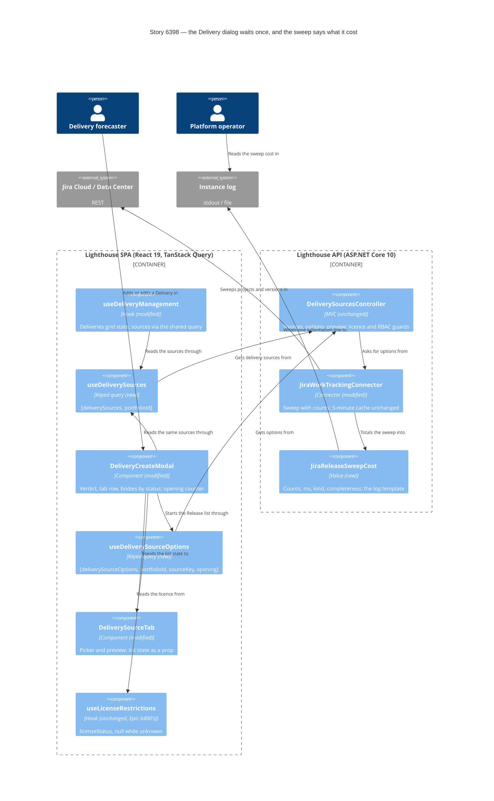

<!-- markdownlint-disable MD024 -->
# Feature Delta — story-6398-jira-release-loads-once

> ADO User Story #6398 "Choosing a Jira Release for a Delivery loads once, and never shows a guess as the answer"
> (Active, no parent Epic). Feedback from a user on Jira Data Center who ties a Delivery to a Jira Release every day.
> Opening the "Add Delivery" dialog and choosing a Jira Release costs three waits of 3 to 5 s each, one after
> another, and none of them looks like loading:
>
> 1. The Jira Release tab is missing at first, and the dialog's only message says the Delivery needs a name. The
>    Portfolio's delivery sources are still loading.
> 2. The tab appears, but says a premium licence is needed. The licence is still unknown, and unknown is treated as
>    "not premium".
> 3. Only then does the Release list start loading, because it is fetched when the tab is drawn. The slowest call
>    starts last.
>
> Wanted: never show a guess as the answer; load sources, licence and Release list together so the user waits once;
> measure why listing Jira Releases takes 3 to 5 s on Data Center, and decide on caching only after measuring.

## Wave: DISCUSS / [REF] Prior-Wave Reading Confirmation

- ⊘ DISCOVER: skipped by maintainer. The evidence is the user's feedback quoted in ADO #6398.
- ⊘ DIVERGE: skipped by maintainer. The Story names the wanted outcome (one wait, no guesses, measure first).
- ✓ `docs/product/jobs.yaml`: reused `job-forecaster-bind-a-delivery-to-the-release-it-tracks` (Epic 5565) and added
  a dated reuse note to it. No new job (see JTBD).
- ✓ `docs/product/personas/delivery-forecaster.yaml`, by reference. No persona change. No journey file exists under
  `docs/product/` that covers creating a Delivery, so none is extended; the light journey lives in this file.
- ✓ Code read (read-only, 2026-10-24). Frontend, relative to `Lighthouse.Frontend/src/`:
  `pages/Portfolios/Detail/Components/DeliveryGrid/DeliveryCreateModal.tsx:105-109, :283-363, :383-393, :471-592,
  :713-771, :773-780, :836-881, :895-899`, `DeliverySourceTab.tsx:51-60, :148-185, :335-415` (the failure Alert at
  `:388-395`, its text at `:391-392`), `deliverySelectionTabs.ts:171-254`, `useDeliveryManagement.ts:222-234,
  :504-508`, `DeliveryModals.tsx:90`, `hooks/useLicenseRestrictions.ts:18-54`,
  `components/Common/LicenseStatus/LicenseStatusIcon.tsx:23-32`, `App.tsx:237`, `services/Api/DeliveryService.ts:297-319`.
  Backend, relative to `Lighthouse.Backend/Lighthouse.Backend/`: `API/DeliverySourcesController.cs:29-55, :60-89,
  :182-197`, `Services/Implementation/Repositories/PortfolioRepository.cs:74-80, :114-125`,
  `Services/Implementation/WorkTrackingConnectors/Jira/JiraWorkTrackingConnector.cs:2985-3062, :3074-3181,
  :3204-3265`, `.../Jira/JiraRestRoutes.cs:79-127`.
- ✓ Related feature read: `docs/feature/epic-6400-fast-with-many-features/feature-delta.md` (facts W3, W3b; DESIGN
  component decomposition, slice 02 row; DEVOPS mutation scope, slice 02 row) and `design/upstream-changes.md` (UC-1,
  DDD-11). Epic 6400 runs in parallel and owns the licence hook and `GetById` (MD-11, MD-12).
- ✓ `CLAUDE.md` (loading and failure looks, sketch before UI, terminology) and `docs/ci-learnings.md` (skimmed; to be
  pre-applied at DELIVER).

## Wave: DISCUSS / [REF] Current-State Surface Inventory (brownfield)

| Surface | Today | Gap |
|---|---|---|
| Delivery sources for the dialog's tab row | Fetched again on every dialog open (`DeliveryCreateModal.tsx:558-567`), although the Deliveries grid already fetched the same list on page load (`useDeliveryManagement.ts:226-234, :504-508`). Until it answers, `sources` is `[]`, so the row shows only Manual and Rule-Based. A failure is also turned into `[]` (`:566`) | Loading and failure both look like "this connection offers no Jira Release" |
| `GET /portfolios/{id}/delivery-sources` | Makes no call to Jira (`DeliverySourcesController.cs:29-55`, `JiraWorkTrackingConnector.cs:3023-3026`), but `portfolioRepository.GetById` loads every Portfolio with its Features, forecasts and simulation results and filters in memory (`PortfolioRepository.cs:74-80, :114-125`; Epic 6400 fact W3b) | A call that should be instant takes seconds on a large instance. Owned by Epic 6400 (MD-11) |
| Licence in the dialog | `useLicenseRestrictions()` (`DeliveryCreateModal.tsx:481`) waits for `/license`, `/teams` and `/portfolios` together (`useLicenseRestrictions.ts:28-54`). It returns `licenseStatus: null` both while loading and after a failure. The dialog reads `isPremium = licenseStatus?.canUsePremiumFeatures ?? false` (`:482`) | Unknown and failed both read as "not premium". The hook and its speed are owned by Epic 6400 slice 02 (MD-12) |
| Jira Release tab body while licence unknown | `SelectionModeContent` shows `PremiumFeatureNotice` whenever `!isPremium` (`DeliveryCreateModal.tsx:303-306`): "Taking a delivery date from a Jira Release is a premium feature…" (`deliverySelectionTabs.ts:219-222`) | A guess shown as the answer |
| Rule-Based tab while licence unknown | Disabled, with the tooltip "Please obtain a premium license…" (`DeliveryCreateModal.tsx:336-362`, `deliverySelectionTabs.ts:177-181`); the rule schema loads only when `isPremium` (`:569-592`) | Same guess, on the other premium tab |
| Message under the form | The first blocking error, e.g. "Delivery name is required" on the Manual tab (`DeliveryCreateModal.tsx:773-780, :895-899`) | What the user reads as the dialog's "tip" while the tab row is incomplete |
| Release list (`useSourceOptions`) | Plain `useEffect` + module-level `Map` cache (`DeliverySourceTab.tsx:51-60, :148-185`), started only when the tab body mounts (`:351`), cleared when the dialog closes (`DeliveryCreateModal.tsx:728`). Loading is a centred spinner (`:398-402`), failure an Alert "The list of {sourceName} entries could not be loaded. Check this {portfolioTerm}'s connection and try again." (`:388-395`) | Starts last; not TanStack Query; "try again" names no way to do it |
| `GET …/delivery-sources/{key}/options` | `LicenseGuard(RequirePremium)` + `RbacGuard(PortfolioWrite)`; also runs `GetById` (`DeliverySourcesController.cs:60-89`) | Pays the `GetById` cost again before Jira is asked (Epic 6400) |
| Jira Release sweep | One call for the project list, then one paged call per project, 8 projects at a time, 50 versions per page (`JiraWorkTrackingConnector.cs:2988-3009, :3074-3093, :3225-3265`). On Data Center the version route cannot filter by status (`JiraRestRoutes.cs:107-110`), so every archived, released and unreleased version of every visible project is paged in and filtered afterwards. The only log line is a Debug count of projects (`:3079`) | Nobody can tell how long the sweep takes, or whether its time goes to projects, pages or `GetById` |
| Backend cache of the sweep | Already exists: process-wide, 5 minutes, only for a complete sweep (`JiraWorkTrackingConnector.cs:3011-3016, :3044-3059`) | "Add a short-lived cache" is not the open question; whether the existing one is long, warm or narrow enough is |
| Edit-Delivery dialog | The same component in edit mode (`DeliveryModals.tsx:90`, `editingDelivery`). A Delivery bound to a Jira Release opens on the Manual tab with its Feature grid until the sources arrive, then switches (`DeliveryCreateModal.tsx:731-765`, `:383-393`) | The same guess, shown when editing. In scope (MD-6) |
| Other source types | Only the Jira connector offers delivery sources (`AvailableSources` exists only in `JiraWorkTrackingConnector.cs:3023`). ADO, Linear, ServiceNow and CSV offer none | Nothing else to fix today; the fix should not be Jira-specific in the frontend |

**Where the three waits come from.** Wait 1 is `GetById` reading every Portfolio, not Jira. Wait 2 is the slowest of
`/license`, `/teams` and `/portfolios`, the last two also reading every Portfolio (Epic 6400 fact W3). Wait 3 is
`GetById` again plus the Jira sweep. Epic 6400, running in parallel, makes `GetById` and the licence cheap; this Story
makes the dialog honest and stops it waiting in series, without touching anything 6400 changes, and measures the Jira
part on its own (US-03).

## Wave: DISCUSS / [REF] Persona IDs

- **delivery-forecaster** (primary). Lena Hoffmann, delivery manager on a Jira Data Center instance with about 200
  projects. Most mornings she adds a Delivery to Portfolio "Payments Platform" and points it at the next Jira
  Release, such as "PAY 2026.11" in project PAY. She has a premium licence and write rights on the Portfolio.
- **platform-operator** (secondary, US-03). Runs the instance, reads the log, gets the "picking a Release is slow"
  complaint and has to say whether Jira or Lighthouse is slow.

## Wave: DISCUSS / [REF] JTBD One-Liners

- #6398 → reused `job-forecaster-bind-a-delivery-to-the-release-it-tracks`: when the thing I forecast already exists
  as a Jira Release, I want to point a Delivery at it instead of describing it again. Its habit force says the picker
  has to be visibly the same act as typing, one step shorter; 10 to 15 s of guesses breaks that. A reuse note is
  dated in `jobs.yaml`; the wording is unchanged.

## Wave: DISCUSS / [REF] Journey (light)

Lena, on Portfolio "Payments Platform" → Deliveries → **Add Delivery** → Jira Release tab → picks "PAY 2026.11
(Payments)" → sees the preview → **Save**.

Emotional arc: *expectant* (she does this daily) → *patient, because she can see it is loading* → *confident* (the
list is there, once). Today it runs *expectant → puzzled (no tab) → alarmed (premium notice, "did our licence
lapse?") → impatient*.

### Sketch: the dialog while it loads (for the maintainer's yes at the start of DISTILL; DISTILL pins the copy)

Reuses the existing `ButtonGroup` tab row, the tab body's `CircularProgress` (`DeliverySourceTab.tsx:398-402`) and
`Alert`. The only new control is the "Try again" button of the sources failure look.

```text
State A: the tab row is not known yet (rare once the page's list is reused)
+-- Add Delivery ---------------------------------------------------+
| Delivery Name  [                                ]                 |
| Delivery Date  [ dd.mm.yyyy ]                                     |
| Selection Mode                                                    |
| [ Manual ] [ Rule-Based ] [ (o) Loading… ]   <- disabled, busy    |
|                                                                   |
| (Manual tab body as today)                                        |
+-------------------------------------------------------------------+

State B: a premium tab chosen (Jira Release or Rule-Based), licence or Release list still on its way
| [ Manual ] [ Rule-Based ] [*Jira Release*]   <- Rule-Based enabled, no tooltip
|                                                                   |
|                (o)  Getting the Jira Releases…                    |
|                     (Rule-Based body: the same spinner)           |
   no premium notice, no locked Rule-Based tab, no premium tooltip

State C: loaded (as today)
| Preview a Jira Release                                            |
| [ Type to search Jira Releases                         v ]        |

Failure looks
- Sources failed:  [ Manual ] [ Rule-Based ]
                   (!) Couldn't check what this Portfolio's connection offers. [Try again]
                   Manual and Rule-Based stay usable.
- List failed:     (!) The list of Jira Release entries could not be loaded. Close this
                   dialog and open it again to retry.          <- no button (MD-13)
- Licence failed:  no look of its own in this Story: state B stays on screen while the dialog
                   is open (known limit, follow-up F1 once Epic 6400 slice 02 has shipped)
```

DISTILL sketch point (MD-13): the two failure looks differ on purpose, one with Try again (sources) and one asking
to reopen the dialog (Release list). The maintainer confirms that difference when the sketches are walked through.

### Shared artifacts

| Artifact | Single source | Consumers | Risk |
|---|---|---|---|
| Licence status | `useLicenseRestrictions()` (unchanged here; Epic 6400 slice 02 rewrites it) | Header, Overview, the dialog's premium tabs | HIGH: the dialog must read it exactly as today, so 6400's rewrite reaches it without a merge |
| Delivery sources of a Portfolio | `GET /portfolios/{id}/delivery-sources`, fetched once by the Deliveries page | Deliveries grid (source names), the dialog's tab row | MEDIUM: grid and dialog disagreeing on which tab exists |
| Jira Release list | `GET …/delivery-sources/jira-release/options`, backend 5-minute cache | Release picker | MEDIUM: a late answer for another Portfolio landing in this dialog |

## Wave: DISCUSS / [REF] Locked Decisions

| ID | Decision | Why |
|---|---|---|
| D1 | **Unknown is never shown as an answer.** While the sources or the licence are unknown, the dialog shows a loading look; the premium notice, the locked Rule-Based tab and its premium tooltip appear only once the licence is known not to be premium. The dialog reads `licenseStatus === null` from the unchanged hook as "not known yet". | The Story's first ask; CLAUDE.md's loading-look rule; MD-12 |
| D2 | **Failure is never shown as "no" either, where this Story can tell.** A failed sources call and a failed Release list each have their own failure look; neither falls back to "no tab" or "premium needed". A failed licence cannot be told from a loading one through today's hook, so it shows the loading look (known limit, F1). | MD-8, MD-12, MD-13 |
| D3 | **The server keeps deciding.** `LicenseGuard` and `RbacGuard` on the options and preview routes are unchanged; the frontend only stops guessing. | The UI is not the gate |
| D4 | **The dialog reuses the sources the Deliveries page already fetched** (`useDeliveryManagement`), asking again only when the page has none yet. How (props or a keyed query) is DESIGN's call, inside the Deliveries folder. | Removes wait 1 for the common case without any backend change |
| D5 | **The Release list starts while the dialog is open, as soon as the sources include the source and the licence is known premium** (MD-7, MD-15), not when the tab is drawn and not on page load. | The slowest call starts as early as it can; a page visit without the dialog costs Jira nothing; no request the server would refuse |
| D6 | **A late answer never lands in the wrong dialog.** An answer for a Portfolio or dialog no longer on screen is dropped. | CLAUDE.md: keyed queries |
| D7 | **Caching is decided from measurement** (MD-9). A 5-minute process-wide cache already exists; US-03 measures the sweep, and the gate says whether a follow-up Story changes it. | The Story's third ask |
| D8 | **The fix is not Jira-specific in the frontend.** It works for any source the server lists. | Only Jira offers a source today, but the tab row is built from the server's list |
| D9 | **Nothing Epic 6400 changes is touched** (MD-12): not `hooks/useLicenseRestrictions.ts`, no `["licenseStatus"]` query read or created, no call to `licensingService.getLicenseStatus`, not `PortfolioRepository` or the Portfolio and Team controllers. | 6400 runs in parallel; its slice 02 adds a source-tree test that only the shared query calls `getLicenseStatus` |

### Maintainer decisions — before DISCUSS

| ID | Decision |
|---|---|
| MD-1 | DISCOVER and DIVERGE skipped by the maintainer. |
| MD-2 | Feature type: user-facing. |
| MD-3 | Walking skeleton: brownfield, evaluate (answered under WS Strategy). |
| MD-4 | UX depth: lightweight (one journey, one sketch set, in this file). |
| MD-5 | JTBD: yes (reused job above). |

### Maintainer decisions — 2026-10-24, end of DISCUSS

| ID | Decision | Was |
|---|---|---|
| MD-6 | **The edit-Delivery dialog is in scope** (same component). | Q1, recommended (a) |
| MD-7 | **The Release list starts when the dialog opens**, not on page load or hover. | Q2, recommended (a) |
| MD-8 | **A failed sources call shows a notice under the tab row with Try again**; Manual and Rule-Based stay usable. | Q4, recommended (a) |
| MD-9 | **Cache gate as recommended**: if the sweep's median with a cold cache on the reporter's connection is over 2 s, a follow-up Story chooses between a longer cache lifetime and narrowing the sweep to the projects the Portfolio's query names; otherwise close with no change. | Q7, recommended (a) |
| MD-10 | **Release Notes tag: yes.** | Q9 |
| MD-11 | **`PortfolioRepository.GetById` (wait 1) belongs entirely to Epic 6400**, which runs in parallel. | New |
| MD-12 | "epic 6400 is ongoing in parallel. leave all that could interfere out of this story." This Story does not touch `hooks/useLicenseRestrictions.ts`, does not read or create a `["licenseStatus"]` query, and does not call `licensingService.getLicenseStatus`. The dialog keeps reading `licenseStatus` from `useLicenseRestrictions()` as today and treats `null` as "not known yet". Reusing the header's licence is dropped; the licence speed-up comes from 6400 slice 02. The licence failure look ("Couldn't check your licence.") is dropped and becomes follow-up F1. | Q6 (and Q3, superseded) |
| MD-13 | **No Try again button on the Release-list error.** Keep the Alert and fix only its wording so the retry path is honest: "The list of {sourceName} entries could not be loaded. Close this dialog and open it again to retry." Today's text (`DeliverySourceTab.tsx:391-392`) uses `{sourceName}` and `{portfolioTerm}`; both stay the terms in use, and DISTILL decides whether the connection hint with `{portfolioTerm}` stays in the new wording. The sources failure look keeps its Try again (MD-8), so the two looks differ; a DISTILL sketch point. | Q8, option (b) |
| MD-14 | **Rule-Based stays enabled while the licence is unknown, and its body shows a loading look.** | Q5, recommended (a) |
| MD-15 | "assume that by the time this feature is done (or certainly when released), the epic 6400 is in too". **N1 resolved as (b): the Release list waits until the licence is known premium.** By release the licence is one fast shared query, so waiting costs almost nothing and sends no refused requests. MD-12 still stands: this Story does not touch the hook; 6400 shipping changes only the timing assumption. | N1, option (b) |

**Known limit (MD-12).** Until Epic 6400 slice 02 has shipped, a licence check that fails shows the loading look for
as long as the dialog is open: the hook returns `null` for both, and this Story may not change the hook. Only the
premium tabs are affected; Manual stays usable, and the server's `LicenseGuard` still decides.

**Follow-ups recorded.**
- **F1** Once Epic 6400 slice 02 has shipped, give the dialog's premium tabs a licence failure look ("Couldn't check
  your licence.", matching 6400's DDD-11) using the hook's new loading/ready/failed status. A new Story, not part of
  #6398. Assuming 6400 slice 02 lands before 6398 is released (MD-15), F1 can follow right after; it stays out of
  this Story's slices (MD-12).
- **F2** The follow-up Story the MD-9 gate may open (cache lifetime or narrower sweep).

### Overlap check with Epic 6400 slice 02

6400 slice 02 modifies (DESIGN component decomposition, slice 02 row; DEVOPS mutation scope, slice 02 row):
`PortfolioRepository`, `IPortfolioRepository`, `PortfoliosController`, `TeamsController`, `TeamController`,
`PortfolioController`, `hooks/useLicenseRestrictions.ts`, `OverviewDashboard.tsx`; it names as unchanged `LicenseGuard`,
`useRbac`, `PortfolioDetail`, `ModifyProjectSettings`, `TeamDetail`, `EditTeam`.

This Story changes: `DeliveryCreateModal.tsx`, `DeliverySourceTab.tsx`, possibly `deliverySelectionTabs.ts`,
`DeliveryModals.tsx` and `useDeliveryManagement.ts` (slices 01, 02); `JiraWorkTrackingConnector.cs` (slice 03).

- **File overlap: none.** No file is on both lists. Slice 05 of 6400 touches `PortfolioRepository` and slice 04
  touches `PortfolioDetail`; this Story touches neither.
- **Behavioural overlap 1 (read, not edit):** the dialog calls `useLicenseRestrictions()`. When 6400 rewrites the hook
  onto shared TanStack queries, rendering the dialog in tests needs a `QueryClientProvider`. Mitigation: render the
  dialog's new Vitest scenarios through the existing `tests/renderWithQueryClient.tsx` wrapper from the start, and
  drive the licence through the mocked `licensingService` as today, so 6400's rewrite does not break them.
- **Behavioural overlap 2 (read, not edit):** `DeliverySourcesController` calls `GetById`, which 6400 slice 02 changes
  to filter in the database. Slice 03's log line is written in the connector, after `GetById`, so the two
  measurements do not mix; slice 03's reading notes which release of 6400 the instance runs.
- **Test-source rule:** 6400's source-tree test that only the shared query calls `getLicenseStatus` is not affected;
  this Story adds no such call.

## Wave: DISCUSS / [REF] Scope Assessment

PASS. 3 Stories, 2 contexts (the Deliveries frontend; the Jira connector's Release sweep). No new endpoint, no payload
change. One UI change (loading and failure looks in the add and edit dialog, the sources Try again, and the reworded
Release-list error). 3 slices: 01 about a day, 02 about ¾ day, 03 about ½ day; about 2¼ days in all.

## Wave: DISCUSS / [REF] Story Map & Slices

Backbone (delivery-forecaster, one Delivery): *open the dialog* → *see which ways to pick are offered* → *learn
whether the licence allows the Jira Release way* → *see the Releases* → *pick and preview* → *save*.

| Slice | Outcome | Brief | Est. |
|---|---|---|---|
| 01 | The dialog never shows a guess: a busy tab while sources are unknown, a loading look in both premium tabs while the licence is unknown (Rule-Based enabled), the premium notice only when the licence is known not premium, the sources failure look with Try again, the Release-list error reworded; add and edit mode | `slices/slice-01-the-dialog-never-shows-a-guess.md` | 1 day |
| 02 | No more waiting in series: the dialog reuses the sources the Deliveries page already fetched, and the Release list starts when the dialog opens; late answers dropped | `slices/slice-02-the-release-list-loads-once.md` | ¾ day |
| 03 | The operator can see why listing Jira Releases took as long as it did, and the maintainer applies the cache gate (MD-9) | `slices/slice-03-the-release-list-says-what-it-cost.md` | ½ day |

### Priority Rationale

01 first: it removes the alarming premium notice, the part of the feedback that can make a customer think their
licence lapsed, and it is right whatever the calls cost. 02 next: it removes the wait for the sources and starts the
Release list first, with no backend change. 03 last: it needs a reading on the reporter's instance and feeds a
decision. 02 does not need 01's code, but it would show today's guesses for a shorter time, so 01 goes first. 03 is
independent of both.

### Slice taste tests (re-run after MD-6..MD-15)

- **Does slice 02 still stand alone?** It shrank: the licence reuse is gone (MD-12), leaving the page's sources and the
  early Release list. It still stands alone and is kept separate from 01. It ships a different outcome (speed, not
  honesty) with its own falsifiable hypothesis. Shipped without 01, it already removes wait 1 and moves the Release
  list to the front. Merged with 01 it would be about 1¾ days, past the one-day slice cap, and one slice would test
  two hypotheses at once.
- **What 02 can promise now.** The Release list waits for the licence (MD-15, N1 (b)). That costs little only because
  Epic 6400 slice 02 is assumed in by release, making the licence one fast shared query; until then the licence wait
  and the Release list run in series. K1 is restated to say so, as an assumption rather than a dependency.
- No slice is infrastructure-only. 01 and 02 change what Lena sees. 03 adds an Information log line the operator
  reads to answer "is it Jira or Lighthouse?".
- Each slice has a hypothesis that can fail (see briefs).
- Each is checked against production-shaped data: 01 and 02 on the dev instance (`:5169`, a Jira Data Center
  connection where available) with the browser throttled to "Slow 4G"; 03 on the reporter's connection.
- Not scale variants of each other. Not cut by layer.
- None touches a file Epic 6400 changes (overlap check above).

## Wave: DISCUSS / [REF] User Stories

### US-01 — The Delivery dialog never shows a guess as the answer (slice 01, ADO #6398)

`job_id: job-forecaster-bind-a-delivery-to-the-release-it-tracks`

As a delivery-forecaster binding a Delivery to a Jira Release, I want the dialog to show that it is still loading
while it does not know yet, so I never read "no Jira Release" or "premium needed" when neither is true.

#### Elevator Pitch
Before: Lena opens **Add Delivery** on "Payments Platform". For 4 s there is no Jira Release tab and the form says
"Delivery name is required"; then the tab appears and says "Taking a delivery date from a Jira Release is a premium
feature" although her licence is premium.
After: Lena opens **Add Delivery** → sees the tab row with a busy "Loading…" tab, then the Jira Release tab with a
spinner reading "Getting the Jira Releases…", then the picker. The premium notice appears only on an instance whose
licence is known not to be premium. If the sources cannot be loaded she reads "Couldn't check what this Portfolio's
connection offers." with **Try again**; if the Release list cannot be loaded, the message tells her to close and
reopen the dialog.
Decision enabled: whether to wait for the picker or type the Delivery by hand, made from what is true rather than from
a guess.

#### Domain Examples
1. **Premium, slow sources.** Lena opens the dialog; the sources take 4 s. The row shows Manual, Rule-Based and a busy
   "Loading…" tab, then "Jira Release". No premium notice appears at any point.
2. **Community licence.** Tom Becker on a Community instance opens the dialog. Once his licence is known, the Jira
   Release tab says "Taking a delivery date from a Jira Release is a premium feature…" and Rule-Based is locked, as
   today. Before it is known, Rule-Based is enabled and either premium tab shows the loading look, not the notice.
3. **Sources fail.** The sources call answers 500. The row shows Manual and Rule-Based and, under it, "Couldn't check
   what this Portfolio's connection offers." with **Try again**; pressing it after the backend recovers brings the
   Jira Release tab.
4. **Release list fails.** Jira is down. The Jira Release tab reads "The list of Jira Release entries could not be
   loaded. Close this dialog and open it again to retry." Lena reopens the dialog a minute later and the list loads.
5. **Editing a bound Delivery.** Lena edits "PAY 2026.10", bound to that Release. The dialog opens with a loading look,
   never on Manual with a Feature grid.
6. **Licence check fails (known limit).** `/license` times out. The premium tabs keep the loading look while the
   dialog is open; Manual stays usable. No premium notice is shown.

#### UAT Scenarios (BDD)

##### Scenario: While the ways to pick are still loading, the dialog says so
Given Lena has a premium licence and "Payments Platform" offers Jira Releases
And the Portfolio's delivery sources have not answered yet
When Lena opens Add Delivery
Then the tab row shows a busy tab in place of the ones still loading
And no premium notice is shown

##### Scenario: The premium notice appears only once the licence is known not to be premium
Given the licence has not answered yet
When Lena opens the Jira Release tab, or the Rule-Based tab
Then she sees a loading look
And neither the premium notice nor a locked Rule-Based tab nor a premium tooltip is shown
When the licence answers that premium features are not available
Then the Jira Release tab shows the premium notice and Rule-Based is locked, as today

##### Scenario: A failed list of ways to pick says so and can be tried again
Given the Portfolio's delivery sources fail when Lena opens Add Delivery
Then the dialog shows "Couldn't check what this Portfolio's connection offers." with a Try again button
And Manual and Rule-Based stay usable
When the sources answer on Try again
Then the Jira Release tab appears

##### Scenario: A failed Release list says how to retry
Given the Jira Release list fails
When Lena opens the Jira Release tab
Then she reads "The list of Jira Release entries could not be loaded. Close this dialog and open it again to retry."
And when she closes and reopens the dialog, the Release list is asked for again

##### Scenario: Editing a Delivery bound to a Jira Release opens on its own tab
Given Delivery "PAY 2026.10" follows Jira Release "PAY 2026.10"
And the Portfolio's delivery sources have not answered yet
When Lena opens it for editing
Then the dialog shows a loading look and never the Manual tab's Feature list

#### Acceptance Criteria
- AC-1.1 While the delivery sources are unknown, the tab row shows a busy placeholder tab; Manual and Rule-Based are
  shown as today, and the source tabs appear when the sources answer.
- AC-1.2 While `useLicenseRestrictions()` returns no licence, Rule-Based is enabled, no premium notice, no locked
  Rule-Based tab and no premium tooltip are shown, and a premium tab chosen meanwhile shows a loading look. The rule
  schema is not requested until the licence is known premium, as today.
- AC-1.3 Once the licence is known not to be premium, today's premium notice, lock and tooltip appear unchanged.
- AC-1.4 A failed sources call shows "Couldn't check what this Portfolio's connection offers." under the tab row with
  a Try again button that repeats only that call; Manual and Rule-Based stay usable.
- AC-1.5 A failed Release list shows "The list of {sourceName} entries could not be loaded. Close this dialog and open
  it again to retry." with no button, and reopening the dialog asks for the list again (today's cache clear on close).
- AC-1.6 Editing a Delivery bound to a source never shows another tab's body while the sources load.
- AC-1.7 `hooks/useLicenseRestrictions.ts` is unchanged, and the dialog adds no licence request of its own (D9).
- AC-1.8 A refused request (`403` from the server's guards) still ends in the Release-list failure look.

#### Outcome KPIs
See K2 under Outcome KPIs.

#### Technical Notes
- Driving port: the `DeliveryCreateModal` rendered through `DeliveryModals`, with the API services mocked (Vitest +
  React Testing Library), rendered through `tests/renderWithQueryClient.tsx` so Epic 6400's hook rewrite does not
  break the scenarios. No backend change.
- The change to the licence is local to `DeliveryCreateModal`: `licenseStatus === null` reads as "not known yet"
  instead of "not premium" (`:482`, `:303-306`, `:336-362`). Known limit: a failed check looks the same (F1).
- Copy uses the configurable terms (Delivery, Portfolio). "Jira Release" is the source's display name from the server.

### US-02 — Choosing a Jira Release no longer waits in series (slice 02, ADO #6398)

`job_id: job-forecaster-bind-a-delivery-to-the-release-it-tracks`

As a delivery-forecaster, I want the dialog to use what the page already knows and to start the Release list first,
so I no longer wait for the ways to pick, then the licence, then the Releases, one after another.

#### Elevator Pitch
Before: Add Delivery → three waits of 3 to 5 s in a row (tab row, then licence, then Release list) before Lena can
type "PAY 2026.11".
After: Add Delivery → the Jira Release tab is there at once, because the Deliveries page already loaded the sources,
and the Release list request starts as soon as the licence is known premium, before Lena clicks the tab. She types
into the picker after about the Release list's own time (with Epic 6400 slice 02 assumed in by release, MD-15).
Decision enabled: binding to the Release instead of falling back to typing name and date by hand.

#### Domain Examples
1. **Daily case.** The Deliveries page of "Payments Platform" has loaded its sources. Lena opens Add Delivery: the
   Jira Release tab is there immediately, and the Release list request starts as soon as her licence is known premium,
   a moment later. She clicks the tab 1 s later and the picker is ready when the list has answered, not 12 s after
   opening.
2. **Reopening.** Lena cancels and reopens the dialog within a minute. The Release list is asked again (the dialog
   still forgets it on close, so a date just set in Jira shows), and the backend's 5-minute cache answers quickly.
3. **Community licence.** Tom Becker's licence is not premium. No Release list request is sent (MD-15); he sees the
   premium notice once his licence is known, never a list, and the server is never asked for something it would
   refuse.
4. **Lena never picks a Release.** She opens the dialog to add a Manual Delivery. One Release list request is made on
   open (MD-7); visiting the Deliveries page without opening the dialog makes none.

#### UAT Scenarios (BDD)

##### Scenario: The dialog opens with the ways to pick the page already knows
Given the Deliveries page of "Payments Platform" has loaded its delivery sources
When Lena opens Add Delivery
Then the Jira Release tab is shown without a new request for the sources

##### Scenario: The Release list starts when the dialog opens, not when the tab is drawn
Given "Payments Platform" offers Jira Releases and Lena's licence is premium
When Lena opens Add Delivery and stays on the Manual tab
Then the Jira Releases are already being fetched
And when she then opens the Jira Release tab, the picker is ready as soon as that answer has arrived

##### Scenario: Nothing is fetched that nobody asked for or the server would refuse
Given Lena visits the Deliveries page of "Payments Platform"
When she does not open Add Delivery
Then no Release list is requested
And when Tom Becker, whose licence is not premium, opens Add Delivery, no Release list is requested either

##### Scenario: A late answer for another Portfolio never lands
Given Lena opened Add Delivery on "Payments Platform" and closed it before its Release list answered
When she opens Add Delivery on "Onboarding"
Then the picker shows only the Releases answered for "Onboarding"

#### Acceptance Criteria
- AC-2.1 Opening the dialog does not request the sources again when the Deliveries page already holds them; it asks
  only if the page has no answer yet, and the sources failure look of AC-1.4 still applies to that request.
- AC-2.2 The Release list request starts while the dialog is open, as soon as the sources include the source and the
  licence is known premium, whichever tab is on screen, never later because a tab is drawn (MD-7, MD-15).
- AC-2.3 No Release list request is sent on page load, for a Portfolio that offers no source, or for a licence that is
  unknown or known not to be premium.
- AC-2.4 An answer for a Portfolio or dialog no longer on screen is dropped.
- AC-2.5 Closing the dialog still forgets the Release list, so the next open asks again (`DeliveryCreateModal.tsx:728`).
- AC-2.6 No file Epic 6400 changes is touched (D9); the licence is read through `useLicenseRestrictions()` as today.

#### Outcome KPIs
See K1, K3 and the guardrail K5 under Outcome KPIs.

#### Technical Notes
- Driving ports: the Deliveries page (`useDeliveryManagement` + `DeliveryModals`) for Vitest, and the existing
  Deliveries E2E flow, which must stay green and wait for the picker rather than for mere visibility.
- How the sources reach the dialog (props from `useDeliveryManagement` or a keyed query in the Deliveries folder) and
  where the Release list request lives once lifted out of the tab body are DESIGN's call. CLAUDE.md asks for keyed
  TanStack queries so a late answer never lands; moving `useSourceOptions` off its module-level `Map` is a likely
  consequence. No `["licenseStatus"]` query is read or created (D9).
- No backend change. The sources and options calls still pay `GetById`, and the licence still waits for `/teams` and
  `/portfolios`, until Epic 6400 slice 02 lands. This slice removes the waiting in series, not the cost of each call.

### US-03 — The Release list says what it cost, and caching is decided from it (slice 03, ADO #6398)

`job_id: job-forecaster-bind-a-delivery-to-the-release-it-tracks`

As a platform-operator who gets "picking a Release is slow", I want each Jira Release sweep to log how long it took
and how much it read, so I can tell Jira's time from Lighthouse's and the maintainer can decide on caching from a
measurement rather than a guess.

#### Elevator Pitch
Before: the log says nothing about the sweep at Information level; the operator cannot say whether 4 s went to
200 projects, to thousands of old versions, or to Lighthouse itself.
After: each sweep writes one Information line, for example `Listed 37 unreleased Jira Releases from 212 projects
(1,480 versions over 260 pages) in 3,912 ms on this Data Center connection`, and a cache hit writes nothing new. The
operator reads it in the log; the maintainer applies the MD-9 gate.
Decision enabled: whether a follow-up Story (F2) should change the existing cache or narrow the sweep, or nothing.

#### Domain Examples
1. **Data Center, cold cache.** Lena opens the dialog at 08:05. The log gains the line above: 3.9 s of a 4.6 s
   options call. The remaining 0.7 s is the request's own cost, `GetById` included.
2. **Cache hit.** Lena reopens at 08:07. No sweep line, and the options call answers in well under a second plus the
   request's own cost.
3. **One project refused.** Project HR answers 403. The line still appears and says the list is incomplete (one
   project skipped), and the incomplete list is not cached, as today.

#### UAT Scenarios (BDD)

##### Scenario: A sweep logs its duration and size
Given the Jira connection of "Payments Platform" has 212 visible projects
When the Release list is fetched with nothing cached
Then one Information line names the number of Releases offered, projects, versions read, pages, the duration and the
kind of Jira

##### Scenario: A remembered list logs no sweep
Given the Release list was fetched completely two minutes ago
When it is fetched again
Then no sweep line is written

##### Scenario: An incomplete sweep says so
Given one project refuses to list its versions
When the Release list is fetched
Then the sweep line says the list is incomplete and how many projects were skipped

#### Acceptance Criteria
- AC-3.1 Every sweep made for the picker writes exactly one Information line with Releases offered, projects,
  versions read, pages, duration in ms, the deployment kind, and whether it was complete. No URL, credential, project
  name or Release name is logged.
- AC-3.2 A cache hit writes no sweep line.
- AC-3.3 The maintainer reads the line on the reporter's instance (asked through the reporter) and on the dev
  instance, notes which Epic 6400 release the instance runs, applies the MD-9 gate and records the outcome in this
  file before the Story closes.

#### Outcome KPIs
See K4 under Outcome KPIs.

#### Technical Notes
- Driving port: `DeliverySourcesController.GetOptions` through `WebApplicationFactory`, with the Jira HTTP stubbed
  (the existing connector tests' pattern); assert through a captured logger.
- The line is written in `JiraWorkTrackingConnector.cs` only; the controller and `GetById` are not touched (D9).
- The refresh's sweep (`ResolveMany`, `JiraWorkTrackingConnector.cs:3289-3301`) shares the walk; whether it logs too
  is DESIGN's call (recommended: yes, the same line, it costs the same).
- Not part of this slice: any change to the cache or the sweep (F2).

## Wave: DISCUSS / [REF] Outcome KPIs

| KPI | Target | Measure | Baseline |
|---|---|---|---|
| K1 Time from opening Add Delivery to a usable Release picker, premium, Data Center, backend cache cold | ≤ the licence call + the Release list call + 0.5 s, and ≤ 5 s on the reporter's instance. Assumption (MD-15, not a dependency): Epic 6400 slice 02 has shipped by release, so the licence call is one fast shared query | Browser DevTools network waterfall on the dev instance throttled to "Slow 4G"; the reporter's own reading after the release | 3 waits of 3–5 s in series, about 10–15 s |
| K2 Guesses shown: a missing source tab, premium notice, locked Rule-Based tab or premium tooltip while sources or licence are unknown or failed | 0 | Vitest scenarios for each state; one throttled check by hand | Shown on every slow open |
| K3 Waits in series before the picker | 1 noticeable (the sources wait removed; the licence wait, short once Epic 6400 slice 02 is in, then the Release list) | Waterfall: no sources request when the page holds them; the options request starts within 100 ms of the licence answering | 3 |
| K4 Jira sweeps whose cost is visible | 100 % of sweeps log duration and size; the MD-9 gate applied within 2 weeks of the reporter's reading | The new log line; the gate outcome in this file | 0 % (Debug project count only) |
| K5 Guardrail: Release list requests per dialog open | ≤ 1, and 0 per page visit without the dialog | Waterfall; backend sweep lines per open | 1 per Jira Release tab mount |

Usage-data event: left to DEVOPS. Expected "N/A, because opening a dialog faster is not a new action, and saving a
bound Delivery is the use, which DEVOPS can check against the existing catalog".

## Wave: DISCUSS / [REF] Definition of Done

1. ACs green: US-01 and US-02 as Vitest + React Testing Library scenarios through the dialog and the Deliveries page;
   US-03 as NUnit tests through `GetOptions`. The existing Deliveries E2E flow stays green and waits for a ready
   picker, not mere visibility.
2. `pnpm test` and `pnpm build` (Biome) clean; `dotnet build` zero warnings and the filtered `dotnet test` clean
   (slice 03 only).
3. Sonar: no new issues; `docs/ci-learnings.md` pre-applied.
4. Checked by hand on the dev instance with the browser throttled to "Slow 4G": the busy tab, both premium tabs'
   loading look, the sources failure look and the Release-list failure look each seen once; the waterfall shows no
   repeated sources request and the options request at dialog open.
5. No file Epic 6400 changes is in the diff (D9; `git diff --stat` checked against the overlap list).
6. Docs at finalization: `docs/portfolios/detail.md` (Deliveries, following a Jira Release) says the dialog shows when
   it is still loading, that Try again retries the list of ways to pick, and that a Release list that could not be
   loaded is retried by reopening the dialog; the operator-facing docs that list log lines, if any, gain the sweep
   line. Screenshots: N/A unless a Deliveries @screenshot captures the dialog mid-load (it does not today; finalize
   confirms). Demo data: N/A, because no data shape changes.
7. Copy uses the configurable terms (Delivery, Portfolio); "Jira Release" stays the source's own name.
8. ADO: Story #6398 Active (already), Resolved on push, Closed on green CI. Release Notes tag: yes (MD-10).
9. Mutation testing (Stryker for the touched frontend files, Stryker.NET for slice 03) ≥ 80 %, run last on frozen
   code.

## Wave: DISCUSS / [REF] Out of Scope

- `PortfolioRepository.GetById` (wait 1) and the cost of `GET /delivery-sources`, `/teams` and `/portfolios`: owned
  entirely by Epic 6400, which runs in parallel (MD-11).
- Anything Epic 6400 changes (MD-12): `hooks/useLicenseRestrictions.ts`, any `["licenseStatus"]` query, any call to
  `licensingService.getLicenseStatus`, reusing the header's licence. The licence speed-up comes from 6400 slice 02.
- A licence failure look in the dialog: follow-up F1, once Epic 6400 slice 02 has shipped.
- A Try again button on the Release-list error (MD-13).
- Changing the backend cache's lifetime, warming it, or narrowing the sweep: follow-up F2, if the MD-9 gate says so.
- Fetching the Release list on page load or on hover (MD-7).
- The preview's own speed after a Release is picked.
- Any other dialog's loading looks.

## Wave: DISCUSS / [REF] WS Strategy, Driving Ports, Pre-requisites

- **WS strategy**: brownfield, evaluated: no new walking skeleton. The existing Deliveries E2E flow (create a Delivery
  bound to a source, with demo data) is the thin sanity check and must wait for the picker to be ready rather than
  visible. DISTILL confirms which spec that is.
- **Driving ports**: the Deliveries page and `DeliveryCreateModal` (frontend); `DeliverySourcesController.GetOptions`
  (backend, slice 03). No HTTP contract changes.
- **Pre-requisites**: none blocking. Epic 6400 runs in parallel with no file overlap (see the overlap check). A Jira
  Data Center connection for the hand check (the demo Jira testbed is Cloud; the reporter's reading covers Data
  Center).

## Wave: DISCUSS / [REF] Standing Checklist

- **RBAC**: N/A, because no endpoint, guard or gated control changes. The options and preview routes keep
  `RbacGuard(PortfolioWrite)` and `LicenseGuard(RequirePremium)`; gating stays derived from `useRbac()` as today, and
  no component starts fetching `my-summary`.
- **Lighthouse-Clients (CLI + MCP)**: N/A, because no payload, route or meaning changes; the clients do not drive this
  dialog. The log line of slice 03 is not an API.
- **Website**: N/A, because no feature or claim the website makes changes; the Jira Release binding is advertised and
  stays as it is. Finalization confirms with a grep of the website repo for "Jira Release".
- **Usage data**: deferred to DEVOPS, as the standing rule requires. Expected "N/A" (see Outcome KPIs).
- **Terminology**: Delivery, Portfolio, Feature in all copy and docs; "Jira Release" is the server's display name of
  the source and stays literal. The reworded Release-list error keeps `{sourceName}` (MD-13).
- **UI sketch**: needed. The sketch above (states A–C, the sources and Release-list failure looks, the licence known
  limit) goes to the maintainer at the start of DISTILL, one decision at a time, before scenarios are written. Sketch
  points: the busy-tab label, the "Getting the Jira Releases…" copy, the two failure looks differing (MD-13). Reuses
  the existing tab row, `CircularProgress` and `Alert`.
- **Loading and failure looks**: this Story is about them. Loading: busy tab (sources), tab-body spinner (licence,
  Release list) in both premium tabs. Failure: sources notice with Try again; Release-list Alert asking to reopen the
  dialog; licence failure has no look of its own until F1 (known limit, MD-12). Never the previous dialog's answer:
  AC-2.4.

## Wave: DISCUSS / [REF] Open Questions for the maintainer

Q1–Q9 were answered on 2026-10-24 (MD-6 to MD-14). N1, which followed from MD-12, was answered the same day (MD-15).
No question is open.

- N1 *(answered, MD-15: option (b))* Does the Release list wait for the licence? (a) start it on dialog open without
  waiting; a Community licence's request is refused by `LicenseGuard` and dropped · **(b) wait until the licence is
  known premium**. Chosen because by release Epic 6400 slice 02 makes the licence one fast shared query, so waiting
  costs almost nothing and no refused request is ever sent.

## Wave: DISCUSS / [REF] Definition of Ready Validation (re-run after MD-6..MD-15)

| DoR item | US-01 | US-02 | US-03 |
|---|---|---|---|
| 1 Problem in domain language | PASS: missing tab, premium notice shown on a premium licence | PASS: waits in series | PASS: operator cannot tell Jira's time from Lighthouse's |
| 2 Persona with specifics | PASS: Lena, delivery manager, Jira DC, ~200 projects, premium, daily | PASS: same | PASS: platform-operator answering the complaint |
| 3 ≥ 3 domain examples, real data | PASS: 6 ("Payments Platform", "PAY 2026.10", Tom Becker on Community, the licence known limit) | PASS: 4 | PASS: 3 (212 projects, 1,480 versions, 3,912 ms) |
| 4 UAT in G/W/T, 3–7 | PASS: 5 | PASS: 4 | PASS: 3 |
| 5 AC derived from UAT | PASS: AC-1.1–1.8 | PASS: AC-2.1–2.6 | PASS: AC-3.1–3.3 |
| 6 Right-sized | PASS: 1 day | PASS: ¾ day | PASS: ½ day |
| 7 Technical notes | PASS: `null` read as unknown, local to the dialog; test wrapper for 6400's rewrite | PASS: sharing is DESIGN's; `GetById` and licence cost stay (6400) | PASS: connector only; refresh sweep |
| 8 Dependencies tracked | PASS: none blocking; no file overlap with 6400; F1 recorded | PASS: ordered after 01; N1 answered (MD-15); Epic 6400 slice 02 at release is an assumption for K1, not a dependency | PASS: reporter's reading for AC-3.3 |
| 9 Outcome KPIs, measurable | PASS: K2 = 0 | PASS: K1, K3, K5 | PASS: K4 |

DoR status: PASSED for all three. No open question (N1 answered by MD-15).

## Wave: DISCUSS / [REF] Wave Decisions Summary

- Prior waves: DISCOVER and DIVERGE ⊘ skipped by maintainer (MD-1).
- Job reused: `job-forecaster-bind-a-delivery-to-the-release-it-tracks`, dated note added.
- Scope: PASS, 3 Stories / 3 slices, about 2¼ days; edit dialog included (MD-6).
- Key finding: waits 1 and 2 are not Jira but `GetById` and the licence hook's `/teams` + `/portfolios` (Epic 6400's
  W3/W3b), both left to Epic 6400 (MD-11, MD-12). Wait 3 is `GetById` plus a Data Center sweep that pages every
  version of every project. A 5-minute backend cache already exists.
- Maintainer decisions: MD-6 to MD-15 (2026-10-24). Known limit: a failed licence check shows the loading look while
  the dialog is open, until F1. Follow-ups: F1 (licence failure look, right after 6400 slice 02), F2 (cache, if the
  gate says so).
- Assumption (MD-15, not a dependency): Epic 6400 slice 02 is in by the time this Story is released, so the licence
  is one fast shared query; the Release list waits for it (N1 answered (b)).
- Overlap with Epic 6400 slice 02: no file overlap; two read-only behavioural overlaps, both mitigated.
- Locked: D1–D9. Open: none.
- Handoff to DESIGN: how the page's sources reach the dialog and where the Release list request lives (keyed queries,
  inside the Deliveries folder), the dialog's reading of `null` as unknown, where the sweep line is written and
  whether the refresh's sweep logs too.

## Wave: DESIGN / [REF] Prior-Wave Reading Confirmation

- ✓ This feature delta in full (MD-1..MD-15, D1..D9, US-01..US-03, AC-1.1..AC-3.3, K1..K5, Out of Scope, F1, F2) and the
  three slice briefs.
- ✓ `CLAUDE.md` (loading and failure look for every view that fetches; reuse `WidgetShell`'s status and keyed TanStack
  queries; sketch before UI; comments for a stranger; the architecture summary at the end of DESIGN).
- ✓ `docs/ci-learnings.md`, the frontend and logging rules that apply here: S3776 (cognitive complexity ≤ 15, with
  `DeliveryCreateModal.tsx` named as a past offender), S3358 (no nested ternary, also inside `${…}`), S6759 (`Readonly<>`
  props on every JSX-returning helper), S7770, S6667 (a logging `catch` passes the exception first), S2139.
- ✓ `docs/product/architecture/brief.md` (the Epic 5565 delivery-date-sync section, the Epic 6400 section) and ADR-259
  (Epic 6400's shared licence query; its hook keeps `licenseStatus: null` while loading or failed and adds a `status`).
- ✓ Epic 6400 DESIGN component decomposition (slice 02 row, `feature-delta.md:1552`) and DEVOPS mutation scope (slice 02
  row, `:2224`). Neither names any file this design changes (see Component Decomposition).
- ✓ Code read 2026-10-24 (frontend under `Lighthouse.Frontend/src/`): `DeliveryGrid/DeliveryCreateModal.tsx` (whole),
  `DeliverySourceTab.tsx` (whole), `deliverySelectionTabs.ts:160-267`, `useDeliveryManagement.ts` (whole),
  `DeliveryModals.tsx` (whole), `DeliverySourceTabFixture.tsx` (whole), `pages/Portfolios/Detail/PortfolioDeliveryView.tsx`,
  `App.tsx:72-83` (QueryClient defaults: stale 5 min, gc 30 min, retry 2), `tests/renderWithQueryClient.tsx`,
  `components/Common/FeatureListDataGrid/useFeatureChildItems.ts` (the per-opening query precedent),
  `components/Common/DataOverviewTable/DeliveriesChips.tsx:111-118`, `pages/Common/MetricsView/WidgetShell.tsx:564` and
  `pages/Common/Reports/ReportsTab.tsx:100` (`data-widget-status`), the E2E walking skeleton
  `Lighthouse.EndToEndTests/tests/specs/portfolios/DeliverySourcePicker.spec.ts`. Backend under
  `Lighthouse.Backend/Lighthouse.Backend/`: `API/DeliverySourcesController.cs:1-100`,
  `.../Jira/JiraWorkTrackingConnector.cs:20-45, :2975-3400` (`GetOptions`, `SweepReleases`, `ReadReleasesOf`,
  `WalkReleasePages`, `ResolveMany`, `SweepReleasesWithoutThrowing`), `.../Jira/JiraRestRoutes.cs:3` (`JiraDeployment {
  Unknown, Cloud, DataCenter }`). Tests: `JiraDeliverySourceProviderTest.cs:1-120` (the connector built from mocks with
  a stubbed `HttpMessageHandler`), `TestHelpers/RecordingLogger.cs`, `Microsoft.Extensions.TimeProvider.Testing` in the
  test project.
- ✓ ADR numbering: highest in `docs/product/architecture/` is ADR-262 (Epic 6400). This wave takes **ADR-263 and
  ADR-264**. Epic 6400 runs in parallel and may claim numbers too, so the numbers are re-checked at push and renamed if
  taken.

## Wave: DESIGN / [REF] Scope and Mode

Application scope (`nw-solution-architect`), PROPOSE mode, autonomous: the recommended option is taken at every point,
and every point that changes what a user sees is listed under Open Questions for the start of DISTILL. Ports-and-adapters
as established; no new container, no new endpoint, no payload change, **no new external call** (the Release list
request already exists; it only starts earlier). L1 and L2 are unchanged; an L3 of the dialog and of the sweep is below.

The invariant this design rests on: **what the dialog shows is derived from the state of keyed queries, never from a
default standing in for an answer**. `[]` is no longer "no sources", `null` is no longer "not premium", and a list
fetched for one opening of the dialog is never shown in another.

## Wave: DESIGN / [REF] Reuse Analysis

| Existing component | File | Overlap | Decision | Justification |
|---|---|---|---|---|
| TanStack Query + the app `QueryClient` | `App.tsx:72-83` | Keyed, de-duplicated server state | **REUSE** | The house pattern CLAUDE.md asks for; already provided at the root |
| `useFeatureChildItems` options (`staleTime 0`, `gcTime 0`, `retry false`, no refetch on focus or reconnect) | `components/Common/FeatureListDataGrid/useFeatureChildItems.ts:10-16` | "Every open asks again, so a reopen after a failure is a retry" | **REUSE THE PATTERN** | Exactly MD-13's retry path; copied as options, not imported (a different question about different data) |
| `fetchDeliverySources` in `useDeliveryManagement` | `useDeliveryManagement.ts:226-234, :504-508` | The page already fetches the sources | **EXTEND**: replaced by the shared query; the hook still returns `deliverySources` as `data ?? []` | The grid's behaviour (key shown when the call fails) stays; the dialog reads the same answer |
| The dialog's own sources `useEffect` | `DeliveryCreateModal.tsx:558-567` | A second request for the same answer | **REPLACE** with the shared query | Removes wait 1 (AC-2.1) |
| `useSourceOptions` + module `Map` + `clearDeliverySourceOptionsCache` | `DeliverySourceTab.tsx:51-60, :148-185`; `DeliveryCreateModal.tsx:728` | Fetch, cache, drop-late-answers by hand | **REPLACE** with a keyed query owned by the dialog | Keys make the late answer, the Portfolio switch and the reopen retry structural instead of hand-written |
| `DeliverySourceTab` picker, preview, publish switch | `DeliverySourceTab.tsx:187-528` | Shows the list | **EXTEND**: receives the list's state as a prop; preview logic untouched | The tab no longer decides when the list is fetched |
| `LoadingSpinner`, `ValidationButton`'s inline `CircularProgress`, `PremiumFeatureNotice`, MUI `Alert` | `DeliveryCreateModal.tsx:93-124` | Loading and failure looks already in this dialog | **REUSE** | No new look; the busy tab is a disabled `Button` with the same small spinner `ValidationButton` uses |
| `data-widget-status` attribute | `WidgetShell.tsx:564`, `ReportsTab.tsx:100` | E2E waits on `ready` | **REUSE** on the source tab body | One waiting convention for page objects |
| `deliverySelectionTabs.ts` (tab model, `deliveryTabForDelivery`, premium gates) | as named | Which tabs exist and their gates | **REUSE AS-IS** | The gates keep their copy; only *when* they apply changes, in the dialog |
| `useLicenseRestrictions()` | `hooks/useLicenseRestrictions.ts` | The licence | **REUSE AS-IS, read only** (D9, MD-12) | Read exactly as today; `null` is interpreted, not changed |
| The Jira sweep, its 5-minute process-wide cache | `JiraWorkTrackingConnector.cs:3040-3093, :3359-3376` | The thing to measure | **EXTEND**: counts travel back from the per-project reads; one line written per sweep | No change to what is read, cached or returned (F2 owns that) |
| `TimeProvider` already injected into the connector | `JiraWorkTrackingConnector.cs:30` | A clock | **REUSE** for the elapsed time | Deterministic in tests through `FakeTimeProvider`; no `Stopwatch` |
| `RecordingLogger<T>`, the connector-with-stubbed-handler test pattern | `TestHelpers/RecordingLogger.cs`, `JiraDeliverySourceProviderTest.cs` | Captured log lines, Jira HTTP stubbed | **REUSE** | The DISTILL seam for slice 03 |
| Source-tree enforcement test pattern | `DeliveryGrid/timeline/ganttAdapterBoundary.enforcement.test.ts` | A Vitest test over source files | **REUSE THE PATTERN** | Enforcement below |

CREATE NEW (each justified by "no existing alternative"):
- `useDeliverySources(portfolioId)` (FE, `DeliveryGrid/useDeliverySources.ts`): the one keyed query both the page and the
  dialog read. No shared query for this answer exists.
- `useDeliverySourceOptions(...)` (FE, `DeliveryGrid/useDeliverySourceOptions.ts`): the keyed Release-list queries for
  one opening of the dialog. Replaces `useSourceOptions` and its `Map`; a hook of its own so the tab fixture and the
  dialog share it and Stryker can mutate it whole.
- `premiumVerdictOf(licenseStatus)` (FE, pure, in or beside the dialog): `unknown | premium | notPremium`. Nothing
  turns the hook's `null` into "not known yet" today.
- `JiraReleaseSweepCost` (BE, `.../Jira/JiraReleaseSweepCost.cs`, internal): the counts and time of one sweep and the
  one place its log template lives. The connector is 3,640 lines and excluded from whole-file mutation; a small file
  keeps the line's wording mutation-covered.

## Wave: DESIGN / [REF] Decisions

| ID | Decision | Rejected |
|---|---|---|
| DDD-1 | **The dialog reads the licence as three answers.** A pure `premiumVerdictOf(licenseStatus)` returns `unknown` when the hook gives `null`, else `premium` or `notPremium` from `canUsePremiumFeatures`, with early returns (no nested ternary, S3358). The premium notice, the Rule-Based lock and its tooltip apply only on `notPremium`; on `unknown` both premium tabs' bodies show the loading look and Rule-Based stays enabled (MD-14); the rule schema and the Release list are requested only on `premium` (AC-1.2, MD-15). `useLicenseRestrictions` is read exactly as today (D9). After Epic 6400 slice 02 the hook still returns `null` while loading or failed (ADR-259), so this keeps working unchanged; F1 later splits `unknown` using the hook's new `status`. | A boolean `isPremium ?? false` (today: the guess). Reading 6400's new `status` now (MD-12 forbids depending on it). A licence request of the dialog's own (D9). |
| DDD-2 | **The sources are one shared keyed query, `["deliverySources", portfolioId]`, read by the page and by the dialog** through `useDeliverySources(portfolioId)`. `useDeliveryManagement` keeps returning `deliverySources` (`data ?? []`, so the grid still names the key on failure, as today); the dialog reads `status`, `data` and `refetch`. Both observers mount with the page (the dialog component stays mounted while closed), so TanStack sends **one** request per page visit and opening the dialog sends none (AC-2.1). Options: `staleTime 0`, `gcTime 0` (one page visit = one answer, as today; nothing is carried across visits), `retry false` (the failure look shows at once and Try again is the retry; the App default would triple a failing call), no refetch on focus or reconnect. Try again = `refetch()`, which also repairs the grid's source names. The "one request" holds when both observers mount in one commit; `DeliveryModals` mounts under `canEdit`, so if `canEdit` turns true after the sources have settled, the dialog's late mount refetches once (staleTime 0). Accepted: at most one extra GET per page visit, and the call-count tests toggle `canEdit` to pin it. | **Props threaded down** (`PortfolioDeliveryView` → `DeliveryModals` → dialog, plus a status and a retry callback): two copies of one state, three files and a callback climbing back into the hook for what a shared key gives for free. **The dialog keeps its own request, seeded with the page's answer**: two requests whenever the page's is still in flight, and two failure paths. **App default stale time** (5 min across visits): a Portfolio whose connection just changed would show the old tabs as current. |
| DDD-3 | **The Release list is one keyed query per offered source and per opening of the dialog, owned by the dialog** (`useDeliverySourceOptions`): key `["deliverySourceOptions", portfolioId, sourceKey, opening]`, enabled when the dialog is open, the sources are loaded and offer that source, and the verdict is `premium` (D5, MD-7, MD-15), whichever tab is on screen. `opening` is a counter the dialog increments **when it closes** (in `resetForm`), so the next opening starts on a fresh key and the closed opening's key loses its last observer and is collected (`gcTime 0`). Consequences, each by construction: a late answer for a closed opening or another Portfolio lands on a key nobody observes and is dropped (D6, AC-2.4); a failed list is never served on reopen, so reopening is the retry (MD-13, AC-1.5, AC-2.5); a reopen within five minutes is answered by the backend's existing cache. Options as in `useFeatureChildItems`: `staleTime 0`, `gcTime 0`, `retry false` (a `403` from the guards ends in the failure look at once, AC-1.8), no refetch on focus or reconnect. The tab receives the query's state as a prop and no longer fetches the list; the module `Map` and `clearDeliverySourceOptionsCache` go. The request is not aborted on close: `deliveryService` takes no signal, the server's sweep would run to its end anyway, and its complete answer lands in the backend cache for a reopen that comes **after** it finished. A close and reopen *while* the sweep is still running starts a second full sweep (the connector has no single-flight; it stores only on completion). Today's tab does the same (closing clears the `Map`), so this is not a regression; it is recorded as a consequence, made visible by the sweep line (two lines close together), and left to F2 with the cache decision (OQ-6). The bound-entry merge (`withCurrentSelection`) stays in `DeliverySourceTab`, applied on the way out of the query state, so a binding to a shipped Release is still offered. **Edit mode** works the same: `offeredTabs` restricts a bound Delivery to its own tab, whose list starts on open (MD-6). | **Lift the `useEffect` and the `Map` into the dialog**: re-implements keying, de-duplication and the "still mounted" flag by hand, the bug class CLAUDE.md's keyed-queries rule exists for. **`prefetchQuery` on open, `useQuery` in the tab**: two places must spell the key, and with `gcTime 0` a prefetched answer with no observer is collected before the tab mounts (a real loss, not a theory). **One key per Portfolio and `removeQueries` on close**: works, but imperative; kept as the fallback if the counter proves awkward. **Start on page load or hover**: MD-7. |
| DDD-4 | **The tab row's loading and failure looks.** While the sources are loading the row shows Manual, Rule-Based and one disabled, `aria-busy` placeholder `Button` reading "Loading…" with the small `CircularProgress` `ValidationButton` already uses (sketch state A). When they failed, the row shows Manual and Rule-Based, and under it an `Alert` "Couldn't check what this {Portfolio}'s connection offers." with a **Try again** button in the Alert's `action` slot (MD-8, AC-1.4); pressing it shows the busy tab again until the answer. **Editing a bound Delivery** (stored as source-bound, with a `sourceKey`) while the sources are loading shows the busy tab and the `LoadingSpinner` body, never the Manual body (AC-1.6), **and Save stays disabled until the sources have answered**: while they are unknown, `deliveryTabForDelivery` falls back to Manual, whose payload carries no `sourceKey`, so a Save then would drop the binding. When they failed, the body shows nothing but the notice and Save stays disabled (OQ-2). **Save while a body shows a loading look** (licence unknown on a premium tab, or the list pending) is disabled by the same rule, so a Save can never meet `LicenseGuard`'s `403`. **A premium tab chosen while the licence was unknown that resolves to `notPremium`** stays selected and shows its premium notice (Rule-Based also locks), which is the honest answer to what was chosen. All three rules live in the pure "which body" helper. The tab row moves into its own small component (`SelectionTabRow`), and the "which body" choice into a pure helper, to keep `DeliveryCreateModal` under S3776. | An MUI `Skeleton` in place of the tab: no screen in the app uses `Skeleton` today (a new look). Hiding the row behind one spinner: hides Manual, which works without the sources. |
| DDD-5 | **The source tab body's looks.** While the licence is `unknown` or the list is pending: the existing centred `CircularProgress` with the caption "Getting the {sourceName}s…" (sketch state B). Failed: the existing `Alert` reworded (MD-13, OQ-4). Loaded: as today. Rule-Based while `unknown`: the existing `LoadingSpinner`. The source tab body carries `data-widget-status="loading|ready|failed"` (the `WidgetShell`/`ReportsTab` convention) so the E2E page object's `switchToSource` waits for `ready`, not visibility. | A status attribute of its own name: a second waiting convention for page objects. |
| DDD-6 | **One Information line per Jira Release sweep, written by the connector, naming no customer.** Emitted once from `SweepReleasesWithoutThrowing`, after the sweep ends or fails, so both the picker (`GetOptions`) and a refresh (`ResolveMany`) are measured, and a cache hit (which returns before the sweep) writes nothing (AC-3.2). Template, held in `JiraReleaseSweepCost`: `"Jira Release sweep for the {SweepPurpose} took {ElapsedMs} ms on this {Deployment} connection: kept {ReleasesKept} of {VersionsRead} versions read over {VersionPages} pages from {ProjectCount} projects; complete: {Complete}, projects skipped: {ProjectsSkipped}"`. Fields: `SweepPurpose` ∈ {`Picker`, `Refresh`}; `ElapsedMs` (integer, from the injected `TimeProvider`, spanning client acquisition, kind detection, the project list and every version page, which is "Jira's time" as the operator means it); `Deployment` ∈ {`Unknown`, `Cloud`, `DataCenter`} (`Unknown` when Jira could not be reached before the kind was known); `ReleasesKept`, `VersionsRead` (before the Data Center status filter, so the paging cost is visible), `VersionPages`, `ProjectCount`, `ProjectsSkipped` (projects whose read failed or was refused); `Complete` (bool: the existing "saw everything"). **Nothing that names the customer**: no URL or host, no connection name, no project key or name, no Release name or id, no credential (AC-3.1; the project rule "no customer identifiers"). Counts are carried back with each project's read and summed after `Parallel.ForAsync`, so no counter is shared between threads. The Debug "Getting Releases of N projects" line is folded into this one. **The failure path**: the deployment kind and the project count are held in locals set as soon as each is known, so the guard's `catch` writes the line with what was learned (`Deployment` as detected or `Unknown`, `ProjectCount` as listed or 0, the other counts 0, `Complete` false), never invented numbers; a per-project failure is already caught inside `ReadReleasesOf`, so the parallel loop does not lose the others' counts. **Scope of "names no customer"**: it holds for this line. The existing per-project Information lines (which name the project key) and the could-not-ask line (whose exception text may carry a host) stay as they are; reviewing them is follow-up F3, outside this Story. AC-3.1's "exactly one Information line" reads "exactly one sweep line" (CA-7). | Logging in `DeliverySourcesController` around `GetOptions`: mixes `GetById` into the number (6400's, MD-11) and cannot see pages or completeness. A metric (counter or histogram) instead of a line: no metrics pipe exists for an operator of a self-hosted instance; the log is what the reporter can send. A line per project: hundreds of lines per sweep. Including the connection id: not needed to read one reporter's log, and the line stays free of anything an operator might redact. |
| DDD-7 | **The refresh's sweep writes the same line, with `SweepPurpose = Refresh`** (DISCUSS technical note, recommended): it is the same walk at the same cost, and on Data Center it reads every status, so it is the larger of the two. Volume: one line per refresh of a Portfolio with bound Deliveries, beside the round summary that refresh already writes. Listed as OQ-3 because it adds lines to every refresh. | Picker only: the refresh's cost, which an operator is as likely to ask about, stays invisible. |
| DDD-8 | **Testing seams.** Frontend (Vitest + RTL): the driving ports are `DeliveryCreateModal` (through the fixture's `renderModal`) and the page's `useDeliveryManagement` + `DeliveryModals`; the driven ports faked are `deliveryService` (`getDeliverySources`, `getDeliverySourceOptions`, `getRuleSchema`, `previewDeliverySource`) through `createMockApiServiceContext`, and `useLicenseRestrictions` mocked at the module, as the five existing dialog suites already do. Mocking the hook (not `licensingService`) keeps the scenarios independent of 6400's rewrite of the hook's insides; its return contract (`licenseStatus`) is what this Story reads. Every render goes through a fresh `QueryClient` (`renderWithQueryClient`, or the fixture's helpers wrapping one), and closing then reopening is a re-render with `open` toggled under the **same** client, so the per-opening key is what is tested. Backend (NUnit): the connector built as `JiraDeliverySourceProviderTest` builds it (stubbed `HttpMessageHandler`, mocked auth), with a `RecordingLogger<JiraWorkTrackingConnector>` and a `FakeTimeProvider` the stub advances per request, driven through `GetOptions` and `ResolveMany`. | `WebApplicationFactory` through `DeliverySourcesController.GetOptions` (DISCUSS's note): the controller is not changed, and replacing the connector's HTTP handler inside the host is heavier than the existing pattern for the same assertion (Changed Assumptions CA-2). |

## Wave: DESIGN / [REF] Component Decomposition

Paths under `Lighthouse.Frontend/src/pages/Portfolios/Detail/Components/DeliveryGrid/` unless marked `BE:`
(`Lighthouse.Backend/Lighthouse.Backend/Services/Implementation/WorkTrackingConnectors/Jira/`).

| Component | Path | Change | Slice |
|---|---|---|---|
| `premiumVerdictOf` | `DeliveryCreateModal.tsx` or a sibling file (crafter's call) | NEW, pure | 01 |
| `DeliveryCreateModal` | `DeliveryCreateModal.tsx` | MODIFIED: reads the verdict; tab row and body by status; sources failure notice with Try again; edit-mode wait (01). Reads `useDeliverySources`; owns `useDeliverySourceOptions` and the opening counter; passes the list state down; drops its sources `useEffect` and the cache clear (02). | 01, 02 |
| `SelectionTabRow` | `DeliveryCreateModal.tsx` (private) | NEW, presentational: the row, the busy placeholder, the failure notice | 01 |
| `DeliverySourceTab` | `DeliverySourceTab.tsx` | MODIFIED: reworded failure Alert, caption under the spinner, `data-widget-status` (01); takes the list state as a prop, `useSourceOptions`, the `Map` and `clearDeliverySourceOptionsCache` removed (02). Preview, picker, publish switch unchanged | 01, 02 |
| `useDeliverySources` | `useDeliverySources.ts` | NEW, keyed query | 02 |
| `useDeliverySourceOptions` | `useDeliverySourceOptions.ts` | NEW, keyed queries per source and opening | 02 |
| `useDeliveryManagement` | `useDeliveryManagement.ts` | MODIFIED: `fetchDeliverySources` and its effect replaced by `useDeliverySources`; return shape unchanged | 02 |
| Test fixture | `DeliverySourceTabFixture.tsx` | MODIFIED: `renderTab` and `renderModal` render inside a fresh `QueryClientProvider`; `renderTab` hosts the tab with the options hook so existing tab suites keep calling it unchanged | 01, 02 |
| E2E page object | `Lighthouse.EndToEndTests` Delivery dialog page object used by `DeliverySourcePicker.spec.ts` | MODIFIED: `switchToSource` waits for `data-widget-status="ready"` | 01 |
| `JiraReleaseSweepCost` | `BE: JiraReleaseSweepCost.cs` | NEW, internal immutable value + the template | 03 |
| `JiraWorkTrackingConnector` | `BE: JiraWorkTrackingConnector.cs` | MODIFIED: per-project reads return their page and version counts; `SweepReleases` returns the sums; `SweepReleasesWithoutThrowing` times the sweep and writes the line; the Debug line goes | 03 |

**Unchanged** (named because a reader might expect a change): `PortfolioDeliveryView.tsx`, `DeliveryModals.tsx`,
`deliverySelectionTabs.ts`, `DeliverySection.tsx`, `hooks/useLicenseRestrictions.ts`, `LicenseTooltip`,
`services/Api/DeliveryService.ts`, `DeliverySourcesController.cs`, `PortfolioRepository`, `LicenseGuard`, `RbacGuard`, the
Jira sweep's reads, cache key, lifetime and "only a complete sweep is kept" rule, every HTTP contract.

**Overlap with Epic 6400 (re-checked against its slice 02 rows):** none of the files above is on 6400's list
(`PortfolioRepository`, `IPortfolioRepository`, the four Portfolio and Team controllers, `useLicenseRestrictions.ts`,
`OverviewDashboard.tsx`; slice 04's `PortfolioDetail`, `TeamDetail`, `FeatureService`). No `["licenseStatus"]` key and no
`getLicenseStatus` call are added, so 6400's source-tree rule holds. DISCUSS listed `DeliveryModals.tsx` as possibly
touched; DDD-2 leaves it unchanged.

**Test blast radius (bounded up front, per the shared-contract rule).** Rendering a component that now calls
`useQuery` needs a `QueryClientProvider`: the five `DeliveryCreateModal*.test.tsx` suites, the eight
`DeliverySourceTab*.test.tsx` suites (through the fixture where they use it, directly otherwise) and
`useDeliveryManagement.test.ts` (`renderHook` with a wrapper). Six tab suites import `clearDeliverySourceOptionsCache` in
`beforeEach`; the import goes, because a fresh client per render already starts empty. Extend the fixture first, then
the suites. `DeliveryCreateModal.sourceBinding.test.tsx:451` asserts one `getDeliverySourceOptions` call: under
DDD-3 it stays exactly one per opening (and zero before the licence is premium); keep the assertion exact, do not
loosen it. The opening counter also ticks on the first, closed mount; the first open still sends exactly one request,
which a test pins.

### Contract shapes (crafter assertions)

| Component | Shape | Universe and assertion |
|---|---|---|
| `premiumVerdictOf` | pure function | Return-only: `null` → `unknown`; `{canUsePremiumFeatures: true}` → `premium`; `false` → `notPremium`. Table test. |
| "Which body does the dialog show" helper | pure function | Return-only over (active tab, verdict, sources status, list status, editing a bound Delivery). Table test per row of the sketch states. |
| `useDeliverySources` | read (query), no writes | Issues at most one `getDeliverySources` per key per page visit for any number of observers; `refetch` issues exactly one more. Asserted by call counts on the mocked service. |
| `useDeliverySourceOptions` | read (query), no writes | Issues no `getDeliverySourceOptions` while closed, while the verdict is not `premium`, or for a source not offered; exactly one per offered source per opening otherwise. Asserted by call counts across open, close, reopen and a Portfolio switch. |
| `DeliveryCreateModal` | effect shell (UI) | Writes only its own form state and the opening counter; reads the licence through the unchanged hook. AC-1.7 (no licence request beyond the hook's existing one, none on dialog open) is held by the source-tree rule (no `getLicenseStatus`, no `licenseStatus` key in the folder) and by the `getLicenseStatus` count on a page render being equal before and after opening the dialog; a module-mocked hook cannot prove it. |
| `DeliverySourceTab` | presentational over the list state | Merges the bound entry into the offered list on the way out (`withCurrentSelection`), never into the query's data; preview fetch unchanged. |
| `JiraReleaseSweepCost` | pure value | Return-only; its rendered properties are exactly the allowlist of DDD-6 (asserted by name). |
| `JiraWorkTrackingConnector` sweep | bounded change | Its only new effect is one log entry per sweep. What it reads from Jira, what it returns and what it caches are byte-equal to today (existing `JiraDeliverySourceProviderTest` stays green unchanged). |

## Wave: DESIGN / [REF] Driving and Driven Ports

- **Driving (unchanged contracts):** the Deliveries page (`PortfolioDeliveryView` → `useDeliveryManagement` →
  `DeliveryModals` → `DeliveryCreateModal`), Add and Edit Delivery. Backend: `GET …/delivery-sources/{key}/options`
  (`DeliverySourcesController.GetOptions`) and the delivery-source refresh (`ResolveMany`), both unchanged.
- **Driven:** `deliveryService.getDeliverySources` and `getDeliverySourceOptions` (existing HTTP calls, now behind keyed
  queries); `useLicenseRestrictions` (read only); the Jira REST API (unchanged requests); `ILogger` (one new line);
  `TimeProvider` (already injected). **No new external call.**
- **External integrations:** Jira Cloud and Jira Data Center REST, unchanged in this Story. Contract tests are not
  newly recommended; the existing captured-payload tests in `JiraDeliverySourceProviderTest` remain the guard.
- **Earned trust, what the environment can lie about:** the elapsed time is only as honest as its clock, so it comes
  from the injected `TimeProvider` (the host's `System` provider in production, the fake in tests), never from
  wall-clock subtraction; and Data Center ignores the status filter, which is why `VersionsRead` is counted before the
  filter is applied in memory, so the line shows the real paging cost rather than the kept count.

## Wave: DESIGN / [REF] C4 Component (the dialog and the sweep)

L1 (System Context) and L2 (Container) are unchanged: same SPA, same API, same Jira. Changed components only.



## Wave: DESIGN / [REF] Loading and Failure Looks, and Sketch Options for DISTILL

Every surface that fetches, its three looks, and what is reused. Nothing shows a previous opening's answer, an empty
area that reads as "none", or a guessed licence.

| Surface | Loading | Failed | Reused |
|---|---|---|---|
| Tab row (sources) | Busy placeholder tab | Notice under the row + Try again; Manual and Rule-Based usable | `Button` + `CircularProgress size≈16` (as `ValidationButton`), `Alert` with `action` |
| Jira Release body (licence unknown or list pending) | Spinner + caption | Reworded `Alert`, no button (MD-13) | `CircularProgress` (`DeliverySourceTab.tsx:398-402`), `Alert` |
| Rule-Based body (licence unknown) | `LoadingSpinner` | Licence failure: stays loading (known limit, F1); schema failure: `SchemaLoadError` as today | `LoadingSpinner`, `SchemaLoadError` |
| Edit, bound Delivery, sources pending | Busy tab + `LoadingSpinner` body, Save disabled | Notice + Try again, empty body, Save disabled (OQ-2) | as above |
| Preview of a picked Release (unchanged fetch) | Today: nothing under the picker until it answers (OQ-7) | Existing "could not be previewed" `Alert` | `Alert`; OQ-7 proposes the small `CircularProgress` |
| Licence itself | Loading look of the premium tabs | None of its own: stays the loading look while the dialog is open. Signed off by the maintainer as a known limit (MD-12), a deliberate deviation from the failure-look rule until F1 | — |

```text
A  sources loading                      B  premium tab chosen, licence or list pending
[ Manual ] [ Rule-Based ] [ (o) Loading… ]   [ Manual ] [ Rule-Based ] [*Jira Release*]
(Manual body as today)                              (o)
                                              Getting the Jira Releases…

C  loaded (as today)                    D  sources failed
Preview a Jira Release                  [ Manual ] [ Rule-Based ]
[ Type to search Jira Releases  v ]     (!) Couldn't check what this Portfolio's
                                            connection offers.        [ Try again ]

E  list failed (MD-13)                  F  edit, bound Delivery, sources pending
(!) The list of Jira Release entries    [ (o) Loading… ]
    could not be loaded. Close this               (o)
    dialog and open it again to retry.  (no Manual body, no Feature grid)
```

Sketch options for the maintainer at the start of DISTILL (one decision at a time; recommended first):
- **S1 busy tab**: (a) disabled tab "Loading…" with a small spinner, state A · (b) Manual and Rule-Based only, plus a
  caption "Checking what this connection offers…" under the row · (c) the whole row replaced by one spinner (hides
  Manual; not recommended).
- **S2 caption in state B**: (a) "Getting the {sourceName}s…" under the spinner, which tells Lena the wait is the
  Release list · (b) the spinner alone, as today.
- **S3 sources notice severity**: (a) `warning` (Manual still works, nothing is lost) · (b) `error` (matches the list's
  Alert).
- **S4 list failure copy** (MD-13 left the connection hint to DISTILL): (a) "…could not be loaded. Close this dialog and
  open it again to retry. If it keeps failing, check this {Portfolio}'s connection." · (b) without the second sentence.
- **S5 the two failure looks differ on purpose** (Try again on D, reopen on E): confirm, as MD-13 asked.

## Wave: DESIGN / [REF] Architecture Enforcement

- **Frontend source-tree test** (Vitest, the `ganttAdapterBoundary.enforcement.test.ts` pattern), in the DeliveryGrid
  folder: (1) `getDeliverySourceOptions` is called only from `useDeliverySourceOptions.ts`, and `getDeliverySources`
  only from `useDeliverySources.ts`; (2) no DeliveryGrid file declares a module-level `Map` or object used as a cache of
  server answers (the bug class this Story removes); (3) no DeliveryGrid file calls `getLicenseStatus` or spells the
  `licenseStatus` query key (D9; complements 6400's own rule).
- **Behavioural probes:** call-count assertions on the mocked `deliveryService` for every row of the contract-shape
  table; a late-answer test (a deferred promise resolved after close and reopen, or after a Portfolio switch, never
  reaches the picker).
- **Backend:** a `RecordingLogger` test asserts the sweep entry's structured property names equal the DDD-6 allowlist,
  and that no property value equals the stubbed host, a project key, a project name or a Release name used in the
  fixture. The existing `JiraDeliverySourceProviderTest` stays green unchanged (the reads are untouched).
- **Sonar pre-applied:** `Readonly<>` props on every new JSX helper (S6759); the verdict and the body choice as helpers
  with early returns (S3358, S3776); a logging `catch` passes the exception first (S6667).
- **Mutation (≥ 80 %, run last on frozen code):** whole files `useDeliverySources.ts`, `useDeliverySourceOptions.ts`,
  `JiraReleaseSweepCost.cs`; `FE:` changed spans of `DeliveryCreateModal.tsx` and `DeliverySourceTab.tsx`;
  `JiraWorkTrackingConnector.cs` excluded (3,640 lines; its changed lines covered by the sweep-line tests). DEVOPS
  confirms.

## Wave: DESIGN / [REF] Open Questions (maintainer, at DISTILL start)

Recommended option first; the design proceeds on it unless the maintainer says otherwise.
- **OQ-1 Busy tab look**: S1 (a). See the sketch options.
- **OQ-2 Editing a bound Delivery when the sources failed**: (a) body shows only the notice with Try again, Save
  disabled until the sources load, so the binding can never be lost by saving from another tab · (b) today's fall-back
  to the Manual body (a save from there drops what the server would ignore, and reads as an edit that vanished).
- **OQ-3 Does the refresh's sweep log too** (DDD-7): (a) yes, the same line with `SweepPurpose = Refresh` · (b) the
  picker only.
- **OQ-4 List failure copy**: S4 (a).
- **OQ-5 Caption under the spinner**: S2 (a).
- **OQ-6 Close and reopen during a running sweep starts a second sweep** (DDD-3): (a) accept for this Story (today's
  behaviour too); the sweep line shows how often it happens and F2 decides single-flight together with the cache · (b)
  add single-flight to `GetOptions` now (an in-flight task per connection and source; a bounded connector change
  slice 03 otherwise avoids).
- **OQ-7 The preview's loading look**: the preview fetch shows nothing while it runs (DISCUSS put its speed out of
  scope, not its look). (a) show the small `CircularProgress` under the picker while the preview is pending, in slice
  01 · (b) leave as today.

### Maintainer decisions — 2026-10-24, end of DESIGN

| ID | Decision | Answers |
|---|---|---|
| MD-16 | **OQ-4 / S4: no extra hint.** The Release-list failure reads "The list of {sourceName} entries could not be loaded. Close this dialog and open it again to retry." and nothing more: no connection hint. | OQ-4, option (b) |
| MD-17 | **The rest as recommended:** OQ-1 S1 (a) busy tab; OQ-2 (a) notice with Try again, Save disabled; OQ-3 (a) the refresh sweep logs the same line with `SweepPurpose = Refresh`; OQ-5 S2 (a) caption "Getting the {sourceName}s…"; OQ-6 (a) accept the second sweep, F2 decides single-flight; OQ-7 (a) small spinner while the preview loads, in slice 01. | OQ-1..OQ-3, OQ-5..OQ-7 |

S3 (the sources notice severity) and S5 (the two failure looks differ on purpose) stay open for the sketch walk-through at
the start of DISTILL.

## Wave: DESIGN / [REF] Changed Assumptions

- **CA-1 (AC-1.5, AC-2.5)**: "today's cache clear on close" is replaced by a fresh query key per opening (DDD-3). The
  behaviour the ACs describe is unchanged: reopening asks again; the mechanism moves from a module `Map` to the key.
- **CA-2 (US-03 technical note)**: the driving port for slice 03's tests is the connector's public `GetOptions` and
  `ResolveMany` with Jira's HTTP stubbed (the `JiraDeliverySourceProviderTest` pattern), not `WebApplicationFactory`
  through `DeliverySourcesController`. The controller is unchanged, the line is written in the connector, and the
  existing pattern already stubs Jira. AC-3.1/3.2 are unchanged.
- **CA-3 (US-01 technical note)**: the licence is driven in Vitest by mocking `useLicenseRestrictions` at the module, as
  the existing dialog suites do, not through a mocked `licensingService`; it is the hook's return contract this Story
  reads, and mocking it keeps the scenarios independent of 6400's rewrite of the hook's insides. AC-1.7 ("no licence
  request of its own") is asserted on a mocked `licensingService` seeing no call from the dialog.
- **CA-4 (overlap list)**: `DeliveryModals.tsx` and `PortfolioDeliveryView.tsx` are not touched (DDD-2). New files:
  `useDeliverySources.ts`, `useDeliverySourceOptions.ts`, `JiraReleaseSweepCost.cs`.
- **CA-5 (AC-3.1 wording)**: "every sweep made for the picker" widens to every sweep, refresh included, if OQ-3 (a)
  stands.
- **CA-6 (the wait model, K1 baseline)**: the dialog is mounted with the page, so its `useLicenseRestrictions()`
  instance asks for the licence when the Deliveries tab opens, not when Add Delivery is clicked. Wait 2 is paid only
  when Lena clicks before the licence has answered (likely on the reporter's instance, where `/teams` and `/portfolios`
  are slow, and the reason she saw the premium notice). The K1 baseline is restated from a measured trace: before
  DISTILL scenarios are written, take a Slow 4G waterfall on the dev instance from opening the Deliveries tab with the
  click at 1 s, 5 s and 15 s, and record it here. Slice 02's early list start matters exactly when the click comes
  before the licence answers or when the list is the longest call; both hold on the reporter's instance.
- **CA-7 (AC-1.7, AC-3.1 wording)**: AC-1.7 reads "no licence request beyond the hook's existing one, and none on
  dialog open" (a module-mocked hook cannot show the original wording). AC-3.1's "exactly one Information line" reads
  "exactly one sweep line"; the existing per-project and could-not-ask lines stay.
- **CA-8 (follow-ups)**: F3 recorded: review the existing Jira Release Information lines that name project keys and the
  could-not-ask line whose exception text may carry a host, against the no-customer-identifiers rule. Outside this
  Story.

## Wave: DESIGN / [REF] Review

`nw-solution-architect-reviewer`, iteration 1 (2026-10-24): **conditionally approved**, 0 critical, 3 high, 5 medium,
4 low. MD-12 confirmed met (no overlap with Epic 6400 slice 02; no licence key or call added). Probes: the per-opening
key shows no previous answer or failure on reopen and drops late answers (TanStack v5 gives an enabled, empty key a
fetching result on the first open render, so there is no "no Releases" frame); the shared sources query is one request
per visit when both observers mount together; the log template carries no customer identifier and its emission point
is right for both callers and the cache hit.

Revisions, issue by issue:
- **H-1 Save in edit mode while sources pending could drop the binding** → DDD-4: Save disabled until the sources have
  answered, and while any body shows a loading look; rules in the pure body helper.
- **H-2 Reopen during a running sweep starts a second sweep; the cache claim was too broad** → DDD-3 corrected (cache
  answers only a reopen after completion), stated as a consequence (also today's behaviour), OQ-6 added; ADR-263
  consequences updated.
- **H-3 The licence is already requested at page mount, so wait 2 is not an on-open wait** → CA-6: the wait model and
  K1 baseline are restated from a measured Slow 4G waterfall before DISTILL scenarios are written.
- **M-1 AC-1.7's assertion was vacuous with the hook mocked** → contract-shape row and CA-7: source-tree rule plus an
  unchanged `getLicenseStatus` count across opening the dialog.
- **M-2 Late `canEdit` mount refetches once** → DDD-2 states and accepts it; tests toggle `canEdit`.
- **M-3 Failure-path values of the sweep line** → DDD-6 specifies them; kind and project count held in locals.
- **M-4 "Exactly one line" and "names no customer" overclaimed** → scoped to the sweep line (CA-7); existing lines are
  follow-up F3 (CA-8); ADR-264 consequences updated.
- **M-5 Looks gaps** → preview row and licence row added to the looks table, OQ-7 for the preview spinner; Save while
  unknown and the tab staying on a `notPremium` verdict specified in DDD-4; the licence's missing failure look is
  recorded as signed off by MD-12 (no new question: the maintainer already decided it).
- **L-1** first-open request count pinned; **L-2** bound-entry merge named in DDD-3 and the contract shapes; **L-3**
  ADR-259 dependency kept as a note; **L-4** `sourceBinding.test.tsx:451` named in the blast radius, kept exact.

Iteration 2 not run: no critical issue, every high issue resolved in the text or turned into a maintainer question
(OQ-6) or a measurement step (CA-6).

## Wave: DESIGN / [REF] Handoff

- **To DEVOPS**: no new container, configuration, migration or external call. One new Information log line (DDD-6),
  for the operator docs if any list log lines. Usage-data event: expected "N/A" (DISCUSS). Mutation scope as above.
  External integrations: Jira Cloud and Data Center REST, unchanged; no new contract test recommended.
- **To DISTILL**: the Slow 4G waterfall of CA-6 first, then the sketch options S1..S5 and OQ-1..OQ-7; then scenarios through the seams of DDD-8. Pin the
  per-opening behaviour (close and reopen under one `QueryClient`), the call counts of the contract-shape table, the
  late answer, the `403` path, the edit-mode wait, the E2E page object's wait on `data-widget-status="ready"`, and the
  sweep line's allowlist.
- **ADRs**: ADR-263 (the dialog's server state is keyed queries: shared sources, a Release list per opening), ADR-264
  (one sweep-cost line per Jira Release sweep, naming no customer). Both Proposed; numbers re-checked at push against
  Epic 6400.
- **Development paradigm**: OOP project; the frontend pieces are hooks and pure helpers, the backend piece a value type
  and a log call in the existing connector.

## Wave: DEVOPS / [REF] Scope and Prior-Wave Reading

**Agent**: Apex (`nw-platform-architect`) · **Date**: 2026-10-24 · **Mode**: autonomous subagent, documents only (no
code, no build, no commit, no ADO). An application change inside the existing product: no migration, no workflow, job,
dependency, configuration key, chart value, image change or external call. One Information log line is added (DDD-6).

- ✓ This file: DISCUSS (MD-1..MD-15, D1..D9, US-01..US-03, K1..K5, DoD, Standing Checklist), DESIGN (DDD-1..DDD-8,
  Component Decomposition, contract shapes, Architecture Enforcement, OQ-1..OQ-7, MD-16, MD-17, CA-1..CA-8, Review,
  Handoff) and the three slice briefs. ADR-263 and ADR-264.
- ✓ `CLAUDE.md` (the usage-data rule, Quality Gates and the connector filter, E2E waits on
  `data-widget-status="ready"`, loading and failure looks). `docs/ci-learnings.md`: the preflight rules (CA1859, CA1861,
  S107, S2139, S6667, NUnit1028/2045/2046/2056/4002), the per-connector path classifier (2026-05-18), the test-time
  budget (2026-10-15), Vitest `5000ms` timeouts in render-heavy files (2026-08-21, which names a DeliveryGrid modal spec),
  the keyed-query rule (2026-10-09), the Stryker.NET span and filter traps (2026-08-16, 2026-09-17), the StrykerJS
  exit-0 trap (2026-09-19), and the frontend Sonar entries (S3776, S3358, S6759, S4624, S6754, S6767, S7718, S7735, S4144).
- ✓ `docs/product/kpi-contracts.yaml` (`OUT-6354-*` and `OUT-6400-*` style), `docs/settings/usagedata.md`,
  `Models/UsageData/UsageDataEventName.cs` (last member `ReportPdfExportStarted = 20`), `docs/settings/systeminfo.md`
  (`## Logs`, `### Connection default changes`: the precedent for documenting an Information line, and `## Log Level`).
- ✓ Code read for CI facts: `Scripts/test-selection/path-classifier.sh` (`JIRA_REGEX`, `SHARED_REGEX`),
  `Scripts/test-timings/test-time-budget.json` (no DeliveryGrid file on the frontend allowlist; backend allowlist holds
  `JiraWorkTrackingConnectorTest`, `Slice03BrokenSourceTest`, `Slice04ForecastPublishingTest`),
  `JiraWorkTrackingConnector.cs:3074-3093, :3204-3232, :3355-3376`, `JiraDeliverySourceProviderTest.cs:28-40`
  (`[Category("acceptance")]`, stubbed handler, not a live category), `TestHelpers/RecordingLogger.cs` (keeps the
  formatted message and the exception only), `pages/Common/MetricsView/widgetStatus.ts:7`, the E2E page objects
  `ModifyDeliveriesDialog.ts:96-105`, `DeliverySourceTab.ts` and the spec `DeliverySourcePicker.spec.ts:56-100`,
  `ci_verifysqlite.yml` / `ci_verifypostgres.yml` (Jira demo tokens), `Lighthouse.Backend/.editorconfig` (CA1873 off).
- ✓ Dev backup `Lighthouse.Backend/Lighthouse.Backend/DB_Backup/LighthouseAppContext.db` in the main checkout, read
  read-only for connection kinds only (no value printed): one Azure DevOps connection and **one Jira connection, Jira
  Cloud**. No Data Center connection exists there or in any test (all Jira tests use the `letpeoplework` Cloud site).
- ✓ Epic 6400 DEVOPS (`docs/feature/epic-6400-fast-with-many-features/feature-delta.md`, usage-data D24, mutation and
  test-time rows) for shared CI-time risks.

## Wave: DEVOPS / [REF] Platform Readiness

| Item | Answer |
|---|---|
| Deployment targets | Existing: self-hosted Standalone builds, Docker images, Kubernetes through the existing Helm chart. No image, chart or packaging change. |
| CI/CD | Existing `ci.yml` (`ci_changes`, `ci_frontend`, `ci_backend`, `ci_verifysqlite`, `ci_verifypostgres`, sonar gates). Extended by tests only; no new workflow, job or step. |
| Branching | Trunk-based on `main`. |
| Release | Existing release pipeline, unchanged. No flag (see Deployment Strategy). Slices may ship in one release or apart. |
| Observability | Existing structured logging (`ILogger`, Serilog sinks: the instance log, Settings → System Info → Logs, the downloadable log file). One new Information line per Jira Release sweep (DDD-6, ADR-264). No metric, trace, dashboard or alert; nothing new leaves the instance. |
| Mutation testing | per-feature, StrykerJS (frontend) and Stryker.NET (slice 03), ≥ 80 %, run last on frozen code. Scope below. |
| Environment matrix | `environments.yaml`: auth off and on, premium and Community licence, licence unknown or failing, Jira Cloud and Data Center, single and multi-replica, Standalone. Database axis N/A (no persistence change). |
| Pre-requisites | P1 the dev instance on `:5169` with a **premium licence imported** and a Portfolio on its Jira Cloud connection that offers Jira Releases (K1, K3, K5 readings, CA-6). P2 the premium licence fixture in this worktree for any local `dotnet test` (two Licensing tests fail without it). P3 a Data Center reading can only come from the reporter (no DC connection exists locally; see Flags 6). |

## Wave: DEVOPS / [REF] Usage-Data Event

**N/A, because this Story adds no action a person can take; it makes an existing one honest and faster.** Opening Add
or Edit Delivery and picking a Jira Release work the same before and after, so an event emitted here would count the
Deliveries feature, not this Story. What the catalogue already counts covers the part that is used: a visit to the
Deliveries tab is `PortfolioTabOpened` (1) with the tab `/portfolios/:id/deliveries`. No Delivery event exists in
`UsageDataEventName` (0..20) or in `docs/settings/usagedata.md`. Whether the Story worked is answered on the instance by
K1, K3, K4 and K5 and in CI by K2, not by telemetry.

The use that would show the Jira Release binding is worth having, *a Delivery was saved, and how it was chosen*, is a
new event about Epic 5565's feature: for example `DeliveryCreated = 21` with one closed enum `Selection` ∈ {`Manual`,
`RuleBased`, `Source`}, and never the source's name, the Portfolio or a date. It is not added here, for two reasons. It
measures a different feature, and Epic 6400 is changing `UsageDataEventShapes`, the tab-opened events and
`usagedata.md` in parallel (D24), so a new event now would touch the files MD-12 keeps this Story away from. Recorded
for the maintainer as candidate **F4**. `UsageDataEventName` and `docs/settings/usagedata.md` stay unchanged here.

## Wave: DEVOPS / [REF] Monitoring Contracts (KPI → signal)

Contracts appended to `docs/product/kpi-contracts.yaml` as `OUT-6398-*`. Self-hosted: no vendor dashboard and no
runtime alert. The signals:

- **Waterfall:** Chrome DevTools Network panel with the **"Slow 4G"** throttling preset and the cache disabled, on the
  dev instance (P1), from opening the Deliveries tab. Read: `GET …/delivery-sources` (count and start), `GET /license`,
  `/teams`, `/portfolios` (end), `GET …/delivery-sources/jira-release/options` (start, end) and the moment the source
  tab body carries `data-widget-status="ready"` (Elements panel, or a scratch Playwright script, below).
- **The sweep line (DDD-6, ADR-264).** Level **Information**, once per sweep, never on a cache hit. Template, held as a
  `const string` in `JiraReleaseSweepCost` and passed to `LogInformation` with its values as arguments (structured
  properties, never a pre-formatted string):
  `Jira Release sweep for the {SweepPurpose} took {ElapsedMs} ms on this {Deployment} connection: kept {ReleasesKept}
  of {VersionsRead} versions read over {VersionPages} pages from {ProjectCount} projects; complete: {Complete}, projects
  skipped: {ProjectsSkipped}`. Fields, all closed or countable: `SweepPurpose` ∈ {`Picker`, `Refresh`}, `ElapsedMs`,
  `Deployment` ∈ {`Unknown`, `Cloud`, `DataCenter`}, `ReleasesKept`, `VersionsRead`, `VersionPages`, `ProjectCount`,
  `ProjectsSkipped`, `Complete`. It names no customer: no URL or host, no connection name, no project key or name, no
  Release name or id, no credential, and no exception text (see Flags 2). The logger category is the connector's
  (`Lighthouse.Backend.Services.Implementation.WorkTrackingConnectors.Jira.JiraWorkTrackingConnector`).
- **How an operator reads it.** The app's default level is Information (`appsettings.json`), but `systeminfo.md`
  recommends "Warning or Information"; **at Warning the line is not written**. The operator sets the level to
  Information under Settings → System Info → Log Level, opens Add Delivery, then searches the Log Viewer for
  `Jira Release sweep` or downloads the log file (Settings → System Info → Logs → Download). Documented at finalize as a
  new `### Jira Release sweeps` subsection under `## Logs` in `docs/settings/systeminfo.md`, beside `### Connection
  default changes`, the existing precedent for documenting an Information line: the example line, what each field
  means, that a cache hit writes nothing, that `VersionsRead` much larger than `ReleasesKept` is the Data Center paging
  cost, and that the level must be Information.
- **How the reporter's reading is taken (AC-3.3, MD-9).** Ask the reporter, through the maintainer, for: the level set
  to Information; five cold picker sweeps over a day, each the first Add Delivery more than 5 minutes after the last
  sweep, or the first after a restart (the backend cache lives 5 minutes per process); the five `SweepPurpose = Picker`
  lines only, plus the Lighthouse version and whether that version carries Epic 6400 slice 02. The gate uses the median
  `ElapsedMs` of those Picker lines (Refresh lines read every status and measure a different walk). The surrounding log
  carries customer identifiers (per-project lines with project keys, F3): only the sweep lines and the version are
  copied into this file; never a host, a project key or the company.

| KPI | Signal | How it is read | Threshold | Contract |
|---|---|---|---|---|
| K1 time to a usable picker, premium, cache cold | Waterfall: from the Add Delivery click to the source tab body's `ready` | **Dev instance (Jira Cloud), before DISTILL (CA-6) and after slice 02:** restart the backend or wait 5 min (cold cache), open the Deliveries tab, click Add Delivery at 1 s, 5 s and 15 s, three runs each; record the median per click time. **Reporter (Data Center), after the release**: their own time to a usable picker, and the sweep lines | ≤ licence end + options duration + 0.5 s after the click, locally; ≤ 5 s on the reporter's instance (Epic 6400 slice 02 assumed in, MD-15) | `OUT-6398-one-wait-to-the-picker` |
| K2 guesses shown | Vitest scenarios, one per state (sources loading or failed, licence unknown, `notPremium`, list failed, edit bound while sources pending, `403`), and the pure-helper table tests | **Gate (hard): every push.** Reading, not gate: the slice-01 dogfood once on the dev instance throttled to Slow 4G with DevTools request blocking on the sources, options and `/license` routes | 0 | `OUT-6398-no-guess-shown` |
| K3 waits in series | Waterfall: sources GETs per dialog open; gap from `/license` end to options start | **CI (hard):** the call-count assertions of the contract-shape table (no sources request on open when the page holds them; options issued on the render the verdict becomes `premium`). **Reading:** the waterfall, as K1 | 0 sources requests on open; options start ≤ 100 ms after the licence answers (reading only, never a CI wall-clock assertion) | `OUT-6398-no-waits-in-series` |
| K4 sweeps whose cost is visible | The sweep line | **CI (hard):** `RecordingLogger` tests through `GetOptions` and `ResolveMany`: one line per sweep, none on a cache hit, the allowlist of property names, no fixture host or key or name in any value, the failure path. **Reading:** the dev-instance dogfood (two opens within 5 min, one line) and the reporter's five lines, then the MD-9 gate within 2 weeks of the reading | 100 % of sweeps; gate outcome recorded here | `OUT-6398-sweep-cost-visible` |
| K5 guardrail: Release list requests per dialog open | Waterfall options GETs; backend sweep lines per open | **CI (hard):** options calls: 0 while closed, 0 while not `premium`, 0 for a source not offered, 1 per offered source per opening, across open, close, reopen and a Portfolio switch. **Reading:** the waterfall; a page visit without the dialog shows no options GET | ≤ 1 per open; 0 per page visit without the dialog | `OUT-6398-one-list-request-per-open` |

**CA-6, the pre-DISTILL Slow 4G waterfall: who and how.** The agent that runs DISTILL takes it first, before scenarios
are written, as DESIGN's handoff asks; the maintainer looks at one run in DevTools by eye, because a scratch script
could disagree with the browser's own panel. How: start the dev instance (`Lighthouse.Backend/Start-DevServer.ps1`, port
`:5169`, auth off, premium licence imported); pick a Portfolio on the Jira Cloud connection whose Deliveries offer the
Jira Release tab; run a scratch Playwright script (in the scratchpad, never committed) that opens Chromium, applies the
Slow 4G network conditions through CDP (`Network.emulateNetworkConditions`), opens the Portfolio's Deliveries tab,
clicks Add Delivery at 1 s, 5 s and 15 s in three runs each, and records each request's start and end and the moment the
source tab body reaches `data-widget-status` `ready`. Before slice 02 ships that attribute does not exist yet, so the
baseline records the picker becoming visible instead and says so. Record the table and the instance's Epic 6400 state
in this file under DISTILL. Keep runs few: the dev instance's Jira connection is the `letpeoplework` Cloud site the CI
Jira tests also use. **Data Center:** no local connection exists, so the K1 Data Center figure and the MD-9 gate come
from the reporter only (Flags 6).

## Wave: DEVOPS / [REF] CI Impact

No new workflow, job or step. What the existing pipeline does with each slice:

| Existing job | Slice 01, 02 (frontend + E2E page object) | Slice 03 (Jira connector) |
|---|---|---|
| `ci_changes` → `path-classifier.sh` | `frontend` and `e2e` paths; no backend path | `JIRA_REGEX` matches `…/WorkTrackingConnectors/Jira/`, so **`jira_connector=true`: the `JiraIntegration` live category runs** against the `letpeoplework` Cloud site. `SHARED_REGEX` does not match (no `Program.cs`, csproj or top-level `WorkTrackingConnectors/*.cs`), so the ADO, Linear and ServiceNow live categories **do not run**. Keep `JiraReleaseSweepCost.cs` inside `Jira/`; at the top level of `WorkTrackingConnectors/` it would force every live connector suite |
| `ci_frontend` | Vitest, `tsc -b`, `vite build`, Biome, then the test-time budget check (`--warn-only`) | not triggered |
| `ci_backend` | not triggered | Build (`TreatWarningsAsErrors`), unit + acceptance (the stubbed `JiraDeliverySourceProviderTest` is `[Category("acceptance")]`, not live), the Jira live category, then the budget check (`--warn-only`) |
| sonar gates | Frontend project: no new issue | Backend project: no new issue; a red backend job skips Sonar, so read the gate after a red run |
| `ci_verifysqlite`, `ci_verifypostgres` | Run the E2E walking skeleton `DeliverySourcePicker.spec.ts`, which reaches the live Jira Cloud demo through the app. Its page object changes (below). No new spec | Same spec; the sweep line is written into the app's log, nothing asserts it there |

**Suites that gain tests.**
- **Vitest (slices 01, 02).** New: the `premiumVerdictOf` and "which body" table tests, `useDeliverySources.test.ts`,
  `useDeliverySourceOptions.test.ts`, the DeliveryGrid source-tree enforcement test, and new scenarios in the five
  `DeliveryCreateModal*.test.tsx` suites and `useDeliveryManagement.test.ts`. Moved under a `QueryClientProvider`: the
  five modal suites, the eight `DeliverySourceTab*.test.tsx` suites (through `DeliverySourceTabFixture.tsx`) and
  `useDeliveryManagement.test.ts`; six tab suites drop the `clearDeliverySourceOptionsCache` import. Extend the fixture
  first, then the suites.
- **NUnit (slice 03).** A pure `JiraReleaseSweepCost` test class and the sweep-line tests in the connector test folder
  (`…Tests/Services/Implementation/WorkTrackingConnectors/Jira/`), built like `JiraDeliverySourceProviderTest` with a
  stubbed handler, a `FakeTimeProvider` and a capturing logger. **Not** in `JiraWorkTrackingConnectorTest`, which is a
  live-Jira class already on the backend budget allowlist. `RecordingLogger` needs to capture structured properties
  first (Flags 3).
- **Playwright.** No new spec. `ModifyDeliveriesDialog.switchToSource` (or `DeliverySourceTab`'s constructor or
  `picker`) waits for the source tab body's `data-widget-status="ready"`, as `MetricsPage.ts:52-71` does, instead of
  the spec's `toBeVisible({ timeout: RELEASES_ARRIVE_FROM_JIRA })`. The new "Loading…" busy tab is a `button` whose name
  does not contain "Jira Release", so `sourceTab("Jira Release")` (substring, case-insensitive) cannot match it; keep it
  so. Run the spec locally against a running instance before committing the page object (CI learning 2026-05-17).

**Test-time budget (warn-only today).** Frontend 63 s per file, backend 34 s per class; no DeliveryGrid file is on the
frontend allowlist. The dialog suites render a real MUI dialog, the class of file that goes red on `Test timed out in
5000ms` under a loaded run (the 2026-08-23 recurrence names a DeliveryGrid modal spec): keep the per-opening and
late-answer tests on deferred promises resolved by hand, never on real timers, and if a modal suite grows past about
half the budget, split it by theme rather than adding to the allowlist. Read each touched file's CI time on the slice
push. Backend: the stubbed connector tests take well under a second each; no wall-clock assertion anywhere (K1 and K3's
100 ms are readings). If DISTILL renames or deletes a test class or file, grep `test-time-budget.json` for it first.

**Sonar and analyzer rules to pre-apply (from the ledger).**
- Frontend: S3776 (≤ 15; `DeliveryCreateModal.tsx` is a past offender, hence `SelectionTabRow` and the pure body
  helper), S3358 (no nested ternary, also inside `${…}`), S4624 (no template literal inside another, which the caption
  "Getting the {sourceName}s…" invites), S6759 (`Readonly<>` props on every JSX helper), S6767 (no declared prop that is
  never drawn, likely when the list state replaces the tab's own fetch), S6754 (`[thing, setThing]`, for the opening
  counter), S7735 (no negated condition in a ternary), S7718 (catch parameter naming), S4144 (no two byte-identical mock
  factories for the two hooks). Biome mirrors the Sonar TS profile; `pnpm build` runs `biome check --write`.
- Backend: S6667 (a logging `catch` passes the exception first; this decides where the sweep line is written, Flags 2),
  CA2254 (a constant template: the `const string` in `JiraReleaseSweepCost`), S2139 (no log-and-rethrow), CA1859 (new
  private members, parameters and locals typed concrete, which matters when the per-project read returns its tally),
  S107 (`WalkReleasePages` has five parameters: carry the counts back in the return value, not as extra parameters),
  S2325/S1144 on new private members. Tests: NUnit2045 and NUnit2056 (`Assert.EnterMultipleScope`), NUnit4002
  (`Is.Zero`), NUnit2046 (`Has.Count`), NUnit1028 (private `TestCaseSource`), CA1861 (hoist constant arrays such as the
  property-name allowlist into a `static readonly`).

**Local gates (mirror CI) before each commit.** Slices 01 and 02: `pnpm test`, `pnpm build` (zero warnings; runs
`biome check --write`), and `DeliverySourcePicker.spec.ts` against a running instance. Slice 03: `dotnet build` (zero
warnings), the filtered `dotnet test` from `CLAUDE.md`, and the Jira live category once
(`TestCategory=JiraIntegration`), because CI will run it on this path.

**Shared CI-time risks with Epic 6400 (MD-12).** No file overlap in code (re-checked: nothing in this scope is
`useLicenseRestrictions.ts`, a `["licenseStatus"]` key, `getLicenseStatus`, `PortfolioRepository` or the Portfolio and
Team controllers; the frontend mutate globs and the backend `test-case-filter` below name none of them). Shared at CI
time:
- Both stories add Vitest suites that render real components, so the frontend job's wall clock and the
  `5000ms`-timeout contention rise together; a timeout in a file neither touched is the 2026-08-21 entry, not a
  regression.
- Both may add entries to `Scripts/test-timings/test-time-budget.json`; an entry naming a file the other renamed fails
  the step. Grep it before each push.
- Text-level merge points: `docs/product/kpi-contracts.yaml` (both append at the end), `docs/settings/systeminfo.md` and
  `docs/portfolios/detail.md` at finalize, the vNext release notes, and the ADR numbers 263 and 264 (re-check at push).
  6400 also edits `WidgetShell.tsx`; this Story only reuses the `data-widget-status` convention and, at most, imports the
  `WidgetStatus` type from `widgetStatus.ts`, read only.
- `DeliverySourcesController` calls `GetById`, which 6400 slice 02 changes. Slice 03's tests drive the connector
  directly (CA-2), so 6400's change cannot redden them.
- Never run the two stories' Stryker runs at the same time on one machine (memory: concurrent runs end 100 % `Timeout`).

## Wave: DEVOPS / [REF] Coexistence

- **Docker images, Helm chart, Standalone:** no change.
- **Lighthouse-Clients (CLI + MCP):** N/A, because no route, payload or meaning changes and the clients do not drive
  this dialog. The sweep line is not an API.
- **Older web bundle against a new server, or the reverse:** no contract changes, so both work; an old bundle keeps
  today's behaviour.
- **Log readers:** one new Information line; the Debug "Getting Releases of N Jira projects" line goes (DDD-6). An
  operator who grepped that Debug line, rare by nature, reads `ProjectCount` in the new line instead. Release-note text:
  not needed for it.
- **Multi-replica:** the sweep cache is process-wide per replica, so on a multi-replica install a reopen within 5
  minutes may reach a replica with a cold cache and write a second line. Correct behaviour, but readers of K4 and K5
  count per replica.

## Wave: DEVOPS / [REF] Deployment Strategy and Rollback

Ships in the next ordinary release through the existing pipeline. **No feature flag**: the change is the dialog's own
state handling plus one log line; the server's `LicenseGuard` and `RbacGuard` stay the gate, so nothing a flag could
protect is at risk, and a flag would add a second branch to the exact state the K2 scenarios pin.

**Rollback first.** Revert the slice's commit(s) on `main`, or install the previous release (re-pin the image tag,
`helm rollback`, or reinstall Standalone).
- No migration, configuration or contract change, so either direction is safe at any time.
- Slice 02 builds on slice 01's files: revert 02 before 01. Slice 03 is independent and reverts alone.
- What a rollback brings back: the guesses (01), the waits in series (02), no sweep line (03). Nothing stored is lost.

**Production validation** (per instance, advisory). After the upgrade, on a premium instance: open Add Delivery with the
connection slow, and no premium notice and no missing tab appear before the answer; the log shows one
`Jira Release sweep for the Picker …` line on the first open and none on a reopen within 5 minutes.

## Wave: DEVOPS / [REF] Mutation Scope (for DELIVER, run last on frozen code)

Gate ≥ 80 % over the included set, per file. Read the per-file table in `mutation-report.json` before believing a
score; a run that shows no mutants for a listed file is broken, not clean. Commit before each run; run the two stacks
one after the other, never together, and never while Epic 6400 runs its own.

| File (`FE:` under `Lighthouse.Frontend/src/pages/Portfolios/Detail/Components/DeliveryGrid/`, `BE:` under `Lighthouse.Backend/Lighthouse.Backend/Services/Implementation/WorkTrackingConnectors/Jira/`) | Slice | Scope | Covered by |
|---|---|---|---|
| `FE: useDeliverySources.ts` (new) | 02 | whole file | hook call-count tests, the page and dialog scenarios |
| `FE: useDeliverySourceOptions.ts` (new) | 02 | whole file | open / close / reopen / Portfolio-switch call counts, late-answer test, `403` |
| `FE:` `premiumVerdictOf` and the "which body" helper (new; whole file if the crafter puts them in a sibling file, else spans) | 01 | whole file or spans | table tests |
| `FE: DeliveryCreateModal.tsx` | 01, 02 | StrykerJS line spans of the changed regions only, **one span per entry**, a one-line span written `N-N`; computed from `git diff -U0` on the frozen commit | modal suites |
| `FE: DeliverySourceTab.tsx` | 01, 02 | changed spans only (caption, reworded Alert, status attribute, the list-state prop path); preview logic unchanged and not mutated | tab suites |
| `FE: useDeliveryManagement.ts` | 02 | changed span (the shared query replacing `fetchDeliverySources`) | `useDeliveryManagement.test.ts` |
| `FE: DeliverySourceTabFixture.tsx`, the enforcement test, `deliverySelectionTabs.ts` | — | excluded (test code; `deliverySelectionTabs.ts` unchanged) | — |
| `BE: JiraReleaseSweepCost.cs` (new) | 03 | whole file | value tests (allowlist of property names, rendering) |
| `BE: JiraWorkTrackingConnector.cs` (3,639 lines) | 03 | **character-offset spans** of `SweepReleases`, `ReadReleasesOf`, `WalkReleasePages` and `SweepReleasesWithoutThrowing` only (`"…/JiraWorkTrackingConnector.cs{a..b}"`, `a` and `b` byte offsets into the frozen file, never line numbers); fallback: excluded, as DESIGN has it (Flags 4) | sweep-line tests through `GetOptions` and `ResolveMany`; `JiraDeliverySourceProviderTest` |
| `E2E: ModifyDeliveriesDialog.ts`, `DeliverySourceTab.ts` | 01 | excluded (test code) | the walking skeleton |

**Stryker.NET traps.** Line-number spans `{65..102}` silently match nothing, because the numbers are character offsets
(ci-learnings 2026-09-17; memory says "ignores line spans", same cause). Compute offsets against the frozen file's bytes
and recompute after any edit; confirm in the report that the connector shows mutants, else drop it to the fallback. A
whole-file entry beside a muted span masks the mute. The "N mutants created" line is a pre-filter count; scope is the
later "will be tested" line. `test-case-filter` (required, or the initial run takes all 4,000+ tests):
`(FullyQualifiedName~WorkTrackingConnectors.Jira.JiraDeliverySourceProviderTest|FullyQualifiedName~WorkTrackingConnectors.Jira.JiraReleaseSweep)&FullyQualifiedName!~API.Integration&FullyQualifiedName!~Integration.Containers&TestCategory!=Integration&TestCategory!=JiraIntegration`.
`JiraDeliverySourceProviderTest` carries `[Category("acceptance")]` but is a stubbed, in-process class, so it stays in;
the WebApplicationFactory suites (`API.Integration`, 80 minutes instead of 3) and the live `JiraWorkTrackingConnectorTest`
stay out. **DISTILL names the new slice-03 classes so they match `JiraReleaseSweep`** (for example
`JiraReleaseSweepCostTest`, `JiraReleaseSweepLineTest`), or the filter fragment changes with them; check the names
against the filter before believing the score. `--with-baseline` after a test-only kill round tests 0 mutants; run fresh.

**StrykerJS traps.** `inPlace: true` (sandbox mode fails here), `"disableTypeChecks": false`, commit first (a dead run
leaves files modified), `"plugins": ["@stryker-mutator/vitest-runner"]`, `"related": false`, the setup file
`./setupTests.ts`, and a standalone `pnpm exec vitest run --config <the stryker vitest config>` printing a test count
before the first Stryker run (Stryker exits 0 on a config error). Configs and `results.md` are committed under this
feature's `mutation/` folder, as in prior features.

## Wave: DEVOPS / [REF] Flags Against DESIGN (not silently fixed)

1. **`data-widget-status` values (DDD-5).** DESIGN writes `loading|ready|failed`. The house convention is
   `WidgetStatus = "loading" | "error" | "ready"` (`pages/Common/MetricsView/widgetStatus.ts:7`), and `MetricsPage.ts`
   waits on `ready` or `error`. `failed` would be the second waiting convention DDD-5 itself rejects. Proposed: `error`,
   typed with `WidgetStatus`.
2. **The sweep line cannot be written inside the guard's `catch` (DDD-6, failure path).** S6667 requires a logging call
   inside a `catch` to pass the exception first, and the exception's text may carry the host, which AC-3.1 and ADR-264
   forbid in this line. Proposed: write the line once, after the `try`/`catch` (or in a `finally`), from the locals
   DDD-6 already holds; the existing could-not-ask line keeps the exception.
3. **`RecordingLogger` cannot see structured properties (DDD-8, ADR-264 enforcement).** It keeps only the formatted
   message and the exception, so "the property names equal the allowlist" cannot be asserted with it today. It is shared
   by 15 test files. Proposed: extend it additively (keep `Entry`'s positional shape, add the state's key-value pairs
   beside it) in its own commit before the slice-03 tests, or capture in a local logger inside the new test class.
4. **Mutation of the connector (Architecture Enforcement).** DESIGN excludes `JiraWorkTrackingConnector.cs`. Character-
   offset spans work in Stryker.NET (ci-learnings 2026-09-17), so DEVOPS includes the four sweep methods by offset and
   keeps DESIGN's exclusion as the fallback. DESIGN may prefer the plain exclusion.
5. **The late `canEdit` mount is the usual case with auth on (DDD-2).** `canEdit` comes from `useRbac()`, which answers
   after the page mounts, so on an auth-on instance the dialog usually mounts after the sources settled and sends the
   one extra sources GET DDD-2 accepted as an edge. Opening the dialog still sends none (K3 holds), but a K5-style count
   per page visit is 2 there, and the auth-off dev instance hides it. Accept and record, or let the dialog mount its
   observer regardless of `canEdit`; DESIGN decides.
6. **K1 and CA-6 on Data Center cannot be read locally.** The dev backup's only Jira connection is Cloud, and every Jira
   test uses the `letpeoplework` Cloud site. CA-6's waterfall is a Cloud reading; the Data Center figure, and so the MD-9
   gate, come only from the reporter. Option for the maintainer: a local Jira Data Center container on a trial licence
   for one reading (Open Question 2).
7. **The log level decides whether K4 can be read.** At Warning, a level `systeminfo.md` recommends, the line is not
   written. Not a design error; the finalize docs and the request to the reporter must say "Information".

## Wave: DEVOPS / [REF] Open Questions for the maintainer

1. **F4, a Delivery-saved usage-data event** (`DeliveryCreated` with a closed `Selection` enum): record it as a
   candidate for after Epic 6400 has shipped (recommended), or add it to this Story (it would touch `usagedata.md` and the
   event shapes 6400 is changing).
2. **A Data Center reading before release:** rely on the reporter's reading after the release (recommended; MD-9
   already says so), or run a local Jira Data Center container on a trial licence once.
3. **Flags 1, 2, 3, 5:** confirm the proposals, at the DISTILL review gate at the latest.

### Maintainer decisions — 2026-10-24, end of DEVOPS

| ID | Decision | Answers |
|---|---|---|
| MD-18 | **F4 later.** No usage-data event in this Story; a Delivery-saved event stays a candidate for after Epic 6400. | Open Question 1 |
| MD-19 | **No local Jira Data Center is available; do without it.** CA-6 and the pre-release K1 reading are Jira Cloud readings; the Data Center figure and the MD-9 gate come from the reporter after the release. | Open Question 2 |
| MD-20 | **Flags 1–5 as proposed, the maintainer not objecting:** `data-widget-status` uses `error` typed with `WidgetStatus`; the sweep line is written once after the `try`/`catch`; `RecordingLogger` is extended additively in its own commit before slice 03's tests; the connector's four sweep methods are mutated by offset spans, exclusion as fallback; the second sources GET with auth on is accepted, recorded, and pinned by a DISTILL scenario (opening the dialog still sends none). | Open Question 3 |

## Wave: DEVOPS / [REF] Wave Decisions Summary

- Usage data: N/A (no new action; `PortfolioTabOpened` already counts the Deliveries tab). F4 recorded as a candidate.
- KPIs: K1, K3, K5 from a Slow 4G waterfall on the dev instance (Cloud) and the reporter's reading; K2, K3, K5 call
  counts and states pinned in Vitest (hard); K4 from the new Information sweep line, pinned by captured-logger tests
  (hard) and read by the reporter at Information level for the MD-9 gate. Five `OUT-6398-*` contracts appended.
- CI: no new job. Slices 01 and 02 run the frontend job and the verify E2E (page object waits on `ready`); slice 03
  runs the backend job plus the `JiraIntegration` live category only. No migration, no Program.cs.
- Mutation: new hooks and `JiraReleaseSweepCost.cs` whole; spans of `DeliveryCreateModal.tsx`,
  `DeliverySourceTab.tsx`, `useDeliveryManagement.ts`; the connector's four sweep methods by character offset, fallback
  excluded.
- Rollback: revert the commit or the release; no flag, no stored state.
- Flags against DESIGN: seven, none silently fixed.
- Files: this section, `environments.yaml`, `docs/product/kpi-contracts.yaml` (`OUT-6398-*`).

## Wave: DISTILL / [REF] Maintainer Decisions — 2026-10-24, before scenarios

| ID | Decision | Answers |
|---|---|---|
| MD-21 | **Sketches A–F approved as shown** (with S1, S2, S4 as already decided by MD-16/MD-17, and the preview spinner of OQ-7). Scenarios pin this copy and layout. | Sketch walk-through |
| MD-22 | **S3: the sources notice is a `warning` Alert** (amber): Manual and Rule-Based still work and nothing is lost. | S3 (a) |
| MD-23 | **S5: the failure looks are made consistent, with no Try again button anywhere.** The sources notice (look D) loses its Try again and reads like the list's: "Couldn't check what this Portfolio's connection offers. Close this dialog and open it again to retry." This supersedes the Try again of MD-8 (Q4); the Story now adds no new control. Reopening the dialog is the one retry path for both failures, so opening the dialog must ask again for the sources when their last answer failed: the dialog is always mounted (`DeliveryModals.tsx:90`) and reads the page's shared sources query, so a reopen alone does not refetch it. | S5, the maintainer's words: "Make consistent, no try again buttons" |
| MD-24 | **The CA-6 Slow 4G waterfall runs on the maintainer's own `:5169`** (premium licence, a Jira Cloud Portfolio offering Releases); its readings restate K1's baseline. | Dev instance |

