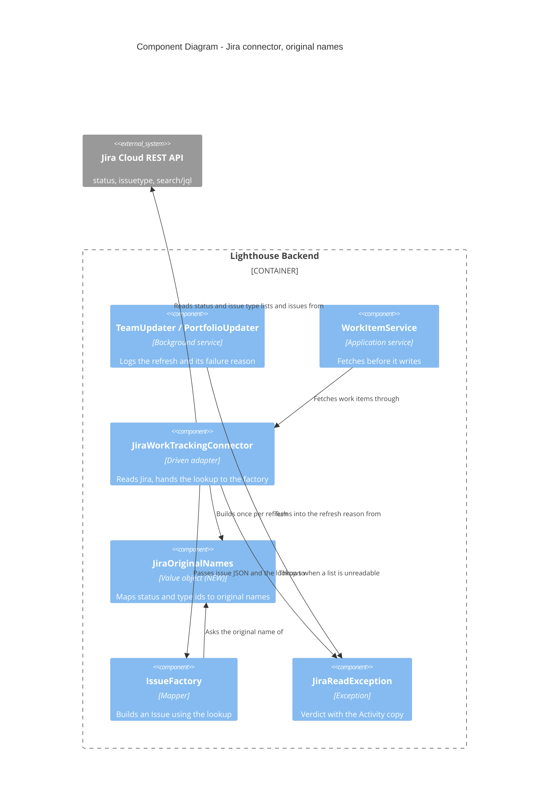

<!-- markdownlint-disable MD024 -->
# Feature Delta — story-6453-jira-original-names

> ADO User Story #6453 "Jira: work against the original (untranslated) status and work item type names" (Active,
> tagged Release Notes, no parent Epic). Jira Cloud translates status, status category and issue type names into the
> profile language of the account behind the API token. Lighthouse matches on those names, so a customer whose token
> account is German sees no states when loading from a board, sees states twice in the suggestions, and cannot tell
> whether to configure German or English names.

## Wave: DISCUSS / [REF] Prior-Wave Reading Confirmation

- ⊘ DISCOVER: skipped by maintainer (2026-10-31). The evidence is the customer report and the live probe recorded
  in ADO #6453 (2026-10-30).
- ⊘ DIVERGE: skipped by maintainer. One product direction: always the original names.
- ⊘ DEVOPS: skipped by maintainer. Usage-data event: **N/A, because** this is a correctness fix that nobody chooses
  to use. There is no behaviour whose uptake could be counted, and no infrastructure change.
- ✓ `docs/product/jobs.yaml`: new job `job-config-admin-configure-jira-in-its-original-names` added (see JTBD).
- ✓ `docs/product/personas/config-admin.yaml`, by reference. No persona change. No journey under
  `docs/product/journeys/` covers "connect a Team to a Jira board"; the light journey lives in this file.
- ✓ Code read (read-only, 2026-10-31), relative to `Lighthouse.Backend/Lighthouse.Backend/`:
  `Services/Implementation/WorkTrackingConnectors/Jira/JiraWorkTrackingConnector.cs:740-840` (board load,
  `MapStatusToCategory`, `GetItemTypesForBoard`), `:1785-1795` (issue → work item, state mapping), `:2702-2775`
  (`PrepareQuery`, `PrepareGenericQuery`, JQL quoting), `:2117` (link type names), `Factories/IssueFactory.cs:47-51,
  :230-245, :280-290` (issue type, current status, changelog `fromString`/`toString`),
  `API/SuggestionsController.cs:33-93` (suggestions de-duplicated with `Distinct()` on exact text).
- ✓ Memory `reference_jira_cloud_untranslated_names` (live probe facts, 2026-10-30).

## Wave: DISCUSS / [REF] Current-State Surface Inventory (brownfield)

| Surface | Today | Gap |
|---|---|---|
| Load from board: states | `/rest/api/3/status`, matched to the board's status IDs, sorted by the **translated** `statusCategory.name` against `"To Do"`/`"In Progress"`/`"Done"` (`JiraWorkTrackingConnector.cs:761-812`). Reports the translated `name` | German token: every status falls through the switch; To Do / Doing / Done stay empty. Same-name statuses with different IDs are listed twice |
| Load from board: work item types | `fields.issuetype.name` of up to 1000 board issues (`:819-840`) | Translated type names ("Geschichte") |
| Sync: current state and type | `fields.status.name`, `fields.issuetype.name` (`IssueFactory.cs:283, :288`) | Translated; `search/jql` carries no `untranslatedName`, only the ID |
| Sync: history | Changelog status items, `fromString`/`toString` (`IssueFactory.cs:237-241`) | Not translated: the probe shows `fromString`/`toString` are original names for both accounts (MD-7); no change |
| JQL Lighthouse builds | `issuetype = "<configured>" OR …`, `status = "<configured>" OR …` (`:2702-2765`) | Probed 2026-10-31: Jira resolves original names in JQL under both languages, status and issue type (MD-9); no change |
| Suggestions | Configured names of all readable Teams/Portfolios, `Distinct()` on exact text (`SuggestionsController.cs:40-92`) | "In Progress" and "in progress" both listed |
| Data Center / Server | No `untranslatedName` on its REST API | Must fall back to `name` |

## Wave: DISCUSS / [REF] Persona IDs

- `config-admin` — sets up Teams and Portfolios against a Jira site, often with a token from their own account,
  whose profile language is their own.

## Wave: DISCUSS / [REF] JTBD One-Liners

- `job-config-admin-configure-jira-in-its-original-names`: When I connect Lighthouse to Jira with a token whose
  account uses German (or any non-English language), I want Lighthouse to show and match the same status and work
  item type names it would show an English account, so loading from a board fills my states, every item lands in
  the right state, and I never have to guess which language to type.

## Wave: DISCUSS / [REF] Journey (light)

1. Admin creates a Team on a Jira connection whose token account is German → clicks **Load from board** → sees To
   Do / Doing / Done and the work item types filled with the **original** names (e.g. "In Progress", "Story"), each
   once. *Today: all three lists empty.*
2. Saves and refreshes → work items appear in the right state, with started/closed dates from their history. *Today:
   only if the admin guessed German names for the current state; history is already in original names (MD-7).*
3. Opens a second Team's state field → suggestions list each name once, ignoring case.
4. Switching the token account's language changes nothing in Lighthouse.

Error paths: the status or issue type list cannot be read → the board load reports no states (today's behaviour,
logged) and the sync fails loudly rather than reporting translated names (DESIGN decides the exact signal). Data
Center → the names Jira gives, as today.

## Wave: DISCUSS / [REF] Locked Decisions

### Maintainer decisions — 2026-10-31

| ID | Decision |
|---|---|
| MD-1 | DISCOVER, DIVERGE and DEVOPS skipped by the maintainer. Usage-data event N/A (correctness fix). |
| MD-2 | Lighthouse **always** works against the original (untranslated) names for statuses and work item types. A German token account returns exactly the same states and types as an English one. |
| MD-3 | **No migration** of existing configurations holding translated names. They stop matching after the upgrade; affected customers re-load from board (or, worst case, use a Lighthouse state mapping to "translate"). The release note must say so. |
| MD-4 | Scope is **status and issue type** only: board load, current state, history, issue type and the JQL Lighthouse builds. Issue link type names and other fields stay as they are, unless the DESIGN probe shows a translated name breaks something. |
| MD-5 | Live testing: set up Jira states with the main test account (`atlassian.pushchair@…`); the restricted account `benjamin@letpeople.work` (`JiraLighthouseRestrictedIntegrationTestToken`) is switched to German by the maintainer and used as the German reader. Its only CI test (`JiraSuppressionRetryIntegrationTest`) writes `duedate` and reads no names. |
| MD-6 | Data Center / Server: where `untranslatedName` is absent, use `name`. |

### Maintainer decisions — 2026-10-31, after the live probe (start of DESIGN)

Probe facts (letpeoplework.atlassian.net, `atlassian.pushchair@…` en_US vs `benjamin@letpeople.work` de_DE):
`/rest/api/3/status` gives the German account translated `name` and `statusCategory.name` ("In Arbeit", "Zu
erledigen", "Fertig", "Wird überprüft", "Geplant", "Abgebrochen") but the same `untranslatedName` and
`statusCategory.key` as the English one. `/rest/api/3/issuetype` translates barely (only id 10030 "Sub-task" →
"Sub-Task"), `untranslatedName` identical. `search/jql`: `fields.status.name` translated, `untranslatedName` null,
`id` and `statusCategory.key` present; same for `fields.issuetype`. Changelog `fromString`/`toString` identical for
both accounts ("To Do" → "In Progress"). JQL: `status = "In Progress"` selects 23 items for both accounts;
`status = "In Arbeit"` selects 0 for both; JQL is case-insensitive.

| ID | Decision |
|---|---|
| MD-7 | Slice 02 (history by status IDs) **dropped**: the changelog is already in original names. History keeps reading `fromString`/`toString`. |
| MD-8 | If the status / issue type lookup fails during a refresh, the refresh **fails visibly**: a log message naming Jira's answer, and the failure with its reason in the Activity section (Task Manager), through the existing `WorkTrackingReadException` → refresh-log `Reason` path. Never fall back to translated names. |
| MD-9 | The JQL Lighthouse builds needs no change: Jira resolves original names in JQL whatever the token's language (AC-1.6 is a regression pin, not new work). |

## Wave: DISCUSS / [REF] Changed Assumptions

- ADO #6453 stated: *"Existing configurations that hold translated names keep working."* and *"Match configured
  names against both the translated and the original name."* Replaced by MD-2/MD-3: Lighthouse matches only the
  original name and does not migrate. Rationale (maintainer): one name per status, the same for every account; a
  state mapping covers the rare customer who wants a local word.
- ADO #6453 stated: *"current state, history (changelog toString), issue type and JQL all use the token account's
  language."* The live probe disproved this for history and JQL: only the current status and issue type (and the
  board load's status list) are translated (MD-7, MD-9). Consequence for MD-3: a Team configured today with German
  names already selects nothing through JQL, so the "break" MD-3 accepts mostly affects configurations that never
  fully worked.

## Wave: DISCUSS / [REF] Scope Assessment

PASS. One connector, 2 stories, no UI layout change, no schema change expected, under a week.

## Wave: DISCUSS / [REF] Story Map & Slices

| Slice | Story | Brief |
|---|---|---|
| 01 | US-01 Load from board and sync use the original names | `slices/slice-01-board-and-sync-use-original-names.md` |
| ~~02~~ | ~~US-02 History uses the original names~~ — dropped (MD-7) | — |
| 02 (number re-used) | US-05 The upgrade repairs items stored with translated states: one full refresh of every Jira Team and Portfolio after the upgrade (DD-11, MD-15); own commit, droppable alone | `slices/slice-02-one-full-refresh-after-upgrade.md` |
| 03 | US-03 Suggestions list each name once | `slices/slice-03-suggestions-ignore-case.md` |

### Priority Rationale

- **01 first**: the walking skeleton: board load → save → refresh → items in the right state. Releasable alone.
  English accounts see no change.
- **02 after 01**: DD-11, its own commit once 01 is green; it repairs data 01 leaves stale and can be dropped alone.
- **03 last**: independent, cheap, connector-agnostic. Can be dropped without harm.

### Slice taste tests

- No slice ships 4+ new components. ✓
- 01 disproves "the board load and sync give a German token the same names as an English one" if the live comparison differs.
- Production data: the live letpeoplework Jira site, read through the German account. ✓

## Wave: DISCUSS / [REF] User Stories

### US-01 — Load from board and sync use the original names (slice 01, ADO #6453)

As a config-admin whose Jira token account uses German, I want Load from board and every refresh to use the original
status and work item type names, so my Team is configured and filled exactly as it would be with an English account.

`job_id: job-config-admin-configure-jira-in-its-original-names`

#### Elevator Pitch

Before: with a German token account, **Load from board** leaves To Do / Doing / Done empty and fills work item types
with German names.
After: click **Load from board** on a Jira Team's settings → sees To Do / Doing / Done and the work item types filled
with the original names ("To Do", "In Progress", "Done", "Story"), each once; save and refresh → the Team's work
items show in those states.
Decision enabled: the admin saves the configuration as loaded instead of guessing which language to type.

#### Acceptance Criteria

- AC-1.1 Load from board sorts each board status into To Do / Doing / Done by its status category **key**
  (`new` / `indeterminate` / `done`), never by the category's display name. Data Center carve-out: where the category
  key is absent, the category name switch applies as today.
- AC-1.2 Each status is reported by its original name (`untranslatedName`), falling back to `name` when absent.
- AC-1.3 A name appears at most once per list, even when two board statuses with different IDs share it (ignoring case).
- AC-1.4 Work item types from Load from board are original names (fallback `name`), each once, ignoring case.
- AC-1.8 (board half) and AC-1.11 below also belong to this story; they keep their numbers for traceability.

### US-04 — A refresh reads the original names (slice 01, ADO #6453)

Split out of US-01 at the review gate (DoR: one outcome per story). As a config-admin whose Jira token account uses
German, I want every refresh to read current states and types in their original names, so a Team configured with
those names is filled exactly as through an English account.

`job_id: job-config-admin-configure-jira-in-its-original-names`

#### Elevator Pitch

Before: a Team configured with "In Progress" refreshed through a German token account stores its items as "In Arbeit",
so they match no configured state.
After: refresh the Team (Refresh button or the scheduled refresh) → its work items show as "In Progress" and count in
WIP and cycle time; if Jira's status list cannot be read, the Activity section shows the failed refresh and why.
Decision enabled: the forecaster trusts the Team's WIP, throughput and cycle time.

#### Acceptance Criteria (refresh)

- AC-1.5 On refresh, each work item's current state and type are the original names, although `search/jql` returns
  only the translated name and the ID.
- AC-1.6 The JQL Lighthouse builds is unchanged; Jira selects the same items for it under both languages (probe on
  record, 2026-10-31). Also checked in the live test (AC-1.7 row).
- AC-1.7 Live: the same board loaded and refreshed through the German account and through an English account gives
  identical state lists, type lists, and work items with identical states.
- AC-1.8 Data Center (no `untranslatedName`): behaviour as today. An identified Data Center makes no new list call (the
  board load's status read it already makes stays) and reports the names Jira gives. A deployment that cannot be identified (serverInfo fails) reads the lists and falls back
  to `name` wherever a list entry has no `untranslatedName`, so a real Data Center behaves as today.
- AC-1.9 (refresh only; Load from board is AC-1.11) If the status or issue type list cannot be read during a refresh,
  or still lacks a status or type id Jira reported after one re-read of both lists (MD-14), the refresh fails: the log carries a
  message naming the Jira answer, and the Activity section (header Task Manager) shows the failed refresh with a
  reason that says the status / work item type list could not be read. It never stores translated names as if they
  were original (MD-8, MD-14). The unknown-id case is worded: "Jira reported a status (id {id}) that is not in its list
  of statuses on this Jira instance, …" (work item type variant in MD-14).
- AC-1.10 Live: started and closed dates of the same issues are identical through the German and the English account
  (history is read from the changelog as today; the probe showed it is not translated — MD-7).
- AC-1.11 Board load: a refused status or type list never shows translated names. The board reports no states (status
  list refused) or no work item types (type list refused, or a board type id still missing after one re-read) and a
  warning naming Jira's answer is logged. Today's look, no new UI.

### US-02 — dropped (MD-7)

The live probe (2026-10-31) showed the changelog's `fromString`/`toString` are the same original names for the
German and the English account. History needs no change; AC-1.10 pins that it stays equal.

### US-05 — The upgrade repairs items stored with translated states (slice 02, ADO #6453)

As a config-admin whose Team was configured in English but refreshed through a German token account, I want the
upgrade to re-read my Team's items once, so items stored with German states do not stay wrong until each one changes.

`job_id: job-config-admin-configure-jira-in-its-original-names`

#### Elevator Pitch

Before: after upgrading, most items of such a Team keep their German states, because a delta refresh only re-reads
items that changed in Jira.
After: the first refresh after the upgrade (scheduled or the Refresh button) → the Activity section shows a full
refresh, and the Team's work items show in their original states, with no admin action.
Decision enabled: the admin does not need to touch a Team that only looked broken because of the token's language.

#### Acceptance Criteria

- AC-1.12 The first refresh of a Jira Team or Portfolio after the upgrade downloads everything (full refresh) and
  stores current states and types in their original names; the refresh after it is a delta again. Teams and
  Portfolios on any other tracker keep their delta refresh (their fetch fingerprint is unchanged). (DD-11, MD-15)

### US-03 — Suggestions list each name once (slice 03, ADO #6453)

As a config-admin typing a state or work item type, I want each suggestion once regardless of letter case, so I don't
pick between "In Progress" and "in progress".

`job_id: job-config-admin-configure-jira-in-its-original-names`

Note: the job above is the Jira case of this change. The change itself is connector-neutral (AC-3.2): it helps every
tracker whose names differ only by letter case.

#### Elevator Pitch

Before: the state suggestions list "In Progress" and "in progress" side by side.
After: open a Team's Doing states field → sees "In Progress" once.
Decision enabled: the admin picks the name without wondering which spelling is right.

#### Acceptance Criteria

- AC-3.1 State and work item type suggestions (Teams and Portfolios) are de-duplicated ignoring case; the first
  spelling met is kept.
- AC-3.2 Applies to every connector (suggestions are connector-agnostic).

## Wave: DISCUSS / [REF] Out of Scope

- Migrating stored translated names (MD-3).
- Matching a configured name against both the translated and the original name (MD-2).
- Issue link type names, resolution, priority and other fields (MD-4).
- Any UI layout change; Load from board and suggestions keep their look.
- Other connectors' languages (ADO, Linear, ServiceNow).

## Wave: DISCUSS / [REF] WS Strategy & Driving Ports

- Walking skeleton = slice 01: Load from board → save → refresh, end to end through the real Jira connector.
- Driving ports: `Load from board` (Team/Portfolio settings → board-information API), the refresh (work item sync),
  `GET /api/suggestions/states/{teams|projects}` and `…/workitemtypes/{teams|projects}`.

## Wave: DISCUSS / [REF] Outcome KPIs

| KPI | Target | Measured by |
|---|---|---|
| Same answer whatever the token language | 100 % identical state lists, type lists, item states and transition dates, German vs English account, on the test board | Live `JiraIntegration` test (AC-1.6, AC-1.7, AC-1.10) |
| Support reports of empty board load / doubled states from non-English Jira accounts after release | 0 | Owner: the maintainer. Count: ADO items tagged or linked to Story 6453 plus Slack #lighthouse reports of that kind, first two releases |

## Wave: DISCUSS / [REF] Checklist (project)

- RBAC impact: **N/A, because** no endpoint, permission or guard changes; suggestions keep their RBAC filter.
- Lighthouse-Clients CLI/MCP: **N/A, because** no API shape changes; clients show the names the API returns, which
  become original names.
- Website marketing surface: **N/A, because** a connector correctness fix, nothing to market.
- Terminology: **N/A, because** status and type names are tracker values, not configurable Lighthouse terms.
- Visualization skill: **N/A, because** no chart or metric view changes.
- UI sketch: no layout or copy change; values only. DISTILL confirms with the maintainer at its start.
- Docs at finalize: `docs/concepts/worktrackingsystems/jira.md` states that Lighthouse uses the original
  (untranslated) names whatever the token account's language, and how to fix a Team configured in German. The Data
  Center note (token account language = instance default where admins define status translations) is **unverified**:
  no Data Center probe was run, so the docs word it as untested.
- Release note (at `/release`): name the break from MD-3 and the fix (Load from board again). With DD-11 (MD-15) the
  upgrade repairs Teams configured in English on a German-token account by one full refresh; Teams configured in
  German still need Load from board again.

## Wave: DISCUSS / [REF] Definition of Done

1. All ACs green in unit/integration tests with recorded German and English Jira payloads.
2. Live `JiraIntegration` test through the German account passes (AC-1.6, AC-1.7, AC-1.10).
3. `dotnet build`, `dotnet test` (filtered), `pnpm build`, `pnpm test` clean.
4. Mutation kill rate ≥ 80 % on the changed backend code.
5. No Sonar issues.
6. Jira concept doc updated at finalize.
7. ADO #6453 Resolved on push, Closed after CI green.
8. Release note flagged for MD-3.
9. Workspace committed.

## Wave: DISCUSS / [REF] DoR Validation

| Item | Evidence |
|---|---|
| Problem clear, from a real user | ADO #6453, customer report + live probe |
| Persona named | `config-admin` |
| Job traced | `job-config-admin-configure-jira-in-its-original-names` |
| ACs testable | AC-1.1…1.11, AC-3.1…3.2, each a fixture or live check |
| Slices thin, ordered | 3 steps: 01 (about 2-3 days after DESIGN and DISTILL grew it), 02 (DD-11, about half a day, droppable alone), 03 (≤2 hours); rationale above |
| Dependencies | Maintainer switches `benjamin@letpeople.work` to German before slice 01's live test (done). JUSTATEST workflow change made by the maintainer 2026-10-31: status 10155 "In Prüfung" in the workflow and on board 1, JUSTATEST-14 in it: a prerequisite of the live test |
| Out of scope explicit | Above |
| KPIs measurable | Above |
| Open questions owned | Resolved: JQL with original names (status and issuetype) and `/rest/api/3/issuetype` scope probed live 2026-10-31. DC behaviour stays "as today" and is unverified (no DC probe) |

## Wave: DISCUSS / [REF] Pre-requisites for DESIGN

Status: **done** (live probes 2026-10-31: status and issuetype JQL both probed, equal counts under both accounts; scope of
the two list routes probed; see MD-7..MD-9 and the review-gate probe).

- Live probe through the German account: JQL `status = "In Progress"` and `issuetype = "Story"`; status category
  `key`; `/rest/api/3/issuetype` vs project-scoped issue types (team-managed projects have their own type IDs).
- Where the ID → original name lookup lives and how long it is cached within a sync. (Answered in DESIGN: DD-1..DD-3, DD-12.)
- Prerequisite of the live test (maintainer, 2026-10-31): status 10155 "In Prüfung" put in the JUSTATEST workflow and on
  board 1, JUSTATEST-14 moved into it.

## Wave: DISCUSS / [REF] Maintainer decisions — 2026-10-31, AFK entry

| ID | Decision |
|---|---|
| MD-10 | AFK session: slice wrap-up = refactor + review (mutation once, at the end); nothing pushed (hold locally). |
| MD-11 | Rigor profile `standard` for both slices: `agent_model` sonnet, `reviewer_model` haiku. |
| MD-12 | Activity-section copy for a failed lookup (approved sketch). Reason, after the existing prefix "The work tracking system could not be read for this refresh: ": *"Lighthouse could not read the list of statuses on this Jira instance, so it cannot tell which state each work item is in. Jira answered {code} ({status}). Nothing was changed; the Team keeps the work items from its last refresh."* Work item type variant: *"…the list of work item types on this Jira instance, so it cannot tell which type each work item is. …"* Log at Error: `GET {route} answered {code} {status}. {Jira's response body}`. The "Nothing was changed" sentence must be true; DESIGN verifies it, and adapts the sentence's wording (not its meaning) to Portfolios. |

> Amended in the DISTILL review gate: MD-13 drops the kept-state sentence for Portfolios (and validation); MD-14 adds
> the unknown-id copy. See the review-gate block at the end of this file.

## Wave: DESIGN / [REF] Prior-Wave Reading Checklist

Mode: PROPOSE, maintainer AFK (MD-10): the recommended option was taken for every engineering choice and is recorded
below. Scope: application architecture, slice 01 in full, slice 03 confirmed.

- ✓ DISCUSS `feature-delta.md` (MD-1..MD-12, probe facts under MD-7..MD-9), both slice briefs listed in the tree.
- ✓ `CLAUDE.md` (ports-and-adapters, comment rule, quality gates), `docs/product/architecture/brief.md` (skimmed for the
  Jira connector: it says nothing about status or issue type names, so **no brief change**), `docs/ci-learnings.md` is
  referenced by the project gates (build is the check; nothing in the design needs a ledger rule).
- ✓ Code read (relative to `Lighthouse.Backend/Lighthouse.Backend/`): `Services/Implementation/WorkTrackingConnectors/Jira/`
  `JiraWorkTrackingConnector.cs` (board load 703-840, `GetIssuesByQuery` 2281, DC download 2319, Cloud download 2377,
  `CreateIssueWithCompleteChangelog` 2528, `PrepareQuery` 2702, `SetStoredFieldKeys` 1648, validation 1142-1215),
  `JiraReadException.cs`, `JiraRestRoutes.cs`, `Factories/IssueFactory.cs` + `IIssueFactory.cs`,
  `Services/Implementation/WorkItems/WorkItemService.cs` (refresh order of fetch and write), `WorkItems/FetchFingerprint.cs`,
  `WorkItems/SyncModeResolver.cs`, `BackgroundServices/Update/TeamUpdater.cs` + `UpdateServiceBase.cs`,
  `API/SuggestionsController.cs`. Tests: `JiraBoardQueryAssemblyTest`, `JiraNamedDependencyLinkTest`,
  `JiraWorkTrackingConnectorTest` (live), `TestHelpers/JiraConnectorTestSetup.cs`, `TestHelpers/TrackerWireFormats.cs`.
- ⊘ DEVOPS, DISCOVER, DIVERGE: skipped by the maintainer (MD-1). No infrastructure, no usage-data event.
- No external integration is introduced. **Contract-test annotation for the handoff:** the two reads
  (`GET rest/api/latest/status` is already read, `GET rest/api/latest/issuetype` is new) extend the Jira REST boundary.
  The consumer expectation is "a JSON array of objects with `id`, `name`, optional `untranslatedName`, and
  `statusCategory.key` on statuses". The live `JiraIntegration` comparison test (see Test Seams) is the contract check
  here; Pact adds nothing for a read-only array this stable.

## Wave: DESIGN / [REF] Design Decisions

Quality attributes driving the choices: correctness (the same answer whatever the token language), reliability (a read
that cannot be trusted must stop the refresh, never degrade into translated names), testability (the rule is pure and can
be pinned with recorded payloads), and low cost (a refresh already pages and fetches changelogs; two list reads must not
multiply with chunking). Team structure is one maintainer, so Conway's Law has nothing to say here.

| ID | Decision | Rejected alternatives and why |
|---|---|---|
| DD-1 | **A small immutable value object, `JiraOriginalNames`, holds two maps (status id to original name, issue type id to original name) and answers `StatusNameFor(id, nameInThePayload)` and `IssueTypeNameFor(id, nameInThePayload)`.** ~~Fallback to the payload's name when the id is unknown, when the id is absent from the payload, or when `untranslatedName` is absent.~~ **Amended by MD-14 (review gate):** an id missing from a list that was read fine is a *miss*, not a fallback: the value object reports it as unknown and never invents a name; the connector handles the miss (DD-12). The payload's name is used in exactly two places: an issue payload that carries no id (nothing to look up; Cloud always sends ids, so this serves hand-built fixtures) and a list entry without `untranslatedName` (Data Center, old Cloud), where the entry's own `name` is used. A static `AsReported` instance (empty maps) is the identity lookup for Data Center (MD-6). Pure: no I/O, no logging. Lives beside the connector (`Jira/`), public because `IIssueFactory` (public) takes it. | (a) Two loose dictionaries passed around: every caller re-implements the fallback rule, and the rule is the thing under test. (b) Rewrite the issue JSON before the factory sees it: hides a semantic change inside a payload that is also stored raw in `Issue.Fields`. (c) Put the lookup inside `IssueFactory` with its own HTTP: the factory is pure today and registered scoped without an HTTP client; it would turn a pure mapper into a driven adapter. |
| DD-2 | **`IIssueFactory.CreateIssueFromJson` gains one optional trailing parameter, `JiraOriginalNames? originalNames = null`; null means `AsReported`.** `GetIssueTypeFromFields` and `GetStateFromFields` ask it for the name. Nothing else in the factory changes (changelog, started/closed dates untouched, MD-7). Existing callers and tests that omit it keep compiling and keep today's behaviour. The state name resolved through the lookup is the name `GetStartedAndClosedDate` receives, so it compares the original current state against the changelog's original names. | A new interface method: forks the contract for no gain. A required parameter: breaks about 30 test call sites for no gain. |
| DD-3 | **Lookup lifetime: read at most once per connector instance per connection, before the first search page of `GetIssuesByQueryFromCloud`; a failed read is not remembered.** The connector is registered scoped and an update task builds its own scope (`UpdateQueueService` creates one per task), so the memo lasts one refresh, one validation or one board load: no staleness window beyond a single refresh, an admin who adds a status is picked up by the next refresh, and chunked by-key queries (`ReferenceIdsPerQuery`) do not repeat the two reads. The read is **not** made by the cheap identity sweep (`SweepIdentities`/`WalkSweep` read ids and change stamps only), so a refresh that finds nothing moved makes no lookup call and cannot fail on one. **Amended (review gate):** the memo holds both lists and is shared by the refresh and the board load of the same connector instance (a board load is one scoped request, so each list is read once; the status list it needs for the category sort is the same read). The single re-read of DD-12 replaces both lists in the memo, at most once per instance (once per refresh). A failed read is still not remembered. | Per query: 2 extra GETs per chunk, multiplied by every chunk of a by-key fetch, and the status list is the largest of the two. Per connection in the static `FieldNames` dictionary or in `processWideCache` with a TTL: dedupes across Teams, but a new status is invisible until the TTL ends and an unknown id then needs a forced re-read to tell "new" from "never existed"; real extra machinery for a saving of one or two GETs per Team refresh. Recorded upgrade path if request volume ever complains: `processWideCache` with a short TTL and a single forced re-read on an unknown id. |
| DD-4 | ~~**Cloud only reads the lists.**~~ **Amended by the review gate: the lists are read on Cloud and on an unidentified deployment; only an identified Data Center skips them.** `GetDeploymentType` returns Unknown when `serverInfo` fails, and today an Unknown deployment takes the Data Center branch. The Unknown branch now reads both lists too (the read sits before the branch) and falls back to the entry's `name` wherever `untranslatedName` is absent, so a real Data Center whose serverInfo failed behaves as today, while a Cloud account whose serverInfo failed still gets original names. `GetIssuesByQueryFromDataCenter` passes `AsReported` and makes no extra call only when the deployment was identified as Data Center (MD-6, AC-1.8). | Reading the lists on an identified Data Center too: Data Center has no `untranslatedName`, so the call would buy nothing. Treating Unknown as Data Center (today's routing): a Cloud account whose serverInfo call failed would silently store translated names. |
| DD-5 | **A list that cannot be trusted stops the refresh.** Failure means: non-success status, a body that is not a JSON array (a gateway page answered 200), or an empty array (an account that can browse nothing is answered `[]`, and every id would then fall back to translated names without a word). All three raise the same `JiraReadException` factory (DD-6), logged at Error. Precedent: `A_link_type_list_that_cannot_be_read_stops_the_refresh...` already treats "200 but unreadable" as a stop. ~~An id missing from a list that was read fine is not a failure: it falls back to the payload name (open question O-2).~~ **Amended by MD-14:** an id missing from a list that was read fine triggers one re-read of both lists and, if still missing, the same stop with its own verdict (DD-12, DD-6); it never falls back to a translated name. | Falling back to translated names on failure: forbidden by MD-8. Treating an empty array as valid: reproduces the silent bug for the one account class most likely to hit it. |
| DD-6 | **Two new `JiraReadException` factory methods, `StatusListRefused` and `IssueTypeListRefused`**, following `FieldListRefused`: codes `status_list_unreadable` and `issue_type_list_unreadable`; verdict message is the MD-12 copy (first two sentences, then the kept-state sentence); technical detail `GET {route} answered {code} {status}. {what Jira said}`; no input field to highlight (the 3-argument `ConnectionValidationResult.Failure`). They take the owner noun so the last sentence is true for each owner (DD-8). The connector logs the same detail at Error, with Jira's response body, before throwing (the existing `RefusedFieldList` logs at Warning; MD-12 asks for Error here). Route `rest/api/latest/issuetype` is added to `JiraRestRoutes` as a route both deployments serve, which is what `JiraRouteLiteralsTest` requires. **Amended (review gate):** (MD-13) the kept-state sentence is said for Teams only; Portfolio and validation verdicts end after "Jira answered {code} ({status}).", so the owner argument now only switches that one sentence on or off. (MD-14) Two more factories, `StatusIdNotInList(id)` and `IssueTypeIdNotInList(id)`, codes `status_id_not_in_list` and `issue_type_id_not_in_list`; verdict = the MD-14 sentence (Team appends the kept-state sentence, Portfolio and validation do not); technical detail names the id and says both lists were read: `Status id {id} is not in the answer of GET {route} (read twice).`; same detail logged at Error; no input field to highlight. | A plain `HttpRequestException`: `TeamUpdater`/`PortfolioUpdater` would not catch it as a read failure and the Activity section would show a generic error. |
| DD-7 | **Board load keeps today's degrade-with-warning behaviour, and never falls back to translated names.** Statuses: the existing status read (`MapStatusToCategory`) now sorts by `statusCategory.key` (`new`/`indeterminate`/`done`; any other key is ignored as today), reports `untranslatedName ?? name`, de-duplicates ignoring case within each list (first spelling kept, same rule as slice 03). A failed status read still returns three empty lists with the existing warning. Work item types: `GetItemTypesForBoard` resolves each board issue's `issuetype.id` through one read of `JiraRestRoutes.IssueType`; if that read fails (or is unusable by the DD-5 test) the board reports **no** work item types with a warning that names what Jira answered, never the translated names. Data Center payloads (no `untranslatedName`, no category `key` on some versions): fall back to `name`, and to the category `name` switch when `key` is absent (AC-1.8). **Amended (review gate, MD-14 and the board-load type read):** Cloud and unidentified deployments read the issue type list for the board's work item types (through the memo of DD-3); an identified Data Center uses each board issue's payload type name and makes no extra call. A board issue type id still missing after the one re-read (DD-12) leaves that type out of the board's list, with a warning naming the id; the board never reports a translated name (AC-1.11). The status read keeps its own call on every deployment, as today; entries without `untranslatedName` give `name`. | Throwing a `JiraReadException` from the board load, which `GetBoardInformation` already lets through as a wizard verdict: more informative, but it needs a wizard-specific copy (the MD-12 sentence about "keeps the work items from its last refresh" is wrong for a screen with nothing saved) and a UI path the sketch never covered. Revisit if support sees empty lists with no explanation. |
| DD-8 | **Verification of "Nothing was changed"** (next section): true for Teams; for Portfolios true except in one corner, ~~so the Portfolio variant is worded "No Feature was changed".~~ **Amended by MD-13:** the Portfolio carries no kept-state sentence at all; the sentence is said only where it is always true, which is Teams. The validation path (`ValidateTeamSettings`/`ValidatePortfolioSettings` call `GetIssuesByQuery` and return a `WorkTrackingReadException`'s verdict) has no last refresh to keep, so there the verdict omits the third sentence. The connector passes the purpose and the owner kind to the factory methods. | Reusing one sentence everywhere: false on at least one path. |
| DD-9 | **JQL is not touched** (MD-9). `PrepareQuery`/`PrepareGenericQuery` keep sending the configured names, which are original names after this change. AC-1.6 is a regression pin on the request body, not new work. Probe evidence in the MD-7..MD-9 block covers `status`; `issuetype` resolves by the same rule and the live comparison test pins it. Probed 2026-10-31 since: `issuetype = "Story"` counts the same under both accounts (site 5452, JUSTATEST 11). | Translating configured names before sending: unnecessary, and wrong for Data Center. |
| DD-10 | **Slice 03 confirmed**: `SuggestionsController` has eight `Distinct()` calls (`SuggestionsController.cs:42`, `:56`, `:70-72`, `:87-89`: one types list each for Teams and Projects, three state lists each). Each becomes `Distinct(StringComparer.OrdinalIgnoreCase)`: `Distinct` keeps the first occurrence, which is AC-3.1's "first spelling met is kept". No other change, connector-agnostic (AC-3.2). | A shared helper: eight one-token edits do not warrant one. |
| DD-11 | **Optional step, flagged for the maintainer at review: a Jira reading-version marker in the fetch fingerprint.** Delta sync skips every issue whose change stamp did not move. A Team whose configuration is English but whose token account is German already has its items stored with German states (JQL matched them, the state names did not). After the upgrade those items are not re-downloaded until each one changes, so most stay wrong. A constant added to `FetchFingerprint.ForConnection` for `WorkTrackingSystems.Jira` gives every Jira Team and Portfolio exactly one full refresh after the upgrade and repairs them without admin action. Cost: it touches a shared, connector-agnostic contract (guard test `FetchShapingPropertyGuardTest`), costs every Jira customer one full cycle once, and that cycle's refresh log carries the reason `configuration-changed`, which is untrue for an upgrade. **Recommendation: take it**, but as its own commit after slice 01 so it can be dropped alone. **Confirmed by the maintainer (MD-15, review gate).** ~~Fallback if rejected: the release note says "save the Team once (or re-load from board) to force a full refresh".~~ (Not needed: confirmed.) **Shape (MD-15):** the marker is appended to the fingerprint only for Jira connections; every non-Jira digest stays byte-identical, pinned by a test that compares non-Jira digests to their values from before this change. The Jira pinned digests (`FetchFingerprintPinnedDigestTest`, `FetchFingerprintAcrossTheConnectionDefaultsUpgradeTest`) move on purpose, and their rationale text is updated to say the marker is why. The `configuration-changed` reason on that one refresh is accepted. Own step after slice 01, own brief: `slices/slice-02-one-full-refresh-after-upgrade.md`. With it, the upgrade repairs Teams configured in English on a German-token account; Teams configured in German still need Load from board again (MD-3). | Doing nothing silently: leaves the reported customer partly broken. Resetting stored items in a migration: MD-3 says no migration, and a full cycle is cheaper and safe. |
| DD-12 | **An id missing from a list that was read fine: re-read both lists once, then fail visibly (MD-14, review gate).** The check is made by the connector, not the factory, which stays pure and total: after each page of issues is downloaded and before the factory sees it, the connector asks `JiraOriginalNames` which status and issue type ids of the page it does not know. On a miss it re-reads both lists once (replacing the memo of DD-3; at most one re-read per refresh, so a later miss in the same refresh fails without another call), rebuilds the lookup and checks again. Still missing: it throws `StatusIdNotInList(id)` or `IssueTypeIdNotInList(id)` (DD-6), logged at Error naming the id, before anything is stored (same fetch-before-write ordering as the verification section). The re-read tells "an admin added a status a minute ago" from "Jira never listed it". The payload-name fallback remains in exactly two places: a list entry without `untranslatedName` (the entry's `name`) and an issue payload with no id. The board load (DD-7) uses the same helper with a different ending: re-read once, then leave that type out and warn. | (a) Keep the payload-name fallback for unknown ids (the former DD-1/DD-5): a German account would silently store translated names for exactly the new or project-scoped statuses, which is the reported bug again. (b) Fail at the first miss with no re-read: a status added since the memo was built fails a refresh that would succeed one call later. (c) Re-read on every miss: a Jira that really lacks an id costs two GETs per page. (d) Throw from the factory: turns a pure mapper into a failing one and removes the chance to re-read. |

## Wave: DESIGN / [REF] Verification: "Nothing was changed"

Verified by reading the refresh path, not assumed.

- **Team** (`WorkItemService.UpdateWorkItemsForTeam` → `RefreshWorkItems`): `ResolveRemoteFetch` (scan, then
  `FetchEverything` or `FetchOnlyWhatMoved`, which is where the Jira download and so the lookup happen) runs **before**
  `SyncDownloadedItems`, `RemoveItemsThatLeftTheQuery` and every `Save()`. An exception from the fetch leaves the
  stored work items untouched. `team.FetchFingerprint` is assigned only after the refresh, so the failed refresh is
  retried in the same mode. `TeamUpdater` then logs the refresh with `Success = false` and the `Reason` from
  `BuildReadFailureReason`, and rethrows. `ScanRemoteIdentities` swallows scan exceptions, but the sweep makes no lookup
  call (DD-3), so a lookup failure cannot be turned into a "scan failed, download everything" retry. The statement
  "Nothing was changed; the Team keeps the work items from its last refresh" is **true**. Team metrics are not
  recomputed either (`UpdateTeamMetrics` follows the work item update).
- **Portfolio** (`UpdateFeaturesForPortfolio` → `RefreshFeatures`, then `RefreshParentFeatures`): `RefreshFeatures`
  fetches before it writes, so a lookup failure while downloading Features changes nothing. But the two halves each
  `Save()`. If the Feature half downloads nothing (no Feature moved, so no lookup call), it still saves what it holds,
  including Features that left the query; a failing lookup in the parent-Feature half then fails the refresh after that
  save. So "Nothing was changed" is true for a Portfolio **except** in that corner, where Features that left the query
  were already dropped and no Feature was updated. ~~Portfolio wording, therefore: *"…Jira answered {code} ({status}). No
  Feature was changed; the Portfolio keeps the Features from its last refresh."* (Meaning unchanged; "Nothing" narrowed
  to what is always true.)~~ **Amended by MD-13:** the Portfolio reason carries no kept-state sentence: the status or type sentence plus "Jira answered {code} ({status})." only, as the validation variant does. The corner above is why "No Feature was changed" was never safe to say either. `portfolio.FetchFingerprint` is not advanced, so the next refresh retries.
- **Validation** (save / test settings): no refresh happened, so the third sentence is omitted (DD-8).
- The reason reaches the Activity section through `BuildReadFailureReason`: prefix "The work tracking system could not
  be read for this refresh: " plus `Verdict.Message`. `WorkTrackingReadException` is caught before the generic handler in
  both `TeamUpdater` and `PortfolioUpdater`; no updater change is needed.

## Wave: DESIGN / [REF] Component Decomposition

Relative to `Lighthouse.Backend/Lighthouse.Backend/`. Style: unchanged, ports-and-adapters inside the modular monolith;
enforcement tooling already in place (ArchUnitNET `ModuleBoundariesArchUnitTest`, `JiraRouteLiteralsTest`), nothing new
needed.

| Component | Path | Status | Responsibility after this change |
|---|---|---|---|
| `JiraOriginalNames` | `Services/Implementation/WorkTrackingConnectors/Jira/JiraOriginalNames.cs` | **NEW** | Pure value object: ids to original names, with the single fallback rule; builds from the two Jira lists; `AsReported` identity. Parsing of already-fetched JSON only, no I/O |
| `JiraWorkTrackingConnector` | `.../Jira/JiraWorkTrackingConnector.cs` | MODIFIED | Reads the two lists (Cloud and unidentified deployments, memoised per instance, DD-3; one re-read on an unknown id, DD-12), fails with `JiraReadException`, hands the lookup to the factory; board load sorts by category key, reports original names, de-duplicates, resolves board issue types by id |
| `JiraReadException` | `.../Jira/JiraReadException.cs` | MODIFIED | Four new verdict factories: two for a refused list, two for an id missing from a list (DD-6, DD-12) |
| `JiraRestRoutes` | `.../Jira/JiraRestRoutes.cs` | MODIFIED | New `IssueType` route (both deployments serve it), beside `Status` |
| `IIssueFactory` / `IssueFactory` | `Factories/IIssueFactory.cs`, `Factories/IssueFactory.cs` | MODIFIED | Optional `JiraOriginalNames` input; type and state resolved through it; history untouched |
| `SuggestionsController` | `API/SuggestionsController.cs` | MODIFIED (slice 03) | Case-insensitive `Distinct` on eight lists |
| `FetchFingerprint` | `Services/Implementation/WorkItems/FetchFingerprint.cs` | MODIFIED, **confirmed** (DD-11, MD-15; own step, slice 02) | Jira-only reading-version marker |
| `TeamUpdater`, `PortfolioUpdater`, `UpdateServiceBase`, `WorkItemService`, `TeamDataService` | `Services/Implementation/BackgroundServices/Update/`, `.../WorkItems/`, `.../TeamData/` | UNCHANGED | The failure path already exists and is correct (verification above) |
| Frontend, API shapes, EF schema, migrations | | UNCHANGED | Values only (checklist in DISCUSS stands) |

Other readers of status or issue type names, checked by search across the backend: only `IssueFactory` (current state,
type; the changelog items use `fromString`/`toString`, original already), `GetItemTypesForBoard`, `MapStatusToCategory`,
and `PrepareQuery` (writes, not reads; DD-9). Parent, Feature, dependency and by-key paths all go through
`GetIssuesByQuery`, so one lookup per refresh covers them. Write-back reads neither. The sweep reads neither. One
side note outside MD-4: `Issue.Fields` still holds the raw payload, so an additional field configured on `status` or
`issuetype` itself would still show the account's language; no such field is predefined, so it stays out of scope.

## Wave: DESIGN / [REF] Driving Ports

No new driving port and no driving-port signature change. The four DISCUSS driving ports keep their shape: Load from
board (`GetBoardInformation`, read-only), the refresh (`IWorkTrackingConnector.GetWorkItemsForTeam` /
`GetFeaturesForProject` / `GetParentFeaturesDetails`), and the two suggestion endpoints (all `GET`, read-only, no write
method on them). The only contract widened is `IIssueFactory.CreateIssueFromJson` (optional parameter, backward
compatible). `JiraReadException` is a driven-side signal that `TeamUpdater` and `PortfolioUpdater` already translate.

## Wave: DESIGN / [REF] Driven Ports / Adapters

| Port | Adapter | Change |
|---|---|---|
| Jira REST: status list | `JiraWorkTrackingConnector` over `HttpClient` | Already read for the board; now also read per Cloud or unidentified-deployment refresh (not on an identified Data Center). Reads `id`, `name`, `untranslatedName`, `statusCategory.key` |
| Jira REST: issue type list | same | **New read**, `rest/api/latest/issuetype`: `id`, `name`, `untranslatedName`; on refresh and on board load, for Cloud and unidentified deployments (not on an identified Data Center) |
| Jira REST: search | same | Unchanged request; response `fields.status.id`/`fields.issuetype.id` now read |
| Persistence | repositories | Unchanged |

Earned Trust (principle 13), answered for the two reads: *what if the environment lies?* Five lies are catalogued and
each has a test: (1) the account is German, so `name` is translated: the lookup wins by id (recorded German payloads);
(2) the lists answer 200 with an empty array or a gateway page: treated as unreadable (DD-5, one fixture each);
(3) `untranslatedName` is absent (Data Center, old Cloud): falls back to the entry's `name` (fixture); (4) `serverInfo` fails, so the deployment cannot be identified: an unidentified deployment reads the lists and falls back to `name` where `untranslatedName` is absent, so a real Data Center behaves as today and only an identified Data Center skips the read (fixtures: serverInfo fails + German list gives original names; serverInfo fails + list entries without `untranslatedName` give `name`); (5) a list read "fine" that lacks an id Jira reports (an admin added it a minute ago, or a scope the account cannot browse): one re-read of both lists, then a visible failure (DD-12; fixtures: the id appears after the re-read, the id never appears). Residual risk accepted: a real Data Center whose serverInfo failed and whose list routes answer unusably now fails its refresh, which it did not before; the verdict names what Jira answered. The behavioural gold test is
the live English-versus-German comparison (Test Seams below). There is no new adapter class to probe; the reads live in
the existing connector, whose connection health probing is unchanged.

Contract shape per component (principle 12):

| Component | Shape | Universe | Assertion mechanism for the crafter |
|---|---|---|---|
| `JiraOriginalNames` | pure-function (return-only) | none: immutable, no I/O | NUnit on recorded lists; built from a `JsonElement` it cannot write. No clock, no logger |
| `IssueFactory.CreateIssueFromJson` | pure-function (return-only), unchanged | none | Existing `IssueFactoryTest` style with a lookup argument; its constructor logger stays the only dependency |
| Connector lookup read | bounded-change | one memo entry on the connector instance; no database, no Jira write | Fake `HttpMessageHandler` counts requests per route: one status read and one issue type read per instance however many chunks (plus at most one re-read of each after an unknown id, DD-12); none for a sweep; none on an identified Data Center; both on Cloud and on an unidentified deployment |
| Board load | pure read | none | Existing `JiraBoardQueryAssemblyTest` handler; asserts every request is a GET |

## Wave: DESIGN / [REF] Reuse Analysis

| Need | Existing candidate | Decision | Justification |
|---|---|---|---|
| Status category sort | `MapStatusToCategory` | **EXTEND** | Same read, same loop; switch on `key`, report `untranslatedName ?? name` |
| Board work item types | `GetItemTypesForBoard` | **EXTEND** | Same read; add the id resolution |
| Read failure to Activity reason | `JiraReadException` + `WorkTrackingReadException` + `BuildReadFailureReason` | **EXTEND** | Add two factories; updater path unchanged and verified |
| Route constant | `JiraRestRoutes` | **EXTEND** | `JiraRouteLiteralsTest` forbids a literal elsewhere |
| Cloud/DC split | `GetDeploymentType`, `GetIssuesByQueryFromCloud`/`FromDataCenter` | **EXTEND** | Lookup read sits before the branch and is skipped only for an identified Data Center (DD-4) |
| Per-connection cache | static `FieldNames`, `processWideCache` | **REJECTED for this use** (DD-3) | Connection-lifetime caches bring staleness; the scoped connector instance already has the right lifetime. In-class precedent: the static `FieldNames` memo keeps field names per connection for the life of the process. The lists differ because an admin adds a status or issue type any day: a process-lifetime copy would call every new id unknown, and under DD-12 would fail refreshes until a restart, while field names almost never change |
| Issue to name mapping | `IssueFactory` | **EXTEND** | Add the optional lookup input |
| Suggestions de-dup | `SuggestionsController` | **EXTEND** | Comparer on the existing `Distinct()` calls |
| Original-names lookup | none | **CREATE NEW** (`JiraOriginalNames`) | No existing type maps ids to names; the fallback rule is the behaviour under test and must have one home; keeping it pure is what lets it be tested without HTTP |
| Test wire helpers | `JiraWireFormat` (`TestHelpers/TrackerWireFormats.cs`), `JiraConnectorTestSetup` | **EXTEND** | Add status and issue type list answers and issue builders that carry `status`/`issuetype` ids and names |

## Wave: DESIGN / [REF] C4 Component Sketch (Jira connector change only)

System Context (L1) and Container (L2) are unchanged: no new system, no new container; the existing Jira REST API is the
only external system touched.

## Wave: DESIGN / [REF] Test Seams for DISTILL

- **Recorded German payloads, no network.** Existing fixtures answer a stubbed `HttpMessageHandler`: board load in
  `Lighthouse.Backend.Tests/Services/Implementation/WorkTrackingConnectors/Jira/JiraBoardQueryAssemblyTest.cs`
  (`AReadableBoardExcept`, `InstanceStatuses`, `BoardIssues`, the status-path TestCase asserting the logged 403), Cloud
  refresh in `JiraIncrementalSyncTest.cs`, `JiraCancellationGranularityTest.cs`, `JiraIssuesPerRequestTest.cs`, the
  failure precedent in `JiraNamedDependencyLinkTest.cs`
  (`A_link_type_list_that_cannot_be_read_stops_the_refresh...`). The connector is built with
  `JiraConnectorTestSetup.AConnectorOver(handler, logger)` and a team from `ATeamOnJiraCloud()` (fresh connection id and
  host per team, which also makes the per-instance memo easy to observe). Issue payloads: `JiraWireFormat` in
  `TestHelpers/TrackerWireFormats.cs`.
- **Pure units**: `Factories/IssueFactoryTest.cs` for the factory with a lookup (German name in the payload, original
  name out; id unknown; id absent; `untranslatedName` absent; changelog unchanged and dates equal); a new test class for
  `JiraOriginalNames` (list parsing, empty or non-array list, fallback rule).
- **Blast radius to plan for**: every Cloud fixture that reaches a download now also requests `rest/api/latest/status`
  and `rest/api/latest/issuetype`. Fixtures that answer `{}` or 404 for unknown routes will now stop the refresh. Fix by
  extending the shared `JiraWireFormat`/`JiraConnectorTestSetup` first (the project rule for shared contracts), then run
  the whole `Jira` test folder; Data Center fixtures that answer serverInfo are unaffected (DD-4); fixtures where serverInfo fails now read the lists
  (unidentified deployment). Fixture payloads that omit `id` still work (payload name used), but a payload id that no
  list carries now stops the refresh after one re-read (DD-12): give every fixture issue an id its list answers.
- **Failure scenarios**: status list 503; issue type list 403; either list `200 []`; either list `200` with an HTML body;
  each asserts `JiraReadException` with the MD-12 copy (Team variant with the kept-state sentence; Portfolio and validation variants without it, MD-13). Add an id missing from a readable list (status, type): both lists re-read once, then the MD-14 copy naming the id; an id that appears after the re-read succeeds; a second miss in the same refresh does not re-read again. Each also asserts an Error-level log with route,
  status and body, and that no work item was stored (drive through `WorkItemService` or `TeamUpdater` with an in-memory
  repository for the "keeps the work items" claim, including the Portfolio corner: nothing moved, then a parent-Feature
  fetch fails).
- **Cost scenarios**: by-key fetch with several chunks makes one read per list (two after an unknown id, DD-12); an identity sweep makes none;
  an identified Data Center makes none; an unidentified deployment (serverInfo fails) reads both. Board load on Cloud
  reads each list once; on an identified Data Center it reads the status list only (today's call) and no type list.
- **Unknown deployment**: serverInfo fails and the lists are German: refresh and board load give original names;
  serverInfo fails and list entries carry no `untranslatedName`: the entries' `name` is used, as on Data Center today.
- **Live `JiraIntegration` test (AC-1.7, AC-1.10)**: extend
  `Lighthouse.Backend.Tests/Services/Implementation/WorkTrackingConnectors/Jira/JiraWorkTrackingConnectorTest.cs`
  (category `JiraIntegration`, site `https://letpeoplework.atlassian.net`, board id `8` "Stories", project `LIGHTHOUSE`,
  existing assertions on Backlog/Planned/Implementation/Deployed/Done and types Bug/Story). Its
  `CreateWorkTrackingSystemConnection` takes the English account from `JiraLighthouseIntegrationTestUsername` (default
  `atlassian.pushchair@huser-berta.com`) and `JiraLighthouseIntegrationTestToken`. Add a sibling that builds the same
  connection from `JiraLighthouseRestrictedIntegrationTestToken` with user `benjamin@letpeople.work` (de_DE, switched by
  the maintainer per MD-5), then load board `8` and refresh the same Team through both and compare state lists, type
  lists, item states and started/closed dates for equality. Like its siblings it throws `NotSupportedException` when its
  token variable is missing, so the filtered CI run excludes it as `JiraIntegration`; no Pact needed. The existing
  `JiraSuppressionRetryIntegrationTest` uses the restricted token for a write and reads no names; leave it as it is.

## Wave: DESIGN / [REF] Open Questions for DISTILL

- **O-1** DD-11 (fingerprint marker): **confirmed by the maintainer (MD-15, review gate).** If taken, DISTILL adds one scenario: a Jira Team
  with stored items and an old fingerprint takes a full refresh once and re-reads states; a second refresh is a delta.
- **O-2** (**Resolved by the latest-route probe in the review-gate block at the end of this file:** `rest/api/latest/status` and `/issuetype`, the routes the connector uses, list project-scoped entries and carry `untranslatedName` for both accounts. Under MD-14 an id still missing fails visibly; there is no payload-name fallback.) Team-managed projects have their own status and issue type ids. Do `rest/api/latest/status` and
  `rest/api/latest/issuetype` list them for an account that can browse the project? Probe once with the live accounts (a
  team-managed project on the test site, if one exists) during DISTILL. ~~If they are missing, the fallback (payload name,
  a translated name for a German account) applies to those items only, and the design then needs a project-scoped read.
  Pin the fallback in a fixture either way.~~ Superseded by MD-14: an id still missing after one re-read fails the
  refresh visibly, and the fixtures pin that failure.
- **O-3** A status name that sits in two categories on one board (same name, different ids and categories): each list is
  de-duplicated on its own, so the name can appear in two lists. Confirm that is acceptable, or pick a precedence. **Accepted by the orchestrator (low): the recommendation stands, the name may appear in two lists.**
- **O-4** Sketch confirmation: no layout change, values only; DISTILL confirms with the maintainer at its start as the
  project rule asks (DISCUSS checklist).
- **O-5** Copy: the Portfolio variant ("No Feature was changed; the Portfolio keeps the Features from its last refresh.")
  and the validation variant (no kept-state sentence) are new wording derived from MD-12; **decided by the maintainer in the review gate (MD-13): the Portfolio variant drops the kept-state sentence like the validation variant, so the Portfolio wording quoted here is superseded.**

## Wave: DESIGN / [REF] Quality Gates

- Requirements traced: AC-1.1..1.4 and 1.11 to board load (DD-7); AC-1.5 to DD-1..3 and DD-12; AC-1.6 to DD-9; AC-1.7, 1.10 to the live test;
  AC-1.8 to DD-4; AC-1.9 to DD-5/6/12 and the verification; AC-3.x to DD-10. ✓
- Dependencies inward: the value object is pure and depends on nothing; the factory depends on it, not on HTTP. ✓
- Simplest option: no cache layer, no new service, no schema change, one new type. Rejected simpler alternatives recorded
  in DD-1, DD-3. ✓
- OSS: no new dependency. ✓ ADR: none; nothing here is architecture-significant beyond one connector's lookup.
- C4: L1/L2 unchanged, L3 for the connector change above. ✓ Peer review: not dispatched in this AFK DESIGN pass; the
  maintainer reviews O-1..O-5.

## Wave: DESIGN / [REF] Open-question resolutions (orchestrator, 2026-10-31, AFK)

- O-2 resolved by the live probe already on record: `/rest/api/3/status` and `/rest/api/3/issuetype` list
  project-scoped (team-managed) entries too (`scope.type = PROJECT`, e.g. status 10119-10122 in project 10072, issue
  types 10096-10101). ~~The fallback to the payload name stays for ids missing anyway.~~ Superseded by MD-14 / DD-12: an id still missing after one re-read fails the refresh.
- O-3: take the design's recommendation; pinned in DISTILL as written there.
- O-4: no layout change; the only new copy is MD-12, already approved by the maintainer with its sketch. Nothing to
  re-sketch at DISTILL.
- O-5: Portfolio and validation copy variants keep MD-12's meaning, adapted to what is true (DD-8). Accepted, then amended by MD-13 (the Portfolio variant drops the kept-state sentence).
- DD-11 / O-1: raised to the maintainer with a 15-minute default (take it, own commit after slice 01); confirmed by MD-15.

## Wave: DISTILL / [REF] Reconciliation and decisions taken (AFK)

- Reconciliation: DISCUSS (MD-1..MD-12, US-01, US-03) against DESIGN (DD-1..DD-11, O-1..O-5 resolutions): 0 contradictions at the time. The review gate then amended DESIGN: MD-13 (Portfolio copy without the kept-state sentence), MD-14 (an unknown id: re-read once, then fail visibly, replacing the payload-name fallback; DD-12), MD-15 (DD-11 confirmed, Jira-only marker), plus the unidentified-deployment and board-load type-read rules (DD-4, DD-7).
  Before the review gate DESIGN narrowed and never reversed: MD-8's "fail visibly" became DD-5/DD-6, MD-12's copy gained the Portfolio and
  validation variants (DD-8, accepted as O-5).
- DD-11 (Jira reading-version marker in `FetchFingerprint`): **taken by default at 17:41, 2026-10-31, confirmed by the maintainer in the review gate (MD-15)**, as its own step
  after slice 01 so it can be dropped alone. Its tests live in their own class (`JiraReadingVersionFingerprintTest`).
- Board choice for the live comparison (maintainer, 2026-10-31): board 6 "LGHTHSDMO board" (project LGHTHSDMO; statuses
  To Do "Zu erledigen" [new], In Progress "In Arbeit" [indeterminate], QA&Testing [indeterminate], Done "Fertig" [done];
  To Do 56, In Progress 8, Done 236 items) is the volume check, replacing board 8 (no translated Doing status, nearly
  all items in Backlog). Board 107 "Bug5973 Repro" (same name under several status ids, plus Canceled "Abgebrochen")
  is the live board-load de-duplication check. Board 1 "SCRUM Board" (JUSTATEST, team-managed) is the exact-expectation
  board: status ids 10000, 10001, 10155, 10002; To Do = [To Do], Doing = [In Progress, In Prüfung], Done = [Done];
  JUSTATEST-14 (Story) in "In Prüfung" (id 10155). Items on 2026-10-31: To Do 1 (JUSTATEST-9), In Progress 2
  (JUSTATEST-1, -8), In Prüfung 1 (JUSTATEST-14). Status 10155 was first created outside the workflow (so no item could
  be in it) and then put into the workflow by the maintainer; the live test therefore asserts it unconditionally. No CI
  board uses JUSTATEST. Prerequisite of the live test, recorded: the JUSTATEST workflow change above (status 10155 in the workflow and on board 1, JUSTATEST-14 in it) was made by the maintainer on 2026-10-31. No further Jira setup changes needed or wanted.
- Custom status named in German ("In Prüfung", category indeterminate): its original name IS German, so both accounts
  get "In Prüfung" and Lighthouse reports it as is, beside English names. That mix is expected, not ours to fix; it is
  pinned in a board-load test, a refresh test (both account languages) and the live board-1 test.
- Data Center / Server (maintainer answer): stays "behaviour as today". No Data Center probe. At finalize the Jira docs
  note (marked unverified: no Data Center probe was run) that on Data Center with admin-defined status translations the token account should use the instance's default
  language.
- UI sketch (O-4): no layout or copy change beyond MD-12; nothing to confirm.

## Wave: DISTILL / [REF] Test list (name -> AC -> slice -> class)

Revised after review-gate rounds 1 and 2 (MD-13, MD-14, MD-15, DD-4, DD-7, DD-12, conditions C-1..C-4). Stories:
US-01 board load (AC-1.1..1.4, AC-1.8 board half, AC-1.11), US-04 refresh (AC-1.5..1.10), US-05 the upgrade's one full
refresh (AC-1.12, slice 02), US-03 suggestions (AC-3.x, slice 03). Paths relative to
`Lighthouse.Backend/Lighthouse.Backend.Tests/`; "Jira/" is `Services/Implementation/WorkTrackingConnectors/Jira/`.
"pin" = passes today and guards behaviour that must not move; "ignored" = new behaviour, `[Ignore]`d until built.
Counts are test methods in the files (a `[TestCase]` / `[TestCaseSource]` method counts once; rows given where they matter).

| Behaviour (test name stem) | AC | Class (file) | State |
|---|---|---|---|
| Status / work item type the list knows reported by original name; entry without original name gives the entry's own name; status id never looked up among types | 1.2, 1.4, 1.5, 1.8 | `JiraOriginalNamesTest` (Jira/) | 4 ignored |
| Ids a list lacks reported as unknown (positive control: only those, once each); a non-null unknown id is never answered with the payload name (C-1) | 1.9, 1.11 (DD-1, DD-12) | `JiraOriginalNamesTest` | 4 ignored |
| Payload without an id keeps its name; as-reported identity knows every id | 1.5, 1.8 | `JiraOriginalNamesTest` | 2 pins |
| German payload gives original state and type; dates equal to the English read | 1.5, 1.10 | `IssueFactoryOriginalNamesTest` (Factories/) | 2 ignored |
| A non-null id the lists lack is never given the payload name (C-1, through the factory) | 1.9 | `IssueFactoryOriginalNamesTest` | 1 ignored |
| History untouched; payload with no id keeps its (German) names; no lookup given keeps today's names | 1.5, 1.10 | `IssueFactoryOriginalNamesTest` | 3 pins |
| Board: German account gets the English To Do / Doing / Done; no `untranslatedName` falls back to name | 1.1, 1.2 | `JiraBoardOriginalNamesTest` (Jira/) | 2 ignored |
| Board: unidentified deployment still gets original names (states and types) | 1.8 (DD-4) | `JiraBoardOriginalNamesTest` | 1 ignored |
| Board: same name under two ids once ignoring case; name in two categories in each (O-3) | 1.3 | `JiraBoardOriginalNamesTest` | 2 ignored |
| Board: custom German-named status "In Prüfung" next to "In Progress", German account | 1.1, 1.2 | `JiraBoardOriginalNamesTest` | 1 ignored |
| Board: work item types original and once; two ids with one name once ignoring case | 1.4 | `JiraBoardOriginalNamesTest` | 2 ignored |
| Board: type id still missing after one more read left out with a warning naming the id; type id that appears after the re-read resolved | 1.4, 1.11 (DD-7, DD-12) | `JiraBoardOriginalNamesTest` | 2 ignored |
| Board: status id still missing after one more read left out with a warning naming the id, never a silent drop (C-2); status id that appears after the re-read listed | 1.11 (C-2) | `JiraBoardOriginalNamesTest` | 2 ignored |
| Board: one status-list GET and one type-list GET per load; a board load then a refresh on one connector reads each list once (C-4) | 1.5, 1.11 (DD-3) | `JiraBoardOriginalNamesTest` | 2 ignored |
| Board: type list refused (403, 503, 200 empty, 200 page) gives no types and a warning carrying the whole answer ("403 (Forbidden)", ...); status list refused gives no states, types still original | 1.11 | `JiraBoardOriginalNamesTest` | 2 ignored (4 rows in one) |
| Board pins: English account; English and no-original-name statuses; English custom status "In Prüfung"; Data Center without category key; unknown category left out; Data Center board reports payload type names (also German ones, unchanged) and asks for no type list; loading only reads | 1.1, 1.8 | `JiraBoardOriginalNamesTest` | 8 pins |
| Cloud refresh: German account gets original states and types; dates equal German vs English; custom German status for a German account | 1.5, 1.10 | `JiraRefreshOriginalNamesTest` (Jira/) | 3 ignored |
| Cloud refresh: a status that appears after one more read resolved with exactly one extra read of each list; a second missing id in the same refresh fails without a third read | 1.9 (DD-12) | `JiraRefreshOriginalNamesTest` | 2 ignored |
| Cloud refresh: unidentified deployment reads the lists and gives a German account original names; entry without original name gives `name` | 1.8 (DD-4) | `JiraRefreshOriginalNamesTest` | 2 ignored |
| Cloud refresh: lists read once across pages and across chunked by-key queries; failed read asked again next refresh | 1.5 (DD-3) | `JiraRefreshOriginalNamesTest` | 3 ignored |
| Cloud refresh pins: English account same; English custom status "In Prüfung"; identified Data Center asks for no list; sweep makes no list call; exact JQL identical under both languages | 1.5, 1.6, 1.8 | `JiraRefreshOriginalNamesTest` | 5 pins |
| List refused (503, 403, 200 `[]`, 200 `{}`, 200 gateway page), status and type: Team stops with the exact copy incl. kept-state sentence; Portfolio and validation without it (MD-13); code, detail `GET {route} answered {code} {status}. {body}`, no input highlighted; Error log | 1.9 | `JiraOriginalNamesRefusedListTest` (Jira/) | 5 ignored |
| Id the list still lacks after one more read: Team (with kept-state sentence), Portfolio, validation (without) for status and type, MD-14 copy, code, detail naming the id and "read twice", both lists read twice; Error log names the id | 1.9 (MD-14) | `JiraOriginalNamesRefusedListTest` | 2 ignored |
| A refused list stops the refresh before anything is downloaded | 1.9 | `JiraOriginalNamesRefusedListTest` | 1 ignored |
| Updater reasons in the refresh log, full reason compared exactly: refused status / type list (Team with kept-state, Portfolio without); MD-14 id-miss copy for status and type (Team with kept-state, Portfolio without) | 1.9 | `TeamUpdaterTest`, `PortfolioUpdaterTest` (Services/Implementation/BackgroundServices/Update/) | 6 ignored |
| Team refresh whose status-list read fails leaves stored work items, fingerprint and repository calls untouched (service level, in-memory list) | 1.9 | `WorkItemServiceTest` (Services/Implementation/WorkItems/) | 1 pin |
| Suggestions: types and states, Teams and Portfolios, de-duplicated ignoring case, first spelling kept (slice 03) | 3.1, 3.2 | `SuggestionsControllerTest` (API/) | 4 ignored |
| Live: boards 6 (volume), 1 (exact, JUSTATEST-14 in "In Prüfung"), 107 (de-dup) through English and German account | 1.6, 1.7, 1.10 | `JiraOriginalNamesLiveTest` (Jira/), `JiraIntegration` | 5 ignored; self-ignores without both tokens |
| DD-11 (US-05, slice 02): pre-upgrade Jira Team digest and Portfolio digest no longer match, so each takes one full refresh | 1.12 (MD-15) | `JiraReadingVersionFingerprintTest` (Services/Implementation/WorkItems/) | 2 ignored |
| DD-11: every tracker but Jira (AzureDevOps, Linear, Csv, ServiceNow) keeps its Team and Portfolio digest byte for byte (8 digests, parametrised over the enum minus Jira, plus a guard that a new member must be pinned); Jira deterministic; ownerless owner stable and not empty | 1.12 (MD-15, C-3) | `JiraReadingVersionFingerprintTest` | 5 pins (8 + 1 rows) |

Totals (methods in the files): 61 ignored (of which 5 live), 24 new pins; the `[TestCase]` rows expand the ignored
set further. The refused-list class has 24 test cases (23 `[TestCase]` rows over 7 methods plus 1 test); the unknown-id
verdicts use a table so Team, Portfolio and validation share one body.

**Review-gate amendments to this list (MD-13, MD-14, MD-15, DD-4, DD-7, DD-12), for the acceptance designer:**

- Superseded: the rows that keep the payload name for an unknown id (value object, factory, refresh) and the board row
  "unknown type id keeps board name". An id a readable list lacks is a miss. Refresh: both lists re-read once, then
  `JiraReadException` with the MD-14 copy and detail naming the id; an id that appears after the re-read succeeds; no
  second re-read in the same refresh. Board: re-read once, then that type is left out with a warning naming the id.
  Kept as pins: payload carries no id (payload name), list entry without `untranslatedName` (the entry's `name`),
  as-reported identity.
- Refused-list rows: Portfolio and validation variants end after "Jira answered {code} ({status})." (no kept-state
  sentence); only the Team variant keeps it; the Portfolio updater test drops the sentence. Add the two unknown-id
  verdicts (status, type) for Team, Portfolio and validation.
- New: serverInfo fails + German list gives original names (refresh and board); serverInfo fails + entries without
  `untranslatedName` give `name`; an identified Data Center makes no list call (existing pin) and the board load makes
  no type-list call there; Cloud and unidentified board load reads the type list.
- Board refused rows also assert AC-1.11 (no states, or no types, and a warning naming Jira's answer).
- DD-11: keep the pin that every non-Jira digest is byte-identical to its pre-change value (marker only for Jira
  connections); the Jira pinned digests move on purpose, with updated rationale text.
- The live row also covers AC-1.6 (the same JQL counts for both accounts).

Error and edge share is well above 40 %: every refused-list, fallback, empty-list, gateway-page, unknown-id, case-clash,
unknown-category and Data Center test is an error or edge case.

## Wave: DISTILL / [REF] WS strategy

Walking skeleton = board load, then refresh of the same project, through the German and the English account (live:
`JiraOriginalNamesLiveTest`, boards 6 and 1) with its recorded-payload twins
`A_German_account_gets_the_To_Do_Doing_and_Done_states_an_English_account_gets` and
`A_German_account_refreshes_work_items_in_the_original_states_and_types`. Driving ports used: `GetBoardInformation`,
`GetWorkItemsForTeam` / `GetFeaturesForProject` / `ValidateTeamSettings` on the real connector (real factory, real
request building), `TeamUpdater` / `PortfolioUpdater` for the refresh log, `SuggestionsController`. Only the transport
(stubbed `HttpMessageHandler`) and the repositories are doubles.

## Wave: DISTILL / [REF] Adapter coverage

| Adapter / route | Recorded-payload scenario | Live scenario |
|---|---|---|
| Status list `rest/api/latest/status` | board (all), refresh, refused (all) | boards 6, 1, 107 |
| Issue type list `rest/api/latest/issuetype` | board (types), refresh, refused (all) | boards 6, 1 |
| Search `rest/api/3/search/jql` (carries id, translated name) | refresh, JQL pin, pages, sweep | boards 6, 1 refresh |
| Data Center search | refresh without list calls | none (maintainer: behaviour as today) |
| Updater refresh log (Activity reason) | Team and Portfolio sentence | none (not a network adapter) |
| Persistence | untouched (updater tests mock the data services, as the existing ones do) | none |

## Wave: DISTILL / [REF] Scaffolds

Minimal compiling stubs, all behaving as today so an un-ignored test fails on an assertion:
- `Jira/JiraOriginalNames.cs` (new): `AsReported`, `FromLists(JsonElement, JsonElement)` returns `AsReported`,
  `StatusNameFor`, `IssueTypeNameFor` return the payload name (maps empty) and are typed `string?` so a miss can be
  expressed (null for a non-null id the lists lack, C-1; the stub never returns null yet); `StatusIdsItDoesNotKnow`,
  `IssueTypeIdsItDoesNotKnow` (the miss report of DD-1/DD-12) return no ids (an empty lookup knows every id).
- `Jira/JiraReadException.cs`: enum `ReadFor { TeamRefresh, PortfolioRefresh, Validation }`; `StatusListRefused`,
  `IssueTypeListRefused`, and the two MD-14 factories `StatusIdNotInList(ReadFor, id)`, `IssueTypeIdNotInList(ReadFor, id)`
  carry the right code and detail but an empty message (the `ReadFor` argument is accepted and unused until the copy is written).
- `Jira/JiraRestRoutes.cs`: `IssueType = "rest/api/latest/issuetype"`.
- `Factories/IIssueFactory.cs`, `IssueFactory.cs`: optional trailing `JiraOriginalNames? originalNames = null`, unused.
- Not scaffolded (nothing to compile against): the `SuggestionsController` comparer, the connector lookup and its re-read, the unidentified-deployment read, the fingerprint marker.
- `TestHelpers/JiraInstanceStub.cs` gained `StatusListOnReread` / `IssueTypeListOnReread` (an instance that gained an entry between two reads), a `"Unknown"` deployment whose `serverInfo` answers 500, and optional board routes (`BoardId`, `BoardStatusIds`, `BoardIssues`) so one connector can load a board and then refresh.
- `TestHelpers/TrackerWireFormats.cs` gained `AnIssueCarryingNamesOnly` (type and status names with no ids).

Test helpers extended first: `TestHelpers/TrackerWireFormats.cs` (`JiraWireFormat`: list endpoints, `AStatus`,
`AnIssueType`, English and German list fixtures, `AnIssueSeenIn`, `TheNameListAnsweredAt`, `JqlOfSearch`;
`ACloudResponseTo` now answers both lists) and new `TestHelpers/JiraInstanceStub.cs` (list answers per account, search
pages, request record). Every existing Cloud fixture that reaches a download now answers both lists through one line
(`TheNameListAnsweredAt`): `JiraCancellationGranularityTest` (2 handlers), `JiraIncrementalSyncTest`,
`JiraIssuesPerRequestTest`, `JiraDeliverySourceProviderTest`, `JiraHistoryCutoffTest` (in `JiraWorkTrackingConnectorTest`),
the three `ParentFromIssueLinks` fixtures, `ParentPlacementAcceptanceTest`, `NamedDependencyLinkAcceptanceTest`; the
`ACloudResponseTo` users (`JiraDependencyLinkTest`, `JiraNamedDependencyLinkTest`, `TrackerPayloadSources`) get it free.
These fixtures cannot yet show that they survive the new reads (the connector does not read the lists), so DELIVER
runs the whole `Jira` folder and the three integration folders when the lookup lands.

Known fixtures NOT touched, for DELIVER: `JiraBoardQueryAssemblyTest` answers `{}` for the issue type list and its board
issues carry no id, so its type assertion (`Story,Bug`) turns into "no types" once the board reads the list (DD-7): give
`AReadableBoardExcept` an issue type list. Data Center fixtures need nothing (DD-4).
For the DD-11 step: `FetchFingerprintPinnedDigestTest` and `FetchFingerprintAcrossTheConnectionDefaultsUpgradeTest`
pin digests for Jira owners and must be re-pinned in that commit (non-Jira pins must not move).

## Wave: DISTILL / [REF] Test placement

Next to what they test, following precedent: connector behaviour in `Services/Implementation/WorkTrackingConnectors/Jira/`
beside `JiraBoardQueryAssemblyTest` and `JiraNamedDependencyLinkTest`; factory in `Factories/` beside
`IssueFactoryLinkDatesTest`; updater reasons added to the existing updater classes; suggestions added to
`SuggestionsControllerTest`; fingerprint in `Services/Implementation/WorkItems/`. No Gherkin, no DSL layer, no scenario
tags (project rule); classification lives only here. Mandates not applied by project rule: scenario tags, `.feature`
files, step-definition SSOT module; PBT not used (NUnit example tests, as the surrounding suite).

## Wave: DISTILL / [REF] Red classification

Re-run after review-gate revision 2, 2026-10-31, with every `[Ignore]` of the new and changed tests temporarily removed
(restored afterwards): 123 test cases in the touched classes, 77 failed, 41 passed, 5 skipped (the live class, which
self-ignores without both tokens). A per-method check confirmed that every method still carrying an `[Ignore]` fails
when un-ignored (the one that passed, the English no-original-name board status, is now a pin without an `[Ignore]`).
Every failure is an assertion failure (`Expected ... But was ...`, or an unthrown `JiraReadException` reported by
`Assert.That(caughtException...)`): missing behaviour, no setup, import or fixture error (no `NullReference`, no
unanswered stub route, no compile problem). The passing cases are the pins in the test list.

| Group | Fails because (right reason) |
|---|---|
| `JiraOriginalNamesTest` (8) | names stay as the payload carried them; the miss report returns no ids; a non-null unknown id still gets the payload name (expected null) |
| `IssueFactoryOriginalNamesTest` (3) | state and type stay German, so the dates are not found; an unknown id still gets the payload names |
| `JiraBoardOriginalNamesTest` (15) | states sorted by the translated category name; types are the board issues' own names; no type list read (0 of 1), no re-read, no warning naming the id for a missing status or type; unidentified deployment gets no states |
| `JiraRefreshOriginalNamesTest` (10) | no list is read on a refresh (`ReadsOf` is 0, expected 1 or 2); German names stay; a missing id is not even noticed |
| `JiraOriginalNamesRefusedListTest` (8, 23 rows) | the connector never reads the lists, so no exception is thrown; the id-miss cases likewise |
| `TeamUpdaterTest`, `PortfolioUpdaterTest` (6) | the stub verdict message is empty, so the full reason differs |
| `SuggestionsControllerTest` (4) | case-sensitive `Distinct()` |
| `JiraReadingVersionFingerprintTest` (2) | the Jira Team and Portfolio digests equal their pre-upgrade values |

Not run: `JiraOriginalNamesLiveTest` (needs both tokens; also `[Ignore]`d until implementation).

Verified afterwards with the ignores restored: `dotnet build` (Lighthouse.Backend) 0 warnings, 0 errors; filtered suite
11791 passed, 78 skipped (the new ignored tests plus pre-existing skips), 0 failed.

Not covered: the Portfolio corner (nothing moved, then a parent-Feature fetch fails) has no service-level test. That is
accepted: DESIGN verified it by reading the refresh order, and the claim it would have pinned ("Nothing was changed" for a
Portfolio) was removed by MD-13. The Team case is pinned at service level
(`UpdateWorkItemsForTeam_JiraStatusListCouldNotBeRead_LeavesTheStoredWorkItemsAsTheyWere`, in-memory list, no repository
write, fingerprint unchanged). The live Data Center path is not probed (maintainer answer above).

## Wave: DISTILL / [REF] Maintainer decisions — 2026-10-31, review gate

Asked after the consolidated review (Eclipse and Architect both returned needs_revision, Sentinel conditionally approved).

| ID | Decision |
|---|---|
| MD-13 | Portfolio copy: **drop the kept-state sentence** for Portfolios (as for the validation variant). Portfolio reason = the status / type sentence + "Jira answered {code} ({status})." only. The Team keeps "Nothing was changed; the Team keeps the work items from its last refresh." |
| MD-14 | An id missing from a list that was read fine: **re-read both lists once**; if the id is still missing, the refresh **fails visibly** (never a translated name). Copy: *"Jira reported a status (id {id}) that is not in its list of statuses on this Jira instance, so Lighthouse cannot tell which state each work item is in."* / type variant *"Jira reported a work item type (id {id}) that is not in its list of work item types on this Jira instance, so Lighthouse cannot tell which type each work item is."*; Team adds the kept-state sentence, Portfolio and validation do not. Replaces the payload-name fallback for ids (the fallback stays only where `untranslatedName` is absent, i.e. Data Center). |
| MD-15 | DD-11 **confirmed** by the maintainer (one full refresh for every Jira Team and Portfolio after the upgrade). The marker is rendered only for Jira connections; every non-Jira digest stays byte-identical and a test pins that. The Jira pinned digests move on purpose and their tests' rationale is updated to say so. The `configuration-changed` reason on that one refresh is accepted. |

Live probe 2026-10-31 (orchestrator) for the review: `rest/api/latest/status` and `rest/api/latest/issuetype` (the routes the connector uses) carry `untranslatedName` for both accounts, project-scoped entries included (status 10001 / 10119 / 10155 `scope.type = PROJECT`; issue type 10099 PROJECT); issue type 10030 is "Sub-task" for English and "Sub-Task" for German, original "Sub-task". JQL `issuetype = "Story"` counts 5452 (site) and 11 (JUSTATEST) for both accounts; `issuetype = "Sub-task"` and `"Sub-Task"` both 0 for both.

## Wave: DISTILL / [REF] Review gate round 2 — outcome and DELIVER conditions

- Eclipse (DISCUSS) round 2: rejected_pending_revisions on N-1 (slice 02 had no user story), N-2 (US-01 had 11 ACs),
  B-2 residual (O-2 still prescribed the fallback). Fixed by the orchestrator in revision 2, docs only: US-01 split
  into US-01 (Load from board: AC-1.1–1.4, AC-1.8 board half, AC-1.11) and US-04 (refresh: AC-1.5–1.10); new US-05 with
  AC-1.12 carries slice 02 (the upgrade's one full refresh, user-visible in the Activity section and the Team's states);
  O-2 fallback struck; AC-1.8 states the board load's existing status read stays on Data Center.
- Architect (DESIGN) round 2: conditionally_approved, 0 blockers, 1 high. Accepted as DELIVER conditions below.
- Conditions DELIVER must meet (each pinned by a test in the slice that implements it):
  - C-1 (Architect N1, high): the value object never answers a non-null id it does not know with the payload name. A
    miss is reported (try-style result or the miss list the connector checks), and a test pins that a non-null
    unknown id is never answered with the payload name, through `JiraOriginalNames` and through `IssueFactory`. DD-1's
    fallback list is only: payload without an id; list entry without `untranslatedName`.
  - C-2 (Architect N2): board load, status side: a board status id missing from the status list gets the same rule as
    the type side (one re-read, then left out with a warning naming the id), pinned by a test; never a silent drop.
  - C-3 (Architect N3): the non-Jira byte-identical fingerprint pin covers every `WorkTrackingSystems` value except
    Jira (AzureDevOps, Linear, Csv, ServiceNow), parametrised so a new member cannot silently join the Jira branch.
  - C-4 (Architect N4/N5): the list read happens once, in `GetIssuesByQuery` before the deployment branch; both download
    methods receive the lookup; the board load's status read goes through the same memo (one GET per list).
  - C-5 (Architect N6, optional): Team copy on a first-ever refresh stays as approved (MD-12); not changed.
