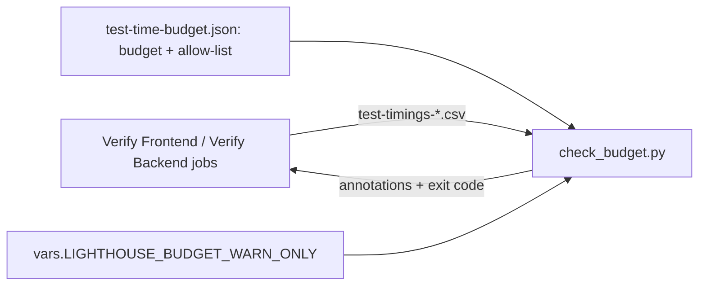

# Feature: story-6462-t4-test-budgets-fail-the-build

Story #6462 · T4 Test-time budgets fail the build instead of warning · part of Epic #6506 "Fast, reliable test suites"
(a Continuous Improvement Epic). Catalogue: [Epic workspace](../epic-6264-modular-monolith/feature-delta.md) ·
Brief: [slice-44](../epic-6264-modular-monolith/slices/slice-44-t4-test-budgets-fail-the-build.md).

DISCUSS: covered at Epic level (see the Epic's Wave Decisions, D-6264-3 and D-6264-4); waves start at DESIGN.

Picked up 2026-11-06 by `/continuous-improvement`, run under `/afk`. Maintainer's options: slices wrap up with refactor
and review, mutation once at the end; nothing is pushed; rigor profile `standard`.

## Wave: DISCUSS / [REF] Inherited

Link, do not copy. From the catalogue's `feature-delta.md`:

- How to pick up a Story; Story Map (G0b); Priority Rationale point 6
- Stories → Test-infrastructure track → T4, including its hand-off from FE7
- Outcome KPIs + guardrails; Wave Decisions; Risks / Open questions
- Improvement log: T2 #6460 ("FE7 and T4")

Also: `docs/evolution/story-6457-fe7-fast-frontend-tests/evolution.md` (Follow-ups) and
`docs/evolution/story-6513-t7-drop-sonar-coverage/evolution.md`, with the T4 contract in
`docs/feature/story-6513-t7-drop-sonar-coverage/feature-delta.md`.

## Wave: DISCUSS / [REF] DoR re-run

| # | DoR item | Status | Evidence |
|---|---|---|---|
| 1 | Problem statement, domain language | PASS | The backend budget cannot go red on a breach; the limits were measured on coverage runs and are looser on today's plain run. |
| 2 | Persona | PASS | `lighthouse-maintainer` and the parallel sessions that wait for CI's answer. |
| 3 | ≥ 3 examples, real data | PASS | Backend budget 34 s with 61 listed classes; frontend budget 63 s with 9 ceilings; per-test factor 3. |
| 4 | UAT | PASS (catalogue) | Scenarios are written at DISTILL. |
| 5 | AC derived from UAT | PASS | Brief's three AC, narrowed by the scope change below. |
| 6 | Right-sized | PASS | Size S; carpaccio at DESIGN. |
| 7 | Technical notes + cross-cutting | PASS | RBAC, Clients, Website, usage data, UI sketch: N/A, because this changes CI and test tooling only and nobody uses it in the product. |
| 8 | Dependencies | PASS | Soft T2, FE7 done; T7 done, so runs since 2026-11-04 14:00 UTC are plain. |
| 9 | Outcome KPIs | PASS | CI fails on the commit that adds an over-budget unit. |

## Wave: DISCUSS / [REF] Baseline re-count

Read from the files on `main` at `87ac968e7`, 2026-11-06.

| Brief says | Today |
|---|---|
| Both CI steps pass `--warn-only` | **Frontend already enforces**: `ci_frontend.yml` passes `--warn-only` only when the repository variable `LIGHTHOUSE_BUDGET_WARN_ONLY` is `true`. **Backend still always passes it** (`ci_backend.yml:187`) and has no such switch. |
| Re-derive both budgets, the large-file limit and every ceiling | Frontend per-file budget 63 s, 9 ceilings. Backend per-class budget 34 s, 61 ceilings. Per-test `LIMIT_FACTOR` 3 (`vitest.config.ts:13`). All measured on coverage runs. |
| At least 5 main runs | 10 `main` runs since T7. Timing artifacts: 9 frontend, 8 backend. Frontend runs 42127753201 and 42127795017 stopped at the first failure, so their timings are partial; check every run for completeness before using it. |

Scope change from the FE7 hand-off: the frontend half of "fail the build" is done. T4 keeps the backend half and one
recalibration of the frontend limits on the plain CI run. The brief is corrected at close-out.

Consequence for AC2: "at least 5 main runs after the change are green" can only be read after a push. This run holds
locally, so AC2 stays open at the hold.

## Checklist

- [ ] Behaviour-free: routes, DTOs, responses, pixels and topologies unchanged; existing tests stay green unmodified
- [ ] Ratchet in the same change: the budget fails the build, and a limit only tightens
- [ ] Baselines are inline lists, so a failure names the unit
- [ ] Moves separate from edits
- [ ] Every number in the brief re-measured (see above)
- [ ] Mutation last, on frozen code; the touched area's score does not drop
- [ ] `ARCHITECTURE.md` and any ADR whose decision changed updated with the code
- [ ] One context at a time (N/A, because no module moves)
- [ ] Terminology (N/A, because no user-facing term)
- [ ] Cross-cutting re-check answered: RBAC, Lighthouse-Clients, Website, usage-data event, UI sketch
- [ ] No user-facing release notes

## Wave: DESIGN / [REF] Decisions (propose mode, maintainer AFK, 2026-11-06)

Shape: CI tooling only (one Python script, one JSON file, two workflow steps, docs). No product code, no UI, no
bounded context. Recommended option taken for every engineering choice and recorded here. Every number is read from
the CI timing artifacts of the `main` runs listed below (downloaded into the session scratchpad, one folder per run,
treated as data), not remembered. The derivation reuses the rule of ADR-237 decisions 3 and 4 unchanged.

| # | Decision | Options | Chosen | Why / trade-off |
|---|---|---|---|---|
| D-6462-1 | Runs the numbers come from | any 10 runs / only complete plain runs | **Frontend: 7 runs. Backend: 8 runs.** See "Measurement" | The five-run minimum holds on both stacks. Runs that stopped early or never ran a stack are out. |
| D-6462-2 | When the backend budget starts failing | (a) now, with the re-derived list; (b) wait for five clean post-change runs, as ADR-237 decision 6 reads; (c) leave warn-only | **(a)**, with the proof moved to before the push: replay the new JSON against every CSV used (all exit 0) plus a planted slow unit per stack. AC2 (five green `main` runs) is read after the push. | (b) cannot be met: all 8 backend runs carry 3 budget warnings today (the budget has never held), and the five clean runs can only come after a corrected list is on `main`, so (b) would wait for ever. (c) is the story's problem. The escape switch covers a wrong guess (D-6462-3). ADR-237 gets an amendment (D-6462-12). |
| D-6462-3 | Escape switch for the backend | reuse `LIGHTHOUSE_BUDGET_WARN_ONLY`; a second variable; no switch | **Reuse the one variable for both stacks** (empty, unset or `false` enforces; `true` warns; anything else fails) | One decision, one knob, and the frontend already ships it (`vars.LIGHTHOUSE_BUDGET_WARN_ONLY`, unset today, verified with `gh variable list`). Two variables would let one stack be silenced and the other forgotten. No switch means a wrong limit on a slow-runner day is only fixable with a commit while `main` is red. |
| D-6462-4 | Where the switch is read | keep the `case` block in the frontend YAML and copy it into the backend YAML; read the variable inside `check_budget.py` | **Inside `check_budget.py`** (`--warn-only` stays and wins; the variable is read when the flag is absent; any other value is a "cannot judge" error naming the variable, exit 2) | The rule would otherwise live twice in bash, where nothing tests it. In the script it is one function with unit tests next to the other switch tests, and both steps shrink to one command. Cost: the frontend step changes too, though its behaviour does not. |
| D-6462-5 | Slow-runner headroom factor | keep 2.1; use the measured figure; use a fixed 1.5 | **Keep 2.1** (ADR-237's rule, B at least 2.1 x L, ceiling at least 2.1 x largest seen) | Measured slow-to-fast ratio is 1.89 at most for frontend files of 8 s or more, 1.68 for backend classes of 8 s or more, 1.62 for a whole frontend run (649 s to 1054 s); only sub-3 s single tests reach 2.5, far under their 6 s limit. All sit under 2.05, so the rule's factor is confirmed, not loosened. Applying it to the largest time seen (which already includes slow-mode runs) is conservative; a tighter factor is an open question (Q3), not a silent change. |
| D-6462-6 | Frontend per-file budget and nine ceilings | derive by rule; keep 63 | **B = 56 s, allow-list empty** (63 to 56) | Largest file over 7 runs: 26.53 s (`ModifyTeamSettings.refinementNeed`, slow-mode run 41953376165). 2.1 x 26.53 = 55.7, so B at least 56; regression anchor 0.55 x 115 s = 63.3, so B at most 63. All nine old entries now sit at 11.8 s or less to 26.5 s: every one fits the budget. |
| D-6462-7 | Backend per-class budget and list | keep 34 / raise / lower | **B = 34 s unchanged; list 61 to 43 entries, every ceiling = 2.1 x largest seen, rounded up** | 34 is anchored on the 62 s thread-pool stall it must catch (0.55 x 62, ADR-237 amendment 2026-10-15); it can only go down. Lowering adds entries: B = 26 needs 62 entries, B = 20 needs 82. The old allow-list had drifted both ways: 42 entries now fit the budget, 24 classes need a new one. |
| D-6462-8 | Per-test `LIMIT_FACTOR` | tighten to 2, keep 3, loosen to 3.1 | **Keep 3** (limit 6 s, 6.31 s for a file's first test); `slowTests.ts` untouched | Largest unlisted test over 7 runs: 2.95 s (`ModifyTeamSettings.readiness`). 2.1 x 2.95 = 6.2 s, so factor 2 (4 s) would trip on a slow runner. 3 sits at 2.03 x, 3 percent under the rule: noted, not loosened, no test has come near it in seven runs. The three per-test ceilings in `slowTests.ts` all pass with more than 2 x headroom and are outside the brief; see Q6. |
| D-6462-9 | Loosening the measurement forces | hide it / flag it | **Flag it** (Q1): 3 existing backend ceilings loosen (Jira connector 127 to 177, ServiceNow 79 to 92, Jira write-back 67 to 76), 24 classes get a new entry, 4 of which (`JiraOriginalNamesLiveTest`, `CategoryListNormalisationSeederOnBothProvidersTests`, `ConnectionFieldChange.Slice01...`, `ConnectionDefaultsUpgradeMigrationTests`) already exceed 34 s on `main` today and would otherwise turn it red | Limits only tighten except where the measurement says otherwise; each of those lines is a reviewed diff in the one JSON file. Everything else tightens: 16 existing entries shrink (largest: `Slice05Reconstruct...` 462 to 214), 42 are dropped, frontend loses nine. |
| D-6462-15 | Revision of D-6462-9, taken by the orchestrating session on 2026-11-06, open to the maintainer's veto | loosen as measured / tighten-only | **Tighten-only.** The three existing ceilings stay at 127, 79 and 67 s: `/continuous-improvement` says a ratchet is never loosened, and their largest time seen (84.0, 43.7, 36.0 s) fits with 1.5 x to 1.9 x headroom. Only the 4 classes already over 34 s get a new entry (524, 184, 101, 86 s), because enforcing would otherwise be red from the first push. The other 20 proposed entries are dropped. | Backend list is **23** entries: 16 tightened, 3 unchanged, 4 new, 42 dropped. Cost, accepted knowingly: those 20 classes sit under the 34 s budget with 1.16 x to 2.0 x headroom, `SkipUnchangedForecasts.Slice01InputChangeScenarios` (29.2 s) the thinnest, so a slow runner can turn one red. The warn-only switch is the answer if it does. |
| D-6462-10 | The ratchet | only the budget / budget plus two checks | **Two deterministic checks in `check_budget.py`**: (1) an entry whose ceiling is not above the budget is "not needed" (both stacks); (2) a frontend file that ran under a quarter of the budget (under 14 s) while allow-listed is "not needed". Both fail, naming the entry, like a stale one does. | (2) reuses the quarter rule the per-test guard already uses to retire an entry. It cannot flap: a file under 14 s is under 29 s on a runner 2.05 x slower, which is under 56. **No backend equivalent**: backend class sets vary per run (`JiraWriteBackTest` ran 1 of its 17 tests in run 41852137825 and took 0.0008 s), so a small sum proves nothing; backend entries leave by the re-derivation recipe in `ci-learnings.md`. |
| D-6462-11 | A script that derives the limits | commit the derivation script / write the recipe | **Write the recipe, commit no script** | The derivation is 40 lines of throw-away analysis done once per runner-population change. A committed tool needs tests and an owner for something run twice a year. Revisit if Q3 is taken. |
| D-6462-12 | ADRs | new ADR / amend | **Amend ADR-237** (decision 6: the backend flips with the recalibration, proof by replay plus five green runs after the push; decision 4: the two new entry checks; the 2026-10-15 "derive again" is done and recorded) and add a one-line status note to ADR-268 (the per-file allow-list now fails when an entry is not needed, where a run can judge it). ADR-269 (frontend layer rules) is not touched. | Decision 6 changes, so the ADR changes; no new decision is large enough for a new ADR. Written at finalization, not in this wave. |
| D-6462-13 | Mutation testing | Stryker per feature | **N/A, because** the change is Python, JSON and YAML and Stryker here covers C# and TypeScript. The Python script is covered by the stdlib `unittest` set that CI runs before every check, and the planted-slow-unit demonstration (below) is the manual proof. | Per CLAUDE.md the strategy is per feature for C# and TS; nothing of either changes. |
| D-6462-14 | Cross-cutting | RBAC, Clients, Website, usage data, UI sketch, loading and failure states, context map, terminology, release notes, improvement backlog | **All N/A, because** this changes CI test tooling that no user of the product sees. Usage-data event: none, because nobody uses a CI budget. Context map and `ARCHITECTURE.md` §4: no concept, context or edge changes. Improvement backlog check: N/A, because this Story is itself an item of the Continuous Improvement Epic #6506. | No silent N/A: each carries its reason. |

### Measurement

Runs, from the ten asked for (`gh run view`, artifacts `test-timings-frontend` and `test-timings-backend`):

| Run | Date (UTC) | Frontend | Backend | Note |
|---|---|---|---|---|
| 42232786032 | 11-06 14:18 | **used** (649 s) | **used** (2735 s) | fast-mode frontend |
| 42127795017 | 11-05 23:12 | excluded: 476 rows, stopped at first failure | **used** (backend job failed one test; units with a failed test left out for that run) | |
| 42127753201 | 11-05 23:12 | excluded: 476 rows, stopped at first failure | none (backend skipped) | |
| 41953376165 | 11-05 02:09 | **used** (1054 s) | none (backend skipped) | slow-mode frontend, source of L |
| 41923442666 | 11-04 22:14 | **used** (763 s) | **used** (2863 s) | |
| 41904560367 | 11-04 20:13 | **used** (758 s) | **used** (backend job failed two tests; those units left out for that run) | |
| 41884787953 | 11-04 18:12 | **used** (793 s) | **used** (2726 s) | |
| 41852137825 | 11-04 14:53 | none (frontend skipped) | **used** (2298 s, 258 rows fewer than its neighbours: most live-connector classes did not run) | |
| 41845404684 | 11-04 14:13 | **used** (995 s) | **used** (2843 s) | slow-mode frontend |
| 41845012379 | 11-04 14:11 | **used** (673 s) | **used** (2685 s) | earliest |

- **Frontend: 7 runs** (41845012379, 41845404684, 41884787953, 41904560367, 41923442666, 41953376165, 42232786032), 9419 to 9438 passed or skipped tests each, 609 to 613 files, every row `Passed` or `Skipped`.
- **Backend: 8 runs** (41845012379, 41845404684, 41852137825, 41884787953, 41904560367, 41923442666, 42127795017, 42232786032), 12655 to 12900 rows each. A unit with a `Failed` test in a run is left out of that run: the failed rows were a 60 s timeout in `JiraWorkTrackingConnectorTest` (run 41904560367, which had inflated that class to 141 s) and two quick failures, none of them a speed figure. The backend step runs only after a green test step, so a red run is never judged anyway.
- **The earliest runs are plain.** T7's two commits (`acd6cbd2a` backend, `638a9bae9` frontend, 2026-11-04 14:39 +01:00) are ancestors of the first run's commit `0c559c8e9` (14:10 UTC), and at that commit the only "coverage" left in the two workflow files is a comment. Timing artifacts cannot show coverage, so this rests on the commits.
- **Bimodal runner, measured.** Frontend whole-run total: 649, 673, 758, 763, 793 (the same commits repeat within a mode), 995, 1054 s: slow to fast is 1.62. The largest file moves with it: 16.7 s (fast) to 26.5 s (slow). Backend totals are tighter for the same test set (2556 to 2883 s, 1.13). Per unit of 8 s or more, max over min: frontend median 1.69, largest 1.89 (16 files); backend median 1.13, p90 1.39, largest 1.68 (75 classes). Single tests of 0.5 s or more (180 of them): median 1.67, p99 2.47, largest 2.51; the largest unlisted test (2.95 s) moved 2.2 to 2.95.
- **What headroom a slow-runner run needs.** The measured slow-to-fast ratio of the units that decide B is 1.7 to 1.9, and the rule asks 2.1 on top of the largest time seen, which already includes slow-mode runs. So a run on a runner as slow as the slowest seen has 2.1 x headroom and one 2.05 x slower than the slowest seen still passes. No change to 2.1 is needed for safety; whether it is wider than needed is Q3.

Today's state against the old limits (the replay of the real script on the latest `main` run 42232786032, `--warn-only`):

- Frontend: exit 0, nothing over 63 s, largest file 16.7 s in that run. All 9 allow-list entries are under the 63 s budget in every run (largest of any entry: 26.5 s against a ceiling of 97).
- Backend: three classes over 34 s on `main` today and nothing says so in a red build: `ConnectionFieldChange.Slice01FieldChangeUpdatesItsOwnersTest` 41.6 s, `CategoryListNormalisationSeederOnBothProvidersTests` 63.1 s, `JiraOriginalNamesLiveTest` 249.5 s. Run 41852137825 adds `ConnectionDefaultsUpgradeMigrationTests` 36.0 s. These sit in every run, so ADR-237 decision 6's "five runs with zero warnings" has been met by none of the 8 runs.
- Near the budget, still under it: `SkipUnchangedForecasts.Slice01InputChangeScenarios` 29.2 s, `Story6084HistoryFillAlwaysOnTest` 26.6 s, `BlockedRuleSetMigrationTests` 25.9 s; 20 more backend classes between 16.6 s and 25 s without an entry.
- Stale entries: none by the script's meaning (all 61 classes still exist in source). By measurement: 42 of 61 backend entries and 9 of 9 frontend entries no longer need one.

## Wave: DESIGN / [REF] Derivation of every budget

### Rule (ADR-237 decisions 3 and 4, unchanged)

- B at least 2.1 x L, where L is the largest unit not on the allow-list over the runs.
- B at most 0.55 x the smallest regression it must catch.
- Units above B / 2.1 go on the allow-list, each with a reason and a ceiling of at least 2.1 x its largest time seen. Ceilings are rounded up to a whole second.

### Frontend per-file budget: 63 s to 56 s, nine ceilings to none

- Anchor: 0.55 x 115 s = 63.3, so B at most 63.
- L = 26.53 s (`ModifyTeamSettings.refinementNeed.test.tsx`, run 41953376165). 2.1 x 26.53 = 55.7, so B at least 56.
- 56 satisfies both. B / 2.1 = 26.7 s and no file is above it, so the allow-list is empty.

| File | Old ceiling | Min | Median | Max over 7 runs | 2.1 x max | Verdict at B = 56 |
|---|---|---|---|---|---|---|
| `WorkItemsDialog.contexts.test.tsx` | 182 | 6.6 | 8.1 | 11.8 | 24.8 | drop (fits the budget) |
| `RefinementView.paging.test.tsx` | 100 | 3.5 | 4.4 | 7.0 | 14.7 | drop (fits the budget) |
| `ModifyTeamSettings.refinementNeed.test.tsx` | 97 | 16.7 | 20.5 | 26.5 | 55.7 | drop (fits the budget) |
| `ModifyTeamSettings.readiness.test.tsx` | 78 | 14.9 | 17.7 | 22.9 | 48.0 | drop (fits the budget) |
| `OverviewDashboard.test.tsx` | 77 | 11.8 | 14.3 | 22.0 | 46.1 | drop (fits the budget) |
| `RefinementView.comments.test.tsx` | 77 | 8.3 | 11.0 | 15.6 | 32.8 | drop (fits the budget) |
| `ReportsTab.createWizard.test.tsx` | 74 | 10.4 | 12.7 | 17.5 | 36.7 | drop (fits the budget) |
| `BaseMetricsView.loading.test.tsx` | 68 | 12.8 | 16.3 | 21.7 | 45.5 | drop (fits the budget) |
| `RefinementView.votes.test.tsx` | 67 | 8.5 | 10.9 | 14.7 | 30.9 | drop (fits the budget) |

Next files, unlisted: `ReportsPage.combinedPdf` 21.0 s, `ReportsPage.removal` 20.2 s, `ModifyTeamSettings.test` 17.6 s.
The budget's own slack: it catches a file that grows past 56 s, 3.4 x the fast-mode time of the worst file. A budget
lower than 56 needs the four slowest files faster first (Q4).

### Backend per-class budget: 34 s unchanged, 61 entries to 43

- Anchor: 0.55 x 62 s (the thread-pool stall) = 34.1, so B at most 34. B / 2.1 = 16.2 s.
- Every class whose largest time seen is above 16.2 s gets an entry at ceil(2.1 x max). The largest class without
  an entry is 16.2 s, and 2.1 x 16.2 = 34.0.
- Sweep for the record (entries needed for each B, same rule): B = 20 needs 82; 26 needs 62; **34 needs 43**; 40 needs 29; 50 needs 20; 60 needs 16. Today's 34 is the lowest budget that does not grow the list past what it was.
- Result: 19 old entries stay (16 tighten, 3 loosen), 24 new entries, 42 old entries drop.
- **Revised by D-6462-15**: the table below is the measurement, not the final list. The final list keeps the three "loosens" rows at their old ceiling and, of the rows marked new, only `JiraOriginalNamesLiveTest`, `CategoryListNormalisationSeederOnBothProvidersTests`, `ConnectionFieldChange.Slice01FieldChangeUpdatesItsOwnersTest` and `ConnectionDefaultsUpgradeMigrationTests`.
- Reasons for new entries use the wording already in the file: "boots the app in a test host and creates and seeds a database for every scenario" for `API.Integration.*`, "starts a fresh Postgres container and applies every migration to prove the schema on a real provider" for `Integration.Containers.*`, "calls the live work tracking system over the network; runs only when that connector's code changes" for `JiraOriginalNamesLiveTest`.

Entries after T4 (largest-first; "Runs" is the number of runs the class appeared in, a class with a failed test is left out of that run):

| # | Class | Runs | Min | Median | Max | New ceiling | Old | Change |
|---|---|---|---|---|---|---|---|---|
| 1 | `Services.Implementation.WorkTrackingConnectors.Jira.JiraOriginalNamesLiveTest` | 6 | 171.0 | 175.9 | 249.5 | 524 | - | **new** |
| 2 | `API.Integration.PercentilesOverTime.Slice07WhereTheLimitsActuallyMovedTest` | 8 | 90.1 | 102.6 | 108.8 | 229 | 386 | tightens |
| 3 | `API.Integration.PercentilesOverTime.Slice05ReconstructCycleTimeHistoryTest` | 8 | 92.2 | 96.0 | 101.8 | 214 | 462 | tightens |
| 4 | `Integration.Containers.CategoryListNormalisationSeederOnBothProvidersTests` | 8 | 63.1 | 83.2 | 87.3 | 184 | - | **new** |
| 5 | `Services.Implementation.WorkTrackingConnectors.Jira.JiraWorkTrackingConnectorTest` | 6 | 71.4 | 77.3 | 84.0 | 177 | 127 | **loosens** |
| 6 | `API.Integration.PercentilesOverTime.Slice06EveryPercentileTabSpansTheSamePeriodTest` | 8 | 51.1 | 52.5 | 57.3 | 121 | 255 | tightens |
| 7 | `Services.Implementation.Encryption.SecretCustodyServiceTests` | 8 | 48.6 | 51.3 | 52.8 | 111 | 211 | tightens |
| 8 | `API.Integration.ConnectionFieldChange.Slice01FieldChangeUpdatesItsOwnersTest` | 8 | 41.6 | 43.5 | 48.0 | 101 | - | **new** |
| 9 | `Services.Implementation.WorkTrackingConnectors.ServiceNow.ServiceNowWorkTrackingConnectorIntegrationTest` | 7 | 23.3 | 28.8 | 43.7 | 92 | 79 | **loosens** |
| 10 | `API.Integration.FasterUpdates.Slice05FetchFingerprintTest` | 8 | 39.4 | 41.1 | 43.1 | 91 | 239 | tightens |
| 11 | `Integration.Containers.ConnectionDefaultsUpgradeMigrationTests` | 8 | 32.9 | 36.5 | 40.8 | 86 | - | **new** |
| 12 | `Services.Implementation.WorkTrackingConnectors.AzureDevOps.AzureDevOpsWorkTrackingConnectorTest` | 7 | 26.9 | 34.1 | 39.3 | 83 | 98 | tightens |
| 13 | `API.Integration.ForecastRealityCheck.Slice01OneSentenceAboutYourSamplingWindowTest` | 8 | 33.7 | 35.2 | 37.0 | 78 | 173 | tightens |
| 14 | `Services.Implementation.WorkTrackingConnectors.Jira.JiraWriteBackTest` | 8 | 0.0 | 32.3 | 36.0 | 76 | 67 | **loosens** |
| 15 | `Services.Implementation.Encryption.PublishedKeySecretCountTests` | 8 | 27.5 | 29.1 | 30.2 | 64 | 150 | tightens |
| 16 | `API.Integration.SkipUnchangedForecasts.Slice01InputChangeScenarios` | 8 | 26.3 | 27.3 | 29.2 | 62 | - | **new** |
| 17 | `Services.Implementation.Encryption.ReferencedKeyIdsTests` | 8 | 24.1 | 25.5 | 26.7 | 57 | 131 | tightens |
| 18 | `API.Integration.BehaviourSettings.Story6084HistoryFillAlwaysOnTest` | 8 | 21.9 | 24.6 | 26.6 | 56 | - | **new** |
| 19 | `Integration.Containers.BlockedRuleSetMigrationTests` | 8 | 22.9 | 23.7 | 25.9 | 55 | - | **new** |
| 20 | `Integration.Containers.BlockedCountSnapshotMigrationTests` | 8 | 19.7 | 21.2 | 25.1 | 53 | 117 | tightens |
| 21 | `Integration.Containers.DeliveryMetricSnapshotDayKeyMigrationTests` | 8 | 16.9 | 19.3 | 23.4 | 50 | - | **new** |
| 22 | `Integration.Containers.LighterRoundsOnPostgresTests` | 8 | 17.2 | 22.5 | 23.2 | 49 | - | **new** |
| 23 | `API.Integration.ConfigureOncePerConnection.Slice05bReferencedFieldsAndOlderPayloadsScenarios` | 8 | 19.2 | 20.9 | 22.7 | 48 | - | **new** |
| 24 | `API.Integration.ConfigureOncePerConnection.Slice02NamedLinkThatMatchedNothingScenarios` | 8 | 19.7 | 20.6 | 22.1 | 47 | - | **new** |
| 25 | `Services.Implementation.Encryption.ReadableSecretsNotOnTheActiveKeyTests` | 8 | 18.8 | 20.9 | 21.9 | 46 | 103 | tightens |
| 26 | `API.Integration.PercentilesOverTime.Story6084TheFillRunsEverywhereTest` | 8 | 18.5 | 20.3 | 21.8 | 46 | - | **new** |
| 27 | `Integration.Containers.BlockedDurationMigrationTests` | 8 | 17.5 | 18.4 | 21.0 | 45 | 52 | tightens |
| 28 | `Integration.Containers.CatalogueBodiesOnPostgresTests` | 8 | 14.5 | 19.2 | 20.4 | 43 | - | **new** |
| 29 | `API.Integration.ConfigureOncePerConnection.Slice04AzureDevOpsDependenciesFromANamedRelationEndScenarios` | 8 | 16.9 | 17.8 | 19.3 | 41 | - | **new** |
| 30 | `API.Integration.FasterUpdates.Slice03JiraCloudPortfolioDeltaTest` | 8 | 17.2 | 17.8 | 19.0 | 40 | 88 | tightens |
| 31 | `API.Integration.OnlyFeaturesAsParentCandidates.Slice01NarrowToFeaturesTest` | 8 | 17.2 | 17.8 | 18.8 | 40 | - | **new** |
| 32 | `API.Integration.TeamFeatureSize.Slice01TeamFeatureSizeTest` | 8 | 17.3 | 17.8 | 18.8 | 40 | 101 | tightens |
| 33 | `API.Integration.ConfigureOncePerConnection.Slice06DefaultChangeUpdatesTheFollowersScenarios` | 8 | 15.6 | 16.6 | 18.4 | 39 | - | **new** |
| 34 | `API.Integration.ConfigureOncePerConnection.Slice12EstimationDefaultScenarios` | 8 | 15.7 | 16.9 | 18.4 | 39 | - | **new** |
| 35 | `API.Integration.SkipUnchangedForecasts.Slice01UserPressScenarios` | 8 | 16.8 | 17.3 | 18.3 | 39 | - | **new** |
| 36 | `Integration.Containers.EmbedSessionSingleUseConcurrencyTests` | 8 | 12.4 | 13.8 | 17.9 | 38 | - | **new** |
| 37 | `API.Integration.Dependencies.Slice02DependencyDetailTest` | 8 | 16.4 | 16.7 | 17.6 | 38 | 71 | tightens |
| 38 | `API.Integration.Refinement.Slice13ReadinessTest` | 8 | 15.7 | 16.0 | 17.4 | 37 | 124 | tightens |
| 39 | `API.Integration.CategoryListsHoldRawStatesSettingsIntegrationTest` | 8 | 13.9 | 15.2 | 17.1 | 36 | - | **new** |
| 40 | `Integration.Containers.ProcessBehaviorSnapshotMigrationTests` | 8 | 12.2 | 16.1 | 17.0 | 36 | - | **new** |
| 41 | `Integration.Containers.ScalabilityTests` | 8 | 10.0 | 12.0 | 16.8 | 36 | - | **new** |
| 42 | `Integration.Containers.ConcurrentStartupMigrationTests` | 8 | 11.3 | 15.2 | 16.6 | 35 | - | **new** |
| 43 | `API.Integration.ConfigureOncePerConnection.Slice11PortfoliosFeatureOwnerFieldDefaultScenarios` | 8 | 14.6 | 15.4 | 16.6 | 35 | - | **new** |

The `Min` of 0.0 for `JiraWriteBackTest` is run 41852137825, where one of its 17 tests ran. The same shows why the
backend gets no runtime "not needed" check (D-6462-10).

Old entries that drop (2.1 x largest time seen is at most 34 s):

| Class | Old ceiling | Largest time seen (s) |
|---|---|---|
| `API.Integration.SleRisk.Slice01SleRiskReadTest` | 86 | 16.2 |
| `Integration.Containers.BlockedStalenessThresholdMigrationTests` | 35 | 15.5 |
| `API.Integration.HealthCheckIntegrationTest` | 37 | 15.3 |
| `API.Integration.RunChartPayloadContractIntegrationTest` | 59 | 14.9 |
| `API.Integration.DependencyAwareForecasting.Slice00OneForecastPerBatchScenarios` | 59 | 14.8 |
| `API.Integration.MetricsEndpointIntegrationTest` | 69 | 14.6 |
| `API.Integration.PercentilesOverTime.Slice10OnlyWhatTheTeamStillKeepsTest` | 61 | 14.2 |
| `API.Integration.DeliverySources.Slice04ForecastPublishingTest` | 60 | 14.1 |
| `API.Security.S8_EmbedEntryPointTests` | 163 | 12.6 |
| `API.Integration.DeliverySources.Slice03BrokenSourceTest` | 45 | 12.1 |
| `API.Integration.Refinement.Slice11CastAVoteTest` | 74 | 11.7 |
| `API.Integration.ManualSorting.Slice03RelativeMovesTest` | 55 | 11.1 |
| `API.Integration.Reports.Slice01TeamReportScenarios` | 68 | 11.0 |
| `API.Integration.Refinement.Slice03StageRulesTest` | 62 | 10.8 |
| `API.Integration.Refinement.Slice04RefinementCadenceTest` | 58 | 10.4 |
| `API.Integration.TaskManager.Slice06TheWarningsWithoutTheLogTest` | 37 | 10.4 |
| `API.Integration.Refinement.Slice12CommentsTest` | 62 | 9.9 |
| `API.Integration.QuietWriteBack.Slice01WriteBackCollectionTest` | 44 | 9.6 |
| `API.Integration.Refinement.NeedOverOneCycleTest` | 52 | 9.2 |
| `API.Integration.TaskManager.Slice08HealthThatChecksItselfTest` | 56 | 9.1 |
| `API.Integration.WorkItemEstimateApiIntegrationTest` | 40 | 8.7 |
| `API.Integration.ShutdownIntegrationTest` | 46 | 8.6 |
| `API.Integration.BehaviourSettings.Slice02OneListOfSwitchesTest` | 36 | 8.4 |
| `API.Integration.Refinement.Slice05NeedAndVerdictTest` | 39 | 8.2 |
| `API.Integration.ManualSorting.Slice02ManualRankTest` | 45 | 7.9 |
| `API.Integration.TeamFeatureSize.Slice02TeamFeatureSizePercentilesTest` | 47 | 7.7 |
| `API.Integration.PercentilesOverTime.Slice03bDateRangeTest` | 52 | 7.5 |
| `API.Integration.PercentilesOverTime.Slice08NothingToShowTest` | 45 | 7.4 |
| `API.Integration.Reports.Slice02ThenInThePastScenarios` | 44 | 7.0 |
| `API.Integration.FastWithManyFeatures.Slice01ForecastRoundsRunOnTheirOwnThreadsScenarios` | 150 | 7.0 |
| `API.Integration.BlockedItems.Slice05PredefinedFieldTest` | 35 | 6.7 |
| `API.Integration.Refinement.Slice07BandPercentilesTest` | 40 | 6.1 |
| `API.Integration.TaskManager.Slice04StopARefreshTest` | 95 | 5.7 |
| `API.Integration.NamedCycleTimeTrendInfoApiIntegrationTest` | 41 | 5.2 |
| `Integration.UsageData.OptionalFeatureToggledEventTests` | 37 | 5.1 |
| `API.Integration.Dependencies.Slice04DependencySettingsTest` | 40 | 4.9 |
| `Integration.UsageData.Slice04ProductEventsTests` | 57 | 4.9 |
| `API.Integration.ResponsiveDuringUpdates.Slice05CancelAllScenarios` | 60 | 3.3 |
| `Services.Implementation.Forecast.ForecastServiceTest` | 36 | 2.2 |
| `API.Integration.PercentilesOverTime.Slice09TheFillShipsOptInTest` | 165 | 1.8 |
| `Architecture.OptionalFeatureApplierSeamArchUnitTest` | 67 | 0.1 |
| `Health.ClusterSubstrateProbeRegistrationTest` | 35 | 0.0 |

### Per-test guard: `LIMIT_FACTOR` stays 3

- Limit today: `BUDGET_SECONDS` 2 x `LIMIT_FACTOR` 3 = 6 s (plus 0.31 s for a file's first test) on every CI run.
- Largest test not on `slowTests.ts` over 7 runs: 2.95 s (`ModifyTeamSettings.readiness`, "switches a rule that was refused ... back on at its last allowed threshold"; 2.21 to 2.95 s). Next: 2.72 s, 2.48 s.
- Rule: limit at least 2.1 x 2.95 = 6.2 s. 6.0 is 2.03 x; with the first-test allowance 6.31 is 2.14 x. Factor 2 gives 4 s and fails the rule; 3.1 would satisfy it to the digit. **Decision: 3 stays.** The measurement neither supports a tighter factor nor proves a looser one is needed (no test came near 6 s in 7 runs, three of them slow-mode); flagged, not loosened.
- The CSV cannot tell which test is first in its file, so the allowance is judged conservatively: left out for the figures above.
- `slowTests.ts` entries on CI (limit = ceiling x 3): `RefinementView.paging` max 5.96 s against 15; `WorkItemsDialog.paging` 3.43 s against 10.5; `ThirdPartyPackagesSection.paging` 1.91 s against 7.5. The third fits under the plain 6 s limit on CI. Not changed in this Story (outside the brief; they are quiet-machine ceilings that only a local run can set). Q6.

## Wave: DESIGN / [REF] Before and after

| | Before | After |
|---|---|---|
| Backend budget step | always `--warn-only`; 3 to 4 classes over 34 s on every `main` run, build green | fails the build; `LIGHTHOUSE_BUDGET_WARN_ONLY=true` softens it |
| Frontend budget step | fails the build; `case` block in the YAML parses the variable | fails the build; the script parses the variable; one command |
| Frontend per-file budget | 63 s, 9 ceilings (97 to 182 s) | **56 s, no ceilings** |
| Backend per-class budget | 34 s, 61 ceilings | **34 s, 23 ceilings**: 4 new, 16 tightened, 3 unchanged, 42 gone |
| Per-test `LIMIT_FACTOR` | 3 | 3 (measured; see above) |
| Entry that is not needed | not detected (only a missing unit is "stale") | fails: ceiling not above budget (both stacks), frontend file under 14 s |
| Why the numbers are what they are | ADR-237 amendment of 2026-10-15, coverage runs | this document, plain CI runs; recipe in `ci-learnings.md` |

## Wave: DESIGN / [REF] Component decomposition and Reuse Analysis



| File | Change | Notes |
|---|---|---|
| `Scripts/test-timings/test-time-budget.json` | MODIFY (data) | Frontend: `budget_seconds` 56, `allowlist` empty. Backend: 43 entries, ceilings as in the table above, existing reasons kept. |
| `Scripts/test-timings/check_budget.py` | MODIFY | `warn_only_requested(env, flag) -> bool` (pure; flag wins, then the variable, else enforce; other values raise `CannotJudge`); `unneeded_entries(stack, rows, budget, ceilings) -> list[str]` (pure; ceiling not above the budget, or frontend file under budget / 4); one extra annotation line, same escaping as the stale one. `_check` returns 1 on stale or unneeded as well. |
| `Scripts/test-timings/tests/test_check_budget.py` | MODIFY (extend `BudgetCheckTestCase` classes) | Rows below. |
| `.github/workflows/ci_backend.yml` | MODIFY | Budget step: `env:` with the variable, no `--warn-only`, comment rewritten. |
| `.github/workflows/ci_frontend.yml` | MODIFY | Budget step: drop the `case` block for one command with the same `env:`; comment says the limits are measured on plain runs. Line 17 comment unchanged. |
| `Lighthouse.Frontend/vitest.config.ts`, `src/tests/timeBudget/*` | UNCHANGED | `LIMIT_FACTOR` stays 3. |
| `docs/ci-learnings.md` | MODIFY (lines 439 to 444) | Both stacks fail; one switch; the derivation recipe (below) and the ledger rule "an allow-listed entry that is not needed is removed in the same change". |
| `docs/product/architecture/adr-237-test-time-budget-guard.md` | MODIFY (amendment) | D-6462-12. At finalization. |
| `docs/product/architecture/adr-268-...only-ever-shrinks.md` | MODIFY (one status line) | At finalization. |

Reuse Analysis:

| Need | Existing | Verdict | Why |
|---|---|---|---|
| Fail the build on an over-budget unit | `check_budget.py` `judge`, `Finding`, annotations | **EXTEND** | Already does it; only the backend step turns it off. |
| Read the escape variable | the frontend YAML `case` block | **EXTEND** (move into the script) | One tested function replaces two untestable bash blocks (D-6462-4). |
| Detect an entry that is not needed | `stale_entries` and `stale_annotation` | **EXTEND** | Same list-the-name, fail-in-both-directions shape as ADR-268; one more reason. |
| Retire rule for a fast test | per-test guard's "under a quarter of the budget" | **EXTEND** (reuse the rule, not the code) | Different language; same figure, one source of truth for the number in the ADR. |
| Derive the limits | `summarise.py` shows one run | **No new tool** | D-6462-11. |
| Shared workflow step for both stacks | none | **No new composite action** | Two call sites differing in stack and source root; after D-6462-4 each is five lines. |

Nothing is CREATE NEW.

### Tests to add (extend the existing `unittest` classes, no scenario tags)

- Switch: flag alone warns; variable `true` alone warns; empty, unset and `false` enforce; `TRUE`, `1`, `yes` exit 2 naming the variable; flag wins over `false`.
- Backend: a planted class over 34 s outside the list fails the check (the end-to-end proof of AC1); the same under `true` passes with a warning annotation.
- Not needed: an entry with ceiling equal to the budget, and one below it, fails on both stacks; a frontend entry whose file ran at 13.9 s fails and at 14.0 s passes (budget 56); a backend entry whose class ran 0.0 s or one test passes.
- Proposed repository files stay as the single source: the shipped `test-time-budget.json` is also loaded by one test and must satisfy the rules above (ceilings above the budget, no duplicates, every backend class declared in source). This catches a hand edit before CI does.

### Proposed YAML (backend; the frontend step is the same with its stack and no `--source-root`)

```yaml
    # A test class over its time budget fails the build. To report it as a warning instead, set the
    # repository variable LIGHTHOUSE_BUDGET_WARN_ONLY to true; empty, unset or false enforces. Any
    # other value fails this step. The limits are measured on plain runs in test-time-budget.json.
    - name: Check test-time budget
      env:
        LIGHTHOUSE_BUDGET_WARN_ONLY: ${{ vars.LIGHTHOUSE_BUDGET_WARN_ONLY }}
      run: |
        python3 --version
        python3 -m unittest discover -s Scripts/test-timings/tests
        python3 Scripts/test-timings/check_budget.py --stack backend --csv test-timings-backend.csv --source-root Lighthouse.Backend/Lighthouse.Backend.Tests
```

### The ratchet

- The budget fails the build in both stacks (AC1), in the same change that corrects the limits.
- A limit only tightens by hand, and the loosenings are named (D-6462-9): every entry is one line in a reviewed file.
- An entry leaves when it is not needed: ceiling no longer above the budget (both stacks), frontend file under a quarter of the budget. A stale (gone) entry already fails.
- Re-derivation recipe, written into `ci-learnings.md`: download `test-timings-<stack>` from at least five complete `main` runs that include both a fast and a slow runner day; leave out partial runs (frontend CSV under about 9000 rows; a unit with a failed test in that run); L is the largest unit time seen; `B >= 2.1 x L`, `B <= 0.55 x` the regression to catch; move units above B / 2.1 to the allow-list at ceil(2.1 x max); re-derive when the runner population changes or a slow file is fixed.
- Not ratcheted automatically, and said so: ceilings that are looser than needed (nothing compares them with the next run) and the budget itself. A follow-up could print a notice when the largest unit is far under B / 2.1 (Q3, Q4).

## Wave: DESIGN / [REF] Carpaccio slices

Two slices of half a day, then a wait. Commit split follows the slice boundary ritual: one focused commit per step, moves
apart from edits; nothing is pushed.

| Slice | Step | Delivers | Commit |
|---|---|---|---|
| 1. The check owns the switch and knows what is not needed (about 0.5 day) | 1-1 | `warn_only_requested` and its tests; the script reads `LIGHTHOUSE_BUDGET_WARN_ONLY` | `feat(test-infra): the budget check reads its warn-only switch itself` |
| | 1-2 | `unneeded_entries`, annotation, tests; the test that loads the shipped JSON and holds it to the same rules (green on today's file too) | `feat(test-infra): a budget allow-list entry that is not needed fails the check` |
| 2. Measured limits, then enforcement (about 0.5 day) | 2-1 | New `test-time-budget.json` (frontend 56 and empty; backend 23 entries, see D-6462-15); replay on all 7 frontend and 8 backend CSVs, every one exit 0; planted slow unit failing on each stack | `fix(test-infra): set the time budgets from plain CI runs` |
| | 2-2 | Both workflow steps: backend loses `--warn-only`, frontend loses the `case`, comments rewritten | `ci(test-infra): the backend time budget fails the build` |
| 3. Close-out (about 1 hour; docs wait for the maintainer per the project rule) | 3-1 | `ci-learnings.md`, ADR-237 amendment, ADR-268 status line, brief corrected, `feature-delta.md` wrap-up | `docs(test-infra): record the recalibrated time budgets` |
| After the push (elapsed time only) | read | AC2: at least 5 `main` runs green on both budget steps; record them | none |

Order 2-1 before 2-2 matters: the step must never enforce limits that were measured on coverage runs. Replay is the
local proof that the new JSON does not turn the first push red; the switch is the answer if a slow-runner run still does.
Rigor profile proposal: `standard` (pass `model` on every dispatch); mutation N/A (D-6462-13).

## Wave: DESIGN / [REF] Architecture summary for the maintainer

1. **Shape in hexagonal terms.** Nothing of the product hexagon changes: no driving adapter, application service,
   port, domain model or driven adapter, no new external call. The tool is a small pipeline outside it:

```
 CI test job --(timings CSV)--> check_budget.py --(annotations, exit code)--> CI job
                                  ^        ^
        test-time-budget.json ----+        +---- LIGHTHOUSE_BUDGET_WARN_ONLY   [json: MODIFIED; script: MODIFIED; backend step: MODIFIED]
```

   Modified: the script (two pure functions added around the existing pure `judge`), the JSON, two YAML steps.
   Unchanged: the CSV converters, the per-test Vitest reporter, `slowTests.ts`, everything under `Lighthouse.Backend` and `src/`.

2. **Patterns weighed.**
   - *Ratchet guard, list by name, fail both ways* (ADR-268): chosen; the allow-list gains a second way to fail (not needed).
   - *Pure core, thin shell* (already the script's shape): kept; the new switch and the new check are pure functions with tests.
   - *Single source of knowledge (DRY on knowledge)*: the switch's three-way rule moves from two YAML blocks into one function.
   - *Fail-closed on bad input*: kept; an invalid switch value is "cannot judge", exit 2, like a bad CSV.
   - *Runtime "not needed" check for the backend*: rejected; class sets vary per run, so a small sum proves nothing.
   - *Percentile or run-relative budget, composite action, derivation tool, a second variable*: rejected, reasons in the decisions table and ADR-237.

## Wave: DESIGN / [REF] Open questions

| # | Question | Default taken | Who |
|---|---|---|---|
| Q1 (settled by D-6462-15, maintainer may overrule) | The measurement loosens 3 existing backend ceilings (Jira connector 127 to 177, ServiceNow 79 to 92, Jira write-back 67 to 76) and adds 24 entries, 20 of them for classes that pass today at 34 s (max 16.6 to 29.2 s). A tighten-only variant keeps the three old ceilings and adds only the 4 classes already over 34 s; the other 20 would then have 1.16 x to 2.0 x headroom over their largest time seen, and `SkipUnchangedForecasts.Slice01InputChangeScenarios` (29.2 s) only 1.16 x. | The rule (all 24, all 3). | Maintainer, before DELIVER |
| Q2 | Live-connector classes depend on a network: `JiraOriginalNamesLiveTest` took 171 to 249 s, and one Jira class 71 to 84 s. Linear and GitHub connector classes appear in none of the 8 runs, so their classes carry no ceiling and one that runs at over 34 s turns that run red. Should live-connector classes be exempt from the per-class budget rather than carry ceilings? | Keep ceilings; first red names the class. | Maintainer |
| Q3 | Is 2.1 wider than needed? Measured slow-to-fast is 1.89 (frontend) and 1.68 (backend), and L is already a slow-mode figure. A factor of 1.7 would give frontend B = 46 and 28 backend entries; 1.5 gives B = 40 and 23 entries. | Keep 2.1 (ADR-237 as written). | Maintainer, a later improvement |
| Q4 | Frontend B only tightens from 63 to 56 because four files sit at 22 to 27 s (`refinementNeed`, `readiness`, `OverviewDashboard`, `BaseMetricsView.loading`). Fix them (T2/FE7 follow-up) and B can fall to about 34 by the same rule. | Out of scope. | Backlog |
| Q5 | AC2 (5 green `main` runs after the change) can only be read after a push. | Holds locally; AC2 stays open at the hold. | Maintainer pushes |
| Q6 | `slowTests.ts`: `ThirdPartyPackagesSection.paging` fits the plain 6 s CI limit (1.91 s) and may be retirable; only a local plain `pnpm test` (limit 2.31 s) decides. | Untouched. | DELIVER may check |
| Q7 | The variable `LIGHTHOUSE_BUDGET_WARN_ONLY` is unset today. Setting it to `true` silences both stacks (no per-stack switch). | Accepted. | none |
| Q8 | The sample is 7 and 8 runs, one fast and one slow mode in the frontend, only one in the backend. A new runner population (hosted-image update) means re-deriving. | Recipe in `ci-learnings.md`. | none |

## Wave: DEVOPS / [REF] Platform readiness

Existing platform throughout; nothing new is deployed. Written 2026-11-06 under `/afk`.

| Topic | Answer |
|---|---|
| Environment matrix | GitHub Actions, the existing `ci_frontend.yml` and `ci_backend.yml` jobs on `main`; locally, Python 3.12 or newer for `Scripts/test-timings`. See `environments.yaml`. |
| CI/CD outline | Unchanged stages. Only the "Check test-time budget" step changes on each stack. No new job, trigger or workflow. |
| Deployment and rollback | No product deployment. Rollback: set the repository variable `LIGHTHOUSE_BUDGET_WARN_ONLY` to `true`, which turns both budgets back into warnings without a commit. It is the maintainer's emergency switch and is unset today. |
| Monitoring contract | The one KPI, "CI fails on the commit that adds an over-budget unit", is read from the step's annotations and exit code. AC2 is read by hand from 5 `main` runs after the push. No dashboard, no alert. |
| Observability stack | GitHub annotations and the `test-timings-*` artifacts, as today. |
| Branching | Trunk-based, push to `main`; this run pushes nothing. |
| Mutation testing | Project strategy stays per-feature. Stryker covers C# and TypeScript only and this change touches neither (D-6462-13), so N/A here; `Scripts/test-timings/tests` carries the proof, including a planted slow unit per stack. |
| Coexistence | The per-test Vitest guard, `summarise.*`, the timing converters and the Sonar steps keep working unchanged. |
| Pre-requisites | The new limits are in place before enforcement starts (step 2-1 before 2-2). |
| Usage-data event | N/A, because this is CI tooling: no user of the product ever reaches it, so no event could show it is used. |
| RBAC, Clients, Website, UI sketch | N/A, because no route, DTO, page or marketing claim changes. |
