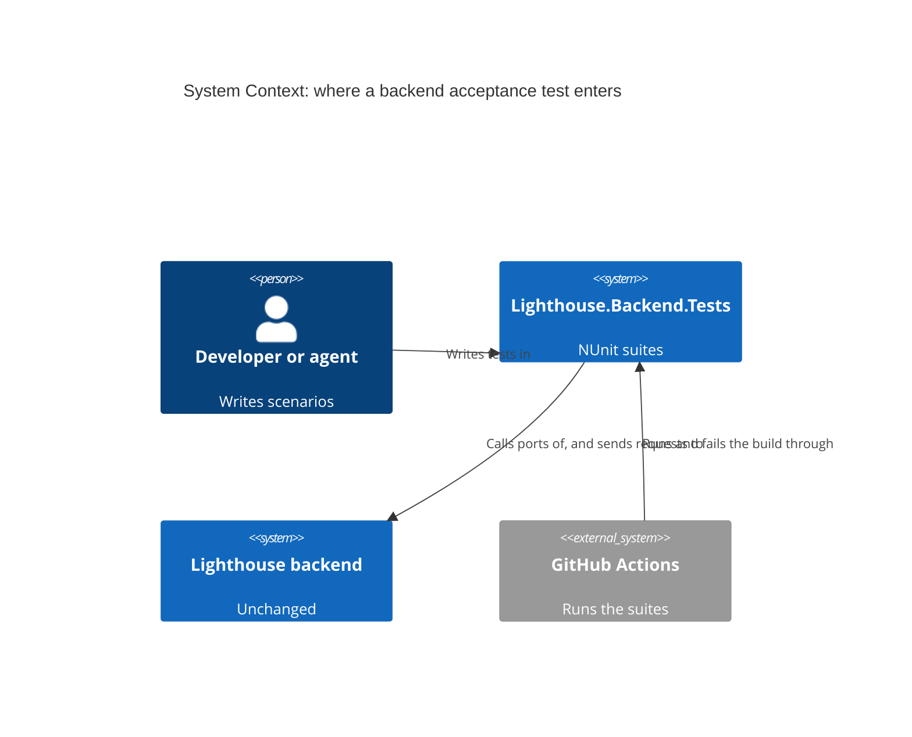
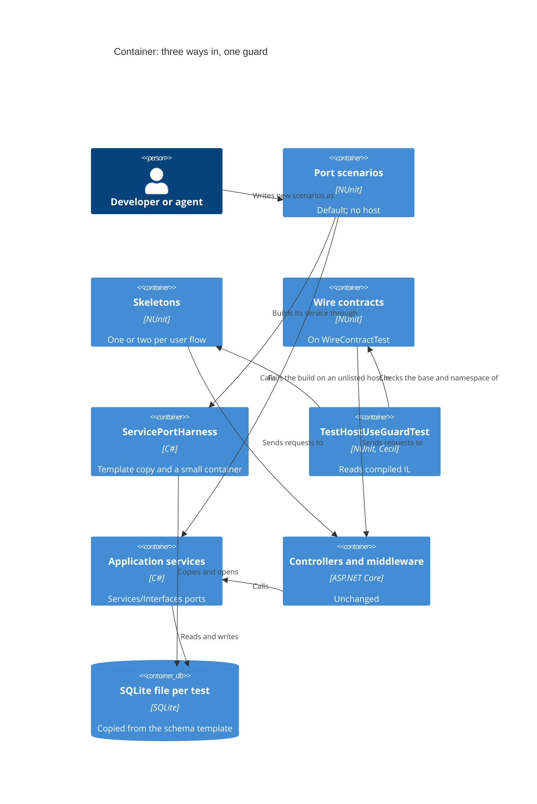

# Feature: story-6469-t5-acceptance-at-the-service-port

Story #6469 · T5 New acceptance scenarios drive the application-service port, with a thin HTTP skeleton per flow · part of Epic #6506
"Fast, reliable test suites". Catalogue: [Epic workspace](../epic-6264-modular-monolith/feature-delta.md) ·
Brief: [slice-49](../epic-6264-modular-monolith/slices/slice-49-t5-acceptance-at-the-service-port.md).

DISCUSS: the brief, settled with the maintainer on 2026-11-07. Its last two sections, "Maintainer decisions" and "Changes from T6's
DESIGN and DEVOPS", override the text above them. Waves start at DESIGN. Rigor `thorough`.

## Wave: DISCUSS / [REF] Inherited

- Epic decision D-6264-5. job_id: infrastructure-only. T10 #6537 and T11 #6538 wait on this Story; T6 #6512 is a dependency.
- Lighthouse-Clients, website, usage-data event, Terminology: N/A, as the brief answers item by item.

## Wave: DESIGN / [REF] Scope, mode and context

Application scope, propose mode, AFK: each engineering choice takes the recommended option and is recorded here. Paradigm OOP, as the
project states. No SPIKE, no wave-decisions file (the brief is the DISCUSS output). The decided points were not reopened.

Read: slices 49, 50, 51, 52; T6's delta, including its DEVOPS revision, "Maintainer decisions" and step 02-01; T2's delta and its
`measurement/`; `docs/ci-learnings.md` backend tests; ADR-270 Decisions 1 and 2; `brief.md` on backend test speed; `IntegrationTestBase`,
`TestWebApplicationFactory`, `TestDatabaseTemplate`, `FixtureSetupTimer`, `FixtureTimingReporter`, `TestHostScanning`,
`TestHostPerFixtureGuardTest`, `SharedHostsDrainTheUpdateQueueGuardTest`, `check_budget.py`, `trx_to_csv.py`, `test-time-budget.json`, the
harnesses of the five top families, and the reality check's controller, service and every test in its folder.

Nothing was run: this agent has no shell. Every number below is read from a file, and its source is named. What is an estimate says so.
`brief.md`, ADR-270, `ARCHITECTURE.md` §4: unchanged. No ADR, because no product architecture changes; this delta and the CLAUDE.md
bullet are the record, as for T2 and T6. Outcome registry check: not run, a test-structure Story adds no typed contract and this agent
runs nothing. Nothing here is a roadmap.

## Wave: DESIGN / [REF] Project rules, answered

| Rule | Answer |
|---|---|
| Bounded contexts touched (ADR-270) | **None changes.** No context, concept, edge or event is added. The tests moved here read Forecasting (the pilot) and whatever the top two turn out to be; the Platform lane's test set-up is not a context. ADR-270 and `ARCHITECTURE.md` §4 stay as they are |
| New terms (ADR-270) | **No domain term.** Four engineering words, kept in CLAUDE.md and out of the glossary: *port scenario*, *skeleton*, *wire contract*, *user flow*. One collision: the brief's "flow" means something else in ADR-270, where Flow metrics is a core context. The guard and the text say **user flow** |
| Domain events | None published or reacted to |
| UI surface (ADR-271) | N/A, because nothing a user sees changes: no screen, chart or copy. So no sketch, and no loading or failure look |
| nWave scenario tags in code | None. New tests carry no `@us-`, `@slice-`, `@kpi-` tag, as a comment or a title prefix, and no new `[Category("slice-01")]`-style attribute. The user-flow name on a skeleton entry is a value the guard reads, not a tag. Moved rows keep the attributes they have today, so their diff stays small |
| Ports and adapters | Production: unchanged. Port scenarios enter through a `Services/Interfaces` port, so controllers are skipped and driven adapters are real or doubled as today. **If a scenario has no port, it stays at the host and the gap goes to Epic #6508; T5 adds no port and moves no logic** |
| RBAC | All logic stays in `IRbacAdministrationService`. T5 adds no RBAC code and no test re-implements it. `[RbacGuard]` runs in the MVC pipeline, so a port scenario cannot see it and says nothing about who may call: every test pinning 401, 403 or an RBAC 404 stays at the host, in `Contracts`, through the existing `WithTestAuthentication` and `ClaimsDrivenRbacAdministrationService`. `ServicePortHarness` registers no RBAC service |
| Production code | None changes in any slice. Mutation: N/A, because Stryker mutates the product assembly; the deliberate break stands in |
| Comments | Written for a stranger, as CLAUDE.md asks. The two inline lists carry a one-line why each, with no slice or Story id |
| External integrations | None added, so no contract-test note. "Contract" here means our own HTTP wire contract |

## Wave: DESIGN / [REF] What a move can actually save

This drives the ranking, so it comes first. The brief ranks by "set-up ... plus body". **The body does not leave.** A scenario at the port
runs the same service on the same SQLite; only the HTTP hop goes.

| Fact | Source |
|---|---|
| Set-up inside a test, per test, in a seeded family: 278 ms as harnesses run today, 210 ms with the schema template on. The template fell short of T2's 30 % bar on this group and did not ship to it | T2 `ab-2026-11-02/summary.txt`, `groupB-ConfigureOncePerConnection` |
| Set-up with no seeders and the template on: about 4 ms | The same file, `CsvWorkTrackingConnectorTest` |
| One host build: mean 135 ms. Measured before T2, when there was one per test; since T2 most fixtures pay it once | T2 `d1-summary.txt`, 2,089 builds, 282 s |
| The slowest hosted tests take seconds where set-up takes a fraction of one, so they are body-bound (an inference: `L0` shows duration only): `Slice07WhereTheLimitsActuallyMovedTest` 20.5 s, 17.6 s, 16.5 s in one test; `Slice05ReconstructCycleTimeHistoryTest` 18.2 s | T6 `evidence/L0.csv`, Release |
| A reality check row costs about 0.3 to 0.73 s | `L0.csv`, ranks 562 to 1,608 of 12,810 |

Three things follow.

- **A move saves about 0.2 to 0.3 s per test, plus the fixture's host, and no more** (an estimate from the first three rows). The move's
  real target is the suite with many cheap tests whose set-up dwarfs the body, not the suite with the biggest seconds.
- **Host builds are the wrong yardstick now.** T2 already took the count far below 2,089, and a suite that leaves the host usually keeps one
  fixture there for its skeleton and contracts. See "Changed Assumptions".
- **A body-bound test should not move.** It lands in the fast tier (no host, so no `IntegrationFixture`) and sets T9's limit, which is
  2.1 x the largest fast-tier test. D-6469-9 keeps it at the host.

**Honest size of the prize.** Pilot plus two suites of about 100 tests each is roughly 250 to 300 moved tests, so about 60 to 90 s summed, against
2,253 s of summed CI backend time after T2's slice 5 (T2 delta, "CI after-measurement"). Corrected at review: the moves as sized at DISTILL came to about 53 to 70 s, about **2.4 to 3.1 %** of that total, and the smaller option the maintainer chose comes to about **1.2 to 1.5 %**. The earlier 3 to 7 % had no derivation behind its upper end. See "Review revision". **T5's value is
mostly the convention and the guard**, which stop every new feature adding at 0.3 s per test instead of 1 ms, and which give T10 and T11 their
tools. The moves prove the shape. Said so the maintainer is not surprised by a small number at the end.

## Wave: DESIGN / [REF] Decisions

| ID | Decision | Why (one line) |
|---|---|---|
| D-6469-1 | Three kinds of backend acceptance test: **port scenario**, **skeleton**, **wire contract**, each with a yes/no test (see "The convention") | Gives the guard lists to check and a reviewer a question to answer |
| D-6469-2 | Add one shared helper, `ServicePortHarness`, composed into a fixture, not inherited | 25-plus files build a SQLite context by hand in at least four shapes; every new scenario would copy one. T10 reuses it |
| D-6469-3 | Direct construction with `new` stays fine for up to three collaborators | The brief's rule; a harness for two mocks is noise |
| D-6469-4 | `WireContractTest` derives from `IntegrationFixture` and owns one host per fixture and nothing else: no seeding, no domain steps | Decided base; `IntegrationTestBase` cannot carry `WithTestAuthentication`, and a bare marker would copy T2's life cycle into every contract fixture |
| D-6469-5 | `Contracts` lives at `Lighthouse.Backend.Tests.Contracts.<Area>`; it marks nothing, the base carries the tier | T6 D-6512-18 |
| D-6469-6 | `Architecture/TestHostUseGuardTest.cs`, four rules, on T6's scan with its wider root set | One question per guard: T2's says how often, T6's says which tier, this one says whether a test may |
| D-6469-7 | **No count constant.** Same shape as T6: two inline lists, a stale entry fails, an addition shows in the diff | A constant is a second line in the same commit, so it stops nothing a reviewer would not see, and it conflicts between parallel Stories |
| D-6469-8 | A moved class keeps its namespace, name and test names, so moved rows keep their ids. New scenarios go to `Tests/Acceptance/<Feature>/` | A kept id is the strongest "no behaviour lost" proof. `API.Integration` is also excluded from Stryker filters, so new port scenarios must sit outside it to kill mutants |
| D-6469-9 | A row stays at the host if it pins the wire, has no port, or its body alone is over 2 s locally. The 2 s becomes T9's limit once T9 calibrates | Moving a body-bound test saves almost nothing and would raise T9's fast-tier limit. 2 s is the frontend's local per-test limit, an estimate here |
| D-6469-10 | Rank in two stages, then correct with the pilot's measurement, as in "Ranking rule" | Removes the "body leaves" error and needs one run only |
| D-6469-11 | The pilot is `ForecastRealityCheck` (3 fixtures, 81 rows) and does not count towards the top two | One-method port, a precedent in the same folder, and all four outcomes appear in it |
| D-6469-12 | Slice order: helper and small move, pilot, guard, text, top two | The pilot settles the helper and base the guard and the text name. The guard still lands before the top two |
| D-6469-13 | DELIVER starts after T6's slice E | T5's moves would otherwise be foreign commits in T6's id proof, and the guard needs T6's scan |
| D-6469-14 | The Story's number is seconds of the moved suites, before and after. The host-build count is reported and must not rise | See "What a move can actually save" |
| D-6469-15 | The DISTILL text is a sentence in the CLAUDE.md bullet, not a file | There is no dispatch file, and the nWave package reverts on reinstall |
| D-6469-16 | Peer review run twice (Sonnet): approved on the second pass, see "Review" | Rigor `thorough` |

## Wave: DESIGN / [REF] The convention (D-6469-1)

A **user flow** is one user outcome reached through one entry route, for example "a Team's reality check runs and its answer comes back".

| Kind | What it is | Yes/no question | Where |
|---|---|---|---|
| **Port scenario** (the default) | Drives a `Services/Interfaces` port, over real SQLite where the database matters, and asserts a business outcome. No host | Is this a business outcome a service can show? | `Tests/Acceptance/<Feature>/`; a moved suite stays where it is |
| **Skeleton** | Sends a real request through the host and asserts a business outcome that needs the route, the DI wiring or middleware to appear. One or two per user flow; a third is caught in review | Could every assertion be made after calling the service directly? If yes, it is not a skeleton | On the skeleton list, with its user flow |
| **Wire contract** | Pins route and verb, status code, JSON member names and formats, headers, or the auth outcome | Would a caller notice if this changed while every service behaved? | `Tests/Contracts/<Area>/`, on `WireContractTest` |

Anything else that starts a host sits on the shrinking list. A reviewer's violation test, from the brief: a host test whose every assertion could
be made after calling the service directly, and that is on neither list.

**Boundary cases.**

- A test asserting both a business value and the wire is split when it moves: value to the port, wire to `Contracts`.
- **A walk over the whole JSON tree is a wire assertion**, even if it reads like a rule ("no part of the answer can rank a window"). A row holding such a walk beside business values is split like any other.
- Logic in a controller has no port: the test stays at the host and the gap is recorded for #6508.
- A suite that never makes an HTTP call but needs the host's container is still a host test (see `FasterUpdates` below).

## Wave: DESIGN / [REF] Component decomposition

| Component | Path (under `Lighthouse.Backend.Tests/`) | Change | Contract shape, and how the crafter asserts it |
|---|---|---|---|
| `ServicePortHarness` | `TestHelpers/` | NEW | Bounded-change: its universe is one temp database and its side files; after dispose none remains. Asserted by a test on the helper |
| `WireContractTest` | `Contracts/` | NEW | Bounded-change: one host per fixture, one database per test. Passes `SharedHostsDrainTheUpdateQueueGuardTest` with no list entry |
| `TestHostUseGuardTest` | `Architecture/` | NEW | Pure over a compiled module, then a list comparison. Planted fixtures, and a real planted class under Debug and Release |
| `TestHostScanning` and the walker | `Architecture/` | REUSE after T6 slice D; EXTEND here if T6 never lands | Pure over a module |
| `RealityCheckWireContractTest` | `Contracts/Forecasting/` | NEW, with 14 moved rows and 7 new | Host fixture |
| `RealityCheckSkeletonTest` | `API/Integration/ForecastRealityCheck/` | NEW, one moved row | Host fixture, on the skeleton list |
| Reality check port base, and the shared script, seed steps and answer reader | `API/Integration/ForecastRealityCheck/` | NEW by extraction | **Unbounded preservation, universe the whole database:** `Run` writes nothing. Today's check is narrower (six `Team` columns, that Team's Work Items, the Team count), so the port row keeps it and adds a command counter on the harness's context, as `RealityCheckQueryCountTest` counts reads: no INSERT, UPDATE or DELETE from any table during `Run`. The answer reader carries the history invariant, see the shared-step table |
| `ForecastRealityCheckAcceptanceTest` | same | MODIFIED: now serves `Slice06` and the skeleton only | Unchanged host life cycle |
| `Slice01...Test`, `Slice04...Test` | same | MODIFIED: new base, names kept | Ids kept |
| `Scripts/test-timings/test-time-budget.json` | outside tests | MODIFIED: `Slice01...` entry drops once CI shows it under the 34 s budget | `check_budget.py` |
| `CLAUDE.md` | root | MODIFIED: one bullet | Read by every wave |

**Why the shared parts become objects.** A class has one base, and the script, the seed steps and the answer are needed by three: the port base, the host
harness and the contract fixture. So they are composed, and a fixture holds them. Internal shape stays the crafter's.

## Wave: DESIGN / [REF] Driving ports

| Port | Entered by | Note |
|---|---|---|
| `IForecastRealityCheckService.Run(team, mode)` | Port scenarios of the pilot | Takes a loaded `Team`, so the scenario reads it first. `Run` is read-only, and its interface exposes no write method |
| The port each top-two suite names | Its port scenarios | Named in that suite's DESIGN note |
| `POST /api/latest/forecast/reality-check/{teamId}`, `POST /api/v1/forecast/reality-check/{teamId}`, `POST /api/latest/forecast/backtest/{teamId}` | Skeleton and wire contracts | Unchanged |

## Wave: DESIGN / [REF] Driven ports and adapters

| Port | At the port scenario | At the host |
|---|---|---|
| `LighthouseAppContext` and repositories | Real, on a per-test copy of the template | Real, as today |
| `IForecastService` | The existing scripted double; the shipped engine for the one moved row that asks for it | Unchanged |
| `ILighthouseClock`, `TimeProvider` | The existing fakes (`FakeLighthouseClock`, `TestToday.Clock`) | Unchanged |
| `ILicenseService` | Reached, through `ITeamMetricsService` and `ForecastFilterRuleService`: the same premium mock the host has (ranking addendum, D-6469-26) | The existing mock |
| `ILogger<T>` | `NullLogger`, or a capture where a scenario reads it | Serilog capture, as today |
| Trackers, collector | The existing doubles | Unchanged |

No new external call. No new adapter, so no `probe()`: the helper is a test fixture, and what can lie about it is in "What can lie".

## Wave: DESIGN / [REF] Technology choices

Unchanged: C# on .NET 10, NUnit, Moq, EF Core on SQLite, `Mono.Cecil` through `IlDependencies`, `Microsoft.Extensions.DependencyInjection`. No new package,
so the OSS check has nothing to add. `Lighthouse.Backend.Tests.csproj` stays untouched: a csproj edit is a shared path and forces every live suite (T6 DEVOPS).

## Wave: DESIGN / [REF] The port helper (D-6469-2, D-6469-3)

`ServicePortHarness` is an `IDisposable` a fixture creates in `[SetUp]` and disposes in `[TearDown]`. It holds no static state, so fixtures stay parallel.

- **Database.** Copies the schema through `TestDatabaseTemplate.CopyTo` to a unique temp path, and connects the way the host does: `Pooling=False`,
  `DatabaseConfigurator.ConfigureSqlite`, `NoWaitingForTheDisk`. Foreign keys and file semantics therefore match the host. T2 rejected in-memory SQLite
  for this, and the decision stands.
- **Services.** A `ServiceCollection` with only the context, `FakeCryptoService`, logging and the clock. The fixture's own registrations come from one
  `Action<IServiceCollection>`, so what a port needs is visible in one place. Each scenario gets a scope.
- **Not in it.** No seeders by default: a fixture calls the ones its scenarios read. How much of the set-up is the seeders is unmeasured (T2 says so); slice A's `c` shows it. No factory type, so the guard's scan
  can never read it as a host. No RBAC service. No clock movement beyond what the fixture does.
- **Dispose.** Closes connections, then deletes the file and its side files, with the retry `IntegrationTestBase` already uses on Windows.

**Rejected.** A base class: a moved suite already has one, and this must also sit under a harness base. The host's container without HTTP: the host and the per-test set-up
stay, so it saves almost nothing. Calling `Program.RegisterServices`: it is private and takes a `WebApplicationBuilder`, and T5 changes no production file.

**The known cost.** A hand-listed container can drift from `Program.cs`. That is what the skeleton is for, and `ServiceProviderValidationTest` still validates the real graph.

## Wave: DESIGN / [REF] The contract base (D-6469-4, D-6469-5)

`WireContractTest` is abstract, derives from `IntegrationFixture`, and so carries `Integration` by inheritance. It has a one-time set-up that builds one host from a
`TestWebApplicationFactory` with `UseSchemaTemplate` on; one protected hook through which a fixture adjusts the host (test authentication, a licence mock); a per-test
reset (clock, fresh database, cached metrics, new client); and a tear-down through `SharedHostTearDown.LeaveTheHostIdleOrFail`. It offers a client and a scope. No seeding, no
routes, no domain words: those belong to the fixture.

| Alternative | Rejected because |
|---|---|
| Derive from `IntegrationTestBase` | It builds its host and client in the constructor, so no hook can adjust the host, and it does not drain the queue. As it stands it also cannot take `WithTestAuthentication`, which returns a plain `WebApplicationFactory`; a factory subclass could work round that, but not the rest |
| A marker with no members | Each contract fixture would copy about 40 lines of T2's life cycle, the very thing `ci-learnings.md` says is still checked by hand |
| A base per suite | The maintainer asked for a small base, one deliberate step visible in a diff |

**Against T6.** `Contracts` is not a tier marker; the category comes from the base. The guard's rule 2 passes, because a contract fixture reaches a host. `trx_to_csv.py` reaches the base through
the chain. T6's Python check fails if two classes on a chain share a simple name, so a contract class gets its own name, which `...WireContractTest` gives it.

## Wave: DESIGN / [REF] The guard (D-6469-6, D-6469-7)

`TestHostUseGuardTest` reads the compiled assembly through `IlDependencies.ReadModule` and passes T6's wider root set to the walker: set-up, one-time set-up and tear-down, constructors,
inherited methods, tests. It judges each concrete class with tests, nested ones included.

| Rule | Fails when | Message names |
|---|---|---|
| 1. A host needs a reason | A concrete fixture reaches a host start, is on neither list and does not derive from `WireContractTest` | The type, and the three ways out: move it to the port, list it as a skeleton with its user flow, or make it a wire contract |
| 2. No stale entry | A type on either list reaches no host, or no longer exists | The type, and that its line goes in this commit |
| 3. One list only | A type is on both lists, or derives from `WireContractTest` and is on a list | The type |
| 4. `Contracts` means the base | A type derives from `WireContractTest` outside `...Tests.Contracts`, or a fixture in that namespace does not derive from it | The type |

There is deliberately no rule that a contract fixture must use the wire: the base starts a host for every fixture on it, so such a rule could never fire. Whether a fixture on the base really pins the wire is the reviewer's question.

**Two lists, inline.** `HostUsersStillToMove`: full type names, generated from the guard's first run. It holds more than 400 names, going by T6's count of hosted files; the first run prints the real number. One why for
the whole list, not one per line: these predate the convention. `SkeletonsByUserFlow`: full type name to user flow, and it may grow. Today's classes that test the host itself, such as `TestWebApplicationFactoryTest`, stay
on the first list; it need not reach zero.

**The count constant: same shape as T6, no constant.** The brief's `MostTypesTheListMayHold` style is dropped. T2's constant "only goes down" because a person lowers it. Adding a type and raising the number are
two lines in one commit, so it blocks nothing that the `+` line alone would not show a reviewer, and on a trunk where Stories move tests in parallel every removal conflicts on that one line. What keeps the list shrinking is rule 2, as T6
found: a fixed type cannot stay listed. What keeps a new type off it is rule 1's message, which does not offer the list as a way out and says outright, as T2's does, to fix the type and not add it; then the CLAUDE.md line and the review. For additions, "only shrinks" rests on those alone.
The difference from T6 is honest and worth stating: T6's list empties in a day, this one lives for years, so an addition is more likely here. If additions ever appear, the answer is a stricter review, not a number.

**Limits.**

- It judges classes, not methods: **a new scenario added to an already listed class passes.** Listing thousands of methods was rejected. The backstop is T9's total ceiling, which a feature adding host time must raise in a reviewed diff, and the CLAUDE.md line.
- T6's limits hold: the walk stops at the test assembly, a host built any other way is invisible, and a virtual call can over-report.
- It cannot tell a skeleton from a mislabelled wire test. That is the reviewer's question.
- **`Contracts` is an unlisted route:** anything on `WireContractTest` in the namespace passes for good, with no line to review, so a business scenario put there is invisible to the guard. The diff shows a new class in `Contracts/`, and the CLAUDE.md test applies. Nothing else catches it.
- A host held by a `[SetUpFixture]` or a static and reached without a start is not judged: a set-up fixture has no tests, and the walk looks for host starts.

**Details the crafter keeps.** Test roots are T2's attribute set (`SetUp`, `Test`, `TestCase`, `TestCaseSource`, `Theory`), plus T6's wider set, because the pilot has methods with `[TestCase]` only. List keys are Cecil's `FullName`, so a nested class reads `Outer/Inner`, not the TRX's `Outer+Inner`.

**Planted fixtures**, in the `PlantedFixtures` style. Red: a host from `[OneTimeSetUp]` on neither list (the brief's AC), from a constructor, from a base class's set-up, through a helper; a contract base outside the namespace; a fixture in
the namespace off the base; a type on both lists; a stale entry. Green: a port fixture using `ServicePortHarness`, a contract fixture, a listed skeleton. Acceptance is stronger: a real concrete class in the working tree,
red under Debug and `-c Release` with its name in the message, the output kept in the workspace, then removed.

**The guards side by side.** T2: how often a host starts. T6: which tier a fixture sits in. T5: whether a fixture may use a host at all. A suite leaving the host therefore touches, in one commit: its base (T6 rule 2), its line here (rule 2), and any line in T2's lists.

## Wave: DESIGN / [REF] The timing run (for the maintainer)

**One run, not one per family**, and the env var alone is not enough. `LIGHTHOUSE_FIXTURE_TIMING=1` writes set-up, tear-down and host-build times per fixture, and **no test time**. Test time is only in a TRX, so the run needs `--logger trx` too. T2 showed each TRX duration includes
`[SetUp]`, and excludes `[OneTimeSetUp]` and `[OneTimeTearDown]`. Tear-down is inside too, inferred from the same measurement: the durations added up to the span with no gap to hold it.

**Before.** A quiet machine, no other test run, Docker up, `main` at or after `d496a646a`, the licence file in place, `dotnet build-server shutdown` after the build.

From `/storage/repos/Lighthouse`:

```
W=docs/feature/story-6469-t5-acceptance-at-the-service-port/measurement
mkdir -p $W
dotnet build Lighthouse.Backend/Lighthouse.Backend.Tests -c Release
dotnet build-server shutdown
env -u AzureDevOpsLighthouseIntegrationTestToken -u JiraLighthouseIntegrationTestToken -u JiraLighthouseRestrictedIntegrationTestToken -u JiraScopedTokenIntegrationTestToken -u ServiceNowLighthouseIntegrationTestToken \
  LIGHTHOUSE_TEST_WORKERS=6 LIGHTHOUSE_FIXTURE_TIMING=1 LIGHTHOUSE_FIXTURE_TIMING_OUT=$PWD/$W/fixture-setup-timings.csv \
  dotnet test Lighthouse.Backend/Lighthouse.Backend.Tests -c Release --no-build \
  --filter "TestCategory!=Integration&TestCategory!=JiraIntegration&TestCategory!=LinearIntegration&TestCategory!=AdoIntegration&TestCategory!=ServiceNowIntegration&TestCategory!=GithubIntegration" \
  --logger "trx;LogFileName=t5.trx" --results-directory $PWD/$W
python3 Scripts/test-timings/trx_to_csv.py --trx $W/t5.trx --output $W/t5-tests.csv
```

Why these choices: Release and 6 workers match T6's `L0`, so `L0.csv` is a free second sample of the same code. The filter is CLAUDE.md's standard one, plus `GithubIntegration`, which changes nothing today. **Run it before T6's slice C.** Once hosted tests carry `Integration`, `TestCategory!=Integration` leaves them all out and the run ranks nothing; after that point drop that one term, which is T6's standard filter.
The set-up CSV can also be read back from `TestContext.Out` if the path fails. `LIGHTHOUSE_FIXTURE_TIMING_OUT` is an absolute path because the reporter runs inside the test process, whose working directory is not this one. Keep both CSVs in the workspace and gzip the TRX, after searching it for token shapes and real hosts, as T6 did with `L0`.

**What the run must read. Stop and tell me if any row is off.**

| Check | Must hold | If not |
|---|---|---|
| Exit, failures | Only environmental failures from CLAUDE.md; no test in a ranked family failed | A failed test's time is not its real cost: fix the cause or drop the family from the ranking |
| `fixture-setup-timings.csv` | Exists, with about 300 rows or more (T2 had 309) and a `Slice13ReadinessTest` row with `setup_count` 44 or more | The reporter did not run: `TestContext.Out` holds the CSV |
| `t5-tests.csv` rows | Close to `L0`'s 12,810 | A filter problem |
| `category` column | Ignore it: every row reads `Unit`, because the command gives no `--source-root` | n/a |
| Family sums against `L0.csv` | The top ten families agree within 25 % (an estimate) | The machine was loaded: run once more |
| Host-build total | Sum of `host_build_count`. **This is the new baseline for the AC**, replacing 2,089 | n/a |

## Wave: DESIGN / [REF] Ranking rule (D-6469-10)

**Join.** Do not split `fully_qualified_name` on dots: test arguments hold dots and commas, and fixture arguments sit mid-name. Take a row's class from the TRX itself, `TestMethod className` by `testId`, as `_class_name_lookup` in `trx_to_csv.py` does, and strip any `(...)` from the class only. Count only `Passed` rows: the 11 `NotExecuted` rows in `L0` are `[Explicit]` or ignored tests. Join to the timer on the part after the last `.`. Two traps: **a simple name in two namespaces is merged in the timer, so mark it and use the TRX figure only;** and a nested fixture has two timer rows, `Outer+Inner` from host builds and `Inner` from `GetType().Name`, so add them. Then group classes into a **family** by
owner: the abstract harness a class derives from (`d1-by-listed-owner.csv` lists them), or the class alone.

**Columns, per family, in seconds.**

| Column | Formula |
|---|---|
| `tests`, `trx` | Row count; sum of `duration_ms` |
| `setup` | `setup_total_ms` + `teardown_total_ms`, summed over the family |
| `fixed` | `one_time_setup_ms` + `one_time_teardown_ms`, and for classes on `IntegrationTestBase` also `host_build_total_ms`. A host starts in one of three places: eagerly in `[OneTimeSetUp]`, already inside `one_time_setup_ms`; lazily at the first `CreateClient` in the first `[SetUp]`, as the pilot's harness does, already inside `setup`; or in `IntegrationTestBase`'s constructor, which no phase timer wraps. Adding `host_build_total_ms` anywhere else counts it twice |
| `body` | `trx` - `setup` |

A family with tests whose timer rows show `setup_count` 0 is **unmeasured, not free**: `FixtureSetupTimer.Measure` sits only in the harnesses that call it. So is one with `host_build_count` 0, which starts its host through a plain factory or a `*TestHost` helper. List it apart, and read its set-up from the code or give it the seeded family's figure, marked as such.

**Leave out** before ranking, as the brief's OUT and the subject of the test demand: `Integration.Containers`, live classes, `Architecture`, `Startup`, `Health`, `API.Security`, the families of `ChecksTheTestHostItself`, and the pilot.

**Stage 1, the ceiling.** Rank by `setup` + `fixed`, which is what would leave if every test moved and the port cost nothing. Do not rank by `trx`, and never by host builds.

**Stage 2, what can move.** For the top five, read the harness and fill the first pass of the coverage table. `m` = rows that are neither wire, nor without a port, nor over 2 s of body. Rank by ceiling x `m` / `tests`, and take the top two. This also settles the brief's "per test whether it makes an HTTP call", which no timer can answer: it is a reading, and only for five families.

**Stage 3, the correction.** Slice A measures on `Slice04...` the port's own cost per test `c` and the HTTP share of a body `h`, both before and after on the same machine. Then per family: `saving = m x (setup / tests - c + h)`, plus `fixed` if the whole family leaves. **Stop rule:** a suite whose `saving` is under 1 % of summed time of the hosted families is reported and not moved, as T10 does. Then ask.

## Wave: DESIGN / [REF] What the top candidates look like today (provisional)

Read from the harnesses, for the maintainer's eye; **the run decides, not this table.** Test counts are T2's host builds, which were about one per test; T6 has more rows now.

| Family | Tests | How it drives | First read of what can move |
|---|---|---|---|
| `UsageDataCollectorObservationTest` | 279, 14 fixtures | POST with a consent header in; JSON reaching the collector out | **Probably little, despite topping every list.** The parsing (`AsTakenIn`) and the gate call are in `UsageDataController`, so a scenario from the browser's message has no port; what reaches the collector is an outbound wire contract. A slice of it could enter at `IUsageDataEventQueue` |
| `ConnectionDefaultsAcceptanceTest` | 98 | Settings routes, "with the body the page sends" | Unknown; its harness says the route is the point, and it has set-up of 278 ms |
| `FasterUpdatesAcceptanceTest` | 94 | `ITeamUpdater.TriggerUpdate`, no HTTP in nearly every scenario | **Fails the reviewer's test on its face**, yet its port is wide: the real queue, `TeamDataService`, `WorkItemService`, metrics, dispatcher, `RefreshLogService`. A small `ServiceCollection` may not hold it. See Open questions |
| `TaskManagerAcceptanceTest` | 90 | Task routes | Unread here. On T2's list: `KeepsProblemsNothingCanEmpty` |
| `ReconstructOverTimeHistoryAcceptanceTest` and the percentiles family | 111 | One GET route, then the filler | **Not a candidate on seconds:** the top of `L0` is its body. It needs its own look at why a fill takes 20 s, which is not a host question |

## Wave: DESIGN / [REF] The pilot (D-6469-11)

**Why this one.** `IForecastRealityCheckService` has one method. `RealityCheckQueryCountTest`, in the same folder, already runs the service over SQLite with no host, so the shape is known to work. And the family shows all four outcomes: moves, skeleton, contract, no port. It ranks fourth by D1's saving. If the run puts it in the top two, the next family takes its place.

**Outcome of each of the 81 rows** (66, 5 and 10; counts confirmed in `L0.csv` for `Slice01`, in D1 for the others).

| Rows | Test | Goes to | Why |
|---|---|---|---|
| 47 | The other `Slice01...Test` rows (the region, levels, sufficiency, windows, dates, no-write) | **Port**, same class, same id | Every assertion is a value on the answer, once the shared steps below are carried over. `A_Team_finishing_one_Work_Item_every_day...` asks for the shipped engine; if its collaborators prove too wide it stays as a second skeleton |
| 5 | All of `Slice04TheAnswerOpensInADialogTest` | **Port**, same id | Values on the answer |
| 1 | `Maria_runs_the_reality_check_on_Ocean_Explorer...` | **Skeleton** `RealityCheckSkeletonTest`, user flow "A Team's reality check runs and its answer comes back" | The one scenario on the shipped engine through the whole wiring |
| 13 | `The_same_check_answers_on_the_versioned_route_as_well`; `The_check_answers_whether_or_not_the_forecast_filter_choice_is_given` x4; `A_request_whose_filter_choice_is_not_yes_no_or_unset...` x3; `Dates_sent_with_the_request_are_ignored...`; `Tom_who_can_read_the_Team...`; `Somebody_who_cannot_read_the_Team...`; `A_Team_that_does_not_exist...`; `The_single_back_test_beside_the_check...` | **Contracts** `RealityCheckWireContractTest` | Route, body, status, auth |
| 4 | `No_part_of_the_answer_can_rank...` x2; `The_windows_either_side_of_an_off_ladder_setting...`; `A_check_whose_forecast_could_not_be_worked_out...` | **Split.** The row stays at the **port**, same id, with its business values (the ladder order, the region, the setting, `DegenerateForecast`, 15 evaluated). Its JSON walk becomes a new row in **Contracts** | Business value and wire in one test |
| 1 | `Running_the_check_twice...` | **Contracts** | Compares raw text, nothing else |
| 10 | All of `Slice06AnOperatorSeesEveryRealityCheckTest` | **Stays**, on the shrinking list, on the old harness | The log line, the override mapping and the 404 are in `ForecastRealityCheckController`: no port. Input for #6508 |
| 0 | `RealityCheckQueryCountTest` (2 rows, no host) | Untouched | Already at the port. Its hand-built context may adopt the helper when touched |

So 56 rows leave the host (47 + 4 + 5) and 25 stay on it, plus 7 new wire rows, in three classes. Host fixtures: 3 before, 3 after, so **the host-build count does not fall, which is D-6469-14's point.** The family's seconds should.

**HTTP-coverage table.** Today nearly every row pins the wire by accident, through `ReadTheAnswer` and `Field`. A move would lose that silently, so 3 new rows take it over.

| What is visible on the wire | Pinned today by | After the move, pinned by |
|---|---|---|
| POST, latest route | Every row | Skeleton, contract rows, `Slice06` |
| POST, versioned route | Versioned row; `Slice06` x2 | Contract row, `Slice06` |
| 200 and a readable body | `ReadTheAnswer`, every row | Skeleton, contract rows |
| 404 for a Team that does not exist | One row; `Slice06` | Contract row, `Slice06` |
| 404 for a caller who cannot read the Team (RBAC) | One row; `Slice06` | Contract row, `Slice06` |
| 200 for a read-only viewer (RBAC) | `Tom_who_can_read...` | Contract row |
| 400 for an unreadable filter choice | 3 rows; `Slice06` x2 | Contract rows, `Slice06` |
| Request member `applyFilterOverride`; dates ignored | 5 rows | Contract rows |
| **Every response member name**, nested ones too | `Field(...)`, spread over all rows, for the members the reader reads | **New row:** a real answer, read in full through today's `RealityCheckAnswer`, which moves to the contract fixture, **extended to every member of the DTO.** It then also pins five names nothing pins today: `teamId`, `teamName`, `levelOutcomes[].forecastValue`, `filterApplied`, `excludedSummary` |
| **Null members are present as null:** `forecast`, `actualCompleted`, `outcome`, `levelOutcomes` on a cell that cannot be evaluated | `Field(...)` on such cells | **New row**, from a Team with cells that cannot be evaluated. The shipped-engine answer evaluates all 16, so it cannot show this |
| **Date format `yyyy-MM-dd`** | `AsDay`, every row | The same new row |
| **Enums as text:** `Determination`, `CurrentSettingStanding`, `SufficiencyReason`, `CellOutcome`, `LevelReading`, the not-tested reason | String comparisons, spread over rows | **New row**, one case per member, through the host's own JSON options. Enums go out as strings and an in-process port cannot see that |
| No raw number per window, no sentence, no negative number, same text twice | 5 rows | 4 new rows split from them, and `Running_the_check_twice...` moved whole |
| Back test route | One row | Contract row |
| Log line | `Slice06` | `Slice06` |
| Values of `filterApplied`, `excludedSummary`, set in the controller | **No scenario here** | Unchanged: a gap today, not made by this move. Only the names gain a pin. Recorded for #6508 |

**Business assertions in shared steps.** The same risk runs the other way: a shared step can hold a rule, not just wire. The coverage check therefore reads every shared step, for this suite and for the top two.

| Shared step | What it asserts | Kind | After the move |
|---|---|---|---|
| `ReadTheAnswer` | Status 200 | Wire | Skeleton, contract rows |
| `ReadTheAnswer` | `Forecasts.HistoriesNoSweptWindowIsAsLongAs` is empty: each check learns from exactly its own window | **Business, on every row** | **The port's answer reader carries it**, so all 56 port rows keep it; the host readers keep it too |
| `Cell`, `Coverage` | Exactly one match | Business | Stay in the reader |
| `Field` | The member exists | Wire | The new member-name row |
| `ThenEveryReasonAndOutcomeComesFromItsClosedSet` | Text is in a closed set | Wire; at the port the enum type holds it | The enum row |
| `WhatIsStoredFor` | Team and Work Items unchanged | Business | Port row, widened as in "Component decomposition". The skeleton keeps it at the host, so the controller's own `GetForecastThroughputStatus` call stays covered |
| Tear-down: history filler and queue drained | The host is left idle | Host only | Nothing to carry: no host. Stays for host fixtures |

**Id table.** 66 rows keep their ids (47 + 4 + 5 at the port, 10 in `Slice06`), so the proof is a list diff: the ids of the `ForecastRealityCheck` classes before, the ids after, with the 15 rows that change class mapped one by one (14 to `RealityCheckWireContractTest`, 1 to `RealityCheckSkeletonTest`), and the 7 new rows marked new. Kept in the workspace. Any other line fails.

**Deliberate break.** Change the five-day bar in `ForecastRealityCheckService` by one, in the working tree: `Five_days_with_finished_work_is_enough_to_check_and_four_is_not` must go red at the port, and the output is kept. Then revert. The change must still compile (the build fails on a commented-out line before any test runs).

## Wave: DESIGN / [REF] Slices (D-6469-12)

Each leaves the suite green. No production file in any slice. A move is its own commit, and never mixes with an edit. Days are estimates. Timed runs stay off the working day.

| Slice | Days | Delivers | Proof |
|---|---|---|---|
| A | 0.5 | `ServicePortHarness` with its test; `Slice04` moved | Ids equal; `c` and `h` measured before and after; helper leaves no file |
| B | 1 | `WireContractTest`, `Contracts`; `Slice01` split into port, skeleton and contract; the 7 new wire rows | Id table; coverage table; deliberate break; family seconds before and after; run alone 3 times |
| C | 1 | `TestHostUseGuardTest`, both lists from its first run; planted cases | A real planted class red under Debug and `-c Release`, named |
| D | 0.25 | CLAUDE.md bullet, with the DISTILL sentence | Read by the review. "A new scenario lands at the port" is first tested by the next feature's DISTILL, as T11 notes; said so |
| E | About 2 | Refinement, smaller option: harness composition and `NeedOverOneCycleTest`, stop and ask, then the rest | As B, plus the checkpoint in "Review revision" |
| F | About 1.25 | Reports, smaller option: the same, first class `ReportWindowBoundaryScenarios` | As E |

The maintainer decides at each first-class checkpoint of E and F, and again after F, with the numbers. E's and F's notes and coverage tables are in the ranking addendum; they are re-cut to the smaller option at the start of slice E, and reviewed before the move, as the brief says. Days are as "Review revision" states.

**T10.** A suite T5 touches is closed to T10 until T5 finishes it, and T10 starts from what T5 leaves, as decided.

## Wave: DESIGN / [REF] The CLAUDE.md bullet (draft, lands in slice D)

> **New backend acceptance scenarios drive the application-service port.** Build the service with `ServicePortHarness`, or with `new` for up to three collaborators, and put the test under `Tests/Acceptance/<Feature>/`. A test may start a host only as a skeleton (one or two per user flow, on the list in `TestHostUseGuardTest`, asserting a business outcome that needs the route or the wiring) or as a wire contract (route, status, JSON names, headers, 401/403, on `WireContractTest` in `Tests/Contracts/`). A new scenario in a class already on the guard's list goes in a new class at the port too. Tell every acceptance-designer dispatch so.

T11 later shortens this to its three lines, and takes it into the skill.

## Wave: DESIGN / [REF] If T6 never lands

**State as read at the end of this wave.** The brief for this wave said T6 was held and `IntegrationFixture` did not exist. Both have moved on: T6's delta records the maintainer's answer to the `[Explicit]` question (base keeps its shape, the rule changes), and `TestHelpers/IntegrationFixture.cs` is on disk with no class deriving from it. The filters have not switched. Nothing in this design depended on that answer. Three ends remain possible, and the middle one is the trap.

| Thing | With T6 | Without T6 |
|---|---|---|
| `WireContractTest` base | `: IntegrationFixture` | No base. Remove one token. No category, so contract tests stay in CI's always-on selection exactly as hosts do today |
| Scan | Moved and widened by T6 slice D | **T5 slice C gains T6's two commits**: the `refactor` move of the walker to `TestHostScanning`, then the root set as a parameter. About half a day. The rest of the guard is unchanged, as it never names `IntegrationFixture` |
| "Leaves the base in the same commit" | Enforced by T6 rule 2 | Nothing to leave |
| Fast tier, T9's limit | D-6469-9's 2 s becomes T9's limit | Stays 2 s, a written rule with no check |
| Ranking | Unaffected | Unaffected: it reads classes, never the `category` column |
| T10's `Integration` time | Available | Lost: T10 needs its own source |
| Order (D-6469-13) | After T6's slice E | Starts at once |

**The partial case: `IntegrationFixture` exists but T6 stops before its filters switch, or before hosted classes move.** Then `WireContractTest : IntegrationFixture` would make contract tests the only hosted tests carrying `Integration`. CI's `Category!=Integration` would silently drop them if the filters have not switched, and CLAUDE.md's local filter would skip them either way. **So `WireContractTest` takes the base only once T6's slice E is done; otherwise it has no base,** as in the table. D-6469-13 already gives this order, and the rule covers a change of plan. The timing run is not affected until T6's slice C.

## Wave: DESIGN / [REF] Reuse Analysis

| Existing | File | Overlap | Decision | Contract shape, universe, how asserted |
|---|---|---|---|---|
| `TestDatabaseTemplate.CopyTo` | `TestHelpers/` | Cheap real database | REUSE | Copies one file to a named path; its own tests |
| `RealityCheckQueryCountTest.BuildContext`, `SecretCustodyServiceTests.BuildProvider` and 25-plus like them | various | Context and small container | CREATE NEW `ServicePortHarness`: each is private to its file, and they differ (`:memory:`, a file with `Migrate`, with and without the foreign-key set-up). Extending one means making it public from a test class. Not rewritten here; they adopt it when touched | Bounded-change, universe one temp path; no file left, asserted in the helper's test |
| `IntegrationTestBase` | `TestHelpers/` | Host life cycle | Not extended for the contract base, see "The contract base" | n/a |
| `SharedHostTearDown`, `SharedHostCleanup`, `ForgetTheCachedMetrics` | `TestHelpers/` | Per-test reset on a shared host | REUSE | Existing guards |
| `*TestHost` helpers | `TestHelpers/` | Host set-up by composition | Not used by the base; a contract fixture may use one where it fits | n/a |
| `WireContractTest` | none | One host for a wire test | CREATE NEW: decided by the maintainer, and no existing base carries the auth host and the drain together | Bounded-change, universe one host and per-test database |
| `TestHostPerFixtureGuardTest`, `TestTierGuardTest` | `Architecture/` | A guard over the same scan | CREATE NEW `TestHostUseGuardTest`: T2's roots are per-test only, and T6's question is the tier. One question, one message each, as the brief decided | Pure over a module, then a list comparison; planted fixtures |
| `HostBuildingScan`, `Compare`, `PlantedFixtures` idiom | `Architecture/` | Walk, list comparison, planted cases | REUSE | Pure; T2's and T6's guards stay green unchanged |
| `FixtureSetupTimer`, `trx_to_csv.py` | | Timing | REUSE unchanged | Read-only for this Story |
| `FakeLighthouseClock`, `TestToday`, `DrawsFromAPinnedStartingNumber`, `CapturedLogMessages` | test doubles | Fakes | REUSE | Existing |

Every overlapping test suite's contract shape is read-only or bounded: a moved scenario's universe stays its own database, as today.

## Wave: DESIGN / [REF] What can lie, and what catches it

| Assumption | Could be false because | Caught by |
|---|---|---|
| A green port suite means the feature works in the product | The hand-listed container differs from `Program.cs` | The skeleton; `ServiceProviderValidationTest` |
| A move loses no wire check | Assertions hide in shared steps, as `Field` and `AsDay` do here | The coverage table, read per step and not per test; the 3 new rows |
| A move loses no business check | Rules hide in shared steps too, as the history invariant does in `ReadTheAnswer` | The shared-step table; the deliberate break, which shows one rule only |
| Port SQLite behaves like host SQLite | A different connection set-up | The helper takes `DatabaseConfigurator.ConfigureSqlite` and `Pooling=False` from the host; a foreign-key row planted in the helper's test |
| The port test can fail | Same as any moved assertion | The deliberate break |
| The saving is real | Set-up may not fall if the scenario needs the seeders; the body may not shrink | `c` and `h`, measured in slice A for the helper, and on each suite's first ported class before the rest moves ("Review revision") |
| TRX includes tear-down | Inferred, not measured directly | It only moves `body`; ranking uses `setup` and `fixed`. Checked on one fixture in slice A |
| The timer covers a family | `Measure` sits only in harnesses that call it, and keys on the simple name | Unmeasured and merged families are listed apart |
| `check_budget.py` stays quiet after a move | A renamed class is stale; a kept class is not judged unneeded on the backend | Classes keep their names; the entry drops on CI's number |
| The guard works | It could read nothing | Planted red fixtures; a real planted class under Release |
| The guard's lists are honest | A type can be added by hand | Review, rule 1's message; see "The count constant" |

## Wave: DESIGN / [REF] C4





No L3: under five components change in any one subsystem.

## Wave: DESIGN / [REF] For the maintainer

Decided in your absence; say if any is wrong. **Nothing here blocks the wave.**

1. **The number will be small: about 1.2 to 1.5 % of summed backend time with the smaller option, an estimate ("Review revision"; first written here as 3 to 7 %).** The value is the convention and guard. If you wanted a big cut from moves alone, T2 already took most of it. See "What a move can actually save".
2. **The body does not leave, so the ranking is not the brief's.** It would have put `Slice07WhereTheLimitsActuallyMovedTest` first, where a move saves almost nothing and a 20 s test lands in the fast tier.
3. **The usage-data family tops every list, and probably cannot move far.** The logic is in `UsageDataController`. Expect it to fall out at stage 2.
4. **New scenarios go to a new folder, `Tests/Acceptance/<Feature>/`**, while moved suites stay under `API/Integration`. Reason: kept ids, and Stryker's `!~API.Integration` filters. The cost is that a moved suite's namespace says "Integration" and is no longer true.
5. **A new scenario in a listed class passes the guard.** Method-level listing was rejected. T9's total ceiling is the backstop, so this limit is only closed once T9 ships.
6. **"Only shrinks" is enforced by review alone for additions.** No constant is the rule you set, and I kept it. Rule 2 removes fixed types; nothing in the build stops a new line, and adding one is the quickest way to green. So rule 1's message says so outright, as T2's does: fix the type, do not add it.
7. **Worth a look, outside this Story:** almost no acceptance harness turns on `UseSchemaTemplate`; only `IntegrationTestBase` and three `API/Security` fixtures do, by text search. T2's A/B saw 68 ms a test on one family, 24 %, under its 30 % bar, so it did not ship. For tests that stay at the host, that is the same order of saving as a move, for a line or two per harness. A candidate for the improvement backlog, or for T10.

**Your run:** see "The timing run". T5 needs it before slice E, not before slice A.

## Wave: DESIGN / [REF] Open for DISTILL and DELIVER

- **`FasterUpdates`, if it ranks.** Its scenarios already skip HTTP, but its port takes most of the update path. If a small container cannot hold it, is it left on the list, or is a wider port fixture allowed? Stage 2's reading answers, and its DESIGN note says.
- Which top two, and their ports and tables: owed after the run, as an addendum.
- Whether `A_Team_finishing_one_Work_Item_every_day...` runs the shipped engine at the port (slice B).
- Whether the licence is reached at all at the reality check port (slice A).
- The 2 s body limit, until T9 calibrates.
- DEVOPS comes next: the usage-data event question (expected N/A) and the CI effect of the guard. `Scripts/test-timings/` edits and test-only edits start no live suite, by T6's reading.
- Per the project rule, tell the acceptance-designer dispatch that an untagged scenario is correct here.

## Changed Assumptions

Original, slice-49, proposal b: "Rank by seconds that a move removes (set-up the seeders do per test, T2 follow-up note of about 210 ms, plus body), not by host builds."
New: rank by set-up, tear-down and fixed cost, scaled by what can move, corrected by the port's measured cost. Why: the body runs the same service at the port; `L0.csv`'s slowest hosted tests are body-bound.

Original, proposal b: "one `LIGHTHOUSE_FIXTURE_TIMING=1` run per candidate harness family, recording set-up plus body seconds per fixture today, and per test whether it makes an HTTP call."
New: one run of the whole filter, with `--logger trx`; the HTTP question is a reading of the top five. Why: the timer has no test time, the TRX has it for every class at once, and no timer sees a call.

Original, AC: "Host builds in a standard-filter run fall from 2,089 (2026-11-02); the target is set at DESIGN from the measurement, not now."
New: the moved suites' summed seconds fall, measured before and after; the host-build count, from the new run's baseline, does not rise. Why: 2,089 predates T2, and the pilot keeps three host fixtures.

Original, AC: "a type removed from the list lowers the ceiling in the same commit" and proposal d "exact ceiling constant, like `MostTypesTheListMayHold`".
New: no constant; a stale entry fails. Why: see "The guard". The brief's last section already allows this.

Original, proposal g: "Test ids change when a test moves, so D11's equal-id-list proof is replaced by a before/after table per suite."
New: a moved class keeps its name, so most ids do not change; the table maps only the rows that change class. Why: a stronger proof for less work.

Original, the dispatch of this wave (not a slice-49 line): T6 held on `[Explicit]`, `IntegrationFixture` absent. New: see "If T6 never lands". Why: T6 moved on while this wave ran.

Original, proposal f: "four slices of at most one day each". New: six, about 4.75 days. Why: the pilot splits, and the top two are a slice each.

Original, proposal d: "Two inline lists, today's host-using types". New: the same, but T6's scan names *concrete* classes, so the first list holds more than 400 entries, not one per harness. Why: listing an abstract base would let a new class on it through, which is the case the guard exists for.

No upstream story or AC needs the product owner: these are test-structure corrections, recorded here.

## Wave: DESIGN / [REF] Review

Two passes by `nw-solution-architect-reviewer`, read-only, on Sonnet (the reviewer model assumed for `thorough`, as T6 did; `.nwave/des-config.json` holds no rigor key). The first: rejected pending revisions, 0 critical, 4 high, 10 medium, 5 low. The second, on the revisions only: **approved**, nothing new above medium.

Confirmed from the code: the row counts, `L0` ranks and durations, D1's ranking, `UseSchemaTemplate` usage, the Stryker exclusion, that the base passes the queue-drain guard, and the `fixed` column against `IntegrationTestBase`. Not confirmed by either pass: anything that needs a run; NUnit category inheritance; the TRX shape of a parametrised fixture; whether a small container holds `ITeamMetricsService`; rule 1's reach into inherited set-up, as T6's scan is not written yet; that the shared-step table is exhaustive.

| Finding | Severity | Resolution |
|---|---|---|
| Four rows "moved whole" mixed business values with a JSON walk | High | Split: values stay at the port, the walk becomes a new contract row. Counts redone |
| Coverage table missed `SufficiencyReason`, null members, and overclaimed member names | High | Added; the reader is extended to every DTO member, pinning five names nothing pinned |
| `ReadTheAnswer` holds a business rule on every row | High | New table of business assertions in shared steps; the port's reader carries it |
| The "changes nothing" claim had no stated universe | High | Whole database, by a write counter; the skeleton covers the controller's own call |
| The partial T6 case; T6's state was out of date | Medium | Added. `WireContractTest` takes the base only after T6's slice E |
| Id arithmetic | Medium | Corrected: 66 kept, 15 change class, 7 new |
| Guard routes not named; test roots and key form unstated | Medium | Added to Limits and the crafter's details |
| "Only shrinks" is unenforced for additions | Medium | Stated plainly; rule 1's message says fix, do not add. No constant, as decided |
| Unsupported seeders claim; wrong A/B label; 3 % mixed local and CI | Medium | Reworded; now about 3 to 7 %, an estimate. The reviewer's CI factor of 1.8 could not be found in T2's delta, so it is not used |
| Ranking join, host-build double count, nested keys | Medium | Rewritten: class from the TRX, `Passed` rows only, three host places named |
| Reasons against `IntegrationTestBase`; D1 predates T2; "body-bound" is an inference; unmeasured families | Low | Reworded and marked |
| Second pass: say which hooks the write counter needs | Medium, not blocking | For the crafter: count writes on the non-query **and** reader hooks, because SQLite writes may run through `ExecuteReader` |

## Wave: DESIGN / [REF] Architecture summary for the maintainer

**The shape in hexagonal terms.** Production's hexagon does not change at all. What changes is where tests plug into it.

```
   TESTS (driving side)                 PRODUCTION (all unchanged)
 +--------------------------+
 | Skeleton  [modified use] |--HTTP-->+-------------+
 | Wire contract [NEW base] |--HTTP-->| Controllers |
 +--------------------------+         | + RBAC guard|
                                      +------+------+
 +--------------------------+                |
 | Port scenario [NEW kind] |         +------v----------------+    +-----------------+
 |  + ServicePortHarness    |--call-->| Application services  |--->| Models (domain) |
 |    [NEW]                 |         | Services/Interfaces   |    +-----------------+
 +--------------------------+         +------+----------------+
                                             |
 +--------------------------+         +------v----------------+
 | TestHostUseGuardTest     |         | Driven adapters       |
 | [NEW] reads compiled IL  |         | EF on SQLite: real    |
 +--------------------------+         | Trackers: doubles     |
                                      +-----------------------+
```

- **Driving adapters:** the controllers are unchanged, and now only skeletons and wire contracts reach them. The new thing is a third way in that skips them: the port scenario. *New.*
- **Application services and ports:** unchanged. T5 adds no port; a scenario with none stays at the host and feeds Epic #6508. `IForecastRealityCheckService` is the first port entered this way.
- **Domain (Models):** unchanged.
- **Driven adapters:** unchanged. No new external call. Port scenarios use real EF on a per-test copy of the schema template, and the existing doubles for trackers, the licence and the clock.
- **Test support:** `ServicePortHarness`, `WireContractTest` and `TestHostUseGuardTest` are new. `IntegrationTestBase`, `TestWebApplicationFactory`, `TestDatabaseTemplate` and T2's and T6's guards are unchanged.

**The patterns weighed.**

| Pattern | Verdict | Why |
|---|---|---|
| Ports and adapters, entering at the driving port | **Chosen** | It is the convention itself: business behaviour needs no HTTP to be shown |
| Test pyramid, per T10's vision | **Chosen** | Each fact pinned at the lowest layer that can prove it: value at the port, wiring at the skeleton, wire at the contract |
| Composition over inheritance (`ServicePortHarness`, shared script and steps) | **Chosen** | A fixture has one base, and the shared parts are needed by three |
| Dependency inversion, in the small container | **Chosen** | The port's collaborators are visible in one registration, not resolved from a whole host |
| Single responsibility, one guard per question | **Chosen** | Three guards, three failure messages, none loosened |
| Ratchet by stale entry | **Chosen** | A fixed type cannot stay listed, with no number to maintain. Additions rest on review |
| Count constant on the ratchet | Rejected | A second line in the same commit blocks nothing, and it conflicts |
| Template method base for the harness (`IntegrationTestBase` style) | Rejected for the helper; **used** for `WireContractTest`, which has one hook | A base fits a single life cycle, not a helper that must sit under other bases |
| Marker-only contract base | Rejected | It would copy T2's life cycle into every fixture |
| Host's container without HTTP | Rejected | Keeps the host and the set-up, so saves almost nothing |
| Reusing `Program.RegisterServices` | Rejected | Private, and T5 changes no production file |
| In-memory SQLite | Rejected, as T2 did | Foreign keys and file semantics differ |
| One step layer that runs a scenario either over HTTP or at the port | Rejected | Hides which layer a test is at, which is the thing being made visible |
| Method-level guard list | Rejected | Thousands of entries; T9's ceiling covers the gap |
| Domain events, outbox, unit of work, optimistic concurrency, value objects, JSON column | N/A | No production model or persistence changes |

## Wave: DEVOPS / [REF] Platform readiness

Existing platform; nothing is deployed. Written 2026-11-07 with the maintainer away, so each choice takes the recommended option. Rigor `thorough`. Files were read and no test
ran, because another agent has the machine. Local seconds are from T6's `evidence/L0.csv`; CI seconds are from `test-timings-backend` of run 42372930241 (T6's `T0`, commit `d852cf98e`), which was downloaded and read. That is one run, so each CI figure below is a reading of one sample, and what is an estimate says so. The classifier answers below come from running `path-classifier.sh` on the file names, which runs no test.

T5 changes test code only: no `ci*.yml` edit, no new CI step, no new script. This wave's job is to keep it that way and to say what each push costs.

| Topic | Answer |
|---|---|
| Usage-data event | **N/A, because nobody using the product reaches a test.** A port scenario, a skeleton or a guard runs on a developer's machine or in CI, so no event could show use. `UsageDataEventName` and `docs/settings/usagedata.md` are unchanged. T5 may move tests that observe usage events; that changes no event |
| Terminology, release notes, RBAC, Clients, Website, UI sketch | N/A, as the brief and DESIGN answer item by item: no route, DTO, screen or word a user sees changes. Release notes are written at `/release`, with nothing to say here |
| Outcome KPIs | `docs/product/kpi-contracts.yaml` holds no row for T5 and gains none, because this is test structure. The Story's numbers are in "What is watched" below |
| Deployment | **None.** Trunk push to `main`. The publish step builds `Lighthouse.Backend.csproj` alone, so test files reach the Docker build stage by `COPY` but not the published output. The `release` job waits for the maintainer as ever. So no canary, no feature flag, no database step |
| Mutation | **N/A, because only test files change and Stryker mutates the product assembly**, as the maintainer accepted. The deliberate break of one production line per moved suite stands in. That break edits a production file in the working tree, so before each push `git diff --name-only <last green> HEAD -- Lighthouse.Backend/Lighthouse.Backend/` must print nothing from this Story; the N/A rests on that line |
| E2E | Stays a thin sanity check: no spec, page object or Playwright test changes. Playwright still runs in `verifysqlite` and `verifypostgres` on every backend push, against an unchanged product, so its green says nothing about T5 |
| Branching | Trunk-based, on `main`, as the project works. Merge `origin/main` if clean; a conflict stops and is reported; nothing is rebased |
| Observability | No new tool. Logs: the CI log of "Test Backend" and "Check test-time budget". Metrics: the `test-timings-backend` CSV; `LIGHTHOUSE_FIXTURE_TIMING=1` locally for host builds. Traces: N/A, because nothing here is a request in production. The red run is the alert; no dashboard |
| Secrets | None added. Port scenarios use `FakeCryptoService` and doubles. List runs keep T6's rule: no token variable set. A kept TRX is searched for token shapes and real hosts first, as T6 did with `L0` |
| Sonar | Applies to new test code as to any other. `sonar-gates` has to stay green, or the window of the next push widens. S4144 in `docs/ci-learnings.md` is the likely one here: reader and seed helpers copied between the port base, the host harness and the contract fixture |

## Wave: DEVOPS / [REF] Environment matrix

`devops/environments.yaml` is not written: this wave may edit this file only, and T6 kept its inventory in its delta too. Nothing installs, so the skill's short form applies: `clean`, on Linux. This table is what DISTILL reads.

| Environment | Runs | What differs for T5 |
|---|---|---|
| **Linux, local** | Class filters per step, Release and Debug; the `A` list before a push; `Test-Fast.ps1` | The only place a list is made. The test host's `TZ` pin sits in `lighthouse.runsettings`, on the process, so port scenarios keep `Europe/Zurich` with no work in `ServicePortHarness` |
| **CI, `ubuntu-latest`** | The only `dotnet test` in any workflow: Release, `A`, no worker cap | Port scenarios and contracts both run under `A`, by different halves of the clause. Parallel per fixture (`ParallelScope.Fixtures`), so a class's rows run one after another |
| **Windows and macOS jobs** | Package, sign, start the app; no test | So `ServicePortHarness`'s retry on delete, which exists for Windows, has no cover on any platform. **Unverified, and it stays so:** it copies `IntegrationTestBase`'s retry. A Windows test job was rejected in T6 for the same reason; it would be a `ci*.yml` edit |
| **A worktree** | As local | 2 Licensing failures until the licence file is copied, so lists come from the main checkout. Pass absolute paths to subagents |
| **No Docker** | Port scenarios, contracts, skeletons, the guard | None needs it. `A` does, as it holds the container tests, so a list run needs Docker up |
| **Postgres** | Container tests only, as today | Every moved row ran on SQLite before and runs on SQLite after, so nothing is lost. A port scenario proves nothing about Postgres; none did |

**Coexistence: these keep working unchanged.** T2's `TestHostPerFixtureGuardTest` and `SharedHostsDrainTheUpdateQueueGuardTest`; T6's `TestTierGuardTest`; `ServiceProviderValidationTest`; `trx_to_csv.py`, `check_budget.py` and their tests; `dev-test.*`. Stryker: moved suites stay under `API.Integration`, so its filters skip them as before. New scenarios under `Tests/Acceptance/` start no host, so they do not bring back the slow Stryker run, but filters are written by hand per feature, so such a scenario kills a mutant only if the config names it. That belongs in T11's guidance.

**Pre-requisites.** T6's slice E done, for `IntegrationFixture` and `TestHostScanning` (T6 stands at 3 of 21 steps as this is written). `Lighthouse.Backend.Tests.csproj` untouched: it has no `Compile` item, so `Contracts/` and `Acceptance/` compile with no edit, and neither folder exists yet.

## Wave: DEVOPS / [REF] What each push triggers

Read from `ci.yml`, `ci_changes.yml` and `path-classifier.sh`.

| Slice | Paths | Backend | Live suites | Frontend | Then |
|---|---|---|---|---|---|
| A | `TestHelpers/`, `API/Integration/ForecastRealityCheck/` | Plain | None | No | Package and verify tail |
| B | `Contracts/`, `API/Integration/ForecastRealityCheck/` | Plain | None | No | Tail |
| C | `Architecture/` | Plain | None | No | Tail |
| D | `CLAUDE.md` alone | **No run:** the path is not in `ci.yml`'s `paths` | None | No | Nothing |
| E, F | Named in their addenda | Plain, if the addendum's files pass the check below | None expected | No | Tail |
| Any, with `test-time-budget.json` | `Scripts/test-timings/` | Plain | None | **Yes**, this path also switches the frontend on | Tail |

Every classifier answers `false` for the connectors and `connector_shared` on each of those paths, and on every file in the tree that names `UsageDataCollectorObservation`, `ConnectionDefaults`, `FasterUpdates` or `TaskManager`, by text search. `backend` answers `true`, except for `CLAUDE.md`.

**The tail is the real cost.** A backend-path push also runs `version`, package, Docker, SBOM, `verifysqlite`, `verifypostgres`, `verifyauth`, the three standalone packages and the Windows and macOS checks, on a product that has not changed. `e2e` stays `false`, which skips only the compile job. So fewer pushes is the saving, not fewer tests.

**Three pushes at most, not six (D-6469-18).**

| Push | Carries | Why |
|---|---|---|
| 1 | Slices A to D | **The guard and the text land together.** Rule 1 reds any other Story's new host test from that moment, so the bullet that explains it must be on trunk with it, not after it. The pilot needs the guard's first list anyway |
| 2 | Slice E, after its addendum is reviewed | Its own list and its own revert |
| 3 | Slice F, the same | The same |

Rejected: one push per slice, which is five tails and five lists for no extra diagnosis, as a list line names its class. One push for the Story, because E and F wait on the maintainer's decision after the numbers, and the guard should not wait for them.

**Keeping a push plain (D-6469-17).** Change detection diffs from the last green run, so a push can run live suites through nothing of ours: a foreign `ci*.yml`, csproj or `Program.cs` change still in the window, which includes a Renovate bump. So T6's D-6512-29 applies as it stands, with one addition. Before each push: `git diff --name-only <last green> HEAD`, then `. Scripts/test-selection/path-classifier.sh` and each `classify_*` on that list, and a grep for `^.github/workflows/ci.*\.yml`. Any `true` means wait for a green run that closes the window, or tell the maintainer. T5 is never the cause of a live run, and never pushes into one by accident: the Linear key is shared with CI. An E or F addendum that needs a file in `WorkTrackingConnectors/` splits that file out or stops.

**Each push waits for the one before to end**, as `ci.yml` has no `concurrency` and a red leaves the window open. A red run's cause is diagnosed, and a failed job is re-run, before anything else is pushed.

**T5's first push waits for T6's last to end (D-6469-22).** D-6469-13 lets the work start after slice E. Pushing before push 7 would put T5's rows in T6's last proof as foreign lines, and the `category` column the cross-check below reads comes only with slice F. In the chain's order they do not overlap; this covers a change of plan.

## Wave: DEVOPS / [REF] Proof that no test is lost

**T6's method, unchanged, with T5's id table as the only allowance (D-6469-19).** No CI step, no `check_selection.py` by another name, as T6's review revision argued: a new check's first failure is a red trunk. Before each push, one local run of the always-on clause `A`, its TRX kept as that push's list, compared with the last list **before the push**. It is also the whole-suite gate that push needs anyway, so a list costs no extra run. T6's "The rules of a list run" and "Reading a diff" apply word for word.

| List | When | Proves | Machine time |
|---|---|---|---|
| `P0` | At the parent of T5's first commit | The first list. Compared with T6's `L7`, it shows trunk's foreign lines at no cost. **It is also the timing run** | About 6 minutes |
| `P1` | Before push 1 | 66 ids unchanged, 15 changed class exactly as mapped, 7 new, and the helper's and guard's own tests named. Nothing else | About 6 minutes |
| `P2`, `P3` | Before pushes 2 and 3 | The same, on each addendum's id table | About 6 minutes each |

So 4 runs, about 24 minutes, or 2 if the maintainer stops after D. A line in the diff is accepted only if it is on the slice's id table, a test this Story added and named here (D-6512-27's rule), or a foreign commit whose diff shows that exact test added or removed.

**`P0` is the timing run (a change to DESIGN, see below).** The same command with `LIGHTHOUSE_TEST_WORKERS=6`, as `L0` had, and `LIGHTHOUSE_FIXTURE_TIMING=1` and `LIGHTHOUSE_FIXTURE_TIMING_OUT` set; DESIGN's table of what the run must read still applies. It saves a run and the maintainer's time. DESIGN's printed filter must not be used: it holds `TestCategory!=Integration`, which from T6's slice C on leaves out every hosted test and ranks nothing.

**CI's part is a cross-check by the orchestrator, after the push, on files CI already writes.** CI's CSV is compared with CI's and local with local, never across.

1. The log prints `force_full=false` and `filter=` with `A` alone. If not, the run does not count.
2. Its CSV against the last plain run's, read the same way, with the same id table.
3. `Total:` = the last plain run's + tests this Story added + foreign tests added - foreign tests removed, written out as a sum.
4. The `category` column: exactly the moved ids change, from `Integration` to `Unit` (56 for the pilot). Contract rows, the skeleton and `Slice06` stay `Integration`. A reading of a column CI writes anyway, not a new check: it shows on CI what T6's guard rule 2 enforces at build time.

An unexplained line stops further pushes until the test is back or the line is explained, as T6's stop rules say.

**Why a move cannot lose a test through the filter.** T6's review named three ways to lose one; T5 adds none. A class leaving the base passes `A` by its first half, a contract class by its second, and that shape was proven by T6's probe. A hosted class gaining a connector category is T6's guard rule 4, at build time.

**`--list-tests` is not used here.** T6 found it prints a test's name without its class, so a test moving between classes under the same name would not show, and that is exactly what T5's 15 rows do. Ids come from the TRX.

**One thing to expect on E or F.** A class leaving the base with an `[Explicit]` test gains a `NotExecuted` row under `A`, as the off-base tests have today. By the maintainer's probe decision it reads as not selected. None does in the pilot: `RealityCheckWallClockProbe` is on no base and is not moved.

**What is lost, plainly.**

1. **Ids prove a test still ran, not that it still checks the same thing.** That is the coverage table, the shared-step table and the deliberate break, and the break shows one rule per suite. The list does not replace them.
2. A list covers a push, not a commit, and push 1 holds four slices. A diff line names its class, so finding the commit stays easy.
3. CI's cross-check comes after the push. The local list is what stops a loss before it.
4. Lists are not kept in git. Like T6, T5 keeps them on disk under `evidence/`, out of git, with count and `sha256` written here. The id tables stay in this delta.

## Wave: DEVOPS / [REF] Budgets and T9's ceilings

| Limit | Effect of T5 | Answer |
|---|---|---|
| **Frontend, 54 s per file** | None | **N/A, because no frontend test or file changes.** The only exposure: a push with `test-time-budget.json` starts the frontend job, so it is judged again on a runner whose time is known to swing |
| **Backend, 34 s per class: the classes that shrink** | `Slice01...` is 33.6 s on CI with 66 rows, against a ceiling of 78. Its 51 port rows should take about 13 s (an estimate: 510 ms a row now, less DESIGN's 0.2 to 0.3 s) | Keeping the entry fails nothing: `_is_not_needed` calls a backend entry idle only when its ceiling equals the budget, and the class stays declared. See D-6469-20 |
| **Backend, 34 s per class: the new classes** | `RealityCheckWireContractTest`, 21 rows: about 10.7 s at the family's mean of 510 ms, 24.6 s if every row took the family's slowest. `RealityCheckSkeletonTest`, 1 row. One-time set-up is outside TRX durations, so the host build does not count | Under budget with T4's factor of 2.1 (10.7 x 2.1 = 22.5 s). **T5 adds no allow-list entry.** A new class over the budget is split, not listed |
| **Backend, 34 s: the guard** | T2's `TestHostPerFixtureGuardTest` is 0.16 s for 18 rows locally; `SharedHostsDrainTheUpdateQueueGuardTest` 2.78 s | Far under, by likeness only. T6's `TestTierGuardTest` gives the real figure before T5 starts |
| **Moved ids and the budget's names** | A moved class keeps its name (D-6469-8), so nothing goes stale | If a class on the list were renamed, `check_budget.py` would red until its entry went in the same commit |
| **T9, fast-tier per-test limit** (2.1 x the largest fast-tier test) | The largest test on CI outside the hosted, container and connector sets is 5.1 s (`DomainEventDispatcherSeamArchUnitTest`, with `ForecastLaneTest` at 5.0 s), so the limit is at least about 10.8 s. The slowest pilot row is 1.17 s on CI, at the host | **T5's moves do not set it.** So D-6469-9's line that the 2 s "becomes T9's limit" does not hold, see D-6469-21 |
| **T9, `Integration` mean** | Pilot rows average 510 ms against about 752 ms for the tier, using `API/Integration`, `Integration/Containers` and `API/Security` as a stand-in, as the real column does not exist yet. Moving below-mean rows **lifts** the mean: about +0.7 % for 56 rows, +3 to +4 % for 250 to 300. A suite of very cheap rows lifts it most: `Integration/UsageData` averages 97 ms, and 279 such rows would add about 9 % | Inside T9's 1.25 x headroom, so no red in either order. **But T9's brief says "T5 and T10 move the slowest, so the risk is small", and T5 does the opposite:** D-6469-9 keeps the slowest at the host. Owed line below |
| **T9, `Integration` total** | Falls: the pilot takes about 29 s out and its 7 new rows add about 4 s, so about 25 s net of about 2,068 s. Nothing here raises it, so no reviewed raise is needed | **The fall overstates the saving.** A moved row leaves the column whole, while most of its time reappears as `Unit`. T5's number is therefore read by class, summed over the family, never from the tier column |
| **T9, calibration** | Each T5 push shifts both figures | The chain's order already puts T9 after T5. T9's 5 runs should start after T5's last move push, as T10's brief says of its own runs. A later E or F stays inside the headroom |
| **T6, fast tier under 60 s** (not a gate) | **The one number T5 makes worse.** Moved rows join the fast tier: about +15 s summed for the pilot, and about +43 s for the 165 rows of the pilot and the smaller option, at about 260 ms a row (an estimate). The tier is at most about 317 s summed on CI today, an upper bound, as hosted tests outside those three folders are still in that figure. At 6 workers that is about +2 s of wall clock for the pilot and about +7 s for all of it, if the work spreads evenly | Accepted, by the maintainer's own rule that moving a test down is good. `SecretCustodyServiceTests`, at 50 s in one fixture, stays the longest class, and `Slice01...` would not replace it. Reported, not gated: T6's slice F figure is the before, one `Test-Fast.ps1 -NoBuild` median after push 1 and one after the last push are the after, with their test counts. Raised below |

**What is watched.**

| Outcome | Instrument | Read when |
|---|---|---|
| Moved suites' seconds fall (D-6469-14) | Family sums, local, before and after on the same machine; the slice's proof. CI as a report from the CSV. Baseline on CI, one run: `Slice01...` 33.63 s, `Slice04...` 2.85 s, `Slice06...` 5.10 s, 41.58 s for 81 rows. Local `L0`: 30.82, 2.74, 5.42, 38.98 s | Each slice's close |
| Host builds do not rise | `host_build_count`, summed, from `P0` and from a list run with the timer on at the Story's end | Twice |
| The shrinking list shrinks | The diff of `HostUsersStillToMove`; rule 2 fails a stale line | Each move |
| No test lost | "Proof that no test is lost" | Each push |

## Wave: DEVOPS / [REF] Rollback

Every step is a `git revert` of test commits and a plain push: no `ci*.yml`, no data, no product file, so no live run and nothing for a user to notice. **Reverse order, because later slices stand on earlier ones.** A rollback push takes a list like any other, and the diff shows the id table in reverse.

| Slice | Revert | Constraint |
|---|---|---|
| F, E | Alone, its commits in reverse | A move's commit holds its base, its guard line and any T2 line, so the revert restores all three together |
| D | Alone, at any time, starts no CI | Revert with C if the guard goes, or the text describes a guard that is not there |
| C | At any time, in the same push as D | Reverting the guard reds nothing, but the CLAUDE.md bullet names it, so D goes with it. Reverse order is not needed for C itself; it is B that must wait for C |
| B | **Only after C.** The guard's first list leaves the pilot off, so a revert of B alone puts `Slice01...` back on a host, unlisted, and rule 1 reds | Skeleton and contract classes go with it |
| A | Only after B, which uses the harness | |

**Fix forward once anything else depends on it.** When a later Story's test uses `ServicePortHarness`, `WireContractTest` or a `Contracts/` class, or T10 has started from T5's files, A and B cannot simply be reverted. A single red test after a push is a fix, not a rollback.

**T5 adds one line to T6's rollback.** T6 says the filter goes last, because reverting it while hosted tests carry `Integration` loses them all. Once T5 lands, `WireContractTest` is on that base too, so the same holds for every contract test. T6's rollback order stands; T5's slice B goes before T6's slice B.

## Wave: DEVOPS / [REF] Decisions

| ID | Decision | Why (one line) |
|---|---|---|
| D-6469-17 | No `ci*.yml` edit, no new CI step, no new script; before each push the window goes through `path-classifier.sh` and a `ci*.yml` grep, every connector answer `false` | A workflow edit forces every live suite on a key shared with CI, and T5 needs nothing from one |
| D-6469-18 | At most three pushes: A to D, E, F | Each backend push runs the whole tail, and the guard must land with its text |
| D-6469-19 | T6's `A` list before each push, read by T6's rules, with the id table as the allowance; CI's CSV is a cross-check; `P0` doubles as the timing run | Reuses a run the push needs anyway; `--list-tests` cannot see a class move |
| D-6469-20 | `test-time-budget.json` is edited only in a backend push already going. An entry drops when the class's largest time over at least 5 plain `main` runs, x 2.1, is at most 34 s, so at most about 16 s. If the Story ends first, T9 does it | T4's rule; a lone edit would run backend, frontend and tail for one line; a kept entry fails nothing |
| D-6469-21 | D-6469-9's 2 s stays T5's own rule and does not become T9's limit, whatever T9 calibrates | While today's slowest fast-tier tests stand, T9's limit will be about 11 s or more, and following it would let body-bound tests move |
| D-6469-22 | T5's first push waits until T6's push 7 has ended | Keeps T6's last proof clean; the `category` reading needs slice F |
| D-6469-23 | No per-wave Forge review: none of the skill's triggers applies (no new target, CI framework, observability stack or security posture). The consolidated review at the end of DISTILL covers this wave | The skill's default |

## Wave: DEVOPS / [REF] Changed assumptions

Original, DESIGN, "The timing run": "**Run it before T6's slice C**", as a separate run for the maintainer.
New: no separate run; `P0` is it, after T6's slice E, under `A`. Why: T5 starts after slice E, so "before slice C" is only possible if the run happens now, no `measurement/` folder exists yet, and the list before the first push is needed anyway. `A` also holds the container tests; the ranking already leaves them out. If the maintainer has run it by then, `P0` needs no timer.

Original, D-6469-9: "The 2 s becomes T9's limit once T9 calibrates".
New: D-6469-21. Why: the largest fast-tier test today gives a limit near 11 s.

Original, DESIGN, "Component decomposition": "`Slice01...` entry drops once CI shows it under the 34 s budget".
New: D-6469-20. Why: at 33.6 s on CI it is under the budget today, so that test says nothing; T4's factor is what makes the drop safe.

Original, "Slices": each slice proved alone, and "A move is its own commit". The commits stand; only the pushes group, as D-6469-18 says.

No story or AC changes, and no architecture changes, so no upstream note.

## Wave: DEVOPS / [REF] Owed to other briefs (not edited here)

- **T9, slice 50, proposal 2:** "T5 and T10 move the slowest, so the risk is small" is wrong for T5, which moves below-mean rows on purpose. The effect is a few percent and inside the headroom; the sentence should say so.
- **T9, slice 50, Goal:** the frontend budget reads 56 s; it is 54 s since `37cc1a614`.
- **T9, slice 50, calibration:** "5 runs after T6" becomes after T6 and after T5's last move push, matching T10.
- **T9 and T10:** read a host-to-port saving by class, not from the `Integration` column.
- **T6, Rollback:** T5's slice B goes before T6's slice B, once T5 lands.
- **T11:** a Stryker config must name `Tests.Acceptance.<Feature>` for a new port scenario to count.

## Wave: DEVOPS / [REF] For the maintainer

Nothing here blocks the wave. Decided in your absence; say if any is wrong.

1. **T5 slows the fast loop a little, on purpose.** About 2 s for the pilot and perhaps 11 to 13 s for all three suites, estimates against a 60 s target the tier may already be close to. Backend CI gets faster and the fast loop gets slower, because the tests go from the slow tier to the fast one. Reported, not gated. If it matters, it counts against E and F when you decide after the numbers.
2. **The timing run is no longer yours to make.** It folds into the list before the first push.
3. **T5 will not raise a live run, but a foreign change can.** The check before each push makes T5 wait rather than push into one.
4. **Three pushes, each with the whole package-and-verify tail, on an unchanged product.** The pipeline has no way to skip the tail for a test-only change, and changing that would be a `ci*.yml` edit, which is outside this Story.

**Not verified.** Anything that needs a run: `c`, `h`, a port row's real cost, `TestHostUseGuardTest`'s time, the real `Integration` column and mean, T6's fast-tier figure. CI seconds are one run. The `Integration` stand-in leaves out hosted tests in other folders and counts every test in those three. The classifier was run on planned and existing paths, not on E's and F's real file lists. `ci_docker.yml` and `green-base-run.mjs` were not read; the second is taken from T6's account.

**Open for DISTILL and DELIVER.** DISTILL: the planted guard cases and id tables are as DESIGN has them; nothing here adds a scenario. DELIVER: each pre-push check above is a line in the step before a push, not a step of its own. Still open from DESIGN: the top two, `FasterUpdates`, the licence question. Still open from T6: the containers answer, which T5 does not read.

## Wave: DESIGN / [REF] The timing run, as it ran (2026-11-07)

Run on `c8b26e574` with the five tracker tokens removed, because the two mixed classes write scratch items to a real tracker whenever a token is set; the command above now says so. Exit 0: 12,818 passed, 2 skipped, 12,820 total, 6 m 37 s. `fixture-setup-timings.csv` holds 326 fixture rows; `Slice13ReadinessTest` shows `setup_count` 44. `t5-tests.csv` holds 12,829 rows. The host-build total, the new baseline for the AC, is **619**. Load was up to about 14 during the run, so the family check against `L0.csv` decides whether it stands. The TRX and test CSV stay out of git, in `measurement/`.

## Wave: DESIGN / [REF] Ranking addendum (2026-11-07, maintainer away)

Closes "The timing run" and D-6469-10. Read from `measurement/`, T6's `L0` and the test and product code. No test ran. Classes come from the TRX by `testId`, `Passed` rows only, as the rule says. The scripts stayed in a scratch folder, so the row tables below are the record.

**The run stands.**

| Check | Must hold | Read |
|---|---|---|
| Exit, failures | No ranked family failed | 12,818 passed, 0 failed |
| `fixture-setup-timings.csv` | About 300 rows or more, `Slice13ReadinessTest` at 44 | 326 rows, 44 |
| Rows | Close to `L0`'s 12,810 | 12,829, of which 11 `NotExecuted`; `L0` has 12,799 `Passed` and 11 `NotExecuted` |
| Host-build total | Sum of `host_build_count` | **619**, 101.5 s, summed here from the CSV |
| Family sums against `L0.csv` | Top ten within 25 % | **Worst −21.3 %.** See below |

**The family check passes, and load did not inflate the run.** The run is faster than `L0` overall: 2,144.7 s summed against 2,310.3 s. "Top ten" can be read two ways, so both were checked, on the classes that are ranked:

| Top ten by | Worst | Next worst |
|---|---|---|
| `trx` sum | `SecretCustodyServiceTests` −21.3 % (37.0 s, 47.0 s) | `ConnectionFieldChangeAcceptanceTest` −10.6 % |
| Ceiling, which is what gets ranked | `DeliverySourcesAcceptanceTest` −7.4 % (31.5 s, 34.0 s) | `ConnectionDefaultsAcceptanceTest` −6.6 % |

Outside the ten, two families of 5 s or more disagree by over 25 %, both faster in this run: `UsageDataCollectorObservationTest` −56.7 % (12.4 s, 28.5 s) and `RefreshLogFindingsPersistenceTest` −45.7 %. Two Postgres families do too, at −72 %, and they are left out anyway. The usage family is the one that could matter, and it does not: even at `L0`'s 2.3 times, its ceiling is about 23.5 s, under the second place below.

`L0` has no set-up column, so set-up has no second sample of its own. It sits inside the TRX, so sums that agree bound it. Against T2's D1 run, for a rough look only as D1 predates T2's hosts: Refinement +21 %, Reports +22 %, `ConnectionDefaults` −31 %.

**Family, as grouped.** The topmost abstract harness on a class's chain, leaving out `IntegrationTestBase` and `IntegrationFixture`; a class with no harness is its own family. `d1-by-listed-owner.csv` could not group everything: it lists only what was on T2's allow-list, so `RefinementAcceptanceTest` and `ReportsAcceptanceTest` are not in it, and neither was in DESIGN's provisional table.

**Left out, per class, not per family,** because a family can hold one Postgres class: 140 classes (66 `Architecture`, 37 `Integration.Containers`, 19 `API.Security`, 7 `Health`, 6 `Startup`, 4 pilot, `TestWebApplicationFactoryTest`). Live classes are not in the run. The pilot's set-up is 18.0 s; it does not count towards the top two.

**Stage 1, the ceiling** (seconds).

| # | Family | Classes | Tests | `trx` | `L0` | `setup` | `fixed` | Ceiling | `body` | Set-up per test |
|---|---|---|---|---|---|---|---|---|---|---|
| 1 | `RefinementAcceptanceTest` | 19 | 300 | 86.8 | 85.5 | 56.8 | 2.7 | **59.6** | 29.9 | 0.189 |
| 2 | `ReportsAcceptanceTest` | 17 | 187 | 65.7 | 64.1 | 38.0 | 2.3 | **40.3** | 27.8 | 0.203 |
| 3 | `TaskManagerHarness` | 25 | 188 | 118.9 | 121.2 | 35.3 | 3.8 | **39.1** | 83.6 | 0.188 |
| 4 | `ConnectionDefaultsAcceptanceTest` | 9 | 105 | 89.4 | 95.7 | 32.9 | 1.5 | **34.4** | 56.5 | 0.313 |
| 5 | `FasterUpdatesAcceptanceTest` | 7 | 94 | 68.6 | 68.1 | 22.6 | 0.0 | **22.6** | 46.0 | 0.240 |
| 6 | `ReconstructOverTimeHistoryAcceptanceTest` | 7 | 54 | 238.1 | 241.3 | 18.2 | 1.1 | 19.3 | 219.9 | 0.337 |
| 7 | `DependenciesAcceptanceTest` | 4 | 53 | 26.5 | 28.0 | 14.6 | 0.0 | 14.6 | 11.8 | 0.276 |
| 8 | `ManualSortingAcceptanceTest` | 3 | 62 | 22.3 | 22.9 | 13.5 | 0.0 | 13.5 | 8.8 | 0.218 |
| 9 | `PercentilesOverTimeAcceptanceTest` | 5 | 57 | 15.7 | 16.4 | 12.9 | 0.0 | 12.9 | 2.8 | 0.226 |
| 10 | `DeliverySourcesAcceptanceTest` | 5 | 52 | 31.5 | 34.0 | 12.5 | 0.0 | 12.5 | 19.0 | 0.240 |
| 14 | `UsageDataCollectorObservationTest` | 15 | 288 | 12.4 | 28.5 | 8.6 | 1.6 | 10.2 | 3.8 | 0.030 |

Ranks 11 to 13 are each under 12 s and left out. `TaskManagerHarness` is partly unmeasured: `TaskManagerAcceptanceTest`'s two classes (17 rows, 18.8 s) have no timer rows. At the family's 0.188 s they add 3.2 s, making 42.3 s, which would pass Reports here and changes nothing below.

**Unmeasured, listed apart.** At the seeded figure of 210 ms a test, marked as an estimate: `NamedDependencyLinkAcceptanceTest` 70 rows, about 14.7 s plus 1.0 s fixed; `ParentPlacementAcceptanceTest` 47 rows, about 9.9 s plus 0.6 s; `RunChartPayloadContractIntegrationTest` 27 rows, about 5.7 s; `SleRiskAcceptanceTest` 22 rows, about 4.6 s. `CategoryListsHoldRawStatesSettingsIntegrationTest` has 75 rows, but its whole `trx` is 9.6 s, which caps it. `SecretCustodyServiceTests` starts no host. None reaches the top five at that figure. `NamedDependencyLink` at `ConnectionDefaults`' 0.313 s would be about 22.9 s, level with fifth, and cannot reach second place either, as the next paragraph shows.

**Stage 2, the first pass.** `m` = rows that are neither wire, nor without a port, nor over 2 s of body. Body per row is its TRX time less its class's mean set-up.

| Family | Ceiling | Tests | Over 2 s | Wire or no port | `m` | Ceiling x `m` / tests |
|---|---|---|---|---|---|---|
| **`RefinementAcceptanceTest`** | 59.6 | 300 | 0 | 136, including 2 skeletons | **164** | **32.6** |
| **`ReportsAcceptanceTest`** | 40.3 | 187 | 0 | 55, including 2 skeletons | **132** | **28.4** |
| `ConnectionDefaultsAcceptanceTest` | 34.4 | 105 | 11 | About 79 | About 15 | About 4.9 |
| `TaskManagerHarness` | 39.1 | 188 | 5 | About 169 | About 14 | About 2.9 |
| `FasterUpdatesAcceptanceTest` | 22.6 | 94 | 0 | All, see below | 0 | 0 |

- **Refinement and Reports** were read row by row: "Slice E note" and "Slice F note" hold the tables, and "How each row was read" holds the reading, so it can be re-summed. It is a reading of test names and steps, so the tallies are expectations until the crafter's own pass (D-6469-34).
- **`ConnectionDefaults`.** Its harness says the route is the point, and it is: `IConnectionSaveService` is `Open`, an edit, `Commit`, and the edit is the controller's mapping from the page's body. "A script saves back what it read", "older payloads" and the owner saves are that mapping or `TeamController`'s, so they have no port. What can move is the field-in-use refusals, which are `ConnectionSaveOutcome`: 12 rows of "the admin removes the field", the parent-source one, and 2 stale-copy ones. Eleven rows are over 2 s, and those that wait on a scheduled update need the update path.
- **`TaskManagerHarness`.** Its driving port is a refresh on the production queue, read over the task route. `GetTasks` filters and orders inside `UpdateController`, so the 30 rows of what the list says have no port (Slice 02, 03, 07, Story 6055). The refresh rows and the 68 forecast-round rows need the queue, the lanes and the hosted services. What is left is about 14 rows of `Slice08` that call the connection check directly.
- **Why the top two is safe.** `m` / tests is at most 1, so no family with a ceiling under 28.4 s can overtake. Only four families are above it. `ConnectionDefaults` would need 88 of 105 rows and `TaskManager` 128 of 188 at its 42.3 s, against about 15 and 14 read. Refinement over Reports is the close call, 32.6 to 28.4 on a reading, and it decides only the order of E and F.

**Top two: `RefinementAcceptanceTest`, then `ReportsAcceptanceTest`.** Both have ports that map nearly one to one onto their routes, and no row over 2 s.

**Stage 3, what is still open.** `saving = m x (setup / tests − c + h)`; `fixed` is not added, as neither family leaves whole. The hosted classes sum to 1,408.5 s in this run, so the 1 % stop line is **14.1 s**.

| Suite | At `c` = 0, before `h` | At `c` = 50 ms, an estimate | Moved only if `c` − `h` is at most |
|---|---|---|---|
| Refinement | 31.0 s | 22.8 s | 0.103 s |
| Reports | 26.8 s | 20.2 s | 0.096 s |

Slice A's `c` does not decide this: `Slice04` runs no seeders. The first ported class of each suite does ("Review revision"). The table above is for the whole suites; the smaller option's figures are there too. **The risk is the seeders.** Both harnesses run all 8 `ISeeder`s per test today, and `TeamMetricsService` reads `GetTeamDataRefreshSettings()` in its constructor, so a port that keeps the seeders keeps most of the set-up. `RealityCheckQueryCountTest` already answers it with an `IAppSettingService` double. Each host fixture that goes also saves one host: about 11 for Refinement and 10 for Reports, about 3.4 s in all at this run's 164 ms a build.

**`FasterUpdates`: answered, and it does not rank.** Its ceiling, 22.6 s, is under second place at any `m`, so it would not be chosen even if every row could move. And it could not: `ITeamUpdater` and `IPortfolioUpdater` run through the production queue in their own scope. Following constructors and `GetRequiredService` calls from `Program.cs` gives about 98 concrete types, against about 49 for Refinement and Reports and 38 for the pilot, an over-count by text search, compared like for like. It pulls in `IHubContext`, `IHttpClientFactory`, `ForecastLane` and the Redis multiplexer. The harness also replaces about 15 services, the logger factory among them, because the quiet log is the promise under test. On top, the 47 rows of `Slice05` mostly enter through the operator's settings save, which is a controller. **So it stays on the list, and no wider port fixture is allowed** (D-6469-25): a container of that size is a second `Program.cs`, and it keeps the set-up, which is the "host's container without HTTP" DESIGN rejected. Its rows pass the "needs the host's container" boundary case, so they are host tests and not violations. The value that is left there is T10's.

**The licence: reached.** DESIGN's line was wrong. `ForecastRealityCheckService` has no licence collaborator, and its controller has no guard, but `Run` calls `ITeamMetricsService.GetThroughputForTeam(team, start, end, mode)`. For any mode but `SkipFilter` that reaches `ApplyForecastFilter`, then `ForecastFilterRuleService.GetEffectiveRuleSet`, whose first line asks `ILicenseService.CanUsePremiumFeatures()`. So the pilot's port registers the same premium mock the host has, and "Driven ports and adapters" now says so. `RealityCheckQueryCountTest` hides this by doubling `IForecastFilterRuleService`. Nothing in the moved rows sets a filter rule, so a wrong answer would not show in a row: a missing registration fails loudly at resolve, which is why the real service stays. At the top two: Refinement reaches it the same way through `ITeamMetricsService`, and `ReportCommands` and `ReportQueries` take the licence directly, as the cap is a business rule at that port.

**`A_Team_finishing_one_Work_Item_every_day...`, for slice B:** the shipped engine needs `IRandomNumberService`, `IFeatureRepository`, `IPortfolioRepository`, `IWhatTheForecastWaitsFor`, `ForecastSimulation` and `TimeProvider` beyond what the port holds. Rule for the crafter: if those registrations outnumber everything the other 50 port rows need, the row stays as the flow's second skeleton. Its id moves class either way only in that case; say so in the id table.

**Changed assumptions.** Original, "Driven ports and adapters": "`ILicenseService`: Not reached". New: reached, as above. Original, DEVOPS: "`P0` is the timing run". New: the maintainer ran it on `c8b26e574`, so `P0` is the first list and needs no timer, as DEVOPS allowed. Original, "Honest size of the prize": "two suites of about 100 tests each". New: 164 and 132 rows leave the host. With the pilot's 56, the saving is about 53 to 70 s summed (`c` from 50 ms to 0, an estimate), just under DESIGN's 60 to 90 s: more rows, but a row's set-up here is 0.19 to 0.20 s, the bottom of DESIGN's range. Original, slices E and F: 1 day each. New: see D-6469-30.

## Wave: DESIGN / [REF] Slice E note: Refinement (the addendum DESIGN owes)

**Ports.**

| Port | Stands for | Note |
|---|---|---|
| `IRefinementViewQuery.ForTeam(teamId, presentedVoterKey)` | The tab | Null for no such Team |
| `IRefinementViewQuery.LogOf(teamId, workItemReference, presentedVoterKey)` | One Work Item's log | Null when not listed |
| `ISizingLogCommands.Vote`, `.Comment`, `.TakeBack` | What a reader adds | Answers `SizingOutcome`. Takes an established `Voter`, not a declared name |

No port: everything through `TeamController` and `TeamsController`. `RefinementSettingsValidator`, the stage-rule and state-mapping checks and the merge of a partial save all run in the controller, so the settings rows stay, as input for #6508. `RefinementVotesController` also holds the voter resolution, the body checks and the outcome-to-status mapping.

**Driven at the port.** Real: `LighthouseAppContext`, the Team, Work Item and sizing-log repositories, `RefinementList`, `SleYardstickResolver`, `StageRuleMatcher`, `RefinementCalendar`, `RefinementNeedCalculator`, `VoterIdentityResolver`, `IBlackoutPeriodService`, `ITeamMetricsService`. Doubles, as today: `ForecastWithScriptedHorizons` for `IForecastService`, the licence mock, `FakeLighthouseClock`. New doubles: `IAuthModeResolver` and an empty `IHttpContextAccessor`, which a read only touches when sign-in is on, and no port row has sign-in on.

**Three traps.**

- **The voter's key.** The port's `Voter.Key` is the stored key, derived from what the browser presents. A step must get it from `VoterIdentityResolver.ForWriteAsync`, as the controller does, or `ForTeam` will not recognise the voter's own vote. Writing the raw key would turn `Every_voter_counts_once...` green for the wrong reason.
- **A port row's Given skips the settings save.** Today a Given chooses states through the settings route, so it runs its normalising and healing. At the port it writes `RefinementSettings` on the Team. A Given could then store a shape no save can produce. New row E10 replays the Givens' own inputs through the save and compares what is stored.
- **The tear-down drain and the rate limiter do not exist at the port.** Nothing to carry. `CallersComeFrom` stays with the contract fixtures: it gives each scenario its own address, which is why the 429 row does not use up its neighbours' allowance on a host with the limiters on.

**Rows.**

| Class | Rows | Seconds | Port | Skeleton | Contract | Stays, no port |
|---|---|---|---|---|---|---|
| `NeedOverOneCycleTest` | 22 | 7.2 | 22 | | | |
| `Slice01RefinementStatesTest` | 18 | 4.1 | | | 1 | 17 |
| `Slice02RefinementListTest` | 15 | 3.8 | 10 | 1 | 3 | 1 |
| `Slice03StageRulesTest` | 30 | 8.5 | 18 | | | 12 |
| `Slice04RefinementCadenceTest` | 31 | 8.3 | 16 | | | 15 |
| `Slice05NeedAndVerdictTest` | 18 | 6.0 | 17 | | | 1 |
| `Slice07BandPercentilesTest` | 18 | 4.6 | 3 | | | 15 |
| `Slice09ClientNeedTest`, `...WithAnApiKeyTest` | 4 | 1.5 | | | 4 | |
| `Slice10SleYardstickTest` | 12 | 3.0 | 12 | | | |
| `Slice11CastAVoteTest` | 29 | 8.2 | 11 | 1 | 16 | 1 |
| `Slice12CommentsTest` | 26 | 7.3 | 22 | | 4 | |
| `Slice13ReadinessTest` | 44 | 13.1 | 25 | | | 19 |
| `Slice15VotesWithAnAccountTest`, `...WithoutRolesTest` | 9 | 2.7 | | | 9 | |
| `Slice16TakeBackTest` | 9 | 3.1 | 8 | | 1 | |
| `Slice16TakeBackWithAnAccountTest` | 3 | 1.1 | | | 3 | |
| `Slice17ClientVotesTest`, `...WithAnApiKeyTest` | 12 | 4.1 | | | 12 | |
| **Total** | **300** | **86.8** | **164** | **2** | **53** | **81** |

How a row was read: its first `When` decides. "The coach opens the tab", a vote, a question or a take-back is the port; a settings save, a settings read or a Team create stays; a row whose assertion is the status, a header, the body's shape, an address, the rate limit, a sign-in or the client's reading of the JSON is a contract. Named cases: `No_row_carries_an_age_or_a_category` walks the JSON, so contract. `Votes_outlive_a_Work_Item_leaving_refinement...` acts through a settings save, so it stays. `The_range_uses_the_same_horizon_as_the_manual_forecast` compares with the forecast route's answer, so it stays. The not-in-refinement refusals (2 votes, 1 question, 1 take-back) and the comment refusals stay at the port with their `SizingOutcome`; their status and code go to E6 and E7.

**Skeletons.** `The_coach_sees_every_Work_Item_in_refinement_in_backlog_order`, user flow "A reader opens a Team's Refinement tab and sees what is in it". `A_reader_votes_in_seconds_without_an_account`, user flow "A reader votes and the tab counts it". Both need the route, the DI wiring and the voter key through the header to appear.

**HTTP-coverage table.**

| What is visible on the wire | Pinned today by | After the move, pinned by |
|---|---|---|
| GET tab, GET log, POST votes, POST comments, DELETE votes/mine | Every row, through the harness | Skeletons; contract rows E1, E5, E8, E9, E11 |
| Versioned `api/v1` routes | **Nothing here** | Unchanged: a gap today, not made by this move |
| 200 and a readable body | `ReadOk`, `ReadOkAs`, every row | Skeletons, contract rows |
| 404 for a Team that does not exist, on the tab and on a vote | 2 rows | The same rows, now contract |
| 404 for a Work Item with no log | 1 row | The same row, now contract |
| 404 and refusal for no role (RBAC) | `Somebody_without_a_role...` x3, `Only_a_Team_admin...` | The same rows, now contract |
| 409 and `code` for a Work Item outside refinement | 4 rows | **New row** E6 |
| 400 and `code` for a comment empty or too long | 5 rows | **New rows** E7 |
| 400 for a bad answer, channel, name or key; 403 for a credential with no person; 429 | 11 rows and `Slice17...ApiKey` | The same rows, now contract |
| Header `X-Lighthouse-Voter-Key`; the key never in an answer | `ConnectionOf`, `The_voter_key_never_comes_back...` | The same row, now contract; both skeletons |
| Escaped and slashed references in the address | 4 rows | The same rows, now contract |
| **Every member name**, nested too: `workItems`, `yardstick`, `need`, `split`, `readyCount`, `readySource`, `stagesConfigured` and the rest | The readers, spread over all rows | **New row** E1, every member of `RefinementViewDto` and what it holds |
| **Log member names:** `entries`, `voters`, `kind`, `isMine`, `isOpenQuestion` | `LogEntryReading` | **New row** E5 |
| **Null members present as null:** `verdict`, `low`, `cycleStart`, `nextRefinementDate`, `stage`, `myVote` | The readers, on such cases | **New row** E2 |
| **Date formats:** `yyyy-MM-dd` for days, `yyyy-MM-ddTHH:mm:ss.fffZ` for `recordedAt` | Readers comparing text | **New row** E3 |
| **Enums as text:** answer, channel, entry kind, readiness, stage, ready source, verdict, reason, yardstick source, voter identity | String comparisons | **New row** E4, every member of each |
| `madeReady` on a vote's answer | 3 rows | **New row** E8; the port rows read `RecordedAndMadeReady` |
| The answer to a take-back that took nothing back | 2 rows | **New row** E9 |
| The row in the answer to a question or comment | `HasCommented` | **New row** E11 |
| `refinementConfigured` on the Team read; settings read and save | `Slice01` and the settings rows | The same rows, unchanged |
| What a client reads (`Slice09`, `Slice17`) | 16 rows | The same rows, now contract |

**Business assertions in shared steps.**

| Shared step | What it asserts | Kind | After the move |
|---|---|---|---|
| `ReadOk`, `ReadOkAs` | Status 200 | Wire | Contract rows |
| `HasVoted`, `HasCommented` | The vote or comment was accepted | **Business** | The port step asserts `Recorded` or `RecordedAndMadeReady`, or a Given that was refused would go unnoticed |
| `TheAdminHasChosen`, `TheAdminHasSetReadiness`, the cadence, band and stage-rule Givens | The save was accepted | Wire on the way to a Given | Gone at the port, E10 stands for it |
| `RowOf` | The Work Item is listed | **Business** | The port reader keeps it |
| `RowsIn`, `YardstickIn`, `NeedIn` | The member exists | Wire | E1 |
| `NeedIn` | Cycle dates are given together | Wire shape of a business fact | E2; the port reads `Need.Range` |
| `DiscussWhenIn` | Both thresholds are named | Settings read | Stays, with its rows |
| `RefusalCodeOf` | The code named | Wire | E6, E7 and the contract rows |
| `ThenTheVerdictCameBackInTime`, the 300 Work Items row | Within two seconds | Business budget, read over HTTP | Kept at the port: the same query with no HTTP, so it gets easier. Lost, and accepted: nothing times the answer's trip over HTTP for 300 Work Items any more |
| `WorkItemsStoredFor` | Work Items kept | Business | Stays with the settings rows that use it |

**Universe of the read.** `Opening_the_tab_changes_nothing...` widens as the pilot's row does: the write counter during `ForTeam`, on both the non-query and reader hooks, plus the file-level check of "Review revision". `Voting_changes_nothing...` is bounded: one more sizing-log entry, nothing else.

**Id table.** 193 rows keep their ids: 161 at the port, 32 in `Slice01` and `Slice07`. 107 change class and are mapped one by one: 3 band rows, 49 no-port rows, 2 skeletons, 53 contract rows. 16 are new. Anything else fails.

**Where rows go** (D-6469-27). Port rows keep their class. `Slice07BandPercentilesTest` is the exception: its no-port side is the larger, so it stays where it is, and 3 rows go to a new port class, `Slice07BandDecidesTheNeedTest`. The 49 no-port rows of mixed classes go to one class, `RefinementSettingsSavesTest`, on the old harness. Contract rows go to four classes, one per kind of instance: `RefinementWithoutSignInWireContractTest`, `RefinementWithRolesWireContractTest`, `RefinementWithoutRolesWireContractTest`, and `RefinementWithLimitersOnWireContractTest` for `Slice11`'s contract rows, whose host keeps the rate limiters on. Skeletons go to `RefinementSkeletonTest`, on a plain host: neither needs the limiters. **Host fixtures: 19 before, about 8 after**: `Slice01`, `Slice07`, the settings class, the skeleton class and the four contract classes, into which the classes that are all contract rows fold. Whether the API-key rows of `Slice09` and `Slice17` fit the sign-in kinds is not confirmed: the scheme is registered in the shared harness, which suggests they do. If they do not, that is a ninth.

**Deliberate break.** `SizingLogEntry.LongestComment` from 2000 to 1999, in the working tree: `A_comment_of_two_thousand_characters_is_kept_whole` must go red at the port, and the output is kept. Then revert.

**Budget and paths.** `Slice13ReadinessTest` keeps its name and entry (ceiling 37 s), and sheds 19 rows. The largest new class, `RefinementSettingsSavesTest`, is about 25 s on CI for 49 rows at the pilot's 510 ms a row, an estimate, under the 34 s budget. No row is on T2's lists; `RefinementAcceptanceTest` has one line in `SharedHostsDrainTheUpdateQueueGuardTest`, which stays true while the harness stays. `path-classifier.sh` on the suite's real files and planned `Contracts/` paths: `backend` true, every connector and `shared` false.

## Wave: DESIGN / [REF] Slice F note: Reports (the addendum DESIGN owes)

**Ports.**

| Port | Stands for | Note |
|---|---|---|
| `IReportQueries.Templates`, `.List`, `.ListAcross`, `.CreationOptions`, `.Get` | Reads | Answers `ReportOutcome<T>`: status, value, code |
| `IReportCommands.Create`, `.Edit`, `.Delete` | One owner's report | The refusal code is at the port, so a row reads it exactly, where today it only looks for it in the body |
| `IReportBulkCommands.CreateForEach`, `IReportBulkRemover.RemoveEach` | Bulk | Each takes an `IReportOwnerWriteAccess`, in practice the caller's RBAC |

`ReportOwner` is the address: `ReportOwner.Team(id)` or `.Portfolio(id)`, so "through another Team's address" is a real port case.

No port: `ToNewReport` in the request DTO and the `ValidationProblem`s, the bulk limits and de-duplication in `ReportsController`, `ReadableOwners`, `[LicenseGuard]`, `earliestStart` in `Refusal`, and `StatusOf`. Those rows stay or become contracts, as input for #6508.

**Driven at the port.** Real: `ReportRepository` behind `IReportReader` and `IReportWriter`, `ReportOwnerLookup`, `ReportMetricSeriesByOwner`, the Team and Portfolio series, `ReportMetricCatalog`, the four `IReportMetric`s, `ThenAndNowTemplate`, `ITeamMetricsService`, the Portfolio metrics service. Doubles, as today: the licence mock per scenario, `FakeLighthouseClock`, `CapturedLogMessages` where a row reads a log. An allow-all `IReportOwnerWriteAccess` for the bulk port rows, which assert no refusal: every row pinning a refusal by role is a contract, so no port row stands in for RBAC. `Program.RegisterReports` lists the 17 registrations to copy. A port row's Given builds `NewReport` itself and so skips `ToNewReport`; F9 is the row that watches that.

**Rows.**

| Class | Rows | Seconds | Port | Skeleton | Contract | Stays, no port |
|---|---|---|---|---|---|---|
| `BulkReportsWithRolesNotEnforcedScenarios` | 4 | 1.6 | | | 4 | |
| `BulkReportsWithoutSignInScenarios` | 4 | 1.7 | | | 4 | |
| `CreateForSeveralTeamsScenarios` | 18 | 6.1 | 7 | 1 | 5 | 5 |
| `EveryReportInOnePlaceScenarios` | 9 | 3.5 | 5 | | 4 | |
| `PortfoliosJoinTheSelectionScenarios` | 8 | 3.0 | 6 | | 2 | |
| `RemoveReportsInBulkScenarios` | 8 | 3.4 | 4 | | 2 | 2 |
| `ReportWindowBoundaryScenarios` | 15 | 4.3 | 15 | | | |
| `ReportsWithoutSignInScenarios` | 3 | 1.0 | | | 3 | |
| `Slice01TeamReportScenarios` | 30 | 8.8 | 19 | 1 | 2 | 8 |
| `Slice02ThenInThePastScenarios` | 19 | 5.4 | 14 | | | 5 |
| `Slice04ThroughputAndShownMetricsScenarios` | 8 | 2.5 | 8 | | | |
| `Slice05WipAndWorkItemAgeScenarios` | 7 | 2.8 | 7 | | | |
| `Slice05bCycleTime95thScenarios` | 6 | 2.1 | 6 | | | |
| `Slice06PortfolioReportScenarios` | 7 | 2.7 | 5 | | 1 | 1 |
| `Slice07NowLengthScenarios` | 12 | 4.2 | 11 | | 1 | |
| `Slice08DeleteAndCommunityCapScenarios` | 15 | 6.4 | 13 | | 2 | |
| `Slice10EditReportScenarios` | 14 | 6.4 | 12 | | 1 | 1 |
| **Total** | **187** | **65.8** | **132** | **2** | **31** | **22** |

Named cases. Stay, no port: `A_create_without_a_readable_Then...` x4, `A_Then_missing_its_end...` x2, `A_Then_end_that_is_not_a_day...` x3 and `A_type_this_version_does_not_offer...` all die in `ToNewReport` or the binder; `Deleting_a_Team...` and `Deleting_a_Portfolio...` act through the owner's route; `An_edit_that_does_not_name_the_version...` is the controller's; the bulk limits and `A_Team_named_twice...` are `ReportsController`'s. `The_operator_is_warned...` and `A_stored_report_whose_Now...` stay too, though `ReportQueries` logs the warning, because their promise is what reaches the place operators read, and that sink is the host's. Contract: `Changes_during_the_run...` and `Losing_Admin...` are about access changing mid-run, and the instance rows are about who may do what.

`The_rebuilt_Then_matches_the_Metrics_tab...`, `Thens_total_age_agrees...` and `Thens_95th_is_the_95th...` compare with the Metrics routes today. At the port they compare with `ITeamMetricsService`, which those routes call. The rows stay honest because the comparison is what they pin; the routes keep their own tests.

**Skeletons.** `A_coach_freezes_the_Cycle_Time_of_the_last_ninety_days_for_a_Team`, user flow "A coach freezes a report and every reader finds it". `A_coach_creates_the_same_comparison_for_two_Teams_in_one_go`, user flow "A coach creates the same report for several owners at once": it is the one row on `ReportsController`'s bulk wiring, with its RBAC and licence guard.

**HTTP-coverage table.**

| What is visible on the wire | Pinned today by | After the move, pinned by |
|---|---|---|
| Team and Portfolio routes, list, one report, templates, POST, PUT, DELETE | Every row | Skeletons, F1, F3, F4, the contract rows, and F5 for POST, GET, PUT and DELETE on each owner kind: the two controllers have their own routes |
| `api/latest/reports`, `/creation-options`, `/bulk`, `/bulk-removal` | The bulk rows | The bulk skeleton, F3, F4, the contract rows, and F8 for both the run and the removal |
| Versioned `api/v1` routes | **Nothing here** | Unchanged: a gap today |
| 200, a readable body | `ReadOk` | Skeletons, contract rows |
| 201 with the report's address; 200 with the read on an edit; 204; 404 on a second delete | `ThenItWasCreated`, `Slice08`, `Slice10` | **New rows** F5 |
| What a request's body becomes (`ToNewReport`) | Every create, through the harness | **New row** F9 |
| 400 and its code | `ThenItIsRefusedFor`, about 30 rows | **New rows** F6 |
| 403 and `report-cap-reached` | `Slice08` | **New rows** F6 |
| 422 and its code for a type this version does not offer | `Slice01` | **New rows** F6 |
| 404 for a report of another owner | 5 rows | **New rows** F6; the port rows read `NotFound` |
| `earliestStart` in a refusal | `A_Then_reaching_past_the_data_cutoff...` | **New row** F7; the port row keeps the code |
| 403 and hiding by role (RBAC) | The reader and no-role rows | The same rows, now contract |
| Premium guard on the bulk route | 3 rows | The same rows, now contract |
| Instance kinds: without sign-in, roles not enforced | 11 rows | The same rows, now contract |
| Bad JSON, malformed dates | The rows that stay | The same rows |
| **Report member names:** `thenAndNow`, `thenWindow`, `nowWindow`, `start`, `end`, `lengthDays`, `daysSinceThenEnded`, `thenRebuildable`, `metrics`, `atThen`, `atNow`, `value`, `sampleSize`, `absentReason`, `shownMetricKeys`, `concurrencyToken`, `createdOn` | The readers | **New row** F1. Metric keys and value names are dictionary keys, so it also pins that the host's JSON options leave them as written |
| **An absent value:** present, `value` null, its reason | `ThenItIsADashFor` | **New row** F2 |
| **Dates** as `yyyy-MM-dd` | Readers comparing text | F1 |
| **List members:** `reports`, `creationBlockedByCap`, `communityCap`; `ownerName` and `thenAndNow` left out when null | `CreationBlockedByCapIn`, `The_per_owner_list_names_no_owner...` | **New row** F3, and that row as a contract |
| **Types and creation options:** `templates`, `templateKey`, `metrics`, `metricKeysByOwnerKind`, `earliestStart` | The readers | **New row** F4 |
| **Bulk answers,** `ownerKind` as text | Bulk readers, `The_answer_is_the_one_the_browsers...` | **New rows** F8, and that row as a contract |
| The address ignoring another Now | `Asking_for_another_Now_in_the_address...` | The same row, now contract |

**Business assertions in shared steps.**

| Shared step | What it asserts | Kind | After the move |
|---|---|---|---|
| `ReadOk` | Status 200 | Wire | Contract rows |
| `ThenItWasCreated`, `GivenTheAdminCreated` | The report was created | **Business** | The port step asserts `Done` and returns the read |
| `ThenItIsRefusedFor`, `ThenItIsRefusedWith` | Status, and the reason in the body | Both | The port reads the exact code; statuses go to F6 |
| `ThenItIsNotFound` | 404 | Both | The port reads `NotFound`; F6 |
| `ThenItIsForbidden` | 403 | Wire, or the cap | Role rows are contracts; the cap reads its code at the port |
| `ThenTheOwnerHoldsNoReport` | Nothing was stored | **Business** | The port reader keeps it, through `List` |
| `ThenItIsADashFor` | A value is stated absent, never 0 | **Business** | Kept, on `CapturedValue`; F2 for the wire |
| `CapturedValue.Missing` | A value not there at all is no dash | **Business** | Kept: a missing key must not pass for an absent value |
| `ReportsIn`, `MetricIn`, `TheThenAndNowOf`, `WindowIn` | The member exists | Wire | F1, F3 |
| `BulkReportsAcceptanceTest` line 277 | A refused request wrote nothing | **Business** | Stays with the refused rows, which stay at the host |
| Tear-down: filler and queue drained | The host is left idle | Host only | Nothing to carry. The rows that delete an owner stay at the host |

**Id table.** 132 rows keep their ids, all at the port. 55 change class and are mapped one by one: 22 no-port rows, 2 skeletons, 31 contract rows. 14 are new. `ReportCreationTimingProbe` is `[Explicit]` and stays where it is.

**Where rows go.** Ten classes are mixed, four are all port rows and three all contract rows. Port rows keep the class. No-port rows go to `ReportsThatStayAtTheHostScenarios` and `BulkReportsThatStayAtTheHostScenarios`, as the two have different harnesses. Skeletons are one class per harness: `ReportsSkeletonTest`, `BulkReportsSkeletonTest`. Contracts are three classes, one per kind of instance: `ReportsWireContractTest`, `ReportsWithoutSignInWireContractTest`, `ReportsWithRolesNotEnforcedWireContractTest`. **Host fixtures: 17 before, 7 after.**

**Deliberate break.** `ReportWindowPolicy.MinimumLengthDays` from 14 to 15: `A_Then_of_exactly_fourteen_days_is_accepted` must go red at the port. Then revert.

**Budget and paths.** No Reports class is on `test-time-budget.json`. `ReportCreationTimingProbe` holds a line in T2's list that stays true. `path-classifier.sh`: as for Refinement.

## Wave: DESIGN / [REF] How each row was read

The whole first-pass reading, in a form that re-sums to the tables above: a class's kind applies to every row but those named. Re-run on the TRX, it gives 164, 2, 53, 81 and 132, 2, 31, 22. Slice E and F check it row by row (D-6469-34).

**Refinement.**

| Class | Every row but those named | Named by how the test name starts |
|---|---|---|
| `NeedOverOneCycleTest` | Port |  |
| `Slice01RefinementStatesTest` | Stays | Contract: `Only_a_Team_admin_can_change` |
| `Slice02RefinementListTest` | Port | Contract: `Somebody_without_a_role`, `Asking_for_the_Refinement_tab_of_a_Team_that_does_not`, `No_row_carries_an_age`; Stays: `Work_Items_in_a_state_taken_out_of_Doing`; Skeleton: `The_coach_sees_every_Work_Item` |
| `Slice03StageRulesTest` | Port | Stays: `A_Team_admin_sets_a_Ready_rule`, `A_rule_on_a_field_Work_Items`, `A_rule_with_more_conditions`, `Creating_a_Team_with`, `A_rule_of_twenty`, `A_save_that_says_nothing`, `A_Ready_rule_on_an_additional_field_that_went_away_reads_back`, `A_Ready_rule_whose_operator`, `Setting_stage_rules_keeps` |
| `Slice04RefinementCadenceTest` | Port | Stays: `A_Team_admin_sets_the_Refinement_cadence`, `A_starting_week_named`, `The_same_weekday_named_twice`, `Every_few_weeks_without`, `Fewer_than_one_or_more`, `A_Refinement_day_that_is_not`, `Checking_settings`, `A_save_that_says_nothing`, `Clearing_every_Refinement_day`, `Setting_the_cadence_keeps` |
| `Slice05NeedAndVerdictTest` | Port | Stays: `The_range_uses_the_same_horizon_as_the_manual_forecast` |
| `Slice07BandPercentilesTest` | Stays | Port: `The_band_decides` |
| `Slice09ClientNeedTest` | Contract |  |
| `Slice09ClientNeedWithAnApiKeyTest` | Contract |  |
| `Slice10SleYardstickTest` | Port |  |
| `Slice11CastAVoteTest` | Contract | Port: `Changing_ones_mind`, `Two_people_who_declare`, `Voting_changes_nothing`, `Votes_are_open`, `Every_reader_sees`, `Every_voter_counts_once`, `A_Work_Item_that_is_not_in_refinement`, `Without_sign_in_the_tab`; Skeleton: `A_reader_votes_in_seconds`; Stays: `Votes_outlive` |
| `Slice12CommentsTest` | Port | Contract: `A_question_without_a_name`, `The_log_of_a_Work_Item_whose_reference`, `The_log_of_a_Work_Item_that_is_not` |
| `Slice13ReadinessTest` | Port | Stays: `A_Team_that_never_chose_readiness`, `A_Team_admin_sets_readiness`, `Either_discussion_rule`, `Fewer_than_one_Yes`, `Fewer_voters_than`, `A_partial_save`, `As_many_voters`, `A_discussion_rule_of_zero`, `A_save_that_says_nothing`, `A_readiness_save`, `A_save_of_only`, `A_save_that_sends_only`, `Changing_readiness_keeps` |
| `Slice15VotesWithAnAccountTest` | Contract |  |
| `Slice15VotesWithoutRolesTest` | Contract |  |
| `Slice16TakeBackTest` | Port | Contract: `Taking_back_without_a_voter_key` |
| `Slice16TakeBackWithAnAccountTest` | Contract |  |
| `Slice17ClientVotesTest` | Contract |  |
| `Slice17ClientVotesWithAnApiKeyTest` | Contract |  |

**Reports.**

| Class | Every row but those named | Named by how the test name starts |
|---|---|---|
| `BulkReportsWithRolesNotEnforcedScenarios` | Contract |  |
| `BulkReportsWithoutSignInScenarios` | Contract |  |
| `CreateForSeveralTeamsScenarios` | Port | Contract: `The_creation_options_leave_out`, `A_Community_instance`, `A_Team_she_only_reads`, `A_run_where_every_Team`, `Changes_during_the_run`; Stays: `A_malformed_run`, `More_than_50_owners`, `A_Team_named_twice`; Skeleton: `A_coach_creates_the_same_comparison` |
| `EveryReportInOnePlaceScenarios` | Port | Contract: `A_report_on_a_Team_he_cannot`, `A_report_on_a_Portfolio_he_cannot`, `A_caller_who_can_read_no_owner`, `The_per_owner_list_names_no_owner` |
| `PortfoliosJoinTheSelectionScenarios` | Port | Contract: `A_Portfolio_she_only_reads`, `The_answer_is_the_one_the_browsers` |
| `RemoveReportsInBulkScenarios` | Port | Stays: `A_removal_naming_no_report`, `More_than_50_reports`; Contract: `Losing_Admin`, `A_report_on_an_owner_she_only_reads` |
| `ReportWindowBoundaryScenarios` | Port |  |
| `ReportsWithoutSignInScenarios` | Contract |  |
| `Slice01TeamReportScenarios` | Port | Stays: `A_create_without_a_readable_Then`, `The_operator_is_warned`, `A_type_this_version_does_not_offer_is_refused_as_such`, `A_stored_report_whose_Now`, `Deleting_a_Team`; Contract: `Somebody_with_no_role`, `A_reader_cannot_create`; Skeleton: `A_coach_freezes_the_Cycle_Time` |
| `Slice02ThenInThePastScenarios` | Port | Stays: `A_Then_missing_its_end`, `A_Then_end_that_is_not_a_day` |
| `Slice04ThroughputAndShownMetricsScenarios` | Port |  |
| `Slice05WipAndWorkItemAgeScenarios` | Port |  |
| `Slice05bCycleTime95thScenarios` | Port |  |
| `Slice06PortfolioReportScenarios` | Port | Stays: `Deleting_a_Portfolio`; Contract: `A_Portfolio_reader_finds_the_report_and_cannot_create` |
| `Slice07NowLengthScenarios` | Port | Contract: `Asking_for_another_Now_in_the_address` |
| `Slice08DeleteAndCommunityCapScenarios` | Port | Contract: `A_reader_cannot_delete`, `A_Portfolio_reader_cannot_delete` |
| `Slice10EditReportScenarios` | Port | Contract: `A_reader_cannot_edit`; Stays: `An_edit_that_does_not_name_the_version` |

## Wave: DISTILL / [REF] Scope, reconciliation and baseline (2026-11-07, maintainer away)

- **Shape.** Test structure, no product behaviour. The specification is NUnit, as for T2 and T6: scenarios by planned test title, and for a guard, planted cases that must go red. No Gherkin, so no `.feature` files, Tier B, domain-types module or state-delta port.
- **Specified, not scaffolded.** T5 cannot start before T6's slice E, so this wave wrote no test and no production file and ran no test. The "fails for the right reason" gate moves to DELIVER: each step shows its red before its green, as in T6.
- **No `deliver/roadmap.json`.** The DISTILL skill's outputs do not name it, so it is not required. DELIVER's roadmap is written when T5 starts, from these tables.
- **No nWave scenario tag anywhere** in a test title, comment or file. An untagged test is correct here. The kind column below lives in this workspace only.
- **UI sketches: N/A,** because nothing a user sees changes: no screen, chart, copy or word. Loading and failure looks: N/A for the same reason.
- **E2E: unchanged.** A thin sanity check, with no spec or page object touched.
- **Maintainer's rules, applied.** Fast is decided by time, not by where a class sits. Moving a test down a layer is good even if it slows the fast loop a little. T5's moved suites landing in the fast tier is accepted, so DEVOPS's raised point is closed, and nothing below gates on it.
- **Read:** this delta, slice-49, T6's DISTILL for its form and the rules of a list run, `atdd-infrastructure-policy.md`, the harnesses and controllers named in the addendum. `docs/product/journeys/epic-4172-forecast-reality-check.yaml` exists for the pilot; no scenario changes behaviour, so its failure modes keep their rows. KPI contract: none for this Story. Deliverable type: application, as `.nwave/des-config.json` declares none. Outcome registry: not run, no typed contract is added. Language: C#.
- **Not open any more:** T6's containers and fast-filter answers are settled there, so ignore "Still open from T6" in DEVOPS. DEVOPS's owed lines to T9, T10, T11 and T6 are the maintainer's to apply and are not touched here.

**Reconciliation: 0 hard contradictions.** Soft points, resolved as recorded:

| Point | Resolved |
|---|---|
| D-6469-9 "becomes T9's limit", D-6469-21 "stays T5's own rule" | D-6469-21 stands |
| DESIGN's printed run, DEVOPS "`P0` is the timing run", the run as it ran | The maintainer's run stands, as the family check passed; `P0` has no timer |
| DESIGN "`ILicenseService`: not reached" against the code | Corrected in place, see the addendum |
| DESIGN "two suites of about 100 tests", 1 day each | 164 and 132 rows; see D-6469-30 |
| Slice-49's "stays at the host and goes on the skeleton list" against "Wire-contract tests: a separate namespace" | The brief's last section wins: `Contracts` |

## Wave: DISTILL / [REF] Decisions

| ID | Decision | Why (one line) |
|---|---|---|
| D-6469-24 | Slice E is Refinement, slice F is Reports | Stage 2 reads 32.6 and 28.4; no other family can reach second place |
| D-6469-25 | No wider port fixture. `FasterUpdates` and the update-path rows of `TaskManager` stay on the shrinking list as host tests | A container that holds the update path is a second `Program.cs`, and keeps the set-up a move exists to remove |
| D-6469-26 | The pilot's port registers the host's premium licence mock and the real `ForecastFilterRuleService` | The licence is reached; a double of the rule service would hide the path |
| D-6469-27 | In a mixed class, port rows keep the class and the id. If the no-port side is the larger, the class stays and the port rows go to a new class. No-port rows go to one class per harness, contract rows to one class per kind of instance | A kept id is the strongest proof where a row's text really changes, and each new fixture is a host build, which must not rise |
| D-6469-28 | Amended at review. Stage 3 runs at the first-class checkpoint of E and of F, not at the close of slice A, and judges the chosen subset of both suites together against 14.1 s, net of the new host rows. At each checkpoint: stop and ask, whatever the number ("Review revision") | D-6469-10; `c` from `Slice04` has no seeders, and neither suite's subset could clear a per-suite line |
| D-6469-29 | Every list run removes the five tracker tokens with `env -u`, and a count of `IntegrationTestToken` in the environment prints 0 first, as under "The guarantee" | The two mixed classes write to a real tracker whenever a token is set |
| D-6469-30 | Re-sized: slice E about 3 days, slice F about 2.5 days, so the Story about 8.25 days, estimates | Each row's Given and Then change, not only its base, and the harnesses' 1,900 and 1,100 lines must become composed parts, as the pilot's did |
| D-6469-31 | A port row's Given writes the model, through one named builder per suite. One contract row per suite sends every input of that builder through the real door and compares what is stored (E10, F9). Rows E12 and F10 hold the builder to being the only way in ("Review revision") | A Given that no save can produce would make a port row green for the wrong reason |
| D-6469-32 | The new row count is the coverage table's, not a target: 7 for the pilot, 16 for Refinement, 14 for Reports | Each row takes over a pin that only shared steps held |
| D-6469-33 | Slice D also adds a "Driving" row to `atdd-infrastructure-policy.md`: application-service port, `ServicePortHarness` | The policy is what a later DISTILL reads, and this wave may not edit it |
| D-6469-34 | The row tables are expectations. A slice E or F starts by checking them row by row against "How each row was read", keeps the list under `evidence/`, and re-runs Stage 3 if `m` moves by more than 5 rows, or if a measured `c` moves by more than 10 ms from the figure Stage 3 last used | They rest on reading names and steps, and stop-line arithmetic should not outlive a misread row or a stale cost: each 10 ms of `c` is about 1.1 s |

## Wave: DISTILL / [REF] What each slice must show

"Red" means a named failure for the reason given, never a build or set-up error. A planned title is a sentence, in the style of the suite beside it, with no tag. **Kind** is ok, sad or edge, and stays here. A new test carries no `[Category("slice-…")]`; moved rows keep the attributes they have. Comments follow CLAUDE.md: the why, in plain words, with no slice or Story id.

**Slice A: the helper, and `Slice04`.** New: `ServicePortHarnessTest` in `TestHelpers/`.

| # | Planned title | Given | When | Then | Kind |
|---|---|---|---|---|---|
| A1 | `Each_scenario_gets_a_database_of_its_own_holding_the_schema_and_nothing_else` | Two harnesses open at once | A Team is saved through the first | The second holds no Team, and its schema is there | ok |
| A2 | `What_a_fixture_registers_is_what_its_scenario_is_given` | A fixture registers a scripted forecast | Its scenario asks for the forecast | It gets the script | ok |
| A3 | `A_finished_scenario_leaves_no_file_behind` | A harness that has written rows | It is disposed | Its database and side files are gone | ok |
| A4 | `Each_scenario_reads_what_is_stored_not_what_an_earlier_step_still_holds` | A Team saved in one scope | It is read in the next scope | The read is a fresh one from the file | edge |
| A5 | `A_row_that_breaks_a_foreign_key_is_refused_as_the_host_refuses_it` | An open harness | A Work Item naming no real Team is saved | It is refused and nothing is stored | sad |
| A6 | `A_scenario_that_failed_with_its_scope_open_leaves_no_file_behind` | A harness with a scope and a connection still open | It is disposed | Nothing is left, and no error hides the failure | sad |
| A7 | `Disposing_a_harness_twice_or_unused_does_no_harm` (2 cases) | A disposed harness; one never used | It is disposed | Nothing happens | edge |
| A8 | `A_service_no_fixture_registered_is_named_when_a_scenario_asks_for_it` | A fixture that registered no licence | Its port is resolved | The failure names the missing service | sad |
| A9 | `An_answer_whose_check_learned_from_more_than_its_own_window_is_not_read` | A scripted forecast that kept a history longer than its window | The port's answer reader reads the answer | It fails, naming the window | sad |

Moved: the 5 rows of `Slice04`, same ids, on the port base. A9 is why the history invariant can be trusted on every row: the reader carries it, and this shows it can fail.

Also in the slice: `c` and `h` measured on `Slice04` before and after on the same machine, and whether a TRX duration holds tear-down, read on one fixture. This `c` proves the helper only; Stage 3 runs at the checkpoints (D-6469-28).

**Slice B: the base, and the pilot's split.** New: `WireContractTestTest` in `TestHelpers/`, `RealityCheckWireContractTest`, `RealityCheckSkeletonTest`.

| # | Planned title | Given | When | Then | Kind |
|---|---|---|---|---|---|
| B1 | `A_contract_fixture_starts_one_host_however_many_scenarios_it_holds` | A planted fixture of three scenarios | It runs | One host build | ok |
| B2 | `Each_contract_scenario_starts_from_a_fresh_database_on_the_same_day` | A scenario that stored a Team and moved the clock | The next scenario starts | No Team, the starting day | ok |
| B3 | `A_fixture_changes_the_host_through_its_one_hook` | A fixture that turns on test sign-in | A caller with no role asks | The answer is the refusal | ok |
| B4 | `A_contract_fixture_is_in_the_hosted_tier_without_saying_so` | A class on the base with no category of its own | Its categories are read | `Integration`, by inheritance | ok |
| B5 | `A_contract_scenario_that_leaves_work_in_the_queue_fails_at_tear_down` | A scenario that queued a refresh | It ends | Tear-down fails, naming the host not idle | sad |
| B6 | `Every_member_of_a_real_answer_has_the_name_the_browser_reads` | A Team with a shipped-engine answer | The check runs over the route | Every member of the DTO is read in full, the five new names too | ok |
| B7 | `A_cell_that_cannot_be_evaluated_states_its_members_as_null_and_days_as_plain_dates` | A Team with cells that cannot be evaluated | The check runs | `forecast`, `actualCompleted`, `outcome`, `levelOutcomes` are present and null; days are `yyyy-MM-dd` | edge |
| B8 | `Every_reason_and_outcome_travels_as_its_name` | Every member of the six enums | Each goes through the host's JSON options | Each is its name, never a number | edge |
| B9, B10 | `No_part_of_the_answer_on_the_wire_can_rank_a_window` (the 2 cases of the row it is split from) | As the split row | The check runs | The walk over the tree finds nothing that ranks | edge |
| B11 | `The_windows_of_an_off_ladder_setting_rank_nothing_on_the_wire` | As the split row | The check runs | The same walk | edge |
| B12 | `A_check_with_no_forecast_ranks_nothing_on_the_wire` | As the split row | The check runs | The same walk | edge |

Moved: 51 rows at the port (47 plus the 4 split), 14 to contracts, 1 to the skeleton, 10 stay. The no-write row widens to the whole database through the command counter, on the non-query **and** reader hooks, plus the file-level check of "Review revision", as the counter alone sees one context. **Before trusting the counter,** plant a write inside the scripted forecast: the row must go red. Remove it.

Proofs: the id table; the coverage table, row by row; the deliberate break of the five-day bar; family seconds before and after; each class run alone 3 times, as DESIGN says.

**Slice C: the guard.** `TestHostUseGuardTest`, planted the `PlantedFixtures` way.

| # | Planted case | Rule | Must show | Kind |
|---|---|---|---|---|
| C1 | A host from `[OneTimeSetUp]`, on neither list | 1 | Red, naming the type | sad |
| C2 | A host from a constructor | 1 | Red, naming the type | sad |
| C3 | A host from a base class's set-up | 1 | Red, naming the concrete type | sad |
| C4 | A host through a helper | 1 | Red, naming the type | sad |
| C5 | A host in a class whose tests carry `[TestCase]` only | 1 | Red: the root set holds it | sad |
| C6 | A nested class with a host | 1 | Red, keyed `Outer/Inner` | edge |
| C7 | Any rule 1 failure | 1 | The message gives the three ways out and says to fix the type, not to add it | sad |
| C8 | A type on both lists | 3 | Red, naming it | sad |
| C9 | On the base and on a list | 3 | Red, naming it | sad |
| C10 | A listed type that reaches no host | 2 | Red: its line goes in this commit | sad |
| C11 | A listed type that no longer exists | 2 | Red | sad |
| C12 | The contract base used outside `...Tests.Contracts` | 4 | Red | sad |
| C13 | A fixture in that namespace off the base | 4 | Red | sad |
| C14 | A port fixture on `ServicePortHarness` | | Green: the helper reads as no host | ok |
| C15 | A fixture on `WireContractTest`, in the namespace | | Green | ok |
| C16 | A listed skeleton with its user flow | | Green | ok |
| C17 | A real concrete class in the working tree, under Debug | 1 | Red, with its full name, output kept, then removed | sad |
| C18 | The same under `-c Release` | 1 | The same: Release is what CI tests, and `async` edges have read differently there | sad |

Before the planted reds go green the rule's code does not exist, so each fails its assertion. T2's and T6's guards stay green with the same ids. The first run prints the real size of `HostUsersStillToMove`. Limits stay as DESIGN states them; a third skeleton for a user flow is the reviewer's to catch, by the maintainer's decision.

**Slice D: the text.** No test: these are read in review.

| # | Check | Must show | Kind |
|---|---|---|---|
| D1 | The CLAUDE.md bullet | As drafted, with the DISTILL sentence and the no-tag rule beside it | ok |
| D2 | The bullet against rule 1's message | The same three ways out, in the same words | sad |
| D3 | Push 1 | The bullet and the guard land together, as a `CLAUDE.md`-only push starts no CI | ok |
| D4 | `atdd-infrastructure-policy.md` | The row of D-6469-33 | ok |

"A new scenario lands at the port" is first tested by the next feature's DISTILL, as DESIGN says.

**Slice E: Refinement.** Smaller option: this table is re-cut at the start of the slice. Runs to its first-class checkpoint, then stops and asks (D-6469-28). New: the four contract classes, `RefinementSkeletonTest`, `Slice07BandDecidesTheNeedTest` and `RefinementSettingsSavesTest`, as named in the note.

| # | Planned title | Given | When | Then | Kind |
|---|---|---|---|---|---|
| E1 | `Every_member_of_the_Refinement_tab_has_the_name_the_browser_and_the_clients_read` | A Team with votes, stages, a cadence and a need | The tab is read over the route | Every member, nested ones too, read in full | ok |
| E2 | `A_Team_with_no_number_states_its_need_as_nulls_and_names_no_date` | A Team without a cadence or stages | The tab is read | `verdict`, `low`, `high`, `cycleStart`, `nextRefinementDate`, `stage`, `myVote` are present and null | edge |
| E3 | `A_day_on_the_tab_is_a_plain_date_and_a_log_entry_is_a_time_in_utc` | A Team that refines, with a vote | Tab and log are read | `yyyy-MM-dd`, and `yyyy-MM-ddTHH:mm:ss.fffZ` | edge |
| E4 | `Every_answer_stage_verdict_and_reason_travels_as_its_name` | Every member of the enums of the coverage table | Each goes through the host's JSON options | Each is its name, never a number | edge |
| E5 | `Every_member_of_a_Work_Items_log_has_the_name_the_browser_reads` | A Work Item with a vote and a question | The log is read | Every member, read in full | ok |
| E6 | `A_vote_on_a_Work_Item_outside_refinement_is_a_conflict_that_names_its_code` | A Work Item outside refinement | A vote is sent | 409 and the code | sad |
| E7 | `A_comment_that_is_empty_or_too_long_is_refused_and_names_its_code` (2 cases) | A Work Item in refinement | The comment is sent | 400 and the code | sad |
| E8 | `A_vote_answers_with_the_row_as_it_now_stands_and_whether_it_made_it_Ready` | One Yes short of Ready | The last Yes is sent | The row, with `madeReady` true | ok |
| E9 | `A_take_back_with_nothing_to_take_back_answers_with_the_row_as_it_stands` | A voter with no vote | They take back | 200 and the row, with nothing recorded | edge |
| E10 | `A_Team_set_up_through_its_settings_holds_what_a_port_scenario_sets_up` (one case per input of `RefinementPortGivens.EveryInput`, the builder every port Given goes through; "same source" means that builder) | One input of the builder | It is saved through the settings form | What is stored equals what the port's Given writes | ok |
| E11 | `A_question_answers_with_the_row_as_it_now_stands` | A Work Item in refinement | A question is sent | 200 and the row, now with a question open | ok |

Moved: 164 port rows, of which 161 keep their ids; 53 to contracts, 2 to the skeleton, 49 re-homed, 32 stay. Before trusting the port's voter step, plant the raw key: `Every_voter_counts_once...` must go red. Remove it. Proofs: as slice B, with `LongestComment` as the break.

**Slice F: Reports.** Smaller option: this table is re-cut at the start of the slice. Runs to its first-class checkpoint, then stops and asks (D-6469-28). New: the three contract classes and two skeleton classes named in the note, and the two classes for the rows that stay.

| # | Planned title | Given | When | Then | Kind |
|---|---|---|---|---|---|
| F1 | `Every_member_of_a_report_has_the_name_the_browser_reads` | A report with all four metrics | It is read over the route | Every member read in full; metric keys and value names as written; days as `yyyy-MM-dd` | ok |
| F2 | `A_value_with_nothing_to_compute_is_stated_with_its_reason_and_no_number` | A report with no finished Work Items | It is read | `value` is null, `absentReason` is there | edge |
| F3 | `Every_member_of_the_lists_has_the_name_the_browser_reads` | Reports on a Team and a Portfolio | The owner's list and the list of everything are read | Every member; `ownerName` only where it is named | ok |
| F4 | `Every_member_of_the_types_and_the_creation_options_has_the_name_the_browser_reads` | A Team and a Portfolio | Both are read | Every member, owner kinds as text | ok |
| F5 | `A_report_is_created_at_its_address_edited_there_and_a_delete_answers_with_nothing` (2 cases: a Team, a Portfolio) | An admin | They create, read, edit and delete it, and delete it again | 201 with the address, 200, 200 with the read, 204, 404 | ok |
| F6 | `Each_kind_of_refusal_has_its_status_and_names_its_code` (4 cases) | A too-short Then; a Community cap reached; a type not offered; a report of another owner | Each is sent | 400, 403, 422, 404, each with its code where it has one | sad |
| F7 | `A_Then_past_the_data_cutoff_says_the_earliest_day_in_its_refusal` | A Team that keeps 90 days | A Then before that is sent | 400, the code and `earliestStart` | sad |
| F8 | `A_bulk_answer_names_each_owner_and_its_outcome` (2 cases: a run, a removal) | One created and one refused; one removed and one not found | It is sent | Every member, `ownerKind` as text | edge |
| F9 | `A_report_sent_through_the_route_is_the_report_a_port_scenario_sets_up` (one case per input of `ReportPortGivens.EveryInput`) | One input of the builder | The same is sent over the route | What is stored is the same | ok |

Moved: 132 port rows, all keeping their ids; 31 to contracts, 2 to skeletons, 22 re-homed. Before trusting the port's refusal reader, plant a wrong code in one row's expectation: it must go red by the code, not by a status. Remove it. Proofs: as slice B, with `MinimumLengthDays` as the break.

**Counts.**

| Slice | New titles | New rows | Sad or edge | Port (moved) | Skeleton | Contract (moved) | Stays or re-homed |
|---|---|---|---|---|---|---|---|
| A | 9 | 10 | 6 of 9 | 5 | | | |
| B | 11 | 12 | 6 of 11 | 51 | 1 | 14 | 10 |
| C | 18 cases | 18 | 15 of 18 | | | | |
| D | 4 checks | | 1 of 4 | | | | |
| E | 11 | 16 | 6 of 11 | 164 | 2 | 53 | 81 |
| F | 9 | 14 | 4 of 9 | 132 | 2 | 31 | 22 |
| **Total** | **62** | **70** | **38 of 62, 61 %** | **352** | **5** | **98** | **113** |

## Wave: DISTILL / [REF] The guarantee

Each is a check that can fail. It holds for every slice.

| # | Guarantee | Command | Fails when |
|---|---|---|---|
| 1 | No production file changes | `git diff --name-only <last green> HEAD -- Lighthouse.Backend/Lighthouse.Backend/`, before each push | It prints anything from this Story. The deliberate breaks are reverted first |
| 2 | No nWave scenario tag | The first command below | It prints a line |
| 3 | No test lost | "Proof that no test is lost", each push's list against the last, with that slice's id table | A line is off the table |
| 4 | No list run touches a tracker | The second command below prints 0, and the run starts with the same `env -u` list | Any other number, or the run lacks it |
| 5 | Host builds fall as planned | `host_build_count` summed, from a list run with the timer on, at the close of each of B, E and F | Over **619** at any point, or over the slice's own figure: B no more than the fixtures of `WireContractTestTest` above the last count; with the smaller option E and F each about 3 below it (4 classes off the host, 1 contract class on). About 613 at the end, an estimate, re-stated when E is re-cut |
| 6 | The moved suites' seconds fall | The summed TRX seconds of the family's ids, wherever they landed, plus its new rows, same machine, before and after | They do not. A sum by harness would fall by itself, as rows leave it. The before is re-measured at the start of each slice on the same machine, on the same ids: the sums in this delta (pilot 39.0 s in `L0`, Refinement 86.8 s, Reports 65.7 s) came from runs under load and are not baselines |
| 7 | No row is left unexplained | Each slice's table adds up to its family: 81, 300, 187 | Any table does not |
| 8 | A push stays plain | D-6469-17's check on the push's own files | A connector answer is `true` |
| 9 | Every restricted run states a count | The TRX's `Counters total` | It is 0 or not the stated number: `dotnet test` exits 0 on an empty filter |

```
git diff <parent of T5's first commit> HEAD -- Lighthouse.Backend/Lighthouse.Backend.Tests | grep -E '^\+.*(@us-|@slice-|@kpi-|@walking_skeleton|@driving_port|@contract-shape|@real-io|@error|@US-|@BUG-)'

env -u AzureDevOpsLighthouseIntegrationTestToken -u JiraLighthouseIntegrationTestToken -u JiraLighthouseRestrictedIntegrationTestToken -u JiraScopedTokenIntegrationTestToken -u ServiceNowLighthouseIntegrationTestToken env | grep -c IntegrationTestToken
```

Rules of a list run: T6's, word for word, plus D-6469-29. `P0` is the first list, at the parent of T5's first commit, with no timer. Each step's other checks are class filters with a stated count. **No crafter runs an unfiltered `dotnet test`.**

## Wave: DISTILL / [REF] Completeness audit and hold

| Item | Answer |
|---|---|
| C1a | A7 (never used), `An_empty_refinement...`, `An_instance_without_reports...` |
| C1b | The five-day bar, 2,000 characters, 14 days and 50 owners, on moved rows; `ReportWindowBoundaryScenarios` |
| C2a | The guard's four rules; the harness's life, open to disposed, in "The port helper" |
| C2b | A6, A7, C8 to C13 |
| C3 | A1 (two at once), B1, the empty and full lists in the moved rows |
| C4a | A7, `Running_the_check_twice...`, `Taking_back_twice...`, `Deleting_a_report_twice...` |
| C4b | A7, `Taking_back_a_vote_you_do_not_have...`, E9 |
| C5a | Debug and Release (C17, C18); the three kinds of instance; premium and Community |
| C5b | N/A, because T5 adds no flag. The timer's variable changes only what the CSV holds, and the list rule compares ids |
| C6a | The malformed rows stay at the host, unchanged; C11 for a list entry |
| C6b | One planted case per guard rule; A8, A9, B5 |
| C6c | C14 to C16 show nothing else fires; the port rows now read the exact code from a closed set |
| C7a | No Docker: none of the new tests needs it, per the environment matrix. A failed template copy is `TestDatabaseTemplate`'s own test |
| C7b | A6, B5 |
| C7c | A1; parallel per fixture on CI; never two list runs |

**15 of 15, COMPLETE**, with C5b N/A and C7a by reference. No `SPECIFICATION_AMBIGUITY`. Error and edge scenarios: 61 %, or 23 of 44, 52 %, without the guard's planted reds. Tier B: no, this is test structure. Driving adapters: every route of the two suites is on a skeleton or a contract row, by the coverage tables. Driven adapters: none new. Walking skeletons: 5, one per user flow but for the pilot's single one, each a business outcome that needs the route.

**Hold.** Rigor `thorough`. DELIVER starts after T6's slice E, and T5's first push waits for T6's last. Open for DELIVER: `c` and `h`, and so Stage 3 at each first-class checkpoint; `A_Team_finishing_one_Work_Item_every_day...`, by its rule; the first list's size; the 2 s body limit, which no moved row comes near.

## Wave: DISTILL / [REF] For the maintainer

Nothing here blocks the wave. Decided in your absence; say if any is wrong.

1. **Refinement and Reports, not the suites you expected.** Neither was on D1's list, so neither was in the brief or DESIGN's table. `UsageData`, `ConnectionDefaults`, `TaskManager` and `FasterUpdates` all fall out at stage 2.
2. **E and F are about three times DESIGN's size:** 3 and 2.5 days against 1 each, for 23 to 31 s and 20 to 27 s summed. That is the honest trade, and it is why Stage 3 runs first. **A choice worth making when `c` is in:** take only the classes that are nearly all port rows (`NeedOverOneCycle`, `Slice05`, `Slice10`, `Slice12`; `ReportWindowBoundary`, `Slice04`, `Slice05`, `Slice05b`). That is 109 of the 296 rows, so about 37 % of the saving. Two of the eight classes still split (`Slice05` by 1 row, `Slice12` by 4), and the harness composition costs the same however few rows move. The maintainer took this option; "Review revision" has its figures.
3. **The licence line in DESIGN was wrong,** and is corrected.
4. **Moving a Given to the model is the new risk.** E10 and F9 are the new host rows that exist only to watch it.
5. **D-6469-23 left DEVOPS to the consolidated review at the end of DISTILL.** You named one reviewer, the acceptance one, so the platform reviewer did not run. The review below read DEVOPS's proofs only as far as the scenarios lean on them.

## Wave: DISTILL / [REF] Review

`nw-acceptance-designer-reviewer`, on Sonnet, 2 passes. It was told an untagged scenario is correct here.

**Pass 1: rejected, on 2 high findings.** Reports' Portfolio and edit routes and the bulk removal had no contract row (F5 and F8 widened); Refinement's host with the limiters on was missing as a kind of instance (fourth contract class, about 8 fixtures, about 598 builds). Its 5 medium findings are fixed too: the reading is recorded and tallies are expectations (D-6469-34); guarantees 5 and 6 can now fail; guarantee 2's command is pasteable; E10 runs from the Givens' own inputs and F9 is new. Its worry that the limiter is shared across scenarios did not hold: `CallersComeFrom` gives each scenario its own address, and pass 2 confirmed that reading.

**Pass 2: approved.** All findings closed, every count re-added. Its 2 low findings are fixed.

**Not reviewed or not verified.** The platform, solution and product reviewers of the consolidated gate did not run, as the dispatch named one reviewer (see "For the maintainer"). Neither pass verified the TRX and CSV figures behind the tables, the type counts for `FasterUpdates`, or the 8 seeders. Nothing here has run: `c`, `h`, the size of the first list and every red are DELIVER's.

## Wave: DISTILL / [REF] Maintainer decisions (2026-11-07)

This overrides earlier text. **Slices E and F take the smaller option:** only the near-all-port classes move, 109 of the 296 rows, for about 37 % of the estimated saving. The other classes stay at the host, on the shrinking list. Slice sizes, scenario and id tables are re-cut to that scope at the start of slice E, once slice A has measured `c` and `h`.

## Wave: DISTILL / [REF] Review revision (2026-11-07)

This overrides earlier text. It answers the architecture and platform review (conditionally approved: 0 critical, 2 high, 6 medium), with the maintainer's smaller option as the scope. Lines that would mislead are corrected in place. Nothing here has run; every figure below is an estimate from the timing run's data.

**Is E and F worth doing: the numbers.** All summed seconds, from this run's set-up per class, `h` taken as 0.

| | Rows | `c` = 0 | `c` = 50 ms | `c` = 100 ms |
|---|---|---|---|---|
| E: `NeedOverOneCycle`, `Slice05`, `Slice10`, `Slice12` | 73 | 13.9 | 10.3 | 6.6 |
| F: `ReportWindowBoundary`, `Slice04`, `Slice05`, `Slice05b` | 36 | 7.2 | 5.4 | 3.6 |
| Host builds saved, about 6 net | | 1 | 1 | 1 |
| **E and F, gross** | **109** | **22** | **17** | **11** |
| New host rows, about 12 at 0.29 s, an estimate until the re-cut | | −3.5 | −3.5 | −3.5 |
| **E and F, net** | | **about 19** | **about 13** | **about 8** |
| Net, share of the 2,144.7 s suite | | 0.9 % | 0.6 % | 0.4 % |

- At the family's mean set-up the two rows are 13.8 s and 7.3 s; by each class's own they are 13.9 s and 7.2 s. Either way **each is under the 14.1 s per-suite stop line even at `c` = 0**, so D-6469-28 as written would have refused both.
- Wall clock is about 2 to 3 s at 6 workers, if the work spreads evenly.
- Each 10 ms of `c` costs 1.1 s. The subset clears the amended line only if `c` − `h` is at most **about 40 ms**. If the port keeps the seeders, `c` will not be that low; if it drops them, E13 has to hold.
- **The harness composition does not shrink with the rows.** `ReportsAcceptanceTest`'s and `RefinementAcceptanceTest`'s registrations, builders and doubles cost the same for 36 rows as for 132.
- With the pilot's 9.5 to 12.3 s, the whole Story's moves save about 26 to 34 s gross, about **1.2 to 1.6 %** of the suite here, 1.2 to 1.5 % of T2's 2,253 s CI total.

**Corrected share (M2).** The moves as sized at DISTILL, 53 to 70 s over 2,253 s, are 2.35 to 3.11 %, so the review's 2.4 to 3.1 % holds. Against this run's own 2,144.7 s, the like-for-like local figure, it is 2.5 to 3.3 %. DESIGN's 7 % had no derivation.

**Sizing with the smaller option, estimates.**

| Slice | Before | Now | Why |
|---|---|---|---|
| A | 0.5 | 0.5 | |
| B | 1 | 1.25 | B13 and the file-level write check |
| C | 1 | 1.25 | C19, C20 |
| D | 0.25 | 0.25 | |
| E | 3 | About 2 | 1 day boxed to the checkpoint, then 3 classes and their contract rows |
| F | 2.5 | About 1.25 | 0.75 day boxed to the checkpoint, then 3 small classes |
| **Story** | **8.25** | **About 6.5** | **3.25 days without E and F; 4.25 if it stops at E's checkpoint** |

**The value gate (H1).** `c` from `Slice04` has no seeders, so it says nothing about E and F.

- **Checkpoint.** Each of E and F starts with its harness composition and one class only: `NeedOverOneCycleTest` for E (22 rows), `ReportWindowBoundaryScenarios` for F (15 rows). Box: 1 day and 0.75 day. A box that runs out is a stop too.
- **Measured there:** `c` and `h` on that class, with the real registrations, both with the seeders and without them, on one machine, before and after.
- **Stage 3 re-run:** `saving = sum over the subset of m x (setup / tests − c + h) + host builds saved − time of the new host rows`, judged on E and F **together** against 14.1 s (D-6469-28 as amended). At E's checkpoint F is projected with E's `c`; at F's, each uses its own.
- **Stop and ask, whatever the number,** before the rest of the suite moves. Under the line, the recommendation is to stop there: the class moved so far stays moved, and the other classes stay on the list.
- **Re-run** whenever D-6469-34 fires, `c` included.

**Port Givens (H2).**

- **One builder per suite.** `RefinementPortGivens` and `ReportPortGivens` hold every distinct Given input as a named member, listed by `EveryInput`. "Same source" means this builder and nothing else.
- E10 and F9 are parametrised over `EveryInput`, so a new input is a new case with no one remembering.
- **New rows, fast tier:** E12 `No_port_scenario_sets_up_a_Team_except_through_the_builder`, F10 `No_port_scenario_builds_a_report_except_through_the_builder`, by reading the port classes' IL as `TestHostUseGuardTest` does. Planted: a port class writing `RefinementSettings` itself goes red.
- **E10 and F9 are host rows, in the Integration tier, so the local fast loop does not see them.** A developer who edits a builder or a Given must run them by name, with the count they expect (`dotnet test` exits 0 on an empty filter), and the builder's summary says so:

```
dotnet test --filter "FullyQualifiedName~A_Team_set_up_through_its_settings_holds_what_a_port_scenario_sets_up|FullyQualifiedName~A_report_sent_through_the_route_is_the_report_a_port_scenario_sets_up|FullyQualifiedName~Every_setting_a_port_scenario_is_given_is_what_a_seeded_database_holds"
```

- **The wider gap.** The port has no seeders and doubles `IAppSettingService`, so a scenario can pass on a default the database never holds. New row E13, host tier, one case per port fixture: `Every_setting_a_port_scenario_is_given_is_what_a_seeded_database_holds` asks the double and the host's real service for every setting the port reads, and compares. A row that depends on a value other than the seeded one sets it in its Given. What it does not cover: an installation whose settings were changed, which is no worse than today's seeded host.
- If the checkpoint shows the seeders are affordable, keep them and drop the double, which closes the gap and retires E13. The checkpoint also lists which seeded tables each port reads beyond the settings; any it finds gets the same treatment.

**The harness against the host (M5).** New row, slice B: B13 `Every_service_a_port_fixture_registers_lives_as_long_as_it_does_on_the_host`, host tier, one case per port fixture. It compares the fixture's registrations with the host's by service type and lifetime, and by implementation type except for the doubles named below. Planted: a scoped service registered as a singleton goes red. E and F each add a case.

**The write check's reach (M6).** The command counter sees only commands sent through a context built on the harness's options. It does not see a second context on its own connection, or a raw `SqliteConnection`. So the no-write rows also check the file: the harness holds one watcher connection open, and `PRAGMA data_version` read on it before and after must not move, because SQLite changes it when any other connection commits to that file. The watcher must not share a cache with them. The counter stays, as it names the statement. Proof: besides the planted write, plant one through a second context: the row must go red by the file check alone. If `data_version` proves unreliable here, the fallback is to compare the bytes of the database and its `-wal` file. This reaches the file only: a write to another store is outside it, and the port holds no other.

**The guard (M3, M4).**

- **C19.** The first list is generated under Debug and under `-c Release`, and the two are compared: they must be equal, or the step stops. Release is what CI tests, and it has read `async` edges differently.
- **`TestHostUseGuardTest` runs again after the final merge of origin/main, before push,** by name with its count, as another Story may have added a host user.
- **`WireContractTestTest` sits in `TestHelpers/`,** beside `ServicePortHarnessTest`, because it is not a contract test. Its planted fixtures derive from the base outside `Contracts`, so rule 4 exempts them by one named line for that type and what it nests, and rule 1 treats it as a host user only through that line.
- **C20.** A fixture elsewhere that copies the shape is still red, so the exemption is one type wide.

**Doubles at the port, each defined once (L).** All live in one class in `TestHelpers/`; a fixture takes them from there and does not write its own.

| Double | Stands for | Answers | Used by |
|---|---|---|---|
| `IAuthModeResolver` | An instance with sign-in off | Sign-in off | Refinement |
| `IHttpContextAccessor`, empty | No signed-in caller | No context; only read with sign-in on, which no port row has | Refinement |
| `ILicenseService` mock | The licence | Premium, unless a scenario says Community | All |
| `IReportOwnerWriteAccess`, allow-all | The caller's RBAC in a bulk run | Allowed | No one under the smaller option, as no bulk row moves. Defined here for whoever moves them |

**No port row may assert a refusal by role.** The doubles allow everything, so such a row could only pass for the wrong reason. Those rows are contracts or stay at the host.

**Accepted cost, restated (L).** The pilot and the smaller option put 165 rows in the fast tier, about +43 s summed and about +7 s at 6 workers, an estimate. Accepted by the maintainer's rule that moving a test down is good.

**Lost coverage, accepted (L).** `Three_hundred_Work_Items_in_refinement...` moves with `Slice05`, so nothing times the answer's trip over HTTP for 300 Work Items any more. The query stays timed. A slow serialisation would show nowhere in this suite. Accepted, as the two seconds was set for the verdict's work.

**Counts now.** A: 9 titles, 10 rows. B: 12 titles, 13 rows. C: 20 cases. D: 4 checks. E and F are re-cut at slice E, and get E12, E13, F10 and the rows the moved classes need; many of E1 to E9 and F1 to F8 may fall away, as most of each suite still pins the wire at the host. The earlier row tables stand for the whole suites.

**Decisions.**

| ID | Decision | Why (one line) |
|---|---|---|
| D-6469-35 | Each suite has one builder for its port Givens; E12 and F10 hold it to that | A list of inputs a Given can step around proves nothing |
| D-6469-36 | The port's settings double is compared with a seeded host (E13), or the seeders stay | A scenario must not pass on a value no database holds |
| D-6469-37 | The no-write rows check the file as well as the commands | A counter on one context cannot see a second |
| D-6469-38 | The guard's list must be equal under Debug and Release, and the guard runs after the last merge | CI tests Release, and the merge can add a host user |
| D-6469-39 | `WireContractTestTest` lives in `TestHelpers/` under one named exemption | It tests the base, so it is not a contract test |

**Open.** The review's L1 said only "fix the wording"; this pass fixed the stale lines it could find (the slices table, line 373, the Stage 3 lines), and any other is still open. The scratch estimate of about 12 new host rows waits for the re-cut. `data_version` under this project's connection settings is unproven.

## Wave: DELIVER / [REF] Slice A: the first list and the before readings (2026-11-07)

**`P0`.** One run of clause `A`, no timer, 6 workers, on `538f5e321`, with the rules of a list run: no test process active, `dotnet build-server shutdown` first, Docker up, the seven variables removed and their count printing 0.

| | |
|---|---|
| Console | `Failed: 0, Passed: 12922, Skipped: 2, Total: 12924`, 6 m 14 s, exit 0 |
| TRX `Counters total` and CSV rows | 12,933: 12,922 `Passed`, 11 `NotExecuted` |
| `sha256` of the sorted list | `ddd17f96632cd521c6e12ada55a2aeeb616a251171607c1b6a5a52f8012575de` |
| `sha256` of the TRX | `7bbd5098dc1f556978de5f5701e7715de3dcdffba41637fb1c9bfb16b5bdb922` |
| Against T6's `L6` | Identical: the same `sha256`, 0 lines only in `L6`, 0 only in `P0`, so no foreign line at all |
| Kept | `evidence/P0.csv` and `evidence/P0.trx.gz`, out of git. Searched first: no token shape. The hosts it names are `dev.azure.com/letpeoplework`, `dev191338.service-now.com` and fixture names under `atlassian.net`, and the first two are already in the test sources |

T6's step 06-03 (`10d691cf9`) landed on trunk after `P0` ran, so it is the parent of this slice's first commit and `538f5e321` is not. It changes `Scripts/test-timings/` and T6's delta only, and no file under `Lighthouse.Backend/`, so `P0` holds for that parent too.

**Before readings.** Same machine, unchanged binaries, each class alone in its own `dotnet test`, 3 rounds, timer on. Seconds are the TRX durations summed, as guarantee 6 reads them. The after reading must be taken the same way: the same `P0` sums below show how far a loaded run moves them.

| Class | Rows | Round 1 | Round 2 | Round 3 | Median | In `P0`, under load |
|---|---|---|---|---|---|---|
| `Slice01OneSentenceAboutYourSamplingWindowTest` | 66 | 14.869 | 14.404 | 14.705 | 14.705 | 24.863 |
| `Slice04TheAnswerOpensInADialogTest` | 5 | 3.942 | 3.860 | 3.584 | 3.860 | 2.365 |
| `Slice06AnOperatorSeesEveryRealityCheckTest` | 10 | 5.048 | 5.280 | 4.910 | 5.048 | 4.557 |
| **Family** | **81** | | | | **23.613** | **31.784** |

The family sum 23.613 s is **pre-`ced6e04ac`**: then the first row built the host and TRX held it. From `ced6e04ac` on, a host fixture builds in `[OneTimeSetUp]`, which TRX leaves out, so 03-xx compares against a re-baseline on the post-`ced6e04ac` tree that adds the timer's `one_time_setup_ms` (see "Slice A review").

**`c` and `h`, the starting figures on `Slice04`.** The port does not exist yet, so neither can be read as such today; these are what each will be compared with. All from the median round, round 2.

| Figure | Reading | How |
|---|---|---|
| Set-up per test at the host, the cost `c` replaces | About 230 ms (204 to 233 over the rounds) | Timer's set-up sum 2.732 s less its one host build 1.582 s, over 5 |
| Body per test at the host, the figure `h` comes out of | About 222 ms (203 to 232) | TRX sum 3.860 s less set-up 2.732 s and tear-down 0.020 s, over 5 |
| Tear-down per test | 4 ms | Timer |

Both means hold the first test's warm-up. `h` is the host's body less the port's, so it is known only after the move. Whether a TRX duration holds tear-down is still unread: at 4 ms a test these sums cannot show it either way, and the reading above assumes it does. The TRX does hold set-up, as the one test that builds the host takes 2.7 to 2.9 s.

**The helper's own tier.** `ServicePortHarnessTest` starts no host, so it sits off `IntegrationFixture`, where T6's guard would fail it as on the base for no reason. It is in the fast tier by the filter: 9,536 passed, `L6-F`'s 9,527 plus its 9 rows. The rows sum to 0.39 s once the schema template exists.

**Found.** Copies of the schema template run in write-ahead-log mode, not the rollback journal `TestDatabaseTemplate`'s comment says: a write under way leaves `-wal` and `-shm` beside the file. The copy is still whole, as the template is checkpointed before it is moved into place. This bears on the file-level write check of "Review revision", where `data_version` is still unproven.

## Wave: DELIVER / [REF] Slice A: `Slice04` at the port, `c`, `h` and `PA` (2026-11-08)

**What moved.** `RealityCheckAtThePortTest` is the port base: a `ServicePortHarness` per scenario, the real services `Run` reads through (`TeamMetricsService`, `ForecastFilterRuleService`, `BlackoutPeriodService`, the repositories behind them), the scripted forecast over a strict engine no row reaches, the clock pinned to the host's day, and `PortDoubles.PremiumLicence()` and `PortDoubles.SettingsAsSeeded()` (refresh 60/180/10, the seeder's rows). `RealityCheckPortAnswer` reads `Run`'s result into the same `RealityCheckAnswer` a caller gets (web defaults, enums as text) and carries the history rule. `Slice04TheAnswerOpensInADialogTest` now derives from it; its scenarios became synchronous, names kept. The pinned `Today` moved into `RealityCheckForecastScript` beside the ladder, so the host fixture and the port base share one value. The simulated runs and the pinned starting number stay in the host fixture: no port row asks for the engine yet.

**A9.** Seen red first, the reader with no rule: `Expected: <NUnit.Framework.AssertionException> But was: null`. Green with the rule; the failure names the history: "a check learned from 31 days, which is no window swept".

**A missing licence fails at resolve.** Not a new row: A8 shows it on the harness. Read once on the port base too, with the licence line removed in the working tree (reverted, never committed): `Unable to resolve service for type '...ILicenseService' while attempting to activate '...ForecastFilterRuleService'`. The port uses the real `ForecastFilterRuleService` and the host's premium mock, now `PortDoubles.PremiumLicence()`.

**Ids.** The 5 rows keep their ids (`PA` against `P0`: 0 lines only in `P0`). In `trx_to_csv.py` they now read `Unit`, as they left the host.

**`c` and `h`, before and after, one machine, interleaved.** Release, each class alone, 3 rounds each, before on `ced6e04ac` in a scratch worktree, after on this commit's tree. Set-up per test was read with a stopwatch probe in `[SetUp]`, never committed; the timer gives only sums.

| Figure | Before, host | After, port |
|---|---|---|
| TRX sum, 5 rows, rounds | 1.980, 2.019, 2.128 (median 2.019) | 2.637, 2.602, 2.957 (median 2.637) |
| One-time set-up, outside the TRX | 1.793, 1.560, 1.822 (host build 1.773, 1.549, 1.811) | 0 |
| Class total, TRX plus one-time | 3.776, 3.583, 3.955 (median 3.776) | 2.637 (median) |
| First row's set-up | 610 to 651 ms | 1,150 to 1,277 ms: the schema template, built once per test process, and shared by every port and template fixture in a full run |
| Set-up per row after the first | 94 to 110 ms (round means 109.8, 105.7, 93.5) | 0.4 to 1.0 ms |
| Body per row after the first, TRX less set-up and tear-down | about 105 ms (round means 108, 105, 98) | about 103 ms (round means 110, 103, 102) |

- **`c`, steady: about 0.6 ms a row,** against the host's 94 to 110 ms. Mean with the first row's warm-up: 234 ms, but that is the template build, which the host's 230 ms did not hold either way. **This `c` proves the helper only:** `Slice04` has no seeders, as "Review revision" says.
- **`h`, steady: about 2 ms** (105 less 103), within round-to-round noise, so the body is the same at both, as DESIGN assumed.
- **A reading to correct, found here.** Since `ced6e04ac` the host fixture builds the host in `[OneTimeSetUp]` (the seed steps take `Factory.Services` there), and a TRX duration does not hold one-time set-up. The before readings above (3.860 s) were taken before that commit, when the first row built the host and its TRX held it. So on `ced6e04ac` a TRX-only sum reads 2.019 s for the host and 2.637 s for the port, a rise, while the class's real cost fell from 3.776 s to 2.637 s. Guarantee 6 sums TRX seconds; for host fixtures from `ced6e04ac` on it must add the timer's `one_time_setup_ms`, or the moved suites will look slower than they are. Against the pre-`ced6e04ac` 3.860 s the class falls by 1.22 s.

**Does a TRX duration hold tear-down? Yes,** read on `Slice04` at the port: a `Thread.Sleep(1000)` planted in `[TearDown]` (reverted, never committed) raised every row's TRX duration by 1.0 to 1.1 s (0.06 to 0.13 s before, 1.05 to 1.16 s with it).

**`PA`.** One run of clause `A`, no timer, 6 workers, Release, on this commit's tree, with the rules of a list run: no test process and no build running (both checks 0), `dotnet build-server shutdown` exit 0, Docker 29.9.3 up, the seven variables removed and the count printing 0.

| | |
|---|---|
| Console | `Failed: 0, Passed: 12934, Skipped: 2, Total: 12936`, 6 m 39 s, exit 0 |
| TRX `Counters total` and CSV rows | 12,945: 12,934 `Passed`, 11 `NotExecuted` |
| `sha256` of the sorted list | `c7e953e7fb85bbc3fc00072cda48f5e47546c5b7aba5229aa982f046fe3613b0` |
| Against `P0` | 0 lines only in `P0`; 12 only in `PA`, listed below |

| Only in `PA` | Why |
|---|---|
| `RealityCheckPortAnswerTest.An_answer_whose_check_learned_from_more_than_its_own_window_is_not_read` | This slice, A9 |
| `ServicePortHarnessTest`, 10 rows (A1 to A8, A7 twice) | This slice, step 01-01 |
| `TestSelectionClauseTest.TheCoverageScriptLeavesOutEveryConnectorByDefault`, `TestSelectionClauseTest.TheFastScriptLeavesOutIntegrationAndEveryConnector` | **Foreign:** `b27724342`, a trunk fix to the fast and coverage scripts' filters, landed after `P0` |

Also green, by name: `TestTierGuardTest` 90, `TestHostPerFixtureGuardTest` 18, `SharedHostsDrainTheUpdateQueueGuardTest` 17, `IntegrationFixtureCategoryTest` 2, and the `ForecastRealityCheck` namespace (66 + 5 + 10 + 1 + 2), 220 in all. `dotnet build` Debug and `-c Release`: 0 warnings, 0 errors.


## Slice A review (2026-11-08)

Refactor `692af5bd3`: the host and port paths share the own-window rule, the licence stand-in and the pinned day; 125 reality-check tests before and after, build 0 warnings.

Adversarial review (sonnet): NEEDS_REVISION, documentation only. Probes clean: the port tests drive the real `ForecastRealityCheckService` over a real per-scenario database with written-out expectations; host and port assert the same rule; `Today` is pinned once; the out-of-list edit to `ForecastRealityCheckAcceptanceTest.cs` only repoints `Today`.

- **Fixed, medium:** the roadmap's TRX comparisons (03-xx, 05-01, 05-05) now add the timer's `one_time_setup_ms` for host fixtures on both sides. Without it the moved class looks slower and the classes left at the host look faster.
- **Fixed, medium:** the family baseline 23.613 s is marked pre-`ced6e04ac`; 03-xx re-baselines on the post-`ced6e04ac` tree with `one_time_setup_ms`.
- **Accepted, low:** `PortDoubles.PremiumLicence()` is a loose mock answering only `CanUsePremiumFeatures`. The host uses the same stand-in, so the two cannot diverge; the free-tier path is out of this Story's scope.
- **Accepted, low:** `PortDoubles` refresh settings copy the seeder's numbers with nothing tying them. Today they feed only a cache lifetime no assertion reads; revisit if a port scenario starts depending on them.

## Wave: DELIVER / [REF] Slice B: `WireContractTest` (step 02-01, 2026-11-08)

**What landed.** `Contracts/WireContractTest.cs`: abstract, on `IntegrationFixture`. `[OneTimeSetUp]` builds a `TestWebApplicationFactory<Program>` with `UseSchemaTemplate` on, passes it through the one hook `AdjustTheHost`, and starts the server. `[SetUp]` resets the clock, moves to a fresh database path, forgets the cached metrics and makes a new `Client`. `[TearDown]` runs `SharedHostTearDown.LeaveTheHostIdleOrFail`, then disposes the client and deletes the database even when the wait failed. It offers `Client`, `Services`, `Clock` and `NewScope()`; no seeding, routes or domain words.

**New row ids,** all in `Lighthouse.Backend.Tests.TestHelpers.WireContractTestTest`, 8 in all. The fixtures B1 to B3 and B5 are nested and on the base, so NUnit runs their one-time set-up and hook; the outer class holds only B4, reads it by reflection and starts no host.

| Row | Id |
|---|---|
| B1 | `WireContractTestTest+OneHostForThreeScenarios.A_contract_fixture_starts_one_host_however_many_scenarios_it_holds(1)`, `(2)`, `(3)` |
| B2 | `WireContractTestTest+EveryScenarioStartsAfresh.Each_contract_scenario_starts_from_a_fresh_database_on_the_same_day(1)`, `(2)` |
| B3 | `WireContractTestTest+SignInTurnedOnThroughTheHook.A_fixture_changes_the_host_through_its_one_hook` |
| B4 | `WireContractTestTest.A_contract_fixture_is_in_the_hosted_tier_without_saying_so` |
| B5 | `WireContractTestTest+WorkLeftOnTheQueue.A_contract_scenario_that_leaves_work_in_the_queue_fails_at_tear_down` |

**Red, each for its own reason,** by a deliberate break of the base, run, then restored byte for byte:

| Row | Break | Red |
|---|---|---|
| B1 | The client made from a new `AdjustTheHost(root)` each scenario | `host builds by scenario 1/2/3: Expected: 1 But was: 2/3/4` |
| B2, database | Neither the fresh path nor the tear-down's delete | `Teams found at the start of scenario 2: Expected: 0 But was: 1` |
| B2, day | No `Clock.Reset()` | `the day at the start of scenario 2: Expected: 2026-11-08 23:30 But was: 2026-11-11 23:30` |
| B3 | The hook's answer ignored | `Expected: Forbidden But was: OK` |
| B4 | The base off `IntegrationFixture` | `Expected: exactly one item equal to "Integration" But was: no matching items` |
| B5 | The tear-down does not wait | `Expected: <NUnit.Framework.AssertionException> But was: null` |

**Found.** Dropping only `UseFreshDatabase()` leaves B2 green: the tear-down deletes the file and the next scope copies the template again. The fresh path is there for the file locks `TestWebApplicationFactory` describes, not for the content, so B2's database half holds through the delete.

**B5 takes 30 s,** the queue wait `SharedHostTearDown.LeaveTheHostIdleOrFail` fixes. Its scenario holds a refresh open on the queue, sees the tear-down fail inside `Assert.ThrowsAsync`, then lets the refresh end so NUnit's own tear-down finds the host idle and no red row is left. The queue has a reader on a test host (hosted services are removed, the reader is not), so a refresh that returns at once never shows as active. Shortening it needs a patience argument on `SharedHostTearDown`, outside this step's files: open for the reviewer.

## Wave: DELIVER / [REF] Slice B: fifteen rows leave `Slice01` (step 02-02, 2026-11-08)

**Before the step,** a separate commit gave `SharedHostTearDown.LeaveTheHostIdleOrFail` an optional queue patience (30 s by default, so every other caller waits as before) and `WireContractTest` a `LeaveTheHostIdleWithin(patience)` its `[TearDown]` calls with the default. B5 passes 1 s: 30.08 s before, 1.06 s after, same assertion.

**What moved.** A move only: test names, bodies and the steps they call are copied word for word; steps no remaining `Slice01` row calls are removed from it. `RealityCheckSkeletonTest` sits on `ForecastRealityCheckAcceptanceTest`, the host `Slice01` still uses, and keeps `ThenNothingAboutTheTeamChanged` read back from the host's database, so the controller's own `GetForecastThroughputStatus` call stays covered. `RealityCheckWireContractTest` sits on `WireContractTest`. Its `AdjustTheHost` turns on test sign-in and makes the same service swaps as the host base (clock, licence, pinned draws, run limits, the scripted forecast), leaving out only the log capture no contract row reads. Its own `[SetUp]` runs the seeders the schema template does not hold, and its `[TearDown]` tells the memo to forget the seeded Teams. The rows ask as Tom, as a viewer of another Team or as an admin through the client's sign-in headers; no test decides who may read what.

**TRX, by class name** (`dotnet test --filter` on the three classes and the three guards, 191 rows, all passed):

| Class | Before | After |
|---|---|---|
| `API.Integration.ForecastRealityCheck.Slice01OneSentenceAboutYourSamplingWindowTest` | 66 | 51 |
| `Contracts.Forecasting.RealityCheckWireContractTest` | 0 | 14 |
| `API.Integration.ForecastRealityCheck.RealityCheckSkeletonTest` | 0 | 1 |
| `TestTierGuardTest`, `TestHostPerFixtureGuardTest`, `SharedHostsDrainTheUpdateQueueGuardTest` | | 90, 18, 17, green |

The test names of the whole family, before and after, are the same list; the class diff is exactly the fifteen rows below. `Test-Fast.ps1`: 9545 passed. `dotnet build`: 0 warnings.

**Id table for this step.** Old class `Slice01OneSentenceAboutYourSamplingWindowTest` for every row.

| # | Test name | New class |
|---|---|---|
| 1 | `Maria_runs_the_reality_check_on_Ocean_Explorer_and_gets_an_answer_without_giving_a_date` | `RealityCheckSkeletonTest` |
| 2 | `The_same_check_answers_on_the_versioned_route_as_well` | `RealityCheckWireContractTest` |
| 3 | `The_check_answers_whether_or_not_the_forecast_filter_choice_is_given("{}")` | `RealityCheckWireContractTest` |
| 4 | `The_check_answers_whether_or_not_the_forecast_filter_choice_is_given("{\"applyFilterOverride\":null}")` | `RealityCheckWireContractTest` |
| 5 | `The_check_answers_whether_or_not_the_forecast_filter_choice_is_given("{\"applyFilterOverride\":false}")` | `RealityCheckWireContractTest` |
| 6 | `The_check_answers_whether_or_not_the_forecast_filter_choice_is_given("{\"applyFilterOverride\":true}")` | `RealityCheckWireContractTest` |
| 7 | `A_request_whose_filter_choice_is_not_yes_no_or_unset_is_refused_and_nothing_is_checked("{\"applyFilterOverride\":\"yes\"}")` | `RealityCheckWireContractTest` |
| 8 | `A_request_whose_filter_choice_is_not_yes_no_or_unset_is_refused_and_nothing_is_checked("{\"applyFilterOverride\":1}")` | `RealityCheckWireContractTest` |
| 9 | `A_request_whose_filter_choice_is_not_yes_no_or_unset_is_refused_and_nothing_is_checked("{\"applyFilterOverride\":")` | `RealityCheckWireContractTest` |
| 10 | `Dates_sent_with_the_request_are_ignored_and_every_check_still_ends_today` | `RealityCheckWireContractTest` |
| 11 | `Tom_who_can_read_the_Team_but_not_change_it_gets_the_whole_answer` | `RealityCheckWireContractTest` |
| 12 | `Somebody_who_cannot_read_the_Team_is_refused_and_learns_nothing_about_it` | `RealityCheckWireContractTest` |
| 13 | `A_Team_that_does_not_exist_is_answered_as_not_found` | `RealityCheckWireContractTest` |
| 14 | `The_single_back_test_beside_the_check_still_answers_as_it_did` | `RealityCheckWireContractTest` |
| 15 | `Running_the_check_twice_gives_the_same_answer_twice` | `RealityCheckWireContractTest` |

**The hook, broken.** `AdjustTheHost` returning the host without test sign-in: `Somebody_who_cannot_read_the_Team...` red, `Expected: NotFound But was: OK`. Tom's row and the missing Team's row stay green, as they would on the old host: with sign-in off everybody may read, and a Team nobody created is not found either way. Restored byte for byte.

**For review.** The host set-up in `AdjustTheHost` repeats the host base's service swaps; one shared place for both is left to 02-05, when `Slice01` leaves that base, since the host base is not in this step's files. The contract's `[TearDown]` forgets the seeded Teams before the base's queue wait rather than after it, as the host base does; no contract row starts a refresh, so nothing can write notes back in between.

## Wave: DELIVER / [REF] Slice B: seven new wire rows (step 02-03, 2026-11-08)

**What landed.** `RealityCheckAnswer` reads every member of `RealityCheckResultDto`: `TeamId`, `TeamName`, `FilterApplied`, `ExcludedSummary` on the answer, and `ForecastValueByLevel` (from `levelOutcomes[].forecastValue`) on `CellReading`, added last so no caller changes. Both paths read through it as before and still call `ThenEveryCheckLearnedFromExactlyItsOwnWindow`. `RealityCheckWireContractTest` gains B6 to B12; the three JSON walkers are copied into it word for word. The four `Slice01` rows keep their walk until 02-04 splits them, so no wire pin is lost in between.

**Rows** (class `Contracts.Forecasting.RealityCheckWireContractTest`):

| Row | Test name |
|---|---|
| B6 | `Every_member_of_a_real_answer_has_the_name_the_browser_reads` (shipped engine) |
| B7 | `A_cell_that_cannot_be_evaluated_states_its_members_as_null_and_days_as_plain_dates` (Coastal Survey) |
| B8 | `Every_reason_and_outcome_travels_as_its_name` (the MVC `JsonOptions` the host serialises with) |
| B9, B10 | `No_part_of_the_answer_on_the_wire_can_rank_a_window(30)`, `(45)`: the rank walk and the no-sentence walk |
| B11 | `The_windows_of_an_off_ladder_setting_rank_nothing_on_the_wire`: the rank walk |
| B12 | `A_check_with_no_forecast_puts_no_negative_number_on_the_wire`: the negative-number walk |

**B12's title differs from the plan.** The plan's `A_check_with_no_forecast_ranks_nothing_on_the_wire` says "the same walk", but the row it is split from, `A_check_whose_forecast_could_not_be_worked_out...`, holds the negative-number walk, not the rank walk. The title names the walk the row holds. 02-04 drops `ThenNoNegativeNumberReachesTheAnswer` from that row.

**Red, each by a deliberate break,** run together, then restored byte for byte (`cmp`):

| Row | Break | Red |
|---|---|---|
| B6 | The reader asks for `forecastvalue` | `The answer carries no 'forecastvalue' where the contract puts one: {"confidenceLevel":50,"forecastValue":7,"held":true}` |
| B7, null | Expects `Number` where null is stated | `Expected: <empty> But was: < "14d/7d forecast", "14d/7d actualCompleted", "14d/7d outcome", "14d/7d levelOutcomes", ...` |
| B7, days | Pattern `yyyy/MM/dd` | `Expected: all items String matching "^\d{4}/\d{2}/\d{2}$" But was: < "2026-09-22", ...` |
| B8 | Expects the lower-cased name | `Determination.AllWindowsAlike goes out as "AllWindowsAlike"`, and every other member |
| B9, B10, rank | `Days` added to the words that name a winner | `$.standardWindowDays`, `$.sampledWindowDays`, ... |
| B9, B10, sentence | Looks for `Sufficient` instead of `Brown` | `But was: < "Sufficient", ...` |
| B11 | The same rank break | `$.standardWindowDays`, ... |
| B12 | Collects numbers `>= 0` | `$.teamId = 1`, `$.standardWindowDays[0] = 14`, ... |

**TRX, by class name:** 21 rows, all passed, summed durations 4.43 s (budget 34 s). B7 is the slowest at 1.08 s.

**Runs.** Family filter (`ForecastRealityCheck|RealityCheckWireContractTest`): 132 passed. `Test-Fast.ps1`: 9545 passed. `dotnet build Lighthouse.Backend`: 0 warnings.

**Known gap, unchanged.** B6 pins the names `filterApplied` and `excludedSummary` and that they read as a boolean and as null or text; their values come from the controller and stay unpinned, recorded for #6508.

## Wave: DELIVER / [REF] Slice B: four rows give up their walks (step 02-04, 2026-11-08)

**What changed.** The four `Slice01` rows split in 02-03 drop the JSON walks `RealityCheckWireContractTest` now holds and keep their ids and their business values. `Slice01` stays on the host base. The three steps that only walked (`ThenNothingInTheAnswerCarriesANumberPerWindow`, `ThenTheAnswerCarriesFactsAndNoSentence`, `ThenNoNegativeNumberReachesTheAnswer`), the three walkers and `WordsThatWouldNameAWinner` had no other caller in `Slice01` and are removed from its specifications; the contract class is untouched.

**Id table for this step.** Class `API.Integration.ForecastRealityCheck.Slice01OneSentenceAboutYourSamplingWindowTest` for every row; contract rows in `Contracts.Forecasting.RealityCheckWireContractTest`.

| Slice01 row (id kept) | Business values kept | Walk given up | Held by |
|---|---|---|---|
| `No_part_of_the_answer_can_rank_one_sampling_window_above_another(30)` | the ladder order | rank walk, no-sentence ("Brown") walk | B9 `No_part_of_the_answer_on_the_wire_can_rank_a_window(30)`, passed |
| `No_part_of_the_answer_can_rank_one_sampling_window_above_another(45)` | the ladder order | rank walk, no-sentence ("Brown") walk | B10 `No_part_of_the_answer_on_the_wire_can_rank_a_window(45)`, passed |
| `The_windows_either_side_of_an_off_ladder_setting_can_hold_up_when_the_setting_itself_does_not` | the region (`StandardWindowDays`, some sound), the setting (45, outside) | rank walk | B11 `The_windows_of_an_off_ladder_setting_rank_nothing_on_the_wire`, passed |
| `A_check_whose_forecast_could_not_be_worked_out_is_named_for_that_reason_and_counts_for_nothing` | `DegenerateForecast` on 30d/28d, 15 evaluated | negative-number walk | B12 `A_check_with_no_forecast_puts_no_negative_number_on_the_wire`, passed |

**Red, re-run before the removal,** the three 02-03 breaks applied together to the contract class, then restored (`cmp` clean): `Days` among the winner words reds B9, B10 and B11 (`$.standardWindowDays`, `$.sampledWindowDays`, ...); `Sufficient` for `Brown` reds B9 and B10 (the second failure in their scope, "the answer carries facts; ..."); numbers `>= 0` reds B12 (`$.teamId = 1`, `$.standardWindowDays[0] = 14`, ...). 4 failed, 17 passed.

**TRX, by class name:** `Slice01...Test` 51 rows, all passed; `RealityCheckWireContractTest` 21 rows, all passed. `Test-Fast.ps1`: 9545 passed. `dotnet build Lighthouse.Backend`: 0 warnings. The diff touches the four rows and the specifications' now-unused members only (4 insertions, 138 deletions); the other 47 rows are unchanged.

## Wave: DELIVER / [REF] Slice B: `Slice01` at the port (step 02-05, 2026-11-08)

**What moved.** `Slice01OneSentenceAboutYourSamplingWindowTest` now derives from `RealityCheckAtThePortTest`; all 51 rows keep their ids, the shipped-engine row included. The scenarios became synchronous (`async Task` to `void`, `await` dropped); names, arguments, Givens and Thens are unchanged. What the host base used to give the specifications now comes from the port base (`StandardWindowDays`, `HorizonDays`, `ConfidenceLevels`, `GivenATeamForecastingFromFixedDates`, `WhatIsStoredFor`) or from the specifications themselves (the four closed-set words `NotTested`, `NotEvaluated`, `UsesFixedDates`, `NotAPositiveLength`). Every row asks through the port base's `TheAnswerTo`, so through `RealityCheckPortAnswer.ReadFrom` and the history rule. The no-write row moved with today's check (`WhatIsStoredFor`, Team and Work Items); 02-06 widens it.

**The shipped engine at the port.** The port base gained one switch, `AScenarioMayRunTheShippedEngine`, false by default: `Slice04` keeps the strict engine no row may reach. `Slice01` turns it on, and the script then sits over the real `ForecastService` with the starting number pinned at 4172 and 1,000 runs, as at the host. Rows that never call `RunAsShipped` never reach it, as at the host.

**Criterion 4, counted.** Distinct service registrations the other 50 rows need: **21**, the port base's list (clock, licence, settings, cache, event dispatcher, 14 repositories and services the check reads through, the scripted forecast, the check's service), not counting the harness's own 4 (logging, crypto, clock, database). What `A_Team_finishing_one_Work_Item_every_day...` needs beyond that: **10** (`ForecastService`, `IRandomNumberService`, `IPortfolioRepository`, `IWhatTheForecastWaitsFor`, `IDependencyDecision`, `IDependencyHonourPolicy`, `ForecastSimulation`, `IDrawStreamFactory`, `ForecastSimulationLimits`, `TimeProvider`). 10 does not outnumber 21, so the row runs at the port and is **not** a second skeleton. Read as the DESIGN rule words it ("if those registrations outnumber everything the other 50 port rows need"); read as the row's total (31) against 21 the rule would hold for any row needing one service more, so it decides nothing.

**Id table for this step.** Class `API.Integration.ForecastRealityCheck.Slice01OneSentenceAboutYourSamplingWindowTest` before and after for every row: the sorted `testName` lists of the before and after TRX are identical, 51 lines. The shipped-engine row stayed in the class (no class change). The rows now read `Unit` in `trx_to_csv.py`, as they left the host.

**Red at the port.** `ForecastDataSufficiencyPolicy.MinimumActiveDays` 5 to 6 in the working tree (reverted, `git status` clean on that file, never committed): `Five_days_with_finished_work_is_enough_to_check_and_four_is_not(5,True)` red, `Assert.That(cell.IsSufficient, ...) Expected: True But was: False` and `Expected: "Sufficient" But was: "TooFewActiveDays"`; `(4,False)` green, as it should be.

**Seconds, Debug, one machine, class alone.**

| | Before, host | After, port |
|---|---|---|
| TRX sum, 51 rows | 12.238 | 7.078 |
| One-time set-up, outside the TRX | 1.769 (host build 1.757) | 0 |
| Class total | **14.007** | **7.078** |
| Set-up, all rows | 5.876 (115 ms a row) | 1.139 (22 ms a row, the first holding the schema template) |

**Runs.** `Slice01` by name: 51 passed. `Slice06` (10), `RealityCheckSkeletonTest` (1), `TestTierGuardTest` (90), `TestHostPerFixtureGuardTest` (18), `SharedHostsDrainTheUpdateQueueGuardTest` (17): 136 passed. Family filter (`ForecastRealityCheck|RealityCheckWireContractTest`): 132 passed. `Test-Fast.ps1`: 9596 passed (9545 + 51). `dotnet build Lighthouse.Backend`: 0 warnings, 0 errors.

**For review.**
- `ForecastRealityCheckAcceptanceTest` now serves `Slice06` and the skeleton only, and still carries members no subclass reads: `NotTested`, `NotEvaluated`, `UsesFixedDates`, `NotAPositiveLength`, `StandardWindowDays`, `GivenATeamForecastingFromFixedDates`, `GivenTheTeamFinishedAWorkItemEvery`, `GivenTheTeamFinishedWorkItemsOn`. The file is outside this step's list; trimming them is a follow-up.
- The pinned starting number and the run count now sit in both bases. Moving them into `RealityCheckForecastScript` beside `Today` would make one place; that file is outside this step's list.
- `RealityCheckWireContractTest.AdjustTheHost` still repeats the host base's service swaps; not unified here.

## Wave: DELIVER / [REF] Slice B: the no-write row sees the whole database (step 02-06, 2026-11-08)

**What changed.** `ServicePortHarness` now carries a `DatabaseWriteWatch` (`harness.Writes`), registered as an interceptor on every context the harness builds, beside `NoWaitingForTheDisk`. `During(step)` / `DuringAsync(step)` return `WritesSeen`: the statements that wrote (INSERT, UPDATE, DELETE or REPLACE at the start of any statement in the command, on the non-query and reader hooks, sync and async), and whether `PRAGMA data_version` moved on a watcher connection of its own (`Pooling=False;Cache=Private`, opened after the template copy, closed before the files are deleted). The no-write row keeps today's check (`WhatIsStoredFor`) and adds both: it asks through `TheAnswerWatchingEveryWriteTo` and ends with `ThenNothingWasWrittenToTheDatabase`. The row's id is unchanged.

**`data_version` under these settings: proven, no fallback.** `ServicePortHarnessTest.A_commit_from_a_connection_the_harness_never_built_is_seen_through_the_file_alone`: a bare `SqliteConnection` the harness never built runs `UPDATE Scratch SET Value = 2`; the file check sees it, the counter sees nothing. With the comparison forced to `false` that row and the seven write rows went red (8 of 18); restored. The byte-compare fallback was not needed.

**Counter rows** (`ServicePortHarnessTest`): `A_statement_that_writes_is_named_whether_it_returns_rows_or_not`, six rows, INSERT, UPDATE and DELETE each once without rows returned (`ExecuteSqlRaw[Async]`, the non-query hook) and once with `RETURNING Value` (`SqlQueryRaw<int>`, the reader hook), sync and async alternating so all four overrides are hit; each names its statement and moves the file. `A_Team_saved_through_a_scope_is_named_by_its_insert` (EF's own `SaveChanges`). `A_step_that_only_reads_is_seen_writing_nothing` (a LINQ read and a `SELECT 1` through the non-query hook). With `UPDATE` dropped from the pattern, exactly the two UPDATE rows went red; restored.

**Plants** (in `RealityCheckAtThePortTest`'s shipped-engine registration of the scripted forecast, resolved during Run; removed, the file is as committed). Output in `evidence/02-06-plant-*.txt`.
- Inside the scripted forecast, through the scope's own context, `UPDATE Teams SET Name = Name`: red by the counter, `But was: < "UPDATE Teams SET Name = Name" >`. Today's check stayed green, and so did the file check: SQLite rewrites no byte for an unchanged value.
- Through a second `LighthouseAppContext` on its own connection, `CREATE TABLE Planted ...; INSERT INTO Planted ...`: red by the file check alone, `Assert.That(writes.TheFileChanged, Is.False) But was: True`. The same-value `UPDATE` through that context stayed green, for the same reason as above: a write that changes nothing in the file is outside what the file check can see, and harmless.

**Reach.** The file check sees any commit to this file from any connection. It does not see a write rolled back before commit, a write that changes no byte, or a write to another store; the port holds no other.

**Runs** (after the refactor of `During`). Every class matching `RealityCheck` or `Slice0`: 1577 passed. `Slice01` + `ServicePortHarnessTest` by class, TRX (`evidence/02-06.trx`, local only): 69 passed (51 + 18). Guards `TestTierGuardTest`, `TestHostPerFixtureGuardTest`, `SharedHostsDrainTheUpdateQueueGuardTest`: 125 passed. `Test-Fast.ps1`: 9605 passed (9596 + 9). `dotnet build Lighthouse.Backend`: 0 warnings, 0 errors.

**For review.**
- `RealityCheckAtThePortTest` gained one line, `protected DatabaseWriteWatch DatabaseWrites => harness.Writes;`. It was outside this step's file list, but the harness is private to the port base and the specifications cannot reach it otherwise.
- `Slice04` has no no-write row; the watch is there for any port row that wants it.
- The counter stays always on; `During` clears what it holds, so the seed's writes before the step are not counted.

## Wave: DELIVER / [REF] Slice B: the port against the host, and the slice's proofs (step 02-07, 2026-11-08)

**B13.** `Contracts/PortFixtures/PortFixtureLifetimesWireContractTest.cs`, on `WireContractTest`, so it needs no line on the shrinking list. Its one hook captures the host's registrations (`ConfigureTestServices` on a plain `TestWebApplicationFactory<Program>`); one case per port fixture, `Slice01...Test` and `Slice04...Test`, reads what the fixture adds to the harness through the port base's new `WhatItRegisters` and compares each service type with the host's last unkeyed registration: present, same lifetime, and the same implementation type. The stand-ins built on purpose are compared by lifetime only: the licence, the settings, the scripted forecast, `ILighthouseClock`, `TimeProvider` and the pinned draws (`IDrawStreamFactory`). The last two were not in the named list; see "For review". A factory registration on either side reads as "whatever a factory returns", so it differs from a type on the other side.

**Red, first, against the port base as it was** (`evidence/02-07-b13-first-run-against-the-port-as-it-was.txt`): both cases, licence and settings `Singleton at the port and Scoped on the host`; for `Slice01` also `TimeProvider`, `IDrawStreamFactory` and `ForecastService is not registered on the host`. Fixed in `RealityCheckAtThePortTest`: the licence and settings stand-ins are scoped, and the shipped `ForecastService` is built inside the scripted forecast's factory (`ActivatorUtilities`) instead of being registered as a concrete type the host never has. `Slice01` 51, `Slice04` 5 and B13 2: 58 passed.

**Red, planted** (`evidence/02-07-b13-scoped-planted-as-singleton.txt`): `ITeamMetricsService` registered as a singleton in the port base, both cases red, `ITeamMetricsService lives as Singleton at the port and as Scoped on the host`. Restored, `cmp` clean.

**Deliberate break** (`evidence/02-07-deliberate-break-minimum-active-days.txt`). `ForecastDataSufficiencyPolicy.MinimumActiveDays` 5 to 6, only the pilot's classes run (`Slice01`, `Slice04`, `Slice06`): 2 failed, 66 passed. `Five_days_with_finished_work_is_enough_to_check_and_four_is_not(5,True)` red at the port, `Expected: True But was: False` and `Expected: "Sufficient"` against `TooFewActiveDays`; `(4,False)` green. Also red, `The_answer_states_exactly_what_it_checked_and_the_bar_each_check_had_to_clear`, `Expected: 5 But was: 6`. Reverted with `git checkout`; `git diff -- Lighthouse.Backend/Lighthouse.Backend/` prints nothing.

**Id table, `PB` against `PA`** (`evidence/02-07-PB.txt`, ids from the TRX as `className.testName`). The family in `PA`: 81 (`Slice01` 66, `Slice04` 5, `Slice06` 10).

| | Rows |
|---|---|
| Kept, same class | 66 (`Slice01` 51, `Slice04` 5, `Slice06` 10) |
| Changed class, as mapped in 02-02 | 15 (14 to `RealityCheckWireContractTest`, Maria's to `RealityCheckSkeletonTest`) |
| Gone | 0 |
| **The family's table** | **81** |
| New wire rows, B6 to B12 | 7 |
| B13, one per port fixture | 2 |
| Named elsewhere: `ServicePortHarnessTest` (02-06) | 9 |
| Named elsewhere: `WireContractTestTest` (02-01) | 8 |

Only in `PA`: 15 lines, the 15 moved rows. Only in `PB`: 41 = 15 + 7 + 2 + 9 + 8. No foreign line.

**Seconds** (`evidence/02-07-seconds-before-and-after.txt`). Before: `38a665ecc^` (`3196fb081`, after `ced6e04ac`) in a scratch worktree; no post-`ced6e04ac` reading of the whole family existed. After: this step's tree. Both Release, each class alone in its own `dotnet test`, 3 rounds, timer on; a class's seconds are its TRX durations plus the timer's `one_time_setup_ms`. Medians per class, summed:

| Class | Before | After |
|---|---|---|
| `Slice01...Test` | 16.686 (66 rows, host) | 6.918 (51 rows, port) |
| `Slice04...Test` | 2.666 (port since slice A) | 2.774 |
| `Slice06...Test` | 5.057 | 5.429 |
| `RealityCheckWireContractTest` | | 6.749 (21 rows, host) |
| `RealityCheckSkeletonTest` | | 3.115 (1 row, host) |
| `PortFixtureLifetimesWireContractTest` | | 1.999 (2 rows, host) |
| **Family** | **24.409** | **26.984** |

**Criterion 4, first reading, not met (met after the fold, below): the family's seconds rise by 2.58 s** (rounds summed: 22.547, 24.567, 24.784 before; 27.648, 26.645, 26.871 after). `Slice01` falls by 9.77 s, but the slice adds three host fixtures, each paying a host build of 1.7 to 2.2 s in one-time set-up, and the 22 rows the two wire classes hold cost 9.86 s between them. Without B13 the after sum is 24.985, still above. TRX alone falls, 21.182 to 19.458, which is the reading guarantee 6 warned would mislead. All 27 runs green.

**`PB`.** Clause `A`, timer on (`LIGHTHOUSE_FIXTURE_TIMING=1`), 6 workers, Release, this step's tree, the rules of a list run: no test process and no build running (both 0), `dotnet build-server shutdown` exit 0, Docker 29.9.3, the seven variables removed and the count 0.

| | |
|---|---|
| Console | `Failed: 0, Passed: 12960, Skipped: 2, Total: 12962`, 6 m 19 s, exit 0 |
| TRX rows | 12,971: 12,960 `Passed`, 11 `NotExecuted` |
| `sha256` of the sorted id list | `4d6272b805b86af40f429a2c016fa2316fc631e18fb97395c7e2e7b319a2c795` |
| Against `PA` | 15 only in `PA`, 41 only in `PB`, each on the table above |
| `host_build_count`, summed | **626**, against 619 in the timing run |

Every line of the host-build difference, by fixture against the timing run's CSV:

| Change | Fixture | Why |
|---|---|---|
| +4 | `WireContractTestTest` B1, B2, B3, B5 | 02-01, allowed |
| +2 | `DeleteUnitRightsTests` | **Foreign:** `6efb2b255` (Bug 6575) added the class after the timing run |
| +1, +1 | `RealityCheckWireContractTest`, `RealityCheckSkeletonTest` | 02-02 |
| −1, −1 | `Slice01...Test`, `Slice04...Test` | left the host (02-05, slice A) |
| +1 | `PortFixtureLifetimesWireContractTest` | B13, this step |

**Criterion 5, first reading, not met by one host build (met after the fold, below):** the limit is 619 + 4 = 623; less the 2 foreign builds `PB` reads 624. The one over is B13's own host.

**Runs.** Guards `TestTierGuardTest`, `TestHostPerFixtureGuardTest`, `SharedHostsDrainTheUpdateQueueGuardTest`: 125 passed. `Test-Fast.ps1`: 9605 passed, unchanged, as B13 is hosted. `dotnet build Lighthouse.Backend` Debug and the tests in Release: 0 warnings, 0 errors.

**For review.**
- Criteria 4 and 5 failed at the first reading, as above; the fold below answers it, and B13 still compares against the host before any swap. Both come from the host fixtures the slice adds; folding the skeleton row and B13 into `RealityCheckWireContractTest`'s host would win back about two host builds, but that host carries the reality check's own swaps, so B13 would compare against an adjusted host.
- B13 exempts `TimeProvider` and the pinned draws from the implementation comparison besides the named stand-ins: the host under test fakes `TimeProvider` itself, and the host's reality-check fixtures pin the draws the same way.
- B13 compares what a port fixture adds, not the harness's own four registrations (logging, crypto, clock, database); `ServicePortHarness` does not hand its collection out.
- B13 and the planned E13 are not wire tests, yet live under `Contracts` because that route needs no new line on the shrinking list.

### After the fold (revision of 02-07, 2026-11-08)

**The fold** (`1abfbd8b0`). Maria's skeleton row and B13 now run on `RealityCheckWireContractTest`'s one host. The skeleton row keeps its test name and its stored-state check, so the controller's path to the shipped engine stays covered; `RealityCheckSkeletonTest` is gone. B13's comparison moved into a plain class, `Contracts/PortFixtures/PortFixtureLifetimes.cs`, unchanged: present on the host, same lifetime, same implementation type, the same exemptions. `PortFixtureLifetimesWireContractTest` is gone. The host's registrations are read by a `ConfigureTestServices` callback layered on the unchanged factory, beneath test sign-in and the reality check's swaps; `WithTestAuthentication` now takes any `WebApplicationFactory` so the reading can sit beneath it.

**The reading is taken before the swaps.** A new row, `The_port_fixtures_are_compared_with_the_host_before_this_fixture_swapped_anything`: the reading's `ILicenseService` is the product's `LicenseService`, scoped, while the host the scenarios run on answers with the stand-in. Planted the other way (`evidence/02-07-fold-snapshot-read-after-the-swaps.txt`), the reading taken after the swaps: that row red (`Expected: Scoped But was: Singleton`, `Expected: LicenseService But was: ILicenseServiceProxy`) and both B13 rows red, `ILicenseService lives as Scoped at the port and as Singleton on the host`. Restored, `cmp` clean.

**B13's reds, re-planted on the fold.** Lifetime half (`evidence/02-07-fold-b13-scoped-planted-as-singleton.txt`): `ITeamMetricsService` as a singleton in `RealityCheckAtThePortTest`, both rows red, `ITeamMetricsService lives as Singleton at the port and as Scoped on the host`. Implementation half, which had no planted red before (`evidence/02-07-fold-b13-planted-as-another-implementation.txt`): `ITeamMetricsService` still scoped but registered as another implementation type, a Moq proxy, both rows red, `ITeamMetricsService is built as ITeamMetricsServiceProxy at the port and as TeamMetricsService on the host`. Each restored, `cmp` clean and `git diff` empty.

**Id table, the moves of the fold.** Two rows change class and one is new; nothing is gone:

| Row | Was | Now |
|---|---|---|
| `Maria_runs_the_reality_check_on_Ocean_Explorer_and_gets_an_answer_without_giving_a_date` | `RealityCheckSkeletonTest` | `RealityCheckWireContractTest` |
| `Every_service_a_port_fixture_registers_lives_as_long_as_it_does_on_the_host`, both cases | `PortFixtureLifetimesWireContractTest` | `RealityCheckWireContractTest` |
| `The_port_fixtures_are_compared_with_the_host_before_this_fixture_swapped_anything` | | `RealityCheckWireContractTest`, new |

So the earlier table reads: changed class 15, all 15 to `RealityCheckWireContractTest`; B13 2, also there; one new row beside them. `RealityCheckWireContractTest` holds 25 rows: 14 moved, Maria's, 7 new wire rows, 2 of B13 and the reading's proof.

**Seconds** (`evidence/02-07-fold-seconds.txt`), the 02-07 method exactly: Release, each class alone, 3 rounds, timer on, TRX plus `one_time_setup_ms`, median per class, summed; the before figure is the same 24.409.

| Class | Before | First reading | After the fold |
|---|---|---|---|
| `Slice01...Test` | 16.686 | 6.918 | 7.532 (51 rows, port) |
| `Slice04...Test` | 2.666 | 2.774 | 2.745 |
| `Slice06...Test` | 5.057 | 5.429 | 5.543 |
| `RealityCheckWireContractTest` | | 6.749 | 7.181 (25 rows, host) |
| `RealityCheckSkeletonTest` | | 3.115 | gone |
| `PortFixtureLifetimesWireContractTest` | | 1.999 | gone |
| **Family** | **24.409** | **26.984** | **23.001** |

**Criterion 4 is met after the fold: the family's seconds fall by 1.41 s**, 24.409 to 23.001 (rounds summed after: 22.943, 23.448, 22.627, each below the before median). The wire class pays one host build of about 2.2 s where three were paid; its four extra rows add about 0.4 s. `Slice01` reads 0.6 s slower than at the first reading on unchanged code, which is this machine's spread between sittings. TRX alone, 19.068. All 12 runs green.

**`PB`, after the fold** (`evidence/02-07-fold-PB.txt`). Clause `A`, timer on, 6 workers, Release, this tree, the rules of a list run: no test process and no build running (both 0), `dotnet build-server shutdown` exit 0, Docker 29.9.3, the seven variables removed and the count 0.

| | |
|---|---|
| Console | `Failed: 0, Passed: 12961, Skipped: 2, Total: 12963`, 6 m 33 s, exit 0 |
| TRX rows | 12,972: 12,961 `Passed`, 11 `NotExecuted` (one more than the first reading: the reading's proof) |
| `sha256` of the sorted distinct id list | `be347dee6010998d7a133eff57adc932b62e966b9eb6c8594277f663bec8ad80` |
| Against `PA` | 15 only in `PA`, the 15 moved rows; 42 only in `PB`: 25 `RealityCheckWireContractTest`, 9 `ServicePortHarnessTest`, 8 `WireContractTestTest`. No foreign line |
| `host_build_count`, summed | **624**, against 619 in the timing run (626 at the first reading) |

Every line of the host-build difference, by fixture against the timing run's CSV:

| Change | Fixture | Why |
|---|---|---|
| +4 | `WireContractTestTest` B1, B2, B3, B5 | 02-01, allowed |
| +2 | `DeleteUnitRightsTests` | **Foreign:** `6efb2b255` (Bug 6575) added the class after the timing run |
| +1 | `RealityCheckWireContractTest` | 02-02; now also carries the skeleton row and B13 |
| −1, −1 | `Slice01...Test`, `Slice04...Test` | left the host (02-05, slice A) |

Gone against the first reading: `RealityCheckSkeletonTest` +1 and `PortFixtureLifetimesWireContractTest` +1.

**Criterion 5 is met after the fold:** the limit is 619 + 4 = 623; less the 2 foreign `DeleteUnitRightsTests` builds `PB` reads 622, one under. Read raw, 624 is over the limit by exactly those two foreign builds.

**Runs after the fold.** Guards `TestTierGuardTest`, `TestHostPerFixtureGuardTest`, `SharedHostsDrainTheUpdateQueueGuardTest`: 125 passed. `Test-Fast.ps1`: 9605 passed, unchanged, as everything moved is hosted. `dotnet build Lighthouse.Backend` Debug and the tests in Release: 0 warnings, 0 errors. Each family class alone 3 times: the 12 seconds runs, all green.

## Slice B review (2026-11-08)

Adversarial review of slice B: NEEDS_REVISION. Code fixes in `ba9619c53`; no test id changed, and two rows were added to an existing parametrised test.

- **Fixed, medium: a factory on both sides read as the same.** `PortFixtureLifetimes.HowItDiffersFromTheHost` compared `WhatIsBuilt` on both sides, which is null for any factory, so two factories building different things passed. A factory on both sides is now reported as "cannot be compared", unless the service is one of the named stand-ins. Planted red: a factory registration for the host's last factory-built service (`IConfiguration`) with a different build passed on both port fixtures before the fix and failed on both after it. The plant was removed with `git checkout`. Neither real port fixture has a non-stand-in factory, so both stay green.
- **Fixed, medium: B6's two tautologies.** The scenario is deterministic: Ocean Explorer is seeded with no `ForecastFilterRuleSetJson`, so `GetEffectiveRuleSet` returns null and `ApplyForecastFilter` reports `(false, null)`. The row now pins `FilterApplied` False and `ExcludedSummary` null, and its comment says why. Shown red with the expectations inverted: the values were False and null. This closes, for this scenario, the gap on these two values that 02-03 left open.
- **Fixed, low: the pre-swap proof covered one layer.** The row also reads `IRbacAdministrationService`: the reading holds the product's `RbacAdministrationService`, while the running host answers with `ClaimsDrivenRbacAdministrationService` from `WithTestAuthentication`. With the reading moved above the test sign-in, only the new assertion went red; the licence assertions stayed green because the licence swap is in the later layer. Restored, and checked with `cmp`.
- **Fixed, low: the write counter missed DDL and WITH statements.** The counter also names `CREATE`, `DROP` and `ALTER`, and a `WITH` statement whose named queries are followed by a write. Two new rows on `A_statement_that_writes_is_named_whether_it_returns_rows_or_not` (a `CREATE TABLE`, a `WITH … UPDATE`) were red at a count of 0 before the regex change. A temporary same-value `UPDATE` row confirmed that the file view misses such a write while the counter names it. The class comment now states the reach. It does not say "a rolled-back write by neither", as the review proposed: the interceptor names a statement before it runs, so a rolled-back write a harness context sent is still named. Only one sent on another connection is seen by neither view.
- **Accepted, low: no strict tripwire in `Slice01`.** `Slice01` runs on the shipped engine, so `When`, `PredictWorkItemCreation` and `UpdateForecastsForPortfolio` reach the real `ForecastService` instead of a strict mock. The check calls none of them today. A future call would run the engine silently instead of failing; the cost is accepted, and `Slice04` keeps the strict engine.
- **Fixed, low: the roadmap named deleted files.** 02-02 (`RealityCheckSkeletonTest.cs`), 02-07 and 05-02 (`PortFixtureLifetimesWireContractTest.cs`) carry a note in `implementation_notes` that the fold in `1abfbd8b0` superseded them. The paths stay. `jq empty` passes.
- **Probe 4, the 51 `Slice01` rows' business assertions: no weakening.** `38a665ecc` against HEAD, on both the Specifications and Scenarios files. Only three assertions are gone: the rank walk, the no-sentence walk and the negative-number walk. Step 02-04 removed them on purpose, and the contract rows `No_part_of_the_answer_on_the_wire_can_rank_a_window` (30, 45), `The_windows_of_an_off_ladder_setting_rank_nothing_on_the_wire` and `A_check_with_no_forecast_puts_no_negative_number_on_the_wire` hold them. Every other assertion, with its expected value and message, is word for word. The only other changes are `async` to sync, and the no-write row gaining the write watch.

**Runs.** The family, `RealityCheckWireContractTest`, `WireContractTestTest` and `ServicePortHarnessTest`: 163 passed. Guards `TestTierGuardTest`, `TestHostPerFixtureGuardTest`, `SharedHostsDrainTheUpdateQueueGuardTest`: 125 passed. `Test-Fast.ps1`: 9607 passed (two more, the new harness rows). `dotnet build Lighthouse.Backend`: 0 warnings.

## Wave: DELIVER / [REF] Slice C: both lists from the first run, and a real class caught (step 03-04, 2026-11-08)

**The first list, generated.** A temporary test ran the guard's scan once over every concrete class and wrote the host users on neither list to a file, under Debug and under `-c Release`. Both files hold **330** names, and `diff` finds them identical (C19 holds). The list was pasted in sorted, untouched, and the temporary test removed. DESIGN expected more than 400, going by T6's count of hosted files; the scan counts classes, and 330 is the real number.

- `Slice06AnOperatorSeesEveryRealityCheckTest` is on it, and so is `TestWebApplicationFactoryTest`, which tests the host itself and stays for good.
- No pilot port class is on either list: `RealityCheckAtThePortTest` and `ServicePortHarnessTest` reach no host. `RealityCheckWireContractTest` is on the base, so by rule 3 it is on neither.
- One why for the whole list, as DESIGN asked, with no slice or Story id. No count constant.

**`SkeletonsByUserFlow` is empty today.** Criterion 2's `RealityCheckSkeletonTest` line is superseded by the fold in `1abfbd8b0` (step 02-07): the skeleton's one row is now a row of `RealityCheckWireContractTest`, on `WireContractTest` in `Contracts.Forecasting`, and a type on the base may not be on a list. The class was not recreated. The only class in the assembly that calls itself a skeleton is `FastWithManyFeatures.Slice01WalkingSkeletonScenarios`; it predates the convention and came out of the scan with the others, so it stays on the first list. Moving it to `SkeletonsByUserFlow`, with its user flow, is a one-line move for the Story that judges it, and is left to the review.

**Rule 4 read "the contracts namespace" as an exact match.** DESIGN's wording is "outside `...Tests.Contracts`", and the real contracts sit by area below it (`Contracts.Forecasting`). With the lists empty, the real pass named `Contracts.Forecasting.RealityCheckWireContractTest` as on the base outside the namespace. The check is now the namespace or one below it, on a namespace boundary.

- Planted `Contracts.Planted…AWireContractBelowItsNamespace`, on the base: red before the fix, named by rule 4 (`evidence/03-04-rule4-below-contracts-red-debug.txt`), green after.
- Planted `ContractsLookalike…AWireContractInANamespaceThatOnlyStartsLikeIt`, on the base in a namespace that only begins with the same name: red under both the old and the new check. With the `.` dropped from the prefix, this case went red: the type was no longer named. Put back, and checked with `cmp`.

**The real pass.** `Every_concrete_class_in_the_test_assembly_keeps_every_rule` runs all four rules over the concrete classes, nested ones included, with compiler-made types left out, as `TestTierGuardTest` does; the planted fixtures are abstract and fall out by that filter. Rule 2 judges "no longer exists" against every type in the module. Green under Debug and Release.

**C17 and C18.** A temporary concrete `Lighthouse.Backend.Tests.API.Integration.AHostUserOnNeitherListTest` started a `TestWebApplicationFactory<Program>` in its test. Under Debug and under `-c Release` the real pass failed with `1 type(s) start an application host without a reason:` and that full name, and nothing else: `evidence/03-04-c17-a-real-host-user-red-debug.txt`, `evidence/03-04-c18-a-real-host-user-red-release.txt`. The file was deleted; `git status` afterwards shows only the guard and the evidence (`evidence/03-04-c17-c18-git-status-after-removal.txt`).

**Seconds.** `TestHostUseGuardTest` alone, 23 tests, three runs: 3.64, 3.52 and 3.68 s summed over its tests, about 5.3 s from the first test's start to the last one's end. The one-time read of the assembly sits in the first test. Far under the 34 s budget.

**Runs.** `TestHostUseGuardTest`, `TestHostPerFixtureGuardTest`, `TestTierGuardTest`, `SharedHostsDrainTheUpdateQueueGuardTest` and `DbContextComesFromAScopeGuardTest`, by class: 158 passed under Debug and under Release. `Test-Fast.ps1`: 9630 passed. `dotnet build Lighthouse.Backend`, Debug and Release: 0 warnings. The guard and the four other guards ran once more after the last wording change to the rule 4 message.

## Wave: DELIVER / [REF] Slice D: the text, and `P1` (step 04-01, 2026-11-08)

**T6's text is already in.** `CLAUDE.md` carries T6's fast-cycle bullet ("Inside a DELIVER step, work on the fast loop; the full gates run later") and the `Test-Fast.ps1` paragraph under Quality Gates. T6 is closed and on main, so D-6469-22's wait is over.

**D1.** The bullet sits directly after the no-tag rule, and ends with the DISTILL sentence "Tell every acceptance-designer dispatch so." It holds all of the draft: the port, `ServicePortHarness` or `new` for up to three collaborators, `Tests/Acceptance/<Feature>/`, the skeleton's limits (one or two per user flow, on the list in `TestHostUseGuardTest`), the contract's reach (route, status, JSON names, headers, 401/403), and the rule for a new scenario in a listed class. No Story, slice or ADR number.

**D2: the words follow the message, not the draft.** Rule 1's message is tested and reads: "move it to the application-service port (build the service with ServicePortHarness, or with new for up to three collaborators, under Tests/Acceptance/<Feature>/); list it as a skeleton with its user flow, if it asserts a business outcome that needs the route or the wiring; or make it a wire contract on WireContractTest in Tests/Contracts/." The bullet now gives those three ways out in those words, after "do one of three things", as the message does. The draft's other facts follow in separate sentences. The draft was not more correct than the message, only worded differently ("put the test under", "as a skeleton (…)", "as a wire contract (…)"), so the message is unchanged.

**D4.** `atdd-infrastructure-policy.md`'s Driving table has a row "Application-service port (backend acceptance scenarios)": `ServicePortHarness` in `TestHelpers/ServicePortHarness.cs`, or `new` for up to three collaborators, under `Tests/Acceptance/<Feature>/`, with the HTTP API row above kept for the two exceptions.

**`P1`** (`evidence/04-01-P1.txt`). Clause `A`, no timer, 6 workers, Release, on `72c988271` with this step's text, the rules of a list run: no test process and no build running (both 0), `dotnet build-server shutdown` exit 0, Docker 29.9.3, the seven variables removed and the count 0.

| | |
|---|---|
| Console | `Failed: 0, Passed: 12986, Skipped: 2, Total: 12988`, 6 m 21 s, exit 0 |
| TRX rows | 12,997: 12,986 `Passed`, 11 `NotExecuted` |
| `sha256` of the sorted distinct id list | `377fe20674b7d33887ce4c6f8193450a351c678151a35122a0f978d5c3ad21ed` (12,979 ids) |
| The last list | `PB` after the fold. Its TRX was not kept, so it was rebuilt from `PA.csv` less the 15 and plus the 42 of `02-07-fold-PB.txt`: 12,954 ids, and the rebuilt list's `sha256` matches the recorded `be347dee…ad80` |
| Against `PB` | 0 only in `PB`; 25 only in `P1`, listed below. No foreign line |
| The pilot | The 66 `Slice01` ids of `PA`: the 51 that stayed are all in `P1` unchanged; the 15 that changed class are all in `P1` under `RealityCheckWireContractTest` with their names, and none under the old class |

| Only in `P1` | Why |
|---|---|
| `TestHostUseGuardTest`, 23 rows | The guard, slice C (03-01 to 03-04) |
| `ServicePortHarnessTest.A_statement_that_writes_is_named_whether_it_returns_rows_or_not`, the `CREATE TABLE` and `WITH … UPDATE` cases | Slice B review, `ba9619c53` |

`P1` against `PA` therefore reads as DEVOPS planned: the 66 unchanged in name or moved as mapped, the 7 new wire rows and the helper's and guard's own tests. No host user outside `HostUsersStillToMove` appeared: `Every_concrete_class_in_the_test_assembly_keeps_every_rule` passed in `P1`, and again by name afterwards.

**Runs.** `TestHostUseGuardTest` by name after the edits: 23 passed. `dotnet build Lighthouse.Backend`: 0 warnings, 0 errors.

**`Test-Fast.ps1 -NoBuild`, three runs (a report, not a gate).** 9630 passed each time. Test duration 1 m 14 s, 1 m 12 s, 1 m 15 s; wall 77.3, 75.6, 78.5 s. **Median: 1 m 14 s of tests, 77.3 s wall.**

## Slice C review (2026-11-08)

Adversarial review of slice C (the host-use guard): five findings, all taken. Code in `3c891e0a0`. Every existing test id kept; each finding got a planted abstract case under `TestHostUseGuardTest.PlantedFixtures`, run red before its fix and green after (9 red in one run before the fixes, each for its own reason, 0 after).

- **Fixed, medium (F1): a host started from a static field initialiser or a `[SetUpFixture]` was invisible.** The scan now walks a type's static constructor when a walked method reads or writes one of its static fields (`ldsfld`, `stsfld`, `ldsflda`) or calls one of its static methods, for types written in the test assembly. A `[SetUpFixture]` has no tests, so rule 1 never judged it; it is now judged like a fixture and named under rule 1 with the same three ways out. Planted: `ReachesAHostOnlyThroughAStaticField` (a test reading `SharedHost.F`, a static readonly field holding a new factory) and `ASetUpFixtureThatStartsAHost`. An abstract `[SetUpFixture]` is never run by NUnit, checked with a throwaway NUnit 5.0.0 project whose abstract set-up fixture throws: its namespace's tests passed. The real assembly's two set-up fixtures, `FixtureTimingReporter` and `InstanceCulturePin`, start no host and are not named; a new test, `A_set_up_fixture_of_the_real_assembly_that_starts_no_host_is_not_named`, holds that for both.
- **Fixed, medium (F2): host detection was by name prefix.** The factories are now matched by element type full name, taken from `typeof(WebApplicationFactory<>)` and `typeof(TestWebApplicationFactory<>)`, plus the types in the test assembly that derive from either. `new TestServer(...)` is a host start. Planted: `BuildsOnlyClientOptions` now reads as no host; `StartsATestServer` reads as one.
  - **`HostUsersStillToMove`, regenerated the 03-04 way** (a temporary printer of rule 1 over the real assembly with both lists empty, run once under Debug and once under `-c Release`, then removed): 330 entries each, the two outputs byte-identical, and identical to the list. **The list does not change**: no entry dropped (every class that builds client options also starts a factory), and no `TestServer` user appeared.
  - **One line left a different list.** `OAuthControllerIntegrationTest` leaves `TestHostPerFixtureGuardTest`'s list of types allowed to start a host per test, and its ceiling drops from 53 to 52. It starts its host in its constructor, once per fixture; only the `new WebApplicationFactoryClientOptions` in five test bodies made it read as a per-test host start. It stays on `HostUsersStillToMove`, because it does start a host.
- **Fixed, medium (F3): nothing stopped a line being added to the list.** No CI diff check was built. List growth stays guarded by review, as the design chose. A rename is the one sanctioned edit, and rule 1's message now says so: when a type goes red under rule 1 while a listed name goes stale under rule 2 in the same run, it adds "if you renamed or moved a listed class, rename its entry". New test: `A_host_user_named_while_a_listed_entry_went_stale_gets_the_rename_hint`, which also checks that the hint is absent with nothing stale.
- **Fixed, low (F4): `[Combinatorial]`, `[Pairwise]` and `[Sequential]` make a method a test without `[Test]`.** Checked against NUnit 5.0.0 with a throwaway fixture: a method carrying only one of them, with `[Values]` parameters, is listed and run; one with `[Values]` and no attribute is not. The three join `TestHostScanning.TestAttributes`. `TestHostPerFixtureGuardTest`'s per-test attributes now derive from that set plus `[SetUp]` instead of repeating it, so they pick up the three too. The only real uses (`PortfolioMetricsServiceTests`, `TeamMetricsServiceTests`) also carry `[Test]`, so no guard's reading of the real assembly changed: `TestTierGuardTest` (90), `SharedHostsDrainTheUpdateQueueGuardTest` (17) and `DbContextComesFromAScopeGuardTest` (10) pass unchanged with no file edited. Planted: one class per attribute, starting a host in its only test.
- **Fixed, low (F5): the exemption covered the whole top-level `WireContractTestTest`.** It now covers only the fixtures nested in it, still keyed on the real `typeof(WireContractTestTest)`. A `[Test]` on the class itself that starts a host is named by rule 1. The real class's own test reads a category by reflection and starts no host, so it passes. Planted: the planted copy `PlantedFixtures.WireContractTestTest` became an abstract class with a test that starts a host; the rule takes the exempt name as a parameter, and with the copy's name passed in, the copy itself is named and its nested `OneHostForThreeScenarios` is not.

**Runs.** By class, under Debug and under `-c Release`, the same counts both times: `TestHostUseGuardTest` 34 (23 before, plus 11), `TestHostPerFixtureGuardTest` 18, `TestTierGuardTest` 90, `SharedHostsDrainTheUpdateQueueGuardTest` 17, `DbContextComesFromAScopeGuardTest` 10, all passed. `Test-Fast.ps1`: 9641 passed (9630 before, plus the 11 new guard tests). `dotnet build Lighthouse.Backend` in Debug and Release: 0 warnings, 0 errors.

## Wave: DELIVER / [REF] Slice E: the re-cut to `NeedOverOneCycleTest`, for review (step 05-01, 2026-11-08)

This overrides the slice E tables of "Slice E note" and "What each slice must show" for the checkpoint. Nothing moved and no code changed in this step. Slice E's first class is `NeedOverOneCycleTest`, boxed at one working day ("Review revision"); the rest of the smaller option waits for the maintainer at the checkpoint.

**1. The 22 rows, one by one.** Every row's only `When` is `WhenTheCoachOpensTheRefinementTab`, so all 22 are port rows, as "How each row was read" says. Every row keeps its class, its method and its arguments, so its id (D-6469-27; the full list, with seconds, is in `evidence/05-01-before-need-over-one-cycle.txt`).

| Rows | Test | Givens at the port | What it pins |
|---|---|---|---|
| 1 | `The_need_covers_the_working_days_from_the_next_Refinement_to_the_one_after` | Builder: states, Ready rule, Thursday cadence; scripted forecast; clock on 2 October | Verdict, range, percentiles, 7 working days, cycle 8 to 15 October, ready count 2, next Refinement 8 October, not a Refinement day |
| 4 | `Every_day_before_the_next_Refinement_reads_the_same_number` (2, 5, 6, 7) | As above, clock moved | The same need and cycle on each day before the Refinement |
| 2 | `With_weekends_blacked_out_Monday_and_Tuesday_both_read_the_five_working_days_of_the_cycle` (5, 6) | As above, plus an open weekly rule on Saturday and Sunday | Range 4 to 6 over 5 working days, cycle 8 to 15 |
| 1 | `On_a_Refinement_day_the_cycle_runs_from_today_to_the_next_Refinement` | As the first, clock on the 8th | Cycle 8 to 15; next Refinement the 15th, a Refinement day |
| 4 | `A_Team_refining_on_two_weekdays_plans_for_the_gap_between_its_next_two_Refinements` (2, 5, 6, 8) | Builder: Monday and Thursday cadence. **No scripted forecast** | Range = working days of the gap, from the shipped engine; cycle 5 to 8 or 8 to 12 |
| 2 | `Only_a_blackout_day_inside_the_cycle_shortens_it` (12, 5) | One blackout day | Working days 6 or 7 |
| 1 | `A_blacked_out_Refinement_after_the_next_is_skipped_and_the_cycle_runs_to_the_one_that_happens` | One blackout day on the 15th | Cycle 8 to 22, 13 working days |
| 1 | `A_blacked_out_next_Refinement_is_skipped_and_the_cycle_starts_at_the_one_that_happens` | One blackout day on the 8th | Cycle 15 to 22; next Refinement the 15th |
| 1 | `Today_a_blacked_out_Refinement_day_starts_no_cycle_and_the_next_Refinement_does` | The same, clock on the 8th | Cycle 15 to 22; not a Refinement day |
| 1 | `A_blackout_on_the_Refinement_after_the_next_is_honoured_even_a_year_ahead` | A run of blackout days to 29 September 2027, and a weekly Thursday rule for one day | Cycle 30 September to 14 October 2027 |
| 1 | `A_year_of_blacked_out_Refinements_after_the_next_leaves_no_cycle_and_no_number` | A run of blackout days to 12 November 2027 | `NoCadence`, no range, no cycle; next Refinement still the 8th |
| 3 | `Without_a_number_the_need_names_no_cycle` (Cadence, ThroughputHistory, RefinementStates) | A Team with no cadence; with 4 days of history; Team Zenith with no states | The reason, no verdict or range, both cycle ends null |

**Shared steps, and where each goes.**

| Step | Today | At the port |
|---|---|---|
| `GravityRefinesSixWorkItems`, `GravityWithItsReadyRule`, `TheAdminHasSetTheCadence` | Settings saves through the route, each asserting 200 | `RefinementPortGivens`, the one builder (D-6469-31, D-6469-35); E10 stands for the saves |
| `SeedTeam`, `SeedTaggedWorkItems`, `TheTeamFinishedWorkEveryDay` | Repository writes, already | The same writes, on the harness's scope |
| `ABlackoutDayOn`, `BlackoutDaysFrom` | `POST /api/latest/blackout-periods`, asserting success | `IBlackoutPeriodService.Create`, the real service |
| `WeekendsAreBlackedOut`, `ThursdaysAreBlackedOutFrom` | `POST /api/latest/recurring-blackout-rules`, asserting success | **`IRecurringBlackoutRuleService.Create`**, the real service. This port is missing from "Slice E note" and from the step's brief, which name only `IBlackoutPeriodService` |
| `TodayIs` | `FakeLighthouseClock` on the host | The same clock |
| `TheTeamIsLikelyToPull...` | `ForecastWithScriptedHorizons` over the real `ForecastService` | The same double. The 4 two-weekday rows script nothing, so the port registers the shipped engine behind it, as slice B's note lists (`IRandomNumberService`, `IFeatureRepository`, `IPortfolioRepository`, `IWhatTheForecastWaitsFor`, `ForecastSimulation`, `TimeProvider`) |
| `ReadTheRefinementTab` | `GET` the tab, JSON | `IRefinementViewQuery.ForTeam`, read into the same readings |
| `NeedIn`, `CycleIn`, `CadenceFactsIn`, `ReadyCountIn` | JSON readers; `NeedIn` and `CycleIn` also assert the members exist | Readers of the port's answer. "The member exists" is wire, and goes to the host rows below |

**The suite's table still adds up to 300.**

| | Rows |
|---|---|
| Port now: `NeedOverOneCycleTest` | 22 |
| Port after the checkpoint, if the maintainer says go: `Slice05` 17, `Slice10` 10, `Slice12` 22 | 49 |
| Stay at the host in those three classes: `Slice05` 1, `Slice10` 2, `Slice12` 4 | 7 |
| The 15 classes outside the smaller option, on `HostUsersStillToMove` | 222 |
| **Total** | **300** |

At the checkpoint no host row changes class, so no new host class is needed yet; the 7 rows' home is decided when their classes move.

**2. The smaller option's tallies, re-checked** (`evidence/05-01-row-check.txt`, row by row). `NeedOverOneCycle` 22, `Slice05` 17 and `Slice12` 22 hold. `Slice10` falls from 12 to 10: `Setting_an_SLE_replaces_the_fallback_on_the_next_read` and `Clearing_the_SLE_brings_the_fallback_back_on_the_next_read` read the tab first, but the action under test is the Team settings save between the reads, and clearing relies on the save turning 0 and 0 into no SLE. By the rule that put `Votes_outlive...` at the host, they stay. **`m` is 71, not 73: it moves by 2.** No `c` has been measured on a Refinement port yet; the last figure, `Slice04`'s 0.6 ms, is unchanged. **D-6469-34 does not fire, so Stage 3 is not restated.** It runs at the checkpoint as planned, with this class's measured `c`. For reading only: at the "Review revision" figures, 2 rows fewer take about 0.4 s off E's gross at `c` = 0.

**3. E1 to E11 for the smaller option.** What still pins the wire after a class moves is the host rows that stay, chiefly `Slice09ClientNeedTest`, which reads the same need, cycle and heading through the shared readers, and `Slice04RefinementCadenceTest`, which stays whole.

| Row | Verdict | Reason |
|---|---|---|
| E1 | **Needed, narrowed, when `Slice10` moves:** the `yardstick` member and what it holds | Only `Slice10` calls `YardstickIn`. Every other member of the tab stays read by host rows (`Slice02`, `Slice03`, `Slice07`, `Slice09`, `Slice13`) |
| E2 | **Needed at the checkpoint, narrowed:** with no number, `cycleStart` and `cycleEnd` are present and null | Only this class asserts both ends present when there is no number (`CycleIn` on `Without_a_number...` and `A_year_of_blacked_out...`). `Slice09`'s no-number row reads the reason, the null verdict, range and next Refinement, not the cycle. Planned cases: no cadence. Add `cycleEnd`, which E2's list missed |
| E3 | **Needed, narrowed, when `Slice12` moves:** `recordedAt` as `yyyy-MM-ddTHH:mm:ss.fffZ` | Days stay pinned as `yyyy-MM-dd` by `Slice09` and `Slice04`. Only `Slice12` compares `recordedAt`; `Slice17` passes null for it |
| E4 | **Needed, narrowed, when `Slice05` and `Slice10` move:** the need's reason (`NoCadence`, `InsufficientData`, `NoRefinementStates`) and the yardstick source | After this class moves, `InsufficientData` and `NoRefinementStates` are still read as text by `Slice05`'s `Too_little_Throughput_history...` and `A_Team_nobody_set_up...`; `NoCadence` by `Slice09`. Verdicts, stages, ready sources, answers and channels stay read by host classes |
| E5 | **Needed, narrowed, when `Slice12` moves:** `isOpenQuestion` and any log member `Slice17` does not read | `Slice17` reads entries through `LogEntryReading`, so most log names stay pinned. Re-read at that step |
| E6 | **Needed, as a question, when `Slice12` moves** | A vote's 409 and code stay at the host in `Slice11`. A question's goes through the comments route and only `Slice12` pins it |
| E7 | **Needed when `Slice12` moves** (2 cases) | Only `Slice12` pins 400 and the code for an empty or too long comment |
| E8 | Not needed | `madeReady` is read only by `Slice13`, which stays |
| E9 | Not needed | The take-back rows are `Slice16`'s, which stays |
| E10 | **Needed at the checkpoint** | This class's Givens leave the settings save behind. Its inputs are in item 4 |
| E11 | **Needed, narrowed, when `Slice12` moves:** the open-question flag on the row a question answers with | `Slice17`'s `HasCommented` keeps the answer's status and row; whether it reads the flag is checked at that step |

E12 and E13 stand as "Review revision" has them, needed at the checkpoint. E12's IL reading also names the two blackout tables: a port class writes blackout periods and rules only through the two services.

**Every pin this class holds through the tab's JSON.**

| Pin | After the move |
|---|---|
| `cycleStart`, `cycleEnd` as dates | Host: `Slice09ClientNeedTest.A_client_is_told_whether_to_refine_more_or_stop` (8 to 15 October) |
| `cycleStart`, `cycleEnd` present and null with no number | **E2** |
| `nextRefinementDate`, `isRefinementDay` | Host: `Slice04RefinementCadenceTest.The_next_Refinement_is_the_first_cadence_day_after_today` and `Slice09`'s first row; null with no cadence: `Slice09`'s `A_client_is_told_why_there_is_no_number` |
| The range: `verdict`, `low`, `high`, `lowPercentile`, `highPercentile`, `horizonWorkingDays` | Host: `Slice09`'s first row (`Below`, 5, 8, 50, 85, 7); percentiles also `Slice07BandPercentilesTest` |
| `readyCount` | Host: `Slice09`'s first row, `Slice03StageRulesTest` |
| No-number reasons as text: `NoCadence` | Host: `Slice09`'s `A_client_is_told_why_there_is_no_number` |
| `InsufficientData`, `NoRefinementStates` | Host: `Slice05`'s two rows until `Slice05` moves, then **E4** |
| Null `verdict`, `low`, `high` with no number | Host: `Slice09`'s `A_client_is_told_why_there_is_no_number` |

The business rules behind every row move with it to the port; `RefinementCadenceCalendar`'s and `RefinementNeedCalculator`'s unit tests stay as they are.

**4. E10's inputs for this class**, as members of `RefinementPortGivens.EveryInput`, each one case.

| Input | Covers |
|---|---|
| States chosen: `Backlog`, `Analysing`, `Next` | The states, with the healing the save does |
| Ready rule: tags contain `ready`, no Being-refined rule | The ready rule |
| Cadence: Thursday, every week, no starting week | The cadence, one weekday |
| Cadence: Monday and Thursday, every week, no starting week | The cadence, several weekdays |
| No states chosen (Team Zenith) | What a Team that never saved stores |

**Blackout days are not E10 inputs.** At the port they go through the real `IBlackoutPeriodService.Create` and `IRecurringBlackoutRuleService.Create`, which are their doors, so what is stored is what a save stores, with their own checks. Each kind the class uses goes through them: one day (start equal to end), a run of days (to 29 September 2027 and to 12 November 2027), an open weekly rule (Saturday and Sunday from 28 September 2026, no end) and a weekly rule bounded to one day (Thursday 7 October 2027). What is lost is only the route's role check (`TheCallerAdministersTheWholeInstance`), which is the blackout routes' own, not this class's. A blackout changes the history the engine draws from, which is why those rows script their forecast.

**5. The deliberate break.** `LongestComment` belongs to `Slice12` and the voter-key plant to `Slice11`, and neither moves at the checkpoint. The break for this class: **`RefinementCadenceCalendar.SearchHorizonDays` from 366 to 362**, in the working tree, after the move. From the first day searched, 3 October 2026, the next Refinement that is not blacked out, 30 September 2027, is the 363rd day, so with 362 days searched there is none: `A_blackout_on_the_Refinement_after_the_next_is_honoured_even_a_year_ahead` must go red at the port, naming its missing cycle, and the output is kept under `evidence/`. Then revert. `A_year_of_blacked_out_Refinements...` stays green under that break, as its next cycle end lies further out than either horizon; it guards against raising the horizon instead.

**6. Before readings** (`evidence/05-01-before-need-over-one-cycle.txt`). One machine, `NeedOverOneCycleTest` alone, Release, timer on, 3 rounds, on `f98bc2dd4`, the seven tracker variables removed (count 0), `dotnet build-server shutdown` first, load about 1. All 22 passed in each round.

| Round | TRX sum | `one_time_setup_ms` | Total | Set-up per test (timer mean) | Host build |
|---|---|---|---|---|---|
| 1 | 4.680 | 1.661 | 6.341 | 113.7 ms | 1.635 |
| 2 | 5.414 | 1.667 | 7.081 | 136.3 ms | 1.642 |
| 3 | 5.176 | 1.690 | 6.866 | 128.2 ms | 1.665 |
| **Median** | **5.176** | **1.667** | **6.866** | **128.2 ms** | **1.642** |

- The after reading adds `one_time_setup_ms` to the TRX for any host fixture, as "Slice A review" requires; at the port it is 0.
- Set-up per row, counting the host build, is about 0.205 s ((2.82 + 1.69) / 22), against the 0.19 s Stage 3 used for the family, so the saving estimate stands.
- One row, `A_blacked_out_next_Refinement_is_skipped...`, takes 1.43 to 1.58 s in every round, against a median row of 0.16 to 0.19 s. Its cause is not read here; the after reading will show whether it is the host's.
- Tear-down: about 51 ms for the class, about 2 ms a row.

**Open for the review.** Whether the moved class keeps its namespace under `API.Integration`, as the pilot's `Slice04` did to keep its ids, in which case the Stryker configs, which leave out `API.Integration`, never run it for a mutant unless slice E's config is written to let it in (backend rule 6). Where the 7 non-port rows of `Slice05`, `Slice10` and `Slice12` go, decided when those classes move.

## Wave: DELIVER / [REF] Slice E re-cut review (2026-11-08, step 05-01)

`nw-acceptance-designer-reviewer`, model `sonnet`: **APPROVED**, with no blockers. The reviewer checked these claims in the code:
- The keeper rows: `Slice09` (cycle, range, percentiles, horizon, ready count), the no-number row of `Slice09`, `Slice04` line 142, and `Slice05` lines 130 and 151.
- The break: `SearchHorizonDays = 366`. The year-ahead row needs offset 362, so a horizon of 362 turns it red.
- The correction of the recurring-rule port to `IRecurringBlackoutRuleService.Create`.
- The arithmetic: 22 rows, a total of 300, and m = 71.

Non-blocking points, settled for 05-02 to 05-04:
1. **Namespace.** The moved class keeps its `API.Integration` namespace, per D-6469-8, so its ids stay. Slice E's mutation is N/A (it changes test files only), so no Stryker config is needed for it.
2. **The guard line.** The class's line in `HostUsersStillToMove` comes off in 05-04's move commit, per backend rule 7.
3. **The outlier row.** `A_blacked_out_next_Refinement_is_skipped_and_the_cycle_starts_at_the_one_that_happens` takes 1.4–1.6 s against a median row of 0.17 s. 05-04 reads it at the port, and 05-05 names its cause if it stays slow.
4. **E10 and blackouts.** Blackout kinds are not E10 inputs. They are covered by the two real blackout services at the port.
5. **The break's red.** With no cycle, the answer is `NoCadence` with a null range. So the red names the range or verdict, not "a missing cycle".
6. **Registrations for the port.** `BlackoutPeriodService` also needs `IRepository<RecurringBlackoutRule>` and `IDomainEventDispatcher`, and the port must register `IRecurringBlackoutRuleService`.

## Wave: DELIVER / [REF] Slice E: the Refinement port and its builder (step 05-02, 2026-11-08)

**What landed.** `RefinementAtThePortTest`, the port base, and `RefinementPortGivens`, the one builder, beside the suite in `API/Integration/Refinement/`. No class moved; `NeedOverOneCycleTest` moves in 05-04. The host harness and its 300 rows are unchanged, and `HostUsersStillToMove` is not touched.

- **The base** registers what `IRefinementViewQuery` reads: the real Team, Work Item, transition, Feature, optional-feature and sizing-log repositories, `RefinementList`, `SleYardstickResolver`, `VoterIdentityResolver`, `StageRuleMatcher`, `RefinementCalendar`, `RefinementNeedCalculator`, both blackout services with their two repositories and `IDomainEventDispatcher`, `TeamMetricsService` and what it needs, and the shipped engine under a per-horizon script (the 4 two-weekday rows script nothing). It runs with the `IAppSettingService` double and no seeders, for 05-05 to measure. `ISizingLogCommands` is not registered: this class casts no vote.
- **Doubles.** `PortDoubles.SignInOff()` (a Moq `IAuthModeResolver` answering `Disabled`) and `PortDoubles.NoRequest()` (the product's own `HttpContextAccessor`, empty, registered as an instance so B13 compares it by type with the host's). The base writes neither itself.
- **The builder.** `ATeam(name, states, throughputHistoryDays, sle…)` and `TheTeamRefines(teamId, inputs)`. `EveryInput` holds the five inputs of item 4: states Backlog, Analysing, Next; no states; the Ready rule; Thursday; Monday and Thursday. "No states" is written as an empty list, which is what a save with no states stores, not as a missing setting. Its summary carries the by-name command for E10 and E13. Cadences go through `RefinementCadence.Of`, the model's own normaliser.
- **E12.** `Architecture/PortGivensGuardTest.No_port_scenario_sets_up_a_Team_except_through_the_builder`, fast tier. It reads every type deriving from the port base, with its compiler-made nested types, for: a setter on `Team` or on any type in `Models.Refinement`; `Add`, `AddRange`, `Update` or `Remove` on `IRepository<Team>`, `IRepository<BlackoutPeriod>` or `IRepository<RecurringBlackoutRule>`; and the context's `Teams`, `BlackoutPeriods` and `RecurringBlackoutRules`. A second row, `The_guard_sees_a_port_class_that_sets_up_a_Team_itself`, keeps five planted port classes (each kind) seen as offenders, so the guard stays falsifiable once the temporary plant is gone.
- **B13.** `RealityCheckWireContractTest`'s `PortFixtures` gains `RefinementAtThePortTest`. The row's parameter is now the fixture's name and a reader of its registrations, so the two existing cases keep their display names and ids. The base's `WhatItRegisters` is static, since no Refinement port fixture varies what it registers. `PortFixtureLifetimes` lists `IAuthModeResolver` among the stand-ins compared by lifetime only.

**Reds seen.**
- E12, a temporary port class `PlantedPortClassTemp` writing `team.RefinementSettings`: `Expected: <empty> But was: < "PlantedPortClassTemp.Plant calls Team.set_RefinementSettings" >`. Removed, green.
- B13, `ISizingLogRepository` planted as a singleton in the base: `Every_service_a_port_fixture_registers_lives_as_long_as_it_does_on_the_host(RefinementAtThePortTest)`, `ISizingLogRepository lives as Singleton at the port and as Scoped on the host`. Restored, green. The other two B13 cases stayed green throughout.
- A throwaway probe (not committed) built a Team through the builder with four inputs and opened the tab: the query resolved, `RefinementConfigured` and `StagesConfigured` true, next Refinement Monday 5 October, need `InsufficientData` with no history, as expected.

**Runs.** `Test-Fast.ps1` (builds first): 9647 passed. `PortGivensGuardTest` and `RealityCheckWireContractTest` by class: 32 passed (6 guard rows, 26 wire rows including 3 B13). `dotnet build` in `Lighthouse.Backend`: 0 warnings, 0 errors.

**Checkpoint findings.**
1. **Registrations are not too wide.** Every service the base registers is on the host with the same lifetime and implementation, except the named stand-ins. The width is the forecast engine and `TeamMetricsService`'s dependencies, which the need calculator pulls in; nothing is registered that the query does not reach.
2. **`PortFixtureLifetimes.cs` was edited**, though not in the step's file list: the sign-in double is a deliberate stand-in, and without it B13 reports `IAuthModeResolver` as built by a factory at the port and as `AuthModeResolver` on the host.
3. **The scripted forecast is a second copy.** The host suite's `ForecastWithScriptedHorizons` and its script are private to `RefinementNeedAcceptanceTest`, so the base carries its own. They can fold into one when the host suite's last user of the script moves.

## Wave: DELIVER / [REF] Slice E: the wire pins before `NeedOverOneCycleTest` moves (step 05-03, 2026-11-08)

**Which rows.** The re-cut ties one row of E1 to E11 to this class's move: **E2**, narrowed to "with no number, `cycleStart` and `cycleEnd` are present and null", one case, no cadence. E1, E3 to E7 and E11 wait for `Slice05`, `Slice10` and `Slice12`; E8 and E9 are not needed; E10 and E13 are 05-04's; E12 landed in 05-02. This reading agrees with the step's brief. The brief's scenario name, `Every_member_of_the_Refinement_tab_has_the_name_the_browser_and_the_clients_read`, is E1's title, and E1 is not tied to this class, so it is not written here.

**What landed.** `RefinementWithoutSignInWireContractTest`, new, in `Tests/Contracts/Refinement/` (namespace `Contracts.Refinement`), on `WireContractTest` with the host unchanged, which is the instance without sign-in. It runs the product's seeders per scenario, as `RealityCheckWireContractTest` does, because the tab reads the Team refresh settings they store. The Team is set up through `RefinementPortGivens` (states Backlog, Analysing, Next and the Ready rule, no cadence), so the wire row and the port rows share one builder.

| Row | Id (new, a new host row) | Asserts | Red reason (the deliberate break) |
|---|---|---|---|
| E2 | `Lighthouse.Backend.Tests.Contracts.Refinement.RefinementWithoutSignInWireContractTest.A_Team_with_no_number_states_its_need_as_nulls_and_names_no_date` | 200; `unavailableReason` is `NoCadence`; `need.cycleStart` and `need.cycleEnd` are present with JSON kind Null | `RefinementViewDto.CycleEnd` marked `JsonIgnore(WhenWritingNull)`: `Assert.That(KindOf(need, "cycleEnd"), Is.EqualTo(JsonValueKind.Null))`, `Expected: Null But was: Undefined`. The same on `CycleStart`: `Expected: Null But was: Undefined` for `cycleStart`. Both reverted; `git status` showed the DTO as it was |

**Counts.** Rows written: 1, the count 05-01 states for this class (E2 only). The class by name: 1 passed (TRX total 1). The three guards and the class together (`TestHostUseGuardTest` 34, `PortGivensGuardTest` 6, `RealityCheckWireContractTest` 26 with its B13 rows, this class 1): 67 passed. The class needs no line on either list of `TestHostUseGuardTest`, which stayed green. `Test-Fast.ps1` (builds first): 9647 passed, unchanged, as the new row is a host row outside the fast tier. `dotnet build` in `Lighthouse.Backend`: 0 warnings, 0 errors.

**For Stage 3.** One new host row and one new host fixture (one host build). `NeedOverOneCycleTest`'s 22 rows are still on the host and unchanged; 05-04 may move the class now that E2 is in.

## Wave: DELIVER / [REF] Slice E: `NeedOverOneCycleTest` at the port, E10 and E13 (step 05-04, 2026-11-08)

**What moved.** `NeedOverOneCycleTest` derives from `RefinementAtThePortTest` now, in one commit. It keeps its `API.Integration.Refinement` namespace, its name, its 22 rows and their arguments. Its line is off `HostUsersStillToMove`. The Then steps read the `RefinementViewDto` the controller would write, built from `IRefinementViewQuery.ForTeam`, so the verdict, the reason and the days are the same text the host read from the JSON.

**The ids.** The TRX of the class at the host (HEAD `d95b12f72`) and at the port list the same 22 fully qualified names; `diff` of the two sorted lists is empty.

**Where each shared step went** (the re-cut table, as built):

| Step at the host | At the port |
|---|---|
| `GravityRefinesSixWorkItems` | `RefinementAtThePortTest.GravityRefinesSixWorkItems`: `Givens.ATeam` (SLE 85 and 7, 30 days of history), the same seven Work Items on the harness's scope, then `RefinesInBacklogAnalysingAndNext` |
| `GravityWithItsReadyRule`, `TheAdminHasSetTheCadence` | `Givens.TheTeamRefines` with `ReadyWhenTaggedReady`, `RefinesOnThursdays` or `RefinesOnMondaysAndThursdays`; E10 stands for the saves |
| `SeedTeam("Team Zenith", …)` | `Givens.ATeam("Team Zenith", …)` and nothing else, so it stores no refinement setting at all, as at the host. It does not use the "No states chosen" input, which stands for a save with no states |
| `TheTeamFinishedWorkEveryDay` | The same Work Items, counted back from Wednesday 7 October 2026, written through `IWorkItemRepository` |
| `ABlackoutDayOn`, `BlackoutDaysFrom` | `IBlackoutPeriodService.Create` |
| `WeekendsAreBlackedOut`, `ThursdaysAreBlackedOutFrom` | `IRecurringBlackoutRuleService.Create` (`AWeeklyBlackout`) |
| `TodayIs` | The port's clock. The three no-number rows now say "today is 7 October" in their Given, the day the host's clock rested on |
| `TheTeamIsLikelyToPull…` | The port's scripted forecast; the 4 two-weekday rows script nothing and get the shipped engine |
| `ReadTheRefinementTab`, `NeedIn`, `CycleIn`, `CadenceFactsIn`, `ReadyCountIn` | `TheRefinementTabOf` into `RefinementViewDto`, and readers of that DTO |

**The pins the class gave up**, each with the row that holds it now: both cycle ends present and null with no number, E2; the cycle ends as days, the next Refinement, `isRefinementDay`, the range, its percentiles, the working days and the ready count on the wire, `Slice09ClientNeedTest`'s first row; `NoCadence` and the null verdict and range as text, `Slice09`'s `A_client_is_told_why_there_is_no_number`; `InsufficientData` and `NoRefinementStates` as text, `Slice05`'s two rows; the blackout routes' role check, the blackout routes' own tests. No business rule left: every assertion of the 22 rows is unchanged, read from the DTO instead of the JSON.

**E10**, `RefinementWithoutSignInWireContractTest.A_Team_set_up_through_its_settings_holds_what_a_port_scenario_sets_up`, one case per member of `EveryInput`, 5 cases. It sets up one Team through the builder and one through the Team settings save, which sends `new TeamSettingDto(team, today)` with the input's refinement section, as the form does for a Team that has not said how it refines. It then compares the two stored `RefinementSettings` as JSON. Reds seen:
- The builder applying no input: 4 red, each naming its input and the difference: the states, `StageRules.Ready`, and `Cadence` for both cadences. "No states chosen" stayed green, because it writes the default.
- "No states chosen" writing the Done state instead: red, `the settings save was refused: ["'Done' cannot be a refinement state: only the Team's To Do and Doing states can be chosen."]`, `Expected: OK But was: BadRequest`.

Both breaks were reverted; `git status` showed `RefinementPortGivens.cs` unchanged.

**E13**, `Every_setting_a_port_scenario_is_given_is_what_a_seeded_database_holds(RefinementAtThePortTest)`, 1 case. It builds the fixture's registrations, takes its `IAppSettingService` stand-in, and checks every setting the stand-in answers (read from its set-ups, so a new answer joins the check by itself) against the seeded host's real service. Today that is `GetTeamDataRefreshSettings`, the one setting the port reads, through `TeamMetricsService`. Red seen with the stand-in's interval at 61: `RefinementAtThePortTest answers service => service.GetTeamDataRefreshSettings() otherwise than a seeded database`, `Expected: "{"Interval":60,"RefreshAfter":180,"StartDelay":10}" But was: "{"Interval":61,…}"`. Reverted. What it does not see: a setting the port reads that the stand-in does not answer.

**The deliberate break.** `RefinementCadenceCalendar.SearchHorizonDays` from 366 to 362, in the working tree: 1 failed, 21 passed. `A_blackout_on_the_Refinement_after_the_next_is_honoured_even_a_year_ahead` failed with `the range must be the forecast over exactly the working days of the cycle Expected: (9, 14, 13) But was: (null, null, null)` and `Expected: <CycleReading { Start = 2027-09-30, End = 2027-10-14 }> But was: <CycleReading { Start = , End =  }>`. `A_year_of_blacked_out_Refinements...` stayed green. The file was reverted, and `git status` shows the calendar unchanged.

**The outlier at the port.** `A_blacked_out_next_Refinement_is_skipped_and_the_cycle_starts_at_the_one_that_happens` took 2.40, 2.49 and 2.45 s in three runs of the class (Debug, timer off). The median row took 0.040 to 0.046 s, and the class's TRX sum was 3.26 to 3.43 s. The row is slower at the port than at the host (1.43 to 1.58 s, Release). So its cost is not the host's: it is in the code the row reaches, and 05-05 names the cause.

**Counts.** The class by name: 22 passed. `RefinementWithoutSignInWireContractTest`: 7 passed (E2 1, E10 5, E13 1). The three guards with both classes (`TestHostUseGuardTest` 34, `PortGivensGuardTest` 6, `RealityCheckWireContractTest` 26, the wire class 7, the moved class 22): 95 passed. `Test-Fast.ps1` (builds first): 9669 passed, 9647 plus the 22 rows now in the fast tier. `dotnet build` in `Lighthouse.Backend`: 0 warnings, 0 errors. `RefinementPortGivens` and `TestHostUseGuardTest.cs` needed no change.
