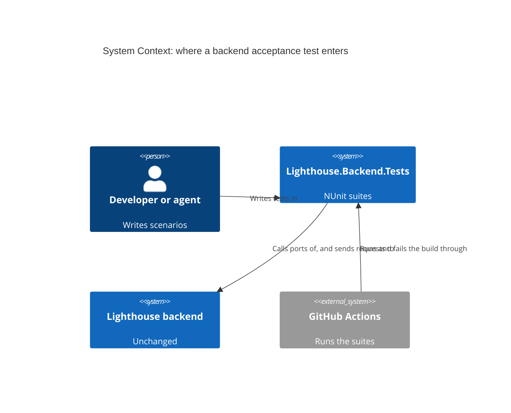
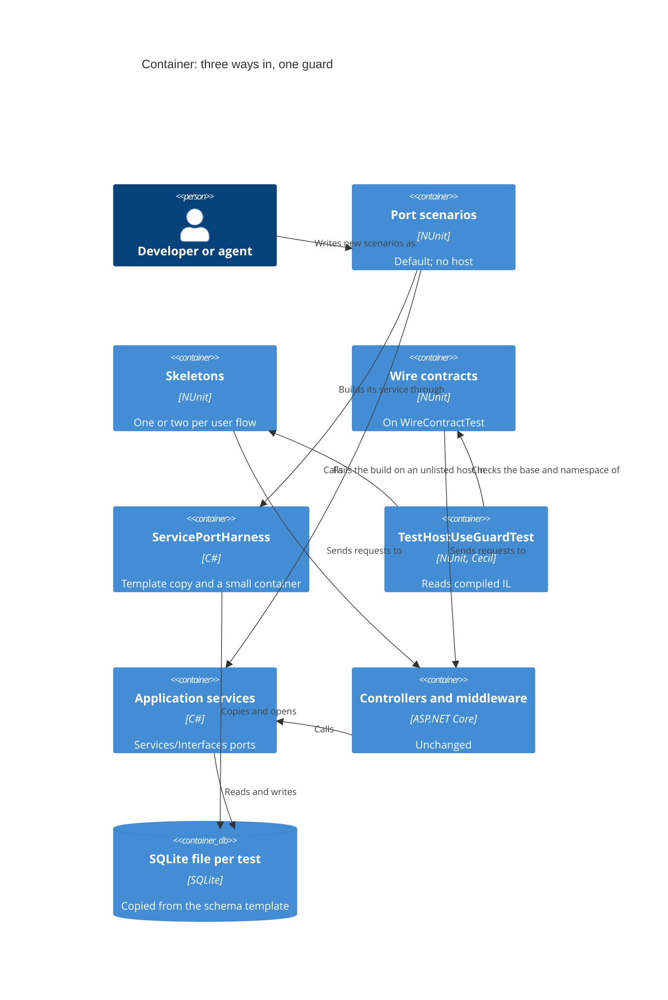

# Feature: story-6469-t5-acceptance-at-the-service-port

Story #6469 · T5 New acceptance scenarios drive the application-service port, with a thin HTTP skeleton per flow · part of Epic #6506
"Fast, reliable test suites". Catalogue: [Epic workspace](../epic-6264-modular-monolith/feature-delta.md) ·
Brief: [slice-49](../epic-6264-modular-monolith/slices/slice-49-t5-acceptance-at-the-service-port.md).

DISCUSS: the brief, settled with the maintainer on 2026-11-07. Its last two sections, "Maintainer decisions" and "Changes from T6's
DESIGN and DEVOPS", override the text above them. Waves start at DESIGN. Rigor `thorough`.

## Wave: DISCUSS / [REF] Inherited

- Epic decision D-6264-5. job_id: infrastructure-only. T10 #6537 and T11 #6538 wait on this Story; T6 #6512 is a dependency.
- Lighthouse-Clients, website, usage-data event, Terminology: N/A, as the brief answers item by item.

## Wave: DESIGN / [REF] Scope, mode and context

Application scope, propose mode, AFK: each engineering choice takes the recommended option and is recorded here. Paradigm OOP, as the
project states. No SPIKE, no wave-decisions file (the brief is the DISCUSS output). The decided points were not reopened.

Read: slices 49, 50, 51, 52; T6's delta, including its DEVOPS revision, "Maintainer decisions" and step 02-01; T2's delta and its
`measurement/`; `docs/ci-learnings.md` backend tests; ADR-270 Decisions 1 and 2; `brief.md` on backend test speed; `IntegrationTestBase`,
`TestWebApplicationFactory`, `TestDatabaseTemplate`, `FixtureSetupTimer`, `FixtureTimingReporter`, `TestHostScanning`,
`TestHostPerFixtureGuardTest`, `SharedHostsDrainTheUpdateQueueGuardTest`, `check_budget.py`, `trx_to_csv.py`, `test-time-budget.json`, the
harnesses of the five top families, and the reality check's controller, service and every test in its folder.

Nothing was run: this agent has no shell. Every number below is read from a file, and its source is named. What is an estimate says so.
`brief.md`, ADR-270, `ARCHITECTURE.md` §4: unchanged. No ADR, because no product architecture changes; this delta and the CLAUDE.md
bullet are the record, as for T2 and T6. Outcome registry check: not run, a test-structure Story adds no typed contract and this agent
runs nothing. Nothing here is a roadmap.

## Wave: DESIGN / [REF] Project rules, answered

| Rule | Answer |
|---|---|
| Bounded contexts touched (ADR-270) | **None changes.** No context, concept, edge or event is added. The tests moved here read Forecasting (the pilot) and whatever the top two turn out to be; the Platform lane's test set-up is not a context. ADR-270 and `ARCHITECTURE.md` §4 stay as they are |
| New terms (ADR-270) | **No domain term.** Four engineering words, kept in CLAUDE.md and out of the glossary: *port scenario*, *skeleton*, *wire contract*, *user flow*. One collision: the brief's "flow" means something else in ADR-270, where Flow metrics is a core context. The guard and the text say **user flow** |
| Domain events | None published or reacted to |
| UI surface (ADR-271) | N/A, because nothing a user sees changes: no screen, chart or copy. So no sketch, and no loading or failure look |
| nWave scenario tags in code | None. New tests carry no `@us-`, `@slice-`, `@kpi-` tag, as a comment or a title prefix, and no new `[Category("slice-01")]`-style attribute. The user-flow name on a skeleton entry is a value the guard reads, not a tag. Moved rows keep the attributes they have today, so their diff stays small |
| Ports and adapters | Production: unchanged. Port scenarios enter through a `Services/Interfaces` port, so controllers are skipped and driven adapters are real or doubled as today. **If a scenario has no port, it stays at the host and the gap goes to Epic #6508; T5 adds no port and moves no logic** |
| RBAC | All logic stays in `IRbacAdministrationService`. T5 adds no RBAC code and no test re-implements it. `[RbacGuard]` runs in the MVC pipeline, so a port scenario cannot see it and says nothing about who may call: every test pinning 401, 403 or an RBAC 404 stays at the host, in `Contracts`, through the existing `WithTestAuthentication` and `ClaimsDrivenRbacAdministrationService`. `ServicePortHarness` registers no RBAC service |
| Production code | None changes in any slice. Mutation: N/A, because Stryker mutates the product assembly; the deliberate break stands in |
| Comments | Written for a stranger, as CLAUDE.md asks. The two inline lists carry a one-line why each, with no slice or Story id |
| External integrations | None added, so no contract-test note. "Contract" here means our own HTTP wire contract |

## Wave: DESIGN / [REF] What a move can actually save

This drives the ranking, so it comes first. The brief ranks by "set-up ... plus body". **The body does not leave.** A scenario at the port
runs the same service on the same SQLite; only the HTTP hop goes.

| Fact | Source |
|---|---|
| Set-up inside a test, per test, in a seeded family: 278 ms as harnesses run today, 210 ms with the schema template on. The template fell short of T2's 30 % bar on this group and did not ship to it | T2 `ab-2026-11-02/summary.txt`, `groupB-ConfigureOncePerConnection` |
| Set-up with no seeders and the template on: about 4 ms | The same file, `CsvWorkTrackingConnectorTest` |
| One host build: mean 135 ms. Measured before T2, when there was one per test; since T2 most fixtures pay it once | T2 `d1-summary.txt`, 2,089 builds, 282 s |
| The slowest hosted tests take seconds where set-up takes a fraction of one, so they are body-bound (an inference: `L0` shows duration only): `Slice07WhereTheLimitsActuallyMovedTest` 20.5 s, 17.6 s, 16.5 s in one test; `Slice05ReconstructCycleTimeHistoryTest` 18.2 s | T6 `evidence/L0.csv`, Release |
| A reality check row costs about 0.3 to 0.73 s | `L0.csv`, ranks 562 to 1,608 of 12,810 |

Three things follow.

- **A move saves about 0.2 to 0.3 s per test, plus the fixture's host, and no more** (an estimate from the first three rows). The move's
  real target is the suite with many cheap tests whose set-up dwarfs the body, not the suite with the biggest seconds.
- **Host builds are the wrong yardstick now.** T2 already took the count far below 2,089, and a suite that leaves the host usually keeps one
  fixture there for its skeleton and contracts. See "Changed Assumptions".
- **A body-bound test should not move.** It lands in the fast tier (no host, so no `IntegrationFixture`) and sets T9's limit, which is
  2.1 x the largest fast-tier test. D-6469-9 keeps it at the host.

**Honest size of the prize.** Pilot plus two suites of about 100 tests each is roughly 250 to 300 moved tests, so about 60 to 90 s summed, against
2,253 s of summed CI backend time after T2's slice 5 (T2 delta, "CI after-measurement"). That is about 3 %, but it sets local seconds against a CI total, and CI runs the same tests slower, so **about 3 to 7 %** is the fairer estimate. **T5's value is
mostly the convention and the guard**, which stop every new feature adding at 0.3 s per test instead of 1 ms, and which give T10 and T11 their
tools. The moves prove the shape. Said so the maintainer is not surprised by a small number at the end.

## Wave: DESIGN / [REF] Decisions

| ID | Decision | Why (one line) |
|---|---|---|
| D-6469-1 | Three kinds of backend acceptance test: **port scenario**, **skeleton**, **wire contract**, each with a yes/no test (see "The convention") | Gives the guard lists to check and a reviewer a question to answer |
| D-6469-2 | Add one shared helper, `ServicePortHarness`, composed into a fixture, not inherited | 25-plus files build a SQLite context by hand in at least four shapes; every new scenario would copy one. T10 reuses it |
| D-6469-3 | Direct construction with `new` stays fine for up to three collaborators | The brief's rule; a harness for two mocks is noise |
| D-6469-4 | `WireContractTest` derives from `IntegrationFixture` and owns one host per fixture and nothing else: no seeding, no domain steps | Decided base; `IntegrationTestBase` cannot carry `WithTestAuthentication`, and a bare marker would copy T2's life cycle into every contract fixture |
| D-6469-5 | `Contracts` lives at `Lighthouse.Backend.Tests.Contracts.<Area>`; it marks nothing, the base carries the tier | T6 D-6512-18 |
| D-6469-6 | `Architecture/TestHostUseGuardTest.cs`, four rules, on T6's scan with its wider root set | One question per guard: T2's says how often, T6's says which tier, this one says whether a test may |
| D-6469-7 | **No count constant.** Same shape as T6: two inline lists, a stale entry fails, an addition shows in the diff | A constant is a second line in the same commit, so it stops nothing a reviewer would not see, and it conflicts between parallel Stories |
| D-6469-8 | A moved class keeps its namespace, name and test names, so moved rows keep their ids. New scenarios go to `Tests/Acceptance/<Feature>/` | A kept id is the strongest "no behaviour lost" proof. `API.Integration` is also excluded from Stryker filters, so new port scenarios must sit outside it to kill mutants |
| D-6469-9 | A row stays at the host if it pins the wire, has no port, or its body alone is over 2 s locally. The 2 s becomes T9's limit once T9 calibrates | Moving a body-bound test saves almost nothing and would raise T9's fast-tier limit. 2 s is the frontend's local per-test limit, an estimate here |
| D-6469-10 | Rank in two stages, then correct with the pilot's measurement, as in "Ranking rule" | Removes the "body leaves" error and needs one run only |
| D-6469-11 | The pilot is `ForecastRealityCheck` (3 fixtures, 81 rows) and does not count towards the top two | One-method port, a precedent in the same folder, and all four outcomes appear in it |
| D-6469-12 | Slice order: helper and small move, pilot, guard, text, top two | The pilot settles the helper and base the guard and the text name. The guard still lands before the top two |
| D-6469-13 | DELIVER starts after T6's slice E | T5's moves would otherwise be foreign commits in T6's id proof, and the guard needs T6's scan |
| D-6469-14 | The Story's number is seconds of the moved suites, before and after. The host-build count is reported and must not rise | See "What a move can actually save" |
| D-6469-15 | The DISTILL text is a sentence in the CLAUDE.md bullet, not a file | There is no dispatch file, and the nWave package reverts on reinstall |
| D-6469-16 | Peer review run twice (Sonnet): approved on the second pass, see "Review" | Rigor `thorough` |

## Wave: DESIGN / [REF] The convention (D-6469-1)

A **user flow** is one user outcome reached through one entry route, for example "a Team's reality check runs and its answer comes back".

| Kind | What it is | Yes/no question | Where |
|---|---|---|---|
| **Port scenario** (the default) | Drives a `Services/Interfaces` port, over real SQLite where the database matters, and asserts a business outcome. No host | Is this a business outcome a service can show? | `Tests/Acceptance/<Feature>/`; a moved suite stays where it is |
| **Skeleton** | Sends a real request through the host and asserts a business outcome that needs the route, the DI wiring or middleware to appear. One or two per user flow; a third is caught in review | Could every assertion be made after calling the service directly? If yes, it is not a skeleton | On the skeleton list, with its user flow |
| **Wire contract** | Pins route and verb, status code, JSON member names and formats, headers, or the auth outcome | Would a caller notice if this changed while every service behaved? | `Tests/Contracts/<Area>/`, on `WireContractTest` |

Anything else that starts a host sits on the shrinking list. A reviewer's violation test, from the brief: a host test whose every assertion could
be made after calling the service directly, and that is on neither list.

**Boundary cases.**

- A test asserting both a business value and the wire is split when it moves: value to the port, wire to `Contracts`.
- **A walk over the whole JSON tree is a wire assertion**, even if it reads like a rule ("no part of the answer can rank a window"). A row holding such a walk beside business values is split like any other.
- Logic in a controller has no port: the test stays at the host and the gap is recorded for #6508.
- A suite that never makes an HTTP call but needs the host's container is still a host test (see `FasterUpdates` below).

## Wave: DESIGN / [REF] Component decomposition

| Component | Path (under `Lighthouse.Backend.Tests/`) | Change | Contract shape, and how the crafter asserts it |
|---|---|---|---|
| `ServicePortHarness` | `TestHelpers/` | NEW | Bounded-change: its universe is one temp database and its side files; after dispose none remains. Asserted by a test on the helper |
| `WireContractTest` | `Contracts/` | NEW | Bounded-change: one host per fixture, one database per test. Passes `SharedHostsDrainTheUpdateQueueGuardTest` with no list entry |
| `TestHostUseGuardTest` | `Architecture/` | NEW | Pure over a compiled module, then a list comparison. Planted fixtures, and a real planted class under Debug and Release |
| `TestHostScanning` and the walker | `Architecture/` | REUSE after T6 slice D; EXTEND here if T6 never lands | Pure over a module |
| `RealityCheckWireContractTest` | `Contracts/Forecasting/` | NEW, with 14 moved rows and 7 new | Host fixture |
| `RealityCheckSkeletonTest` | `API/Integration/ForecastRealityCheck/` | NEW, one moved row | Host fixture, on the skeleton list |
| Reality check port base, and the shared script, seed steps and answer reader | `API/Integration/ForecastRealityCheck/` | NEW by extraction | **Unbounded preservation, universe the whole database:** `Run` writes nothing. Today's check is narrower (six `Team` columns, that Team's Work Items, the Team count), so the port row keeps it and adds a command counter on the harness's context, as `RealityCheckQueryCountTest` counts reads: no INSERT, UPDATE or DELETE from any table during `Run`. The answer reader carries the history invariant, see the shared-step table |
| `ForecastRealityCheckAcceptanceTest` | same | MODIFIED: now serves `Slice06` and the skeleton only | Unchanged host life cycle |
| `Slice01...Test`, `Slice04...Test` | same | MODIFIED: new base, names kept | Ids kept |
| `Scripts/test-timings/test-time-budget.json` | outside tests | MODIFIED: `Slice01...` entry drops once CI shows it under the 34 s budget | `check_budget.py` |
| `CLAUDE.md` | root | MODIFIED: one bullet | Read by every wave |

**Why the shared parts become objects.** A class has one base, and the script, the seed steps and the answer are needed by three: the port base, the host
harness and the contract fixture. So they are composed, and a fixture holds them. Internal shape stays the crafter's.

## Wave: DESIGN / [REF] Driving ports

| Port | Entered by | Note |
|---|---|---|
| `IForecastRealityCheckService.Run(team, mode)` | Port scenarios of the pilot | Takes a loaded `Team`, so the scenario reads it first. `Run` is read-only, and its interface exposes no write method |
| The port each top-two suite names | Its port scenarios | Named in that suite's DESIGN note |
| `POST /api/latest/forecast/reality-check/{teamId}`, `POST /api/v1/forecast/reality-check/{teamId}`, `POST /api/latest/forecast/backtest/{teamId}` | Skeleton and wire contracts | Unchanged |

## Wave: DESIGN / [REF] Driven ports and adapters

| Port | At the port scenario | At the host |
|---|---|---|
| `LighthouseAppContext` and repositories | Real, on a per-test copy of the template | Real, as today |
| `IForecastService` | The existing scripted double; the shipped engine for the one moved row that asks for it | Unchanged |
| `ILighthouseClock`, `TimeProvider` | The existing fakes (`FakeLighthouseClock`, `TestToday.Clock`) | Unchanged |
| `ILicenseService` | Not reached: the licence is checked outside the port in this suite, confirmed at slice A | The existing mock |
| `ILogger<T>` | `NullLogger`, or a capture where a scenario reads it | Serilog capture, as today |
| Trackers, collector | The existing doubles | Unchanged |

No new external call. No new adapter, so no `probe()`: the helper is a test fixture, and what can lie about it is in "What can lie".

## Wave: DESIGN / [REF] Technology choices

Unchanged: C# on .NET 10, NUnit, Moq, EF Core on SQLite, `Mono.Cecil` through `IlDependencies`, `Microsoft.Extensions.DependencyInjection`. No new package,
so the OSS check has nothing to add. `Lighthouse.Backend.Tests.csproj` stays untouched: a csproj edit is a shared path and forces every live suite (T6 DEVOPS).

## Wave: DESIGN / [REF] The port helper (D-6469-2, D-6469-3)

`ServicePortHarness` is an `IDisposable` a fixture creates in `[SetUp]` and disposes in `[TearDown]`. It holds no static state, so fixtures stay parallel.

- **Database.** Copies the schema through `TestDatabaseTemplate.CopyTo` to a unique temp path, and connects the way the host does: `Pooling=False`,
  `DatabaseConfigurator.ConfigureSqlite`, `NoWaitingForTheDisk`. Foreign keys and file semantics therefore match the host. T2 rejected in-memory SQLite
  for this, and the decision stands.
- **Services.** A `ServiceCollection` with only the context, `FakeCryptoService`, logging and the clock. The fixture's own registrations come from one
  `Action<IServiceCollection>`, so what a port needs is visible in one place. Each scenario gets a scope.
- **Not in it.** No seeders by default: a fixture calls the ones its scenarios read. How much of the set-up is the seeders is unmeasured (T2 says so); slice A's `c` shows it. No factory type, so the guard's scan
  can never read it as a host. No RBAC service. No clock movement beyond what the fixture does.
- **Dispose.** Closes connections, then deletes the file and its side files, with the retry `IntegrationTestBase` already uses on Windows.

**Rejected.** A base class: a moved suite already has one, and this must also sit under a harness base. The host's container without HTTP: the host and the per-test set-up
stay, so it saves almost nothing. Calling `Program.RegisterServices`: it is private and takes a `WebApplicationBuilder`, and T5 changes no production file.

**The known cost.** A hand-listed container can drift from `Program.cs`. That is what the skeleton is for, and `ServiceProviderValidationTest` still validates the real graph.

## Wave: DESIGN / [REF] The contract base (D-6469-4, D-6469-5)

`WireContractTest` is abstract, derives from `IntegrationFixture`, and so carries `Integration` by inheritance. It has a one-time set-up that builds one host from a
`TestWebApplicationFactory` with `UseSchemaTemplate` on; one protected hook through which a fixture adjusts the host (test authentication, a licence mock); a per-test
reset (clock, fresh database, cached metrics, new client); and a tear-down through `SharedHostTearDown.LeaveTheHostIdleOrFail`. It offers a client and a scope. No seeding, no
routes, no domain words: those belong to the fixture.

| Alternative | Rejected because |
|---|---|
| Derive from `IntegrationTestBase` | It builds its host and client in the constructor, so no hook can adjust the host, and it does not drain the queue. As it stands it also cannot take `WithTestAuthentication`, which returns a plain `WebApplicationFactory`; a factory subclass could work round that, but not the rest |
| A marker with no members | Each contract fixture would copy about 40 lines of T2's life cycle, the very thing `ci-learnings.md` says is still checked by hand |
| A base per suite | The maintainer asked for a small base, one deliberate step visible in a diff |

**Against T6.** `Contracts` is not a tier marker; the category comes from the base. The guard's rule 2 passes, because a contract fixture reaches a host. `trx_to_csv.py` reaches the base through
the chain. T6's Python check fails if two classes on a chain share a simple name, so a contract class gets its own name, which `...WireContractTest` gives it.

## Wave: DESIGN / [REF] The guard (D-6469-6, D-6469-7)

`TestHostUseGuardTest` reads the compiled assembly through `IlDependencies.ReadModule` and passes T6's wider root set to the walker: set-up, one-time set-up and tear-down, constructors,
inherited methods, tests. It judges each concrete class with tests, nested ones included.

| Rule | Fails when | Message names |
|---|---|---|
| 1. A host needs a reason | A concrete fixture reaches a host start, is on neither list and does not derive from `WireContractTest` | The type, and the three ways out: move it to the port, list it as a skeleton with its user flow, or make it a wire contract |
| 2. No stale entry | A type on either list reaches no host, or no longer exists | The type, and that its line goes in this commit |
| 3. One list only | A type is on both lists, or derives from `WireContractTest` and is on a list | The type |
| 4. `Contracts` means the base | A type derives from `WireContractTest` outside `...Tests.Contracts`, or a fixture in that namespace does not derive from it | The type |

There is deliberately no rule that a contract fixture must use the wire: the base starts a host for every fixture on it, so such a rule could never fire. Whether a fixture on the base really pins the wire is the reviewer's question.

**Two lists, inline.** `HostUsersStillToMove`: full type names, generated from the guard's first run. It holds more than 400 names, going by T6's count of hosted files; the first run prints the real number. One why for
the whole list, not one per line: these predate the convention. `SkeletonsByUserFlow`: full type name to user flow, and it may grow. Today's classes that test the host itself, such as `TestWebApplicationFactoryTest`, stay
on the first list; it need not reach zero.

**The count constant: same shape as T6, no constant.** The brief's `MostTypesTheListMayHold` style is dropped. T2's constant "only goes down" because a person lowers it. Adding a type and raising the number are
two lines in one commit, so it blocks nothing that the `+` line alone would not show a reviewer, and on a trunk where Stories move tests in parallel every removal conflicts on that one line. What keeps the list shrinking is rule 2, as T6
found: a fixed type cannot stay listed. What keeps a new type off it is rule 1's message, which does not offer the list as a way out and says outright, as T2's does, to fix the type and not add it; then the CLAUDE.md line and the review. For additions, "only shrinks" rests on those alone.
The difference from T6 is honest and worth stating: T6's list empties in a day, this one lives for years, so an addition is more likely here. If additions ever appear, the answer is a stricter review, not a number.

**Limits.**

- It judges classes, not methods: **a new scenario added to an already listed class passes.** Listing thousands of methods was rejected. The backstop is T9's total ceiling, which a feature adding host time must raise in a reviewed diff, and the CLAUDE.md line.
- T6's limits hold: the walk stops at the test assembly, a host built any other way is invisible, and a virtual call can over-report.
- It cannot tell a skeleton from a mislabelled wire test. That is the reviewer's question.
- **`Contracts` is an unlisted route:** anything on `WireContractTest` in the namespace passes for good, with no line to review, so a business scenario put there is invisible to the guard. The diff shows a new class in `Contracts/`, and the CLAUDE.md test applies. Nothing else catches it.
- A host held by a `[SetUpFixture]` or a static and reached without a start is not judged: a set-up fixture has no tests, and the walk looks for host starts.

**Details the crafter keeps.** Test roots are T2's attribute set (`SetUp`, `Test`, `TestCase`, `TestCaseSource`, `Theory`), plus T6's wider set, because the pilot has methods with `[TestCase]` only. List keys are Cecil's `FullName`, so a nested class reads `Outer/Inner`, not the TRX's `Outer+Inner`.

**Planted fixtures**, in the `PlantedFixtures` style. Red: a host from `[OneTimeSetUp]` on neither list (the brief's AC), from a constructor, from a base class's set-up, through a helper; a contract base outside the namespace; a fixture in
the namespace off the base; a type on both lists; a stale entry. Green: a port fixture using `ServicePortHarness`, a contract fixture, a listed skeleton. Acceptance is stronger: a real concrete class in the working tree,
red under Debug and `-c Release` with its name in the message, the output kept in the workspace, then removed.

**The guards side by side.** T2: how often a host starts. T6: which tier a fixture sits in. T5: whether a fixture may use a host at all. A suite leaving the host therefore touches, in one commit: its base (T6 rule 2), its line here (rule 2), and any line in T2's lists.

## Wave: DESIGN / [REF] The timing run (for the maintainer)

**One run, not one per family**, and the env var alone is not enough. `LIGHTHOUSE_FIXTURE_TIMING=1` writes set-up, tear-down and host-build times per fixture, and **no test time**. Test time is only in a TRX, so the run needs `--logger trx` too. T2 showed each TRX duration includes
`[SetUp]`, and excludes `[OneTimeSetUp]` and `[OneTimeTearDown]`. Tear-down is inside too, inferred from the same measurement: the durations added up to the span with no gap to hold it.

**Before.** A quiet machine, no other test run, Docker up, `main` at or after `d496a646a`, the licence file in place, `dotnet build-server shutdown` after the build.

From `/storage/repos/Lighthouse`:

```
W=docs/feature/story-6469-t5-acceptance-at-the-service-port/measurement
mkdir -p $W
dotnet build Lighthouse.Backend/Lighthouse.Backend.Tests -c Release
dotnet build-server shutdown
LIGHTHOUSE_TEST_WORKERS=6 LIGHTHOUSE_FIXTURE_TIMING=1 LIGHTHOUSE_FIXTURE_TIMING_OUT=$PWD/$W/fixture-setup-timings.csv \
  dotnet test Lighthouse.Backend/Lighthouse.Backend.Tests -c Release --no-build \
  --filter "TestCategory!=Integration&TestCategory!=JiraIntegration&TestCategory!=LinearIntegration&TestCategory!=AdoIntegration&TestCategory!=ServiceNowIntegration&TestCategory!=GithubIntegration" \
  --logger "trx;LogFileName=t5.trx" --results-directory $PWD/$W
python3 Scripts/test-timings/trx_to_csv.py --trx $W/t5.trx --output $W/t5-tests.csv
```

Why these choices: Release and 6 workers match T6's `L0`, so `L0.csv` is a free second sample of the same code. The filter is CLAUDE.md's standard one, plus `GithubIntegration`, which changes nothing today. **Run it before T6's slice C.** Once hosted tests carry `Integration`, `TestCategory!=Integration` leaves them all out and the run ranks nothing; after that point drop that one term, which is T6's standard filter.
The set-up CSV can also be read back from `TestContext.Out` if the path fails. `LIGHTHOUSE_FIXTURE_TIMING_OUT` is an absolute path because the reporter runs inside the test process, whose working directory is not this one. Keep both CSVs in the workspace and gzip the TRX, after searching it for token shapes and real hosts, as T6 did with `L0`.

**What the run must read. Stop and tell me if any row is off.**

| Check | Must hold | If not |
|---|---|---|
| Exit, failures | Only environmental failures from CLAUDE.md; no test in a ranked family failed | A failed test's time is not its real cost: fix the cause or drop the family from the ranking |
| `fixture-setup-timings.csv` | Exists, with about 300 rows or more (T2 had 309) and a `Slice13ReadinessTest` row with `setup_count` 44 or more | The reporter did not run: `TestContext.Out` holds the CSV |
| `t5-tests.csv` rows | Close to `L0`'s 12,810 | A filter problem |
| `category` column | Ignore it: every row reads `Unit`, because the command gives no `--source-root` | n/a |
| Family sums against `L0.csv` | The top ten families agree within 25 % (an estimate) | The machine was loaded: run once more |
| Host-build total | Sum of `host_build_count`. **This is the new baseline for the AC**, replacing 2,089 | n/a |

## Wave: DESIGN / [REF] Ranking rule (D-6469-10)

**Join.** Do not split `fully_qualified_name` on dots: test arguments hold dots and commas, and fixture arguments sit mid-name. Take a row's class from the TRX itself, `TestMethod className` by `testId`, as `_class_name_lookup` in `trx_to_csv.py` does, and strip any `(...)` from the class only. Count only `Passed` rows: the 11 `NotExecuted` rows in `L0` are `[Explicit]` or ignored tests. Join to the timer on the part after the last `.`. Two traps: **a simple name in two namespaces is merged in the timer, so mark it and use the TRX figure only;** and a nested fixture has two timer rows, `Outer+Inner` from host builds and `Inner` from `GetType().Name`, so add them. Then group classes into a **family** by
owner: the abstract harness a class derives from (`d1-by-listed-owner.csv` lists them), or the class alone.

**Columns, per family, in seconds.**

| Column | Formula |
|---|---|
| `tests`, `trx` | Row count; sum of `duration_ms` |
| `setup` | `setup_total_ms` + `teardown_total_ms`, summed over the family |
| `fixed` | `one_time_setup_ms` + `one_time_teardown_ms`, and for classes on `IntegrationTestBase` also `host_build_total_ms`. A host starts in one of three places: eagerly in `[OneTimeSetUp]`, already inside `one_time_setup_ms`; lazily at the first `CreateClient` in the first `[SetUp]`, as the pilot's harness does, already inside `setup`; or in `IntegrationTestBase`'s constructor, which no phase timer wraps. Adding `host_build_total_ms` anywhere else counts it twice |
| `body` | `trx` - `setup` |

A family with tests whose timer rows show `setup_count` 0 is **unmeasured, not free**: `FixtureSetupTimer.Measure` sits only in the harnesses that call it. So is one with `host_build_count` 0, which starts its host through a plain factory or a `*TestHost` helper. List it apart, and read its set-up from the code or give it the seeded family's figure, marked as such.

**Leave out** before ranking, as the brief's OUT and the subject of the test demand: `Integration.Containers`, live classes, `Architecture`, `Startup`, `Health`, `API.Security`, the families of `ChecksTheTestHostItself`, and the pilot.

**Stage 1, the ceiling.** Rank by `setup` + `fixed`, which is what would leave if every test moved and the port cost nothing. Do not rank by `trx`, and never by host builds.

**Stage 2, what can move.** For the top five, read the harness and fill the first pass of the coverage table. `m` = rows that are neither wire, nor without a port, nor over 2 s of body. Rank by ceiling x `m` / `tests`, and take the top two. This also settles the brief's "per test whether it makes an HTTP call", which no timer can answer: it is a reading, and only for five families.

**Stage 3, the correction.** Slice A measures on `Slice04...` the port's own cost per test `c` and the HTTP share of a body `h`, both before and after on the same machine. Then per family: `saving = m x (setup / tests - c + h)`, plus `fixed` if the whole family leaves. **Stop rule:** a suite whose `saving` is under 1 % of summed time of the hosted families is reported and not moved, as T10 does. Then ask.

## Wave: DESIGN / [REF] What the top candidates look like today (provisional)

Read from the harnesses, for the maintainer's eye; **the run decides, not this table.** Test counts are T2's host builds, which were about one per test; T6 has more rows now.

| Family | Tests | How it drives | First read of what can move |
|---|---|---|---|
| `UsageDataCollectorObservationTest` | 279, 14 fixtures | POST with a consent header in; JSON reaching the collector out | **Probably little, despite topping every list.** The parsing (`AsTakenIn`) and the gate call are in `UsageDataController`, so a scenario from the browser's message has no port; what reaches the collector is an outbound wire contract. A slice of it could enter at `IUsageDataEventQueue` |
| `ConnectionDefaultsAcceptanceTest` | 98 | Settings routes, "with the body the page sends" | Unknown; its harness says the route is the point, and it has set-up of 278 ms |
| `FasterUpdatesAcceptanceTest` | 94 | `ITeamUpdater.TriggerUpdate`, no HTTP in nearly every scenario | **Fails the reviewer's test on its face**, yet its port is wide: the real queue, `TeamDataService`, `WorkItemService`, metrics, dispatcher, `RefreshLogService`. A small `ServiceCollection` may not hold it. See Open questions |
| `TaskManagerAcceptanceTest` | 90 | Task routes | Unread here. On T2's list: `KeepsProblemsNothingCanEmpty` |
| `ReconstructOverTimeHistoryAcceptanceTest` and the percentiles family | 111 | One GET route, then the filler | **Not a candidate on seconds:** the top of `L0` is its body. It needs its own look at why a fill takes 20 s, which is not a host question |

## Wave: DESIGN / [REF] The pilot (D-6469-11)

**Why this one.** `IForecastRealityCheckService` has one method. `RealityCheckQueryCountTest`, in the same folder, already runs the service over SQLite with no host, so the shape is known to work. And the family shows all four outcomes: moves, skeleton, contract, no port. It ranks fourth by D1's saving. If the run puts it in the top two, the next family takes its place.

**Outcome of each of the 81 rows** (66, 5 and 10; counts confirmed in `L0.csv` for `Slice01`, in D1 for the others).

| Rows | Test | Goes to | Why |
|---|---|---|---|
| 47 | The other `Slice01...Test` rows (the region, levels, sufficiency, windows, dates, no-write) | **Port**, same class, same id | Every assertion is a value on the answer, once the shared steps below are carried over. `A_Team_finishing_one_Work_Item_every_day...` asks for the shipped engine; if its collaborators prove too wide it stays as a second skeleton |
| 5 | All of `Slice04TheAnswerOpensInADialogTest` | **Port**, same id | Values on the answer |
| 1 | `Maria_runs_the_reality_check_on_Ocean_Explorer...` | **Skeleton** `RealityCheckSkeletonTest`, user flow "A Team's reality check runs and its answer comes back" | The one scenario on the shipped engine through the whole wiring |
| 13 | `The_same_check_answers_on_the_versioned_route_as_well`; `The_check_answers_whether_or_not_the_forecast_filter_choice_is_given` x4; `A_request_whose_filter_choice_is_not_yes_no_or_unset...` x3; `Dates_sent_with_the_request_are_ignored...`; `Tom_who_can_read_the_Team...`; `Somebody_who_cannot_read_the_Team...`; `A_Team_that_does_not_exist...`; `The_single_back_test_beside_the_check...` | **Contracts** `RealityCheckWireContractTest` | Route, body, status, auth |
| 4 | `No_part_of_the_answer_can_rank...` x2; `The_windows_either_side_of_an_off_ladder_setting...`; `A_check_whose_forecast_could_not_be_worked_out...` | **Split.** The row stays at the **port**, same id, with its business values (the ladder order, the region, the setting, `DegenerateForecast`, 15 evaluated). Its JSON walk becomes a new row in **Contracts** | Business value and wire in one test |
| 1 | `Running_the_check_twice...` | **Contracts** | Compares raw text, nothing else |
| 10 | All of `Slice06AnOperatorSeesEveryRealityCheckTest` | **Stays**, on the shrinking list, on the old harness | The log line, the override mapping and the 404 are in `ForecastRealityCheckController`: no port. Input for #6508 |
| 0 | `RealityCheckQueryCountTest` (2 rows, no host) | Untouched | Already at the port. Its hand-built context may adopt the helper when touched |

So 56 rows leave the host (47 + 4 + 5) and 25 stay on it, plus 7 new wire rows, in three classes. Host fixtures: 3 before, 3 after, so **the host-build count does not fall, which is D-6469-14's point.** The family's seconds should.

**HTTP-coverage table.** Today nearly every row pins the wire by accident, through `ReadTheAnswer` and `Field`. A move would lose that silently, so 3 new rows take it over.

| What is visible on the wire | Pinned today by | After the move, pinned by |
|---|---|---|
| POST, latest route | Every row | Skeleton, contract rows, `Slice06` |
| POST, versioned route | Versioned row; `Slice06` x2 | Contract row, `Slice06` |
| 200 and a readable body | `ReadTheAnswer`, every row | Skeleton, contract rows |
| 404 for a Team that does not exist | One row; `Slice06` | Contract row, `Slice06` |
| 404 for a caller who cannot read the Team (RBAC) | One row; `Slice06` | Contract row, `Slice06` |
| 200 for a read-only viewer (RBAC) | `Tom_who_can_read...` | Contract row |
| 400 for an unreadable filter choice | 3 rows; `Slice06` x2 | Contract rows, `Slice06` |
| Request member `applyFilterOverride`; dates ignored | 5 rows | Contract rows |
| **Every response member name**, nested ones too | `Field(...)`, spread over all rows, for the members the reader reads | **New row:** a real answer, read in full through today's `RealityCheckAnswer`, which moves to the contract fixture, **extended to every member of the DTO.** It then also pins five names nothing pins today: `teamId`, `teamName`, `levelOutcomes[].forecastValue`, `filterApplied`, `excludedSummary` |
| **Null members are present as null:** `forecast`, `actualCompleted`, `outcome`, `levelOutcomes` on a cell that cannot be evaluated | `Field(...)` on such cells | **New row**, from a Team with cells that cannot be evaluated. The shipped-engine answer evaluates all 16, so it cannot show this |
| **Date format `yyyy-MM-dd`** | `AsDay`, every row | The same new row |
| **Enums as text:** `Determination`, `CurrentSettingStanding`, `SufficiencyReason`, `CellOutcome`, `LevelReading`, the not-tested reason | String comparisons, spread over rows | **New row**, one case per member, through the host's own JSON options. Enums go out as strings and an in-process port cannot see that |
| No raw number per window, no sentence, no negative number, same text twice | 5 rows | 4 new rows split from them, and `Running_the_check_twice...` moved whole |
| Back test route | One row | Contract row |
| Log line | `Slice06` | `Slice06` |
| Values of `filterApplied`, `excludedSummary`, set in the controller | **No scenario here** | Unchanged: a gap today, not made by this move. Only the names gain a pin. Recorded for #6508 |

**Business assertions in shared steps.** The same risk runs the other way: a shared step can hold a rule, not just wire. The coverage check therefore reads every shared step, for this suite and for the top two.

| Shared step | What it asserts | Kind | After the move |
|---|---|---|---|
| `ReadTheAnswer` | Status 200 | Wire | Skeleton, contract rows |
| `ReadTheAnswer` | `Forecasts.HistoriesNoSweptWindowIsAsLongAs` is empty: each check learns from exactly its own window | **Business, on every row** | **The port's answer reader carries it**, so all 56 port rows keep it; the host readers keep it too |
| `Cell`, `Coverage` | Exactly one match | Business | Stay in the reader |
| `Field` | The member exists | Wire | The new member-name row |
| `ThenEveryReasonAndOutcomeComesFromItsClosedSet` | Text is in a closed set | Wire; at the port the enum type holds it | The enum row |
| `WhatIsStoredFor` | Team and Work Items unchanged | Business | Port row, widened as in "Component decomposition". The skeleton keeps it at the host, so the controller's own `GetForecastThroughputStatus` call stays covered |
| Tear-down: history filler and queue drained | The host is left idle | Host only | Nothing to carry: no host. Stays for host fixtures |

**Id table.** 66 rows keep their ids (47 + 4 + 5 at the port, 10 in `Slice06`), so the proof is a list diff: the ids of the `ForecastRealityCheck` classes before, the ids after, with the 15 rows that change class mapped one by one (14 to `RealityCheckWireContractTest`, 1 to `RealityCheckSkeletonTest`), and the 7 new rows marked new. Kept in the workspace. Any other line fails.

**Deliberate break.** Change the five-day bar in `ForecastRealityCheckService` by one, in the working tree: `Five_days_with_finished_work_is_enough_to_check_and_four_is_not` must go red at the port, and the output is kept. Then revert. The change must still compile (the build fails on a commented-out line before any test runs).

## Wave: DESIGN / [REF] Slices (D-6469-12)

Each leaves the suite green. No production file in any slice. A move is its own commit, and never mixes with an edit. Days are estimates. Timed runs stay off the working day.

| Slice | Days | Delivers | Proof |
|---|---|---|---|
| A | 0.5 | `ServicePortHarness` with its test; `Slice04` moved | Ids equal; `c` and `h` measured before and after; helper leaves no file |
| B | 1 | `WireContractTest`, `Contracts`; `Slice01` split into port, skeleton and contract; the 7 new wire rows | Id table; coverage table; deliberate break; family seconds before and after; run alone 3 times |
| C | 1 | `TestHostUseGuardTest`, both lists from its first run; planted cases | A real planted class red under Debug and `-c Release`, named |
| D | 0.25 | CLAUDE.md bullet, with the DISTILL sentence | Read by the review. "A new scenario lands at the port" is first tested by the next feature's DISTILL, as T11 notes; said so |
| E | 1 | Top suite: its DESIGN note, tables, move | As B |
| F | 1 | Second suite, the same | As B |

The maintainer decides again after F, with the numbers. **E and F are re-sized when their DESIGN notes are written.** Their coverage tables are owed: they need the timing run. A short addendum to this delta holds each table and the port it names, reviewed before the move, as the brief says.

**T10.** A suite T5 touches is closed to T10 until T5 finishes it, and T10 starts from what T5 leaves, as decided.

## Wave: DESIGN / [REF] The CLAUDE.md bullet (draft, lands in slice D)

> **New backend acceptance scenarios drive the application-service port.** Build the service with `ServicePortHarness`, or with `new` for up to three collaborators, and put the test under `Tests/Acceptance/<Feature>/`. A test may start a host only as a skeleton (one or two per user flow, on the list in `TestHostUseGuardTest`, asserting a business outcome that needs the route or the wiring) or as a wire contract (route, status, JSON names, headers, 401/403, on `WireContractTest` in `Tests/Contracts/`). A new scenario in a class already on the guard's list goes in a new class at the port too. Tell every acceptance-designer dispatch so.

T11 later shortens this to its three lines, and takes it into the skill.

## Wave: DESIGN / [REF] If T6 never lands

**State as read at the end of this wave.** The brief for this wave said T6 was held and `IntegrationFixture` did not exist. Both have moved on: T6's delta records the maintainer's answer to the `[Explicit]` question (base keeps its shape, the rule changes), and `TestHelpers/IntegrationFixture.cs` is on disk with no class deriving from it. The filters have not switched. Nothing in this design depended on that answer. Three ends remain possible, and the middle one is the trap.

| Thing | With T6 | Without T6 |
|---|---|---|
| `WireContractTest` base | `: IntegrationFixture` | No base. Remove one token. No category, so contract tests stay in CI's always-on selection exactly as hosts do today |
| Scan | Moved and widened by T6 slice D | **T5 slice C gains T6's two commits**: the `refactor` move of the walker to `TestHostScanning`, then the root set as a parameter. About half a day. The rest of the guard is unchanged, as it never names `IntegrationFixture` |
| "Leaves the base in the same commit" | Enforced by T6 rule 2 | Nothing to leave |
| Fast tier, T9's limit | D-6469-9's 2 s becomes T9's limit | Stays 2 s, a written rule with no check |
| Ranking | Unaffected | Unaffected: it reads classes, never the `category` column |
| T10's `Integration` time | Available | Lost: T10 needs its own source |
| Order (D-6469-13) | After T6's slice E | Starts at once |

**The partial case: `IntegrationFixture` exists but T6 stops before its filters switch, or before hosted classes move.** Then `WireContractTest : IntegrationFixture` would make contract tests the only hosted tests carrying `Integration`. CI's `Category!=Integration` would silently drop them if the filters have not switched, and CLAUDE.md's local filter would skip them either way. **So `WireContractTest` takes the base only once T6's slice E is done; otherwise it has no base,** as in the table. D-6469-13 already gives this order, and the rule covers a change of plan. The timing run is not affected until T6's slice C.

## Wave: DESIGN / [REF] Reuse Analysis

| Existing | File | Overlap | Decision | Contract shape, universe, how asserted |
|---|---|---|---|---|
| `TestDatabaseTemplate.CopyTo` | `TestHelpers/` | Cheap real database | REUSE | Copies one file to a named path; its own tests |
| `RealityCheckQueryCountTest.BuildContext`, `SecretCustodyServiceTests.BuildProvider` and 25-plus like them | various | Context and small container | CREATE NEW `ServicePortHarness`: each is private to its file, and they differ (`:memory:`, a file with `Migrate`, with and without the foreign-key set-up). Extending one means making it public from a test class. Not rewritten here; they adopt it when touched | Bounded-change, universe one temp path; no file left, asserted in the helper's test |
| `IntegrationTestBase` | `TestHelpers/` | Host life cycle | Not extended for the contract base, see "The contract base" | n/a |
| `SharedHostTearDown`, `SharedHostCleanup`, `ForgetTheCachedMetrics` | `TestHelpers/` | Per-test reset on a shared host | REUSE | Existing guards |
| `*TestHost` helpers | `TestHelpers/` | Host set-up by composition | Not used by the base; a contract fixture may use one where it fits | n/a |
| `WireContractTest` | none | One host for a wire test | CREATE NEW: decided by the maintainer, and no existing base carries the auth host and the drain together | Bounded-change, universe one host and per-test database |
| `TestHostPerFixtureGuardTest`, `TestTierGuardTest` | `Architecture/` | A guard over the same scan | CREATE NEW `TestHostUseGuardTest`: T2's roots are per-test only, and T6's question is the tier. One question, one message each, as the brief decided | Pure over a module, then a list comparison; planted fixtures |
| `HostBuildingScan`, `Compare`, `PlantedFixtures` idiom | `Architecture/` | Walk, list comparison, planted cases | REUSE | Pure; T2's and T6's guards stay green unchanged |
| `FixtureSetupTimer`, `trx_to_csv.py` | | Timing | REUSE unchanged | Read-only for this Story |
| `FakeLighthouseClock`, `TestToday`, `DrawsFromAPinnedStartingNumber`, `CapturedLogMessages` | test doubles | Fakes | REUSE | Existing |

Every overlapping test suite's contract shape is read-only or bounded: a moved scenario's universe stays its own database, as today.

## Wave: DESIGN / [REF] What can lie, and what catches it

| Assumption | Could be false because | Caught by |
|---|---|---|
| A green port suite means the feature works in the product | The hand-listed container differs from `Program.cs` | The skeleton; `ServiceProviderValidationTest` |
| A move loses no wire check | Assertions hide in shared steps, as `Field` and `AsDay` do here | The coverage table, read per step and not per test; the 3 new rows |
| A move loses no business check | Rules hide in shared steps too, as the history invariant does in `ReadTheAnswer` | The shared-step table; the deliberate break, which shows one rule only |
| Port SQLite behaves like host SQLite | A different connection set-up | The helper takes `DatabaseConfigurator.ConfigureSqlite` and `Pooling=False` from the host; a foreign-key row planted in the helper's test |
| The port test can fail | Same as any moved assertion | The deliberate break |
| The saving is real | Set-up may not fall if the scenario needs the seeders; the body may not shrink | `c` and `h`, measured in slice A before the top two are chosen |
| TRX includes tear-down | Inferred, not measured directly | It only moves `body`; ranking uses `setup` and `fixed`. Checked on one fixture in slice A |
| The timer covers a family | `Measure` sits only in harnesses that call it, and keys on the simple name | Unmeasured and merged families are listed apart |
| `check_budget.py` stays quiet after a move | A renamed class is stale; a kept class is not judged unneeded on the backend | Classes keep their names; the entry drops on CI's number |
| The guard works | It could read nothing | Planted red fixtures; a real planted class under Release |
| The guard's lists are honest | A type can be added by hand | Review, rule 1's message; see "The count constant" |

## Wave: DESIGN / [REF] C4





No L3: under five components change in any one subsystem.

## Wave: DESIGN / [REF] For the maintainer

Decided in your absence; say if any is wrong. **Nothing here blocks the wave.**

1. **The number will be small: about 3 to 7 % of summed backend time, an estimate.** The value is the convention and guard. If you wanted a big cut from moves alone, T2 already took most of it. See "What a move can actually save".
2. **The body does not leave, so the ranking is not the brief's.** It would have put `Slice07WhereTheLimitsActuallyMovedTest` first, where a move saves almost nothing and a 20 s test lands in the fast tier.
3. **The usage-data family tops every list, and probably cannot move far.** The logic is in `UsageDataController`. Expect it to fall out at stage 2.
4. **New scenarios go to a new folder, `Tests/Acceptance/<Feature>/`**, while moved suites stay under `API/Integration`. Reason: kept ids, and Stryker's `!~API.Integration` filters. The cost is that a moved suite's namespace says "Integration" and is no longer true.
5. **A new scenario in a listed class passes the guard.** Method-level listing was rejected. T9's total ceiling is the backstop, so this limit is only closed once T9 ships.
6. **"Only shrinks" is enforced by review alone for additions.** No constant is the rule you set, and I kept it. Rule 2 removes fixed types; nothing in the build stops a new line, and adding one is the quickest way to green. So rule 1's message says so outright, as T2's does: fix the type, do not add it.
7. **Worth a look, outside this Story:** almost no acceptance harness turns on `UseSchemaTemplate`; only `IntegrationTestBase` and three `API/Security` fixtures do, by text search. T2's A/B saw 68 ms a test on one family, 24 %, under its 30 % bar, so it did not ship. For tests that stay at the host, that is the same order of saving as a move, for a line or two per harness. A candidate for the improvement backlog, or for T10.

**Your run:** see "The timing run". T5 needs it before slice E, not before slice A.

## Wave: DESIGN / [REF] Open for DISTILL and DELIVER

- **`FasterUpdates`, if it ranks.** Its scenarios already skip HTTP, but its port takes most of the update path. If a small container cannot hold it, is it left on the list, or is a wider port fixture allowed? Stage 2's reading answers, and its DESIGN note says.
- Which top two, and their ports and tables: owed after the run, as an addendum.
- Whether `A_Team_finishing_one_Work_Item_every_day...` runs the shipped engine at the port (slice B).
- Whether the licence is reached at all at the reality check port (slice A).
- The 2 s body limit, until T9 calibrates.
- DEVOPS comes next: the usage-data event question (expected N/A) and the CI effect of the guard. `Scripts/test-timings/` edits and test-only edits start no live suite, by T6's reading.
- Per the project rule, tell the acceptance-designer dispatch that an untagged scenario is correct here.

## Changed Assumptions

Original, slice-49, proposal b: "Rank by seconds that a move removes (set-up the seeders do per test, T2 follow-up note of about 210 ms, plus body), not by host builds."
New: rank by set-up, tear-down and fixed cost, scaled by what can move, corrected by the port's measured cost. Why: the body runs the same service at the port; `L0.csv`'s slowest hosted tests are body-bound.

Original, proposal b: "one `LIGHTHOUSE_FIXTURE_TIMING=1` run per candidate harness family, recording set-up plus body seconds per fixture today, and per test whether it makes an HTTP call."
New: one run of the whole filter, with `--logger trx`; the HTTP question is a reading of the top five. Why: the timer has no test time, the TRX has it for every class at once, and no timer sees a call.

Original, AC: "Host builds in a standard-filter run fall from 2,089 (2026-11-02); the target is set at DESIGN from the measurement, not now."
New: the moved suites' summed seconds fall, measured before and after; the host-build count, from the new run's baseline, does not rise. Why: 2,089 predates T2, and the pilot keeps three host fixtures.

Original, AC: "a type removed from the list lowers the ceiling in the same commit" and proposal d "exact ceiling constant, like `MostTypesTheListMayHold`".
New: no constant; a stale entry fails. Why: see "The guard". The brief's last section already allows this.

Original, proposal g: "Test ids change when a test moves, so D11's equal-id-list proof is replaced by a before/after table per suite."
New: a moved class keeps its name, so most ids do not change; the table maps only the rows that change class. Why: a stronger proof for less work.

Original, the dispatch of this wave (not a slice-49 line): T6 held on `[Explicit]`, `IntegrationFixture` absent. New: see "If T6 never lands". Why: T6 moved on while this wave ran.

Original, proposal f: "four slices of at most one day each". New: six, about 4.75 days. Why: the pilot splits, and the top two are a slice each.

Original, proposal d: "Two inline lists, today's host-using types". New: the same, but T6's scan names *concrete* classes, so the first list holds more than 400 entries, not one per harness. Why: listing an abstract base would let a new class on it through, which is the case the guard exists for.

No upstream story or AC needs the product owner: these are test-structure corrections, recorded here.

## Wave: DESIGN / [REF] Review

Two passes by `nw-solution-architect-reviewer`, read-only, on Sonnet (the reviewer model assumed for `thorough`, as T6 did; `.nwave/des-config.json` holds no rigor key). The first: rejected pending revisions, 0 critical, 4 high, 10 medium, 5 low. The second, on the revisions only: **approved**, nothing new above medium.

Confirmed from the code: the row counts, `L0` ranks and durations, D1's ranking, `UseSchemaTemplate` usage, the Stryker exclusion, that the base passes the queue-drain guard, and the `fixed` column against `IntegrationTestBase`. Not confirmed by either pass: anything that needs a run; NUnit category inheritance; the TRX shape of a parametrised fixture; whether a small container holds `ITeamMetricsService`; rule 1's reach into inherited set-up, as T6's scan is not written yet; that the shared-step table is exhaustive.

| Finding | Severity | Resolution |
|---|---|---|
| Four rows "moved whole" mixed business values with a JSON walk | High | Split: values stay at the port, the walk becomes a new contract row. Counts redone |
| Coverage table missed `SufficiencyReason`, null members, and overclaimed member names | High | Added; the reader is extended to every DTO member, pinning five names nothing pinned |
| `ReadTheAnswer` holds a business rule on every row | High | New table of business assertions in shared steps; the port's reader carries it |
| The "changes nothing" claim had no stated universe | High | Whole database, by a write counter; the skeleton covers the controller's own call |
| The partial T6 case; T6's state was out of date | Medium | Added. `WireContractTest` takes the base only after T6's slice E |
| Id arithmetic | Medium | Corrected: 66 kept, 15 change class, 7 new |
| Guard routes not named; test roots and key form unstated | Medium | Added to Limits and the crafter's details |
| "Only shrinks" is unenforced for additions | Medium | Stated plainly; rule 1's message says fix, do not add. No constant, as decided |
| Unsupported seeders claim; wrong A/B label; 3 % mixed local and CI | Medium | Reworded; now about 3 to 7 %, an estimate. The reviewer's CI factor of 1.8 could not be found in T2's delta, so it is not used |
| Ranking join, host-build double count, nested keys | Medium | Rewritten: class from the TRX, `Passed` rows only, three host places named |
| Reasons against `IntegrationTestBase`; D1 predates T2; "body-bound" is an inference; unmeasured families | Low | Reworded and marked |
| Second pass: say which hooks the write counter needs | Medium, not blocking | For the crafter: count writes on the non-query **and** reader hooks, because SQLite writes may run through `ExecuteReader` |

## Wave: DESIGN / [REF] Architecture summary for the maintainer

**The shape in hexagonal terms.** Production's hexagon does not change at all. What changes is where tests plug into it.

```
   TESTS (driving side)                 PRODUCTION (all unchanged)
 +--------------------------+
 | Skeleton  [modified use] |--HTTP-->+-------------+
 | Wire contract [NEW base] |--HTTP-->| Controllers |
 +--------------------------+         | + RBAC guard|
                                      +------+------+
 +--------------------------+                |
 | Port scenario [NEW kind] |         +------v----------------+    +-----------------+
 |  + ServicePortHarness    |--call-->| Application services  |--->| Models (domain) |
 |    [NEW]                 |         | Services/Interfaces   |    +-----------------+
 +--------------------------+         +------+----------------+
                                             |
 +--------------------------+         +------v----------------+
 | TestHostUseGuardTest     |         | Driven adapters       |
 | [NEW] reads compiled IL  |         | EF on SQLite: real    |
 +--------------------------+         | Trackers: doubles     |
                                      +-----------------------+
```

- **Driving adapters:** the controllers are unchanged, and now only skeletons and wire contracts reach them. The new thing is a third way in that skips them: the port scenario. *New.*
- **Application services and ports:** unchanged. T5 adds no port; a scenario with none stays at the host and feeds Epic #6508. `IForecastRealityCheckService` is the first port entered this way.
- **Domain (Models):** unchanged.
- **Driven adapters:** unchanged. No new external call. Port scenarios use real EF on a per-test copy of the schema template, and the existing doubles for trackers, the licence and the clock.
- **Test support:** `ServicePortHarness`, `WireContractTest` and `TestHostUseGuardTest` are new. `IntegrationTestBase`, `TestWebApplicationFactory`, `TestDatabaseTemplate` and T2's and T6's guards are unchanged.

**The patterns weighed.**

| Pattern | Verdict | Why |
|---|---|---|
| Ports and adapters, entering at the driving port | **Chosen** | It is the convention itself: business behaviour needs no HTTP to be shown |
| Test pyramid, per T10's vision | **Chosen** | Each fact pinned at the lowest layer that can prove it: value at the port, wiring at the skeleton, wire at the contract |
| Composition over inheritance (`ServicePortHarness`, shared script and steps) | **Chosen** | A fixture has one base, and the shared parts are needed by three |
| Dependency inversion, in the small container | **Chosen** | The port's collaborators are visible in one registration, not resolved from a whole host |
| Single responsibility, one guard per question | **Chosen** | Three guards, three failure messages, none loosened |
| Ratchet by stale entry | **Chosen** | A fixed type cannot stay listed, with no number to maintain. Additions rest on review |
| Count constant on the ratchet | Rejected | A second line in the same commit blocks nothing, and it conflicts |
| Template method base for the harness (`IntegrationTestBase` style) | Rejected for the helper; **used** for `WireContractTest`, which has one hook | A base fits a single life cycle, not a helper that must sit under other bases |
| Marker-only contract base | Rejected | It would copy T2's life cycle into every fixture |
| Host's container without HTTP | Rejected | Keeps the host and the set-up, so saves almost nothing |
| Reusing `Program.RegisterServices` | Rejected | Private, and T5 changes no production file |
| In-memory SQLite | Rejected, as T2 did | Foreign keys and file semantics differ |
| One step layer that runs a scenario either over HTTP or at the port | Rejected | Hides which layer a test is at, which is the thing being made visible |
| Method-level guard list | Rejected | Thousands of entries; T9's ceiling covers the gap |
| Domain events, outbox, unit of work, optimistic concurrency, value objects, JSON column | N/A | No production model or persistence changes |
