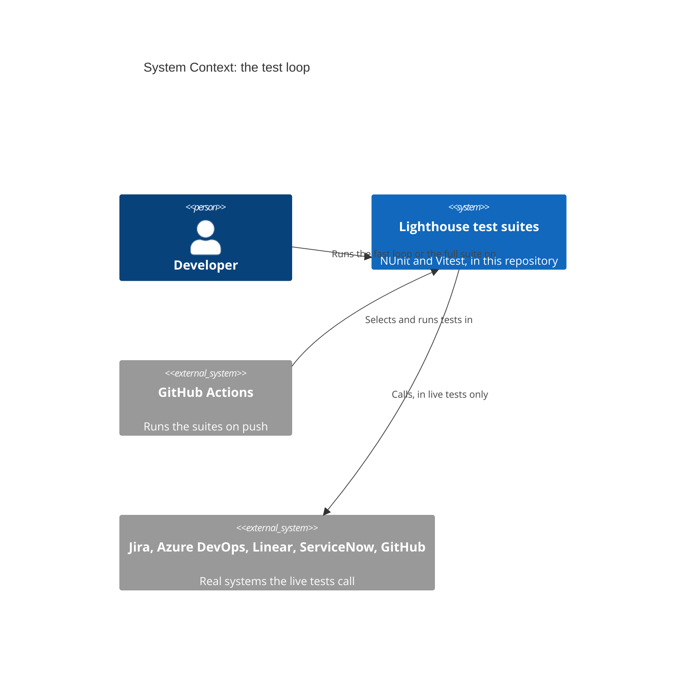
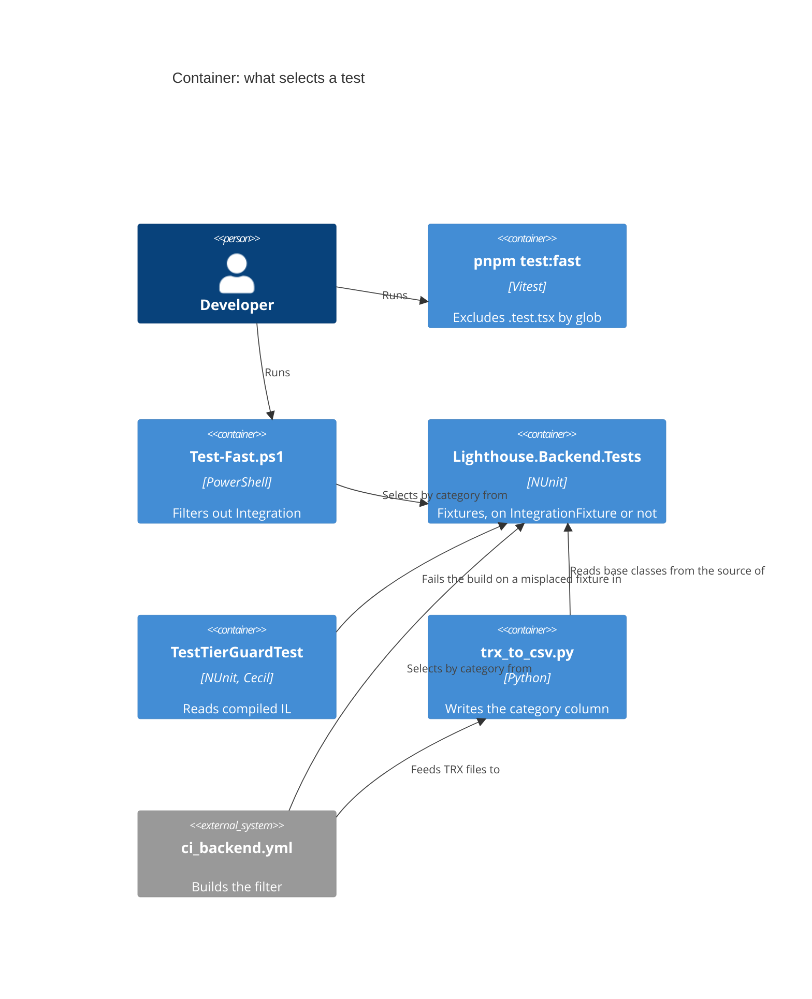

# Feature: story-6512-t6-speed-tiers-and-fast-local-loop

Story #6512 · T6 Speed tiers from the code's structure, and a fast-only local loop · part of Epic #6506 "Fast, reliable test
suites". Catalogue: [Epic workspace](../epic-6264-modular-monolith/feature-delta.md) ·
Brief: [slice-48](../epic-6264-modular-monolith/slices/slice-48-t6-speed-tiers-and-fast-local-loop.md).

DISCUSS: the brief, settled with the maintainer on 2026-11-07. Its final section, "Maintainer decisions", overrides the text
above it. Waves start at DESIGN. Rigor `thorough`.

## Wave: DISCUSS / [REF] Inherited

- Epic decision D-6264-5. job_id: infrastructure-only. T5's `Contracts` namespace and guard build on the category this Story
  sets (slice-49). T9 builds on the tiers (slice-50).
- RBAC, Lighthouse-Clients, website, usage-data, UI sketch, Terminology, context map: N/A, as the brief answers item by item.

## Baseline re-count

Read at DESIGN by text search on trunk 1f83b5455. The design agent ran nothing (a delivery is using this machine), so these
are file counts, not a compiled scan. Slice D's guard prints the real class list on its first run. CI's counts and every
timing stay unmeasured until slice A and slice F.

| Brief said | Today |
|---|---|
| 57 files derive from `IntegrationTestBase` | Confirmed: 57, one of them abstract (`ForecastedStartDateAcceptanceTest`) |
| About 36 other abstract bases | Confirmed: 36. 9 derive from another of the 36; 1 starts no host (`UpdateServiceTestBase`). **26 hosted roots** take the edit |
| Many classes build a host themselves | About 100 files by word search, 56 in `API/Integration`, about 14 in `API/Security`, the rest elsewhere, counting users of the 8 `*TestHost` helpers. A floor |
| 34 container test files | Confirmed: 37 minus 3 helpers. 3 inherit a hosted abstract base, 31 take the edit |
| 16 live files | Confirmed: 13 carry `Integration` on the class, 3 only on methods. `JiraSuppressionRetryIntegrationTest` has one test, so it is whole-class in effect: **14 whole-class, 2 mixed** (`JiraWriteBackTest`, `AzureDevOpsWriteBackTest`) |
| The two bare live files need a category of their own | **They already have one.** `GithubServiceTest` and `LighthouseReleaseServiceIntegrationTest` both carry `GithubIntegration`, which CI selects today |
| 200 to 300 one-line markers | About 170 one-line edits: 1 + 26 roots, about 100 self-hosting, 31 container, 14 live |
| 64 architecture files are a tier of their own | Dropped by the decisions. 61 are regular tests; 3 start a host and move (`OptionalFeatureApplierSeamArchUnitTest`, `TestHostIsReleasedAfterDisposeTest`, `TestHostsRunWithoutRateLimitingByDefaultTest`) |
| Frontend 208 `.test.ts`, 405 `.test.tsx` | 208 confirmed, 26 importing `@testing-library/react` confirmed. `.test.tsx` is about 410, from T12's 618 files |
| All 3 `slowTests` entries are `.tsx`; the reporter leaves an uncollected file alone | Confirmed, `compareToAllowList.ts` line 88 |
| `trx_to_csv.py` reads `API.Integration` as `Unit` | Worse. The class pattern needs the attribute directly above the class, and all 13 class-level live files stack a connector attribute under it, so they read `Unit` too. Only method-level attributes are found. A plain CI run has no such tests, so its `Integration` count is 0 |
| CI: no change, "new categories leave CI's filter alone" | **False for `Integration`.** That line was written for new category names, before the same-day correction. See D-6512-8 and "Changed Assumptions" |
| New in this count | `UsageDataCanary` in `ci_backend.yml` matches no test. 6 hosted tests are `[Explicit]` probes, one of which rewrites a recorded baseline; see D-6512-10 |

## Checklist

- [ ] Behaviour-free: production code unchanged
- [ ] Ratchet in the same change: the guard that a host-building test sits on the shared base class
- [ ] Every test still runs in the full suite, proven by comparing ids before and after on both stacks
- [ ] `CLAUDE.md`, `Test-Coverage.ps1` and `trx_to_csv.py` updated for the one `Integration` category
- [ ] Mutation: N/A only where test files alone change; say so per file

## Wave: DESIGN / [REF] Scope, mode and context

Application scope, propose mode, AFK: the maintainer is away, so each engineering choice takes the recommended option and is
recorded below. Rigor `thorough`. Read: slices 48, 49, 50 with their "Maintainer decisions", CLAUDE.md, `trx_to_csv.py`,
`summarise.py`, `check_budget.py`, `ci_backend.yml`, `ci_changes.yml`, `Scripts/test-selection/`, `Test-Coverage.ps1`,
`IntegrationTestBase`, `TestHostScanning`, `TestHostPerFixtureGuardTest`, `IlDependencies`, `package.json`, `vitest.config.ts`.
No SPIKE, no wave-decisions file (the brief is the DISCUSS output). The decided points were not reopened.

Context map (ADR-270): N/A, because no context, concept, event or edge changes. `brief.md`, ADR-270, `ARCHITECTURE.md` §4: unchanged.
No ADR, because no product architecture changes; this delta is the record. Outcome registry: not run, a test-set-up Story adds no
typed contract and this agent runs nothing. Loading and failure looks: N/A, because no screen is added or changed. Paradigm:
OOP, as the project states. External integrations: none added, so no contract-test note.

## Wave: DESIGN / [REF] Decisions

| ID | Decision | Why (one line) |
|---|---|---|
| D-6512-1 | New root `IntegrationFixture` in `TestHelpers`, holding `[Category("Integration")]` and nothing else | It decides a category, not how a host starts, so no fixture's life cycle changes |
| D-6512-2 | A category probe proves the claim before anything moves; a failure stops the Story | NUnit 5.0.0 and adapter 6.3.1 are unconfirmed here, see "The category probe" |
| D-6512-3 | Each fixture kind moves as in "How fixtures move"; moves are their own commits | One-line edits a reviewer can read as mechanical |
| D-6512-4 | `Architecture/TestTierGuardTest.cs` reads compiled IL through `IlDependencies.ReadModule`, five rules | ArchUnitNET drops async edges in Release |
| D-6512-5 | One inline list of full type names with reasons, no count constant; it empties and is deleted in slice E | "Never counts"; a stale entry already fails, so the list cannot sit idle |
| D-6512-6 | `trx_to_csv.py` follows base classes in the source tree; a class it cannot place is warned, never silently `Unit` | Python cannot read the assembly, and `Unit` by default is how the column went wrong |
| D-6512-7 | The standard filter drops `Integration`, keeps the four connectors and adds `GithubIntegration` | The decided filter, and it keeps the same tests out |
| D-6512-8 | CI's always-on clause changes text so its selection stays the same (exact string below); `.github/` is therefore touched | Left alone, it would silently drop every hosted test from CI |
| D-6512-9 | The live tests' "own category" is the existing `GithubIntegration`; no new name | Both classes already carry it and CI selects by it |
| D-6512-10 | Keep CI's `Category!=UsageDataCanary` clause; `dev-test` and the test mirror adopt it | No test carries it, but it is what keeps the `[Explicit]` probes from running |
| D-6512-11 | Container tests sit on `IntegrationFixture` too | They need Docker and take seconds; see "For the maintainer" |
| D-6512-12 | The 2 mixed classes keep literal method-level attributes; `Test-Fast.ps1` hides their tokens | Splitting them changes test ids; a token would make the fast loop write to real trackers |
| D-6512-13 | The filters switch in slice B, before any class moves | The new strings select the same tests on today's code, so each step is provable alone |
| D-6512-14 | Full-suite proof as in "Proof that every test still runs" | Compares ids, on both stacks, without touching a real system |
| D-6512-15 | `pnpm test:fast` as briefed; `pnpm test --changed` is the documented command for a component edit | `test:fast --changed` excludes `.test.tsx`, so a component edit would report nothing |
| D-6512-16 | Targets measured as in "Measuring the targets" | The decided numbers, made repeatable |
| D-6512-17 | Six slices, frontend first, none with production files | See "Slices" |
| D-6512-18 | `Contracts` is not a slow-tier marker; T5's contract base derives from `IntegrationFixture` | The category comes from the base, the namespace says nothing |
| D-6512-19 | Peer review run once (`nw-solution-architect-reviewer`, Sonnet, the reviewer model assumed for `thorough`): conditionally approved, 0 critical, 3 high; all addressed here, see "Review" | A second iteration is left to the orchestrator |

## Wave: DESIGN / [REF] The base class (D-6512-1)

`IntegrationFixture` is abstract, carries the attribute and has no members. `IntegrationTestBase` cannot play this role: its
constructor builds a host, and its name stays because 57 files use it. An interface cannot either, because attributes on
interfaces are not inherited. `[TestFixture]` stays off the root, so no fixture is built differently and no id can move. If
Sonar's empty-class rules fire in the build, hold the category name in a constant that the attribute and the guard both use;
no pragma.

**Does the category inherit?** Expected yes on both counts, not confirmed. As far as this design can tell from NUnit 3 and 4,
`CategoryAttribute` is declared inherited, and the adapter reads categories from the suite above a test (that is how class-level
`JiraIntegration` works today). The package cache is closed to this agent and NUnit here is 5.0.0, so slice B proves it.

## Wave: DESIGN / [REF] The category probe (D-6512-2)

First step of slice B, in the working tree only, never committed. One file with these fixtures, each holding one trivial test:
derives directly; derives through an abstract class; inherits its test from the abstract base; `[TestFixture(2)]`;
`[TestFixtureSource]`; a nested public class whose outer class is not on the base; a plain class not on the base; an `[Explicit]`
test on the base.

Under Debug and under `-c Release`, for real runs restricted with `FullyQualifiedName~CategoryProbe`:

| Filter | Expected |
|---|---|
| `TestCategory=Integration` | The six derived fixtures, and the `[Explicit]` test (this confirms the hazard in D-6512-10) |
| `TestCategory!=Integration` | Only the plain class |
| CI's new always-on clause | All except the `[Explicit]` test |
| CI's force-full clause, `(Category=Integration&Category!=UsageDataCanary)` | The six, not the `[Explicit]` test |

Read the result from the TRX, not the console summary, and keep it in the workspace. Run `--list-tests` with the same filters
once, which settles what the brief left open; nothing depends on its answer. Any row off stops the Story before a class moves,
and the shape of the base goes back to the maintainer.

A permanent test keeps part of this: a nested abstract planted type on the base, read by reflection with `inherit: true`, must
show the category. It guards NUnit upgrades. The filter half stays covered by the proof below.

## Wave: DESIGN / [REF] How fixtures move (D-6512-3)

| Kind | Count (text search) | Move |
|---|---|---|
| On `IntegrationTestBase` | 57 files | One edit to `IntegrationTestBase` covers all |
| Abstract acceptance bases | 26 roots cover the 35 hosted bases | `: IntegrationFixture` on each root; the concrete classes follow |
| Builds a host itself, or through a `*TestHost` helper | About 100 files | `: IntegrationFixture` on the class; how it starts its host stays |
| `Integration/Containers` | 31 files, 3 more arrive through a hosted base | The same line |
| Live, whole class | 14 files | `: IntegrationFixture`, the literal `Integration` attribute goes, the connector attribute stays |
| Live, mixed | 2 files | Unchanged, on the guard's named list |
| `*TestHost` helpers | 8 | Untouched: they are not fixtures |
| `UpdateServiceTestBase` and its 6 users | 1 base | Untouched: no host, so regular |

A class whose single base is a non-hosted class cannot take the line. None is expected from the search; the guard's first run
would name any. If one appears, the shared base goes on the root only when every class under it hosts; otherwise it stops and is
reported, because moving a regular class to `Integration` would lose it from the fast tier.

No test file moves folder. A class in `API/Integration` that starts no host stays regular.

## Wave: DESIGN / [REF] The guard (D-6512-4, D-6512-5)

`TestTierGuardTest` reads the compiled test assembly through `IlDependencies.ReadModule` and reuses the call walker of
`TestHostPerFixtureGuardTest`, which moves to `TestHostScanning` in its own `refactor` commit. The next commit makes the root set a parameter of the scan. T2's guard keeps its set and
its planted cases unchanged, because a host in one-time set-up is fine by its rule. The new guard passes a wider set:
one-time set-up and tear-down, instance and static constructors (field initialisers compile into them), and methods inherited
from base types. It judges each concrete class with tests, nested ones included, because a nested class does not take its outer
class's category. `TestHostPerFixtureGuardTest` keeps its own question and its list.

| Rule | Fails when | Message names |
|---|---|---|
| 1. Hosted means on the base | A concrete fixture reaches a host start and `IntegrationFixture` is not in its base chain | The type, and that it must derive from the base |
| 2. No stale marker | A fixture on the base reaches no host, carries no connector category and is outside `Integration.Containers` | The type, and that it must leave the base |
| 3. The category is not written by hand | A `[Category("Integration")]` sits anywhere but on the base or the 2 named mixed classes | The type or method |
| 4. A hosted fixture has no connector category | It reaches a host and carries one of the five | The type, and that CI would read it as live and drop it |
| 5. Live and container fixtures are on the base | A concrete fixture carries a connector category or sits in `Integration.Containers`, and is off the base; the 2 mixed classes excepted | The type, and that the fast loop would run it |

Rule 2 is also what makes T5's moves honest: a suite that leaves the host must leave the base in the same commit.

**A planted misplaced test.** Nested abstract fixtures in `PlantedFixtures` style, read through the scan directly, because the real
pass looks only at concrete classes. Planted red: host in `[OneTimeSetUp]`; in an async `[OneTimeSetUp]` after an `await`; in a
constructor; in a field initialiser; in a base class's set-up; through a helper; a fixture on the base with no host; a hand-written
category, also in another letter case; a hosted fixture with a connector category; a container fixture off the base; a connector
category off the base. Planted green: on the base with a host, regular with no host, an unrelated
method named like a sink. The acceptance check is stronger: a real concrete class, unmarked, in the working tree, shown red under
Debug and `-c Release` with its name in the message, and the same for a stale marker, output kept in the workspace, then removed.

**Baseline.** One inline dictionary of full type names to reasons, as T2 keeps. No count constant, unlike T2's
`MostTypesTheListMayHold`. Rules 1 and 5 pass for a listed type; a listed type that is now on the base fails as stale, so the list only
shrinks and any addition shows in a reviewed diff. The rules never change to fit a type. The list holds about 130 entries in slice D,
is empty after slice E, and is then deleted. Rules 2, 3 and 4 have no baseline: the live classes are on the base before the guard lands. The 2 mixed classes are a separate, permanent named list with a reason each. They are
not a baseline.

**Limits.** The walk stops at the test assembly. A host start means a new factory, or `WithWebHostBuilder` or `WithTestAuthentication`
on one, and a factory is matched by type name or by deriving from one, so a host built any other way is invisible. The walk also
follows a virtual call to every override in the assembly, which can over-report a regular class; slice D checks the first output
and narrows that for this guard if it does. A slow test that starts no
host is not this guard's business: T9's budget is the backstop, as decided.

## Wave: DESIGN / [REF] The timing CSV (D-6512-6)

`discover_integration_class_names` learns one more thing: it reads each class's first base from the source tree and closes over the
chain to `IntegrationFixture`. `summarise.py` gets this for free, as it calls the same function. CI already passes `--source-root`.
The method-level path stays for the 2 mixed classes. The class declaration shapes it must read, each with a Python test: primary
constructor (`class X() : Base`), base with arguments, base on the next line, interface after the base, qualified base, a base named
in only one part of a partial class, nested class, private ones too (TRX writes `Outer+Inner`), a file with two namespaces, a chain
crossing files. `parse_trx` must also strip a fixture's arguments before the lookup: 5 classes use
`[TestFixture(...)]` or `[TestFixtureSource]` and would otherwise read `Unit`; confirm the TRX shape on a real file in slice F. `summarise.py` calls "integration" what is now mostly
hosted tests: its wording and `test_summarise.py` change in slice F. Rejected: a marker written into the TRX at run time, which every
fixture would have to emit; the adapter's MsTest category mode, unconfirmed and it changes the property the filters read.

**Keeping the count honest for T9:**

1. Once, in slice F: the `Unit` rows of a full CSV must equal the fast run's ids exactly, both directions.
2. Each run: a TRX class with no declaration in the source tree prints a warning, so a blind spot is seen.
3. In CI: `test_trx_to_csv.py` also scans the real tree and asserts named anchors, in the step that already runs those tests: one
   class on `IntegrationTestBase`, one through a three-deep abstract chain, one self-hosting, one container, one live, one regular.
   The same test fails if two classes on a chain to the base share a simple name, because bases are resolved by that name.
4. The name `Integration` keeps one meaning in the column: hosted, container, live.

## Wave: DESIGN / [REF] Every place that names the filter (D-6512-7 to D-6512-10)

**How CI selects today.** `ci_backend.yml`, step "Compute Test Backend filter", builds `Category!=Integration` and appends, joined by
`|`, either `(Category=Integration&Category!=UsageDataCanary)` on a shared-path change or the connector categories whose paths
changed. Then one `dotnet test --filter`. No other workflow runs `dotnet test`.

**Does the change alter what CI runs? Unless the filter changes, yes.** Once hosted tests carry `Integration`, `Category!=Integration`
drops them all: more than 400 test files, by the brief's count, would stop running in CI, silently, and the job would stay green.

The obvious replacement, the five connector categories alone, is also wrong. `JiraWriteBackTest` and `AzureDevOpsWriteBackTest` carry
their connector category on the class and `Integration` only on the live methods, so 3 offline tests (1 Jira, 2 ADO) run on every
push today and would stop. Live is exactly "`Integration` and a connector category", so the always-on clause is its complement:

```
Category!=Integration|(Category!=JiraIntegration&Category!=AdoIntegration&Category!=LinearIntegration&Category!=ServiceNowIntegration&Category!=GithubIntegration)
```

On today's code this selects exactly what `Category!=Integration` selects, because every `Integration` test carries a connector
category. After the moves it selects the same tests again: hosted tests pass the second half, live tests fail both halves. Rule 4 of
the guard protects the assumption. The force-full and per-connector clauses keep their text and their selection: everything, and
the same connector classes.

| Place | Change |
|---|---|
| `.github/workflows/ci_backend.yml` line 104 (and its comment) | The string above |
| `Scripts/test-selection/dev-test.sh` lines 48, 54, 63 | The same string; `Category=Integration` becomes the guarded clause |
| `Scripts/test-selection/dev-test.ps1` lines 47, 51, 54 | The same |
| `Scripts/test-selection/test-build-filter.sh` lines 17, 23, 9 expected strings | The same; it mirrors CI and says so |
| `Lighthouse.Backend/Test-Coverage.ps1` line 24 | Standard filter below |
| `CLAUDE.md` line 213 and the paragraph under it | Standard filter below; the paragraph adds GitHub; a new line names the fast loop and warns off a bare `TestCategory=Integration` |
| `docs/product/kpi-contracts.yaml` lines 1350, 1941 | Describe the new always-on clause |
| `Scripts/test-timings/trx_to_csv.py` docstring | Says what it now reads |

Standard filter, for people and for `Test-Coverage.ps1`:

```
TestCategory!=JiraIntegration&TestCategory!=LinearIntegration&TestCategory!=AdoIntegration&TestCategory!=ServiceNowIntegration&TestCategory!=GithubIntegration
```

It selects the same tests as today's. CLAUDE.md's line that this filter excludes the `LighthouseReleaseServiceIntegrationTest`
failures stays true only because `GithubIntegration` is in it. Left as they are: `docs/feature/**` and `docs/evolution/**` (history),
the live Stryker config and `mutation-testing.md` (they select by name). Old configs under `docs/feature/` do carry
`TestCategory!=Integration`: slice F adds one line to `.claude/commands/mutation-testing.md` saying not to copy that term, as it now
leaves out every hosted test. `dev-test.*` and `test-build-filter.sh` have no ServiceNow clause; that gap is older and stays.

**The `[Explicit]` probes.** 6 hosted tests are `[Explicit]`, and `SharedClockBaselineCapture` rewrites a recorded baseline. NUnit runs
an explicit test when a positive filter names it. Once those classes carry `Integration`, a bare `Category=Integration`, which
`dev-test` uses, would run them. A negative term in the same clause blocks that, which is why CI's dead-looking
`Category!=UsageDataCanary` clause must stay, and why `dev-test` adopts it. Its comment should say so. The probe confirms this.

**Cost of the edit.** Any change to a `ci*.yml` sets every connector input and `connector_shared` to true (`ci_changes.yml` lines
209 to 216), so the push of slice B runs all live suites once. Slice C's live-class edits run the matching connectors. Avoid
repeating those pushes; the Linear key is shared with CI.

## Wave: DESIGN / [REF] Proof that every test still runs (D-6512-14)

Real runs, with the integration tokens unset, so nothing touches a real system. All id lists are sorted. Kept in the workspace.

**Other commits on trunk.** Other Stories push test changes while this one runs. Each before list is taken at the parent of the
slice's first commit and the after list at its last commit. A diff line is accepted only if `git log` over that range shows a commit
from another Story changing that test's file; each such id is written down with the commit. Any other line is a failure, and the
same rule holds on the frontend.

**Backend.** At the parent of slice B's first commit, and again at the parent of each later proof range: run today's always-on clause twice with `--logger trx`, and take
`fully_qualified_name` through `trx_to_csv.py`. Any difference between those two lists is the unstable-name list; it is written down
and left out of every later diff. Also list the unfiltered suite with `--list-tests`: discovery needs no filter and calls no tracker,
and it is the only list that includes live tests.

| Check | When | Must hold |
|---|---|---|
| Always-on clause, before and after | End of slices B, C and E | Diff empty |
| Unfiltered `--list-tests`, before and after | End of slice E | Diff empty, live and `[Explicit]` tests included |
| Force-full clause, restricted with the five connectors left out so no live test runs | End of slice E | Same ids before and after, no `[Explicit]` id |
| Fast run plus hosted run equal the always-on list | End of slice F | Equal, no overlap. Hosted run: `TestCategory=Integration&TestCategory!=JiraIntegration` and the other four |
| Connector attributes | End of slice E | `git grep` of the five connector names, before and after: the same lines |
| `Unit` rows equal the fast ids | End of slice F | Equal |

`[Explicit]` tests must appear in no real run's list; `--list-tests` discovers them, the same before and after. A commit inside a slice
is covered by the guard and the normal suite, not by an id diff.
Environmental failures in CLAUDE.md change an outcome, not an id, so they do not disturb the diff.

**Frontend** (FE7's method, `file :: full name` from `test-results.json`). `pnpm test` before and after slice A: diff empty, as nothing in
the config changes. `pnpm test:fast` ids plus the `.test.tsx` ids of the full run equal the full list, no overlap. That run also
shows `--exclude` adds to the config's `exclude` rather than replacing it: no `.stryker-tmp` file may appear.

## Wave: DESIGN / [REF] Frontend command and targets (D-6512-15, D-6512-16)

`package.json`, one script beside `test`, with no Vitest config change:

```
"test:fast": "cross-env TZ=Europe/Zurich vitest run --exclude \"**/*.test.tsx\""
```

`pnpm test:fast --changed` runs the logic tests an edit affects. It cannot see a component's test, so an edit to a `.tsx` file would
report nothing while looking like a pass. `pnpm test --changed` covers that case and already works; CLAUDE.md names both. Slice A
checks that an edit touching no `.test.ts` exits 0 and says it ran nothing. If it exits 1, add `--passWithNoTests` to the script.

Backend: `Lighthouse.Backend/Test-Fast.ps1`, beside `Test-Coverage.ps1`, runs `TestCategory!=Integration`, with a `-NoBuild` switch.
It clears the Jira and Azure DevOps integration-token variables for its run and restores them, because the 2 mixed classes create
scratch items in `[OneTimeSetUp]` whenever one of their tests runs and a token is present. Neither command is a gate: `pnpm test` and
`dotnet test` stay what "done" means.

**Measuring.** On a quiet machine at the default worker cap, 5 warm runs, median wall clock, with test counts. A wrapper script stays out
of the repo; numbers and the commit go in the workspace.

| Target | Run | Pass |
|---|---|---|
| Frontend `--changed`, under 10 s | `pnpm test:fast --changed` after a comment added to one file, for 3 fixed files: few, median and many related `.test.ts` files, named in slice A | Median of each under 10 s; report the `.tsx` case too, as information |
| Frontend whole tier, under 60 s | `pnpm test:fast` | Median under 60 s |
| Backend whole tier, under 60 s | `Test-Fast.ps1 -NoBuild` after one build; build time reported apart | Median under 60 s |

Frontend misses after slice A: the node project is measured, as decided. Backend misses: list the slowest classes from the run. That is
T9's and T10's input, not a new tier. The likeliest cost is the 61 architecture files, each reading whole assemblies.

## Wave: DESIGN / [REF] Slices (D-6512-17)

Each leaves the suite green. Moves are commits of their own; a commit never mixes a move with an edit. **Production files: none in any
slice.** Mutation: N/A throughout, because Stryker mutates the product assembly and no product file changes. The Python scripts carry
their own unit tests.

| Slice | Days (est.) | Delivers | Commits, in order | Files outside tests |
|---|---|---|---|---|
| A | 0.5 | `pnpm test:fast`, frontend ids proof, first timing, the target confirmed | script and docs | `package.json`, `CLAUDE.md` |
| B | 0.5 | Probe, `IntegrationFixture`, filters switched, always-on diff empty | base with its reflection test; filters | `ci_backend.yml`, `Scripts/test-selection/*`, `Test-Coverage.ps1`, `CLAUDE.md`, `kpi-contracts.yaml` |
| C | 0.5 | Most tests marked, live classes on the base; always-on diff empty | `IntegrationTestBase` and 26 roots; 14 live classes | None |
| D | 1 | Scan moved, guard live, red shown on real planted classes | `refactor` scan move; root set as a parameter; guard with planted cases and its list of about 130 | None |
| E | 1 | The list emptied and deleted; ids proof | moves by kind: `API/Integration`; `API/Security` and the rest; containers | None |
| F | 1 | `Test-Fast.ps1`, CSV, medians re-cut, backend proof and target, docs | script; CSV and its tests; docs and numbers | `Test-Fast.ps1`, `Scripts/test-timings/*`, `CLAUDE.md`, `.claude/commands/mutation-testing.md` |

Frontend first because it is independent and cheap and gives the first real number. Filters come before moves so no commit can drop a
test from CI; roots and live classes before the guard so its list is about 130 lines, not 450, and rule 3 holds from its first commit.
The fast filter means nothing until slice E ends, so its script lands after. Days are estimates; the five timed runs and full-suite
proof runs are machine time, kept off a slice's working day where they can wait for a quiet machine. T12 delivers now: slice A's timing
waits for that, and only that overlaps. T9's 5 calibration runs start after slice F.

## Wave: DESIGN / [REF] Reuse Analysis

| Existing | File | Overlap | Decision | Contract shape, and how the crafter asserts it |
|---|---|---|---|---|
| `HostBuildingScan` | `Architecture/TestHostPerFixtureGuardTest.cs` | Call walker | EXTEND, moved to `TestHostScanning`, roots added | Pure over a module; planted fixtures, and T2's guard stays green unchanged |
| `IlDependencies.ReadModule` | `Architecture/IlDependencies.cs` | Reads the assembly | REUSE | Read-only, one module per fixture |
| `Compare`, `PlantedFixtures` idiom | `TestHostScanning`, T2's guard | List comparison, planted cases | REUSE | Pure |
| `IntegrationTestBase` | `TestHelpers/` | Host life cycle | EXTEND: derives from the new root | Unchanged behaviour; ids diff |
| `TestTierGuardTest` | none | A guard over the same scan | CREATE NEW: T2's guard asks how often a host starts and stays as it is; two questions, two failure messages, as T5 argues too | Pure over a module, then a list comparison; planted fixtures |
| `IntegrationFixture` | none | Category on a class | CREATE NEW: `IntegrationTestBase` builds a host in its constructor, and the other 26 roots and 100 classes start theirs differently | Attribute only, no behaviour |
| `discover_integration_class_names` | `trx_to_csv.py` | Classification | EXTEND | Pure over a source tree; fixture `.cs` files |
| `declared_classes` | `check_budget.py` | Walks declarations | Not reused: it reads names, not bases, and sharing would couple the budget check to this column | n/a |
| `Test-Coverage.ps1` | `Lighthouse.Backend/` | Runs a filtered suite | CREATE NEW sibling `Test-Fast.ps1`: one script with a mode would mix a coverage tool with the loop | Shell only |
| `dev-test.sh`, `--unit-only` | `Scripts/test-selection/` | Runs a filtered suite | EXTEND for the filter; not the fast loop, because it tracks CI's selection | Shell; `test-build-filter.sh` asserts the strings |
| TimeBudgetReporter | `src/tests/timeBudget/` | Subset runs | REUSE unchanged | Checked by slice A's run |

## Wave: DESIGN / [REF] What can lie, and what catches it

| Assumption | Could be false because | Caught by |
|---|---|---|
| The category is inherited and the filter sees it | Unconfirmed on NUnit 5 and adapter 6 | The probe, before any move |
| The TRX tells us categories | It does not (the script's own docstring) | Ids from runs selected by filter, not read from the TRX |
| `--list-tests` honours a filter | Unconfirmed | Used unfiltered only |
| A negative term blocks `[Explicit]` tests | Remembered behaviour, NUnit 5 | The probe |
| `--exclude` adds to the config | Unconfirmed on Vitest 5 | Frontend ids proof |
| The source scan matches the compiled truth | It reads text | `Unit` rows against the fast ids; anchors; the warning |
| The guard walks what runs | It stops at the test assembly | Real planted class under Release; T9's budget |
| The guard itself works | It could pass by reading nothing | Planted red fixtures, which fail if the scan goes blind |

## Wave: DESIGN / [REF] C4





## Wave: DESIGN / [REF] For the maintainer

1. **`.github/` changes after all.** The brief's OUT and last AC exclude it. The decision to reuse the name `Integration` makes one line
   there unavoidable, or CI loses every hosted test. Taken: edit it. What CI runs stays the same, and slice B proves that.
2. **Container tests sit on the base (D-6512-11).** The decision says hosted and live; about 30 container files start Docker, and some
   start no host. Left regular they would make the fast loop need Docker, and their seconds would set T9's fast-tier budget. Taken: on
   the base, with the guard allowing `Integration.Containers`. If you meant them to stay regular, say so before slice D.
3. **T9's ceilings need like-for-like runs.** Live tests appear in the CSV only when a connector's path changed, and they read
   `Integration`. T9's total ceiling and mean would jump on such a push, and every `ci*.yml` edit makes one. T9's DESIGN must judge only
   plain runs or leave connector classes out. That is a T9 point, not done here.
4. **T5 proposes a count constant** (`MostTypesTheListMayHold` style) for its shrinking list. The rule given here is "never counts". T5's
   DESIGN should take the same shape, or say why not.

## Wave: DESIGN / [REF] Open for DISTILL and DELIVER

- The 3 fixed files for the `--changed` measure (slice A).
- Whether the guard's override following needs narrowing (slice D, from its first output).
- The TRX class shape of a parametrised fixture (slice F, from a real file).
- `.test.tsx` count, read from the first real run.

## Changed Assumptions

Original, slice-48, Proposals 7: "**CI: no change.** The guard is one more test in the run; new categories leave CI's filter alone;
`check_budget.py` ignores `category`." And OUT: "`.github/`". And its last AC: "No change in `.github/` or production code, so
mutation is N/A."

New: what CI **runs** does not change; the text of its filter does, on one line of `ci_backend.yml`. Why: the same-day correction made
the marker the name CI's filter excludes. The AC becomes "the always-on clause selects the same ids before and after; no production
code changes, so mutation is N/A."

Original, slice-48, Maintainer decisions: "the two bare live files (`GithubServiceTest`, `LighthouseReleaseServiceIntegrationTest`) gain a
category of their own". New: they already have it, `GithubIntegration`; the standard filter adds it. Why: the attribute is on both classes.

Original, slice-48, Proposals 6: "A (0.5) ... B (1) ... C (1) ... D (0.5 to 1)", four slices. New: six slices, about 4.5 days. Why: filters
now land separately and before any move, and the guard lands after the root and live moves.

## Wave: DESIGN / [REF] Review

One pass by `nw-solution-architect-reviewer`, read-only: conditionally approved, 0 critical, 3 high. It confirmed from the code that all
16 live files carry a connector category, so the always-on clause holds on today's code and after the moves; the mixed classes; the
GitHub category; the `UsageDataCanary` finding. It could not confirm NUnit 5 behaviour, Vitest behaviour, the file counts or any timing.

| Finding | Severity | Resolution |
|---|---|---|
| Rule 3 would be red in the guard's slice, as the live classes moved later | High | Live classes move in slice C, before the guard |
| A container or connector class off the base passed the guard | High | Rule 5, with planted cases |
| The id baseline went stale under other Stories' commits | High | Before lists per slice range; a diff line needs a named foreign commit |
| `[Explicit]` wording contradicted `--list-tests`; force-full proved by reasoning only | Medium | Wording fixed; force-full check added |
| Shared root set would flip T2's guard | Medium | Root set is a parameter |
| Old Stryker configs carry the old term | Medium | Line in `mutation-testing.md`; ServiceNow gap recorded |
| CSV shapes missing; a warning alone | Medium | Shapes added; a collision fails the Python test. An unplaceable class stays a warning, so the timing step cannot fail a run over a label |
| Slices C and D at the edge of a day | Medium | C split in two; timed runs kept off the working day |
| Sink definition, `summarise.py` wording, a `TestTierGuardTest` row, one more CSV alternative | Low | Added |

## Wave: DEVOPS / [REF] Platform readiness

Existing platform; nothing is deployed. Written 2026-11-07 with the maintainer away, so each choice takes the recommended option. Files
were read and nothing was run, because a delivery is using this machine: every number below is a rule for reading a run, not a reading.
Letters used: `D` tests listed, `R` tests ran, `E` tests a plain run leaves out (live and `[Explicit]`), `X` the `[Explicit]` tests alone.

| Topic | Answer |
|---|---|
| Environment | **Linux, local:** `pnpm test:fast`, `Test-Fast.ps1` under `pwsh` and all proof runs; half the cores, integration tokens unset; the counts for the check below under `-c Release`, as CI builds. **CI, `ubuntu-latest`:** the only `dotnet test` in any workflow (`ci_backend.yml` line 140); Release, no worker cap, tokens set, Docker present. **Windows and macOS jobs:** check signed binaries and start the app; they run no test. **A worktree:** 2 Licensing failures until the licence file is copied, so proof lists come from the main checkout. **No Docker:** the fast loop needs none, but only once slice E ends. |
| Proof on every push (D-6512-20) | A new step, "Check test selection", after "Test the budget check" and before "Check test-time budget", so a budget breach cannot hide it. It lists the suite with an unfiltered `dotnet test -c Release --no-build --list-tests`, counts the rows of `test-timings-backend.csv`, and writes one line to the log and the step summary: listed `D`, ran `R`, left out `D - R`, expected, run kind. The raw total cannot carry a stop: it moves with every test another Story adds, and jumps when a connector runs. Left out holds only live and `[Explicit]` tests, so other Stories' commits do not move it, and one lost hosted test adds 1 to it. A person compares `R` from run to run. Code: `Scripts/test-timings/check_selection.py` with its tests, numbers with reasons in `test-selection.json` beside it. |
| What stops the run | Plain run: left out must equal `E`. A run with connector categories: at or under `E`. Force-full run: must equal `X` (6 by text search). Any other value, or a missing list or CSV, exits 1: `Verify Backend` goes red, `sonar-gates` is skipped, nothing is packaged. `LIGHTHOUSE_BUDGET_WARN_ONLY` does not reach it. A commit that adds or removes a live or `[Explicit]` test changes the number in the same commit, in a reviewed diff. A deleted test leaves `D` and `R` together: that is a deletion, seen in its diff, not a test leaving CI. Slice B's probe also compares `--list-tests` with the TRX count; if they cannot be reconciled, the fallback is a committed floor on `R` at the before-count less 1 % (an estimate), which catches the loss of the hosted tests but not of one class. The id diff then carries the rest. |
| What the first push is judged against | **Written down before it:** `T0`, the count of the last green plain `main` run (`Total:` in the "Test Backend" log, and the CSV rows) with its commit; `D0` and the always-on count `A0`, under `-c Release`, at the parent of slice B's first commit. `T0` and `A0` must agree, under DESIGN's foreign-commit rule. `E` is `D0 - A0`. **The first push cannot judge the clause.** A `ci*.yml` edit forces the full filter, which selects everything but `[Explicit]` tests whatever the always-on clause says, and adds the live tests, so its total does not compare with `T0`. It is judged on left out = `X`, and ran = `T0` + `E` - `X` + other Stories' test changes. **The first plain run judges the clause:** ran = `T0` + those changes, left out = `E`. Slice B's proof stays open until then, and the local id diff is the only earlier evidence. |
| Pushes that run live suites | **One**, with slice B's `ci_backend.yml` edit and the new step in it. Slice C's 14 live-class commit moves ahead of the `IntegrationTestBase` commit and rides that push: alone, its files on connector paths would run those connectors a second time. The forced run then also shows they still run. Nothing later touches a `ci*.yml`: slice F's CSV work is under `Scripts/test-timings/`, found by the existing discover step, and starts no live suite. The 3 hosted classes in connector folders arrive through `IntegrationTestBase`, so no file there changes. `Lighthouse.Backend.Tests.csproj` must stay untouched: a csproj edit is a shared path and forces the full run. |
| Keeping it at one (D-6512-21) | One holds only if that run ends green. Change detection diffs from the last green run, which needs backend, frontend, E2E, `sqlite`, `postgres` and Sonar to hold. On red the edit stays in the window and the next push runs every live suite again. `ci.yml` has no `concurrency`, so a push during the run takes the same base and starts a second live run at once on the same keys. So: no other push on trunk until it ends (T12 is delivering, so agree the moment), and no use of the Linear key for an hour before, since Linear meters per key over a rolling hour. A 429 carries `Retry-After: 3600` and most of its failures read as plain assertion failures: grep the log for `TooManyRequests`, wait the hour, re-run the failed job, do not push. The budget step judges live classes too (5 carry ceilings), so a slow tracker can also red the run. The push runs all stacks. |
| Order after that push | The hosted commit (`IntegrationTestBase` and 26 roots) waits for one green plain run, so a wrong clause and a wrong move are never judged together. A docs-only push starts no CI, and `workflow_dispatch` after a green base skips the backend, so that run must come from a backend path, usually another Story's push. If none comes within a day the commit goes anyway: the check still stops a loss, only the diagnosis is harder. Every push of slices C, D and E is plain and judged exactly. |
| Rollback | Reverse of the order DESIGN chose. **The filter goes last:** reverting it while hosted tests carry `Integration` restores `Category!=Integration` and loses them all, the one thing that must not happen. The check is therefore its own commit, so a filter revert cannot take the stop with it. **F:** alone, until T9 builds on the column. **E:** its commits in reverse; the list returns and the guard stays green; CI is unaffected, as the always-on clause selects these classes either way. **D:** alone, after E or without it, scan refactor last; no test changes, the ratchet goes. **C:** only after D, or rules 3 and 5 fail; the live commit's revert runs those connectors. **B:** only after C, filter then base; a `ci*.yml` edit, so a second live run: prefer a fix forward unless the clause itself is wrong. **A:** alone, at any time. |
| Windows | `Test-Fast.ps1` and `dev-test.ps1` have no CI cover on any platform, and no Windows machine is at hand, so Windows stays **unverified and is said so in the docs**. A Windows test job was rejected: nobody here uses one, and it would be another `ci*.yml` edit. `Test-Fast.ps1`: its filter holds nothing a shell reads specially; it clears `JiraLighthouseIntegrationTestToken` and `AzureDevOpsLighthouseIntegrationTestToken` for the process, restores them in `finally` and checks `$LASTEXITCODE` as `Test-Coverage.ps1` does. `dev-test.ps1` passes the filter through a variable; `&` already goes that way in `Test-Coverage.ps1`, while `(`, `)` and `|` are new. `-DryRun` under `pwsh` in slice B shows the string, not Windows quoting. `pnpm test:fast` has the same `cross-env` shape as `pnpm test`. |
| Backend memory | One standard-filter run grew its testhost from 2.0 to 18.3 GB in 8 minutes on a 31 GB machine (2026-10-31, cause not diagnosed). T6 changes no fixture, so a full run stays that big. Never two backend suites at once, and none beside T12's delivery. DESIGN's proof needs about 12 full-size runs (2 at each of 3 parents, 3 after-lists, 2 force-full, 1 hosted), one at a time; an after-list doubles as the next before-list if trunk has not moved. Run `dotnet build-server shutdown` between them. The fast tier starts no host, so it should stay low; unmeasured, so slice F records its peak once. In CI the list step starts its testhost after the run's has exited, so the peak does not rise; its duration is read off the first run. |
| Monitoring | The step summary line and `test-timings-backend`, whose ids give a diff when a count surprises. The `Integration` column stays 0 on a plain run until slice F. No dashboard, no alert: the red run is the alert. |
| Mutation | N/A, because Stryker mutates the product assembly and no product file changes. `check_selection.py` carries unit tests, as the other scripts do. |
| Usage-data event | N/A, because `Test-Fast.ps1` and `pnpm test:fast` run on a developer's machine and no user of the product reaches them, so no event could show use. `UsageDataEventName` is unchanged. |
| Terminology, release notes, RBAC, Clients, Website, UI sketch | N/A, because no route, DTO, screen or word a user sees changes. Release notes are written at `/release`, with nothing to say here. |
| T9's brief (owed; not edited here) | Four lines change. "T6 slice D writes the tier" is now slice F. "Covers hosted and live" is now hosted, container and live (point 2). The mean and the maintainer's total ceiling must leave connector classes out, read from their literal attributes, or every force-full run goes red, which keeps a `ci*.yml` edit in the window (point 3); doing that in the script needs no workflow edit. Proposal 5's "touches `ci_backend.yml` for the summary" is not needed: `check_budget.py` can write to `GITHUB_STEP_SUMMARY` itself, which saves a second live run (point 1). |
| T5's brief (owed; not edited here) | Three lines change. Proposal d and the first AC drop the exact ceiling constant for a list that shrinks through stale entries, or T5's DESIGN says why not (point 4). The open `Contracts` check is answered: not a slow-tier marker, and the contract base derives from `IntegrationFixture`. T6 joins T5's dependencies, and a suite leaving the host leaves the base in the same commit (guard rule 2). Points 1 to 3 change nothing for T5: a host-to-port move stays in the always-on selection, so left out holds still. |
| What this changes in DESIGN | "One line of `ci_backend.yml`" becomes that line plus one step, in the same push. "Slice B proves that" holds only locally until the first plain run. Slice C's commit order flips, and its live commit joins slice B's push. `--list-tests` now matters: "nothing depends on its answer" no longer holds, for the unfiltered count. The probe gains CI's joined strings, always-on `\|` force-full and always-on `\|` one connector, because it tests the clauses one at a time and CI runs them together. |

## Wave: DEVOPS / [REF] Review revision: the smaller check (2026-11-07, maintainer away)

The review of DESIGN and DEVOPS returned NEEDS_REVISION: the always-on clause is sound, the new CI step is not worth it. This
section overrides anything above that differs.

- **"Check test selection" is dropped, with `check_selection.py` and `test-selection.json`.** Only three things can lose a test:
  a wrong clause (judged by the local id diffs at B, C and E, and by the first plain run against `T0`, whose `Total:` line the
  log already prints), a hosted class gaining a connector category (guard rule 4 at build time), or an offline class given
  `Integration` plus a connector, which is possible today. The step guarded mostly the third, and its first run would be on
  the one push that cannot be repeated cheaply: a red there runs every live suite a second time. Its constants would also red
  trunk when another Story adds a live test.
- **Added, cheap:** a unit test in the existing test project that evaluates the clause string against synthetic category
  sets, so the logic is pinned at no CI cost. The first-plain-run comparison against `T0` is done by the orchestrator and
  recorded; a difference stops the run.
- **The fast filter also leaves out the connectors**, not only `Integration`: `JiraWriteBackTest` and
  `AzureDevOpsWriteBackTest` create real items in `[OneTimeSetUp]` for any selected test, so a bare `TestCategory!=Integration`
  with a token set writes to a real tracker. Three offline tests leave the fast loop, and `Test-Fast.ps1` needs no token
  clearing. `CLAUDE.md` prints the safe filter or the script, never the bare one.
- **`dev-test.sh --unit-only`:** its comment and help text change, as it now runs the plain CI selection with hosted tests.
- **A guard rule for `UsageDataCanary`:** a fixture carrying it carries a connector, because the clause selects by exclusion.
- **Slices, updated:** B holds the probe, `IntegrationFixture` and the filters. Its push also carries slice C's 14 live classes,
  so it is the one live push; the hosted commit waits for one green plain run, or a day. Filters before moves holds per commit,
  and per push only in that order.
- **Containers (D-6512-11) stay on the base, as raised with the maintainer**, who has not answered; it goes past "boots the
  host", so it is a decision to revisit at slice D.

## Wave: DISTILL / [REF] Scope, reconciliation and baseline (2026-11-07, maintainer away)

- Shape: a change to how tests are selected, with no product behaviour. The specification is NUnit, Vitest and Python `unittest`, and
  the acceptance scenarios for a guard are planted cases that must go red. No Gherkin, so no scaffolds, Tier B, domain-types module or
  state-delta port. Nothing is written in this wave except this section and `deliver/roadmap.json`: the tests are written red-first in
  DELIVER, and no test or build was run here, because a delivery is using this machine. So every "expected" below is a rule for reading a
  run. The Pre-DELIVER "fails for the right reason" gate is met step by step: each step shows its red before its green.
- No nWave scenario tag goes into any test title, comment or file. An untagged test is correct here; classification stays in this
  workspace, in the tables below.
- UI sketches: N/A, because nothing a user sees changes. Loading and failure looks: N/A, no screen is added or changed.
- Policy: `docs/architecture/atdd-infrastructure-policy.md` exists, read as inherited; no port is added. Journey, KPI contract: none for
  this Story; `kpi-contracts.yaml` only has two lines of wording to change. Deliverable type: application. Outcome registry: not run,
  no typed contract is added.
- Language: C# for the backend, TypeScript for the frontend, Python for the timing scripts.
- Read for this wave, beyond the delta and slice-48: `ci_backend.yml`, `ci_changes.yml`, `path-classifier.sh`, `test-build-filter.sh`,
  `dev-test.*`, `trx_to_csv.py`, `Test-Coverage.ps1`, `TestHostPerFixtureGuardTest`, `TestHostScanning`, the 16 live files' class lines.

**Reconciliation: 0 hard contradictions.** Soft points, resolved as recorded:

| Point | Resolved |
|---|---|
| DESIGN and DEVOPS: `Test-Fast.ps1` clears tokens, D-6512-12 "hides their tokens"; fast filter is `TestCategory!=Integration` | The revision wins: the fast filter leaves out the connectors and clears nothing |
| slice-48's Maintainer decisions: "The fast loop is `TestCategory!=Integration`" | Taken as the revision has it, because a bare filter with a token set writes to a real tracker. It is stricter and costs 3 tests. **Named for the maintainer**: this is the one place the delta's last section goes past a maintainer line, not only past the brief |
| DEVOPS "Check test selection", `check_selection.py`, `E`, `X`, "left out", the `--list-tests` reconciliation, the floor on `R` | Gone with the step. `T0`, `Total:` and the CSV remain |
| DESIGN's "Fast run plus hosted run equal the always-on list"; "`Unit` rows equal the fast ids" | Both are false once the fast filter leaves out the connectors: the 3 offline tests of the mixed classes are in neither. See D-6512-24 |
| Revision: hosted commit waits "or a day"; this wave's brief: it waits for one green plain run | It waits. The day existed because the plain run had to come from another Story; D-6512-23 removes that need. After a day with no green plain run the orchestrator reports; it does not push |
| DESIGN: scan move in slice D | Moved to slice C, D-6512-23. Same commit, earlier |
| DEVOPS "about 12 full-size runs" | Replaced, D-6512-22 |
| Guard: five rules in DESIGN, a sixth in the revision | Six rules |

## Wave: DISTILL / [REF] Decisions

| ID | Decision | Why (one line) |
|---|---|---|
| D-6512-22 | One full-size local backend run in the whole Story, at the end of slice E; every other id list comes from CI's own `test-timings-backend` CSV or from a run that selects next to nothing | CI runs the always-on clause on every plain push anyway, and its CSV holds every id; see "Proof that every test still runs" |
| D-6512-23 | The `refactor` scan move leaves slice D for slice C and is pushed alone after the live push, so the Story makes its own first plain run | It is a backend path and changes no category; waiting for another Story's push was the only reason for "or a day" |
| D-6512-24 | The tiers add up as fast + hosted + 3 offline tests; the `Unit` column equals fast + those 3 | The revision's fast filter leaves those 3 out, and they carry no `Integration` |
| D-6512-25 | The probe gains the shapes it lacked: a live class on the base, and a mixed class's live and offline methods | The always-on clause rests on those two shapes and DESIGN's list had neither; the 3 offline tests are the reason the clause has a second half |
| D-6512-26 | A step's local check is `dotnet build` and the named test classes; the whole suite runs locally once and in CI on each push | Steps change categories and base classes, not test bodies, and a whole run is 8 minutes and up to 18 GB on a machine shared with a delivery. **It relaxes CLAUDE.md's `dotnet test` gate for slices B to D; named for the maintainer** |
| D-6512-27 | A diff line is also accepted when it is a test this Story added, named in the delta | DESIGN allowed only foreign commits, which would fail this Story's own pin, reflection and guard tests |
| D-6512-28 | Frontend: one full `pnpm test`, no before-run | Nothing in the config changes, which `git diff` shows; the one run is what the partition needs |
| D-6512-29 | Before each push, the push's diff goes through `path-classifier.sh` and every connector answer must be `false` | A self-hosting class in a connector folder would start a second live run; text search finds none today, and the check costs nothing |

## Wave: DISTILL / [REF] Names used below

Every string is exact. All `dotnet test` commands below run from the repo root, against `Lighthouse.Backend/Lighthouse.Backend.Tests`,
with `-c Release --no-build --logger trx` after one `dotnet build -c Release` unless a line says otherwise, and with no variable ending
in `IntegrationTestToken` set, checked first with `env | grep -c IntegrationTestToken`, which must print 0. Release matches CI, so local
and CI lists compare like for like.

| Name | String |
|---|---|
| Old clause | `Category!=Integration` |
| Always-on clause `A` | `Category!=Integration\|(Category!=JiraIntegration&Category!=AdoIntegration&Category!=LinearIntegration&Category!=ServiceNowIntegration&Category!=GithubIntegration)` |
| Force-full clause | `A` joined by `\|` with `(Category=Integration&Category!=UsageDataCanary)` |
| Standard filter | `TestCategory!=JiraIntegration&TestCategory!=LinearIntegration&TestCategory!=AdoIntegration&TestCategory!=ServiceNowIntegration&TestCategory!=GithubIntegration` |
| Fast filter `F` | `TestCategory!=Integration&` followed by the standard filter |
| Hosted filter `H` | `TestCategory=Integration&` followed by the standard filter |
| Offline filter `O` | `(TestCategory=JiraIntegration\|TestCategory=AdoIntegration\|TestCategory=LinearIntegration\|TestCategory=ServiceNowIntegration\|TestCategory=GithubIntegration)&TestCategory!=Integration` |

(`\|` is a plain `|`; the backslash only keeps this table a table.)

A **plain run** is a green `main` run whose "Compute Test Backend filter" log prints `force_full=false` and `filter=` with the always-on
clause alone (the old clause before the live push). A **list** is the sorted `fully_qualified_name` column with duplicates kept, read with
Python's `csv` because names hold commas. A **full-size run** is any local `dotnet test` that selects the hosted tests.

## Wave: DISTILL / [REF] The guarantee

Each is a check that can fail.

| # | Guarantee | Command | Fails when |
|---|---|---|---|
| 1 | No production file changes | `git show --name-only --format= <hash>` for each of this Story's commits, grepped for `^Lighthouse.Backend/Lighthouse.Backend/` and for files under `Lighthouse.Frontend/src` other than `*.test.ts(x)` | Any line prints |
| 2 | The clause selects what it must | `dotnet test ... --filter "FullyQualifiedName~TestSelectionClauseTest"` | A synthetic category set lands on the wrong side, or a place holds a different string |
| 3 | The new clause equals the old on today's tree | `dotnet test ... --filter "<H>"` at the end of slice B and again after the live classes move | Any test is selected: `A` differs from the old clause only for a test with `Integration` and no connector, which is what `H` selects |
| 4 | No id is lost, run to run | List of each plain run against the list of the plain run before it | A line is neither a foreign commit's test file nor a test this Story added |
| 5 | The first plain run matches `T0` | See "First plain run against `T0`" | Any difference stops the Story |
| 6 | No id is lost at all, live and `[Explicit]` included | `dotnet test ... --list-tests` (no filter), sorted, at the parent of slice B's first commit and at the end of slice E | As 4 |
| 7 | The connector attributes stand | `git grep -E 'Category\("(Jira\|Ado\|Linear\|ServiceNow\|Github)Integration"\)' -- Lighthouse.Backend/Lighthouse.Backend.Tests \| sort` at the same two points | Any line differs |
| 8 | `[Explicit]` tests stay out of real runs | At the end of slice E, `A`, force-full and `H`, each `&`-joined with the five probe class names by `FullyQualifiedName~` | A row for any of the 6 tests has an outcome other than the one `T0`'s CSV shows for it (absent, unless `T0` shows otherwise) |
| 9 | The tiers add up, with no overlap | `F`, `H`, `O` lists at the end of slice E | The three lists sorted together differ from the last plain run's list, own and foreign lines aside. An overlap shows as a duplicate line the plain list does not have |
| 10 | Exactly 3 offline tests sit outside fast and hosted | `O` run | Not 3 ids: 1 in `JiraWriteBackTest`, 2 in `AzureDevOpsWriteBackTest` |
| 11 | The guard bites | Planted cases, and real planted classes under Debug and Release, "What each slice must show" | A planted red stays green, or the message omits the type |
| 12 | The fast loop touches no real system | The `F` list holds no class with a connector attribute; `Test-Fast.ps1` holds `F` by text | A connector class appears; a person is shown the bare filter (`git grep -nF 'TestCategory!=Integration"' CLAUDE.md Lighthouse.Backend/Test-Coverage.ps1` prints a line) |
| 13 | Exactly one live-suite push | The filter line of each CI run of this Story's pushes | A second run has `force_full=true` or a connector clause because of this Story's files |
| 14 | The CSV's column agrees with the filters | New `trx_to_csv.py` over the `F`, `H`, `O` TRX files, then the first plain CSV after slice F | `Unit` rows differ from `F` + `O`, either direction |
| 15 | Frontend tiers add up | `pnpm test:fast` ids and the `.test.tsx` ids of one `pnpm test` against that run's whole list | Not equal, an overlap, or a `.stryker-tmp` id |
| 16 | The targets hold | "Measuring the targets", 5 warm runs | A median is over target: a hold for the maintainer, not a green |

Mutation is a waiver, not a check: see "What closes the Story".

## Wave: DISTILL / [REF] What each slice must show (red before, green after)

"Red" means non-zero or a named failure for the reason given, never a build or set-up error. Failing names and messages go in the step's
commit body or this delta. Scenario counts are per step; none is over 8.

**Slice A: `pnpm test:fast`.** From `Lighthouse.Frontend`.

| Case | Before | After |
|---|---|---|
| The command exists | `pnpm test:fast` fails, no such script | Runs, exit 0, no `.test.tsx` in `test-results.json` |
| A planted failing `.test.ts` | | `pnpm test:fast` red, naming it. Removed |
| A planted failing `.test.tsx` | | `pnpm test:fast` stays green and does not list it; `pnpm test <it>` is red. Removed |
| An edit that touches no `.test.ts` | | `pnpm test:fast --changed` exits 0 and says it ran nothing; if exit 1, add `--passWithNoTests` |
| A subset run and the time-budget reporter | | No stale-entry or budget finding for the 3 `.tsx` entries |
| Partition | | Guarantee 15 |

**Slice B: the base, and the filters.**

| Case | Before | After |
|---|---|---|
| The category reaches a derived type | `IntegrationFixtureCategoryTest` does not compile or is red | A nested abstract planted type on the base shows `Integration` by reflection with `inherit: true` |
| Regular and hosted sets are kept; live is left out, for all five connectors | `TestSelectionClauseTest` red: `ci_backend.yml` still holds the old clause, which drops `{Integration}` | Green |
| An offline test of a mixed class is kept | Same | `{JiraIntegration}` and `{AdoIntegration}` selected by `A` |
| A planted wrong clause: the five connectors alone | | The evaluator reports `{JiraIntegration}` dropped: this test holds the wrong answer as its expectation, so the evaluator cannot go blind |
| A planted wrong clause: the old clause after the moves | | Reports `{Integration}` dropped |
| Force-full takes everything but the canary | | `{Integration, UsageDataCanary}` dropped by its second half, and kept by `A` if it has no connector, which is why guard rule 6 exists |
| The joined strings | | `A\|Category=JiraIntegration` selects `{Integration, JiraIntegration}` and no other live set |
| Every place holds the same text | Red | `ci_backend.yml`, `dev-test.sh`, `dev-test.ps1`, `test-build-filter.sh` all hold `A` |
| `H` selects nothing on today's tree (guarantee 3) | Plant `[Category("Integration")]` on one offline class, uncommitted: `H` selects exactly it. Remove | Selects nothing |
| The shell mirror | `bash Scripts/test-selection/test-build-filter.sh` fails on the new expected strings | `failed: 0`. CI does not run this script, so the step does |
| The always-on list on a dry run | | `pwsh Scripts/test-selection/dev-test.ps1 -DryRun` prints the string (not Windows quoting, as DEVOPS says) |

`TestSelectionClauseTest` holds a small evaluator of `=`, `!=`, `&`, `|` and parentheses over a set of categories, and reads the strings from
the real files through the `FindRepositoryRoot` idiom of `CategoryListOwnershipGuardTest`. It says how the clause reads, not how NUnit reads
it: the probe covers that half.

**Slice C: the moves that come before the guard.**

| Case | Must show |
|---|---|
| The 14 live classes | All 14 have no base on the class line (read here), so each takes `: IntegrationFixture`. The literal `Integration` goes, the connector stays. Guarantee 3 still selects nothing. Guarantee 7 holds, as those lines stay |
| `JiraSuppressionRetryIntegrationTest` | Its one method-level `Integration` goes too; the class has one test, so the selection is the same |
| The hosted commit | `IntegrationTestBase` and the 26 roots take the line. `H` restricted to one class on each kind (`FullyQualifiedName~` on one `IntegrationTestBase` class and one class under a three-deep root) selects them, and `F` restricted the same way selects nothing: red before the commit, green after |

**Slice D: the guard.** Planted nested abstract fixtures, the `PlantedFixtures` way, through the scan directly.

| Step | Planted red | Planted green |
|---|---|---|
| Rule 1 | Host in `[OneTimeSetUp]`; in an async `[OneTimeSetUp]` after an `await`; in a constructor; in a field initialiser; in a base class's set-up; through a helper | On the base with a host; regular with no host |
| Rules 2 to 4 | On the base with no host; a hand-written category; the same in another letter case; on a method; a hosted fixture with a connector category | A live fixture on the base; a container fixture on the base with no host; an unrelated method named like a sink |
| Rules 5 and 6 | A container fixture off the base; a connector category off the base; `UsageDataCanary` with no connector | A named mixed class; `UsageDataCanary` with a connector |

Before a planted red goes green, the rule's own code does not exist, so it fails the assertion, and T2's `TestHostPerFixtureGuardTest` stays
green unchanged throughout: same ids, same list. Also: a stale list entry goes red, as "a listed type now on the base" (the list can only
shrink). A planted container fixture needs the `Integration.Containers` namespace: give it one in the test file, not a rule parameter.

The acceptance check is stronger. A real concrete class in the working tree, under Debug and under `-c Release`: unmarked with a host, then
on the base with no host. Each red with its full name in the message, output kept in this delta, class removed, `git status` clean.

**Slice E: the list empties.** In each commit, moving a class while its entry stays turns the stale check red once; removing the entry
turns it green. Guarantees 6 to 10 close it. Then the list and its stale check are deleted, which a guard run shows.

**Slice F: the script, the column, the numbers.**

| Case | Before | After |
|---|---|---|
| `Test-Fast.ps1 -NoBuild` | No file | Runs `F`, exit 0, list equal to the `F` list of slice E plus own and foreign lines; a failing planted regular test makes it exit non-zero; removed |
| Class shapes in `test_trx_to_csv.py`, first step: primary constructor, base with arguments, base on the next line, interface after the base, qualified base, a base named in one part of a partial class, nested class, private nested class (`Outer+Inner`) | Each reads `Unit` | Each reads `Integration` |
| Second step: two namespaces in a file; a chain crossing files; a parametrised fixture's arguments stripped; a TRX class with no declaration warns and is not silently `Unit`; the mixed classes' method-level path still works; the real-tree anchors; two classes sharing a simple name on a chain fail; `summarise.py`'s wording | Red | Green, and `python3 -m unittest discover -s Scripts/test-timings/tests` passes |
| The real TRX of a parametrised fixture | Open from DESIGN | Read from slice E's `H` TRX and pinned in a test before the code changes |

## Wave: DISTILL / [REF] The probe that opens slice B

As DESIGN, with D-6512-25. One file, `Architecture/CategoryProbe.cs`, in the working tree only, never committed; `git status` shows it gone
at the end of the step. It holds its own copy of the root class, since the real one lands after it. All run under Debug and under `-c Release`, each filter `&`-joined with `FullyQualifiedName~CategoryProbe`, read
from the TRX, not the console. Results go in this delta.

| Fixture | Shape |
|---|---|
| `Direct` | Derives from the base |
| `Through` | Through an abstract class |
| `Inherited` | Inherits its test from an abstract base on the base |
| `Parametrised` | `[TestFixture(2)]` on the base |
| `Sourced` | `[TestFixtureSource]` on the base |
| `Nested` | Nested public class on the base, outer class off it |
| `Plain` | Off the base |
| `Explicit` | `[Explicit]` test on the base |
| `Live` | On the base, `JiraIntegration` on the class |
| `MixedLive`, `MixedOffline` | One class off the base with `JiraIntegration`; `Integration` on the first method only |

| Filter | Must select | Must not select |
|---|---|---|
| `TestCategory=Integration` | The first six, `Explicit`, `Live`, `MixedLive` (confirms the hazard of D-6512-10) | `Plain`, `MixedOffline` |
| `TestCategory!=Integration` | `Plain`, `MixedOffline` | The rest |
| `A` | The first six, `Plain`, `MixedOffline` | `Explicit`, `Live`, `MixedLive` |
| Force-full clause | All | `Explicit` |
| `A\|Category=JiraIntegration` | The first six, `Plain`, `Live`, `MixedLive`, `MixedOffline` | `Explicit` |
| Standard filter | The first six, `Plain` | `Explicit`, `Live`, `MixedLive`, `MixedOffline` |
| `F` | `Plain` | The rest |
| `H` | The first six | The rest |
| `O` | `MixedOffline` | The rest |

Run `--list-tests` with one filter once and write down whether it honours it. Nothing depends on that now.

**What stops the Story.** Any cell off, under either configuration, or a filter the adapter refuses to parse. No class moves and no filter
changes; the probe's table goes to the maintainer with the shape of the base as the question. A missing TRX or a build error is not a
result: fix it and run the probe again.

## Wave: DISTILL / [REF] Proof that every test still runs

**Backend: what the 12 runs proved, and what proves it now.** CI runs the always-on clause on every plain push and uploads every id in
`test-timings-backend` (`if: always()`, `ci_backend.yml` line 163). `A` also differs from the old clause in one way only, which a run
selecting nothing can show.

| DEVOPS's run | Proved | Now | Cost |
|---|---|---|---|
| 2 at slice B's parent | The before list, the unstable names | `T0`'s CSV. Unstable names: the diff of `T0`'s list against the plain run before it; a line no test-file change explains is unstable, written down, left out of later diffs | 0 |
| 2 at slice C's parent, 2 at slice E's | Fresh before lists | The list of the plain run before each push | 0 |
| After-list, slice B | `A` selects what the old clause did | Guarantee 3 before the push, the first plain run after it | One run selecting nothing |
| After-list, slice C | The hosted commit lost nothing | That push's plain run | 0 |
| After-list, slice E | The moves lost nothing | `F` + `H` + `O` before the push, its plain run after it | In the next row |
| 1 hosted | The tiers add up | **Kept: `H`, the one full-size run**, with `F` and `O`, which are small | **1** |
| 2 force-full | Same ids, no `[Explicit]` | Guarantee 8, restricted to the 5 classes holding the `[Explicit]` tests. The force-full set is `A` plus the `Integration` tests; `A` is proven, and the rest is the connector list (guarantees 6, 7) | Small |

**About 12 full-size runs become 1**, plus 2 unfiltered `--list-tests` discoveries, which start no host, and a few runs selecting under a
few hundred tests. If a plain run's CSV is missing or unreadable, one local `A` run replaces it, as a named second full-size run.

**What is lost, plainly.**

1. **The proof comes after the push for slices B, C and D**, where it came before. A wrong selection at those pushes is seen on that push's
   plain run, not on the machine. No product code is at stake, and the next push waits for the comparison, so tests are out of CI for one
   run at most. At slice B a loss cannot happen at all on the live push, because the force-full run selects everything.
2. **A list covers a push, not a slice's commit.** A diff line names its class, so finding the commit stays easy.
3. **No full list ever runs under the force-full string after the moves.** Clause logic, probe, guarantee 8 and the connector list cover it by
   reasoning. The first force-full run after slice E, whenever it comes, is read once for `[Explicit]` ids. That is the one real gap.
4. **The whole suite does not run locally before the pushes of slices B to D** (D-6512-26). A red there costs a plain re-run, except on the
   live push, where it costs a second live run. That push changes no test body, so nothing in it can red an offline test that was green.
5. **The lists depend on CI being green and plain.** A foreign red or a connector run delays the comparison, not the truth of it.

**The full-size run's rules.** It belongs to the last step of slice E and to no other. Before it: nothing else runs (`ps -eo args | grep -cE
'[t]esthost|[v]itest'` prints 0, no build going, T12's delivery finished or paused), and `dotnet build-server shutdown` has run. It is
never repeated for a failed test: a failed test is still a row, its id counts, and the failure is read against CLAUDE.md's environmental
list, then only that class runs again. Only a crash that leaves a short TRX justifies a second run, named in this delta. Every step's
own check stays a class filter. No crafter runs an unfiltered or standard-filter `dotnet test`.

**Frontend.** One `pnpm test` and one `pnpm test:fast`, `test-results.json` deleted before each, ids as `file :: full name` (guarantee 15). No
before-run, because `git diff` shows the script line is the only change (D-6512-28). Not beside any other run.

**What is kept.** Each list is written down in this delta by run id, commit, count and `sha256`; the artifact holds it. The diff lines are
written in full. Only the `F`, `H`, `O` lists have no artifact: they go in `evidence/` in this workspace. A foreign line names its commit
(DESIGN's rule); an own line names the test (D-6512-27).

## Wave: DISTILL / [REF] First plain run against `T0`

Done by the orchestrator and recorded here, as the revision says.

**Written down before the first commit of slice B:** `T0`, from the last green plain `main` run: the run id, its commit, the `Total:` line of
"Test Backend", the CSV row count, the list's `sha256`. Read the commit from `gh run view`, not the run list, whose pages can be stale.
A force-full run is not a candidate, and that includes T12's push, which edits `ci_frontend.yml`. Also written down: the `[Explicit]` ids'
rows in that CSV, if any, so guarantee 8 reads them like for like.

**The live push cannot judge the clause**: force-full selects everything whatever `A` says. It is judged on: green; every `T0` id present; every
extra id in a class with a connector attribute; no `[Explicit]` id beyond `T0`'s.

**The first plain run judges it.** It is the run of the scan-move push. In order:

1. It is plain: the log prints `force_full=false` and `filter=` with `A` alone. If not, it does not count; wait for the next.
2. Ids: its list against `T0`'s. Every line is a test this Story added (named: `IntegrationFixtureCategoryTest`, `TestSelectionClauseTest`) or
   sits in a file a foreign commit changed in the range.
3. Count: `Total:` = `T0` + this Story's tests + foreign tests added - foreign tests removed, written out as a sum.
4. The `category` column reads `Integration` 0 times, as before slice F.

**Any difference stops the Story.** No hosted commit, no further backend push. A wrong clause can only be fixed by a `ci*.yml` edit, which
is a second live run, so the fix goes to the maintainer first. Only then does the hosted commit go.

## Wave: DISTILL / [REF] Push plan

Each push waits for the one before to end, and the check of D-6512-29 runs before each, except the live one, which is meant to answer `true`.

| Push | Carries | Backend run | Judged on |
|---|---|---|---|
| 1 | Slice A | None (frontend path) | Frontend green |
| 2, **the one live push** | Slice B, and slice C's 14 live classes | Force-full, every connector | "First plain run against `T0`", the live paragraph |
| 3 | The scan move, alone | Plain, the first | Against `T0` |
| 4 | The hosted commit | Plain | Ids against push 3, guarantee 4 |
| 5 | Slice D | Plain | Ids against push 4 |
| 6 | Slice E, after its proof | Plain | Ids against push 5 and against `F` + `H` + `O` |
| 7 | Slice F | Plain (`Scripts/test-timings/` is a backend path) | Ids against push 6, guarantee 14 |

Before push 2, as DEVOPS: no other push on trunk until it ends, agreed with T12; no use of the Linear key for an hour before, **and that
hour counts from the end of any other live run**. T12's last push edits `ci_frontend.yml`, which matches `ci.*\.yml`, so it runs every live
suite too. On a red: grep the log for `TooManyRequests`; wait the hour and re-run the failed job, never push. `Lighthouse.Backend.Tests.csproj` stays
untouched throughout: a csproj edit forces a full run. A docs-only push starts nothing and may go at any time.

## Wave: DISTILL / [REF] Stop rules

| Stop | Trigger | Then |
|---|---|---|
| The Story | A probe cell off | The maintainer decides the base's shape |
| The Story | Any difference at the first plain run | As that section |
| The Story | A production file in a commit | Remove it; report |
| Pushing | Push 2 red | No push until diagnosed; a re-run of the failed job, not a new push |
| Pushing | An unexplained line in any id diff | Nothing further pushes until it is explained or the test is back |
| Pushing | Any `classify_*` answers `true` for a planned plain push | Split the commit or stop: never a second live run. `git diff --name-only <last green> HEAD`, then `. Scripts/test-selection/path-classifier.sh` and each `classify_*` on that list |
| Pushing | Trunk moved and conflicts | Stop and report; nothing is rebased |
| A run | Another run is active, or a token variable is set | Wait, or unset; a proof run never overlaps |
| A run | A second full-size run wanted | Only for a short TRX; named in this delta first |
| A move | A class's only base is a non-hosted class | The shared base takes the line only if every class under it hosts; otherwise stop and report |
| The guard | A rule looks wrong for a type | The type changes or joins the list with a reason; a rule never loosens. The first output may narrow override following for this guard only, as DESIGN allows |
| Slice D | Containers still unanswered at the guard's first output | Ask once more; no answer keeps them on the base (D-6512-11) and says so |
| A target | A median over target | Frontend: the node project is measured, as decided. Backend: the slowest classes are listed for T9 and T10. Both go to the maintainer; neither adds a tier |
| Any | A planted file left behind | `git status` is clean of planted files before every commit |

## Wave: DISTILL / [REF] What closes the Story

1. Every step done with its focused commit; moves in commits of their own. Pushes 1 to 7 made, each judged and recorded.
2. Guarantees 1 to 16 recorded with their evidence; the DISCUSS Checklist ticked by evidence, with "ids before and after on both stacks" as
   guarantees 4, 6, 9, 15.
3. The maintainer has confirmed the targets from the measured medians. The frontend one after slice A, as decided.
4. Mutation, per slice. **A:** N/A, `package.json` and docs. **B:** N/A, a test helper, tests, workflow, shell and docs. **C, D, E:** N/A, test files
   only. **F:** N/A for Stryker, which mutates the product assembly; `Test-Fast.ps1` is shell, and the Python scripts carry their own unit
   tests. Guarantee 1 is what makes each N/A true.
5. `CLAUDE.md` names the fast loop, the standard filter and the warning; `Test-Coverage.ps1`, `dev-test.*` comment and help, `kpi-contracts.yaml`,
   `trx_to_csv.py` docstring and `mutation-testing.md` match; Windows is said to be unverified.
6. Owed, and handed over at close: the four lines of T9's brief and the three of T5's, as DEVOPS lists; the watch item of the first force-full run
   after slice E (it does not hold the Story, and is left as an ADO comment). T9's 5 calibration runs start after this. ADO #6512 moves by the usual story rule; the Epic is the maintainer's. No release notes.

## Wave: DISTILL / [REF] Completeness audit and hold

15-item checklist over the planned set, items not applicable counted as passing with the reason. **15 of 15: COMPLETE**, by count; the
check is on a plan, so DELIVER's reds are what finally prove it.

| Item | Answer |
|---|---|
| C1a, C1b | `H` selecting nothing; empty and three-deep chains. No numeric boundary exists |
| C2a, C2b | N/A, no state machine |
| C3 | 0, 1 and many: no matching test, a one-test class, the chain anchors |
| C4a, C4b | The scan and CSV are pure; moving a class twice is refused by the stale check. No inverse operation |
| C5a, C5b | Every filter against every category shape, in the probe table; `-NoBuild` changes no selection |
| C6a to C6c | Letter case, unparseable filter, unplaceable class (a warning), a closed list of failures per guard rule |
| C7a | No Docker: the fast loop after slice E. No token: the check before each run |
| C7b | A short TRX; a 429 on the live push |
| C7c | Never two runs: the full-size rules, the push plan |

Error and edge cases: the slice tables plant about 20 cases that must go red, against 7 planted greens in the guard. Tier B: no, config-shaped. Driving ports: the
two commands and the guard's test run, each exercised directly. No new driven adapter.

Hold: rigor `thorough`, recorded in the roadmap; pass `model` explicitly on every dispatch. The DESIGN and DEVOPS reviews have run; this wave's own
review has not, and is the orchestrator's. Open for DELIVER: the 3 fixed files of the `--changed` measure, override following, the TRX shape of a
parametrised fixture, the `.test.tsx` count. Slice A's timing waits for T12 to finish, and only that overlaps.

## Wave: DISTILL / [REF] Orchestrator amendment (2026-11-07, maintainer away)

- **D-6512-26 is withdrawn.** The filtered `dotnet test` runs in full before every push, as `CLAUDE.md` requires; nothing here
  relaxes green-before-push. Steps inside a slice may check `dotnet build` and named classes, but the gate before a push of
  slices B to E is the whole filtered run. That is one run per push, a few minutes each, and never beside a frontend run.
