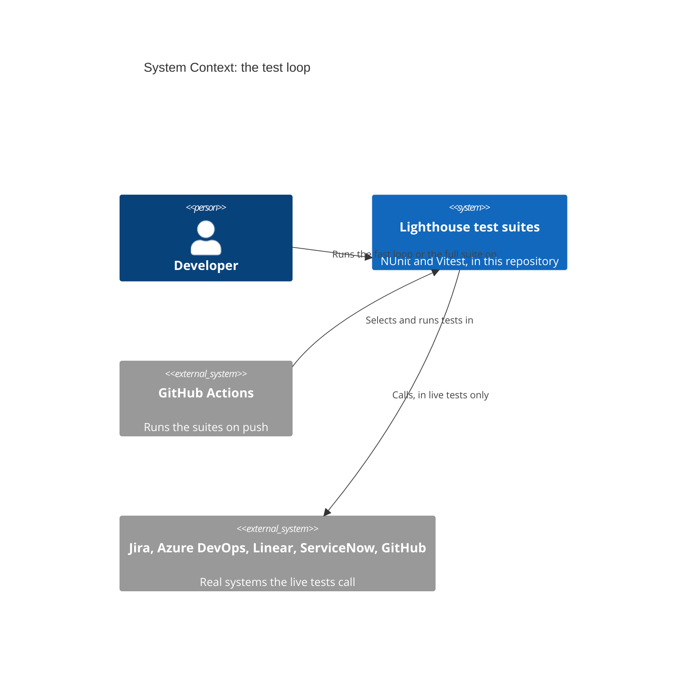
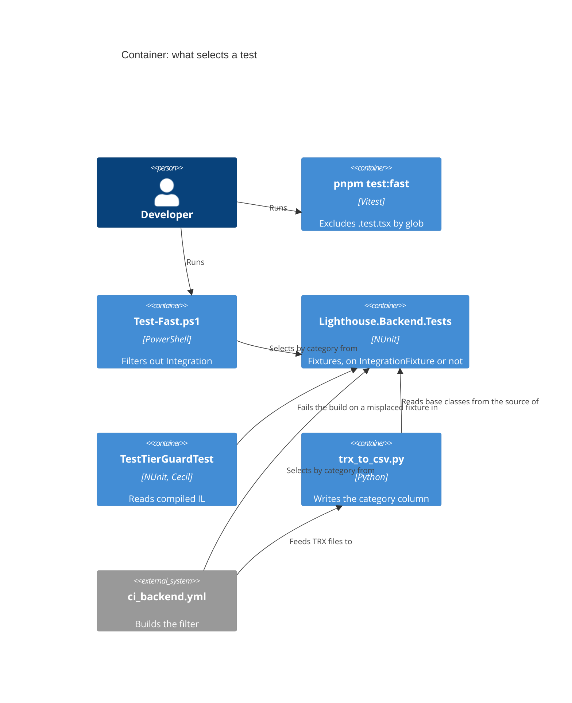

# Feature: story-6512-t6-speed-tiers-and-fast-local-loop

Story #6512 · T6 Speed tiers from the code's structure, and a fast-only local loop · part of Epic #6506 "Fast, reliable test
suites". Catalogue: [Epic workspace](../epic-6264-modular-monolith/feature-delta.md) ·
Brief: [slice-48](../epic-6264-modular-monolith/slices/slice-48-t6-speed-tiers-and-fast-local-loop.md).

DISCUSS: the brief, settled with the maintainer on 2026-11-07. Its final section, "Maintainer decisions", overrides the text
above it. Waves start at DESIGN. Rigor `thorough`.

## Wave: DISCUSS / [REF] Inherited

- Epic decision D-6264-5. job_id: infrastructure-only. T5's `Contracts` namespace and guard build on the category this Story
  sets (slice-49). T9 builds on the tiers (slice-50).
- RBAC, Lighthouse-Clients, website, usage-data, UI sketch, Terminology, context map: N/A, as the brief answers item by item.

## Baseline re-count

Read at DESIGN by text search on trunk 1f83b5455. The design agent ran nothing (a delivery is using this machine), so these
are file counts, not a compiled scan. Slice D's guard prints the real class list on its first run. CI's counts and every
timing stay unmeasured until slice A and slice F.

| Brief said | Today |
|---|---|
| 57 files derive from `IntegrationTestBase` | Confirmed: 57, one of them abstract (`ForecastedStartDateAcceptanceTest`) |
| About 36 other abstract bases | Confirmed: 36. 9 derive from another of the 36; 1 starts no host (`UpdateServiceTestBase`). **26 hosted roots** take the edit |
| Many classes build a host themselves | About 100 files by word search, 56 in `API/Integration`, about 14 in `API/Security`, the rest elsewhere, counting users of the 8 `*TestHost` helpers. A floor |
| 34 container test files | Confirmed: 37 minus 3 helpers. 3 inherit a hosted abstract base, 31 take the edit |
| 16 live files | Confirmed: 13 carry `Integration` on the class, 3 only on methods. `JiraSuppressionRetryIntegrationTest` has one test, so it is whole-class in effect: **14 whole-class, 2 mixed** (`JiraWriteBackTest`, `AzureDevOpsWriteBackTest`) |
| The two bare live files need a category of their own | **They already have one.** `GithubServiceTest` and `LighthouseReleaseServiceIntegrationTest` both carry `GithubIntegration`, which CI selects today |
| 200 to 300 one-line markers | About 170 one-line edits: 1 + 26 roots, about 100 self-hosting, 31 container, 14 live |
| 64 architecture files are a tier of their own | Dropped by the decisions. 61 are regular tests; 3 start a host and move (`OptionalFeatureApplierSeamArchUnitTest`, `TestHostIsReleasedAfterDisposeTest`, `TestHostsRunWithoutRateLimitingByDefaultTest`) |
| Frontend 208 `.test.ts`, 405 `.test.tsx` | 208 confirmed, 26 importing `@testing-library/react` confirmed. `.test.tsx` is about 410, from T12's 618 files |
| All 3 `slowTests` entries are `.tsx`; the reporter leaves an uncollected file alone | Confirmed, `compareToAllowList.ts` line 88 |
| `trx_to_csv.py` reads `API.Integration` as `Unit` | Worse. The class pattern needs the attribute directly above the class, and all 13 class-level live files stack a connector attribute under it, so they read `Unit` too. Only method-level attributes are found. A plain CI run has no such tests, so its `Integration` count is 0 |
| CI: no change, "new categories leave CI's filter alone" | **False for `Integration`.** That line was written for new category names, before the same-day correction. See D-6512-8 and "Changed Assumptions" |
| New in this count | `UsageDataCanary` in `ci_backend.yml` matches no test. 6 hosted tests are `[Explicit]` probes, one of which rewrites a recorded baseline; see D-6512-10 |

## Checklist

- [ ] Behaviour-free: production code unchanged
- [ ] Ratchet in the same change: the guard that a host-building test sits on the shared base class
- [ ] Every test still runs in the full suite, proven by comparing ids before and after on both stacks
- [ ] `CLAUDE.md`, `Test-Coverage.ps1` and `trx_to_csv.py` updated for the one `Integration` category
- [ ] Mutation: N/A only where test files alone change; say so per file

## Wave: DESIGN / [REF] Scope, mode and context

Application scope, propose mode, AFK: the maintainer is away, so each engineering choice takes the recommended option and is
recorded below. Rigor `thorough`. Read: slices 48, 49, 50 with their "Maintainer decisions", CLAUDE.md, `trx_to_csv.py`,
`summarise.py`, `check_budget.py`, `ci_backend.yml`, `ci_changes.yml`, `Scripts/test-selection/`, `Test-Coverage.ps1`,
`IntegrationTestBase`, `TestHostScanning`, `TestHostPerFixtureGuardTest`, `IlDependencies`, `package.json`, `vitest.config.ts`.
No SPIKE, no wave-decisions file (the brief is the DISCUSS output). The decided points were not reopened.

Context map (ADR-270): N/A, because no context, concept, event or edge changes. `brief.md`, ADR-270, `ARCHITECTURE.md` §4: unchanged.
No ADR, because no product architecture changes; this delta is the record. Outcome registry: not run, a test-set-up Story adds no
typed contract and this agent runs nothing. Loading and failure looks: N/A, because no screen is added or changed. Paradigm:
OOP, as the project states. External integrations: none added, so no contract-test note.

## Wave: DESIGN / [REF] Decisions

| ID | Decision | Why (one line) |
|---|---|---|
| D-6512-1 | New root `IntegrationFixture` in `TestHelpers`, holding `[Category("Integration")]` and nothing else | It decides a category, not how a host starts, so no fixture's life cycle changes |
| D-6512-2 | A category probe proves the claim before anything moves; a failure stops the Story | NUnit 5.0.0 and adapter 6.3.1 are unconfirmed here, see "The category probe" |
| D-6512-3 | Each fixture kind moves as in "How fixtures move"; moves are their own commits | One-line edits a reviewer can read as mechanical |
| D-6512-4 | `Architecture/TestTierGuardTest.cs` reads compiled IL through `IlDependencies.ReadModule`, five rules | ArchUnitNET drops async edges in Release |
| D-6512-5 | One inline list of full type names with reasons, no count constant; it empties and is deleted in slice E | "Never counts"; a stale entry already fails, so the list cannot sit idle |
| D-6512-6 | `trx_to_csv.py` follows base classes in the source tree; a class it cannot place is warned, never silently `Unit` | Python cannot read the assembly, and `Unit` by default is how the column went wrong |
| D-6512-7 | The standard filter drops `Integration`, keeps the four connectors and adds `GithubIntegration` | The decided filter, and it keeps the same tests out |
| D-6512-8 | CI's always-on clause changes text so its selection stays the same (exact string below); `.github/` is therefore touched | Left alone, it would silently drop every hosted test from CI |
| D-6512-9 | The live tests' "own category" is the existing `GithubIntegration`; no new name | Both classes already carry it and CI selects by it |
| D-6512-10 | Keep CI's `Category!=UsageDataCanary` clause; `dev-test` and the test mirror adopt it | No test carries it, but it is what keeps the `[Explicit]` probes from running |
| D-6512-11 | Container tests sit on `IntegrationFixture` too | They need Docker and take seconds; see "For the maintainer" |
| D-6512-12 | The 2 mixed classes keep literal method-level attributes; `Test-Fast.ps1` hides their tokens | Splitting them changes test ids; a token would make the fast loop write to real trackers |
| D-6512-13 | The filters switch in slice B, before any class moves | The new strings select the same tests on today's code, so each step is provable alone |
| D-6512-14 | Full-suite proof as in "Proof that every test still runs" | Compares ids, on both stacks, without touching a real system |
| D-6512-15 | `pnpm test:fast` as briefed; `pnpm test --changed` is the documented command for a component edit | `test:fast --changed` excludes `.test.tsx`, so a component edit would report nothing |
| D-6512-16 | Targets measured as in "Measuring the targets" | The decided numbers, made repeatable |
| D-6512-17 | Six slices, frontend first, none with production files | See "Slices" |
| D-6512-18 | `Contracts` is not a slow-tier marker; T5's contract base derives from `IntegrationFixture` | The category comes from the base, the namespace says nothing |
| D-6512-19 | Peer review run once (`nw-solution-architect-reviewer`, Sonnet, the reviewer model assumed for `thorough`): conditionally approved, 0 critical, 3 high; all addressed here, see "Review" | A second iteration is left to the orchestrator |

## Wave: DESIGN / [REF] The base class (D-6512-1)

`IntegrationFixture` is abstract, carries the attribute and has no members. `IntegrationTestBase` cannot play this role: its
constructor builds a host, and its name stays because 57 files use it. An interface cannot either, because attributes on
interfaces are not inherited. `[TestFixture]` stays off the root, so no fixture is built differently and no id can move. If
Sonar's empty-class rules fire in the build, hold the category name in a constant that the attribute and the guard both use;
no pragma.

**Does the category inherit?** Expected yes on both counts, not confirmed. As far as this design can tell from NUnit 3 and 4,
`CategoryAttribute` is declared inherited, and the adapter reads categories from the suite above a test (that is how class-level
`JiraIntegration` works today). The package cache is closed to this agent and NUnit here is 5.0.0, so slice B proves it.

## Wave: DESIGN / [REF] The category probe (D-6512-2)

First step of slice B, in the working tree only, never committed. One file with these fixtures, each holding one trivial test:
derives directly; derives through an abstract class; inherits its test from the abstract base; `[TestFixture(2)]`;
`[TestFixtureSource]`; a nested public class whose outer class is not on the base; a plain class not on the base; an `[Explicit]`
test on the base.

Under Debug and under `-c Release`, for real runs restricted with `FullyQualifiedName~CategoryProbe`:

| Filter | Expected |
|---|---|
| `TestCategory=Integration` | The six derived fixtures. The `[Explicit]` test may leave a `NotExecuted` row, which reads as not selected |
| `TestCategory!=Integration` | Only the plain class |
| CI's new always-on clause | All except the `[Explicit]` test |
| CI's force-full clause, `(Category=Integration&Category!=UsageDataCanary)` | The six, not the `[Explicit]` test |

Read the result from the TRX, not the console summary, and keep it in the workspace. Run `--list-tests` with the same filters
once, which settles what the brief left open; nothing depends on its answer. Any row off stops the Story before a class moves,
and the shape of the base goes back to the maintainer.

A permanent test keeps part of this: a nested abstract planted type on the base, read by reflection with `inherit: true`, must
show the category. It guards NUnit upgrades. The filter half stays covered by the proof below.

## Wave: DESIGN / [REF] How fixtures move (D-6512-3)

| Kind | Count (text search) | Move |
|---|---|---|
| On `IntegrationTestBase` | 57 files | One edit to `IntegrationTestBase` covers all |
| Abstract acceptance bases | 26 roots cover the 35 hosted bases | `: IntegrationFixture` on each root; the concrete classes follow |
| Builds a host itself, or through a `*TestHost` helper | About 100 files | `: IntegrationFixture` on the class; how it starts its host stays |
| `Integration/Containers` | 31 files, 3 more arrive through a hosted base | The same line |
| Live, whole class | 14 files | `: IntegrationFixture`, the literal `Integration` attribute goes, the connector attribute stays |
| Live, mixed | 2 files | Unchanged, on the guard's named list |
| `*TestHost` helpers | 8 | Untouched: they are not fixtures |
| `UpdateServiceTestBase` and its 6 users | 1 base | Untouched: no host, so regular |

A class whose single base is a non-hosted class cannot take the line. None is expected from the search; the guard's first run
would name any. If one appears, the shared base goes on the root only when every class under it hosts; otherwise it stops and is
reported, because moving a regular class to `Integration` would lose it from the fast tier.

No test file moves folder. A class in `API/Integration` that starts no host stays regular.

## Wave: DESIGN / [REF] The guard (D-6512-4, D-6512-5)

`TestTierGuardTest` reads the compiled test assembly through `IlDependencies.ReadModule` and reuses the call walker of
`TestHostPerFixtureGuardTest`, which moves to `TestHostScanning` in its own `refactor` commit. The next commit makes the root set a parameter of the scan. T2's guard keeps its set and
its planted cases unchanged, because a host in one-time set-up is fine by its rule. The new guard passes a wider set:
one-time set-up and tear-down, instance and static constructors (field initialisers compile into them), and methods inherited
from base types. It judges each concrete class with tests, nested ones included, because a nested class does not take its outer
class's category. `TestHostPerFixtureGuardTest` keeps its own question and its list.

| Rule | Fails when | Message names |
|---|---|---|
| 1. Hosted means on the base | A concrete fixture reaches a host start and `IntegrationFixture` is not in its base chain | The type, and that it must derive from the base |
| 2. No stale marker | A fixture on the base reaches no host, carries no connector category and is outside `Integration.Containers` | The type, and that it must leave the base |
| 3. The category is not written by hand | A `[Category("Integration")]` sits anywhere but on the base or the 2 named mixed classes | The type or method |
| 4. A hosted fixture has no connector category | It reaches a host and carries one of the five | The type, and that CI would read it as live and drop it |
| 5. Live and container fixtures are on the base | A concrete fixture carries a connector category or sits in `Integration.Containers`, and is off the base; the 2 mixed classes excepted | The type, and that the fast loop would run it |

Rule 2 is also what makes T5's moves honest: a suite that leaves the host must leave the base in the same commit.

**A planted misplaced test.** Nested abstract fixtures in `PlantedFixtures` style, read through the scan directly, because the real
pass looks only at concrete classes. Planted red: host in `[OneTimeSetUp]`; in an async `[OneTimeSetUp]` after an `await`; in a
constructor; in a field initialiser; in a base class's set-up; through a helper; a fixture on the base with no host; a hand-written
category, also in another letter case; a hosted fixture with a connector category; a container fixture off the base; a connector
category off the base. Planted green: on the base with a host, regular with no host, an unrelated
method named like a sink. The acceptance check is stronger: a real concrete class, unmarked, in the working tree, shown red under
Debug and `-c Release` with its name in the message, and the same for a stale marker, output kept in the workspace, then removed.

**Baseline.** One inline dictionary of full type names to reasons, as T2 keeps. No count constant, unlike T2's
`MostTypesTheListMayHold`. Rules 1 and 5 pass for a listed type; a listed type that is now on the base fails as stale, so the list only
shrinks and any addition shows in a reviewed diff. The rules never change to fit a type. The list holds about 130 entries in slice D,
is empty after slice E, and is then deleted. Rules 2, 3 and 4 have no baseline: the live classes are on the base before the guard lands. The 2 mixed classes are a separate, permanent named list with a reason each. They are
not a baseline.

**Limits.** The walk stops at the test assembly. A host start means a new factory, or `WithWebHostBuilder` or `WithTestAuthentication`
on one, and a factory is matched by type name or by deriving from one, so a host built any other way is invisible. The walk also
follows a virtual call to every override in the assembly, which can over-report a regular class; slice D checks the first output
and narrows that for this guard if it does. A slow test that starts no
host is not this guard's business: T9's budget is the backstop, as decided.

## Wave: DESIGN / [REF] The timing CSV (D-6512-6)

`discover_integration_class_names` learns one more thing: it reads each class's first base from the source tree and closes over the
chain to `IntegrationFixture`. `summarise.py` gets this for free, as it calls the same function. CI already passes `--source-root`.
The method-level path stays for the 2 mixed classes. The class declaration shapes it must read, each with a Python test: primary
constructor (`class X() : Base`), base with arguments, base on the next line, interface after the base, qualified base, a base named
in only one part of a partial class, nested class, private ones too (TRX writes `Outer+Inner`), a file with two namespaces, a chain
crossing files. `parse_trx` must also strip a fixture's arguments before the lookup: 5 classes use
`[TestFixture(...)]` or `[TestFixtureSource]` and would otherwise read `Unit`; confirm the TRX shape on a real file in slice F. `summarise.py` calls "integration" what is now mostly
hosted tests: its wording and `test_summarise.py` change in slice F. Rejected: a marker written into the TRX at run time, which every
fixture would have to emit; the adapter's MsTest category mode, unconfirmed and it changes the property the filters read.

**Keeping the count honest for T9:**

1. Once, in slice F: the `Unit` rows of a full CSV must equal the fast run's ids exactly, both directions.
2. Each run: a TRX class with no declaration in the source tree prints a warning, so a blind spot is seen.
3. In CI: `test_trx_to_csv.py` also scans the real tree and asserts named anchors, in the step that already runs those tests: one
   class on `IntegrationTestBase`, one through a three-deep abstract chain, one self-hosting, one container, one live, one regular.
   The same test fails if two classes on a chain to the base share a simple name, because bases are resolved by that name.
4. The name `Integration` keeps one meaning in the column: hosted, container, live.

## Wave: DESIGN / [REF] Every place that names the filter (D-6512-7 to D-6512-10)

**How CI selects today.** `ci_backend.yml`, step "Compute Test Backend filter", builds `Category!=Integration` and appends, joined by
`|`, either `(Category=Integration&Category!=UsageDataCanary)` on a shared-path change or the connector categories whose paths
changed. Then one `dotnet test --filter`. No other workflow runs `dotnet test`.

**Does the change alter what CI runs? Unless the filter changes, yes.** Once hosted tests carry `Integration`, `Category!=Integration`
drops them all: more than 400 test files, by the brief's count, would stop running in CI, silently, and the job would stay green.

The obvious replacement, the five connector categories alone, is also wrong. `JiraWriteBackTest` and `AzureDevOpsWriteBackTest` carry
their connector category on the class and `Integration` only on the live methods, so 3 offline tests (1 Jira, 2 ADO) run on every
push today and would stop. Live is exactly "`Integration` and a connector category", so the always-on clause is its complement:

```
Category!=Integration|(Category!=JiraIntegration&Category!=AdoIntegration&Category!=LinearIntegration&Category!=ServiceNowIntegration&Category!=GithubIntegration)
```

On today's code this selects exactly what `Category!=Integration` selects, because every `Integration` test carries a connector
category. After the moves it selects the same tests again: hosted tests pass the second half, live tests fail both halves. Rule 4 of
the guard protects the assumption. The force-full and per-connector clauses keep their text and their selection: everything, and
the same connector classes.

| Place | Change |
|---|---|
| `.github/workflows/ci_backend.yml` line 104 (and its comment) | The string above |
| `Scripts/test-selection/dev-test.sh` lines 48, 54, 63 | The same string; `Category=Integration` becomes the guarded clause |
| `Scripts/test-selection/dev-test.ps1` lines 47, 51, 54 | The same |
| `Scripts/test-selection/test-build-filter.sh` lines 17, 23, 9 expected strings | The same; it mirrors CI and says so |
| `Lighthouse.Backend/Test-Coverage.ps1` line 24 | Standard filter below |
| `CLAUDE.md` line 213 and the paragraph under it | Standard filter below; the paragraph adds GitHub; a new line names the fast loop and warns off a bare `TestCategory=Integration` |
| `docs/product/kpi-contracts.yaml` lines 1350, 1941 | Describe the new always-on clause |
| `Scripts/test-timings/trx_to_csv.py` docstring | Says what it now reads |

Standard filter, for people and for `Test-Coverage.ps1`:

```
TestCategory!=JiraIntegration&TestCategory!=LinearIntegration&TestCategory!=AdoIntegration&TestCategory!=ServiceNowIntegration&TestCategory!=GithubIntegration
```

It selects the same tests as today's. CLAUDE.md's line that this filter excludes the `LighthouseReleaseServiceIntegrationTest`
failures stays true only because `GithubIntegration` is in it. Left as they are: `docs/feature/**` and `docs/evolution/**` (history),
the live Stryker config and `mutation-testing.md` (they select by name). Old configs under `docs/feature/` do carry
`TestCategory!=Integration`: slice F adds one line to `.claude/commands/mutation-testing.md` saying not to copy that term, as it now
leaves out every hosted test. `dev-test.*` and `test-build-filter.sh` have no ServiceNow clause; that gap is older and stays.

**The `[Explicit]` probes.** 6 hosted tests are `[Explicit]`, and `SharedClockBaselineCapture` rewrites a recorded baseline. NUnit runs
an explicit test when it is selected directly. Once those classes carry `Integration`, a bare `Category=Integration`, which
`dev-test` uses, might run them. The probe did not see that: beside other selected tests the `[Explicit]` test stayed `NotExecuted`
under every filter, and a filter selecting only an `[Explicit]` test was not tried. So the hazard is unproven, not gone, which is why
CI's dead-looking `Category!=UsageDataCanary` clause stays and `dev-test` adopts it. Its comment should say so.

**Cost of the edit.** Any change to a `ci*.yml` sets every connector input and `connector_shared` to true (`ci_changes.yml` lines
209 to 216), so the push of slice B runs all live suites once. Slice C's live-class edits run the matching connectors. Avoid
repeating those pushes; the Linear key is shared with CI.

## Wave: DESIGN / [REF] Proof that every test still runs (D-6512-14)

Real runs, with the integration tokens unset, so nothing touches a real system. All id lists are sorted. Kept in the workspace.

**Other commits on trunk.** Other Stories push test changes while this one runs. Each before list is taken at the parent of the
slice's first commit and the after list at its last commit. A diff line is accepted only if `git log` over that range shows a commit
from another Story changing that test's file; each such id is written down with the commit. Any other line is a failure, and the
same rule holds on the frontend.

**Backend.** At the parent of slice B's first commit, and again at the parent of each later proof range: run today's always-on clause twice with `--logger trx`, and take
`fully_qualified_name` through `trx_to_csv.py`. Any difference between those two lists is the unstable-name list; it is written down
and left out of every later diff. Also list the unfiltered suite with `--list-tests`: discovery needs no filter and calls no tracker,
and it is the only list that includes live tests.

| Check | When | Must hold |
|---|---|---|
| Always-on clause, before and after | End of slices B, C and E | Diff empty |
| Unfiltered `--list-tests`, before and after | End of slice E | Diff empty, live and `[Explicit]` tests included |
| Force-full clause, restricted with the five connectors left out so no live test runs | End of slice E | Same ids before and after, no `[Explicit]` id that ran; a `NotExecuted` row reads as not selected |
| Fast run plus hosted run equal the always-on list | End of slice F | Equal, no overlap. Hosted run: `TestCategory=Integration&TestCategory!=JiraIntegration` and the other four |
| Connector attributes | End of slice E | `git grep` of the five connector names, before and after: the same lines |
| `Unit` rows equal the fast ids | End of slice F | Equal |

`[Explicit]` tests must run in no real run, though a TRX may hold a `NotExecuted` row for them; `--list-tests` discovers them, the same before and after. A commit inside a slice
is covered by the guard and the normal suite, not by an id diff.
Environmental failures in CLAUDE.md change an outcome, not an id, so they do not disturb the diff.

**Frontend** (FE7's method, `file :: full name` from `test-results.json`). `pnpm test` before and after slice A: diff empty, as nothing in
the config changes. `pnpm test:fast` ids plus the `.test.tsx` ids of the full run equal the full list, no overlap. That run also
shows `--exclude` adds to the config's `exclude` rather than replacing it: no `.stryker-tmp` file may appear.

## Wave: DESIGN / [REF] Frontend command and targets (D-6512-15, D-6512-16)

`package.json`, one script beside `test`, with no Vitest config change:

```
"test:fast": "cross-env TZ=Europe/Zurich vitest run --exclude \"**/*.test.tsx\""
```

`pnpm test:fast --changed` runs the logic tests an edit affects. It cannot see a component's test, so an edit to a `.tsx` file would
report nothing while looking like a pass. `pnpm test --changed` covers that case and already works; CLAUDE.md names both. Slice A
checks that an edit touching no `.test.ts` exits 0 and says it ran nothing. If it exits 1, add `--passWithNoTests` to the script.

Backend: `Lighthouse.Backend/Test-Fast.ps1`, beside `Test-Coverage.ps1`, runs `TestCategory!=Integration`, with a `-NoBuild` switch.
It clears the Jira and Azure DevOps integration-token variables for its run and restores them, because the 2 mixed classes create
scratch items in `[OneTimeSetUp]` whenever one of their tests runs and a token is present. Neither command is a gate: `pnpm test` and
`dotnet test` stay what "done" means.

**Measuring.** On a quiet machine at the default worker cap, 5 warm runs, median wall clock, with test counts. A wrapper script stays out
of the repo; numbers and the commit go in the workspace.

| Target | Run | Pass |
|---|---|---|
| Frontend `--changed`, under 10 s | `pnpm test:fast --changed` after a comment added to one file, for 3 fixed files: few, median and many related `.test.ts` files, named in slice A | Median of each under 10 s; report the `.tsx` case too, as information |
| Frontend whole tier, under 60 s | `pnpm test:fast` | Median under 60 s |
| Backend whole tier, under 60 s | `Test-Fast.ps1 -NoBuild` after one build; build time reported apart | Median under 60 s |

Frontend misses after slice A: the node project is measured, as decided. Backend misses: list the slowest classes from the run. That is
T9's and T10's input, not a new tier. The likeliest cost is the 61 architecture files, each reading whole assemblies.

## Wave: DESIGN / [REF] Slices (D-6512-17)

Each leaves the suite green. Moves are commits of their own; a commit never mixes a move with an edit. **Production files: none in any
slice.** Mutation: N/A throughout, because Stryker mutates the product assembly and no product file changes. The Python scripts carry
their own unit tests.

| Slice | Days (est.) | Delivers | Commits, in order | Files outside tests |
|---|---|---|---|---|
| A | 0.5 | `pnpm test:fast`, frontend ids proof, first timing, the target confirmed | script and docs | `package.json`, `CLAUDE.md` |
| B | 0.5 | Probe, `IntegrationFixture`, filters switched, always-on diff empty | base with its reflection test; filters | `ci_backend.yml`, `Scripts/test-selection/*`, `Test-Coverage.ps1`, `CLAUDE.md`, `kpi-contracts.yaml` |
| C | 0.5 | Most tests marked, live classes on the base; always-on diff empty | `IntegrationTestBase` and 26 roots; 14 live classes | None |
| D | 1 | Scan moved, guard live, red shown on real planted classes | `refactor` scan move; root set as a parameter; guard with planted cases and its list of about 130 | None |
| E | 1 | The list emptied and deleted; ids proof | moves by kind: `API/Integration`; `API/Security` and the rest; containers | None |
| F | 1 | `Test-Fast.ps1`, CSV, medians re-cut, backend proof and target, docs | script; CSV and its tests; docs and numbers | `Test-Fast.ps1`, `Scripts/test-timings/*`, `CLAUDE.md`, `.claude/commands/mutation-testing.md` |

Frontend first because it is independent and cheap and gives the first real number. Filters come before moves so no commit can drop a
test from CI; roots and live classes before the guard so its list is about 130 lines, not 450, and rule 3 holds from its first commit.
The fast filter means nothing until slice E ends, so its script lands after. Days are estimates; the five timed runs and full-suite
proof runs are machine time, kept off a slice's working day where they can wait for a quiet machine. T12 delivers now: slice A's timing
waits for that, and only that overlaps. T9's 5 calibration runs start after slice F.

## Wave: DESIGN / [REF] Reuse Analysis

| Existing | File | Overlap | Decision | Contract shape, and how the crafter asserts it |
|---|---|---|---|---|
| `HostBuildingScan` | `Architecture/TestHostPerFixtureGuardTest.cs` | Call walker | EXTEND, moved to `TestHostScanning`, roots added | Pure over a module; planted fixtures, and T2's guard stays green unchanged |
| `IlDependencies.ReadModule` | `Architecture/IlDependencies.cs` | Reads the assembly | REUSE | Read-only, one module per fixture |
| `Compare`, `PlantedFixtures` idiom | `TestHostScanning`, T2's guard | List comparison, planted cases | REUSE | Pure |
| `IntegrationTestBase` | `TestHelpers/` | Host life cycle | EXTEND: derives from the new root | Unchanged behaviour; ids diff |
| `TestTierGuardTest` | none | A guard over the same scan | CREATE NEW: T2's guard asks how often a host starts and stays as it is; two questions, two failure messages, as T5 argues too | Pure over a module, then a list comparison; planted fixtures |
| `IntegrationFixture` | none | Category on a class | CREATE NEW: `IntegrationTestBase` builds a host in its constructor, and the other 26 roots and 100 classes start theirs differently | Attribute only, no behaviour |
| `discover_integration_class_names` | `trx_to_csv.py` | Classification | EXTEND | Pure over a source tree; fixture `.cs` files |
| `declared_classes` | `check_budget.py` | Walks declarations | Not reused: it reads names, not bases, and sharing would couple the budget check to this column | n/a |
| `Test-Coverage.ps1` | `Lighthouse.Backend/` | Runs a filtered suite | CREATE NEW sibling `Test-Fast.ps1`: one script with a mode would mix a coverage tool with the loop | Shell only |
| `dev-test.sh`, `--unit-only` | `Scripts/test-selection/` | Runs a filtered suite | EXTEND for the filter; not the fast loop, because it tracks CI's selection | Shell; `test-build-filter.sh` asserts the strings |
| TimeBudgetReporter | `src/tests/timeBudget/` | Subset runs | REUSE unchanged | Checked by slice A's run |

## Wave: DESIGN / [REF] What can lie, and what catches it

| Assumption | Could be false because | Caught by |
|---|---|---|
| The category is inherited and the filter sees it | Unconfirmed on NUnit 5 and adapter 6 | The probe, before any move |
| The TRX tells us categories | It does not (the script's own docstring) | Ids from runs selected by filter, not read from the TRX |
| `--list-tests` honours a filter | Unconfirmed | Used unfiltered only |
| A negative term blocks `[Explicit]` tests | Remembered behaviour, NUnit 5 | The probe |
| `--exclude` adds to the config | Unconfirmed on Vitest 5 | Frontend ids proof |
| The source scan matches the compiled truth | It reads text | `Unit` rows against the fast ids; anchors; the warning |
| The guard walks what runs | It stops at the test assembly | Real planted class under Release; T9's budget |
| The guard itself works | It could pass by reading nothing | Planted red fixtures, which fail if the scan goes blind |

## Wave: DESIGN / [REF] C4





## Wave: DESIGN / [REF] For the maintainer

1. **`.github/` changes after all.** The brief's OUT and last AC exclude it. The decision to reuse the name `Integration` makes one line
   there unavoidable, or CI loses every hosted test. Taken: edit it. What CI runs stays the same, and slice B proves that.
2. **Container tests sit on the base (D-6512-11).** The decision says hosted and live; about 30 container files start Docker, and some
   start no host. Left regular they would make the fast loop need Docker, and their seconds would set T9's fast-tier budget. Taken: on
   the base, with the guard allowing `Integration.Containers`. If you meant them to stay regular, say so before slice D.
3. **T9's ceilings need like-for-like runs.** Live tests appear in the CSV only when a connector's path changed, and they read
   `Integration`. T9's total ceiling and mean would jump on such a push, and every `ci*.yml` edit makes one. T9's DESIGN must judge only
   plain runs or leave connector classes out. That is a T9 point, not done here.
4. **T5 proposes a count constant** (`MostTypesTheListMayHold` style) for its shrinking list. The rule given here is "never counts". T5's
   DESIGN should take the same shape, or say why not.

## Wave: DESIGN / [REF] Open for DISTILL and DELIVER

- The 3 fixed files for the `--changed` measure (slice A).
- Whether the guard's override following needs narrowing (slice D, from its first output).
- The TRX class shape of a parametrised fixture (slice F, from a real file).
- `.test.tsx` count, read from the first real run.

## Changed Assumptions

Original, slice-48, Proposals 7: "**CI: no change.** The guard is one more test in the run; new categories leave CI's filter alone;
`check_budget.py` ignores `category`." And OUT: "`.github/`". And its last AC: "No change in `.github/` or production code, so
mutation is N/A."

New: what CI **runs** does not change; the text of its filter does, on one line of `ci_backend.yml`. Why: the same-day correction made
the marker the name CI's filter excludes. The AC becomes "the always-on clause selects the same ids before and after; no production
code changes, so mutation is N/A."

Original, slice-48, Maintainer decisions: "the two bare live files (`GithubServiceTest`, `LighthouseReleaseServiceIntegrationTest`) gain a
category of their own". New: they already have it, `GithubIntegration`; the standard filter adds it. Why: the attribute is on both classes.

Original, slice-48, Proposals 6: "A (0.5) ... B (1) ... C (1) ... D (0.5 to 1)", four slices. New: six slices, about 4.5 days. Why: filters
now land separately and before any move, and the guard lands after the root and live moves.

## Wave: DESIGN / [REF] Review

One pass by `nw-solution-architect-reviewer`, read-only: conditionally approved, 0 critical, 3 high. It confirmed from the code that all
16 live files carry a connector category, so the always-on clause holds on today's code and after the moves; the mixed classes; the
GitHub category; the `UsageDataCanary` finding. It could not confirm NUnit 5 behaviour, Vitest behaviour, the file counts or any timing.

| Finding | Severity | Resolution |
|---|---|---|
| Rule 3 would be red in the guard's slice, as the live classes moved later | High | Live classes move in slice C, before the guard |
| A container or connector class off the base passed the guard | High | Rule 5, with planted cases |
| The id baseline went stale under other Stories' commits | High | Before lists per slice range; a diff line needs a named foreign commit |
| `[Explicit]` wording contradicted `--list-tests`; force-full proved by reasoning only | Medium | Wording fixed; force-full check added |
| Shared root set would flip T2's guard | Medium | Root set is a parameter |
| Old Stryker configs carry the old term | Medium | Line in `mutation-testing.md`; ServiceNow gap recorded |
| CSV shapes missing; a warning alone | Medium | Shapes added; a collision fails the Python test. An unplaceable class stays a warning, so the timing step cannot fail a run over a label |
| Slices C and D at the edge of a day | Medium | C split in two; timed runs kept off the working day |
| Sink definition, `summarise.py` wording, a `TestTierGuardTest` row, one more CSV alternative | Low | Added |

## Wave: DEVOPS / [REF] Platform readiness

Existing platform; nothing is deployed. Written 2026-11-07 with the maintainer away, so each choice takes the recommended option. Files
were read and nothing was run, because a delivery is using this machine: every number below is a rule for reading a run, not a reading.
Letters used: `D` tests listed, `R` tests ran, `E` tests a plain run leaves out (live and `[Explicit]`), `X` the `[Explicit]` tests alone.

| Topic | Answer |
|---|---|
| Environment | **Linux, local:** `pnpm test:fast`, `Test-Fast.ps1` under `pwsh` and all proof runs; half the cores, integration tokens unset; the counts for the check below under `-c Release`, as CI builds. **CI, `ubuntu-latest`:** the only `dotnet test` in any workflow (`ci_backend.yml` line 140); Release, no worker cap, tokens set, Docker present. **Windows and macOS jobs:** check signed binaries and start the app; they run no test. **A worktree:** 2 Licensing failures until the licence file is copied, so proof lists come from the main checkout. **No Docker:** the fast loop needs none, but only once slice E ends. |
| Proof on every push (D-6512-20) | A new step, "Check test selection", after "Test the budget check" and before "Check test-time budget", so a budget breach cannot hide it. It lists the suite with an unfiltered `dotnet test -c Release --no-build --list-tests`, counts the rows of `test-timings-backend.csv`, and writes one line to the log and the step summary: listed `D`, ran `R`, left out `D - R`, expected, run kind. The raw total cannot carry a stop: it moves with every test another Story adds, and jumps when a connector runs. Left out holds only live and `[Explicit]` tests, so other Stories' commits do not move it, and one lost hosted test adds 1 to it. A person compares `R` from run to run. Code: `Scripts/test-timings/check_selection.py` with its tests, numbers with reasons in `test-selection.json` beside it. |
| What stops the run | Plain run: left out must equal `E`. A run with connector categories: at or under `E`. Force-full run: must equal `X` (6 by text search). Any other value, or a missing list or CSV, exits 1: `Verify Backend` goes red, `sonar-gates` is skipped, nothing is packaged. `LIGHTHOUSE_BUDGET_WARN_ONLY` does not reach it. A commit that adds or removes a live or `[Explicit]` test changes the number in the same commit, in a reviewed diff. A deleted test leaves `D` and `R` together: that is a deletion, seen in its diff, not a test leaving CI. Slice B's probe also compares `--list-tests` with the TRX count; if they cannot be reconciled, the fallback is a committed floor on `R` at the before-count less 1 % (an estimate), which catches the loss of the hosted tests but not of one class. The id diff then carries the rest. |
| What the first push is judged against | **Written down before it:** `T0`, the count of the last green plain `main` run (`Total:` in the "Test Backend" log, and the CSV rows) with its commit; `D0` and the always-on count `A0`, under `-c Release`, at the parent of slice B's first commit. `T0` and `A0` must agree, under DESIGN's foreign-commit rule. `E` is `D0 - A0`. **The first push cannot judge the clause.** A `ci*.yml` edit forces the full filter, which selects everything but `[Explicit]` tests whatever the always-on clause says, and adds the live tests, so its total does not compare with `T0`. It is judged on left out = `X`, and ran = `T0` + `E` - `X` + other Stories' test changes. **The first plain run judges the clause:** ran = `T0` + those changes, left out = `E`. Slice B's proof stays open until then, and the local id diff is the only earlier evidence. |
| Pushes that run live suites | **One**, with slice B's `ci_backend.yml` edit and the new step in it. Slice C's 14 live-class commit moves ahead of the `IntegrationTestBase` commit and rides that push: alone, its files on connector paths would run those connectors a second time. The forced run then also shows they still run. Nothing later touches a `ci*.yml`: slice F's CSV work is under `Scripts/test-timings/`, found by the existing discover step, and starts no live suite. The 3 hosted classes in connector folders arrive through `IntegrationTestBase`, so no file there changes. `Lighthouse.Backend.Tests.csproj` must stay untouched: a csproj edit is a shared path and forces the full run. |
| Keeping it at one (D-6512-21) | One holds only if that run ends green. Change detection diffs from the last green run, which needs backend, frontend, E2E, `sqlite`, `postgres` and Sonar to hold. On red the edit stays in the window and the next push runs every live suite again. `ci.yml` has no `concurrency`, so a push during the run takes the same base and starts a second live run at once on the same keys. So: no other push on trunk until it ends (T12 is delivering, so agree the moment), and no use of the Linear key for an hour before, since Linear meters per key over a rolling hour. A 429 carries `Retry-After: 3600` and most of its failures read as plain assertion failures: grep the log for `TooManyRequests`, wait the hour, re-run the failed job, do not push. The budget step judges live classes too (5 carry ceilings), so a slow tracker can also red the run. The push runs all stacks. |
| Order after that push | The hosted commit (`IntegrationTestBase` and 26 roots) waits for one green plain run, so a wrong clause and a wrong move are never judged together. A docs-only push starts no CI, and `workflow_dispatch` after a green base skips the backend, so that run must come from a backend path, usually another Story's push. If none comes within a day the commit goes anyway: the check still stops a loss, only the diagnosis is harder. Every push of slices C, D and E is plain and judged exactly. |
| Rollback | Reverse of the order DESIGN chose. Once T5 has landed, T5's slice B is reverted before T6's slice B, because its contract tests sit on the same base. **The filter goes last:** reverting it while hosted tests carry `Integration` restores `Category!=Integration` and loses them all, the one thing that must not happen. The check is therefore its own commit, so a filter revert cannot take the stop with it. **F:** alone, until T9 builds on the column. **E:** its commits in reverse; the list returns and the guard stays green; CI is unaffected, as the always-on clause selects these classes either way. **D:** alone, after E or without it, scan refactor last; no test changes, the ratchet goes. **C:** only after D, or rules 3 and 5 fail; the live commit's revert runs those connectors. **B:** only after C, filter then base; a `ci*.yml` edit, so a second live run: prefer a fix forward unless the clause itself is wrong. **A:** alone, at any time. |
| Windows | `Test-Fast.ps1` and `dev-test.ps1` have no CI cover on any platform, and no Windows machine is at hand, so Windows stays **unverified and is said so in the docs**. A Windows test job was rejected: nobody here uses one, and it would be another `ci*.yml` edit. `Test-Fast.ps1`: its filter holds nothing a shell reads specially; it clears `JiraLighthouseIntegrationTestToken` and `AzureDevOpsLighthouseIntegrationTestToken` for the process, restores them in `finally` and checks `$LASTEXITCODE` as `Test-Coverage.ps1` does. `dev-test.ps1` passes the filter through a variable; `&` already goes that way in `Test-Coverage.ps1`, while `(`, `)` and `|` are new. `-DryRun` under `pwsh` in slice B shows the string, not Windows quoting. `pnpm test:fast` has the same `cross-env` shape as `pnpm test`. |
| Backend memory | The 18 GB growth seen on 2026-10-31 was a leak, and T1 #6459 fixed it. T2 recorded a local standard-filter run of about 350 s at a peak of about 3.6 GB. T6 changes no fixture, so a run stays that size. Never two test runs at once, and none beside T12's delivery. DISTILL replaced DESIGN's proof runs: see "Proof that every test still runs". Run `dotnet build-server shutdown` between them. The fast tier starts no host, so it should stay low; unmeasured, so slice F records its peak once. In CI the list step starts its testhost after the run's has exited, so the peak does not rise; its duration is read off the first run. |
| Monitoring | The step summary line and `test-timings-backend`, whose ids give a diff when a count surprises. The `Integration` column stays 0 on a plain run until slice F. No dashboard, no alert: the red run is the alert. |
| Mutation | N/A, because Stryker mutates the product assembly and no product file changes. `check_selection.py` carries unit tests, as the other scripts do. |
| Usage-data event | N/A, because `Test-Fast.ps1` and `pnpm test:fast` run on a developer's machine and no user of the product reaches them, so no event could show use. `UsageDataEventName` is unchanged. |
| Terminology, release notes, RBAC, Clients, Website, UI sketch | N/A, because no route, DTO, screen or word a user sees changes. Release notes are written at `/release`, with nothing to say here. |
| T9's brief (owed; not edited here) | Four lines change. "T6 slice D writes the tier" is now slice F. "Covers hosted and live" is now hosted, container and live (point 2). The mean and the maintainer's total ceiling must leave connector classes out, read from their literal attributes, or every force-full run goes red, which keeps a `ci*.yml` edit in the window (point 3); doing that in the script needs no workflow edit. Proposal 5's "touches `ci_backend.yml` for the summary" is not needed: `check_budget.py` can write to `GITHUB_STEP_SUMMARY` itself, which saves a second live run (point 1). |
| T5's brief (owed; not edited here) | Three lines change. Proposal d and the first AC drop the exact ceiling constant for a list that shrinks through stale entries, or T5's DESIGN says why not (point 4). The open `Contracts` check is answered: not a slow-tier marker, and the contract base derives from `IntegrationFixture`. T6 joins T5's dependencies, and a suite leaving the host leaves the base in the same commit (guard rule 2). Points 1 to 3 change nothing for T5: a host-to-port move stays in the always-on selection, so left out holds still. |
| What this changes in DESIGN | "One line of `ci_backend.yml`" becomes that line plus one step, in the same push. "Slice B proves that" holds only locally until the first plain run. Slice C's commit order flips, and its live commit joins slice B's push. `--list-tests` now matters: "nothing depends on its answer" no longer holds, for the unfiltered count. The probe gains CI's joined strings, always-on `\|` force-full and always-on `\|` one connector, because it tests the clauses one at a time and CI runs them together. |

## Wave: DEVOPS / [REF] Review revision: the smaller check (2026-11-07, maintainer away)

The review of DESIGN and DEVOPS returned NEEDS_REVISION: the always-on clause is sound, the new CI step is not worth it. This
section overrides anything above that differs.

- **"Check test selection" is dropped, with `check_selection.py` and `test-selection.json`.** Only three things can lose a test:
  a wrong clause (judged by the local id diffs at B, C and E, and by the first plain run against `T0`, whose `Total:` line the
  log already prints), a hosted class gaining a connector category (guard rule 4 at build time), or an offline class given
  `Integration` plus a connector, which is possible today. The step guarded mostly the third, and its first run would be on
  the one push that cannot be repeated cheaply: a red there runs every live suite a second time. Its constants would also red
  trunk when another Story adds a live test.
- **Added, cheap:** a unit test in the existing test project that evaluates the clause string against synthetic category
  sets, so the logic is pinned at no CI cost. The first-plain-run comparison against `T0` is done by the orchestrator and
  recorded; a difference stops the run.
- **The fast filter also leaves out the connectors**, not only `Integration`: `JiraWriteBackTest` and
  `AzureDevOpsWriteBackTest` create real items in `[OneTimeSetUp]` for any selected test, so a bare `TestCategory!=Integration`
  with a token set writes to a real tracker. Three offline tests leave the fast loop, and `Test-Fast.ps1` needs no token
  clearing. `CLAUDE.md` prints the safe filter or the script, never the bare one.
- **`dev-test.sh --unit-only`:** its comment and help text change, as it now runs the plain CI selection with hosted tests.
- **A guard rule for `UsageDataCanary`:** a fixture carrying it carries a connector, because the clause selects by exclusion.
- **Slices, updated:** B holds the probe, `IntegrationFixture` and the filters. Its push also carries slice C's 14 live classes,
  so it is the one live push; the hosted commit waits for one green plain run, or a day. Filters before moves holds per commit,
  and per push only in that order.
- **Containers (D-6512-11) stay on the base, as raised with the maintainer**, who has not answered; it goes past "boots the
  host", so it is a decision to revisit at slice D.

## Wave: DISTILL / [REF] Scope, reconciliation and baseline (2026-11-07, maintainer away)

- Shape: a change to how tests are selected, with no product behaviour. The specification is NUnit, Vitest and Python `unittest`, and
  the acceptance scenarios for a guard are planted cases that must go red. No Gherkin, so no scaffolds, Tier B, domain-types module or
  state-delta port. Nothing is written in this wave except this section and `deliver/roadmap.json`: the tests are written red-first in
  DELIVER, and no test or build was run here, because a delivery is using this machine. So every "expected" below is a rule for reading a
  run. The Pre-DELIVER "fails for the right reason" gate is met step by step: each step shows its red before its green.
- No nWave scenario tag goes into any test title, comment or file. An untagged test is correct here; classification stays in this
  workspace, in the tables below.
- UI sketches: N/A, because nothing a user sees changes. Loading and failure looks: N/A, no screen is added or changed.
- Policy: `docs/architecture/atdd-infrastructure-policy.md` exists, read as inherited; no port is added. Journey, KPI contract: none for
  this Story; `kpi-contracts.yaml` only has two lines of wording to change. Deliverable type: application. Outcome registry: not run,
  no typed contract is added.
- Language: C# for the backend, TypeScript for the frontend, Python for the timing scripts.
- Read for this wave, beyond the delta and slice-48: `ci_backend.yml`, `ci_changes.yml`, `path-classifier.sh`, `test-build-filter.sh`,
  `dev-test.*`, `trx_to_csv.py`, `Test-Coverage.ps1`, `TestHostPerFixtureGuardTest`, `TestHostScanning`, the 16 live files' class lines.

**Reconciliation: 0 hard contradictions.** Soft points, resolved as recorded:

| Point | Resolved |
|---|---|
| DESIGN and DEVOPS: `Test-Fast.ps1` clears tokens, D-6512-12 "hides their tokens"; fast filter is `TestCategory!=Integration` | The revision wins: the fast filter leaves out the connectors and clears nothing |
| slice-48's Maintainer decisions: "The fast loop is `TestCategory!=Integration`" | Taken as the revision has it, because a bare filter with a token set writes to a real tracker. It is stricter and costs 3 tests. **Named for the maintainer**: this is the one place the delta's last section goes past a maintainer line, not only past the brief |
| DEVOPS "Check test selection", `check_selection.py`, `E`, `X`, "left out", the `--list-tests` reconciliation, the floor on `R` | Gone with the step. `T0`, `Total:` and the CSV remain |
| DESIGN's "Fast run plus hosted run equal the always-on list"; "`Unit` rows equal the fast ids" | Both are false once the fast filter leaves out the connectors: the 3 offline tests of the mixed classes are in neither. See D-6512-24 |
| Revision: hosted commit waits "or a day"; this wave's brief: it waits for one green plain run | It waits. The day existed because the plain run had to come from another Story; D-6512-23 removes that need. After a day with no green plain run the orchestrator reports; it does not push |
| DESIGN: scan move in slice D | Moved to slice C, D-6512-23. Same commit, earlier |
| DEVOPS "about 12 full-size runs" | Replaced by 8, D-6512-22 |
| Guard: five rules in DESIGN, a sixth in the revision | Six rules |

## Wave: DISTILL / [REF] Decisions

| ID | Decision | Why (one line) |
|---|---|---|
| D-6512-22 | Before every push from push 2 on, one local run of `A`, its TRX kept as that push's id list and compared locally with the last; `H` once, at the end of slice E. CI's `test-timings-backend` CSV is a cross-check | The proof comes before the push, and the run is the whole-suite gate too; see "Proof that every test still runs" |
| D-6512-23 | The `refactor` scan move leaves slice D for slice C and is pushed alone after the live push, so the Story makes its own first plain run | It is a backend path and changes no category; waiting for another Story's push was the only reason for "or a day" |
| D-6512-24 | The tiers add up as fast + hosted + 3 offline tests; the `Unit` column equals fast + those 3 | The revision's fast filter leaves those 3 out, and they carry no `Integration` |
| D-6512-25 | The probe gains the shapes it lacked: a live class on the base, and a mixed class's live and offline methods | The always-on clause rests on those two shapes and DESIGN's list had neither; the 3 offline tests are the reason the clause has a second half |
| D-6512-26 | **Withdrawn.** A step's own checks are `dotnet build` and named test classes; the `A` run before each push is the whole-suite gate | `CLAUDE.md`'s gate holds; nothing here relaxes green-before-push |
| D-6512-27 | A diff line is also accepted when it is a test this Story added, named in the delta | DESIGN allowed only foreign commits, which would fail this Story's own pin, reflection and guard tests. A foreign commit now excuses a line only if its diff shows that exact test removed |
| D-6512-28 | Frontend: one full `pnpm test`, no before-run | Nothing in the config changes, which `git diff` shows; the one run is what the partition needs |
| D-6512-29 | Before each push, the push's diff goes through `path-classifier.sh` and every connector answer must be `false` | A self-hosting class in a connector folder would start a second live run; text search finds none today, and the check costs nothing |

## Wave: DISTILL / [REF] Names used below

Every string is exact. All `dotnet test` commands below run from the repo root, against `Lighthouse.Backend/Lighthouse.Backend.Tests`,
with `-c Release --no-build --logger trx` after one `dotnet build -c Release` unless a line says otherwise, and with no variable ending
in `IntegrationTestToken` set, checked first with `env | grep -c IntegrationTestToken`, which must print 0. Release matches CI, so local
and CI lists compare like for like.

| Name | String |
|---|---|
| Old clause | `Category!=Integration` |
| Always-on clause `A` | `Category!=Integration\|(Category!=JiraIntegration&Category!=AdoIntegration&Category!=LinearIntegration&Category!=ServiceNowIntegration&Category!=GithubIntegration)` |
| Force-full clause | `A` joined by `\|` with `(Category=Integration&Category!=UsageDataCanary)` |
| Standard filter | `TestCategory!=JiraIntegration&TestCategory!=LinearIntegration&TestCategory!=AdoIntegration&TestCategory!=ServiceNowIntegration&TestCategory!=GithubIntegration` |
| Fast filter `F` | `TestCategory!=Integration&` followed by the standard filter |
| Hosted filter `H` | `TestCategory=Integration&` followed by the standard filter |
| Offline filter `O` | `(TestCategory=JiraIntegration\|TestCategory=AdoIntegration\|TestCategory=LinearIntegration\|TestCategory=ServiceNowIntegration\|TestCategory=GithubIntegration)&TestCategory!=Integration` |

(`\|` is a plain `|`; the backslash only keeps this table a table.)

The standard filter's `GithubIntegration` is a stated addition: today's filter does not name it. The selection stays the same, because both
GitHub classes carry `Integration` today and that term leaves the filter.

A **plain run** is a green `main` run whose "Compute Test Backend filter" log prints `force_full=false` and `filter=` with the always-on
clause alone (the old clause before the live push). A **list** is defined under "Reading a diff". A **list run** is a local `dotnet test` that selects the hosted tests.

**A count is part of every restricted run.** `dotnet test` exits 0 when a filter matches nothing, so "green" means the exit status **and** a stated
nonzero count read from the TRX's `Counters total`. Stated counts: `TestHostPerFixtureGuardTest` exactly 18; `IntegrationFixtureCategoryTest` at least
2; `TestSelectionClauseTest` at least 8; `TestTierGuardTest` at least 8 after rule 1, 16 after rules 2 to 4, 21 after rules 5 and 6.

## Wave: DISTILL / [REF] The guarantee

Each is a check that can fail.

| # | Guarantee | Command | Fails when |
|---|---|---|---|
| 1 | No production or other non-test code changes | `git show --name-only --format= <hash>` for each of this Story's commits, against an allow-list: `Lighthouse.Backend/Lighthouse.Backend.Tests/`, `Lighthouse.Backend/Test-Coverage.ps1`, `Lighthouse.Backend/Test-Fast.ps1`, `Lighthouse.Frontend/package.json`, `Scripts/test-selection/`, `Scripts/test-timings/`, `.github/workflows/ci_backend.yml`, `.claude/commands/mutation-testing.md`, `CLAUDE.md`, `docs/` | A path outside the list. So the product, migrations, frontend source, E2E and every other workflow are covered without naming them |
| 2 | The clause selects what it must | `dotnet test ... --filter "FullyQualifiedName~TestSelectionClauseTest"`, at least 8 tests by the TRX | A synthetic category set lands on the wrong side, or a place holds a different string |
| 3 | The new clause equals the old on today's tree | `dotnet test ... --filter "<H>"` at the end of slice B and again after the live classes move | Any test is selected: `A` differs from the old clause only for a test with `Integration` and no connector, which is what `H` selects. This is the one check where zero is the right count; the planted case in slice B shows the filter can select |
| 4 | No id is lost, run to run | Each local list against the one before it, before the push, as "Reading a diff" says | A `Passed` id is missing or no longer `Passed`, with no exemption |
| 5 | The first plain run matches `T0` | See "First plain run against `T0`" | Any difference stops the Story |
| 6 | No id is lost at all, live and `[Explicit]` included | `dotnet test ... --list-tests` (no filter), sorted, at the parent of slice B's first commit and at the end of slice E | As 4, ids only |
| 7 | The connector attributes stand | `git grep -E 'Category\("(Jira\|Ado\|Linear\|ServiceNow\|Github)Integration"\)' -- Lighthouse.Backend/Lighthouse.Backend.Tests \| sort` at the same two points | Any line differs |
| 8 | `[Explicit]` tests stay out of real runs | At the end of slice E, `A`, force-full and `H`, each `&`-joined by `FullyQualifiedName~` with the 5 classes holding them and with the control class `HealthCheckIntegrationTest`. Those 5 classes hold only `[Explicit]` tests: 6 methods, 9 ids, as `RealityCheckWallClockProbe` has 4 cases. The control is there because a filter that matched nothing would also run no `[Explicit]` test | The TRX's `Counters executed` is not exactly the control class's count in `L6`, which must be nonzero, or any of the 9 ids has a row with an outcome other than `NotExecuted`. A `NotExecuted` row and no row both read as not selected: `T0` holds all 9 as `NotExecuted`, the probe shows `A` and force-full give an `[Explicit]` test on the base no row and `H` gives it one. `Counters total` counts those rows, so it is not the number to read |
| 9 | The tiers add up, with no overlap | `F`, `H`, `O` lists at the end of slice E | With every `NotExecuted` row of the 9 `[Explicit]` ids taken out of both sides, the three lists sorted together differ from `L6`. An overlap shows as a duplicate line `L6` does not have |
| 10 | Exactly 3 offline tests sit outside fast and hosted | `O` run | Not 3 ids: 1 in `JiraWriteBackTest`, 2 in `AzureDevOpsWriteBackTest` |
| 11 | The guard bites | Planted cases, and real planted classes under Debug and Release, "What each slice must show" | A planted red stays green, or the message omits the type |
| 12 | The fast loop touches no real system | The `F` list holds no class with a connector attribute; `Test-Fast.ps1` holds `F` by text; `git grep -nE 'TestCategory!=Integration([^&]\|$)' -- CLAUDE.md Lighthouse.Backend/Test-Coverage.ps1 Lighthouse.Backend/Test-Fast.ps1 Scripts/test-selection docs/ci-learnings.md .claude/commands` | A connector class appears; or the grep prints a line, which catches the term in quotes, backticks or at a line's end. The one warning line of `mutation-testing.md` is the only allowed hit |
| 13 | Exactly one live-suite push | The filter line of each CI run of this Story's pushes | A second run has `force_full=true` or a connector clause because of this Story's files. A foreign cause is written down, see "Push plan" |
| 14 | The CSV's column agrees with the filters | New `trx_to_csv.py` over the `F`, `H`, `O` TRX files, then the first plain CSV after slice F | `Unit` rows differ from `F` + `O`, either direction |
| 15 | Frontend tiers add up | `pnpm test:fast` ids and the `.test.tsx` ids of one `pnpm test` against that run's whole list | Not equal, an overlap, or a `.stryker-tmp` id |
| 16 | The targets hold | "Measuring the targets", 5 warm runs | A median is over target: a hold for the maintainer, not a green |

Mutation is a waiver, not a check: see "What closes the Story".

## Wave: DISTILL / [REF] What each slice must show (red before, green after)

"Red" means non-zero or a named failure for the reason given, never a build or set-up error. Failing names and messages go in the step's
commit body or this delta. Scenario counts are per step; none is over 8.

**Slice A: `pnpm test:fast`.** From `Lighthouse.Frontend`.

| Case | Before | After |
|---|---|---|
| The command exists | `pnpm test:fast` fails, no such script | Runs, exit 0, no `.test.tsx` in `test-results.json` |
| A planted failing `.test.ts` | | `pnpm test:fast` red, naming it. Removed |
| A planted failing `.test.tsx` | | `pnpm test:fast` stays green and does not list it; `pnpm test <it>` is red. Removed |
| An edit that touches no `.test.ts` | | `pnpm test:fast --changed` exits 0 and says it ran nothing; if exit 1, add `--passWithNoTests` |
| A subset run and the time-budget reporter | | No stale-entry or budget finding for the 3 `.tsx` entries |
| Partition | | Guarantee 15 |

**Slice B: the base, and the filters.**

| Case | Before | After |
|---|---|---|
| The category reaches a derived type | `IntegrationFixtureCategoryTest` does not compile or is red | A nested abstract planted type on the base shows `Integration` by reflection with `inherit: true` |
| Regular and hosted sets are kept; live is left out, for all five connectors | `TestSelectionClauseTest` red: `ci_backend.yml` still holds the old clause, which drops `{Integration}` | Green |
| An offline test of a mixed class is kept | Same | `{JiraIntegration}` and `{AdoIntegration}` selected by `A` |
| A planted wrong clause: the five connectors alone | | The evaluator reports `{JiraIntegration}` dropped: this test holds the wrong answer as its expectation, so the evaluator cannot go blind |
| A planted wrong clause: the old clause after the moves | | Reports `{Integration}` dropped |
| Force-full takes everything but the canary | | `{Integration, UsageDataCanary}` dropped by its second half, and kept by `A` if it has no connector, which is why guard rule 6 exists |
| The joined strings | | `A\|Category=JiraIntegration` selects `{Integration, JiraIntegration}` and no other live set |
| Every place holds the same text | Red | `ci_backend.yml`, `dev-test.sh`, `dev-test.ps1`, `test-build-filter.sh` all hold `A` |
| `H` selects nothing on today's tree (guarantee 3) | Plant `[Category("Integration")]` on one offline class, uncommitted: `H` selects exactly it. Remove | Selects nothing |
| The shell mirror | `bash Scripts/test-selection/test-build-filter.sh` fails on the new expected strings | `failed: 0`. CI does not run this script, so the step does |
| The always-on list on a dry run | | `pwsh Scripts/test-selection/dev-test.ps1 -DryRun` prints the string (not Windows quoting, as DEVOPS says) |

`TestSelectionClauseTest` holds a small evaluator of `=`, `!=`, `&`, `|` and parentheses over a set of categories, and reads the strings from
the real files through the `FindRepositoryRoot` idiom of `CategoryListOwnershipGuardTest`. It says how the clause reads, not how NUnit reads
it: the probe covers that half.

**Slice C: the moves that come before the guard.**

| Case | Must show |
|---|---|
| The 14 live classes | All 14 have no base on the class line (read here), so each takes `: IntegrationFixture`. The literal `Integration` goes, the connector stays. Guarantee 3 still selects nothing. Guarantee 7 holds, as those lines stay |
| `JiraSuppressionRetryIntegrationTest` | Its one method-level `Integration` goes too; the class has one test, so the selection is the same |
| The hosted commit | `IntegrationTestBase` and the 26 roots take the line. `H` restricted to one class on each kind (`FullyQualifiedName~` on one `IntegrationTestBase` class and one class under a three-deep root) selects them, and `F` restricted the same way selects nothing: red before the commit, green after |

**Slice D: the guard.** Planted nested abstract fixtures, the `PlantedFixtures` way, through the scan directly.

| Step | Planted red | Planted green |
|---|---|---|
| Rule 1 | Host in `[OneTimeSetUp]`; in an async `[OneTimeSetUp]` after an `await`; in a constructor; in a field initialiser; in a base class's set-up; through a helper | On the base with a host; regular with no host |
| Rules 2 to 4 | On the base with no host; a hand-written category; the same in another letter case; on a method; a hosted fixture with a connector category | A live fixture on the base; a container fixture on the base with no host; an unrelated method named like a sink |
| Rules 5 and 6 | A container fixture off the base; a connector category off the base; `UsageDataCanary` with no connector | A named mixed class; `UsageDataCanary` with a connector |

Before a planted red goes green, the rule's own code does not exist, so it fails the assertion, and T2's `TestHostPerFixtureGuardTest` stays
green unchanged throughout: same ids, same list. Also: a stale list entry goes red, as "a listed type now on the base" (the list can only
shrink). A planted container fixture needs the `Integration.Containers` namespace: give it one in the test file, not a rule parameter.

The acceptance check is stronger. A real concrete class in the working tree, under Debug and under `-c Release`: unmarked with a host, then
on the base with no host. Each red with its full name in the message, output kept in this delta, class removed, `git status` clean.

**Slice E: the list empties.** In each commit, moving a class while its entry stays turns the stale check red once; removing the entry
turns it green. Guarantees 6 to 10 close it. Then the list and its stale check are deleted, which a guard run shows.

**Slice F: the script, the column, the numbers.**

| Case | Before | After |
|---|---|---|
| `Test-Fast.ps1 -NoBuild` | No file | Runs `F`, exit 0, list equal to the `F` list of slice E plus own and foreign lines; a failing planted regular test makes it exit non-zero; removed |
| Class shapes in `test_trx_to_csv.py`, first step: primary constructor, base with arguments, base on the next line, interface after the base, qualified base, a base named in one part of a partial class, nested class, private nested class (`Outer+Inner`) | Each reads `Unit` | Each reads `Integration` |
| Second step: two namespaces in a file; a chain crossing files; a parametrised fixture's arguments stripped; a TRX class with no declaration warns and is not silently `Unit`; the mixed classes' method-level path still works; the real-tree anchors; two classes sharing a simple name on a chain fail; `summarise.py`'s wording | Red | Green, and `python3 -m unittest discover -s Scripts/test-timings/tests` passes |
| The real TRX of a parametrised fixture | Open from DESIGN | Read from slice E's `H` TRX and pinned in a test before the code changes |

## Wave: DISTILL / [REF] The probe that opens slice B

As DESIGN, with D-6512-25. One file, `Architecture/CategoryProbe.cs`, in the working tree only, never committed; `git status` shows it gone
at the end of the step. It holds its own copy of the root class, since the real one lands after it. All run under Debug and under `-c Release`, each filter `&`-joined with `FullyQualifiedName~CategoryProbe`, read
from the TRX, not the console. Results go in this delta.

| Fixture | Shape |
|---|---|
| `Direct` | Derives from the base |
| `Through` | Through an abstract class |
| `Inherited` | Inherits its test from an abstract base on the base |
| `Parametrised` | `[TestFixture(2)]` on the base |
| `Sourced` | `[TestFixtureSource]` on the base |
| `Nested` | Nested public class on the base, outer class off it |
| `Plain` | Off the base |
| `Explicit` | `[Explicit]` test on the base |
| `Live` | On the base, `JiraIntegration` on the class |
| `MixedLive`, `MixedOffline` | Two methods of **one class**, the shape of `JiraWriteBackTest`: off the base, `JiraIntegration` on the class, `Integration` on `MixedLive` only. Below, each name means that method |

| Filter | Must select | Must not select |
|---|---|---|
| `TestCategory=Integration` | The first six, `Live`, `MixedLive`. `Explicit` leaves a `NotExecuted` row and does not run, so it does not confirm the hazard of D-6512-10 | `Plain`, `MixedOffline` |
| `TestCategory!=Integration` | `Plain`, `MixedOffline` | The rest |
| `A` | The first six, `Plain`, `MixedOffline` | `Explicit`, `Live`, `MixedLive` |
| Force-full clause | Every fixture but `Explicit`: the first six, `Plain`, `Live`, `MixedLive`, `MixedOffline` | `Explicit` |
| `A\|Category=JiraIntegration` | The first six, `Plain`, `Live`, `MixedLive`, `MixedOffline` | `Explicit` |
| Standard filter | The first six, `Plain` | `Explicit`, `Live`, `MixedLive`, `MixedOffline` |
| `F` | `Plain` | The rest |
| `H` | The first six | The rest |
| `O` | `MixedOffline` | The rest |

A `NotExecuted` row of an `[Explicit]` test reads as not selected, in every row of this table: it is not counted, and it is not a cell off. A filter selecting only an `[Explicit]` test was not tried.

Run `--list-tests` with one filter once and write down whether it honours it. Nothing depends on that now.

**What stops the Story.** Any cell off, under either configuration, or a filter the adapter refuses to parse. No class moves and no filter
changes; the probe's table goes to the maintainer with the shape of the base as the question. A missing TRX or a build error is not a
result: fix it and run the probe again.

## Wave: DISTILL / [REF] Proof that every test still runs

**The rule.** Before every push from push 2 on, the step before the push runs the always-on clause `A` locally, once, and keeps its TRX as
that push's id list. The list is compared with the one before it **locally, before the push**; a difference stops the push. This run is also
the whole-suite gate before the push. CI's CSV of the same commit is a cross-check afterwards, not the proof.

```
dotnet test Lighthouse.Backend/Lighthouse.Backend.Tests -c Release --no-build --filter "<A>" --logger "trx;LogFileName=L<push>.trx"
python3 Scripts/test-timings/trx_to_csv.py --trx <that file> --output L<push>.csv
```

| List | When | Selection | What it proves |
|---|---|---|---|
| `L0` | Parent of slice B's first commit | Old clause | The first list |
| `L2` | Before push 2 | `A` | `A` selects what the old clause did, on the real tree, with the live classes moved |
| `L3` | Before push 3 | `A` | The scan move changed nothing. The rule has no exceptions, so no crafter has to judge one |
| `L4` | Before push 4 | `A` | The hosted commit lost nothing: the hosted-kept half of `A` on real hosted classes |
| `L5` | Before push 5 | `A` | The guard's commits lost nothing |
| `L6` | Before push 6 | `A` | The moves lost nothing |
| `H` | Before push 6, once | `H` | The tiers add up, with `F` and `O`, which are small |
| `L7` | Before push 7 | `A` | Nothing moved in the last slice |

**8 runs of about 350 s, about 47 minutes of machine time in all**, where DEVOPS had about 12. Besides those: 2 unfiltered `--list-tests`
discoveries, which start no host, and a few restricted runs. The 2 force-full runs are gone: guarantee 8 covers `[Explicit]` on the real tree,
and the force-full set is `A` plus the `Integration` tests, of which `A` is proven and the rest is the connector list (guarantees 6, 7).
Unstable names come free from CI: `T0`'s CSV against the plain run before it.

**Reading a diff.** A list holds `fully_qualified_name` and `outcome`, sorted, duplicates kept, read with Python's `csv`. Local lists are compared
with local lists and CI's with CI's, never across, because Docker, licence files and tokens differ.

- **Passed ids must match.** An id that was `Passed` and is now missing, skipped or not executed is lost, so a test that starts skipping counts.
- **`Passed` to `Failed`** is read against CLAUDE.md's environmental list, then that class alone runs again; its green, with a stated nonzero
  count from its TRX, is recorded and the id stands.
- **A foreign commit excuses a line only if its diff shows that exact test removed**, quoted with the commit. A foreign commit that merely touched
  the file excuses nothing. A foreign added line is the same, with the test added. A rename shows as one of each.
- **A test this Story added** is named in the delta (D-6512-27).
- **Unstable names are compared by per-class counts**, written down from the CI pair: the class's count must match, line by line does not apply.

**What is lost, plainly.**

1. **No full list ever runs under the force-full string after the moves.** Clause logic, probe, guarantee 8 and the connector list cover it by
   reasoning. The first force-full run after slice E, whenever it comes, is read once for any `[Explicit]` id that ran, an outcome other than `NotExecuted`. That is the one real gap.
2. **A list covers a push, not a commit.** A diff line names its class, so finding the commit stays easy.
3. **Machine time.** Each run holds the machine alone for about 6 minutes, so a list run and T12's delivery take turns.
4. **Push 3's CI run says nothing about hosted tests**, as "First plain run against `T0`" says; `L4` is the first evidence for that half.

**The rules of a list run.** One at a time, never beside any other test run, frontend or backend: `ps -eo args | grep -cE '[t]esthost|[v]itest'` prints
0 and no build is going. `dotnet build-server shutdown` before it. Live tests cannot run under `A`, but no token variable is set either, because
`O` and the mixed classes are nearby. Docker is up, as `A` holds the container tests. A list run is never repeated for a failed test; only a crash
that leaves a short TRX justifies a second, named in this delta. A step's other checks stay class filters with a stated count, and no crafter
runs an unfiltered or standard-filter `dotnet test`; the `A` run is the whole-suite gate.

**Frontend.** One `pnpm test` and one `pnpm test:fast`, `test-results.json` deleted before each, ids as `file :: full name` (guarantee 15). No
before-run, because `git diff` shows the script line is the only change (D-6512-28). Not beside any other run.

**What is kept.** Each list is written down in this delta by commit, count and `sha256`; the diff lines are written in full. The local lists and
`F`, `H`, `O` go in `evidence/` in this workspace, as they have no artifact. CI's lists stay in their artifacts, named by run id.

## Wave: DISTILL / [REF] First plain run against `T0`

Done by the orchestrator and recorded here, as the revision says.

**Written down before the first commit of slice B:** `T0`, from the last green plain `main` run: the run id, its commit, the `Total:` line of
"Test Backend", the CSV row count, the list's `sha256`. Read the commit from `gh run view`, not the run list, whose pages can be stale.
A force-full run is not a candidate, and that includes T12's push, which edits `ci_frontend.yml`. Also written down: the `[Explicit]` ids'
rows in that CSV: all 9 are there, `NotExecuted`.

**The live push cannot judge the clause**: force-full selects everything whatever `A` says. It is judged on: green; every `T0` id present; every
extra id in a class with a connector attribute; no `[Explicit]` id with an outcome other than `NotExecuted`.

**The first plain run judges it, in part.** It is the run of the scan-move push. No class but the live ones sits on the base yet, so it can
judge the clause **only for live and regular tests**: a hosted test with `Integration` and no connector does not exist at that point. That half
of `A` first meets real hosted classes in `L4`, the local list before push 4, and then in push 4's plain run. In order:

1. It is plain: the log prints `force_full=false` and `filter=` with `A` alone. If not, it does not count; see "Push plan".
2. Ids and outcomes: its CSV against `T0`'s, read as "Reading a diff" says.
3. Count: `Total:` = `T0` + this Story's tests + foreign tests added - foreign tests removed, written out as a sum.
4. The `category` column reads `Integration` 0 times, as before slice F.

**Any difference stops the Story.** No hosted commit, no further backend push. A wrong clause can only be fixed by a `ci*.yml` edit, which
is a second live run, so the fix goes to the maintainer first. Only then does the hosted commit go.

## Wave: DISTILL / [REF] Push plan

The orchestrator makes each push, once the step before it has finished its local list. A push is a line in that step, not a step of its
own. Each push waits for the one before to end, and the check of D-6512-29 runs before each, except the live one, which is meant to answer `true`.

| Push | Carries | Local list before it | Backend run | CI cross-check after it |
|---|---|---|---|---|
| 1 | Slice A | None, no backend file | None (frontend path) | Frontend green |
| 2, **the one live push** | Slice B, and slice C's 14 live classes | `L2` against `L0` | Force-full, every connector | "First plain run against `T0`", the live paragraph |
| 3 | The scan move, alone | `L3` against `L2` | Plain, the first | Against `T0`, for live and regular tests only |
| 4 | The hosted commit | `L4` against `L3`: the hosted-kept half of `A` meets real hosted classes here | Plain | Against push 3's |
| 5 | Slice D | `L5` against `L4` | Plain | Against push 4's |
| 6 | Slice E, after its proof | `L6` against `L5`, and `F` + `H` + `O` against `L6` | Plain | Against push 5's |
| 7 | Slice F | `L7` against `L6` | Plain (`Scripts/test-timings/` is a backend path) | Against push 6's, guarantee 14 |

Before push 2, as DEVOPS: no other push on trunk until it ends, agreed with T12; no use of the Linear key for an hour before, **and that
hour counts from the end of any other live run**. T12's last push edits `ci_frontend.yml`, which matches `ci.*\.yml`, so it runs every live
suite too. On a red: grep the log for `TooManyRequests`; wait the hour and re-run the failed job, never push. `Lighthouse.Backend.Tests.csproj` stays
untouched by this Story: a csproj edit forces a full run. A docs-only push starts nothing and may go at any time.

**To look at before push 2: can a failed job be re-run without a name conflict?** Every workflow pins `upload-artifact` at v7.0.2 and none sets
`overwrite`, and `ci_backend.yml` uploads `test-timings-backend` and `sonar-report-backend` from the job that runs the tests. Reading the
workflow does not settle whether a second attempt of that job collides with the first attempt's artifact names, and the plan's answer to a
429 is exactly that re-run. So before push 2, read a past `main` run with an attempt above 1 that reached those steps (`gh run view <id>
--attempt 2 --log`). If it collides, or none exists, add `overwrite: true` to both uploads in push 2's own `ci_backend.yml` edit; adding it
later would be a second live run.

**Push 3 must be plain, and how it can fail to be.** Change detection diffs from the last green run. So push 3 is plain only if that run is at
or after push 2 and no `ci*.yml` edit lies in the window. Push 3 therefore waits until every foreign run started since push 2 has ended and the
newest is green; a foreign red is re-run by its owner, or waited out by the next foreign green.

**If push 3 runs force-full all the same** (a foreign run was red or unfinished, or a foreign edit sat in the window), it is not a failure and
not the first plain run. It is judged as the live paragraph says, and once green the window closes. There is no deadlock, though the hosted
commit is still waiting: the next plain run needs a backend-path commit, and `workflow_dispatch` will not do, because after a green base it
skips the backend. **The named way out is the scan's root-set commit of slice D**, which changes no category and may go ahead of the hosted
commit for this purpose, after its own local list. A foreign backend-path push serves just as well. If neither gives a plain run, the
orchestrator reports; the hosted commit still does not go.

**A foreign force-full run and "exactly one live push".** Guarantee 13 counts runs caused by this Story's files. A foreign `ci*.yml` or csproj
edit that runs the live suites, on its own push or inside push 3's window, does not break it; it is written down with its cause. It does
restart the Linear hour, and it is no cross-check. A force-full run because push 2 never went green is this Story's second live run: guarantee
13 has failed, and the maintainer is told.

**A version change on trunk.** NUnit 5.0.0 and adapter 6.3.1 sit in `Lighthouse.Backend.Tests.csproj`. Before each push, `git diff <probe's commit>
HEAD -- Lighthouse.Backend/Lighthouse.Backend.Tests/Lighthouse.Backend.Tests.csproj` is read; a change to either re-runs the probe's `Live` fixture
against `A`, `F` and `H`, in the working tree only, and any cell off stops the Story.

## Wave: DISTILL / [REF] Stop rules

| Stop | Trigger | Then |
|---|---|---|
| The Story | A probe cell off | The maintainer decides the base's shape |
| The Story | Any difference at the first plain run | As that section |
| The Story | A file outside guarantee 1's allow-list in a commit | Remove it; report |
| A step waits | The fast filter unanswered by the maintainer | The filters step does not start. No answer means it waits, and push 2 with it |
| A step waits | Containers unanswered by the maintainer | The container move does not start. No answer means it waits, and push 6 with it. Slice D goes on, with the guard allowing containers on the base as DESIGN has it; a "keep them regular" answer changes rules 2 and 5 first |
| Pushing | A local list differs from the one before it | No push until explained by "Reading a diff" or the test is back |
| Pushing | Push 2 red | No push until diagnosed; a re-run of the failed job, not a new push |
| Pushing | A foreign run started since push 2 is unfinished or red | Push 3 waits. See "Push plan" for the way out |
| Pushing | NUnit or the adapter changed on trunk | The probe's `Live` fixture runs again before the next push; a cell off stops the Story |
| Pushing | An unexplained line in a CI cross-check | Nothing further pushes until it is explained or the test is back |
| Pushing | Any `classify_*` answers `true` for a planned plain push | Split the commit or stop: never a second live run. `git diff --name-only <last green> HEAD`, then `. Scripts/test-selection/path-classifier.sh` and each `classify_*` on that list |
| Pushing | Trunk moved and conflicts | Stop and report; nothing is rebased |
| A run | Any other test run is active, frontend or backend, or a token variable is set | Wait, or unset; a list run never overlaps |
| A run | A named class filter's TRX shows fewer tests than its stated count | Not a green: `dotnet test` exits 0 on no match. Fix the filter |
| A run | A list run repeated | Only for a short TRX; named in this delta first. A failed test is not a reason |
| A move | A class's only base is a non-hosted class | The shared base takes the line only if every class under it hosts; otherwise stop and report |
| The guard | A rule looks wrong for a type | The type changes or joins the list with a reason; a rule never loosens. The first output may narrow override following for this guard only, as DESIGN allows |
| A target | A median over target | Frontend: the node project is measured, as decided. Backend: the slowest classes are listed for T9 and T10. Both go to the maintainer; neither adds a tier |
| Any | A planted file left behind | `git status` is clean of planted files before every commit |

## Wave: DISTILL / [REF] What closes the Story

1. Every step done with its focused commit; moves in commits of their own. Pushes 1 to 7 made, each judged and recorded.
2. Guarantees 1 to 16 recorded with their evidence; the DISCUSS Checklist ticked by evidence, with "ids before and after on both stacks" as
   guarantees 4, 6, 9, 15.
3. The maintainer has confirmed the targets from the measured medians. The frontend one after slice A, as decided.
4. Mutation, per slice. **A:** N/A, `package.json` and docs. **B:** N/A, a test helper, tests, workflow, shell and docs. **C, D, E:** N/A, test files
   only. **F:** N/A for Stryker, which mutates the product assembly; `Test-Fast.ps1` is shell, and the Python scripts carry their own unit
   tests. Guarantee 1 is what makes each N/A true.
5. `CLAUDE.md` names the fast loop, the standard filter and the warning; `Test-Coverage.ps1`, `dev-test.*` comment and help, `kpi-contracts.yaml`,
   `trx_to_csv.py` docstring and `mutation-testing.md` match; Windows is said to be unverified.
6. Owed, and handed over at close: the four lines of T9's brief and the three of T5's, as DEVOPS lists; the watch item of the first force-full run
   after slice E (it does not hold the Story, and is left as an ADO comment). T9's 5 calibration runs start after this. ADO #6512 moves by the usual story rule; the Epic is the maintainer's. No release notes.

## Wave: DISTILL / [REF] Completeness audit and hold

15-item checklist over the planned set, items not applicable counted as passing with the reason. **15 of 15: COMPLETE**, by count; the
check is on a plan, so DELIVER's reds are what finally prove it.

| Item | Answer |
|---|---|
| C1a, C1b | `H` selecting nothing; empty and three-deep chains. No numeric boundary exists |
| C2a, C2b | N/A, no state machine |
| C3 | 0, 1 and many: no matching test, a one-test class, the chain anchors |
| C4a, C4b | The scan and CSV are pure; moving a class twice is refused by the stale check. No inverse operation |
| C5a, C5b | Every filter against every category shape, in the probe table; `-NoBuild` changes no selection |
| C6a to C6c | Letter case, unparseable filter, unplaceable class (a warning), a closed list of failures per guard rule |
| C7a | No Docker: the fast loop after slice E. No token: the check before each run |
| C7b | A short TRX; a 429 on the live push |
| C7c | Never two runs: the rules of a list run, the push plan |

Error and edge cases: the slice tables plant about 20 cases that must go red, against 7 planted greens in the guard. Tier B: no, config-shaped. Driving ports: the
two commands and the guard's test run, each exercised directly. No new driven adapter.

Hold: rigor `thorough`, recorded in the roadmap; pass `model` explicitly on every dispatch. The DESIGN, DEVOPS and DISTILL reviews have run; see "Review revision". Open for DELIVER: the 3 fixed files of the `--changed` measure, override following, the TRX shape of a
parametrised fixture, the `.test.tsx` count. Slice A's timing waits for T12 to finish, and only that overlaps.

## Wave: DISTILL / [REF] Orchestrator amendment (2026-11-07, maintainer away)

- **D-6512-26 is withdrawn.** The filtered `dotnet test` runs in full before every push, as `CLAUDE.md` requires; nothing here
  relaxes green-before-push. Steps inside a slice may check `dotnet build` and named classes, but the gate before a push of
  slices B to E is the whole filtered run. That is one run per push, a few minutes each, and never beside a frontend run.

## Wave: DISTILL / [REF] Review revision (2026-11-07, maintainer away)

The DISTILL review returned NEEDS_REVISION: 0 blockers, 4 high, 6 medium, 3 low. This section overrides anything above that differs, including
the amendment just above, whose "filtered run" is now exactly `A`. Sections above were also corrected in place where they would mislead.

- **The local run before every push uses `A`, and its TRX is that push's id list.** The proof comes before each push; CI's artifacts are a
  cross-check. 8 runs of about 350 s (7 lists and `H`), never beside any other test run. D-6512-22 and the loss list are rewritten.
- **Push 3 judges the clause only for live and regular tests.** The hosted-kept half first meets real hosted classes in `L4`, before push 4.
- **Memory:** DEVOPS's 18 GB is corrected. T1 #6459 fixed that leak; T2 recorded about 3.6 GB and about 350 s.
- **Counts:** every restricted run states a nonzero count read from the TRX. Guarantee 8 gains a control class, because the 5 classes hold only
  `[Explicit]` tests and their right answer alone would be "nothing ran". They are 6 methods and 9 ids, not 6 tests.
- **Diffs compare outcomes:** Passed ids must match. A foreign commit excuses a line only if its diff shows that exact test removed. Unstable names
  compare per-class counts.
- **Push plan:** push 3 waits for foreign runs to end green; a re-run, or the scan's root-set commit pulled forward, is the way out; a foreign
  force-full run is written down and does not break guarantee 13; a version change re-runs the probe's `Live` fixture.
- **Re-run and `upload-artifact`: not settled by reading.** v7.0.2 everywhere, no `overwrite`. It is a check before push 2, with `overwrite: true` in
  push 2's edit as the answer if it collides.
- **Roadmap shape.** No step is orchestrator-only. T0, the probe and `IntegrationFixture` are one step, 02-01. The filters are 02-02. The live push
  and its judging are a line after 03-01; the scan move is 03-02 and the hosted commit 03-03. Slices D, E and F keep their ids; 05-04 is run by a
  crafter. A step that follows a push opens by checking the delta records that push as judged. 21 steps.
- **`test_file`** names a real file in every step; none names the delta or the probe.
- **The CSV's `fully_qualified_name` column** gets a byte-identical check across the `trx_to_csv.py` change, because ids and budgets key on it (06-04).
- **Lows:** guarantees 1 and 12 widened; force-full cell spelled out; `MixedLive` and `MixedOffline` are one class; `GithubIntegration` is a stated
  addition. No hosted base is generic: a search for `abstract class Name<` over the test project finds none, so the chain has no `Base<T>` to read.
- **Two real stops, both with the maintainer.** The fast filter before 02-02, the containers before 05-03. No answer means those steps wait; the
  earlier "no answer keeps them on the base" is withdrawn.

## Wave: DISTILL / [REF] Maintainer decisions (2026-11-07)

These answer the two stops, so 02-02 and 05-03 no longer wait for the maintainer. This section overrides earlier text.

- **Fast filter:** the fast loop also leaves out the five connector categories. It cannot reach a real system, and 3 offline tests leave it. They still run in the full suite and in CI.
- **Containers:** they sit on `IntegrationFixture`. They work with an outside system, and they are not fast: in CI run 42345830021, 139 container tests took 385 s in total, about 2.8 s each, which is 1 % of the tests and 17 % of the test time.

## Wave: DELIVER / [REF] Slice A, step 01-01: what ran (2026-11-07)

Run on `82b53525f` plus this step's edit, from `Lighthouse.Frontend`, one run at a time, at the default 6 workers. No test process was active
before or between the runs.

| Case | What ran | Result |
|---|---|---|
| The command exists | `pnpm test:fast` before the edit | Exit 1, `Command "test:fast" not found` |
| | `pnpm test:fast` after it | Exit 0, 208 files, 3,648 tests, 33 s; `test-results.json` holds 0 `.test.tsx` files |
| A planted failing `.test.tsx` | `pnpm test:fast` | Exit 0, still 3,648 tests, named in neither the log nor `test-results.json` |
| | `pnpm test src/tests/plantedFailure.test.tsx` | Exit 1, `FAIL src/tests/plantedFailure.test.tsx > planted failure` |
| A planted failing `.test.ts` | `pnpm test:fast` | Exit 1, `FAIL src/tests/plantedFailure.test.ts > planted failure`. Both removed; `git status` shows neither |
| An edit that touches no `.test.ts` | A comment in `GeneralSettingsComponent.tsx`, `pnpm test:fast --changed` | Exit 0, `No affected test files found, exiting with code 0`. So `--passWithNoTests` stays out of the script |
| | The same edit, `pnpm test --changed` | Exit 0, 8 files, 147 tests: the component's tests the fast command cannot see |
| A subset run and the time-budget reporter | `pnpm test:fast` | `0 offenders`, in fail mode, and no line for any of the 3 `.tsx` entries of `slowTests.ts` |

**`--changed` with `package.json` edited runs the whole tier.** Vitest treats `package.json` as a reason to re-run everything, so with this
step's own edit uncommitted `pnpm test:fast --changed` ran all 3,648 tests. The row above was read with `package.json` hidden from git for that
one run, which is the state a developer has once it is committed. Whoever measures `--changed` needs a clean `package.json`.

**Guarantee 15, the tiers add up.** `test-results.json` deleted before each run; ids as `file :: full name`, sorted, duplicates kept.

| List | Run | Count | `sha256` of the sorted list |
|---|---|---|---|
| Fast | `pnpm test:fast`, exit 0, 33 s | 3,648 | `15b5d1d0297c0aefdfa4b877fccbfe9c8c7522e7b438f3e89008b1bca26ca661` |
| The `.test.tsx` ids of the full run | | **5,857**, in 410 files | `b9867a12c5916c66a4b8a96db5558223111f28b04696e238d3a95c02d4176a87` |
| Full | `pnpm test`, exit 0, 231 s, 618 files | 9,505 | `b707c1ae64d1cfa714377b60e2e79a02193c9f1414d71bdd4ed0594fc52848a4` |
| Fast and `.test.tsx` together | | 9,505 | `b707c1ae64d1cfa714377b60e2e79a02193c9f1414d71bdd4ed0594fc52848a4` |

No id on one side only, no overlap, no `.stryker-tmp` id. The full list holds 5 repeated ids, tests sharing a name in one file, which is why the
lists are compared with their duplicates kept.

`git diff` showed one added line in `package.json` and no Vitest config change. `pnpm build` was clean, with Biome making no fixes, and `git status`
afterwards showed only this step's files.

## Wave: DELIVER / [REF] Slice A, step 01-02: first timing (2026-11-07)

**One target is missed: a hold for the maintainer.** `--changed` on the many-file case has a median of 15.25 s against 10 s. The few and median
cases and the whole tier are inside their targets.

| Measure | Target | Median | The 5 runs (s) | Files, tests | Result |
|---|---|---|---|---|---|
| `pnpm test:fast --changed`, few | 10 s | **1.35 s** | 1.35, 1.36, 1.51, 1.34, 1.34 | 1, 29 | Inside |
| `pnpm test:fast --changed`, median | 10 s | **3.53 s** | 3.53, 3.37, 3.41, 3.64, 3.56 | 4, 90 | Inside |
| `pnpm test:fast --changed`, many | 10 s | **15.25 s** | 15.23, 14.93, 15.61, 15.75, 15.25 | 70, 1,102 | **Over** |
| `pnpm test:fast` | 60 s | **32.86 s** | 32.68, 34.20, 33.08, 32.82, 32.86 | 208, 3,648 | Inside |
| `pnpm test --changed`, a `.tsx` edit, as information | none | 15.37 s | 15.27, 15.37, 15.18, 15.38, 15.50 | 8, 147 | Information |

Every run exited 0 with every test passing, at the default 6 workers, with `LIGHTHOUSE_TEST_WORKERS`, `VITEST_MAX_WORKERS` and `CI` unset. Time is
wall clock around the `pnpm` command. Each series opened with one more run to warm up, not counted. No `.test.tsx` ran in a `test:fast` run;
`test-results.json` was read after each one.

**The 3 fixed files.** A count of each source `.ts` file's related `.test.ts` files over the import graph, type-only imports left out, gave 247
files with at least one, and a median of 4. The file counts in the table are what Vitest itself ran.

| Case | File | Graph count | Vitest ran |
|---|---|---|---|
| Few | `src/components/SurveyNudge/nudgeEligibility.ts` | 1 | 1 |
| Median | `src/utils/date/age.ts` | 4 | 4 |
| Many | `src/models/Forecasts/WhenForecast.ts` | 71, the highest | 70 |

The `.tsx` case is `src/components/Common/BaseSettings/GeneralSettingsComponent.tsx`, the file 01-01 used.

**`--changed` no longer runs everything.** The first run after `package.json` was committed ran 1 file and 29 tests, not 3,648.

**Before each series.** `ps -eo args | grep -cE '[t]esthost|[v]itest'` printed 0 before all of them, and the wrapper waited for a 1-minute load under
1.5. The 5- and 15-minute figures still carry the series before.

| Series | Commit | Load, 1 / 5 / 15 min |
|---|---|---|
| Few | `e99b6559c` | 1.03 / 4.11 / 6.47 |
| Median | `e99b6559c` | 1.48 / 4.11 / 6.44 |
| Many | `e99b6559c` | 1.38 / 3.64 / 6.11 |
| `.tsx` | `fdcad7ba4` | 1.39 / 3.50 / 5.67 |
| Whole tier, discarded | `add13df5f`, then `fcc395c1c` | 1.42 / 3.28 / 5.23 |
| Whole tier | `fcc395c1c` | 1.40 / 4.14 / 5.23 |
| Many, node | `fcc395c1c` | 0.33 / 1.21 / 3.20 |

**The commit moved during the measuring.** `fdcad7ba4` and `add13df5f` change only slice briefs. `fcc395c1c` merged `origin/main`, which brought a
`fallow` update in `package.json` and `pnpm-lock.yaml`. That merge landed as the third run of the first whole-tier series started: `pnpm` installed
first, and that run took 49.99 s. The series (32.51, 35.82, 49.99, 34.37, 33.21, median 34.37 s) is discarded and the table's is a repeat on the merged
commit. So the first run after a dependency change costs about 15 s more, and that is not the tier's speed.

**The node project, measured because the many case is over.** The same file and comment, with `environment: "node"`, from a config outside the repo
that wraps `vitest.config.ts` and adds one line defining `Element`, because `setupTests.ts` touches `Element.prototype` and all 70 files otherwise die
in setup. Without that line the runs took about 3 s and ran no test, so that figure means nothing.

| Measure | Median | The 5 runs (s) | Files | Tests |
|---|---|---|---|---|
| Many, in node | **9.59 s** | 9.59, 9.72, 9.64, 9.47, 9.53 | 60 passed, 10 failed | 898 passed, 204 failed |

- It comes in under 10 s, by 0.41 s, and only with 10 files failing. Those would have to stay in `jsdom`, so a real split runs them too and its time
  is not this one. This is a reading, not a working setup.
- The 10 are hook tests and the services around them: `useMetricsData` (110 failures), `useDeliveryManagement` (39), `usageDataEvents` (14), `useRbac` (13),
  `usageDataReporter` (8), `useRbacGate` (8), `useLicenseRestrictions` (7), `useCumulativeStateTimeChoices` (3), `LogService` and
  `useRefinementSetUpReporter` (1 each). The usual message is `document is not defined`.
- The cost it removes is plain in Vitest's own split: under `jsdom` the many case spends 41 % on the environment, and under node none.

**How far the miss reaches.** A straight line through the median and many cases reaches 10 s near 40 related files, an estimate from 2 points. 15 of the
247 files have 41 or more, among them shared models and API helpers such as `Feature.ts` and `ApiError.ts`. An edit to one of those is the
slow case; most edits stay well inside.

**For the maintainer to confirm:** whether 10 s stands for a file that 70 test files depend on, with 15 s accepted for that case, or a node project
is wanted, at the price of 10 files that need sorting out. Nothing was changed for this: no script, no config. The wrapper stays outside the repo, and
`git status` was clean after every series, so the comment edits left no diff.

## Wave: DELIVER / [REF] Slice B, step 02-01: T0, L0 and the probe (2026-11-07)

**The probe stopped the Story, and the maintainer has since answered: see "Maintainer decisions (2026-11-07, probe)".** Two cells were off, the same two under
Debug and under `-c Release`, by the rule as it stood. The step resumed under the new rule; "Slice B, step 02-01: the base" has what ran then.

**`T0`.**

| Item | Value |
|---|---|
| Run, read with `gh run view` | 42372930241, commit `d852cf98e5d0e5f341c2a4eff1614122fa831709`, job 128404640395 |
| Its log | `force_full=false`, `filter=Category!=Integration` |
| `Total:` line of "Test Backend" | `Failed: 0, Passed: 12799, Skipped: 2, Total: 12801` |
| CSV rows | 12,810: 12,799 `Passed`, 11 `NotExecuted` |
| `sha256` of the sorted list | `f593897e6d867809bc656ec28b6c9163cb72c68c1d9c69526ea0a10a47d46fa1` |
| The run itself | `waiting`, the deploy approval, with 12 jobs green, 1 skipped, none failed |

Every list's `sha256` here is over its `fully_qualified_name,outcome` lines, sorted, joined by a newline, with no newline at the end.

**The CSV has 9 more rows than `Total:`.** Those 9 are the `[Explicit]` ids, and they are all in `T0`'s CSV as `NotExecuted`, not absent:
`ForecastWallClockProbe.MeasureForecastWallClock`, `SharedClockBaselineCapture.RecordTheBaselineTheRestOfTheSliceIsHeldTo`,
`RealityCheckWallClockProbe.MeasureRealityCheckWallClock` with `(615,30)`, `(615,45)`, `(5000,30)`, `(20000,30)`,
`RealityCheckWallClockProbe.MeasureSingleBacktestWallClock`, `StartForecastWallClockProbe.MeasureFiftyFeatureForecastWallClock` and
`ReportCreationTimingProbe.Creating_a_365_day_report_on_a_large_Team_stays_within_ten_seconds`. The other 2 `NotExecuted` rows are the 2 skips of `Total:`:
`Story6055ActivityNamesTheWorkTest.On_a_real_instance_a_triggered_forecast_does_not_name_its_own_portfolio`, which carries `[Ignore]`, and one case of
`CategoryListsHoldRawStatesSettingsIntegrationTest(Portfolio)`, which calls `Assert.Ignore`.

**Unstable names: none between two CI runs of the same code.**

| Pair | Result |
|---|---|
| `T0` against 42372874167 (`37cc1a614`), the plain run just before it. `force_full=false`, Test Backend green, the same `Total:`; the run as a whole is red on a test-timings pin | Same `sha256`, 0 one-sided ids |
| `T0` against 41852137825 (`f0bfb5d71`), the last plain run that was green as a whole. `force_full=false`, `Total: 12388`, 12,397 rows, `sha256` `573123ce0e9640315a7feed5e7756b1b12c32698b798b564c88d59afc8f9541b` | 438 ids only in `T0`, 25 only in the older run, over 54 classes. Three days of real commits separate them, so it cannot name unstable tests alone. The per-class counts are in `evidence/t0-against-f0bfb5d71.txt` |
| `L0` against `T0`, for information only, as local and CI lists are not compared | 7 ids on each side, in two classes whose row counts match: `DeliveriesControllerTest` 4 of 79 rows, `ParentResolutionPlacementTest` 3 of 25. Both have ids that print an object or a generated value |

So those two classes are the ones to compare by count, at 79 and 25, if two local lists differ there. Only one local list exists so far, so whether they
change between local runs is not yet known.

**`L0`.**

| Item | Value |
|---|---|
| Commit | `d852cf98e`, tree clean. This was HEAD when it ran; `37cc1a614` and `d852cf98e` are inside it, and they change only `Scripts/test-timings`, its test and a delta, so no test list |
| Commit since | `d85e3d4a5` landed after it and is the parent of this step's commit. It changes a slice brief and `roadmap.json`; `git diff --stat d852cf98e d85e3d4a5 -- Lighthouse.Backend Scripts .github` prints nothing |
| Command | `dotnet test Lighthouse.Backend/Lighthouse.Backend.Tests -c Release --no-build --filter "Category!=Integration"`, after a Release build and `dotnet build-server shutdown` |
| Rules of a list run | No test process active; Docker up; the 5 token variables were set in this shell, so each `dotnet test` ran with them removed |
| Console | `Failed: 0, Passed: 12799, Skipped: 2, Total: 12801`, 7 m 21 s, exit 0 |
| TRX `Counters total` and CSV rows | 12,810: 12,799 `Passed`, 11 `NotExecuted` |
| `sha256` of the sorted list | `1b08a59fca31d6f86cefca787e624e8d989d45a56692870a9c86fc3d4bdd3352` |
| Kept | `L0.csv`, and the TRX as `L0.trx.gz`, 4.3 MB, on disk in `evidence/`, out of git by `evidence/.gitignore`. So are later `L` lists; this table's count and `sha256` are the record |

**The two lists for guarantees 6 and 7**, in `evidence/`; the unfiltered list is on disk only.

| List | Lines | `sha256` of the file |
|---|---|---|
| `list-tests-unfiltered.sorted.txt`, `--list-tests` with no filter, Release | 13,075 | `be2b83d37790e2ed0c3c3f5f133f860bce46d205624e939e3b5636c3f8611f19` |
| `connector-attributes.sorted.txt`, the sorted `git grep` | 17 | `f0e71fb1d464e9a62717e81a8b66c1a750028149b59bd43fe347348cd74bffde` |

`--list-tests` prints the test's name without its class, so it shows a count and names, not full ids. Guarantee 6 is weaker than "ids" suggests: a test
moving between classes under the same name would not show.

**The probe.** `Architecture/CategoryProbe.cs` held the fixtures of "The probe that opens slice B" and its own root. Its root is an empty abstract class with
`[Category("Integration")]`, and it built with 0 warnings under both configurations, so no Sonar rule fired on an empty class. The filters are in
`evidence/probe-filters.tsv`, each run as `(<filter>)&FullyQualifiedName~CategoryProbe`. Every filter parsed, every run exited 0 and left a TRX, all 18 are in
`evidence/probe-debug/` and `evidence/probe-release/`. Each cell below is the same under Debug and Release. The count is the TRX's `Counters total`.

| Filter | Expected count | TRX count | Rows, against the table | Result |
|---|---|---|---|---|
| `TestCategory=Integration` | 9 | 9 | As named; `Explicit`'s row is `NotExecuted` | Holds by rows; the hazard itself did not show, see below |
| `TestCategory!=Integration` | 2 | 2 | As named | Holds |
| `A` | 8 | 8 | As named, no `Explicit` row | Holds |
| Force-full clause | 10 | 10 | As named, no `Explicit` row | Holds |
| `A\|Category=JiraIntegration` | 10 | 10 | As named, no `Explicit` row | Holds |
| Standard filter | 7 | **8** | The seven named, **plus a `NotExecuted` row for `Explicit`** | **Off** |
| `F` | 1 | 1 | As named | Holds |
| `H` | 6 | **7** | The six named, **plus a `NotExecuted` row for `Explicit`** | **Off** |
| `O` | 1 | 1 | As named | Holds |

The `Explicit` test ran in none of the 18 runs. Where it has a row, its outcome is `NotExecuted` with the text of its `[Explicit]` reason, and the console leaves
it out: `H` prints `Total: 6` where the TRX says 7. So both off cells are a row in the TRX, not a test that ran. They are still off: the table and the step's
criterion ask for the TRX count, and this reading is not a licence to pass them.

`--list-tests` with `TestCategory=Integration&FullyQualifiedName~CategoryProbe` listed 9 tests, so it honours the filter.

`git status` showed no probe file after it was removed, and both configurations were rebuilt without it, 0 warnings, so no later `--no-build` run can pick it up.

**What the two cells reach, by reasoning from the probe, not yet seen on the real tree.**

- **Row 1 does not confirm the hazard of D-6512-10.** A positive category selects the row but the test did not run. That was with other tests selected beside
  it; a filter selecting only the `[Explicit]` test was not tried.
- **Guarantee 8 fails as written.** `T0` shows the 9 ids as `NotExecuted`, and once their classes sit on the base `A` gives them no row at all, so the outcome differs
  from `T0`'s. `H` would also carry a row for each, so its count would not be the control's.
- **Guarantee 9 fails as written.** `H` would hold 9 `NotExecuted` rows that `L6` does not have, so `F`, `H` and `O` sorted together differ from `L6`.
- **"Reading a diff" does not trip.** It guards `Passed` ids, and these rows were never `Passed`.

**Put to the maintainer.** The base's shape, as the stop rule says, or the rule itself. Option 1 was chosen:

1. Keep the shape and count only tests that ran, reading a `NotExecuted` row of an `[Explicit]` test as not selected. Then the two cells hold, row 1's hazard needs a
   new wording, and guarantees 8 and 9 are rewritten around `NotExecuted`.
2. Keep the rule and change the shape, so that an `[Explicit]` test on the base has no row under `H` or the standard filter. Nothing tried here does that.

This step recommended 1, since no filter ran the test.

## Wave: DELIVER / [REF] Slice B, step 02-01: the base (2026-11-07)

Run after the maintainer's answer, on top of `d496a646a`. No probe ran again: the decision changes how its result reads, so under it every cell holds.

| Case | What ran | Result |
|---|---|---|
| Red before the base | `IntegrationFixtureCategoryTest` alone, `dotnet build` | 1 error, `CS0246`, `IntegrationFixture` not found |
| Sonar on an empty class | `dotnet build` with the base added | `S2094` fired once, on the test's own planted type off the base, not on `IntegrationFixture`. An empty class with an attribute passes, so no constant and no pragma; the planted type took a member |
| Build | `dotnet build`, then `-c Release` | 0 warnings, 0 errors, each |
| The test class | `FullyQualifiedName~IntegrationFixtureCategoryTest`, Debug and Release | TRX total 2, executed 2, passed 2, each |
| A class that scans test types | `FullyQualifiedName~TestHostPerFixtureGuardTest`, Release | TRX total 18, passed 18 |
| A planted fault | `[Category("Planted")]` on the base, Debug | TRX total 2, failed 1: `ATypeOnTheBaseCarriesTheIntegrationCategory`. Restored; both builds clean, class green again |

Removing the attribute outright is not a usable plant: the empty class then fails the build on `S2094`, and a `--no-build` run after that reads the old binaries and passes.

`IntegrationFixture` is abstract, has no members and no `TestFixture` attribute. No class derives from it yet.

## Wave: DELIVER / [REF] Maintainer decisions (2026-11-07, probe)

These override earlier text.

- **Probe: the base's shape stays and the rule changes.** A `NotExecuted` row of an `[Explicit]` test reads as not selected. Probe row 1, guarantees 8 and 9 and the other
  lines that said such a test has no row are rewritten to match. Under this rule every cell of the probe holds, under Debug and Release.
- **The remaining hazard, plainly.** A filter selecting only an `[Explicit]` test was not tried, and NUnit may run a test selected directly. That is why CI keeps its
  `UsageDataCanary` clause.
- **Frontend timing target.** `pnpm test:fast --changed` stays under 10 s for a typical edit; about 15 s is accepted for a heavily shared file. No node project.
- **Evidence.** `L0.trx.gz`, `L0.csv`, the unfiltered list and later `L` lists stay on disk, out of git by `evidence/.gitignore`. Their count and `sha256` are recorded in this delta.

## Wave: DELIVER / [REF] Slice B, step 02-02: the clause pin and the filters, what ran (2026-11-07)

Entry held: the fast filter is answered in "Maintainer decisions (2026-11-07)". Nothing here is pushed; it rides the live push with the 14 live classes.

**Re-running a failed job does not collide on the artifact names, so `overwrite` is not added.** Attempt 2 of a run shows its backend job in two ways, and only one of them is a re-run:
a job with attempt 1's start time was carried over (41884787953, 41293660335), so it says nothing.

| Run | Attempt 1 backend | Attempt 2 backend | Artifacts on the run |
|---|---|---|---|
| 41904560367 | Red, 20:14, timings uploaded | Re-ran at 20:35, timings uploaded | `test-timings-backend` twice, 20:31 and 20:52 |
| 41800757772 | Red, timings uploaded | Re-ran, timings uploaded | `test-timings-backend` twice |
| 40926989922 | Red, timings uploaded | Re-ran green, both uploaded | `test-timings-backend` twice, `sonar-report-backend` once |

The log of attempt 2 of 41904560367 (`gh run view --attempt 2 --log`, job 126847765707) shows `overwrite: false`, then `Artifact test-timings-backend successfully finalized`, and no `conflict` or `already exists` anywhere.
So two uploads of one name on one run succeed, each attempt keeping its own. 36249938078 and 35091633703 show the same from September.

Not seen directly: `sonar-report-backend` uploaded in two attempts of one run. In all of these attempt 1 was red before it, and that step has no `if: always()`, so the 429 re-run this plan cares about does not upload it twice either. It is the same action at the same pin, so it should behave the same.

**The pin.** `TestSelectionClauseTest` is new, on the delta's specification, and reads the clauses from the real files.

| Case | What ran | Result |
|---|---|---|
| Red before the edit | `FullyQualifiedName~TestSelectionClauseTest`, `-c Release` | TRX total 20, passed 14, failed 6. `TheAlwaysOnClauseKeepsRegularAndHostedTests`: "A hosted test carries Integration alone", expected True, was False. `EveryPlaceHoldsTheSameText`, all 4 places: string differs at index 21. `AForceFullRunTakesEverythingButTheCanary`: the first half does not keep the canary |
| Which scenarios were green before | The same run | The 14 are the cases the old clause also meets: live left out, offline kept, the two planted clauses, the joined strings. "What each slice must show" says "Same" for the offline case; it was green, because the old clause keeps `{JiraIntegration}` |
| An earlier red that does not count | The first run of the class | 18 failed on `DirectoryNotFoundException`, as `Lighthouse.sln` sits in `Lighthouse.Backend/` and the idiom stopped there. The class anchors on `Lighthouse.Backend/Lighthouse.sln` instead; this red is the one above |
| Green after | The same filter | TRX total 20, executed 20, passed 20 |
| Named classes, last | `TestSelectionClauseTest`, `IntegrationFixtureCategoryTest`, `TestHostPerFixtureGuardTest`, `-c Release` | TRX total 40, passed 40 (20, 2, 18) |

**Guarantee 3.** `H`, `-c Release`, the 5 token variables removed, each build's exit checked first.

| Tree | TRX | Selected |
|---|---|---|
| `[Category("Integration")]` planted on `IntegrationFixtureCategoryTest`, uncommitted | total 2, passed 2 | Exactly its 2 tests, the class's count |
| Plant removed, rebuilt, `git status` clean of it | total 0 | "No test matches the given testcase filter", exit 0. The one check where zero is right |

**The other places.**

| Case | What ran | Result |
|---|---|---|
| Shell mirror, red | `bash Scripts/test-selection/test-build-filter.sh`, new expected strings, script logic unchanged | `passed: 0`, `failed: 9` |
| Shell mirror, green | After the script's own edit | `passed: 9`, `failed: 0` |
| Dry runs | `dev-test.sh --dry-run` and `dev-test.ps1 -DryRun`, each in auto, unit-only and full | `A` in every mode; in full, `A\|(Category=Integration&Category!=UsageDataCanary)`. Bare `Category=Integration` is in neither file, by grep |
| Workflow | `node --test .github/scripts/*.test.mjs` | 218 pass, 0 fail |
| Timing scripts | `python3 -m unittest discover -s Scripts/test-timings/tests` | 125 tests, OK |
| Guarantee 12's grep | Over the paths that exist so far | Prints nothing |
| Builds | `dotnet build Lighthouse.Backend`, then the test project with `-c Release` | 0 warnings, 0 errors, each |

- **`dev-test.ps1 -UnitOnly`** took the same wording as `dev-test.sh --unit-only`, as its old comment was just as wrong.
- **`Test-Coverage.ps1` and `CLAUDE.md`** hold the standard filter. `GithubIntegration` is the stated addition, and both now name GitHub in their list of real systems.
- **`CLAUDE.md` names no fast loop yet.** It holds the warning against a bare `TestCategory=Integration` and no fast filter at all, because `Test-Fast.ps1` does not exist until slice F and `F` selects the same as the standard filter until the hosted commit. Slice F owes that line.
- **Why the comment in `dev-test.*` says "may".** It says the negative term is what keeps the `[Explicit]` probes from running, and that NUnit may run a test a filter selects directly. A filter selecting only an `[Explicit]` test is still untried, as the probe's decisions say.
- **Not run in this step:** the whole-suite `A` list, which belongs before the push.

## Wave: DELIVER / [REF] Review pass on slices A and B (2026-11-07)

The review found no high finding, and by hand evaluation no test leaves CI. Its fixes ran as slice B's refactor pass, on top of merge `31e0c23f9`. Not pushed. This section overrides "Every place that names the filter", which said the missing ServiceNow clause in `dev-test.*` and `test-build-filter.sh` stays.

| Finding | Fix | What ran |
|---|---|---|
| Medium: `dev-test.*` auto mode never added `ServiceNowIntegration`, though CI does | Added to `dev-test.sh`, `dev-test.ps1` (with the classifier's regex, byte for byte) and the mirror | Mirror red first: `passed: 8`, `failed: 2`, on "all connectors" and the new "ServiceNow only". After: `passed: 10`, `failed: 0`. A real ServiceNow-only commit in a scratch clone printed `A\|Category=ServiceNowIntegration` from both scripts |
| Low: the pin read only the first `parts =` and the first guarded match | `EveryPlaceHoldsTheSameText` now reads every match, and counts the modes that add the guarded clause: 2 in `dev-test.*`, 1 elsewhere | See the plants below |
| Low: `BareIntegrationTerm` missed a term inside a longer string, and `TestCategory=Integration` | Widened; only the whole guarded clause passes | See the plants below |
| Low: an assertion stated the `[Explicit]` hazard as fact | Now says "may", as the `dev-test` comments do | Read in the plant's failure message |
| Low: `slice-03b / CS-H` in both `dev-test` headers | Plain words | `git grep` finds neither |
| Low: a `ToString()` in `IntegrationFixtureCategoryTest` that only satisfies S2094 | One plain line says so; the type has no behaviour to give it | Build clean, class green |

**One addition beyond the findings.** The mirror tests its own copy of the logic, so it could not see `dev-test.*` lacking a connector. `EveryPlaceHoldsTheSameText` also checks each place adds all five connector clauses. Before the script edits it was red on exactly that, in `dev-test.sh`, `dev-test.ps1` and the mirror: TRX total 20, passed 17, failed 3.

**The plants**, run against the real files with `FullyQualifiedName~EveryPlaceHoldsTheSameText`, then restored and compared byte for byte.

| Plant | Red on |
|---|---|
| `dev-test.sh`: guarded clause dropped from `--full` | The mode count, 1 against 2 |
| `dev-test.sh`: guarded clause dropped from a shared change | The mode count |
| `dev-test.ps1`: guarded clause dropped from a shared change | The mode count |
| `dev-test.ps1`: `-Full` given a bare `'Category=Integration'` | The mode count, the bare term and the connector set |
| `test-build-filter.sh`: `Category=Integration` inside a longer string | The bare term |
| `ci_backend.yml`: `TestCategory=Integration` in a comment | The bare term |

**After the pass.** `dotnet build Lighthouse.Backend`, Debug and `-c Release`: 0 warnings, 0 errors, each. `TestSelectionClauseTest`, `IntegrationFixtureCategoryTest` and `TestHostPerFixtureGuardTest`, Release: TRX total 40, passed 40 (20, 2, 18). `EveryPlaceHoldsTheSameText` took a second parameter, so its 4 ids changed; they are this Story's own tests and sit in no list yet.

**Recorded for what follows.**

- **The frontend target is decided:** `pnpm test:fast --changed` under 10 s for a typical edit, about 15 s accepted for a heavily shared file, no node project. See "Maintainer decisions (2026-11-07, probe)".
- **Containers are decided:** they sit on `IntegrationFixture`. See "Maintainer decisions (2026-11-07)". Neither is an open stop any more.
- **`L0` predates Bug 6575's merge.** The merge brought backend test changes in `API/CreateRightsControllerGuardTest.cs`, `API/Security/DeleteUnitRightsTests.cs` (new), `F_BE_1_GroupSnapshotInheritanceTests.cs` and `API/Security/S5_ApiKeyScopesTests.cs`. So `L2` against `L0` must explain those ids, and a line in those classes counts as Bug 6575's only if its commits show it.

## Wave: DELIVER / [REF] Slice C, step 03-01: the 14 live classes and `L2`, what ran (2026-11-07)

Commit `862003a96`, the move alone: 14 files, 16 insertions, 28 deletions. Not pushed. All 14 had no base on the class line, and no class derives from any of them. `GithubServiceTest` and `LighthouseReleaseServiceIntegrationTest` took a `using` for the base. `AzureDevOpsHistoryCutoffTest`, `AzureDevOpsStateTransitionParserTest` and `JiraHistoryCutoffTest` share a file with a moved class and stay regular: 3 rows each in `L0` and `L2`.

| Case | What ran | Result |
|---|---|---|
| Literal `Integration` | The commit's diff | 13 class attributes and the one method of `JiraSuppressionRetryIntegrationTest` removed |
| The mixed classes | `git diff` of `JiraWriteBackTest` and `AzureDevOpsWriteBackTest` | No change; 1 and 2 rows in `L0` and `L2` |
| Guarantee 7 | The sorted `git grep` of the five connector attributes | 17 lines, `sha256` `f0e71fb1d464e9a62717e81a8b66c1a750028149b59bd43fe347348cd74bffde`, the same as `connector-attributes.sorted.txt` |
| Builds | `dotnet build Lighthouse.Backend`, then the test project with `-c Release` | 0 warnings, 0 errors, each |
| Guarantee 3 | `H`, `-c Release`, the 5 token variables removed | TRX total 0, "No test matches the given testcase filter", exit 0 |
| Named classes | `IntegrationFixtureCategoryTest`, `TestSelectionClauseTest`, `TestHostPerFixtureGuardTest`, `-c Release` | TRX total 40, passed 40 |
| Live tests | The 14 classes in `L2.csv` | 0 rows, so none ran. No live test ran on this machine |

**`L2`.** Run on the working tree that became `862003a96`, once, with no other test process, after `dotnet build-server shutdown`, with the 5 token variables removed.

| Item | Value |
|---|---|
| Filter | `A` |
| Console | `Failed: 0, Passed: 12831, Skipped: 2, Total: 12833`, 6 m 33 s, exit 0 |
| TRX `Counters` and CSV rows | total 12,842, executed 12,831, passed 12,831. CSV: 12,842 rows, 12,831 `Passed`, 11 `NotExecuted` |
| `sha256` of the sorted list | `efff1264c406145909d8df8b37c9cb82ddb2ba4db51342b4503410d7c18ab6ff` |
| Kept | `L2.csv` and `L2.trx.gz` in `evidence/`, out of git |

**`L2` against `L0`.** 0 lines only in `L0`, so every `Passed` id stands and the 11 `NotExecuted` rows are the same. 32 lines only in `L2`, all `Passed`:

| Class | Added | Why |
|---|---|---|
| `TestSelectionClauseTest` | 20 | This Story's |
| `IntegrationFixtureCategoryTest` | 2 | This Story's |
| `DeleteUnitRightsTests` | 8 | Bug 6575, foreign: the new file in `6efb2b255`, 6 `[Test]` and 2 `[TestCase]` |
| `CreateRightsControllerGuardTest` | 2 | Bug 6575, foreign: `DeleteTeam_IsGuardedOnCanDeleteUnitWithNoScope` and `DeletePortfolio_IsGuardedOnCanDeleteUnitWithNoScope`, added in `6efb2b255` |

`F_BE_1_GroupSnapshotInheritanceTests` and `S5_ApiKeyScopesTests` show no line: Bug 6575 changed only the bodies of their tests, so no id moved. `DeliveriesControllerTest` and `ParentResolutionPlacementTest`, the two classes with unstable names, match line by line and by count, at 79 and 25.

**Before push 2.** `Lighthouse.Backend.Tests.csproj` is unchanged since the probe, so NUnit and the adapter are too.

## Wave: DELIVER / [REF] Push 2 judged (2026-11-07)

Push `2c1f0ae0c`, run 42379254193, force-full as expected. Against `T0`'s CSV (run 42372930241): 0 ids lost; 297 extra ids, every one in a class with a connector attribute (the live classes, with `AzureDevOpsWriteBackTest` and `JiraWriteBackTest`), in this Story's `TestSelectionClauseTest` and `IntegrationFixtureCategoryTest`, or in Bug 6575's `DeleteUnitRightsTests` and `CreateRightsControllerGuardTest`. 11 `NotExecuted` rows, as in `T0`. All live connector tests passed; no `TooManyRequests`.

The run is red for two reasons outside this Story: `PortfolioUpdaterTest.ExecuteAsync_ShouldBeRefreshed_PremiumLicense_MoreThanOneProject_Refreshes` saw a second update call (a looping background service, a file this Story did not touch; timing flake suspected, not proven), and `Verify Authentication` could not pull `traefik:v3.3` from Docker Hub.

**Maintainer's word (2026-11-07):** do not hold the work for this. Push 2 counts as judged on the ids, without the re-run, because a re-run would spend the shared Linear key to prove nothing about the clause. Push 3 is the first plain run and shows both jobs again.

## Wave: DELIVER / [REF] Slice C, step 03-02: the scan move and `L3`, what ran (2026-11-07)

Commit `bf353051c`, the move alone: 2 files, 126 insertions, 127 deletions. Not pushed. `HostBuildingScan` is now a nested class of `TestHostScanning`. Sorted, the lines removed and the lines added differ in two places only: `private sealed class` became `public sealed class`, and the guard lost `using Mono.Cecil.Cil;`, which it no longer needs.

| Case | What ran | Result |
|---|---|---|
| Builds | `dotnet build Lighthouse.Backend`, then the test project with `-c Release` | 0 warnings, 0 errors, each |
| The guard, Debug | `FullyQualifiedName~TestHostPerFixtureGuardTest` | TRX total 18, passed 18; the same 18 ids as `L2.csv` |
| The guard, `-c Release` | The same filter | TRX total 18, passed 18; the same 18 ids as `L2.csv` |
| Push's diff | `git diff --name-only 2c1f0ae0c HEAD` through the regexes of `path-classifier.sh`, read by a Python script because the shell gate here refuses `.` | `classify_jira`, `_ado`, `_linear`, `_servicenow`, `_github` and `_shared` answer `false`. `classify_backend` answers `true` |

**`classify_backend` is `true` on purpose.** Its regex matches both moved files, and that answer is what starts the plain backend run push 3 is for. D-6512-29 asks for every *connector* answer to be `false`, and they are. The Pushing row of the stop conditions and the step's criterion say every `classify_*`, which no backend push can meet; read literally, they would stop push 3 and every push after it.

**`L3`.** Run on the working tree that became `bf353051c`, once, with no other test process, after `dotnet build-server shutdown`, with the 5 token variables removed.

| Item | Value |
|---|---|
| Filter | `A` |
| Console | `Failed: 0, Passed: 12831, Skipped: 2, Total: 12833`, 6 m 21 s, exit 0 |
| TRX `Counters` and CSV rows | total 12,842, executed 12,831, passed 12,831. CSV: 12,842 rows, 12,831 `Passed`, 11 `NotExecuted` |
| `sha256` of the sorted list | `efff1264c406145909d8df8b37c9cb82ddb2ba4db51342b4503410d7c18ab6ff` |
| Kept | `L3.csv` and `L3.trx.gz` in `evidence/`, out of git |

**`L3` against `L2`.** 0 lines only in `L2`, 0 lines only in `L3`, and the same `sha256`, so no line needed excusing. `PortfolioUpdaterTest` did not fail here.

## Wave: DELIVER / [REF] Pushing row reworded (2026-11-07)

This overrides "every `classify_*` answers false" wherever it stands. The check is that every **connector and shared** answer is false: `jira`, `ado`, `linear`, `servicenow`, `github` and `connector_shared`. `classify_backend` must answer true on a backend push, because that is what starts the plain run; D-6512-29 already says this.

## Wave: DELIVER / [REF] Slice D, step 04-01: the root set as a parameter and `L3b`, what ran (2026-11-07)

**Pulled forward, ahead of 03-03.** The run for push 3 turned out force-full, so it was not the first plain run, and the hosted commit still waits. "Push plan" names this commit as the way out: it is a backend-path commit that changes no category, so it can make the plain run. The roadmap's dependency on 03-03 is waived for that reason.

Commit `4103cadc3`, this change alone: 2 files, 26 insertions, 20 deletions. Not pushed. `HostBuildingScan` now takes the root set in its constructor, as a predicate on a method, because the tier guard's wider set holds constructors, which no attribute names. `PerTestAttributes` moved unchanged into `TestHostPerFixtureGuardTest`, which passes it in. The scan still skips compiler-made types itself, whatever the set says. RED was skipped: the change has no behaviour of its own.

| Case | What ran | Result |
|---|---|---|
| Builds | `dotnet build Lighthouse.Backend`, then the test project with `-c Release` | 0 warnings, 0 errors, each |
| The guard, Debug | `FullyQualifiedName~TestHostPerFixtureGuardTest` | TRX total 18, passed 18; the same 18 ids as `L3.csv` |
| The guard, `-c Release` | The same filter | TRX total 18, passed 18; the same 18 ids as `L3.csv` |
| Host only in `[OneTimeSetUp]`, T2's set | The planted `StartsAHostOnlyInOneTimeSetUp` case, in both runs above | Not found, the case passes |
| That case can fail | Debug, once, with `OneTimeSetUpAttribute` added to T2's set by hand, then taken out and the file's `sha256` checked | 2 failed, 16 passed: the planted case, and `NoTypeStartsAnApplicationHostForEveryTestWithoutBeingOnTheList` |

**`L3b`.** Run on the working tree that became `4103cadc3`, once, with no other test process, after `dotnet build-server shutdown`, with the 5 token variables removed.

| Item | Value |
|---|---|
| Filter | `A` |
| Console | `Failed: 0, Passed: 12831, Skipped: 2, Total: 12833`, 6 m 37 s, exit 0 |
| TRX `Counters` and CSV rows | total 12,842, executed 12,831, passed 12,831. CSV: 12,842 rows, 12,831 `Passed`, 11 `NotExecuted` |
| `sha256` of the sorted list | `efff1264c406145909d8df8b37c9cb82ddb2ba4db51342b4503410d7c18ab6ff` |
| Kept | `L3b.csv` and `L3b.trx.gz` in `evidence/`, out of git |

**`L3b` against `L3`.** 0 lines only in `L3`, 0 lines only in `L3b`, and the same `sha256`, so no line needed excusing. This is the local list for the plain push.

## Wave: DELIVER / [REF] Push 3 was not plain (2026-11-07)

This overrides "Push 3 is the first plain run". Push 2 was judged on its ids without a re-run, so run 42379254193 stayed red and CI measured the change window from the last green run, which held `ci_backend.yml`. Push 3 (`5d1faea04`, run 42382479502) therefore came out force-full: a second run of every live suite, about 40 minutes after the first. It is the Story's own making, so guarantee 13 is not met as written, and the orchestrator's decision to skip the re-run caused it. Every gate job passed and no rate limit followed. It closes the window. The first plain run is now the push of `4103cadc3`, step 04-01 pulled forward as the Push plan names.

## Wave: DELIVER / [REF] First plain run judged (2026-11-07)

Push `d87ce32be`, run 42384656167. The log prints `force_full=false` and `filter=` with the always-on clause alone. `Verify Backend` green: `Failed: 0, Passed: 12831, Skipped: 2, Total: 12833`, the same counts as the local `L3b`. Against `T0`'s CSV: 0 ids lost, 0 outcomes changed, 32 ids added, all explained (`TestSelectionClauseTest` 20, `IntegrationFixtureCategoryTest` 2, Bug 6575's `DeleteUnitRightsTests` 8 and `CreateRightsControllerGuardTest` 2). The `category` column reads `Integration` 0 times. This judges the clause for live and regular tests only. The entry of step 03-03 is met.

## Wave: DELIVER / [REF] Slice C, step 03-03: the hosted commit and `L4`, what ran (2026-11-07)

Commit `591da8ace`, the move alone: 25 files, 25 insertions, 25 deletions, each the class line. Not pushed. `IntegrationTestBase` and 24 roots took `: IntegrationFixture`. `UpdateServiceTestBase`, the `*TestHost` helpers and the concrete classes are untouched. `3352aa88a` touches only `Lighthouse.Frontend/`.

**The 26 roots, read at the edit.** The design's 26 fit the 35 abstract classes of `API/Integration` less the 9 that derive from another of them; the design names no list, so this reading is inferred from the arithmetic. Two of those 26 took no edit, and one hosted root lies outside them:

| Class | What it is | What happened |
|---|---|---|
| `ForecastedStartDateAcceptanceTest` | Already on `IntegrationTestBase` | No edit: it follows through that base |
| `ParentFromIssueLinksAcceptanceTest` | Starts no host, and neither does its one subclass, `Slice01LinkTypeReferenceTest`. The design's count took it as hosted | Stays regular, by the stop rule: a shared base takes the line only if every class under it hosts. Reported, not a stop of the step: the other moves do not depend on it |
| `UsageDataCollectorObservationTest` | Hosted, abstract, 15 subclasses, in `Integration/UsageData`: outside this step's files | Not moved. Slice E owes it, one line on this root rather than on its subclasses |

In the same folder, `Slice02ParentFromLinkTest` has no base and no host, so it stays regular, and `Slice03AmbiguityRefusalTest` has no base and starts its own host, so it is slice E's. No hosted class met here has a non-hosted class as its only base. Every root edited starts its host in its own `[OneTimeSetUp]` or `[SetUp]`; `TaskManagerHarness` does so through its only 2 direct subclasses. That was read from the source, not checked by a tool; slice D's guard is the check that can fail.

| Case | What ran | Result |
|---|---|---|
| Swap, before | `H` and `F`, each `&`-joined with `FullyQualifiedName~` on `JwtBearerStandaloneGateTest` (on `IntegrationTestBase`) and `BulkReportsWithoutSignInScenarios` (three deep under `ReportsAcceptanceTest`) | `H`: TRX total 0, "No test matches". `F`: TRX total 5, passed 5 (1 and 4) |
| Swap, after | The same two filters | `H`: TRX total 5, passed 5. `F`: TRX total 0 |
| Builds | `dotnet build` in `Lighthouse.Backend`, then the test project with `-c Release` | 0 warnings, 0 errors, each |
| Named classes | `IntegrationFixtureCategoryTest`, `TestSelectionClauseTest`, `TestHostPerFixtureGuardTest`, `-c Release` | TRX total 40, passed 40 |
| How many moved | `H` with `--list-tests`, which starts no host; the TRX holds no categories to count | 2,079 lines, where `H` selected nothing before |
| Push's diff | `git diff --name-only d87ce32be HEAD` through the regexes of `path-classifier.sh`, read by a Python script | `jira`, `ado`, `linear`, `servicenow`, `github` and `connector_shared` answer `false`. `classify_backend` answers `true`, 25 files. No `ci*.yml` and no csproj in it |

**`L4`.** Run on the working tree that became `591da8ace`, once, with no other test process, after `dotnet build-server shutdown`, with the 5 token variables removed and Docker up.

| Item | Value |
|---|---|
| Filter | `A` |
| Console | `Failed: 0, Passed: 12831, Skipped: 2, Total: 12833`, 6 m 18 s, exit 0 |
| TRX `Counters` and CSV rows | total 12,842, executed 12,831, passed 12,831. CSV: 12,842 rows, 12,831 `Passed`, 11 `NotExecuted` |
| `sha256` of the sorted list | `efff1264c406145909d8df8b37c9cb82ddb2ba4db51342b4503410d7c18ab6ff` |
| `sha256` of the files | `L4.csv` `2c862df591491ecebab372d29a9317c0befe0a8521a2d1462359785c4f3ac5c2`, `L4.trx.gz` `4801e49f1ddbecaecd481a8cd4be8c2338815cc12827cdc726fbd169768794dd` |
| Kept | `L4.csv` and `L4.trx.gz` in `evidence/`, out of git |

**`L4` against `L3b`.** 0 lines only in `L3b`, 0 lines only in `L4`, and the same `sha256`, so no line needed excusing. This is the first evidence that `A` keeps real hosted tests: `H` now lists 2,079 of them, and every id still ran. `PortfolioUpdaterTest` did not fail here. The `category` column reads `Unit` on all 12,842 rows, as before slice F.

**Before push 4.** `Lighthouse.Backend.Tests.csproj` is unchanged, so NUnit and the adapter are too.

## Wave: DELIVER / [REF] Slice D, step 04-02: rule 1 and its list, what ran (2026-11-07)

Commit `b39a18a88`: 2 files, 341 insertions, 1 deletion. Not pushed. `TestTierGuardTest.cs` did not exist before this step, although the step named it as the test file: the step wrote it. `HostBuildingScan` gains `FixtureReachesAHost` and `TypeAndItsBases`, and `DerivesFrom` becomes public. `TestHostPerFixtureGuardTest` is untouched.

**The real count: 118, not about 130.** The first real output named 118 concrete classes, and Debug and `-c Release` gave the same 118 names in the same order. The design's figure was an estimate with no list behind it, so the 12 between them cannot be itemised. The list is 118 lines.

| Check on the 118 | How | Result |
|---|---|---|
| Over-report from override following | A temporary scan, not committed, walked every class with override following on and off | 0 of 118 reach a host only through an override, so nothing was narrowed and the scan keeps following overrides |
| Over-report from anything else | The same scan printed one path per class, and each was read | Each starts in the class's own set-up, constructor or test, in a test-host helper it creates, or in `UsageDataCollectorObservationTest`. The 15 subclasses of that root are the only inherited ones |
| Under-report, against T2's list | T2's 53 entries looked up | 43 on this list, 6 on the base, and 4 abstract roots (`QuietWriteBackAcceptanceTest`, `SleRiskAcceptanceTest`, `StaleWorkItemsAcceptanceTest`, `TaskManagerAcceptanceTest`) that are not judged themselves |
| Under-report, against the source | Files with tests that name a factory or host, and none of whose classes the scan found on the list or on the base | Only 5 guard classes, which read the assembly and start nothing |
| What step 03-03 left | Read off the list | `Slice03AmbiguityRefusalTest` is listed. All 15 subclasses of `UsageDataCollectorObservationTest` are listed, as lines of their own, because the list holds concrete classes. `ParentFromIssueLinksAcceptanceTest` and `Slice01LinkTypeReferenceTest` are not, and stay regular |

The same temporary scan read the 228 concrete classes on the base: 214 reach a host, and the 14 that do not are all live classes. That is an observation for rule 2, not yet a check.

| Case | What ran | Result |
|---|---|---|
| Planted reds, before the rule | The rule stubbed to find nothing, Debug | All 6 failed on the assertion, `Expected is <System.String[1]>, actual is ... with 0 elements`: host in `[OneTimeSetUp]`, in an async `[OneTimeSetUp]` after an `await`, in a constructor, in a field initialiser, in a base class's set-up, through a helper |
| Planted greens, before and after | Same run, and every run after it | On the base with a host, and regular with no host, both pass |
| Stale case, tightened | It passed against the stub, so it could not fail. It gained a still-off-the-base control | With the rule, it reports only the type now on the base. It was not re-run against the stub |
| A real unmarked class | `TierGuardPlantedHostedFixture` in the working tree, Debug and `-c Release` | 2 failed of 12 in each, this one with `Each must derive from IntegrationFixture: Lighthouse.Backend.Tests.Architecture.TierGuardPlantedHostedFixture.` |
| Stale, shown once | `LighthouseAppContextConcurrencyTest` put on the base with its line left in, the same runs | The other failure in each: `These types are on the list but are not hosted fixtures off the base any more: Lighthouse.Backend.Tests.LighthouseAppContextConcurrencyTest.` Both plants removed; `git status` showed only this step's files |
| The guard | `FullyQualifiedName~TestTierGuardTest`, Debug and `-c Release` | TRX total 12, passed 12, each |
| The guards that read the same assembly | With `TestHostPerFixtureGuardTest`, `DbContextComesFromAScopeGuardTest`, `SharedHostsDrainTheUpdateQueueGuardTest` and `IntegrationFixtureCategoryTest`, Debug and `-c Release` | TRX total 59, passed 59, each; `TestHostPerFixtureGuardTest` 18 |
| Builds | `dotnet build` in `Lighthouse.Backend`, and with `-c Release` | 0 warnings, 0 errors, each |

Only named classes ran, as the step says; no whole-suite list. "On the base with no host", the second half of the working-tree check, needs rule 2, so it is shown in the step that adds it. A `[TestCaseSource]` method's body and a static constructor are in the walk's reach only as far as the root set names them: the static constructor is a root but has no planted case, and a source method is not a root.

**The list, by reason.** Full names less `Lighthouse.Backend.Tests.`.

Starts one host for the whole fixture (60):

```text
API.ForecastControllerCalendarDayAnchorTest
API.Integration.AgeInStatePercentilesNonLinearFlowReadApiIntegrationTest
API.Integration.AgeInStatePercentilesReadApiIntegrationTest
API.Integration.ArchivedDeliveryStaleAggregateRaceIntegrationTest
API.Integration.ArchivedDeliveryWriteRefusalIntegrationTest
API.Integration.BlockedItems.BlockedStalenessThresholdValidationTests
API.Integration.CategoryListsHoldRawStatesSettingsIntegrationTest
API.Integration.CumulativeStateTimePortfolioReadApiIntegrationTest
API.Integration.CumulativeStateTimeReadApiIntegrationTest
API.Integration.CycleTimeDefinitionOverAMappingIntegrationTest
API.Integration.DeliveryArchiveClosurePinIntegrationTest
API.Integration.DeliveryFeatureSelectionScopeIntegrationTest
API.Integration.DeliveryMetricsHistoryReadApiIntegrationTest
API.Integration.FeatureMoveAuthOffIntegrationTest
API.Integration.FlowEfficiencyPortfolioReadApiIntegrationTest
API.Integration.FlowEfficiencyReadApiIntegrationTest
API.Integration.ForecastFilterTeamSettingsIntegrationTest
API.Integration.ForecastFilterThroughputChartIntegrationTest
API.Integration.InstanceDayForecastWindowIntegrationTest
API.Integration.JwtBearerAuthIntegrationTest
API.Integration.McpInboundAuthIntegrationTest
API.Integration.NamedCycleTimeCumulativeScopeIntegrationTest
API.Integration.NamedCycleTimePortfolioIntegrationTest
API.Integration.NamedCycleTimeReadApiIntegrationTest
API.Integration.NamedCycleTimeTrendInfoApiIntegrationTest
API.Integration.OrderedParentSources.ParentSourcesSettingsApiIntegrationTest
API.Integration.ParentFromIssueLinks.Slice03AmbiguityRefusalTest
API.Integration.PortfolioConcurrencyTokenIntegrationTest
API.Integration.PortfolioOwningTeamSaveIntegrationTest
API.Integration.RbacGroupMappingConcurrencyTokenIntegrationTest
API.Integration.RecurringBlackoutRulesChartOverlayIntegrationTest
API.Integration.RecurringBlackoutRulesWriteBackIntegrationTest
API.Integration.ServiceNowConnectionAcceptanceTest
API.Integration.TeamConcurrencyTokenIntegrationTest
API.Integration.TeamStalenessThresholdSettingsIntegrationTest
API.Integration.TeamThroughputHistoryValidationIntegrationTest
API.Integration.ViewerEmbedSessionJourneyTests
API.Integration.WorkItemAgePercentilesPortfolioReadApiIntegrationTest
API.Integration.WorkItemAgePercentilesReadApiIntegrationTest
API.Integration.WorkItemEstimateApiIntegrationTest
API.Integration.WorkTrackingSystemConnectionConcurrencyTokenIntegrationTest
API.Integration.WriteBackMappingForNewAdditionalFieldIntegrationTest
API.Security.DeleteUnitRightsTests
API.Security.F_BE_1_GroupSnapshotInheritanceTests
API.Security.S13_ViewerEmbedHandshakeTests
API.Security.S14_ViewerEmbedSubjectValidatorTests
API.Security.S15_EmbedSurfaceOptInTests
API.Security.S16_ValidateEndpointAccessTests
API.Security.S17_LicenseDetailsTests
API.Security.S18_ApiKeyCreationScopeTests
API.Security.S2_ConnectionListPayloadShapeTests
API.Security.S5_ApiKeyScopesTests
API.Security.S6_RateLimitingTests
API.Security.S8_EmbedEntryPointTests
API.Security.S9_EmbedCookiePolicyTests
API.Security.S9b_EmbedCookieConcurrencyTests
Architecture.OptionalFeatureApplierSeamArchUnitTest
LighthouseAppContextConcurrencyTest
Services.Implementation.DomainEvents.DeliveryMetricSnapshotRecordingHandlerTest
Services.Implementation.Repositories.FeatureListReaderRegistrationTest
```

Starts a host in its tests or its per-test set-up (38):

```text
API.Integration.AgeInStatePercentilesPortfolioReadApiIntegrationTest
API.Integration.ArchivedDeliveryReadStabilityIntegrationTest
API.Integration.ConnectionSecretStatePayloadTests
API.Integration.ConnectionValidationUnreadableSecretTests
API.Integration.CycleTimeDefinitionSettingsIntegrationTest
API.Integration.CycleTimeDefinitionValidityIntegrationTest
API.Integration.DependencyAwareForecasting.Slice00OneForecastPerBatchScenarios
API.Integration.EncryptionControllerTests
API.Integration.ForwardedHeadersIntegrationTest
API.Integration.HealthCheckIntegrationTest
API.Integration.MetricsEndpointIntegrationTest
API.Integration.OAuthCallbackCsrfIntegrationTest
API.Integration.OAuthControllerIntegrationTest
API.Integration.OAuthProviderAbstractionIntegrationTest
API.Integration.PortfolioDeleteSerialisationTests
API.Integration.PortfolioStalenessThresholdSettingsIntegrationTest
API.Integration.PortfolioTimeInStateReadApiIntegrationTest
API.Integration.RunChartPayloadContractIntegrationTest
API.Integration.ShutdownIntegrationTest
API.Integration.SystemInfoAuthVisibilityCrossLayerTest
API.Integration.SystemInfoWireFormatRegressionTests
API.Integration.TeamDeleteSerialisationTests
API.Integration.TimeInStateReadApiIntegrationTest
API.Security.S1_AllowedOriginsEnvVarBindingTests
API.Security.S1_CorsFailClosedTests
API.Security.W1_VersionEndpointAuthorizationTests
Health.DataProtectionKeyRingTest
Integration.UsageData.UsageDataCollectorAddressTests
Integration.UsageData.UsageDataConsentRateLimitTests
Integration.UsageData.UsageDataEventCeilingTests
Services.Implementation.DomainEvents.SnapshotRecordedDayInstanceZoneTest
Services.Implementation.LighthouseClockTest
Services.Implementation.OAuth.OAuthProviderRegistryTest
Services.Implementation.OAuth.OAuthStateSecretPersistenceTest
Startup.EncryptionBootstrapOrderTests
Startup.RecentProblemsCapacityConfigurationTest
Startup.ServiceProviderValidationTest
TestClockBoundaryTest
```

Takes its host from `UsageDataCollectorObservationTest` (15):

```text
Integration.UsageData.BulkReportsUsageEventTests
Integration.UsageData.OptionalFeatureToggledEventTests
Integration.UsageData.ParentSourcesUsageEventTests
Integration.UsageData.ReportPdfExportUsageEventTests
Integration.UsageData.ReportUsageEventsTests
Integration.UsageData.Slice04ProductEventsTests
Integration.UsageData.Story6193EveryEventSaysItsSourceTest
Integration.UsageData.Story6404FeaturesHeldUsageEventTests
Integration.UsageData.TeamForecastRealityCheckRunEventTests
Integration.UsageData.TeamRefinementNeedUsageEventsTests
Integration.UsageData.TeamRefinementUsageEventsTests
Integration.UsageData.TeamSizingUsageEventsTests
Integration.UsageData.UsageDataEventPipeTests
Integration.UsageData.UsageDataVetoEmitTests
Integration.UsageData.WorkTrackingSystemFieldsChangedUsageEventTests
```

Runs against a Postgres or Redis container (2):

```text
Integration.Containers.EmbedSessionSingleUseConcurrencyTests
Integration.Containers.ScalabilityTests
```

Tests how the test host starts and stops (3):

```text
Architecture.TestHostIsReleasedAfterDisposeTest
Architecture.TestHostsRunWithoutRateLimitingByDefaultTest
TestHelpers.TestWebApplicationFactoryTest
```

## Wave: DELIVER / [REF] Slice D, step 04-03: rules 2 to 4, what ran (2026-11-07)

Commit `560fd37c8`: 1 file, 292 insertions, 4 deletions. Not pushed. `TestHostScanning.cs` needed no change. The rules live in `TestTierGuardTest.cs`, and the planted container fixture has a namespace of its own at the end of that file, as DISTILL said.

**The real pass was green the first time, with no baseline for these rules.** The two mixed classes are on `LiveClassesWithOfflineTests`, a permanent list with a reason each:

| Class | Reason on the list |
|---|---|
| `AzureDevOpsWriteBackTest` | writes to a real Azure DevOps, but its empty-update and bad-id tests touch no tracker and must run in every CI build |
| `JiraWriteBackTest` | writes to a real Jira, but its empty-update test touches no tracker and must run in every CI build |

A second test keeps that list true: an entry that no longer writes the category on a method fails as stale.

| Case | What ran | Result |
|---|---|---|
| Planted reds, before the rules | The three rules stubbed to find nothing, Debug | All 9 failed on the assertion, `Expected is <System.String[1]>, actual is ...`: on the base with no host; a category on the class, in another letter case, inherited from a parent, on a method, on a `[TestCase]`; a hosted fixture with a connector on the class, in another letter case, on a method. The letter-case connector case was later removed, see below |
| Planted greens | Every run; they pass against the stub too, so they were proved by the next row | A live fixture on the base; a container fixture on the base with no host; an unrelated method named like a sink; on the base with a host; regular with no host |
| Can the greens fail? | Temporary edits, Debug: no container exemption, no connector exemption, no host exemption, the base not exempt from rule 3, a sink matched by name alone. All restored | 9 failed of 39, each green red for its own edit, among them `ContainerOnTheBaseWithNoHost`, `LiveOnTheBase` and `LiveThatCallsAMethodNamedLikeAHostSink` |
| Real classes, in the working tree | A temporary file of four concrete classes, Debug and `-c Release`. Also one mixed class taken off the list, and a name that does not exist put on it | 4 failed of 39 in each, the same four. Rule 2 named `TierGuardPlantedStaleFixture`, the "second half" 04-02 left open. Rule 3 named `TierGuardPlantedHandWrittenClass`, `TierGuardPlantedHandWrittenMethod::Serve` and each write method of `JiraWriteBackTest`, so the list is what keeps it green. Rule 4 named `TierGuardPlantedHostedConnector`. The stale test named the false entry. All removed |
| The guard | `FullyQualifiedName~TestTierGuardTest`, Debug and `-c Release`, on the committed code | TRX total 37, passed 37, each |
| The guards that read the same assembly | With `TestHostPerFixtureGuardTest` (18), `DbContextComesFromAScopeGuardTest` (10), `SharedHostsDrainTheUpdateQueueGuardTest` (17), `IntegrationFixtureCategoryTest` (2), Debug and `-c Release` | TRX total 84, passed 84, each |
| Builds | `dotnet build` in `Lighthouse.Backend`, and with `-c Release` | 0 warnings, 0 errors, each |

The working-tree and temporary-edit rows ran before the last edit, which made the connector match exact and renamed one private method. Their messages did not change. Only named classes ran, as the step says.

**What the real pass showed that the design did not say.**

- **Test selection matches a category exactly.** With the tokens removed, `TestCategory=JiraIntegration` and `Category=JiraIntegration` restricted to `JiraWriteBackTest`'s empty-update test select 1 test, and `jiraintegration` selects 0, in both spellings of the filter. So a lower-case `[Category("integration")]` is not the tier: it reads like the tier and puts the test in none. Rule 3 still reports it, as the step asks, for that reason. A connector match is exact, because CI would not read a lower-case connector as live and rule 4's message would be false. A lower-case connector on the base with no host is therefore a stale marker under rule 2.
- **No real class uses the container exception yet.** Read from a temporary census, the same in Debug and `-c Release`: 1,006 concrete classes, 228 on the base, 214 of them hosted and 14 live. The 3 container classes on the base (`BulkReportOwnerDeletedMidRunOnPostgresTests`, `CatalogueBodiesOnPostgresTests`, `LighterRoundsOnPostgresTests`) all reach a host. Only the planted case exercises the exception until slice E moves the containers.
- **34 container classes are off the base, not 31.** The 31 is a file count: `TaskManagerMultiReplicaTests.cs` holds four classes. 2 of the 34 are on rule 1's list.
- **Rules 3 and 4 read `Category =` on an attribute as well as `[Category]`.** The design names only the attribute, but `[TestCase(..., Category = "...")]` is in use in `ConnectionDefaultsUpgradeMigrationTests`, so a test could have entered a tier that way. Reading it needed no change to how the module is loaded, enum arguments included.
- **Rule 4 also reads a connector on a method**, since CI would drop that test alone. No real class has one. It looks at hosted classes on and off the base; 0 real hits.

**Limits, as the hand-off asked.** Neither matters for these rules today, since all 14 classes on the base with no host are live. A host reached only from a `[TestCaseSource]` body, or from another class's static constructor through a static field, is not seen. For rule 2 that errs towards red: such a fixture is told to leave the base, and someone reads why. For rule 4 it errs towards silence. A fixture's own static constructor is a root, still with no planted case. `SetCategory` on `TestCaseData` is invisible, as it runs at discovery; no test uses it.

## Wave: DELIVER / [REF] Push 4 judged (2026-11-07)

Run 42387692805 at `9825d4e5d`, the hosted commit. `force_full=false`, so a plain run: 12,831 passed, 2 skipped, 12,833 in all, the same `Total:` as the plain run 42384656167. The two `test-timings-backend` CSVs hold the same 12,824 ids with the same outcomes: 0 lost, 0 added, 0 changed. Every gate passed and the run stopped at deploy approval, which counts as a green base. So the hosted tests moved to the base and CI still runs every one of them. This is the first CI evidence for that half; `L4` was the local one.

## Wave: DELIVER / [REF] Slice D, step 04-04: rules 5 and 6, what ran (2026-11-07)

One file changed, `TestTierGuardTest.cs`, plus this section. Not pushed. The guard now has all six rules.

**Rule 5 holds the 32 by the one list, as the design says.** "Rules 1 and 5 pass for a listed type" is in "The guard", so no second list was made. The list is renamed `FixturesNotYetOnTheBase`, since it no longer holds only hosted fixtures, and it grows from 118 to 150 lines. The stale test now asks whether a listed type still owes a move, for either rule, and is renamed to match. Slice E empties the list as planned: a moved container class with its line left in goes red.

| Reason on the list | Classes |
|---|---|
| Runs against a Postgres or Redis container (new) | 30 |
| Starts a host beside a container (from 04-02) | 2 |
| Sits in the container namespace, runs on SQLite with no container (new) | 2: `CategoryListNormalisationSeederIsolationTests`, `ParentSourcesColumnConversionTests` |

| Case | What ran | Result |
|---|---|---|
| Planted reds, before the rules | The two rules and their messages stubbed, Debug | 14 failed of 61, on the assertion: a container off the base; a connector off the base on the class, a method, a `[TestCase]` and a parent; a canary with no connector on the class, a method, a `[TestCase]`, a parent and on the base; a listed container now on the base; the list test; both messages |
| The real pass, first time | The rules in, the list not yet grown, Debug | 1 failed of 61, rule 5 naming 32 classes, all in `Integration.Containers`. No connector class is off the base but the 2 mixed ones |
| Real classes, in the working tree | A temporary file, Debug and `-c Release`: a container and a connector off the base, a canary with no connector, and 2 listed fixtures that break other rules. `SubstrateProbeTests` taken off the list; `ParentSourcesColumnConversionTests` put on the base with its line left in | 5 failed of 61 in each, the same five. Rule 5 named the container, the connector and `SubstrateProbeTests`. The stale test named `ParentSourcesColumnConversionTests`. Rule 6 named the canary and the listed canary; rule 3 named the listed canary's method; rule 4 named the listed hosted connector. Neither listed type was named by rule 1 or rule 5. All restored |
| Can the greens fail? | Temporary edits, Debug: no mixed-class exception, no connector check in rule 6, the canary and the connector matched in any letter case, no base check in rule 5. All restored | 8 failed of 61, among them `ALiveClassNamedForItsOfflineTestsMayStayOffTheBase`, `CanaryWithAConnector` and both letter-case plants |
| The guard | `FullyQualifiedName~TestTierGuardTest`, Debug and `-c Release`, on the final code | TRX total 61, passed 61, each |
| The guards that read the same assembly, and the clause pin | With `TestHostPerFixtureGuardTest`, `DbContextComesFromAScopeGuardTest`, `SharedHostsDrainTheUpdateQueueGuardTest`, `IntegrationFixtureCategoryTest` and `TestSelectionClauseTest`, Debug and `-c Release` | TRX total 128, passed 128, each |
| Builds | `dotnet build` in `Lighthouse.Backend`, and with `-c Release` | 0 warnings, 0 errors, each |

The working-tree and temporary-edit rows ran before the last edit, which only drew the sorted-name lines into one helper. Only named classes ran, as the step says.

**What the real pass showed that the design did not say.**

- **"The fast loop would run it" is true of a container and false of a live class.** Since the maintainer's fast filter leaves out the five connectors, `F` drops a connector class on or off the base. What a live class off the base really risks is `A`, which keeps a test whose only category is a connector, so CI would run it against the real tracker in every build. Rule 5's message says both, each of the kind it is true of.
- **2 of the 34 touch no container.** They sit in `Integration.Containers` but run on SQLite. Rule 5 goes by the namespace, so they are owed the base, and their list reason says what they are. Slice E can move them to the base as the rule stands, or move the 2 files out of the namespace: a choice for that step, and either empties their lines.
- **The list is 150, not "about 130".** That figure predates both real counts.
- **Slice E's `git grep` of the connector names will not match line for line.** The planted fixtures and `ConnectorCategories` in this file, added in 04-03 and here, hold those names. That check has to leave this file out.

**Limits.** Rule 6 judges the fixture, as the design has it: a canary on one method and a connector on another pass, though the canary's test would run in CI. No test carries the canary today. "No other rule passes for a listed type" reads as rules 2, 3, 4 and 6, because the design gives rule 1 the same list. Rule 2 is not in the working-tree row, as it looks only at fixtures on the base, and no rule 2 code reads the list.

## Wave: DELIVER / [REF] Slice D, step 04-05: the real planted classes and `L5`, what ran (2026-11-07)

This section is the only file changed. Not pushed. The guard's code stays as `fc62ba407` left it.

**The two classes.** Each was a real concrete class in `Architecture/`, in a temporary file, alone in the tree for its two runs. `TierGuardPlantedRealHostedFixture` has no base and starts its host in an async `[OneTimeSetUp]` after an `await`, the shape the compiler builds differently under Release. `TierGuardPlantedRealStaleFixture` derives from `IntegrationFixture`, starts no host and carries no category. Each run was a build, then `FullyQualifiedName~TestTierGuardTest` with the seven variables below removed.

| Run | Build | Result, by the TRX | Exit | Failed test |
|---|---|---|---|---|
| Hosted, Debug | 0 warnings, 0 errors | total 61, passed 60, failed 1 | 1 | `EveryFixtureThatStartsAHostIsOnTheBaseOrOnTheList` |
| Hosted, `-c Release` | 0 warnings, 0 errors | total 61, passed 60, failed 1 | 1 | The same |
| On the base with no host, Debug | 0 warnings, 0 errors | total 61, passed 60, failed 1 | 1 | `NoFixtureSitsOnTheBaseWithoutAReason` |
| On the base with no host, `-c Release` | 0 warnings, 0 errors | total 61, passed 60, failed 1 | 1 | The same |

The message, the same in Debug and `-c Release` for each class:

```text
These fixtures start an application host, so the fast test loop would run them. Each must derive from IntegrationFixture: Lighthouse.Backend.Tests.Architecture.TierGuardPlantedRealHostedFixture.
```

```text
These fixtures start no application host, carry no connector category and are no container tests, so the fast test loop leaves them out for no reason. Each must leave IntegrationFixture: Lighthouse.Backend.Tests.Architecture.TierGuardPlantedRealStaleFixture.
```

**Removed.** Both classes are gone and were never committed. The guard then ran on a fresh build: TRX total 61, passed 61, exit 0, in Debug and in `-c Release`. `git status --short` after those runs listed neither class.

**What the classifier answers for push 5.** On `git diff --name-only 9825d4e5d HEAD`, read at `88482340c`, before this section's commit, and again after it.

| Function | Answer | Matching paths |
|---|---|---|
| `classify_backend` | `true`, as expected | `Architecture/TestHostScanning.cs`, `Architecture/TestTierGuardTest.cs` |
| `classify_jira` | `false` | None |
| `classify_ado` | `false` | None |
| `classify_linear` | `false` | None |
| `classify_servicenow` | `false` | None |
| `classify_github` | `false` | None |
| `classify_shared` | `false` | None |

The range holds 7 paths: the two above, `Lighthouse.Frontend/vitest.config.ts`, this delta, and the deltas of Stories 6536, 6537 and 6538. The other Stories' docs change no answer: the same seven regexes without those three paths answer the same. The `vitest.config.ts` line is `88482340c`, which is another Story's and matches none of the regexes. `Lighthouse.Backend.Tests.csproj` is not in the range, so NUnit and the adapter are unchanged.

The functions themselves were not called, because this shell refuses to source a script. A Python script read each function's regex from `path-classifier.sh` and ran it through the same `grep -Eq`, as step 03-03 read them.

**`L5`.** Run at `88482340c`, with `git status` clean for `Lighthouse.Backend`, `Scripts` and `.github`; `git diff fc62ba407 88482340c` prints nothing for those three. The check for another test run found none just before it and just after it, though nothing watched during it. Docker was up, and `dotnet build-server shutdown` ran first. No wait was needed for that run.

| Item | Value |
|---|---|
| Command | `dotnet test Lighthouse.Backend/Lighthouse.Backend.Tests -c Release --no-build --filter "<A>" --logger "trx;LogFileName=L5.trx"`, at the default 6 workers, `LIGHTHOUSE_TEST_WORKERS` unset on 12 cores |
| Console | `Failed: 0, Passed: 12892, Skipped: 2, Total: 12894`, 6 m 14 s, exit 0 |
| TRX `Counters` and CSV rows | total 12,903, executed 12,892, passed 12,892. CSV: 12,903 rows, 12,892 `Passed`, 11 `NotExecuted` |
| `sha256` of the sorted list | `03f6dbc87ea3873a40cf89c63de65aae6fee96f0d0a547895be17e1229304688` |
| `sha256` of the files | `L5.csv` `d57472745296d0652b391b47e8239fb51921b17d5ee7aea69cab88d7c835463c`, `L5.trx.gz` `fcd91e8779777605a6a99752303dbcb17123cedc865c4a192bc53d828d4eddc6` |
| Kept | `L5.csv` and `L5.trx.gz` in `evidence/`, out of git |

**`L5` against `L4`.** 0 lines only in `L4`, so no `Passed` id was lost and nothing needed excusing. 61 lines only in `L5`, each `Passed`, all in `Lighthouse.Backend.Tests.Architecture.TestTierGuardTest`: the guard's 61 tests, which this Story added in steps 04-02 to 04-04, so 12,842 + 61 = 12,903. The 11 `NotExecuted` lines are the same in both. The `category` column reads `Unit` on all 12,903 rows, as before slice F.

**Seven variables, not five.** `L5` and every run in this step removed seven variables. `L0` to `L4` removed five, and `LinearAPIKey` and `AzureDevOpsLighthouseE2ETestToken` stayed set on this machine. That changes nothing in the comparison:

- `LinearAPIKey` is read in the test project only by `LinearWorkTrackingConnectorTest` and `LinearDependencyDogfoodTest`, each with the category on the class. `AzureDevOpsLighthouseE2ETestToken` is read only by the Playwright config, so `dotnet test` never reads it.
- `Category=LinearIntegration` with `--list-tests`, which runs nothing, selects 21 tests. In `L4`'s TRX, none of its 12,824 distinct test ids belongs to those two classes, and none carries the name of one of the 21.
- `L4`'s TRX has no categories to read, so that check goes by class and name.

## Wave: DELIVER / [REF] Slice E, step 05-01: the fixtures of `API/Integration`, what ran (2026-11-07)

Commit `c547370b0`, the move alone: 65 files, 70 insertions, 128 deletions, all modified, none renamed. Not pushed. 64 classes in 64 files took `: IntegrationFixture`; 6 of those files also took the `using`. Their 64 lines left `FixturesNotYetOnTheBase`, which goes from 150 to 86. A diff read shows nothing else: 64 class lines, 6 `using` lines, 64 list lines.

**64, not about 56.** The step's figure was an estimate; the count is the list's keys under `API.Integration`, each found in that folder. No listed type of that namespace lives elsewhere, and none of the 64 had a base, so the stop rule on a non-hosted base did not arise and no shared base moved. Two have a primary constructor, `CategoryListsHoldRawStatesSettingsIntegrationTest` and `CycleTimeDefinitionOverAMappingIntegrationTest`, and took the base after it. `Slice03AmbiguityRefusalTest` is partial: it took the base on its `Specifications` part, where `Slice01LinkTypeReferenceTest` carries its own, so 65 files hold these classes and 64 changed.

No listed class stayed regular. `ParentFromIssueLinksAcceptanceTest`, `Slice01LinkTypeReferenceTest` and `Slice02ParentFromLinkTest` were never listed and stay regular, as step 03-03 has it.

| Case | What ran | Result |
|---|---|---|
| Stale, shown once | `FeatureMoveAuthOffIntegrationTest` moved, its line left in, Debug | TRX total 61, passed 60, failed 1, exit 1: `EveryTypeOnTheListStillOwesAMoveToTheBase`, naming that class |
| Its line removed | The same, Debug | TRX total 61, passed 61, exit 0 |
| The guard, after the move | `FullyQualifiedName~TestTierGuardTest`, Debug and `-c Release` | TRX total 61, passed 61, exit 0, each |
| The host guard | `FullyQualifiedName~TestHostPerFixtureGuardTest`, Debug and `-c Release` | TRX total 18, passed 18, exit 0, each |
| The other guards and the clause pin | `IntegrationFixtureCategoryTest`, `TestSelectionClauseTest`, `DbContextComesFromAScopeGuardTest`, `SharedHostsDrainTheUpdateQueueGuardTest`, `-c Release` | TRX total 49, passed 49, exit 0 |
| Three moved classes, run | `FeatureMoveAuthOffIntegrationTest`, `Slice03AmbiguityRefusalTest`, `CategoryListsHoldRawStatesSettingsIntegrationTest`, `-c Release` | TRX total 84, passed 83, exit 0. The 84th is `SavingAnOwnersUnchangedSettings_WhoseStoredCycleTimeRunsInsideOneGroup_Saves`, ignored for a Portfolio in the test itself |
| Those three, by tier | `H` and `F`, each `&`-joined with those classes, `--list-tests`, `-c Release` | `H` 84 lines, `F` 0 |
| `H` as a whole | `--list-tests`, `-c Release` | 2,676 lines |
| Builds | `dotnet build` in `Lighthouse.Backend`, then the test project with `-c Release` | 0 warnings, 0 errors, each |

The seven variables were removed from every run. Only named classes ran, so this is not a list; that comes in step 05-04. `H`'s 2,676 has no matching count from before this step to subtract, as `H` was not listed at `8fb288160`.

**The comments.** Commit `892a58942`, apart from the move so that one stays the move alone: 14 of the touched files, comments only, 55 insertions, 59 deletions. They explained themselves through story, decision and ADR ids. A diff read shows no line outside a comment, and the scan for those ids over the 64 files now prints nothing. The scan matches ids, not narration, so other comments that break the rule may remain. After it, on Debug only: a build with 0 warnings and 0 errors, and `TestTierGuardTest` TRX total 61, passed 61, exit 0. `-c Release` did not run on the comment commit.

## Wave: DELIVER / [REF] Review of slices C and D (2026-11-07)

A review fix outside the roadmap's steps, commit `6aadc2bc5`. Not pushed.

**What NUnit does with spaces.** NUnit 5.0.0, read from the framework and through a real `dotnet test --filter` with adapter 6.3.1, not from memory.

| Written | NUnit's category | `Category=Integration` selects it |
|---|---|---|
| `[Category(" Integration ")]` | `Integration`, trimmed | Yes |
| `Category = "x,Integration"` on `[TestCase]`, `[TestCaseSource]`, `[TestFixture]`, `[TestFixtureSource]` | `x` and `Integration` | Yes |
| `Category = "x, Integration"` on the same four | `x` and ` Integration`, the space kept | No |
| `Category = " Integration"` on `[TestCase]` | ` Integration` | No |

A list is cut at the commas, empty pieces are dropped and nothing is trimmed. The guard had it the wrong way round on both paths: it left the name raw and trimmed the list. It now trims the name, cuts the list as NUnit does, and `TheGuardReadsACategoryTheWayNUnitDoes` asks the framework, so an upgrade that changes this fails there. The three plants that wrote `"some-slice, X"` claimed a reading NUnit does not make, so they now write `"some-slice,X"`. No real test writes a space after a comma, so the real pass did not change.

**The plants.** Each ran with only its root removed, Debug, then the file was restored and compared byte for byte. The plant's case failed every time. "Nothing else" means no other net would have caught the root's loss, and that is the gap the review named.

| Root removed | The plant that failed | Also failed |
|---|---|---|
| `[Test]` | `HostInATestBody` | `EveryTypeOnTheListStillOwesAMoveToTheBase` |
| `[TestCase]` | `HostInATestCaseBody` | `EveryTypeOnTheListStillOwesAMoveToTheBase` |
| `[TestCaseSource]` | `HostInATestCaseSourceBody` | Nothing else |
| `[Theory]` | `HostInATheoryBody` | Nothing else |
| `[SetUp]` | `HostInASetUp` | `NoFixtureSitsOnTheBaseWithoutAReason` |
| `[TearDown]` | `HostInATearDown` | Nothing else |
| `[OneTimeTearDown]` | `HostInAOneTimeTearDown` | Nothing else |
| The static constructor, by `method.IsConstructor && !method.IsStatic` | `HostInAStaticConstructor` | Nothing else |

A static constructor was already a root, because Cecil's `IsConstructor` covers it; no code changed for it. `[TestCaseSource]` and `[Theory]` go beyond the review's list, as they sit in the same set with the same gap.

Being abstract does not hide a plant from `TestHostPerFixtureGuardTest`, because its scan reads abstract classes. The first run proved it: `NoTypeStartsAnApplicationHostForEveryTestWithoutBeingOnTheList` named `TestTierGuardTest`. That guard now leaves both guards' plants out by name, and its real pass stays at 18 tests.

**The connectors.** One list, `TestSelectionClauseTest.Connectors`, which the tier guard reads. `TheConnectorListIsWhatTheClauseInCiLeavesOut` pins it to the `Category!=` terms of the clause in `ci_backend.yml`, so the clause's text stays the source of truth. A temporary `Category!=PlanetIntegration` in that clause failed the test, TRX total 1, failed 1, exit 1; the workflow file was then restored byte for byte.

**What ran.** The seven variables were removed from every run.

| Run | Result, by the TRX |
|---|---|
| Before the fix, Debug, without `IntegrationFixtureCategoryTest` | total 113, passed 107, failed 6: five category cases, and the host guard naming the plants |
| The four classes, Debug | total 115, passed 115, exit 0: 74 + 18 + 21 + 2 |
| The four classes, `-c Release` | total 115, passed 115, exit 0: 74 + 18 + 21 + 2 |
| `DbContextComesFromAScopeGuardTest`, `SharedHostsDrainTheUpdateQueueGuardTest`, `BackendTestParallelizationGuardTest`, `-c Release` | total 29, passed 29, exit 0 |
| Builds: `Lighthouse.Backend`, then the test project in Debug and `-c Release` | 0 warnings, 0 errors, each |

**The guard's time.** In `L5`'s TRX, the 61 tests of `TestTierGuardTest` add up to 2.68 s, one after another from 17:44:50.2 to 17:44:52.9. 2.31 s of that is one test, `NoFixtureSitsOnTheBaseWithoutAReason`, the first to walk the hosted fixtures' call trees. `TestHostPerFixtureGuardTest` takes 0.17 s. The TRX gives a test's time only, so the one-time set-up that reads the assembly and runs the first scan is not in these figures. After this fix, with 74 tests and a run of only these classes: 1.34 s in `-c Release`, 2.38 s in Debug.

**Gaps not fixed.** Each is known and left as it is.

- **Interface dispatch is not followed.** The scan follows calls to overrides of a virtual method, not to implementations of an interface. A fixture that reaches a host only through an interface call looks hostless.
- **A static class with tests is invisible to every rule.** Such a class is abstract in the assembly, and the real pass reads concrete classes only. NUnit would run it. The real tree has 0, read from the compiled assembly.
- **`[Sequential]`, `[Pairwise]` or `[Combinatorial]` without `[Test]`.** NUnit treats such a method as a test; the guard does not count it as one. The tree has 0 of these; the 2 methods that use one also carry a test attribute.
- **A host in a `[SetUpFixture]`.** It is not in the root set and sits on no fixture. The tree has 2 such classes, `FixtureTimingReporter` and `InstanceCulturePin`; neither mentions a host or a factory.
- **`[assembly: Category]`.** The guard reads classes and methods only. The tree has 0.
- **Container identity is a namespace proxy.** A class counts as a container test because of the namespace it sits in, not because it starts a container. A container test outside that namespace goes unseen, and one in it that needs none counts as one, which is why `SitsAmongTheContainerTests` exists.
- **A wrongly-cased connector or canary runs silently, by design.** Selection matches exactly, so `jiraintegration` is no connector and the rules treat it as what NUnit treats it as. The clause lets such a test through.
- **A space after a comma now behaves the same way, and this is new. Closed by rule 7, see "Rule 7, added by the maintainer".** `Category = "x, JiraIntegration"` is not that connector, for NUnit or the guard, so a live test written so would run in CI against its real tracker, and no rule says so. Before this fix the guard saw a connector NUnit did not. The tree has 0.
- **A class can be added to the list to dodge a rule.** The list has no count constant, on purpose: it is emptied in slice E, and the review of the diff is what stops an addition until then.
- **Each guard reads the assembly again, and a positive answer is not cached.** Each guard reads the module and builds its own scan. The scan remembers methods that reach no host, not those that do, so a walk that finds a host is walked again for the next root. At about 3 s this is not worth a shared cache.

Seen while here, also not fixed, each 0 in the tree: a generic `[TestCase<T>]` has another attribute name, so it is no root; `TestCaseData.SetCategory` and a class derived from `CategoryAttribute` are not read.

## Wave: DELIVER / [REF] Push 5 judged (2026-11-07)

Run 42393654124 at `8fb288160`, the guard's push, with T9's slice A beside it. `force_full=false`, so a plain run: 12,892 passed, 2 skipped, 12,894 in all, the count `L5` gave locally. Against push 4's CSV: 0 ids lost, 0 outcomes changed, and 61 added, all in `TestTierGuardTest`. Every gate passed and the run stopped at deploy approval, which counts as a green base. The review's fixes came after this push and go out with slice E.

## Wave: DELIVER / [REF] Slice E, step 05-02: `API/Security` and the rest, what ran (2026-11-07)

Commit `c3dfcb3bb`, the move alone: 39 files, 39 insertions, 94 deletions, all modified, none renamed. Not pushed. 38 class lines took `: IntegrationFixture`, and 1 of those files also took the `using`. 52 lines left `FixturesNotYetOnTheBase`, which goes from 86 to 34, every one a class of `Integration.Containers`. A diff read by a script shows nothing else: 38 class lines, 1 `using` line, 52 list lines, 4 constants.

**52 types, 38 edits.** 37 classes took the base on their own line. `UsageDataCollectorObservationTest` took it for its 15 subclasses, which were not touched; `Story6193EveryEventSaysItsSourceTest`, partial and one of those, needed no edit. `TestWebApplicationFactoryTest` sits in the base's own namespace, so needs no `using`. None of the 37 had a base or a primary constructor.

**The stop rule.** It did not stop anything. The one shared base is `UsageDataCollectorObservationTest`, and all 15 classes under it are hosted: they were all on the list, and the text search finds no other subclass. No listed class stayed regular.

**Beyond the list lines.** The four reasons no container line uses left `TestTierGuardTest` with them: `StartsOneHostForTheFixture`, `StartsAHostInItsTests`, `InheritsItsHostFromTheUsageDataRoot`, `ChecksTheTestHostItself`. Keeping them would have left dead constants. Whether the build would have refused them was not tried.

| Case | What ran | Result |
|---|---|---|
| Stale, shown once | All 38 class lines moved, all 52 lines left in, `FullyQualifiedName~TestTierGuardTest`, Debug | TRX total 74, passed 73, failed 1, exit 1: `EveryTypeOnTheListStillOwesAMoveToTheBase`, naming 52 types. 05-01 showed this for one class on its own line; here the 15 subclasses show it through their root, and no other rule fired |
| The guards, after the move | `TestTierGuardTest` and `TestHostPerFixtureGuardTest`, Debug and `-c Release` | TRX total 92, passed 92, exit 0, each: 74 + 18 |
| Moved classes and the clause pin, run | `S1_CorsFailClosedTests`, `UsageDataEventPipeTests`, `Story6193EveryEventSaysItsSourceTest`, `TestWebApplicationFactoryTest`, `ServiceProviderValidationTest`, `OptionalFeatureApplierSeamArchUnitTest`, `IntegrationFixtureCategoryTest`, `TestSelectionClauseTest`, `-c Release` | TRX total 97, passed 97, exit 0 |
| The 52, by tier | `H` and `F`, each `&`-joined with the 52 names, `--list-tests`, `-c Release` | `H` 589 lines, `F` 0 |
| `H` as a whole | `--list-tests`, `-c Release` | 3,265 lines: 05-01's 2,676 and these 589 |
| Builds | `dotnet build` in `Lighthouse.Backend`, then the test project with `-c Release` | 0 warnings, 0 errors, each |
| The diff | `git diff --name-only` through the regexes of `path-classifier.sh`, each run by `grep -Eq` from a Python script | `jira`, `ado`, `linear`, `servicenow`, `github` and `connector_shared` answer `false`. `classify_backend` answers `true`, 39 files, as any file of the test project does |

The seven variables were removed from every run. Only named classes ran, so this is not a list; that comes in step 05-04. 14 of the 52 ran, the 6 named here and the 8 of the comment commit below; the rest were listed by tier only. `Services/Implementation/OAuth` looks like a shared path and is not: the shared regex reads `WorkTrackingConnectors/(Auth|OAuth)/` and production `Models/OAuth/`.

**The comments.** Commit `36b05ea1b`, apart from the move: 8 of the touched files, comments only, 27 insertions, 28 deletions. They explained themselves through Epic, story, bug, decision and ADR ids; each now says the reason, or loses the pointer where the sentence stood without it. The scan was widened after the first pass missed ids like `F3`. It matches ids, not narration, so other comments that break the rule may remain, as at 05-01. On that commit's tree, both builds 0 warnings and 0 errors, and the 8 classes with both guards TRX total 176, passed 176, exit 0, on Debug and `-c Release`, with the diff answering as above on 8 files.

Left as it is: `Start_DoesNotChallengeAMisconfiguredIdentityProvider` says `(D31)` in an assertion message. That is a string a test run can print, not a comment, so changing it does not belong in a comments-only commit.

## Wave: DELIVER / [REF] Slice E, step 05-03: the containers and the end of the list, what ran (2026-11-07)

The entry condition holds: "Maintainer decisions (2026-11-07)" says containers sit on `IntegrationFixture`. Three commits and this section. Not pushed.

| Commit | What | Files |
|---|---|---|
| `bfd282779` | The move alone: 34 class lines took `: IntegrationFixture`, 5 files took the `using`, 34 list lines and the 3 reasons they used left the guard. The list stays, empty | 32 files, 40 insertions, 74 deletions |
| `ba4812e81` | Comments only, in 6 of the touched files | 6 files, 23 insertions, 25 deletions |
| `a09275cf0` | The deletion, `TestTierGuardTest.cs` alone | 1 file, 6 insertions, 75 deletions |

**34 classes, 31 files.** `TaskManagerMultiReplicaTests.cs` holds four. None had a base or a primary constructor. A diff read shows 34 class lines, 5 `using` lines and nothing else in those 31 files. The namespace's files are 37: these 31, the 3 helpers (`SharedPostgresContainer`, `PostgresContainerFixture`, `RedisContainerFixture`), untouched, and 3 classes that were never listed because they reach the base through a parent: `BulkReportOwnerDeletedMidRunOnPostgresTests`, `CatalogueBodiesOnPostgresTests`, `LighterRoundsOnPostgresTests`. Those 3 were not touched either.

**The 2 that touch no container.** `CategoryListNormalisationSeederIsolationTests` and `ParentSourcesColumnConversionTests` took the base with the others and no file changed folder. The namespace is the proxy that holds them in the tier: rule 2 allows them on the base because they sit in `Integration.Containers`, and rule 5 demands it for the same reason. Moving them out of the namespace and off the base, into the fast tier, stays a later choice. Nothing here decides it.

**What the deletion removed.** The guard falls from 74 tests to 70.

| Removed | Why |
|---|---|
| `FixturesNotYetOnTheBase` and its comment | Empty |
| `EveryTypeOnTheListStillOwesAMoveToTheBase` | The stale check |
| `AListedTypeNowOnTheBaseIsStale`, `AListedContainerFixtureNowOnTheBaseIsStale` | They tested the stale check |
| `TheListExcusesAFixtureFromBeingOffTheBaseAndFromNothingElse` | Nothing is excused now |
| The plant `ContainerOffTheBaseThatBreaksOtherRules` | Only that test read it |
| `OwedAMoveToTheBase` and the field `hostedFixturesOffTheBase` | Only the stale check read the first; rule 1 alone read the second |

Rules 1 and 5 lost their excuse: each now fails on what it finds, with no `Compare`. Their tests dropped "OrOnTheList" from their names, to `EveryFixtureThatStartsAHostIsOnTheBase` and `EveryLiveOrContainerFixtureIsOnTheBase`, because the old names would have been false. `LiveClassesWithOfflineTests` and its tests stay, and so does `Compare`, which its stale test and the host guard use. Every rule keeps its planted red and green cases. No count constant ever existed.

**For step 05-04's list.** 6 ids of `TestTierGuardTest` leave and 2 arrive: the 4 removed tests, the 2 old names, the 2 new names. Everything else about the guard's ids is unchanged. Those 6 lost `Passed` ids are this step's doing and no other test left.

| Case | What ran | Result |
|---|---|---|
| Stale, shown once | All 34 class lines moved, all 34 lines left in, `FullyQualifiedName~TestTierGuardTest`, Debug | TRX total 74, passed 73, failed 1, exit 1: `EveryTypeOnTheListStillOwesAMoveToTheBase`, naming 34 types, counted from the TRX. No other rule fired, so the IL reads every one of the 34 as on the base |
| The list empty, the move's tree | `TestTierGuardTest` and `TestHostPerFixtureGuardTest`, Debug and `-c Release` | TRX total 92, passed 92, exit 0, each: 74 + 18 |
| Containers, for real | Docker 29.9.3 up. `SubstrateProbeTests`, `PostgresUpdateExecutionLockTests`, `EmbedSessionSingleUseConcurrencyTests`, `ClusterSubstrateHealthCheckTests`, `TaskManagerMomentsMultiReplicaTests`, and on SQLite `CategoryListNormalisationSeederIsolationTests` and `ParentSourcesColumnConversionTests`, Debug and `-c Release` | TRX total 24, passed 24, exit 0, each |
| The comments' tree | `EmbedSessionSingleUseConcurrencyTests`, `TaskManagerMultiReplicaTests`, `PredefinedAdditionalFieldMigrationTests` for real, with `TestTierGuardTest`, Debug and `-c Release` | TRX total 81, passed 81, exit 0, each: 7 + 74 |
| The 34, by tier | `H` and `F`, each `&`-joined with the 34 names, `--list-tests`, `-c Release` | `H` 130 lines, `F` no match |
| The namespace, by tier | `H` and `F`, each `&`-joined with `FullyQualifiedName~Integration.Containers.`, `--list-tests`, `-c Release` | `H` 139 lines, `F` no match. 139 is the count in the maintainer's decision |
| `H` as a whole | `--list-tests`, `-c Release` | 3,395 lines: 05-02's 3,265 and these 130 |
| After the deletion | `TestTierGuardTest` and `TestHostPerFixtureGuardTest`, Debug and `-c Release` | TRX total 88, passed 88, exit 0, each: 70 + 18 |
| Real planted classes, the list gone | See below, Debug and `-c Release`, the same two classes of guard | TRX total 88, passed 86, failed 2, exit 1, each |
| The host guard's exclusion lifted | `typeof(TestTierGuardTest).FullName!` taken out of `TypesThatHoldPlantedFixtures`, `TestHostPerFixtureGuardTest`, Debug and `-c Release` | TRX total 18, passed 17, failed 1, exit 1, each: `NoTypeStartsAnApplicationHostForEveryTestWithoutBeingOnTheList` naming `TestTierGuardTest`. Restored byte for byte |
| The guard, final tree | `FullyQualifiedName~TestTierGuardTest`, Debug and `-c Release` | TRX total 70, passed 70, exit 0, each |
| The other guards and the clause pin, final tree | `TestHostPerFixtureGuardTest`, `IntegrationFixtureCategoryTest`, `TestSelectionClauseTest`, `DbContextComesFromAScopeGuardTest`, `SharedHostsDrainTheUpdateQueueGuardTest`, `BackendTestParallelizationGuardTest`, Debug and `-c Release` | TRX total 70, passed 70, exit 0, each: 18 + 23 + 29, the same figure as the guard by chance |
| Builds | `dotnet build` in `Lighthouse.Backend`, and with `-c Release`, final tree | 0 warnings, 0 errors, each |
| The diff | `git diff --name-only 9d0f46b06 HEAD`, 32 paths, through the regexes of `path-classifier.sh`, each run by `grep -Eq` from a Python script | `jira`, `ado`, `linear`, `servicenow`, `github` and `shared` answer `false`. `backend` answers `true`, 32 paths, as any file of the test project does |

The seven variables were removed from every run. Only named classes ran, so this is not a list; that comes in step 05-04. 9 of the 34 ran for real; the other 25 were listed by tier only, and compiled.

**The planted classes.** A temporary file in `Architecture/`, never committed, built with 0 warnings and 0 errors under both configurations. `TierGuardPlantedRealHostedFixture` has no base and starts its host in an async `[OneTimeSetUp]` after an `await`. `TierGuardPlantedRealConnectorFixture` carries `LinearIntegration` with no base. `TierGuardPlantedRealContainerFixture` sits in `Integration.Containers` with no base. Rule 1 failed in `EveryFixtureThatStartsAHostIsOnTheBase`, rule 5 in `EveryLiveOrContainerFixtureIsOnTheBase`, and no other test. The messages, the same in Debug and `-c Release`:

```text
These fixtures start an application host, so the fast test loop would run them. Each must derive from IntegrationFixture: Lighthouse.Backend.Tests.Architecture.TierGuardPlantedRealHostedFixture.
```

```text
These live or container fixtures are off the base. Off it, the fast test loop would run a container test, and CI would run a live test against its real tracker in every build. Each must derive from IntegrationFixture: Lighthouse.Backend.Tests.Architecture.TierGuardPlantedRealConnectorFixture, Lighthouse.Backend.Tests.Integration.Containers.TierGuardPlantedRealContainerFixture.
```

The file was removed, and the final-tree runs above came after that on a fresh build. `git status --short` then listed only the guard.

**The host guard's exclusion is still right.** The plants that start hosts in test bodies and per-test set-ups all stay in `TestTierGuardTest`, and the row above shows the host guard still finds them there when the exclusion is lifted, so it is still needed. The list's deletion removed no plant that starts a host. It matches by top-level type, so it covers those plants and nothing else, and its real pass stays at 18 tests.

**The comments.** `ba4812e81`: 6 of the touched files, comments only. They explained themselves through Epic, slice, decision, bug and ADR ids; each now says the reason, or loses the pointer where the sentence stood without it. A diff read shows no line outside a comment. The scan matches ids, not narration, so other comments that break the rule may remain, as at 05-01 and 05-02. `[Category("slice-02")]` and its like on these classes are attributes, not comments, so they stayed.

**A gap that closed.** "A class can be added to the list to dodge a rule", from the review's gaps, is gone with the list. Rules 1 and 5 now have one exception, the 2 mixed classes on their permanent named list.

## Wave: DELIVER / [REF] Rule 7, added by the maintainer (2026-11-07)

Commit `042b22096`, outside the roadmap's steps, on the maintainer's word: "Close the gap". Not pushed. It closes "A space after a comma now behaves the same way" from "Review of slices C and D". The guard's rule table above is history and stays as it was.

**The rule.** A category name has no whitespace at either edge. `NoCategoryNameHasASpaceAtAnEdge` reads every concrete fixture, on or off the base, with no exception, together with its bases in this assembly, and reads the same places the guard reads for any category: the class and its methods. It covers the list form on `[TestCase]`, `[TestCaseSource]`, `[TestFixture]` and `[TestFixtureSource]`, and `[Category]`. A tab counts as well as a space.

**`[Category]` is in.** NUnit trims there, so the meaning is safe, and the real tree holds none: the real pass is green, and a text search finds only the two plants. That leaves one plain rule. The rule reads the name as written, before the trim the other rules use. The message's "NUnit keeps the space" is worded for the list, the form where it is true.

**What the rule does not read.** The gaps listed under that review apply to it too: `[assembly: Category]`, a static class with tests, `TestCaseData.SetCategory`, a class derived from `CategoryAttribute`, and a fixture whose only tests are generic `[TestCase<T>]`.

**The plants.** 12 reds and 6 greens, through `ACategoryWithASpaceAtAnEdgeIsFoundWhereItIsWritten` and `ACategoryWithNoSpaceAtAnEdgeIsNotFound`. The reds name the place and the piece. 4 reds are existing plants, whose cases in rules 3 and 5 did not change: `CategoryAfterACommaAndASpace`, `ConnectorAfterACommaAndASpaceOffTheBase`, `CategoryWithSpacesAround`, `ConnectorWithASpaceOffTheBase`. New plants start no host, are abstract, and sit in `TestTierGuardTest`, so `TestHostPerFixtureGuardTest` still leaves them out by name. `--list-tests` on `FullyQualifiedName~PlantedFixtures` matches nothing.

| Case | What ran | Result |
|---|---|---|
| Red, the rule a stub that finds nothing | `TestTierGuardTest`, Debug | TRX total 90, passed 77, failed 13, exit 1: the 12 reds on their assertion, and the message test |
| The rule in place | `TestTierGuardTest`, Debug | TRX total 90, passed 90, exit 0 |
| The 6 greens spoiled, a space written into each | `TestTierGuardTest`, Debug | TRX total 90, passed 82, failed 8, exit 1: the 6 greens, and rules 3 and 5 on the 2 plants whose list changed. Restored, checked by hash |
| The real pass spoiled | A temporary file of concrete classes, and `[Category(" JiraIntegration")]` on `JiraWriteBackTest`, Debug and `-c Release` | TRX total 90, passed 89, failed 1, exit 1, each: `NoCategoryNameHasASpaceAtAnEdge`, naming 5 places and no other test failing. Restored, checked by hash |
| The four classes, final tree | `TestTierGuardTest`, `TestHostPerFixtureGuardTest`, `TestSelectionClauseTest`, `IntegrationFixtureCategoryTest`, Debug and `-c Release` | TRX total 131, passed 131, exit 0, each: 90 + 18 + 21 + 2 |
| Builds | `dotnet build` in `Lighthouse.Backend`, and with `-c Release` | 0 warnings, 0 errors, each |

The real pass's 5 places: a list on a `[TestCase]` off the base, the same on the base, a list on the `[TestFixture]` of an abstract parent found through its concrete child, `[Category(" some-slice ")]`, and `JiraWriteBackTest`, which has a permanent exception from rules 3 and 5 and none from this one. The seven variables were removed from every run.

**For step 05-04's list.** The guard goes from 70 tests to 90. 20 ids of `TestTierGuardTest` arrive and none leave, so the guard's 70 earlier ids stay as they were, and no other class gains an id. Some of the new ids hold a space inside their quotes, and a comparison must keep it: trimmed, ids stop matching. The tab shows as the two characters `\t`.

```text
NoCategoryNameHasASpaceAtAnEdge
TheMessageForASpaceAtAnEdgeNamesThePlaceAndThePieceAndSaysWhatTheSpaceDoes
ACategoryWithNoSpaceAtAnEdgeIsNotFound("CategoryOnAMethod")
ACategoryWithNoSpaceAtAnEdgeIsNotFound("CategoryOnATestCase")
ACategoryWithNoSpaceAtAnEdgeIsNotFound("CategoryOnTheClass")
ACategoryWithNoSpaceAtAnEdgeIsNotFound("ConnectorListedWithNoSpaceOnTheBase")
ACategoryWithNoSpaceAtAnEdgeIsNotFound("ConnectorOnATestCaseOffTheBase")
ACategoryWithNoSpaceAtAnEdgeIsNotFound("LiveOnTheBase")
ACategoryWithASpaceAtAnEdgeIsFoundWhereItIsWritten("CanaryAfterACommaAndASpace","CanaryAfterACommaAndASpace","::Serve"," UsageDataCanary")
ACategoryWithASpaceAtAnEdgeIsFoundWhereItIsWritten("CategoryAfterACommaAndASpace","CategoryAfterACommaAndASpace","::Serve"," Integration")
ACategoryWithASpaceAtAnEdgeIsFoundWhereItIsWritten("CategoryWithSpacesAround","CategoryWithSpacesAround",""," Integration ")
ACategoryWithASpaceAtAnEdgeIsFoundWhereItIsWritten("ChildOfASpaceInAList","SpaceInAListOnATestFixture",""," GithubIntegration")
ACategoryWithASpaceAtAnEdgeIsFoundWhereItIsWritten("ConnectorAfterACommaAndASpaceOffTheBase","ConnectorAfterACommaAndASpaceOffTheBase","::Serve"," AdoIntegration")
ACategoryWithASpaceAtAnEdgeIsFoundWhereItIsWritten("ConnectorAfterACommaAndASpaceOnTheBase","ConnectorAfterACommaAndASpaceOnTheBase","::Serve"," JiraIntegration")
ACategoryWithASpaceAtAnEdgeIsFoundWhereItIsWritten("ConnectorAfterATab","ConnectorAfterATab","::Serve","\tJiraIntegration")
ACategoryWithASpaceAtAnEdgeIsFoundWhereItIsWritten("ConnectorBeforeASpaceAndAComma","ConnectorBeforeASpaceAndAComma","::Serve","JiraIntegration ")
ACategoryWithASpaceAtAnEdgeIsFoundWhereItIsWritten("ConnectorWithASpaceOffTheBase","ConnectorWithASpaceOffTheBase",""," JiraIntegration")
ACategoryWithASpaceAtAnEdgeIsFoundWhereItIsWritten("SpaceInAListOnATestCaseSource","SpaceInAListOnATestCaseSource","::Serve"," LinearIntegration")
ACategoryWithASpaceAtAnEdgeIsFoundWhereItIsWritten("SpaceInAListOnATestFixture","SpaceInAListOnATestFixture",""," GithubIntegration")
ACategoryWithASpaceAtAnEdgeIsFoundWhereItIsWritten("SpaceInAListOnATestFixtureSource","SpaceInAListOnATestFixtureSource",""," ServiceNowIntegration")
```

## Wave: DELIVER / [REF] Slice E, step 05-04: the proof before the moves are pushed, what ran (2026-11-07)

Run at `0e37d8142`, with `git status` clean. Not pushed: this is the list for push 6. No code changed in this step, so this section and one small evidence file are its commit. One Release build first, `dotnet build -c Release` in `Lighthouse.Backend`: 0 warnings, 0 errors.

**The rules of a list run.** A script ran them before each of the 7 runs and refused the run if one failed. Each time: the `ps` check printed 0, a second check for a running build or test command printed 0, `dotnet build-server shutdown` exited 0, and the check for the seven removed variables printed 0. Docker 29.9.3 was up, and `LIGHTHOUSE_TEST_WORKERS` was unset, so 6 workers on 12 cores. T12 was not checked by name: the evidence that it was not running is those two `ps` checks and the dispatch's word that nothing else runs in this checkout. The `lighthouse-app` container and a `dotnet Lighthouse.dll` process under another user, which looks like that container's, ran throughout; neither is a test run. The filters were read from this delta's table and `test-build-filter.sh`, and `A` and the guarded clause were confirmed in `ci_backend.yml`. `Test-Fast.ps1` does not exist yet, so it was not a source. No list run was repeated, none needed a class run, and no test failed.

| List | Filter | Console | TRX total, executed, passed | CSV rows | Wall time, console duration | `sha256` of the sorted list |
|---|---|---|---|---|---|---|
| `L6` | `A` | `Failed: 0, Passed: 12922, Skipped: 2, Total: 12924`, exit 0 | 12,933, 12,922, 12,922 | 12,933: 12,922 `Passed`, 11 `NotExecuted` | 380 s, 6 m 12 s | `ddd17f96632cd521c6e12ada55a2aeeb616a251171607c1b6a5a52f8012575de` |
| `L6-F` | `F` | `Failed: 0, Passed: 9527, Skipped: 0, Total: 9527`, exit 0 | 9,535, 9,527, 9,527 | 9,535: 9,527 `Passed`, 8 `NotExecuted` | 74 s, 1 m 10 s | `8d850ca3312dd70a57276b12f577d3f22784b8c47f380a833d1b0800cce4dd17` |
| `L6-H` | `H` | `Failed: 0, Passed: 3392, Skipped: 2, Total: 3394`, exit 0 | 3,395, 3,392, 3,392 | 3,395: 3,392 `Passed`, 3 `NotExecuted` | 333 s, 5 m 29 s | `79e2e6ae00dda2bd222b5fb8e72661fa0f3e345bc6c6e9e23fb8df5797f7c5dd` |
| `L6-O` | `O` | `Failed: 0, Passed: 3, Skipped: 0, Total: 3`, exit 0 | 3, 3, 3 | 3: 3 `Passed` | 2 s, 141 ms | `2f3f0d41685f38c2cedd0ff856c8a18a53d34d21d09176575bd7f38e1ae51973` |

The `category` column of `L6` reads `Unit` on all 12,933 rows, as before slice F.

**`L6` against `L5`.** 6 lines only in `L5`, 36 only in `L6`, all `Passed`, all in two classes this Story owns, so 12,903 - 6 + 36 = 12,933. The 11 `NotExecuted` lines are the same in both. No other class gained or lost an id, and nothing differs that was not expected. Ids were compared untrimmed.

The 6 lost, all from `TestTierGuardTest`: 4 deleted and 2 renamed in `a09275cf0`.

```text
AListedContainerFixtureNowOnTheBaseIsStale
AListedTypeNowOnTheBaseIsStale
TheListExcusesAFixtureFromBeingOffTheBaseAndFromNothingElse
EveryTypeOnTheListStillOwesAMoveToTheBase
EveryFixtureThatStartsAHostIsOnTheBaseOrOnTheList
EveryLiveOrContainerFixtureIsOnTheBaseOrOnTheList
```

The 36 gained: 1 in `TestSelectionClauseTest`, 20 to 21, and 35 in `TestTierGuardTest`, 61 - 6 + 35 = 90. 20 of the 35 are rule 7's, word for word the list under "Rule 7, added by the maintainer". The other 16:

```text
TestSelectionClauseTest.TheConnectorListIsWhatTheClauseInCiLeavesOut
TestTierGuardTest.EveryFixtureThatStartsAHostIsOnTheBase
TestTierGuardTest.EveryLiveOrContainerFixtureIsOnTheBase
TestTierGuardTest.TheGuardReadsACategoryTheWayNUnitDoes
TestTierGuardTest.ACategoryWrittenByHandIsFoundWhereItIsWritten("CategoryWithSpacesAround","CategoryWithSpacesAround","")
TestTierGuardTest.TheCategoryOnTheBaseIsNotWrittenByHand("CategoryAfterACommaAndASpace")
TestTierGuardTest.ALiveOrContainerFixtureOffTheBaseIsFound("ConnectorAfterACommaAndASpaceOffTheBase",False)
TestTierGuardTest.ALiveOrContainerFixtureOffTheBaseIsFound("ConnectorWithASpaceOffTheBase",True)
TestTierGuardTest.AFixtureOffTheBaseIsFoundHoweverItReachesAHost("HostInAOneTimeTearDown",True)
TestTierGuardTest.AFixtureOffTheBaseIsFoundHoweverItReachesAHost("HostInASetUp",True)
TestTierGuardTest.AFixtureOffTheBaseIsFoundHoweverItReachesAHost("HostInAStaticConstructor",True)
TestTierGuardTest.AFixtureOffTheBaseIsFoundHoweverItReachesAHost("HostInATearDown",True)
TestTierGuardTest.AFixtureOffTheBaseIsFoundHoweverItReachesAHost("HostInATestBody",True)
TestTierGuardTest.AFixtureOffTheBaseIsFoundHoweverItReachesAHost("HostInATestCaseBody",True)
TestTierGuardTest.AFixtureOffTheBaseIsFoundHoweverItReachesAHost("HostInATestCaseSourceBody",True)
TestTierGuardTest.AFixtureOffTheBaseIsFoundHoweverItReachesAHost("HostInATheoryBody",True)
```

Those are the 2 new names of 05-03, and the 13 of `6aadc2bc5` that took the guard from 61 to 74, and the clause pin's one.

**`L6` against `L0`, the whole Story so far.** 0 lines lost and 123 gained: 113 this Story's (`TestTierGuardTest` 90, `TestSelectionClauseTest` 21, `IntegrationFixtureCategoryTest` 2) and 10 foreign from `6efb2b255`, Bug 6575 (`DeleteUnitRightsTests` 8, `CreateRightsControllerGuardTest` 2), as "Slice C, step 03-01" named them.

**The tiers add up (guarantee 9).** The three lists sorted together are identical to `L6`, id and outcome, with **nothing** taken out: 9,535 + 3,395 + 3 = 12,933 rows. The rule allows taking out the 9 `[Explicit]` rows from both sides; that also gives equality, 12,924 on each side, but it was not needed. The ids shared by any two tiers number 0 for each pair, so no overlap. The 18 repeated rows `L6` holds, 17 ids, are its own: the tiers hold them too.

| Tier | Tests, of the 12,924 that are not `[Explicit]` | Share |
|---|---|---|
| Fast `F` | 9,527 | 73.7 % |
| Hosted `H` | 3,394, of which 3,392 ran and 2 are the skips | 26.3 % |
| Offline `O` | 3 | 0.02 % |

**Connector classes.** Read from the sorted grep, 16 classes. `L6-F` and `L6-H` hold no row of any of them. `L6-O` holds only `JiraWriteBackTest` 1 and `AzureDevOpsWriteBackTest` 2.

**Guarantee 10.** `O` selects exactly 3 ids, by `--list-tests` and by the TRX, and all 3 passed: `JiraWriteBackTest.WriteFieldsToWorkItems_EmptyUpdates_ReturnsEmptyResult`, and `AzureDevOpsWriteBackTest.WriteFieldsToWorkItems_EmptyUpdates_ReturnsEmptyResult` and `.WriteFieldsToWorkItems_NonNumericWorkItemId_ReturnsFailure`.

**`[Explicit]` stays out (guarantee 8).** Each clause was `&`-joined with `FullyQualifiedName~` of `ForecastWallClockProbe`, `SharedClockBaselineCapture`, `RealityCheckWallClockProbe`, `StartForecastWallClockProbe`, `ReportCreationTimingProbe` and `HealthCheckIntegrationTest`. Force-full selects live tests in general, so each join was listed first: `(force-full)&(the six)` listed 16 names, the 9 `[Explicit]` ids and the control's 7, no connector file holds any of the six names, and the six names sit in six class lines. So no live test could run. The control has 7 rows in `L6`, all `Passed`.

| Join | Listed | TRX executed | TRX total | Rows of the 9 ids | Exit | Wall time |
|---|---|---|---|---|---|---|
| `A` | 16 | 7 | 7 | None | 0 | 25 s |
| Force-full | 16 | 7 | 7 | None | 0 | 26 s |
| `H` | 8 | 7 | 8 | 1, `ReportCreationTimingProbe`, `NotExecuted` | 0 | 23 s |

`git status` printed nothing after each, so `SharedClockBaselineCapture` did not rewrite its baseline.

**What "as `T0` showed them" came to.** In `L6`, the whole list, all 9 are `NotExecuted`, exactly as in `T0`, and in `L6-F` 8 and `L6-H` 1 the same. In the joined runs they differ from `T0`: no row under `A` and force-full, one row under `H`. The step's wording does not cover that; guarantee 8, as the maintainer's probe decision rewrote it, does: a `NotExecuted` row and no row both read as not selected. That later rule is the one applied. None of the 9 has an outcome other than `NotExecuted` in any run here.

Two things seen that no line here depends on. `ReportCreationTimingProbe` is the only one of the 5 classes in `H`, so the only one carrying `Integration`; the other 4 are in `F`. And the probe's "`A` gives an `[Explicit]` test on the base no row" holds for the joined run and not for the whole list, where that test has its row under `A`. So whether a row appears depends on the rest of the selection, which is one more reason to read outcomes and not rows. The gap named under "What is lost, plainly" stays: no whole list runs under the force-full string here.

**The unfiltered list (guarantee 6).** `--list-tests`, no filter, `-c Release`, against 02-01's record, compared as raw lines: 13,075 before, 13,198 after, 0 lines only before, 123 only after. Those 123 are the same 123 as `L6` against `L0`: the 113 this Story's and the 10 of Bug 6575, each name found in `L6` under those classes. As 02-01 said, these names carry no class, so a test moving between classes under one name would not show.

**The connector list (guarantee 7).** The sorted `git grep`: 17 lines before, 24 after. All 17 stand, unchanged. The 7 new lines are this Story's plants inside `Architecture/TestTierGuardTest.cs`: `JiraIntegration` 3, `AdoIntegration` 1, `LinearIntegration` 1, `GithubIntegration` 1, `ServiceNowIntegration` 1. Nothing else differs.

**What the classifier answers for push 6.** On `git diff --name-only 8fb288160 HEAD`, read at `0e37d8142`, each regex read from `path-classifier.sh` and run through `grep -Eq` by a script, as 04-05 did.

| Function | Answer | Matching paths |
|---|---|---|
| `classify_backend` | `true`, as expected | 136, all in `Lighthouse.Backend/Lighthouse.Backend.Tests` |
| `classify_jira`, `classify_ado`, `classify_linear`, `classify_servicenow`, `classify_github`, `classify_shared` | `false` | None |

The range holds 137 paths: those 136 and this delta. This section's commit adds only a path under `docs/`, which no regex reads.

**Kept in `evidence/`.** The TRX files stay for steps 06-03 and 06-04. Everything but the connector list is out of git; `L*` and `list-tests-*.txt` were already in `.gitignore`, which is why the tier lists are named `L6-F` and so on, not `F`. The connector list sits in git beside its earlier sibling.

| File | Size or lines | `sha256` of the file |
|---|---|---|
| `L6.csv` | 12,933 rows | `554754cb9ca042f7d08be0d4cdda60293516e5ff17c9ac9c2fc32a6afc49f304` |
| `L6.trx.gz` | 4.4 MB | `01a8caea83fc16e7c0528abb8e149af4a7ee6db7a578dbb6a3e5805262fc5d35` |
| `L6-F.csv` | 9,535 rows | `c0d4d778a721efeda5018903ff76657bc5186c4bed6661fa575438ec9cfc4e06` |
| `L6-F.trx.gz` | 2.5 MB | `89145a7a57b90308a07a3773521770b6773d930c92ce04f2400e99db80e34c97` |
| `L6-H.csv` | 3,395 rows | `fa28b9731944318b0fe69eb41316dec4ee95b86f331ced9227d23548dec4f403` |
| `L6-H.trx.gz` | 1.7 MB | `1761f7f5c8bc7bafb1897aaad0b21f7d03bde8a990432f737a98064d0f232bbc` |
| `L6-O.csv` | 3 rows | `d6e765934319391ae9b9dd0bbf6cecb9173c426c90f1d6bca992aff22f695026` |
| `L6-O.trx.gz` | 1.5 KB | `17ca42dfa2347ae5e30726740c58c106dc469af1d39fbb86930de5cbb3cef8a7` |
| `L6-G8-A.csv`, `.trx.gz` | 7 rows | `e2fb9c419aa837ebd681da5e9ef4bfb9e27b582329f91d193f5b8c13e76d098b`, `97042ceae1df200fe23a37dc8c7b17993022a6b5eeb6926d08db53bdef7f0f0f` |
| `L6-G8-FF.csv`, `.trx.gz` | 7 rows | `dac754755ac9b9e54aeac8c5d3394824f5f46fe4572de3b2a3f52327905a68ff`, `7d5536a3058f550938f44408f92b1c45f8439a1e6eb47313a7b55e594e3972a2` |
| `L6-G8-H.csv`, `.trx.gz` | 8 rows | `cbea5882b8823cacbd5a09c5e9569e8f6c7c7b0f310af28ad2b14f61d5287c9c`, `325eb071162b2e7fabc6ebc11fc07bb416c799645c6399b8fe1b7e9fa9016889` |
| `list-tests-unfiltered-L6.sorted.txt` | 13,198 lines | `1be193412f5d284616b0fcad4d790aadf639259caa409f7f5acf042faa861972` |
| `connector-attributes-L6.sorted.txt`, in git | 24 lines | `2fdae433029905c256948f3ef625b026022d3d1a822337c68a7622cdef7a31ed` |

## Wave: DELIVER / [REF] Slice F, step 06-01: `Test-Fast.ps1`, what ran (2026-11-07)

Run on `50a1d8586` plus the new script, under `pwsh` on Linux, one run at a time. Before each run the `ps` check printed 0 and the seven variables were removed with `env -u`. `LIGHTHOUSE_TEST_WORKERS` was unset, so 6 workers on 12 cores. One Debug build first, `dotnet build` in `Lighthouse.Backend`: 0 warnings, 0 errors, 48 s.

**What the script does.** It runs `dotnet test` on the test project with `F` held as text, and adds `--no-build` under `-NoBuild`. It has no `-Filter` parameter, so it cannot be pointed at the live tests, it clears no variable, and it checks `$LASTEXITCODE` as `Test-Coverage.ps1` does. It names no configuration, as `Test-Coverage.ps1` does not, so `-NoBuild` uses the Debug build a plain `dotnet build` leaves. A Release pin would have run a stale build after that plain build, with no warning. The script's help says Windows is unverified.

| Case | What ran | Result |
|---|---|---|
| No file | `pwsh Lighthouse.Backend/Test-Fast.ps1 -NoBuild` before the script | Exit 64, the path is not a script |
| Green | `-NoBuild` | Exit 0, `Failed: 0, Passed: 9527, Skipped: 0, Total: 9527`, 1 m 11 s by the console, 75.9 s of wall time |
| List | That TRX through `trx_to_csv.py`, sorted id and outcome, against `L6-F.csv` | 9,535 rows on both sides, 9,527 `Passed` and 8 `NotExecuted`, equal line for line. 0 lines only on one side, so no exemption was needed |
| Planted failure | `PlantedFailureTest` in `Lighthouse.Backend.Tests/Models`, with one `Assert.Fail`, no category. Script without `-NoBuild` | Exit 1, `Failed: 1, Passed: 9527, Total: 9528`, and the one failure is `PlantedFailure`. File removed, `git status` shows only the script |
| Clean again | Script without `-NoBuild`, after the removal | Exit 0, `Passed: 9527, Total: 9527`, list again equal to `L6-F.csv`, 102.7 s of wall time with the recompile |
| The term guarantee 12 forbids | `grep -nE 'TestCategory!=Integration([^&]\|$)'` on the script | No line |

The list is Debug and `L6-F` is Release. They hold the same ids and outcomes, so the configuration changes nothing in this selection.

The script takes no logger argument, so the TRX came from the environment: `VSTestLogger=trx` and `VSTestResultsDirectory`, which `dotnet test` reads as MSBuild properties. A `;` in `VSTestLogger` splits it, so the file name cannot be chosen that way. The TRX files stayed in the scratchpad and are not kept.

**Where the time goes with `-NoBuild`,** from the sampler's wall time and the TRX's timestamps, on the green run.

| Part | Time |
|---|---|
| `pwsh`, MSBuild and the test platform starting, until the run starts | 2.2 s |
| Test host start and discovery, until the first test starts | 1.9 s |
| The tests, first start to last end | 71.1 s |
| Writing the results | 0.7 s |
| Whole script | 75.9 s |

So the script itself costs about 5 s, and the tests are 94 % of it. The test durations add up to 320 s, which on 6 workers would be about 53 s if spread evenly. The slowest classes: `SecretCustodyServiceTests` 42.8 s, `PublishedKeySecretCountTests` 31.7 s, `ReferencedKeyIdsTests` 29.7 s, `ReadableSecretsNotOnTheActiveKeyTests` 26.7 s, `TestTierGuardTest` 16.6 s. Those first four are 41 % of the sum. This is one run, not the 5 warm runs of 06-04, and nothing was tuned here.

**Peak memory, recorded once.** On the green `-NoBuild` run, sampled from `/proc` every 0.2 s: 3,196 MB for the test host, 3,600 MB for the script's whole process tree.

## Wave: DELIVER / [REF] Slice F, step 06-02: the CSV follows base classes, what ran (2026-11-07)

Run on `c8ecd06da` plus this step's change. Python only: no `dotnet test` ran, and the real TRX files are step 05-04's `L6` runs. Not pushed.

**What changed.** `discover_integration_class_names` now reads each class's first base and closes over the chain to `IntegrationFixture`, as well as the literal attribute it read before. It reads the code with comments, strings and preprocessor lines blanked out, and tracks braces to name a nested class `Outer+Inner`. `parse_trx`, `CSV_COLUMNS`, `NAMESPACE_PATTERN` and the method-level path keep their behaviour; the two discovery functions now share the loop that reads the files.

| Case | What ran | Result |
|---|---|---|
| Count before | `python3 -m unittest discover -s Scripts/test-timings/tests` | 125 tests, OK |
| Red, the eight shapes | The new tests, before the code | Each failed its assertion, `Unit` where `Integration` was expected. 135 tests, 9 failures: the eight shapes, primary constructor twice, with and without parameters. The control class on another base read `Unit` |
| Green | The same command, after the code | 136 tests, OK, exit 0 |
| Column unchanged | Old and new `trx_to_csv.py` over `L6.trx` | 12,933 rows each; `fully_qualified_name` identical in order; `duration_ms` and `outcome` identical. A spot check: 06-04 proves it |
| Real tree against the lists | Discovery on `Lighthouse.Backend.Tests`, 1 s, 426 names, with the `(...)` tail cut by hand | `H`: 364 of 364 classes found. `F`: 0 of 622. `O`: 0 of 2. Every class in `L6.trx` has a declaration |
| The column on `L6.trx` | New script | `Integration` 3,271, `Unit` 9,662. 124 of those `Unit` rows sit in 4 parametrised fixtures, which 06-03 takes. 9,662 - 124 = 9,538 = `F` 9,535 + `O` 3 |
| Hand mutants | 10 edits of the scan, each on a scratch copy | All 10 killed, judged against an unmutated run of the same copy, where 5 budget tests already fail because they read repository paths |

The first mutant run left two survivors. No test had a class after a closed class, so one was added. The handling of `;` after a body-less class changed nothing a test could see, so it was removed.

**For 06-03.**
- A chain crossing files already works, because a partial class needs the whole tree in one map: its test will be green when it is written, not red.
- Two namespaces in a file are untouched and still read the first one.
- No real TRX row holds a `+`, because no nested class has tests today. So `Outer+Inner` rests on DESIGN's statement and not on a real file.
- A type other than a class does not count as an enclosing scope, so a class nested in a struct or record would lose its outer name.

## Wave: DELIVER / [REF] Push 6 judged (2026-11-07)

Run 42401089668 at `50a1d8586`, the moves, the review's fixes and rule 7. `force_full=false`, so a plain run: 12,922 passed, 2 skipped, 12,924 in all, the count `L6` gave locally. Against push 5's CSV: 6 ids gone, all the guard's own (4 deleted with the list, 2 renamed), 36 added (35 in `TestTierGuardTest`, 1 in `TestSelectionClauseTest`), 0 outcomes changed. That is exactly the difference `L6` showed against `L5`. Every gate passed and the run stopped at deploy approval, which counts as a green base. So every hosted, live and container fixture is on the base, and CI still runs every test it ran before.

## Wave: DELIVER / [REF] Slice F, step 06-03: the CSV's chains, warnings and the real tree, what ran (2026-11-07)

Run on `538f5e321` plus this step's change. Python only: no `dotnet test` ran, and the real TRX files are step 05-04's `L6` runs. Not pushed.

**What changed.** `parse_trx` looks a class up without a parametrised fixture's arguments, and `fully_qualified_name` keeps them. A class the source tree does not declare reads a new value, `Unplaced`, with one warning on stderr per class, and the run still exits 0. Each namespace of a file now names its own classes. `simple_name_collisions` reports classes on a chain that share a simple name. `summarise.py` says `hosted, container or live` where it said `integration`. `CSV_COLUMNS` did not change. With no `--source-root` every row still reads `Unit`.

**The TRX shape, read from `L6-H.trx`.** The arguments sit on `className` alone: `...CategoryListsHoldRawStatesSettingsIntegrationTest(Portfolio)`, `...Scenarios(2)`. `testName` and the method's `name` carry none. 10 such class names in 4 fixtures, with word and number arguments, and none holds a `+`. The test pins two real rows, ids included.

| Case | What ran | Result |
|---|---|---|
| Count before | `python3 -m unittest discover -s Scripts/test-timings/tests` | 136 tests, OK |
| The pin | The new test, before the code | Green, as it should be: it pins what TRX writes, not a change |
| Red | The new tests against stubs that do nothing | 153 tests, 10 failures, each on its assertion: two namespaces, the arguments for a class and for a method, `Unit` where `Unplaced` was due, no warning, the mixed class under `(Team)`, the planted collision, the `parametrised` anchor, and `summarise.py` twice |
| Green when written | The chain crossing files, a namespace inside a string, two collision controls, a parametrised class found under its declaration | Passed against the stubs. Each guards behaviour the old code had or nothing yet broke. The chain test fails when the map is cut per file, and the string test when the scan reads strings |
| Green | The same command, after the code | 153 tests, OK, exit 0 |
| Column unchanged but for the category | Old and new `trx_to_csv.py` over `L6.trx` | 12,933 rows each; `fully_qualified_name` identical in order; `duration_ms` and `outcome` identical. A spot check: 06-04 proves it |
| The column on `L6.trx` | New script | `Integration` 3,395, `Unit` 9,538, `Unplaced` 0. Exactly 124 rows moved, all to `Integration`, all in the 4 fixtures: 76, 24, 12 and 12 |
| Against the tiers | New script over `L6-H`, `L6-F`, `L6-O` | `H` 3,395 `Integration`. `F` 9,535 and `O` 3, all `Unit`. 9,535 + 3 = 9,538. As ids, `Unit` of `L6` and `F` + `O` hold the same 9,522 distinct names, 0 either way; 16 rows repeat a name |
| Warnings on the real tree | Over `L6`, `L6-H`, `L6-F`, `L6-O` | None. Every TRX class has a declaration |
| Real-tree anchors | `TheRealTreeTests` | On `IntegrationTestBase`: `TeamDeletionIntegrationTest`. Three deep: `Slice04StopARefreshTest`, through `TaskManagerHostPerFixtureAcceptanceTest` and `TaskManagerHarness`. Self-hosting: `SystemInfoWireFormatRegressionTests`. Container: `SubstrateProbeTests`. Live: `JiraOriginalNamesLiveTest`. Parametrised: `CycleTimeDefinitionOverAMappingIntegrationTest(Team)`. All `Integration`. Regular: `AdditionalFieldDefinitionTest`, `Unit` |
| Collision | The real tree, then a namesake of `TaskManagerHarness` planted by a mutant | 0 collisions in 426 classes on a chain; the planted one fails `test_no_two_classes_on_a_chain_share_a_simple_name` |
| Hand mutants | 26 edits on a scratch copy, the two test modules run against the real tree, baseline unmutated before and after: OK | 26 of 26 killed. Two namespace mutants first died only on the real tree, and one, offsets shifted by the blanking, survived. The two-namespace test gained a long header and an exact list of names, and the run was repeated on the final code |

**Three real files hold more than one namespace:** `KernelRulesCatchANewOffenderArchUnitTest.cs`, `RepositoryLeakRatchetArchUnitTest.cs` and `TestTierGuardTest.cs`. Their fixture classes now carry the right namespace; none of them runs as a test of its own, so the column did not move. The namespace is found with strings blanked, as a test may hold C# source in one. No real file has a namespace in a string today.

**Time.** The three scans of a run share one walk of the tree, so the script on a small TRX takes 2.6 s, up from 1.4 s and down from 5.2 s without the sharing. The Python tests took 10.7 s and 16.7 s on a shared machine, up from 7.4 s, and they run in both CI workflows.

**Left as it is.**
- `Outer+Inner` still rests on DESIGN's statement: no row of any `L6` TRX holds a `+`.
- A class nested in a struct or record loses its outer name. No real case. It costs more than a line: a positional record has no body, so counting it as a scope would wrongly nest whatever follows it, and `record` is also a common variable name.
- A namespace nested in a namespace is read as two in a row, so the inner one loses its outer name and a class after it takes the inner name. No real case; a class it misnames warns as `Unplaced`.
- The collision test looks at classes on a chain, as DESIGN says. A class off every chain that shares its simple name with a base on one, and is itself used as a base, would still put its children in `Integration`. No real case: a probe of the tree found none.
- A TRX class in two files of one run warns once per file, and `summarise.py` repeats the warning in the same CI step.

## Wave: DELIVER / [REF] Slice F, step 06-04: the column agrees, the ids stayed, and the backend target is missed (2026-11-07)

Run on `9768c4b1e`, which adds the pin to `145b561a0`. Not pushed. The real TRX files are step 05-04's `L6`, `L6-H`, `L6-F` and `L6-O`. The old script is `trx_to_csv.py` at `c8ecd06da`, the same file as `a2a88fd8a`, the last before 06-02.

**The backend target is missed: a hold for the maintainer.** `Test-Fast.ps1 -NoBuild` has a median of **73.3 s** against 60 s. Guarantee 16 is not met. No test changed and no tier was added. The column and the id checks all pass.

**The pin.** `TheNameColumnTests` runs `main` over a TRX holding a parametrised fixture with a word and a number argument, a nested class, a nested class with an argument, and a method whose arguments force CSV quoting. It compares the column's raw bytes, with and without a source tree.

| Case | What ran | Result |
|---|---|---|
| Against the old script | The test file on a scratch copy of the old script, with two stub names added so the file imports; the pin uses neither | 2 tests, OK |
| Against the new script | The same two tests | 2 tests, OK |
| Class arguments stripped | A temporary edit of a scratch copy | Both tests fail |
| Method arguments stripped | The same | Both tests fail |
| `+` flattened to `.` | The same | Both tests fail |
| Whole Python suite | `python3 -m unittest discover -s Scripts/test-timings/tests` | 155 tests, OK, exit 0, up from 153 |

**The id column.** Old and new script over each file, the column cut from the raw lines, compared with `cmp`, once with `--source-root` and once without.

| File | Rows | `cmp` with a tree | `cmp` without | Warnings |
|---|---|---|---|---|
| `L6` | 12,933 | Identical | Identical | 0 |
| `L6-H` | 3,395 | Identical | Identical | 0 |
| `L6-F` | 9,535 | Identical | Identical | 0 |
| `L6-O` | 3 | Identical | Identical | 0 |

`L6` holds 3,247 quoted rows and 126 rows with a fixture's arguments, so the check covers those shapes on real data. No row holds a `+`, so on real data the `+` rests on the pin alone.

**The category column, both ways (guarantee 14's first half).** New script, compared as name and outcome with repeats counted. Every row of `H` reads `Integration` and every row of `F` and `O` reads `Unit`; 0 rows read otherwise, and `Unplaced` reads 0.

| Compared | Only on one side |
|---|---|
| `Integration` of `L6` against `H` | 0 and 0 |
| `Unit` of `L6` against `F` + `O` | 0 and 0 |

The first plain CSV after slice F, the other half of guarantee 14, comes with push 7.

**Medians per category, re-cut.** From `L6`'s CSV under the new script, `Passed` rows only, because a `NotExecuted` row reads 0 ms.

| Category | Rows | `Passed` | Median | p90 | Sum |
|---|---|---|---|---|---|
| `Integration` | 3,395 | 3,392 | 237.660 ms | 838.8 ms | 1,767.5 s |
| `Unit` | 9,538 | 9,530 | 0.688 ms | 17.5 ms | 224.9 s |
| Before: all rows read `Unit` | 12,933 | 12,922 | 1.690 ms | | 1,992.4 s |

Each tier run on its own: `F` 0.866 ms over 9,527, `H` 252.798 ms over 3,392, `O` 53.406 ms over 3, and this step's run 1, Debug, 0.899 ms over 9,536. The `Unit` sum is 224.9 s inside `L6` and 320.7 s in `L6-F`, for nearly the same tests, so a sum means something only inside its own run. Why it differs was not looked into.

**The 5 warm runs.** `env -u` with the seven variables, then `pwsh Lighthouse.Backend/Test-Fast.ps1 -NoBuild`, one at a time, 30 s apart, after a warm-up that does not count. `LIGHTHOUSE_TEST_WORKERS` was unset, so 6 workers on 12 cores. The `ps` check printed 0 before each run. The TRX logger was on, through `VSTestLogger`, so a run without it may be a little shorter: 06-01 put the writing of results at 0.7 s.

| Run | Load before (1 min) | Wall time | Tests, first start to last end | Summed durations | Result |
|---|---|---|---|---|---|
| Warm-up | 1.51 | 73.26 s, not counted | | | Exit 0, 9,536 passed |
| 1 | 1.82 | 73.29 s | 69.0 s | 311.0 s | Exit 0, 9,536 passed |
| 2 | 1.97 | 74.06 s | 69.7 s | 311.4 s | Exit 0, 9,536 passed |
| 3 | 2.55 | 73.46 s | 68.9 s | 302.1 s | Exit 0, 9,536 passed |
| 4 | 2.08 | 72.90 s | 68.6 s | 308.5 s | Exit 0, 9,536 passed |
| 5 | 1.99 | 72.95 s | 68.6 s | 310.0 s | Exit 0, 9,536 passed |
| **Median** | | **73.29 s** | 68.9 s | 310.0 s | |

Every run: `Failed: 0, Passed: 9536, Skipped: 0, Total: 9536`, and 9,544 TRX rows, the other 8 being the `[Explicit]` `NotExecuted` rows. Build apart: `dotnet build` in `Lighthouse.Backend`, 42.0 s by MSBuild's own count, 0 warnings, 0 errors.

**The count.** `L6-F` holds 9,527 `Passed`, and this tier holds 9 more. Run 1's ids against `L6-F`: 0 only in `L6-F`, 9 only in run 1, and all 9 are in `ServicePortHarnessTest`, T5's commit `145b561a0`.

**This is the second series.** The first one's wrapper called `bc`, which this machine does not have, so it recorded no wall time and no seconds for the build. Its 5 runs each passed 9,536 tests with 68.0 to 70.4 s between first start and last end, and its log files' timestamps span 72 to 75 s in whole seconds. So it agrees, but it is not the measure. The build's 42.0 s comes from that first series' log, and nothing changed before the second.

**Where the time goes.** A run spends 4.4 s outside the tests, close to 06-01's 5 s. The rest is 69 s of tests holding 51 s of work per worker. Median of each class's summed seconds over the 5 runs; they add up to 308.3 s over 619 classes.

| # | Class | Tests | Summed | Share | Per test |
|---|---|---|---|---|---|
| 1 | `SecretCustodyServiceTests` | 42 | 43.8 s | 14.2 % | 1.05 s |
| 2 | `PublishedKeySecretCountTests` | 17 | 32.7 s | 10.6 % | 1.92 s |
| 3 | `ReferencedKeyIdsTests` | 14 | 30.0 s | 9.7 % | 2.16 s |
| 4 | `ReadableSecretsNotOnTheActiveKeyTests` | 11 | 26.2 s | 8.5 % | 2.38 s |
| 5 | `RefreshLogFindingsPersistenceTest` | 7 | 17.0 s | 5.5 % | 2.42 s |
| 6 | `TestTierGuardTest` | 90 | 13.5 s | 4.4 % | 0.15 s |
| 7 | `MigrationsAppliedHealthCheckTest` | 5 | 12.4 s | 4.0 % | 2.53 s |
| 8 | `ForecastLaneTest` | 12 | 10.9 s | 3.5 % | 0.91 s |

The per-test column is from run 1. The first four, all in `Services/Implementation/Encryption`, hold 84 tests and 43.1 % of the sum; the eight hold 60.5 %. That is T9's and T10's input. DESIGN named the architecture files as the likeliest cost. They are second: the `Architecture` namespace is 66.6 s in run 1, 21.4 % of the sum over 64 classes, none above 5.8 s but the guard, so it spreads across workers. `Services` is 192.3 s, 61.8 %, and most of that is the four Encryption classes, which do not spread because a class runs on one worker.

**What a better layout could reach.** The four Encryption classes start 24 to 25 s into a run, once 28.6 s, and `SecretCustodyServiceTests` is the last class to end in every run of both series. For the last 18 to 21 s of a run, fewer than 5 tests are in flight, so workers stand idle. The summed time over 6 workers is 51.4 s, packing the classes longest first gives the same 51.4 s, and the longest class at 43.8 s fits inside it. With the 4.4 s outside the tests that is about 56 s. This is an estimate, not a run, and nothing here makes NUnit start those classes first. Lowering what the four classes cost would help whichever order they land in.

**`TestTierGuardTest`.** In these runs the class took 13.3 to 13.6 s, with one run at 20.8 s, not 06-01's 16.6 s. Two tests are 95 % of it, in run 1 `EveryFixtureThatStartsAHostIsOnTheBase` 7.60 s and `NoFixtureSitsOnTheBaseWithoutAReason` 5.07 s, and the other 88 take 0.67 s. Both walk every real fixture. Alone the class ran 90 tests in 3.83 s summed, with the same two at 2.16 s and 1.25 s; the earlier 74 tests in 1.34 s did not reproduce on today's 90. So the two tests cost about 3.7 times as much beside 5 other workers as alone, and neither is the class's first test. The assembly read sits in the class's `[OneTimeSetUp]`, and the two tests share one `HostBuildingScan` built there. Some of their time may be that scan's first pass over the real fixtures, but a TRX cannot split it, so one-time set-up is a possible reason here and not a measured one.

**For the maintainer to decide:** whether 73 s stands as this tier's number for now, with T9 and T10 taking the list above, or the target waits for them. What closes the Story, point 3, needs that answer.
