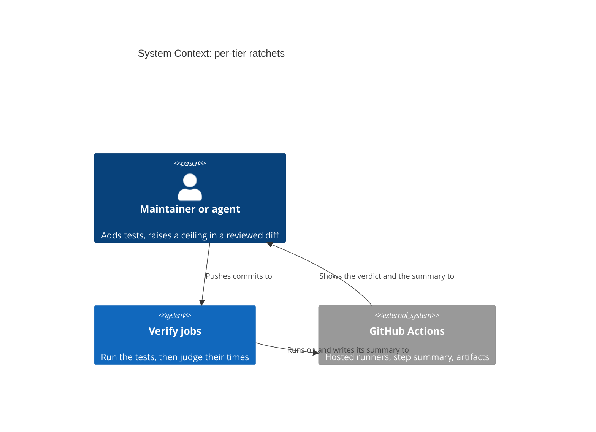
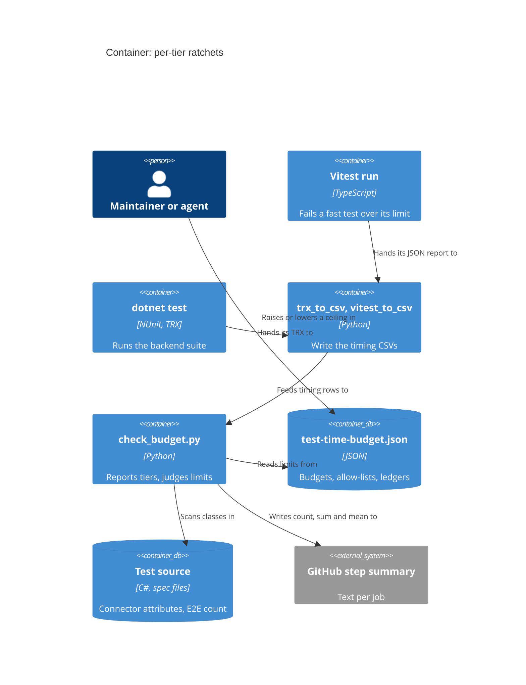

# Feature: story-6536-t9-per-tier-ratchets

Story #6536 · T9 A tight budget for fast tests, and a ceiling for the slow tiers that only goes down · part of Epic #6506 "Fast, reliable
test suites". Catalogue: [Epic workspace](../epic-6264-modular-monolith/feature-delta.md) ·
Brief: [slice-50](../epic-6264-modular-monolith/slices/slice-50-t9-per-tier-ratchets.md).

DISCUSS: the brief, settled with the maintainer on 2026-11-07. Its sections "Maintainer decisions", "Changes from T6's DESIGN and DEVOPS",
"Test pyramid vision" and "Changes from T5's DESIGN and DEVOPS" override the text above them. Waves start at DESIGN. Rigor `thorough`.

## Wave: DISCUSS / [REF] Inherited

- Epic decision D-6264-5. job_id: infrastructure-only. Hard dependencies: T6 #6512 (the `category` column, slice F) and T4 #6462 (pushed). Soft: T10 #6537 lowers the ceilings.
- RBAC, Lighthouse-Clients, website, usage-data event, UI sketch, Terminology: N/A, as the brief answers item by item.

## Wave: DESIGN / [REF] Scope, mode and context

Application scope, propose mode, AFK: each engineering choice takes the recommended option and is recorded here. Paradigm OOP, as the
project states; the scripts stay plain Python with a pure core, as they are. No SPIKE, no wave-decisions file.

Read: slices 50 and 51; T6's delta (decisions, the timing CSV, slices, "For the maintainer", its DEVOPS and review revision, both "Maintainer
decisions", push 2); T5's delta (the guard, DEVOPS "Budgets and T9's ceilings", the last review revision); T4's delta (decisions, per-test
guard, the ratchet); ADR-237; `docs/ci-learnings.md`; `check_budget.py`, `trx_to_csv.py`, `vitest_to_csv.py`, `test-time-budget.json`,
`ci_backend.yml`, `ci_frontend.yml`, `ci_changes.yml`, `path-classifier.sh`, `vitest.config.ts`, `src/tests/timeBudget/*`; T6's `evidence/L2.csv`.

**Nothing was run.** This agent has no shell, and no CI artifact was downloaded. **The real `Integration` column does not exist yet**, so the
design fixes rules and shapes, and every figure below is a placeholder until real runs fill it ("The figures").

## Wave: DESIGN / [REF] Project rules, answered

| Rule | Answer |
|---|---|
| Bounded contexts touched (ADR-270) | **None.** No context, concept, edge or event is added; this is CI test tooling. ADR-270 and `ARCHITECTURE.md` §4 stay as they are |
| New terms (ADR-270) | **No domain term.** Engineering words stay out of the glossary: *fast tier*, *ceiling*, *ledger*, *left out*. "Integration" here is the test category, not ADR-270's Work Tracking Integration |
| Domain events | None published or reacted to |
| UI surface (ADR-271), loading and failure looks, visualization skill | N/A, because no user of the product sees anything. The step summary is CI text |
| nWave scenario tags in code | None. The ledger's `runs` are CI run ids, data the check reads, not tags |
| Production code | None changes. Mutation: N/A, because Stryker mutates the product and no product file changes. The deliberate break of each guard stands in, as in T4 (D-6462-20) |
| Ports and adapters | Product hexagon untouched. The check keeps its own small shape: a pure core, a shell that reads, prints and exits |
| ADR | No new ADR. **ADR-237 gets an amendment at finalization** (D-6536-19); this agent may write only this file. `brief.md`: unchanged |
| Outcome registry | Not run: no typed contract is added and this agent runs nothing |
| External integrations | None added, so no contract-test note |
| Improvement backlog check | N/A, because this Story is itself an item of the Continuous Improvement Epic |

## Wave: DESIGN / [REF] Decisions

| ID | Decision | Why (one line) |
|---|---|---|
| D-6536-1 | **No `ci*.yml` edit, no new step, no new workflow.** All of it lives in `check_budget.py`, its JSON, and the Vitest reporter | A workflow edit runs every live suite once more on a key shared with CI; both steps already have the inputs |
| D-6536-2 | Frontend fast limit: a second, lower base limit in the reporter for every file that is not `.test.tsx`; `.test.tsx` keeps 2 s; `LIMIT_FACTOR` and the first-test allowance apply to both | Only the reporter knows which test was first in its file, which shuffling now changes per run; the CSV cannot say |
| D-6536-3 | **The frontend does not wait for T6.** Its tier is the file name, so its figure comes from CSVs that already exist, from runs after T12's shuffle landed | The wait in the brief is a backend wait |
| D-6536-4 | Backend fast limit: `check_budget.py` checks every counted row that is not `Integration`, one test at a time. Exceptions sit in a new `fast_allowlist` keyed by **class**, with reason and ceiling, and reuse the stale and not-needed checks | Two classes have unstable test names, so a per-test key would rot; a class key reuses what exists |
| D-6536-5 | A class may be listed only if it holds a slow test in **every** calibration run. A cost that moves **between classes** stays in `L`; one that moves between tests of a listed class is covered by its class entry. At most 10 entries. Lowering the limit to a listed ceiling makes that entry not needed, so it leaves in the same commit | A real cost can be listed; a cost that lands on whichever class goes first would red an innocent class if the limit were set below it |
| D-6536-6 | **What counts:** rows with outcome `Passed`, in a class with no connector category. The 11 `NotExecuted` rows and all live rows are out of count, sum, mean and shares | A zero-second row would lower the mean; a connector push would lift it |
| D-6536-7 | **Connector classes are left out, not whole runs.** The check finds them by scanning the source tree for a class-level attribute naming one of the five connector categories, bound to the class it stands on | A verdict on every run beats a skipped one; judging plain runs only would give no verdict after any connector change. See "Leaving connector classes out" |
| D-6536-8 | Backend `Integration` has two ceilings, both failing the build: **mean seconds per test**, which only goes down, and **total seconds**, which may go up only by a reviewed entry with a reason. **The brief's literal rule, that every feature adding integration tests raises the total, is not met by this shape; that needs the maintainer's ruling, "For the maintainer" point 1** | The maintainer's decision, with one part it cannot deliver |
| D-6536-9 | Each limit is a **ledger**: an ordered list of entries in `test-time-budget.json`, each with seconds, CI run ids and a reason. An entry with 5 or more **distinct** ids is **enforced** and never changes. At most one **provisional** entry, with fewer ids, may sit last. The check refuses a ledger whose enforced mean or fast-limit entries rise, or a provisional one above them | "Only goes down" becomes a pure check with no git access, and the derivation sits next to the number, as ADR-237 asks |
| D-6536-10 | **Headroom** `h` = the measured largest / smallest of that figure over the runs used, with a floor of 1.13. Ceiling = largest seen x `h`, rounded up. **A measured spread over 1.25 is never capped:** the entry stays provisional and the maintainer is asked | The brief asked DESIGN to confirm 1.25 from measurement; none exists. A capped ceiling would sit inside runner noise and red trunk |
| D-6536-11 | **Raising the total** is a fresh derivation over the last 5 plain runs, the red one included, with a reason naming what grew. **Lowering** either ceiling uses the same formula and only applies when lower | A raise by only the feature's own seconds leaves no room for noise, so the next slow runner reds trunk |
| D-6536-12 | **The build fails against the newest enforced entry. A provisional entry only warns, on its own number, and every run prints "provisional, n of 5" as a warning.** More runs mean a re-derived number in the provisional entry, never ids added to an old number. The Story does not close while a limit is provisional | The maintainer does not want the 5-run limit to block progress, and one run must not red trunk. A newer short entry cannot switch off an older enforced one |
| D-6536-13 | No ledger entry: report only. A ledger in force and **no** counted `Integration` row: cannot judge, exit 2 | Slice B can land before the numbers; a column that silently reads all `Unit` must not pass as "mean 0" |
| D-6536-14 | Each run writes count, sum, mean, the limit and the room left to the log and `GITHUB_STEP_SUMMARY`, before the verdict. A failed write warns and changes no verdict | Publishing is not judging. The step runs only after green tests, so a red-test run has no summary |
| D-6536-15 | **Shares, no gate.** Each job prints its own two layers, labelled as not the pyramid shares. The three shares across everything come from a new read-only mode, `check_budget.py --pyramid`, fed the two CSVs of one commit; the E2E scan lives only there | No job holds both CSVs, and joining them needs a `ci*.yml` edit. See "The shares" |
| D-6536-16 | No frontend total, as decided. The frontend report prints its sum and says it does not compare across runs | The Vitest Duration is bimodal; a sum invites the comparison it cannot bear |
| D-6536-17 | `LIGHTHOUSE_BUDGET_WARN_ONLY` softens the new breaches too; a bad ledger or a stale entry is not softened. The frontend limit keeps `LIGHTHOUSE_TIME_BUDGET` | One knob per mechanism, as T4 decided |
| D-6536-18 | Three slices, in "Slices" | Frontend needs nothing from T6; the numbers are data, not code |
| D-6536-19 | ADR-237 amendment at finalization, plus `docs/ci-learnings.md`: the derivation recipe, and line 471, which still says the backend only warns | T4's pattern; the ledger line is wrong today, `ci_backend.yml` already fails |
| D-6536-20 | Peer review run once (`nw-solution-architect-reviewer`, Sonnet): conditionally approved, 0 critical, 2 high; see "Review". A second iteration is left to the orchestrator | Wave gate |

## Wave: DESIGN / [REF] What is judged

| Limit | Stack | Unit | Fails when | Goes | Lives in |
|---|---|---|---|---|---|
| Fast per-test | Frontend | One test in a file that is not `.test.tsx` | Over the fast base limit (x 3 on CI, + 0.31 s if first in its file) | Down | `vitest.config.ts`, exceptions in `slowTests.ts` |
| Fast per-test | Backend | One counted row that is not `Integration` | Over the limit, or over its class's `fast_allowlist` ceiling | Down | `test-time-budget.json` |
| `Integration` mean | Backend | Sum / count of counted `Integration` rows | Over the ceiling | **Only down** | `test-time-budget.json` |
| `Integration` total | Backend | Sum of counted `Integration` rows | Over the ceiling | Up only by a reviewed entry | `test-time-budget.json` |
| Per-file / per-class | Both | T4's, unchanged: 54 s, 34 s, 23 entries | | | `test-time-budget.json` |

The shares are in no row: they are reported, never judged. **The hard rule is time.**

## Wave: DESIGN / [REF] Leaving connector classes out (D-6536-6, D-6536-7)

The five names are the ones `ci_backend.yml` line 106 excludes: `JiraIntegration`, `AdoIntegration`, `LinearIntegration`,
`ServiceNowIntegration`, `GithubIntegration`. The scan lives beside `discover_integration_class_names` in `trx_to_csv.py`, which
`check_budget.py` already imports. Today: 16 attributes on 16 classes in 16 files. What it must get right, each a test:

- **Bind to the class, not the file.** `AzureDevOpsHistoryCutoffTest`, `AzureDevOpsStateTransitionParserTest` and `JiraHistoryCutoffTest` share a file with a live class and are regular; they stay counted.
- **Read the attribute, not a mention.** `ServiceNowWorkTrackingConnectorIntegrationTest.cs` line 22 names the category in a doc comment.
- **Mixed classes leave whole.** `JiraWriteBackTest` and `AzureDevOpsWriteBackTest` carry the attribute on the class, so their offline rows leave with the live ones. That is 3 rows, in no tier here, as in T6's fast filter.
- **A hosted class in a connector folder stays counted:** it carries no connector attribute.
- **Other attributes may stand between.** `[Category]` need not touch the `class` line, unlike what `INTEGRATION_CATEGORY_AT_CLASS_PATTERN` assumes, and a file may hold two namespaces.
- **A class deriving from a connector class inherits the category in NUnit, so it leaves too.** None exists among the 14 classes T6 moved; the scan closes over the base chain T6's slice F reads, and the case is a test.
- **The list cannot drift.** A Python test reads `ci_backend.yml` and fails unless the five names match the workflow's. T6's guard rule 5 keeps a connector class on its base. A sixth connector then reds this test, not a ceiling.
- **`UsageDataCanary` is no sixth name.** CI excludes it from every filter, and T6's guard makes a fixture carrying it carry a connector too, so it never reaches the CSV as counted.

Rejected: a new `category` value (T6: the name keeps one meaning); a fifth CSV column (a shape change for two readers, for what one scan
gives); listing classes in the JSON (a second list to keep in step); judging plain runs only (no verdict after a connector change).

## Wave: DESIGN / [REF] The budget file (D-6536-9, D-6536-11, D-6536-12)

The `backend` section gains one block. Field names are the crafter's; the data is not.

| Item | Holds | Rule the check enforces, as cannot-judge if broken |
|---|---|---|
| Fast-limit ledger | Entries of seconds, run ids, reason | Each enforced entry below the one before |
| Mean ledger | The same | Each enforced entry below the one before. **No path raises it** |
| Total ledger | The same, plus count at derivation | May rise; every entry has a non-empty reason, as an allow-list entry has |
| All three | | Run ids distinct within an entry. At most one provisional entry, last |
| `fast_allowlist` | Class, reason, `ceiling_seconds`, as `allowlist` | Stale if the class is gone; not needed if the ceiling equals the limit |

The ledger catches an appended raise. It does not stop someone rewriting an old row; a reviewer sees that in the diff. Git history would
hold the same facts, but reading it from CI ties a gate to checkout depth and to what a merge did.

**Who moves a ceiling.**

| Event | What happens |
|---|---|
| A slow test makes the mean breach | The test gets faster, or moves down a tier |
| A feature's tests make the total breach | Move them down, or raise: a fresh derivation with a reason. The red run counts as one of the 5 |
| A slow-runner day makes the total breach, nothing grew | The report shows count unchanged. Re-run. If it repeats, `LIGHTHOUSE_BUDGET_WARN_ONLY` and a re-derivation |
| A move down lifts the mean past its ceiling | Removing cheap rows raises a mean, so a good act can red. **The mean has no raise, so this stops and asks the maintainer.** T5's remaining moves stay inside the headroom (about +2 %, below) |
| The runners get slower for good, so a mean or fast limit no longer fits | `LIGHTHOUSE_BUDGET_WARN_ONLY`, then the maintainer decides. Neither ledger has a raise; T4's rule is that a limit rises only by a named decision, and here that means rewriting the ledger by hand, in a reviewed diff |
| T10 finishes | Lowers both, after its 5 runs |

## Wave: DESIGN / [REF] The figures: what is a placeholder, and how it gets filled

**Rule, per limit.** `L` = the largest seen over the runs used. Fast limit: at least 2.1 x `L`, T4's rule, rounded up. Mean and total:
largest x `h` (D-6536-10). Runs used: at least 5, complete, with green tests (a budget step that went red is fine, D-6536-11); for the backend also plain and after
T6's slice F, for the frontend after T12's shuffle, which is on: `.github/actions/build-frontend/action.yml` line 71 passes it as a flag.
The CSV cannot tell which test was first in its file, so frontend `L` includes any cold start, and with the allowance on top the limit is up to 0.31 s loose. T4 accepted the same.
 Run ids are written down, as T4 did. T4's recipe also applies: the set holds both a fast and a slow runner day. On the
frontend, read which group each run fell in from its Vitest Duration (about 650 s or about 1,100 s); five from one group understate `L`.

| Figure | Today | Stand-in, for sizing only | Source of the stand-in | Filled by |
|---|---|---|---|---|
| Frontend fast base limit | **2 s, so it changes nothing until set** | Unknown. At most about 2.1 s from T4's 2.95 s, which mixes `.test.ts` and `.tsx` | T4 | Slice A: `ceil(2.1 x L / 3)` to 0.1 s, `L` the largest `.test.ts` over 5 shuffled runs. The factor 3 turns a CI time into a quiet-machine limit. Too few runs: it stays 2 s, nothing held |
| Backend fast limit | **None, not judged** | About 10.8 s with nothing listed; lower if D-6536-5 lets `ForecastLaneTest` and others be listed | T5: 5.1 s on CI, one run. Local `L2` shows 9.5 s for the same test, under load | Slice C |
| `Integration` mean | **None, report only** | 0.75 s, so a ceiling of 0.85 to 0.94 s | T5's stand-in: three folders, every test in them | Slice C |
| `Integration` total | **None, report only** | 2,068 s, so a ceiling of 2,340 to 2,590 s | The same | Slice C |
| `h` | 1.13, or more if measured | 1.13 | T4: whole backend runs, 2,556 to 2,883 s, 8 runs. **Not measured for the `Integration` sum alone**; container tests, 17 % of test time, swing more (T4: one class 63 to 87 s) | Slice C, from max / min of each figure |
| Backend shares | Unknown | | T6 has not labelled it | First run after slice F |
| Frontend shares | 3,648 fast, 5,857 `.test.tsx` | | The brief, 2026-11-07 | Every frontend run |
| E2E declared | About 56 | About 52 in `tests/specs` by one text search, parametrised specs counted once | This wave; not checked against Playwright | Each `--pyramid` run |

**How slice C fills the backend, without waiting for all of it.** First plain run after T6's slice F: a provisional entry with the run ids so
far; breaches warn (D-6536-12). The warnings are the test of the number. Each later run re-derives that entry's number with its id added. At
the 5th distinct id the entry is enforced and fails. The 5 that enforce it come **after T5's last move push, or after T5 stops at its checkpoint**: T5's moves shift both figures, and a saving
from them is read by class, never from this column.

Why T5's later moves are safe: its 165 rows at 510 ms leave a tier of about 2,750 rows at 752 ms, so the mean rises about 2 %, under the
floor of 1.13, and the total falls. Estimates on the stand-in.

**What the total can and cannot see.** This is the figure's honest size, on the stand-ins. A seconds ceiling has to clear runner noise, so from
the largest run seen it leaves 13 to 25 %: about 270 to 520 s, or **about 360 to 690 tests at the tier's mean**. So:

- It bounds **drift**, not a feature. A single new scenario in a class on T5's list does not trip it, and neither does a normal feature: 20 rows are about 0.7 %.
- It trips when growth has used the room, on whichever feature is last. That feature's raise (D-6536-11) re-derives and buys room again.
- The other limits on that scenario: T4's class ceiling at 2.1 x, T5's CLAUDE.md line, review. The report shows the count against the count at derivation, so growth is visible on every run.
- T5's line "a feature adding host time must raise" holds only as "growth past the room must raise". See "For the maintainer", point 1.

**What neither ceiling sees:** one-time set-up is outside TRX durations, so the cost of a new host never shows here. T2's and T5's guards own
that. The mean also falls if hosted rows are mislabelled `Unit`; T6's anchors in `test_trx_to_csv.py` own that.

## Wave: DESIGN / [REF] The report (D-6536-14, D-6536-15)

Backend, as text in the log and the step summary; wording is DISTILL's.

```
Tier          Tests   Seconds   Mean s   Ceiling                   Room
Fast         10,010     317.0    0.032   per test 10.8 s           largest 5.1 s
Integration   2,750   2,068.0    0.752   mean 0.85 / total 2,340   12 % / 12 %
Left out        275   (connector classes; live rows and their offline neighbours)
Since the total was set: +41 tests
This stack only, not the pyramid shares: 78.4 % fast, 21.6 % integration. No gate.
```

The figures in that sketch are placeholders. The frontend prints the same two tiers, with no ceiling, and one line saying its sum does not
compare across runs.

**The shares.** The three figures need three sources that no job holds together: the frontend CSV, the backend CSV, and Playwright, which runs
in other jobs. So:

- **Each run:** its stack's two layers, in counts and as a share of that stack, labelled so nobody reads them against 90 / 9.5 / 0.5.
- **Across everything:** `check_budget.py --pyramid` with the two CSVs prints the three shares beside the 90 / 9.5 / 0.5 upper limits, exit 0 always, writing nothing. Run at slice C, recorded here, and at T10's end. Same counting code, so the two cannot disagree. E2E is a text scan of `Lighthouse.EndToEndTests/tests/specs`: a count of `test(` calls, not of what ran. Parametrised specs read low, and at 0.25 % that moves nothing.
- **Layers:** fast = frontend not `.test.tsx` + backend `Unit`. Integration = `.test.tsx` + backend `Integration`. E2E = Playwright. A Python test reads `package.json`, so the `.test.tsx` rule and `test:fast` cannot part.

Rejected: a job that downloads both artifacts (a `ci*.yml` edit, one more live run, for a line with no gate; see "For the maintainer", point 2);
a separate non-`ci` workflow on `workflow_run` (a job skipped by path leaves no artifact, and it is a new pipeline for a report).

The review suggested cutting `--pyramid` for size. Kept: it is what makes the maintainer's three shares exist at all, and it reuses the tier counting; only the E2E scan is extra.

## Wave: DESIGN / [REF] Component decomposition

| Component | Path | Change | Contract shape |
|---|---|---|---|
| Tier counting | `Scripts/test-timings/check_budget.py` | NEW functions | Pure, return-only: rows and connector classes in, per-tier count, sum, mean out |
| Fast-test judge | same | NEW function, beside `judge` | Pure: rows, limit, exceptions in, `Finding`s out |
| Ceiling judge | same | NEW function | Pure: tier totals and ledgers in, `Finding`s out; provisional is a field of the finding |
| Ledger reader | same, `load_allowlist` | EXTEND | Read-only; raises `CannotJudge` on a rising or malformed ledger |
| Report | same | NEW function | Pure: returns text. The shell alone writes it |
| `_check` and `main` | same | EXTEND | The shell, **bounded change**: universe is the file `GITHUB_STEP_SUMMARY` names, delta is the report text appended. The path comes in as a parameter, as `warn_only_requested` takes the environment. Order: read, report, judge, exit. `--pyramid` writes nothing |
| Connector scan | `Scripts/test-timings/trx_to_csv.py` | EXTEND | Read-only over a passed root |
| Budget file | `Scripts/test-timings/test-time-budget.json` | EXTEND | Data |
| Check tests | `Scripts/test-timings/tests/` | EXTEND, sibling file as T4 | Planted rows, real tree, shipped file |
| Fast limit | `Lighthouse.Frontend/src/tests/timeBudget/compareToAllowList.ts` | EXTEND | Pure: `limitFor` picks by tier; `ran-far-under-budget` uses the test's own tier |
| Reporter and config | `timeBudgetReporter.ts`, `vitest.config.ts` | EXTEND | Prints both limits; one new constant |
| Docs | `docs/ci-learnings.md`, ADR-237 | MODIFY at finalization | |

Whether the new Python sits in `check_budget.py` or a sibling module is the crafter's call, kept to one entry point.

## Wave: DESIGN / [REF] Driving ports

- `check_budget.py --stack <stack> --csv <csv>`, unchanged, so neither workflow step changes. It is the same command locally on a downloaded artifact.
- `check_budget.py --pyramid`, new, no verdict.
- Vitest's reporter hook, unchanged; runs in `pnpm test` and `pnpm test:fast`.

## Wave: DESIGN / [REF] Driven ports and adapters

| Port | Adapter | Direction |
|---|---|---|
| Timing rows | `test-timings-*.csv`, `load_timings` | Read |
| Limits | `test-time-budget.json`, `load_allowlist` | Read |
| Test source | The tree under `--source-root`; `tests/specs` for `--pyramid` | Read |
| Annotations, verdict | stdout, exit code 0, 1, 2 as today | Write |
| Step summary | The file `GITHUB_STEP_SUMMARY` names; absent locally, so printed only | Write, the only new side effect |

## Wave: DESIGN / [REF] Technology choices

Python 3.12 stdlib, as `check_budget.py` requires; TypeScript in the reporter. No new dependency, no licence question.

## Wave: DESIGN / [REF] Reuse Analysis

| Existing | File | Overlap | Decision | Why | Assertion |
|---|---|---|---|---|---|
| `judge`, `Finding`, `breach_annotation` | `check_budget.py` | Name a thing over a limit | EXTEND | Same `::error::` form, a new `limit_kind` | Planted row, exit code, name in the message |
| `load_allowlist`, `_allowlisted`, `_positive_seconds` | `check_budget.py` | Read and refuse limits | EXTEND | Reasons and positive seconds already checked | Malformed file exits 2 |
| `stale_entries`, `declared_classes`, `_is_not_needed` | `check_budget.py` | List hygiene | EXTEND | `fast_allowlist` is keyed by class for this reason | Stale and not-needed cases |
| `warn_only_requested` | `check_budget.py` | The switch | REUSE | | Switch tests, new breach kinds |
| `class_of` | `check_budget.py` | Row to class | REUSE | Handles fixture arguments | Parametrised name row |
| `discover_integration_class_names` | `trx_to_csv.py` | Scan for an attribute | EXTEND | Same walk, five names; binds to the class | File with two classes |
| `compareToAllowList`, `limitFor` | `compareToAllowList.ts` | Per-test limit | EXTEND | Brief's second limit | Boundary per tier, first-in-file |
| `summarise.py` | | Table for people | NOT USED | Reads raw reports, ADR-237 kept it apart from the gate | |
| Reporter's `check_budget.py` overlap | | Frontend per-test | NOT DUPLICATED | The frontend limit stays in one place | |

Nothing is CREATE NEW above function level. `--pyramid` is a mode, not a script, so the counting has one home.

## Wave: DESIGN / [REF] What can lie, and what catches it

| Lie | Effect if unseen | Caught by |
|---|---|---|
| `category` reads `Unit` for hosted rows | Mean and total look fine; hosted rows hit the fast limit | Zero rows: exit 2. Partial: T6's anchors and its one-time id check |
| A new connector category | A force-full run reds the ceilings | The Python test against `ci_backend.yml` |
| Comment mentions a category | A class wrongly left out | Attribute-anchored scan, with a test |
| CSV of a red run | Partial numbers | The step runs only after green; a failed `bail: 1` run gets no check, as ADR-237 |
| A ceiling set from fast runners only | Slow-day red | Both-runner rule, provisional stage, the switch |
| The ledger edited to raise the mean | The ratchet goes | Exit 2 for an appended raise; a rewritten history is the reviewer's |
| A summary file that cannot be written | Report lost | A warning; verdict stands |
| Sharding (T8) | The check sees part of the rows: total and mean silently fall | **Not caught.** T8 must merge the CSVs before this step and re-derive. Owed line |
| A change in worker count or runner | Every figure shifts | Re-derive, as ADR-237 says. Mean has no raise, so a slower fleet stops and asks |
| Docker image pull on a cold runner | Container rows jump | Inside `h` if calibration saw it; provisional warnings show it |
| A check that lost its teeth | Nothing fails | "Test the budget check" plants each breach on every run, before the real check |

## Wave: DESIGN / [REF] C4





## Wave: DESIGN / [REF] Slices

| Slice | Days (est.) | Delivers | Needs | Files |
|---|---|---|---|---|
| A | 0.5 | Frontend fast limit; set if 5 shuffled runs exist, else inert at 2 s | 5 shuffled runs for the figure; nothing from T6 or T5 | `timeBudget/*`, `vitest.config.ts`, `slowTests.ts` if a test is listed |
| B | 1 | Tier counting and report on both stacks (0.25); connector scan (0.25); ledgers with their rules, fast-test and ceiling judges (0.25, planted tests included); `--pyramid` and the E2E scan (0.25). **Ledgers ship empty: report only** | T6's slice F on `main` for real numbers; it is safe before, and prints that nothing is labelled yet | `Scripts/test-timings/*` |
| C | 0.25, then waiting on runs | First entries, provisional; fast allow-list; enforced at 5 ids; ADR-237 and `ci-learnings.md`; three shares recorded here | T6's slice F; T5's last move or stop for the enforcing 5 | `test-time-budget.json`, docs |

About 1.75 days of work, against the brief's two days, in three slices rather than two, because the numbers are a wait and not work.

Every push under `Scripts/test-timings/` runs backend, frontend and the tail, and no live suite (`classify_backend`, `ci_changes.yml` line 198),
so each also yields a calibration run. A and B can go in one push. Slice C's JSON edits ride a backend push already going where one exists,
as T5's D-6469-20 does.

**Rollback.** C: drop the entries, and it reports only. B: alone, once C is gone. A: alone. The switch covers a wrong number in the meantime.

## Wave: DESIGN / [REF] For the maintainer

**Point 1 needs your ruling before DISTILL writes the total's scenarios.** It changes a decision of yours, so it is not taken here. It blocks neither DEVOPS, nor slice A, nor the rest of DISTILL. Points 2 to 4 are decided in your absence.

1. **The total cannot see one feature, so "a feature that adds integration tests raises it" holds only for growth past its room.** A ceiling in
   seconds must clear runner noise, which is 13 to 25 %, about 360 to 690 tests at the tier's mean (stand-in figures). So T9 bounds drift, and
   T5's gap, a new scenario in a listed class, stays open for one scenario at a time.
   - **(a) Seconds only (the shape designed here, pending your word).** Your rule that time is the hard rule. A raise every so often, on whichever feature crosses, with the count printed on every run. Bounded drift, no per-feature overhead.
   - **(b) Add a count line beside the total.** Exact, no noise, so every feature adding an `Integration` row edits the JSON with a reason, which is what your decision literally says. Cost: a gate on count, not time; a trivial test pays too; each such push also starts the frontend job, and parallel Stories conflict on the line.
   - Recommendation (a), because you said time is the hard rule, and T5 and T6 both declined count constants. (b) is one field and one scenario, so it can be added later with nothing redone. Say so if the explicit act per feature is what you wanted.
2. **The three shares do not appear on each run.** Each run shows its stack's two layers; the three across everything come from one command on two CSVs, because joining them in CI is a `ci*.yml` edit. If you want them per run, the cheap moment is the next `ci*.yml` edit anyone makes for another reason.
3. **The mean has no raise, by your decision.** A good move down of cheap rows can lift it. T5's stay inside the headroom. If one ever does not, the work stops and asks you.
4. **The backend fast limit will not be very tight.** With nothing listed it lands near 11 s, against a 0.9 ms median. It stops a real wait or a stuck test, not a 1 s test: the real-SQLite Encryption classes run 1.3 to 1.6 s a test, in the fast tier. Listing can lower it only for costs that stay in one class across runs (D-6536-5).

## Wave: DESIGN / [REF] Open for DEVOPS, DISTILL and DELIVER

- **DEVOPS:** the usage-data answer (the brief says N/A); the pushes in the window; T8's owed line.
- **DISTILL:** report wording; the planted cases, one per stack and per ceiling, with "more tests at the same mean pass" up to the total, which waits on point 1. No nWave tags, as CLAUDE.md says.
- **DELIVER, slice C:** `h` from real runs; the fast allow-list by D-6536-5; which runs are slow-runner days on the backend. Whether the backend is bimodal like the frontend is unknown.
- **Not decided here:** who lowers a ceiling between T10 and the next re-derivation. T4 left the same gap for its limits; the room column makes it visible.

## Changed Assumptions

Original, slice-50, Proposals 1: "**Fast-tier per-test budget, both stacks: 2.1 x the largest fast-tier test over at least 5 `main` runs after T6**".
New: the frontend needs runs after T12's shuffle, not after T6. Why: its tier is the file name; shuffling changes which test pays the cold start.

Original, slice-50, Proposals 3: "Ceiling = the largest mean seen over at least 5 runs x 1.25 (an estimate; DESIGN confirms it from the measured max/min of the mean".
New: `h` is the measured max / min, at least 1.13; over 1.25 the entry stays provisional and the maintainer is asked. Why: no column exists to measure, so 1.25 cannot be confirmed; a tighter ceiling is worth having when noise allows.


Original, slice-50, Maintainer decisions: "a feature that adds integration tests raises it in a reviewed diff with a reason".
Proposed, **awaiting the maintainer** (point 1): growth past the ceiling's room raises it. Why: seconds cannot resolve one feature through runner noise.

Original, slice-50, Maintainer decisions: "T9 prints the three shares in its report". New: each run prints its stack's layers, `--pyramid` prints the three. Why: no job holds all three sources.

Original, slice-50, AC: "Both limits derive from at least 5 plain `main` runs". New: a provisional entry with fewer ids may exist and only warns; the Story closes only with 5. Why: the maintainer's word not to hold for the limit; a failing verdict still needs 5.

Original, T5 DESIGN, "Limits": "The backstop is T9's total ceiling, which a feature adding host time must raise in a reviewed diff". New: see point 1.

**Owed to other briefs (not edited here).**

- **T10, Maintainer decisions:** "T10 lowers T9's ceilings in its last commit". That commit must come **after** T10's 5 runs, or its entry has too few ids and drops to a warning. It is a data commit.
- **T10, Proposals 1:** "`category` column T6 slice D writes" reads slice F.
- **T8:** a sharded backend must merge its CSVs before this step, and re-derive.
- **`docs/ci-learnings.md` line 471:** says the backend per-class check only warns; it fails since T4.

## Wave: DESIGN / [REF] Review

One pass by `nw-solution-architect-reviewer` (Sonnet), read-only: conditionally approved, 0 critical, 2 high, 7 medium, 1 low. It confirmed from the code the no-`ci*.yml` claim, the 16 attributes, the three classes sharing a file, the 23 backend entries and the stale `ci-learnings.md` line. It could not confirm any figure, T6's slice F labelling, or that no class inherits a connector attribute. Its priority check reads no data for Integration, as expected.

| Finding | Severity | Resolution |
|---|---|---|
| The total does not meet a settled maintainer decision, and it was recorded as decided | High | Point 1 is now a ruling that gates the total's scenarios; D-6536-8 says so |
| A short entry could switch off enforcement; ids could be padded | High | D-6536-9, D-6536-12: the newest enforced entry fails, a provisional one only warns, ids distinct, an enforced entry never changes, a warning on every run, the Story cannot close provisional |
| Per-run shares read against the pyramid's limits | Medium | Labelled as this stack only. E2E moved out of the per-run report |
| Fast limit has no raise | Medium | Kept down-only, with a row: a slower fleet goes to the maintainer |
| Spread over 1.25 undefined | Medium | D-6536-10: never capped, stays provisional, asks |
| D-6536-5 ambiguous; a lowered limit reds idle entries | Medium | "Between classes"; idle entries leave in the same commit |
| Connector scan edge cases | Medium | Three cases and the `UsageDataCanary` answer added |
| Frontend `L` double-counts the allowance | Medium | Not fixable from the CSV, which cannot tell the first test; stated and accepted, as T4 did |
| Slice A needs T12's shuffle, absent from `vitest.config.ts` | Medium | **Finding wrong:** the shuffle is a flag in `build-frontend/action.yml` line 71. The rule now says so |
| Size against S; cut `--pyramid` | Medium | Slice B re-estimated at 1 day with its pieces named, the Story at about 1.75. `--pyramid` kept, as the only source of the three shares |
| Effect contract undeclared | Medium | `_check` declared bounded change, path injected, `--pyramid` writes nothing |
| Green against the red run in the rule | Low | "Green tests; a red budget step is fine" |

## Wave: DESIGN / [REF] Architecture summary for the maintainer

**The shape in hexagonal terms.** The product's hexagon does not change. No driving adapter, service, port, Model or tracker adapter is touched, and
there is no new external call. The check is its own small hexagon, and it grows inside its pure core.

```
 DRIVING                     PURE CORE (check_budget.py)              DRIVEN
+-----------------------+   +-----------------------------------+   +----------------------------+
| Check test-time       |   | tier counting            [NEW]    |   | timing CSVs          [same]|
| budget step    [same] |-->| fast-test judge          [NEW]    |<--| test-time-budget.json      |
| check_budget --stack  |   | ceiling judge            [NEW]    |   |   + ledgers        [EXTEND]|
|                       |   | ledger rules             [NEW]    |<--| source scan: connector     |
| --pyramid       [NEW] |-->| report text              [NEW]    |   |   classes, E2E count [NEW] |
+-----------------------+   | judge, stale, not needed  [same]  |-->| annotations, exit   [same] |
                            +-----------------------------------+-->| step summary         [NEW] |
+-----------------------+   +-----------------------------------+   +----------------------------+
| Vitest reporter [same]|-->| compareToAllowList                |
|                       |   |   limit by tier        [EXTEND]   |
+-----------------------+   +-----------------------------------+
```

- **Driving adapters:** the workflow steps are unchanged, on purpose; a workflow edit would run every live suite. `--pyramid` is new, for people.
- **Application core:** new pure functions. They take rows and limits and return findings and text, so every rule is tested without a file.
- **Domain:** none in the product sense. The ideas are a tier, a limit, and a ledger of limits.
- **Driven adapters:** CSVs and the JSON as today. New: the scan for connector classes and E2E tests, read-only, and the step summary, the one new write.
- **Unchanged:** every test, `trx_to_csv.py`'s labelling, T4's budgets and T5's and T6's guards.

**The patterns weighed.**

| Pattern | Verdict | Why |
|---|---|---|
| Functional core, imperative shell | **Chosen** | Rules stay pure and cheap to test, and the check already works this way |
| Ratchet by append-only ledger | **Chosen** | "Only goes down" is a check, not a habit, and the derivation sits by the number |
| Single responsibility, one mechanism per question | **Chosen** | The reporter owns the frontend test, the script owns the rest |
| Open/closed on the budget file | **Chosen** | New blocks, and T4's fields and tests stay as they are |
| Fail closed | **Chosen** | A check that sees no `Integration` rows refuses rather than passes |
| Provisional limit that warns | **Chosen** | Keeps work moving, one run cannot red trunk, and it cannot switch off an enforced limit |
| Two ceilings, mean and total | **Chosen, maintainer** | The mean catches slower tests; the total catches growth |
| Count ceiling | Rejected for now, offered | Exact, but it gates count rather than time |
| Run-speed normalisation (total over the fast tier's time) | Rejected | Unproven, and T5's moves shift both sides. The ratio can be read from the CSVs later |
| Reading the previous ceiling from git | Rejected | Ties a gate to checkout depth |
| Skipping the verdict on connector runs | Rejected | Loses the check exactly when a run is most mixed |
| New CSV column or category for live tests | Rejected | Changes a shared shape for what one scan gives |
| Job joining both CSVs | Rejected | A `ci*.yml` edit for a line with no gate |
| Percentile or median as the gate | Rejected | ADR-237: the bar rises with the suite |
| Domain events, outbox, unit of work, optimistic concurrency, value objects, JSON column | N/A | No product model or persistence changes |

## Wave: DEVOPS / [REF] Platform readiness

Existing platform; nothing is deployed. Written 2026-11-07 with the maintainer away, so each choice takes the recommended option and says why.
**No test ran**, because T6 is using the machine, and no file but this one changed. Read: T9's delta, slices 50 and 51, T5's and T6's DEVOPS,
`ci.yml`, `ci_backend.yml`, `ci_frontend.yml`, `ci_changes.yml`, `green-base-run.mjs`, `path-classifier.sh`, `check_budget.py`, the budget file,
the reporter. Read from GitHub, read-only: job and step results of recent `main` runs, two job logs, artifact lists, and the frontend CSVs of five
runs. Every backend figure above stays a placeholder. `environments.yaml` is not written: this wave may edit this file only, as in T5 and T6.

| Topic | Answer |
|---|---|
| Environments | **CI, `ubuntu-latest`:** the only place the limits judge; `Verify Backend` and `Verify Frontend`, Python 3.12 or the check refuses. **Linux, local:** the Vitest limit also fires in `pnpm test` and `pnpm test:fast`, unscaled; `check_budget.py` on a downloaded CSV, and `--pyramid`, print and write nothing. No Docker is needed for any of it. Windows and macOS jobs run no test |
| Pipeline | **No `ci*.yml` edit, no new step, no new workflow, confirmed from the files (D-6536-21).** `Check test-time budget` already passes `--stack`, `--csv`, `--source-root` and `LIGHTHOUSE_BUDGET_WARN_ONLY`; the runner sets `GITHUB_STEP_SUMMARY` itself. `Test the budget check` already runs the Python tests in both jobs, and both have the whole tree, so a test reading `ci_backend.yml` or `package.json` finds it. Both workflows' comments above the step speak only of a class or a file; that goes stale, and is fixed by whoever next edits them, not by an edit of ours |
| Deployment strategy | None: a trunk push to `main`. Rollout is the ledger itself: report only, then provisional, then enforced. Rollback is below |
| Branching | Trunk-based, unchanged. `ci.yml` has no `concurrency`, so each push waits for the one before to end, as in T5 |
| Observability | The log and the step summary of each run, the `::error::` and `::warning::` annotations, and the timing CSVs. No dashboard, no alert: the red run is the alert. A CSV is kept 90 days (run 42372930241 expires 2027-02-05), so a ledger's run ids outlive their data; the calibration table below keeps the figures |
| Mutation | N/A, because Stryker mutates the product and no product file changes. The planted breach of each limit stands in, as in DESIGN. Strategy stays `per-feature` for the project; `CLAUDE.md` is unchanged |
| Usage-data event | **N/A, because nobody using the product reaches a CI budget check, so no event could show use.** `UsageDataEventName` and `docs/settings/usagedata.md` are unchanged (D-6536-30) |
| Coexistence | T4's per-file and per-class budgets, the reporter's `slowTests.ts`, T5's and T6's guards, and `summarise.py` keep working as they are. `dev-test.sh` and `Test-Fast.ps1` do not read the ledger |
| Pre-requisites | T6's slice F on `main` for any backend figure. T5's last move, or its stop, for the enforcing 5. A clean change-detection window before each push (see "What each push triggers"). Slice A needs neither |
| Peer review | Not run: the skill's triggers do not apply (no new target, framework, stack or security change), and the review at the end of DISTILL covers this wave |

**Monitoring contracts.** No `outcome-kpis.md` exists; the outcomes are the brief's.

| Outcome | Instrument | Read when |
|---|---|---|
| A slow fast test fails the build | Reporter (frontend); fast judge (backend); the planted case on every run | Each run |
| `Integration` mean does not creep | Report row, ledger | Each run; at T10's end |
| `Integration` growth is visible | Report row, "since the total was set" | Each run |
| The three shares | `check_budget.py --pyramid`, recorded here | Slice C; T10's end |

## Wave: DEVOPS / [REF] What each push triggers

Read from `ci.yml`, `ci_changes.yml` and `path-classifier.sh`. The tail is `version`, package, Docker, SBOM, `verifysqlite`, `verifypostgres`,
`verifyauth`, the standalone packages and the Windows and macOS checks. Observed on 2026-11-07: backend job 13 to 20 minutes, frontend job 10 to 16.

| Push | Slice | Paths | Backend | Frontend | Live suites | Then |
|---|---|---|---|---|---|---|
| 1 | A and B | `Lighthouse.Frontend/src/tests/timeBudget/`, `vitest.config.ts`, `Scripts/test-timings/` | Plain | Yes | None | Tail. Its run is a calibration run if it is after slice F |
| A alone, if B is not ready | A | `Lighthouse.Frontend/` only | **Skipped** | Yes | None | Tail |
| 2 | C, first entries | `test-time-budget.json` | Plain | **Yes**, this path starts it | None | Tail. Rides push 1 if T6's last run was plain and green, or another backend push; see D-6536-22 |
| 3 | C, enforcing | `test-time-budget.json`, and `slowTests.ts` only if listed | Plain | Yes | None | Tail |
| Any | Finalization | `docs/` | No run | No run | None | Nothing: the path is not in `ci.yml`'s `paths` |

So **two or three code pushes in all**. A and B share a push, as DESIGN allows: a red in slice A shows in `Build Frontend (composite)`, a red in slice B in
`Test the budget check`, so the two stay apart without a second tail.

**"No live suite" holds only if the window is clean, and today it is not.** Change detection diffs from the last run that `isGreenBase` accepts, so a
`ci*.yml`, csproj or `Program.cs` change still in the window forces every live suite, whatever the push touched. Run 42382479502 shows it: a push of a
test scan and docs, with `connector_shared=true` and every connector `true`, because red run 42379254193 left `ci_backend.yml` in the window (base
6dc63d981, 21 commits back). **T6's check applies to each T9 push as it stands:** `git diff --name-only <last green> HEAD`, then each connector and shared
`classify_*`, and a grep for `^.github/workflows/ci.*\.yml`. Any `true` means wait for a green run, or tell the maintainer.

**A calibration run cannot be asked for.** `workflow_dispatch` after a green base finds no change and skips the backend, and re-running a job keeps the run
id, so it is no new id. The 5 come from real backend pushes, T9's own included.

## Wave: DEVOPS / [REF] What goes ahead without 5 runs

The maintainer's word: do not hold work for a 5-run limit where it blocks progress. This is the whole answer.

| Step | Goes ahead on | Effect on a breach | Waits for |
|---|---|---|---|
| Slice A code | Nothing needed | **Fails.** The frontend limit lives in the reporter and has no warn stage | Nothing |
| Slice A figure | **The 5 runs already exist**, see below. Re-read at DELIVER | **Fails at once**, in the test step. `LIGHTHOUSE_TIME_BUDGET=warn` softens every test, not this limit, so it is no provisional stage | Nothing. If the re-read cannot find 5, it stays 2 s, inert |
| Slice B, all of it | Empty ledgers | **Report only**, nothing judged | Nothing; the backend rows read "nothing labelled" before slice F |
| ADR-237, `ci-learnings.md` line 471 | Nothing needed | None; docs start no CI | Nothing. They need no number, so they do not wait for slice C's end |
| First backend entries: fast limit, mean, total | One plain green run after slice F; **T5 need not be finished** | **Warn only**, on their own number, with "provisional, n of 5" on every run | Slice F |
| `--pyramid`, the shares | The first plain run after slice F | Reported, never judged | Slice F |
| T10 starting | The report and the CSVs; provisional entries are enough | None | T5 and T6, as its brief says, not T9's 5 |
| `fast_allowlist` entries | **Not on a provisional entry.** D-6536-5 needs a class slow in every calibration run, which fewer than 5 cannot show | | The enforcing push |
| **Enforcing push** | **5 distinct eligible ids after T5's last move or stop** | **Fails** | The only step that waits. It blocks nothing but T9's closing |

So only one thing waits: T9 stays Active with slice C open while a limit is provisional (D-6536-12), and the chain moves on to T10 past it. If T5 stops late, the
cost is a warning on every run, not a held Story.

**Slice A's figure, read today (D-6536-23).** Five green shuffled frontend runs exist. In the table, "largest" is the largest test in a file not ending `.test.tsx`.

| Run | Vitest Duration | Largest `.test.ts` | Rows |
|---|---|---|---|
| 42369233738 | 587 s | 0.622 s | 9,505 |
| 42370581769 | 491 s | 0.475 s | 9,505 |
| 42370793984 | 454 s | 0.449 s | 9,505 |
| 42372930241 | 777 s | 0.664 s | 9,505 |
| 42379254193 | 598 s | 0.726 s | 9,505 |

`L` = 0.726 s, so `ceil(2.1 x L / 3)` to 0.1 s is **0.6 s, or 1.8 s on CI**, against 6 s today and DESIGN's stand-in of about 2.1 s. Run 42379254193's backend went
red, its frontend job did not, so its frontend CSV counts ("Reading a run"). Run 42366736330 has no seed line, so the shuffle starts at 42369233738.

- **One file sets it.** Every top test of every run is in `src/layerBoundaries.enforcement.test.ts`, and which one moves between runs. The next file's largest is 0.167 s. Without that file the rule gives 0.2 s, or 0.6 s on CI. Taken here: **0.6 s, nothing listed**, because the rule says so and it is the simple start. The limit only goes down, so listing that file's slow tests later costs one frontend push. See "For the maintainer", point 2.
- **The risk is local, not CI.** The base limit is unscaled on a developer's machine, and the factor 3 is T4's assumption, not measured for this file. Two sessions at once could red `pnpm test:fast` where CI is fine. DELIVER reads that file's local time from one `pnpm test:fast` when the machine is free, before pushing.
- The set holds one slow day at most: 777 s against 454 to 598 s. DESIGN's "about 650 or about 1,100 s" no longer describes the runs, which T12 and T13 changed, so the check that the set holds both is read as "the slowest run seen is in it".

## Wave: DEVOPS / [REF] Reading a run, so the ledger does not learn a bad one

Three facts make this a rule and not a habit, each read from GitHub:

- **The red run's CSV exists.** `Extract` and `Upload` carry `if: always()`. In run 42379254193 `Test Backend` failed and `test-timings-backend` was still uploaded. "The step runs only after green" protects the verdict, not the derivation.
- **One run id can hold two CSVs.** Run 41904560367 was re-run, and lists `test-timings-backend` twice, under the same id and name (artifacts 13360697176 and 13362801269). A ledger's run id alone does not say which one was read.
- **A run's conclusion means nothing here.** Most `main` runs sit at `waiting` on the deploy gate with no conclusion, and a red `verifyauth` marks a run failed with a sound backend. Picking runs by a run-level `success` would skip them, and would reject good ones.

**The rule (D-6536-25).** The unit is one job in one attempt. A CSV may enter a derivation only if, in that attempt, the test step succeeded (`Test Backend`, or `Build Frontend (composite)`), it has no `Failed` row, and, for the backend, all connector and `connector_shared` answers in Detect Changes are `false` and it is after slice F. The enforcing 5 must also be after T5's last move or stop.

| What happened | Backend CSV counts? | Verdict that run | What to do |
|---|---|---|---|
| `PortfolioUpdaterTest` red, or any one flake, on a plain run | **No, not that attempt** | None: the budget step is skipped | Read the name, as `ci-learnings.md` says. Re-run the failed job once: no live cost, and a green re-run closes the window, as `isGreenBase` reads the latest attempt. **The green attempt counts**, under the same id, with its artifact id written down. Red twice is a real failure, handed to whoever owns the test; T9 quarantines nothing |
| The same on a force-full run | **No, in any attempt:** it is not plain | None | Do **not** re-run for T9's sake: it spends the shared keys for an id that cannot count. Whether to re-run to close the window is the pushing Story's call |
| `verifyauth` red because `traefik` could not be pulled from Docker Hub, backend green | **Yes.** It is another job, and it is not in `isGreenBase`, so it holds no window either | Stands | Nothing for T9. Re-run it if a Release is wanted, as a red there skips Release |
| `verifysqlite` or `verifypostgres` red for Docker Hub, backend green | **Yes** | Stands | The window stays open, as both must succeed. Re-run the job |
| Docker Hub fails inside `Verify Backend`: Testcontainers pulls `postgres:18-alpine` | **No:** the container fixtures go red, so `Test Backend` does | None | As a flake. Check the log for the pull error; `Integration/Containers` red with no pull error is the known rotating flake |
| A slow pull or a slow runner, all green | **Yes. A green complete run is never dropped for being slow (D-6536-26).** It is the noise a ceiling must clear | Stands | One bad run counts twice, in the largest and in `h`, so a spread over 1.25 keeps the entry provisional and goes to the maintainer (D-6536-10), rather than being tidied by removing the run |
| `Check test-time budget` red, tests green | **Yes**, D-6536-11 | Red | See "A red on trunk" |
| `Test the budget check` red, tests green | **Yes**, the times are sound | None: the budget step is skipped | Fix the script or its pins |
| A connector or force-full run, all green | **No:** not plain | **Stands.** Connector classes are left out, so the run is judged | When one first passes after slice F, compare its `Integration` mean with the plain runs'. Ceilings come from plain runs and also judge the others, and whether live suites beside them slow those rows is unknown |

The frontend reads the same way, with no plain rule. Its `bail: 1` means a red run's CSV may also be short. A re-run of it keeps the seed, as the seed is the run id, so it is no new order.

**The calibration table.** Slice C keeps one row per run in this file: run id, attempt, artifact id, commit, the connector answers, `Failed` rows, then count, sum and mean per tier. The same command that CI runs prints those figures from a downloaded CSV, so no new tool is needed. A docs-only commit carries it, so adding a row starts no CI. The ledger keeps run ids only, as DESIGN says.

## Wave: DEVOPS / [REF] A red on trunk from a new ceiling

Provisional entries cannot red on a limit, so this starts at the enforcing push.

**What it does.** Observed on all three red runs read (42372874167, 42379254193, 42127795017):

- **`sonar-gates`, every standalone package, the Windows and macOS checks and Release are skipped.** The image, `packageapp` and the verify jobs still run, so the cost is paid and nothing can ship. The Sonar analysis itself is sent before the budget step, but its gate is unread, and the next green inherits the batch (`ci-learnings.md`).
- **The window stays open for everyone.** `Verify Backend` red is not a green base, so the next push by any Story diffs from the older commit. If that window holds a connector path or a `ci*.yml` edit, an unrelated push runs live suites on the keys CI shares. That is what happened to run 42382479502.
- **Other Stories stop.** T5's rule is that a red is diagnosed before anything else is pushed, so one red holds T5, T6 and T10 for at least one backend job, 13 to 20 minutes.
- **Their proofs survive.** A budget red comes after the tests, the CSV and the upload, so an id comparison or a host count from that run still stands. Only the verdict is red.
- **It may name nobody's change.** A mean or total breach is on a tier, so the Story that pushed may have done nothing.

**What keeps it rare (D-6536-28).** Enforcing waits for 5 runs that include the slowest seen. The enforcing push goes on a clean window with no other Story's push running, so its first verdict is read alone.

**What to do (D-6536-29).** Read the report before anything else.

| Report says | Cause | Action |
|---|---|---|
| Count up, or one class far up | The pushing Story | Its fix: move tests down, or for the total alone a fresh derivation with a reason (D-6536-11), one JSON push |
| Count unchanged | Slow runner | Re-run the failed job once. On a plain run it costs no live quota and, once green, closes the window |
| Count unchanged, red again | Slower fleet, or a real drift | **Stop and raise it.** `LIGHTHOUSE_BUDGET_WARN_ONLY` is a repository variable, and it also softens T4's limits, so **it is the maintainer's to set**: an agent working AFK does not change it |
| The same, the maintainer away, trunk blocked, T9 not yet closed | | `git revert` the enforcing commit: a data-only plain push that returns the entry to warning. Recorded here. After T9 closes this is a raise, and needs the maintainer's word |

## Wave: DEVOPS / [REF] The total ceiling: seconds only, and what option (b) adds

Designed for **(a), seconds only**, while the maintainer's ruling is pending. Nothing above changes with it: slice C's total line stands either way, and only DISTILL's total scenarios wait.

Option (b), a count line beside the total, is one field, one report row and one scenario. It needs no `ci*.yml` edit, and it can come later with nothing redone. On the platform it adds:

| Effect | Seconds only | With a count line |
|---|---|---|
| Calibration | 5 runs, provisional first | **None.** One plain run after slice F gives the number, so it can fail from the start, with no warn stage |
| Reading a red | Noise or growth, by the report | **Always real:** a re-run cannot help, and it names the Story that added rows |
| JSON edits | Every so often, when the room is used | **Every feature that adds an `Integration` row.** Each such push also starts the frontend job, 10 to 16 runner minutes, though not more wall clock, as backend takes longer |
| Reds on trunk | Rare | **More, and this is its real cost.** No local check counts rows, because `dotnet build` and `dotnet test` run no budget step. A Story that forgets learns from a red trunk, with everything in the section above |
| Parallel Stories | Nothing | One line that two Stories edit: a merge conflict, which an agent must stop on rather than rebase. If they merge cleanly, the second push reds for tests that are both reviewed |
| T5 and T10 | Nothing | Moves lower the count. As an at-most line it leaves silent room that the next feature uses with no edit; as an exact line every move edits it too. At most, lowered in T5's and T10's data commits, is the workable form |

Unverified for (b): that the count of the two classes with unstable test names holds still from run to run. The recommendation stays (a), as DESIGN's.

## Wave: DEVOPS / [REF] Rollback

Every step is a `git revert` and a plain push: no `ci*.yml`, no data, no product file, so no live run on a clean window, and nothing a user sees.

| Step | How | Constraint |
|---|---|---|
| A wrong number, right now | The maintainer sets `LIGHTHOUSE_BUDGET_WARN_ONLY=true`: no push, reaches the next run. Not a bad ledger or a stale entry, which stay red by design. Whether a re-run picks up a changed variable is not verified | Softens T4's limits too, so it is short-lived |
| C, enforcing commit | Revert: back to provisional, warnings only. Starts backend and frontend | Before T9 closes; afterwards it counts as a raise. T10's data commit goes first if it has landed |
| C, first entries | Revert: report only | After the enforcing commit |
| B | Revert alone, once C is gone | The ledgers it reads must be out first |
| A | Revert alone, at any time: a frontend-only push. Or the limit back to 2 s | Independent of B and C |
| Finalization docs | With what they describe; no CI | |

**One line on T6's rollback.** T6 says slice F reverts alone "until T9 builds on the column". That moment is T9's first ledger entry, not slice B: with an entry in the ledger and no `Integration` row the check exits 2 (D-6536-13), and a provisional entry counts as in force for that rule, because a column that reads all `Unit` is no limit to warn about. So T9's slice C goes first, then T6's F. Slice B alone only prints "nothing labelled". The reverse order of T6 and T5 stands.

## Wave: DEVOPS / [REF] Decisions

| ID | Decision | Why (one line) |
|---|---|---|
| D-6536-21 | No `ci*.yml` edit stands; the stale workflow comments wait for the next edit | Their cost is a sentence; the edit's cost is every live suite |
| D-6536-22 | **Two ledger pushes at most: first entries, and the enforcing one. The number is re-derived at those two, not after each run.** Ids between are collected here, in a docs commit. First entries ride a push already going | Each JSON push starts backend, frontend and the tail, and creates the next run, so "each later run re-derives" never ends and costs a tail each time |
| D-6536-23 | Slice A takes `ceil(2.1 x L / 3)` from the latest 5 green shuffled runs at DELIVER, 0.6 s today, nothing listed, enforced from its first push | The runs exist and the frontend has no warn stage to wait in |
| D-6536-24 | `fast_allowlist` entries arrive only with the enforcing push | D-6536-5 cannot be shown with fewer than 5 runs, and a provisional limit only warns anyway |
| D-6536-25 | Eligibility is read per job and per attempt, and each counted run has a row in the calibration table with its artifact id | A run id alone can hold two CSVs, one of them red |
| D-6536-26 | A green complete run is never dropped for being slow | Removing the slow run is how a ceiling ends up inside the noise |
| D-6536-27 | **Tests of the shipped budget file assert the ledger's rules, never its numbers**, and planted cases read the limit from the file. For DISTILL | Run 42372874167: a one-line budget edit without its pinned constant failed `Test the budget check` in both jobs. A data commit must stay a data commit, T10's too |
| D-6536-28 | The enforcing push goes on a clean window, with no other push running | Its first verdict is the one most likely to be noise, and a red there spends other Stories' time |
| D-6536-29 | An enforced red: read the count, one re-run, then stop. The switch is the maintainer's; before T9 closes an agent may revert the enforcing commit | It changes a repository setting that also softens T4's limits; a revert is a reviewed, recorded diff |
| D-6536-30 | Usage-data event N/A | Nobody using the product reaches CI |

Rejected, to keep it small: a `--derive` mode (a second job for the script, for two derivations); an attempt field in the ledger (the table holds it; the check would have nothing to do with it); a check step that refuses a CSV with a `Failed` row (the step already runs only after green); a warn stage for the frontend limit (a second switch, when the 5 runs already exist); a synthetic calibration push (a tail each, for ids real pushes bring).

## Wave: DEVOPS / [REF] Changed assumptions

Original, DESIGN, "How slice C fills the backend": "Each later run re-derives that entry's number with its id added". New: re-derived at the first entries and the enforcing push only (D-6536-22). Why: each edit is itself a full run.

Original, DESIGN, "Slices": "Every push under `Scripts/test-timings/` runs backend, frontend and the tail, and no live suite". New: no live suite **on a clean window**. Why: run 42382479502.

Original, DESIGN, "What can lie", CSV of a red run: "The step runs only after green". It holds for the verdict; the CSV is uploaded regardless, so the derivation has its own rule (D-6536-25).

Original, D-6536-9: "each with seconds, CI run ids and a reason". It stands, and the id is not enough alone; the table adds attempt and artifact.

Original, DESIGN, "The figures", frontend: "Unknown. At most about 2.1 s". New: 0.6 s from five runs. "Too few runs: it stays 2 s" no longer applies today.

Original, DESIGN, "The figures": "about 650 s or about 1,100 s". New: 454 to 777 s across the five runs read.

Original, D-6536-13: "A ledger in force and **no** counted `Integration` row". New: a provisional entry counts as in force for this rule.

Nothing here changes the architecture, so no upstream change goes back to DESIGN.

## Wave: DEVOPS / [REF] Owed to other briefs (not edited here)

**T10 #6537.**

- The lowering commit comes **after** T10's 5 runs, as DESIGN says, and it is a data commit: it starts backend, frontend and the tail, and it needs no test edit (D-6536-27).
- Proposal 6 reads "both from T9's summary". **Read the CSVs**, with `check_budget.py` on a download: a step summary is text on a run page and exists only when the budget step ran. Proposals 1 and 6 use the eligibility rule here, attempts and artifact ids included, or T10's before and after can learn a red attempt.
- If T9 is still provisional at T10's end, T10 re-derives the provisional entry; the same rule, and T9 closes on that 5.
- A lower total or mean is a fresh derivation over those 5 by T9's formula and applies only if lower. Maintainer's word: the total goes down too.
- `category` is slice F's, not slice D's, as DESIGN owes.

**T8 #6514 (state Next; it splits backend unit and integration into parallel jobs and shards the frontend).**

- **One job must judge all rows, or each job judges only what it holds.** As the check stands, a backend job with no `Integration` rows exits 2 once a ledger exists, and an `Integration` job holding part of them passes on a smaller sum and mean. The second is silent. T8 merges the backend CSVs before `Check test-time budget`, or changes what the step is given.
- **It must re-derive every limit.** Fewer tests per job changes per-test times. Mean and fast limit have no raise, so if either rises, T8 stops and asks the maintainer. T4's class limits move too.
- The frontend limit lives in the reporter, so it holds per shard; `test-timings-frontend` and `--pyramid` then need the whole set.
- T8 is a `ci*.yml` edit in any case, so it is the moment for the per-run three shares (DESIGN's point 2) and the two stale step comments.

**T6 #6512.** The rollback line above. And **now:** "Push 3 is the first plain run" does not hold. See "For the maintainer", point 1.

**T5 #6469.** Nothing changes. A T9 enforced red stops its pushes under its own rule.

## Wave: DEVOPS / [REF] For the maintainer

Nothing here blocks DISTILL except the ruling already asked for.

1. **T6's push 3 is not plain (act on this first; it is T6's, found here).** Run 42382479502 has `connector_shared=true` and every connector `true`, so it is a second run of every live suite on the shared keys, and it cannot be T6's first plain run or the comparison against `T0`. Push 2's red left `ci_backend.yml` in the window. If this run ends green the window closes and the next backend push is plain. If it goes red on the same flake, the next one is live again.
2. **How tight the frontend limit starts.** Taken: 0.6 s, or 1.8 s on CI, with nothing listed. One file sets it. Listing that file's slow tests in `slowTests.ts` would give 0.2 s, or 0.6 s on CI, for everything else. It can follow at any time; say if you want it from the start.
3. **Still pending from DESIGN:** seconds only, or a count line. Designed for seconds only.
4. **The switch.** D-6536-29 keeps `LIGHTHOUSE_BUDGET_WARN_ONLY` yours. If you would rather let an agent set it in a blocked-trunk case, say so.

## Wave: DEVOPS / [REF] Open for DISTILL and DELIVER

- **DISTILL:** D-6536-27 for every shipped-file test; a provisional entry with no `Integration` row exits 2; the planted cases as DESIGN lists them. No nWave tags.
- **DELIVER, slice A:** re-read the 5 runs; the local read of `layerBoundaries.enforcement.test.ts`.
- **DELIVER, slice C:** the calibration table; the first comparison of a force-full run's mean against plain runs.

**Not verified.** Any backend tier figure, as the column does not exist yet. The factor 3 for `layerBoundaries.enforcement.test.ts` on a local machine. That the reporter's per-test seconds equal the CSV's `duration_ms`. Whether a re-run picks up a changed repository variable. Whether live suites slow the `Integration` rows beside them. How `gh run download` chooses between two artifacts of one name, which is why the table holds the artifact id. That the step summary cannot be read through the API. Why a skipped `sonar-gates` skips what needs it: observed on three runs, not explained by the `if` in `ci.yml`. The cause of the `PortfolioUpdaterTest` flake, which T6 records as suspected only.

## Wave: DISTILL / [REF] Scope, reconciliation and baseline (2026-11-07, maintainer away)

Rigor `thorough`. AFK: each choice takes the recommended option and says why.

- **Shape.** As T6: the specification is `unittest` and Vitest, and an acceptance scenario for a guard is a planted case that must go red. No Gherkin, so no scaffolds, no Tier B, no domain-types module, no state-delta port. Nothing is written in this wave but this section and `deliver/roadmap.json`. The tests are written red-first in DELIVER, so the "fails for the right reason" gate is met step by step. **No test or build ran here,** because T6 is using the machine, so every "then" below is a rule for reading a run, not a result.
- **No nWave scenario tag goes into any test title, comment or file.** An untagged test is correct here. The kinds below (`W`, `H`, `E`, `B`, `P`) live only in this file.
- **UI sketches: N/A,** because no user of the product sees anything; the report is CI text. Loading and failure looks: N/A, no screen.
- **Language:** Python for the check, TypeScript for the reporter. Deliverable type: application. Journey, KPI contract: none for this Story; `docs/product/kpi-contracts.yaml` is not touched. Policy: `docs/architecture/atdd-infrastructure-policy.md` read as inherited; its row for the timing scripts (`unittest`, the script run as a process) applies and no port is added.
- **Outcome registry: not run.** `--pyramid` is a new operation, but registering writes outside the two files this wave may edit.
- **Read:** the whole of this delta, slice 50, `check_budget.py`, `trx_to_csv.py`, `vitest_to_csv.py`, the budget file, `test_check_budget.py` and `test_check_budget_time_budgets.py` (helpers and shipped-file tests), `compareToAllowList.ts` and its test, `timeBudgetReporter.ts`, `timeBudgetOptions.ts`, `slowTests.ts`, `vitest.config.ts`, `package.json`, `ci_backend.yml`'s budget steps, T6's roadmap and slice F. Run: `playwright test --list` only, which executes no test.

**Reconciliation: 0 hard contradictions.** The one block was DESIGN's point 1, which gated the total's scenarios. This wave's dispatch says seconds only for now, option (a), so they are written for (a). Soft points:

| Point | Resolved |
|---|---|
| DESIGN point 1, D-6536-8: the brief's "a feature that adds integration tests raises it" | Option (a), from the dispatch (D-6536-32). This wave cannot see the maintainer's own words, so it stays listed in "For the maintainer" |
| DESIGN "Slices": slice B is "safe before" T6's slice F; DEVOPS "What goes ahead without 5 runs": slice B "Waits for: Nothing" | Slice B waits for it (D-6536-33). Provisional and report-only still hold; only its start moves |
| DESIGN: E2E is "a count of `test(` calls" | Wrong for this tree, and `--list` shows it (D-6536-34) |
| DESIGN: `--pyramid` "exit 0 always" | Exit 0 whatever the shares say; unreadable inputs exit 2 (D-6536-35) |
| D-6536-10 "stays provisional" against D-6536-9 "5 distinct ids is enforced" | The enforcing push is not made, so the entry keeps fewer ids (D-6536-40) |
| DEVOPS push table: A and B in one push | Slice A may go alone and early: DEVOPS's own row "A alone" |
| D-6536-19: ADR-237 "at finalization"; DEVOPS: docs "need no number, so they do not wait" | D-6536-19 stands, and docs come with what they describe: the last step, 03-03, after the enforcing push |

## Wave: DISTILL / [REF] Decisions

| ID | Decision | Why (one line) |
|---|---|---|
| D-6536-31 | **No property-based tests.** Neither Hypothesis nor fast-check is installed, and D-6536 adds no dependency. Input domains are tables through `subTest` and `it.each`; "writes nothing" uses the existing `snapshot()` helper | The rules are small finite tables, and a dependency for them is not worth a CI change |
| D-6536-32 | **The total is seconds only, option (a).** Option (b) stays one named follow-up scenario, F-1, in no step | The dispatch's word; DEVOPS shows nothing else depends on it |
| D-6536-33 | **Slice B waits for T6's slice F on `main`,** not only slice C. Slice A waits for nothing | The connector scan reuses the base-chain walk T6 writes in 06-02 and 06-03, and both edit `trx_to_csv.py`. Before F there is also no number to read |
| D-6536-34 | **The E2E scan counts a line-start `test(` or `testWith<Name>(` in `*.spec.ts`.** Not `test.describe(`, `test.skip(`, `testUserRow.getByRole(`, a comment or a `.feature` file | Only 52 tests use plain `test(`; 83 use a fixture such as `testWithDemo(`. Playwright lists 140, this rule finds 135, the planned one 52 |
| D-6536-35 | `--pyramid` exits 0 whatever the shares are. A missing or unreadable CSV or spec folder exits 2 | "Never judged" is about the shares; a share computed from nothing is worse than none |
| D-6536-36 | **Any** of the three ledgers holding an entry, with no counted `Integration` row, exits 2. The fast ledger counts too | A column reading all `Unit` would put hosted tests under the fast limit and name innocent ones |
| D-6536-37 | Refusals in reading a bad ledger print no report, since the limits are what it would print. The "no `Integration` row" refusal comes after the report. Exit 2 beats a breach, and no switch softens it | Follows D-6536's order read, report, judge, exit, and that report is what shows the column is empty |
| D-6536-38 | **Slice B rewrites T4's two planted backend tests in `ASlowUnitPlantedInARunFailsAgainstTheShippedBudgets` so they survive a filled ledger; the frontend one stays.** Proof is a trial: entries put in the shipped file, the suite run, the file restored | As they stand they carry no `Integration` row, so slice C's first entries turn them to exit 2 and red `Test the budget check`. That is run 42372874167 again, and D-6536-27 forbids it |
| D-6536-39 | **The test helpers clear `GITHUB_STEP_SUMMARY`** in both `CheckWorkspace.check` and `Workspace._run` | Both inherit the environment, and `Test the budget check` runs in CI, so every planted run would append to the real job summary |
| D-6536-40 | A spread over 1.25 means the enforcing push is not made and the maintainer is asked; the provisional entry stays as it is, with fewer than 5 ids | A ledger entry with 5 ids is enforced by the check, so "keep it provisional" can only mean not writing them |
| D-6536-41 | Rounded up to: fast limit 0.1 s, mean 0.01 s, total 1 s. Messages of the new limits print three decimals; T4's keep one | `breach_annotation` prints `.1f`, so a 2.04 s test would read "took 2.0s, over the 2s". The rounding is what DESIGN's stand-ins already show |
| D-6536-42 | One limit, one breach line: over the enforced number is an error and no breach warning; between a lower provisional and the enforced is a breach warning. The progress line of a provisional limit is separate and prints on every run, breached or not. A test in a listed class answers only to its class ceiling | Two lines for one fact read as two problems; progress and breach are two facts |
| D-6536-43 | A provisional entry equal to the newest enforced one is allowed; above it is refused for mean and fast limit, as D-6536-9 says "above". Every entry needs at least one run id | The literal rule, and a harmless case: it can never be enforced, as enforced entries must fall |
| D-6536-44 | The report shows the limit that can fail, with any provisional one beside it; "since the total was set" reads that same entry. A `Not run` line closes the sum, so tests, left out and not run add up to the CSV's rows. A row in a connector class is `Left out` whatever its outcome; `Not run` is the rest that did not pass. The frontend counts `Passed` too | One counting rule, and a report whose lines add up can be checked by eye |
| D-6536-45 | The reader refuses more than 10 `fast_allowlist` entries, and any entry while the fast ledger has no enforced entry | Each is a line in a reader that exists. The second makes D-6536-24 a check, and leaves no state where a listed class has no limit to be listed against |
| D-6536-46 | **The connector scan fails closed:** an unreadable `.cs` exits 2. It skips `bin`, `obj` and `.stryker-tmp` as `declared_classes` does | `_read_cs_file` skips quietly, which here would count a live class in the ceilings |
| D-6536-47 | The step summary holds the report inside a code fence, and no annotation lines | The summary renders Markdown, so a plain table collapses into one paragraph |

## Wave: DISTILL / [REF] The report, as worded

Backend. Figures are stand-ins; the words are fixed, with spacing the crafter's.

```
Backend test time
Tier          Tests   Seconds   Mean s   Ceiling                         Room
Fast         10,010     317.0    0.032   per test 10.8 s                 largest 5.1 s
Integration   2,750   2,068.0    0.752   mean 0.85                       12 %
                                         total 2,340                     12 %
Left out        275   connector classes, not judged
Not run          11   did not pass, not counted
Since the total was set: +41 tests
This stack only, not the pyramid shares: 78.4 % fast, 21.6 % integration. No gate.
```

- A provisional limit reads `mean 0.85 (provisional, 2 of 5)`. An enforced limit with a lower provisional one reads `mean 0.85, provisional 0.80 (2 of 5)`. No entry reads `not set`. Room is `(limit - value) / limit`, negative when over.
- `Integration` with no row, and no ledger: its figures read `nothing labelled yet`.
- `Since the total was set` prints a sign: `+41 tests`, `-4 tests`, `+0 tests`. With no total entry the line is left out.
- Frontend: the title `Frontend test time`, the same two tiers with no ceiling or room column, `Not run` for skipped tests, and the line `The seconds do not compare across runs: the runner sets them.`, and the same `This stack only` line

Annotations. Each fragment in quotes is pinned by a scenario.

| Case | Line |
|---|---|
| Fast test | `::error::<test> took 3.400s, over the 2s fast test limit set in test-time-budget.json` |
| Listed class | `::error::<test> took 6.000s, over the 5s class ceiling set in test-time-budget.json` |
| Mean | `::error::Integration tests averaged 0.600s each over 16 tests, over the 0.5s mean ceiling set in test-time-budget.json` |
| Total | `::error::Integration tests took 10.400s in all over 26 tests, over the 10s total ceiling set in test-time-budget.json; +6 tests since it was set` |
| Provisional, each run | `::warning::the Integration mean ceiling of 0.5s is provisional, 2 of 5 runs, so it warns and does not fail` |
| Provisional, breached | The limit's own line as `::warning::`, reading `provisional mean ceiling`, `provisional total ceiling` or `provisional fast test limit` |
| Nothing to judge | `::error::test-time-budget.json holds limits that need Integration tests, but this run has none, so it cannot be judged` |

## Wave: DISTILL / [REF] Scenarios

**Kinds:** `W` walking skeleton, `H` happy path, `E` error or refusal, `B` boundary, `P` a check made by reading real runs. A title is the planned test's title, in the words of the people reading the build. One title may be one table test. Contract shape: slices A and B are pure-function except the two rows named bounded-change (B-16) and unbounded-preservation (B-17, B-57).

### Slice A: the frontend fast limit

When the reporter judges a finished run with budget 2 s, fast budget 0.6 s, factor 3, allowance 0.31 s. A test is not first in its file unless the row says so. Test files: `compareToAllowList.test.ts`, `timeBudgetReporter.test.ts`. **Edge values sit off the computed sums, because 0.6 x 3 and 0.6 + 0.31 are not exact in floating point.**

| # | Scenario | Given | Then | Kind |
|---|---|---|---|---|
| A-1 | A slow logic test fails the run and is named, and a component test of the same length does not | Plain run in fail mode; `src/a.test.ts` and `src/a.test.tsx` at 0.7 s | One finding, `src/a.test.ts :: <test> took 0.7 s, limit 0.6 s`; exit code 1 through the reporter | W |
| A-2 | A logic test is judged at the edge of its limit | Plain 0.6 / 0.61; plain first in file 0.9 / 0.92; on CI 1.79 / 1.81; on CI first in file 2.1 / 2.12 | First of each pair passes, second is named | B |
| A-3 | A component test keeps the limit it had | `.test.tsx` at 2.0 and 2.01 | 2.0 passes, 2.01 named. Every existing case keeps its expected values; the shared options only gain the new field, and A-8's closing line changes | B |
| A-4 | The tier comes from how the file name ends | `src/tsx/logic.test.ts`, `src/layerBoundaries.enforcement.test.ts`, `src/a.test.ts.test.tsx` at 0.7 s | The first two are named, the third is not | B |
| A-5 | A listed logic test answers to its own ceiling | `.test.ts` entry with ceiling 1.5 s; runs of 1.4 and 1.6 s | 1.4 passes though over 0.6; 1.6 is `over-ceiling`, naming 1.5 | E |
| A-6 | A list entry retires against its own tier's limit | Plain runs: `.test.ts` entry at 0.14, 0.15, 0.3 s; `.test.tsx` entry at 0.49, 0.5 s | `ran-far-under-budget` for 0.14 and 0.49 only | E |
| A-7 | The switches treat both tiers alike | Warn mode with one slow test per tier; off mode; a skipped slow logic test | Warn names both, does not fail; off names none; skipped is not judged | E |
| A-8 | The run's closing line states both limits | Any judged run | `Time budget: fail mode, budget 2 s, fast budget 0.6 s, limit factor 2, first-test allowance 0.5 s, 1 offenders`, with the test's own options | H |
| A-9 | A real slow logic test fails `pnpm test:fast` | One planted `.test.ts` with two tests, the second sleeping past the limit; one planted `.test.tsx` the same | `pnpm test:fast` exits non-zero and names the `.test.ts`; `pnpm test <the .test.tsx>` passes. Both removed | W |
| A-10 | The limit comes from five shuffled runs and fits a developer's machine | The 5 latest green shuffled frontend runs at DELIVER; one `pnpm test:fast` on a free machine | `ceil(2.1 x L / 3)` to 0.1 s, run ids in this file; no test over the limit locally | P |

### Slice B: the planted run

Every case in slice B starts from one **steady run** and one **planted budget**, and changes only what its row says. Each builds on the row above where it can, so the table reads as a story:

- **Planted budget:** fast limit 2 s, mean ceiling 0.5 s, total ceiling 10 s set at 20 tests, each enforced on 5 distinct ids; T4's budget 5,000 s, which no class in these rows reaches unless a row plants that on purpose.
- **Steady run:** 100 `Unit` rows at 0.01 s, 20 `Integration` rows at 0.4 s, so 8 s and mean 0.4 s. 3 `NotExecuted` rows. 4 rows in one planted class carrying `[Category("JiraIntegration")]`, one of them 30 s. The `NotExecuted` rows sit in a regular class.

Unless a row says otherwise: when `check_budget.py --stack backend` reads it, as a process, in a temporary folder.

**Connector classes (step 02-01).** Test file `test_connector_classes.py`: planted source folders, real files.

| # | Scenario | Given | Then | Kind |
|---|---|---|---|---|
| B-1 | A live class leaves the count and the regular class in its file stays | One file, two classes, the attribute on the first | Only the first is left out | W |
| B-2 | A comment naming a connector leaves nobody out | The category named in a doc comment above a class | Not left out | E |
| B-3 | A mixed class leaves whole | Live and offline tests in a class carrying the attribute | Every row of the class is left out | H |
| B-4 | A hosted class in a connector's folder stays counted | A class on `IntegrationFixture` under `WorkTrackingConnectors/Jira` | Not left out | E |
| B-5 | The attribute is found however the class is written | Another attribute between; a blank line between; two namespaces in a file; `sealed`, `abstract`, primary constructor; nested class written `Outer+Inner` | Left out, under the namespace that holds it | B |
| B-6 | A class built on a connector class leaves too | Chain of one and of two; base in another file | All left out; a class on an unrelated base stays | H |
| B-7 | A connector missing from the list stops the check's own tests | Five names read from the always-on clause in `ci_backend.yml`; then the same text with a sixth planted | Equal for the real file; different for the planted text | E |
| B-8 | The real tree leaves out what it should | The real test source | `JiraWriteBackTest` and `AzureDevOpsWriteBackTest` left out; `AzureDevOpsHistoryCutoffTest`, `AzureDevOpsStateTransitionParserTest`, `JiraHistoryCutoffTest` counted. Named classes, no count of 16 | H |

**Tiers and the report (step 02-02).** Test file `test_check_budget_tiers.py`, as are the next five groups.

| # | Scenario | Given | Then | Kind |
|---|---|---|---|---|
| B-9 | Each run shows how many tests each tier has, how long they took and how much room is left | Steady run, ledgers empty | The report as worded: Fast 100, 1.0 s; Integration 20, 8.0 s, 0.400; each ceiling `not set`; Left out 4; Not run 3; exit 0. The ceiling and room cells are pinned by B-21 | W |
| B-10 | The frontend shows its two tiers and says its seconds do not compare | Frontend CSV with `.test.ts`, `.test.tsx` and skipped rows; `--stack frontend` | Both tiers, no ceiling, `Not run`, the line on seconds | W |
| B-11 | Only tests that passed outside connector classes count | The steady run with `Failed`, `NotExecuted` and connector rows at 0, 1 and many, each of them slow; a `NotExecuted` row in a connector class | Count, sum and mean do not move; that last row is `Left out`, once; Tests + Left out + Not run equal the CSV's rows in every case | H |
| B-12 | With no limit written the check only reports | Steady run with `Integration` at 5 s a test; empty ledgers | `not set`, exit 0, no annotation. The same run with all entries removed from the planted budget reads the same | H |
| B-13 | A run with nothing labelled says so | All rows `Unit`; empty ledgers | `nothing labelled yet`, exit 0, no failure from dividing by zero | E |
| B-14 | The frontend tiers follow the same rule as the fast command | `package.json`; then its text with the exclude taken out | The real `test:fast` line excludes `**/*.test.tsx`, the suffix the counting uses; the planted text does not, and the test says so | E |
| B-15 | Source that cannot be read gives no verdict, and build output is not source | An undecodable `.cs`; a connector class only under `obj/` | Exit 2 naming the file; the class under `obj/` leaves nothing out | E |

**The step summary (step 02-03).**

| # | Scenario | Given | Then | Kind |
|---|---|---|---|---|
| B-16 | The report also lands in the job's summary, after what is there | `GITHUB_STEP_SUMMARY` names a file holding text | The text stays; the report follows in a code fence, with no annotation line. A second run adds a second report | H |
| B-17 | With no summary file named the run only prints | The variable unset, then empty | The report is in the log; the folder's `snapshot()` is unchanged | E |
| B-18 | A summary that cannot be written warns and changes no verdict | The variable names a folder | One `::warning::`, the report still in the log, exit 0. Step 02-06 repeats it on a breach, exit 1 | E |
| B-19 | The report comes before any verdict | A class over T4's budget | Every report line is above the first `::error::`, exit 1 | H |
| B-20 | The check's own tests leave the real summary alone | Both test helpers run with `GITHUB_STEP_SUMMARY` set in the outer environment | That file is unchanged | E |

**Ledger rules (step 02-04).** Each `E` row: exit 2, one `::error::` naming the ledger and the file, no report, no traceback.

| # | Scenario | Given | Then | Kind |
|---|---|---|---|---|
| B-21 | A limit is lowered by a new entry | The planted budget; then its mean ledger 0.5 then 0.45, both on 5 ids | First: `per test 2 s` with `largest 0.010 s`, `mean 0.5` and `total 10` with 20 % room each, `+0 tests`. Second: accepted, `mean 0.45`, 11 % room | H |
| B-22 | A mean or fast limit that rises is refused | Each ledger with an enforced entry above, then equal to, the one before | Refused, four cases | E |
| B-23 | The total may rise, with a reason | Total 10 then 13 with a reason; then with a blank reason | First accepted, second refused | E |
| B-24 | A provisional entry cannot sit above the mean or fast limit | Enforced 0.5 with provisional 0.6, 0.5, 0.45; the same for the fast limit; total with provisional 13 | Above refused on mean and fast limit; equal and below accepted; the total accepted | E |
| B-25 | There is one provisional entry at most, and it comes last | Two provisional; provisional before enforced | Both refused | E |
| B-26 | Distinct run ids decide what an entry is | Entries with 0, 1, 4, 5, 6 ids; 5 ids with one repeated | 0 refused; 1 and 4 provisional; 5 and 6 enforced; the repeat refused, not read as 4 | B |
| B-27 | A malformed entry is refused | Seconds 0, -1, text, `true`; no reason; ledger not a list; ids not a list; a total entry with no count at derivation, or 0 | Refused, naming what is wrong | E |
| B-28 | The switch does not soften a bad ledger | B-22's case, with `--warn-only`, then the variable `true` | Exit 2 both times | E |

**The fast limit on the backend (step 02-05).**

| # | Scenario | Given | Then | Kind |
|---|---|---|---|---|
| B-29 | A slow fast test fails the build and is named | Steady run, one `Unit` row at 3.4 s | Exit 1; the test's full name, `3.400s`, `2s`, `fast test limit`, the file name | W |
| B-30 | A fast test is judged at the edge of the limit | `Unit` rows at 2000 ms and 2001 ms | The first passes, the second is named as `2.001s` | B |
| B-31 | Only fast tests answer to this limit | An `Integration` row at 3 s with the rest of its tier at 0.2 s; a connector row and a `NotExecuted` row at 30 s | Exit 0, none named | H |
| B-32 | Every slow test is named, not only the first | Three slow rows, two in one class | Three lines | H |
| B-33 | A listed class answers to its own ceiling | `fast_allowlist` ceiling 5 s; rows at 3 and 6 s, one of them of a parametrised fixture | 3 passes; 6 is named with `class ceiling`, `5s`; the fixture's row finds its class | E |
| B-34 | A listed class that is gone fails, whatever the switch | An entry for a class not in the source; the variable `true` | Exit 1, naming the entry, as T4's stale line | E |
| B-35 | A listed class that no longer earns its place fails | Ceiling equal to the limit, then ceiling below it | Equal fails as not needed; below is stricter and stays, as T4's | E |
| B-36 | The list stays short and complete | 10 and 11 entries; no reason; no ceiling; a class listed twice; an entry with the fast ledger empty, then provisional only | 10 accepted; the others exit 2 | B |

**The ceilings (step 02-06).**

| # | Scenario | Given | Then | Kind |
|---|---|---|---|---|
| B-37 | A slower integration tier fails the build though no test is over any other limit | 16 `Integration` rows at 0.6 s, so total 9.6 s | Exit 1, `averaged 0.600s`, `16 tests`, `0.5s mean ceiling`, the file name | W |
| B-38 | More tests at the same mean pass, until the total is reached | Steady rows at 0.4 s: 20, 25, then 26 of them | 20 and 25 pass; 26 fails on the total alone, `10.400s`, `26 tests`, `+6 tests since it was set` | H |
| B-39 | Each ceiling is judged at its edge | 10 `Integration` rows at a mean of exactly 0.5 s, then 1 ms more in all; 25 rows at 0.4 s, exactly 10 s, then 1 ms more | Each exact value passes; each other is named, on that ceiling alone | B |
| B-40 | A reviewed raise gives the total room again | B-38's 26 rows; a new total entry of 13 s, 5 ids, a reason, set at 26 tests | Exit 0, `+0 tests` | H |
| B-41 | A raise on too few runs lifts nothing | The same with 4 ids | Exit 1 against 10 s, and the provisional warning `4 of 5` | E |
| B-42 | A push that runs the live suites does not move the ceilings | The steady run plus 40 connector rows at 30 s | The same `Integration` figures, exit 0 | E |
| B-43 | The switch softens every new breach and nothing else | Fast, mean and total breaches with the variable `true`; then a stale list entry in the same run | Three `::warning::` lines and exit 0; the report's text equals the run without the switch; with the stale entry, exit 1 | E |
| B-44 | T4's limits still judge beside the new ones | A class over T4's budget with ledgers in force; then a breach with a summary that cannot be written | Exit 1 with T4's message unchanged; exit 1 and one `::warning::` | E |

**Provisional limits, nothing to judge, and the shipped file (step 02-07).**

| # | Scenario | Given | Then | Kind |
|---|---|---|---|---|
| B-45 | A provisional limit warns and never fails | Each of the three limits alone, provisional on 2 ids, breached | Exit 0, no `::error::`; one breach warning on its own number, and the progress line | H |
| B-46 | A provisional limit says how far along it is on every run | The same with nothing over | One `::warning::` per limit, `provisional, 2 of 5`, and the report says the same | H |
| B-47 | A newer short entry cannot switch off an enforced one | Mean enforced 0.5, provisional 0.45; 16 `Integration` rows at 0.6 s, then at 0.47 s | 0.6: one error on 0.5, no breach warning on 0.45. 0.47: a breach warning on 0.45, exit 0 | E |
| B-48 | A limit in force with no integration tests gives no verdict | All rows `Unit`; an entry in the mean ledger, enforced; then provisional; then in the fast ledger alone; then in the total ledger alone; then with a `Unit` row also over the fast limit; then with the variable `true` | Exit 2 each time, the report printed first, the "cannot be judged" line | E |
| B-49 | Filling the budget file is a data commit | **A trial:** a provisional entry in each shipped ledger; then an enforced entry in each, with a real class in `fast_allowlist` | `python3 -m unittest discover -s Scripts/test-timings/tests` stays green in all three states, with no test file touched; the file restored | E |
| B-50 | The shipped file obeys the ledger rules, whatever its numbers | The shipped file, empty and in B-49's states, with the trial's seconds chosen so they appear nowhere else | The reader accepts it. That no test pins a number is shown by B-49's trials staying green, not by a text search (dropped in the slice B review) | E |
| B-51 | A breach planted from the shipped limits fails | Each shipped limit, read from the file, that has an enforced entry: a row or tier just over it | Exit 1, named. An empty ledger is said so in the test's name, and the planted budget covers it | H |

**The pyramid (step 02-08).** Test file `test_check_budget_pyramid.py`.

| # | Scenario | Given | Then | Kind |
|---|---|---|---|---|
| B-52 | The three shares across both stacks and Playwright are printed beside their limits | Both planted CSVs and a planted spec folder | `--pyramid` prints fast, integration and E2E as counts and shares beside 90 / 9.5 / 0.5, exit 0 | W |
| B-53 | The shares never judge | Integration at 40 %, E2E at 2 %; then a backend CSV with no `Integration` row | Exit 0, `No gate.`; the second prints `nothing labelled yet` | H |
| B-54 | A share counts what the run's report counts | The same CSVs through `--stack` and `--pyramid` | The tier counts are equal; connector and not-passed rows are out of both | H |
| B-55 | Only real test declarations count as E2E tests | Lines with `test(`, `testWithDemo(`, tab-indented inside a loop; `test.describe(`, `test.skip(`, `test.beforeEach(`, `testUserRow.getByRole(`, a comment, a `.feature` file, a helper outside `*.spec.ts` | The first three count, nothing else does. On the real folder the count is above zero | B |
| B-56 | Inputs that cannot be read give no shares | A missing CSV; a CSV with the wrong columns; a missing spec folder; a missing source folder; `--frontend-csv` or `--backend-csv` left out | Exit 2, naming it | E |
| B-57 | The command writes nothing | `GITHUB_STEP_SUMMARY` set | The `snapshot()` of the folder and that file are unchanged | E |

### Slice C: real runs

Each is a check made on real CI, recorded here. No new test file.

| # | Scenario | Given | Then | Kind |
|---|---|---|---|---|
| C-1 | The first plain run after the tiers are labelled gives the first limits, and the next run shows them as warnings | The first eligible backend CSV after slice F | Three provisional entries with their run id; the next run's report and `provisional, 1 of 5` warnings; exit 0 on any breach | W |
| C-2 | A run that fails the reading rule does not teach the ledger | Each row of DEVOPS "Reading a run" that says no | No id, no table row counted; a green re-run enters with its attempt and artifact id | P |
| C-3 | The three shares are written down | The two CSVs of one commit | `--pyramid`'s output recorded here; its E2E count set beside `playwright test --list` | P |
| C-4 | Five eligible runs turn the limits on | 5 distinct eligible ids after T5's last move or stop, the slowest seen among them, spread at or under 1.25, a clean window, no other push running | Entries with 5 ids; the first verdict read alone; no provisional warning left | W |
| C-5 | A spread too wide to trust stops at the maintainer | A figure whose largest / smallest exceeds 1.25 | No enforcing push for it, and the maintainer is asked; no run is dropped to fix the spread | E |
| C-6 | A class is listed only if it is slow in every run | The 5 CSVs; a class slow in all, another in 4 | The first may be listed, the second may not; at most 10 entries; none on a provisional limit | E |
| C-7 | Each limit push is a data commit | `git show --name-only` of the first-entries and enforcing commits | `test-time-budget.json`, and `slowTests.ts` only if listed; no test file. `Test the budget check` green | E |
| C-8 | The docs say what shipped | ADR-237, `docs/ci-learnings.md` | The amendment and recipe are in; line 471's "still only warns" is gone; no figure is cited that slice C has not read | P |

**Named follow-up, not written, in no step.**

| # | Scenario | What it would need |
|---|---|---|
| F-1 | Every feature that adds an integration test says so in a reviewed count line | Option (b): one at-most count field beside the total, one report row, this one scenario. See DEVOPS "The total ceiling: seconds only". Nothing above changes |

## Wave: DISTILL / [REF] Coverage

| Slice | Scenarios | `W` | `H` | `E` | `B` | `P` |
|---|---|---|---|---|---|---|
| A | 10 | 2 | 1 | 3 | 3 | 1 |
| B | 57 | 6 | 17 | 28 | 6 | 0 |
| C | 8 | 2 | 0 | 3 | 0 | 3 |
| **All** | **75** | **10** | **18** | **34** | **9** | **4** |

Errors and boundaries are 43 of 75, 57 %, against the 40 % floor. Follow-up F-1 is not counted.

**Each acceptance criterion and owed item.**

| Source | Covered by |
|---|---|
| Brief AC: a planted slow fast test, each stack, fails and is named | A-1, A-9, B-29 |
| Brief AC: a mean over its ceiling fails and is named; more tests at the same mean pass, until the total is reached, which the maintainer's second ceiling adds | B-37, B-38 |
| Brief AC: limits from 5 plain runs, ids written down | C-1, C-2, C-4 |
| Brief AC: each run shows count, sum, mean | B-9, B-10, B-16 |
| Maintainer: total raised in a reviewed diff with a reason | B-23, B-40, B-41 |
| Maintainer: three shares, no gate | B-52, B-53 |
| DESIGN "What can lie": zero labels; connector drift; comment; ledger raised; summary unwritable; lost teeth | B-48; B-7; B-2; B-22; B-18; B-51 and T4's planted runs |
| D-6536-27 | B-49, B-50, B-51, C-7 |
| DEVOPS: provisional entry with no `Integration` row exits 2 | B-48 |

**Driving ports.** `check_budget.py --stack`, as a process: B-9 on. `--pyramid`, as a process: B-52 on. The Vitest reporter hook: A-1, A-8; through real Vitest, A-9.

**Driven adapters, each with real I/O.** Timing CSVs, temp files: every row. Budget file, temp and shipped: B-21 on, B-49 to B-51. Test source, temp and real: B-1 on, B-8. Spec folder: B-55. Annotations and exit code: every row. Step summary: B-16 to B-18. Nothing is faked: the check has no external port.

**Test placement.** Python in `Scripts/test-timings/tests/`, siblings as T4, on `base.BudgetCheckTestCase`, so both `Test the budget check` steps run them with no workflow edit. Frontend under `Lighthouse.Frontend/src/tests/timeBudget/`. Unit tests beyond these: none planned; the rules are small enough to read at the process boundary, and a crafter may add pure ones. The state of a limit is none, provisional, enforced: the module docstring of `test_check_budget_tiers.py` says so.

**Mandates, for this project's shape.** Mandate 8's `assert_state_delta`: no such port here; B-16, B-17, B-57 assert the same by before and after. Mandate 9 and Tier B: no property machinery, D-6536-31. Mandate 12: no Gherkin steps, so no step layer to measure; planted-case helpers are the shared vocabulary. Pillar 2: the steady run and planted budget, with rows that build on each other. Pillar 3: the real script as a process, the real Vitest in A-9.

## Wave: DISTILL / [REF] Completeness audit

Run over the 75 scenarios.

| Item | Result |
|---|---|
| C1a empty or zero | Pass: B-12, B-13, B-26 |
| C1b each boundary | Pass: A-2, A-3, B-26, B-30, B-36, B-39 |
| C2a state machine documented | Pass: none, provisional, enforced, planned in the docstring |
| C2b illegal event per state | Pass: B-22, B-24, B-25, B-41 |
| C3 zero, one, many | Pass: B-11, B-26, B-32, B-36 |
| C4a apply twice | Pass: B-16; the check is otherwise read-only |
| C4b inverse without prerequisite | Pass: B-12, entries removed; the rollback order in DEVOPS |
| C5a mode combinations | Pass: B-43, B-45, B-47, B-48; A-7 |
| C5b flag orthogonality | Pass: B-43, the report's text is equal |
| C6a malformed input | Pass: B-27, B-56, B-15; T4's cover CSVs |
| C6b each declared error | Pass: B-13 to B-15, B-22 to B-28, B-34, B-36, B-48, B-56 |
| C6c closed error set | Pass: exit 0, 1, 2 only and no traceback, through `assert_refuses_to_judge` |
| C7a degraded resource | Pass: B-18, B-44 |
| C7b interruption | N/A, counted as passing: the step runs only after green tests, so a stopped run gets no check; ADR-237's rule, DESIGN "What can lie" |
| C7c concurrent actors | N/A, counted as passing: one process per job, reading only |

**15 of 15: COMPLETE.** No `SPECIFICATION_AMBIGUITY` is left: every gap found was closed by a decision above. Audit log: `(story-6536, C1 to C7, 0 open, none)`; three findings were closed in delivery scope: D-6536-34, D-6536-38, D-6536-39.

## Wave: DISTILL / [REF] Review

One pass by `nw-acceptance-designer-reviewer` (Sonnet), read-only, told an untagged scenario is correct here: **conditionally approved, 0 blockers, 2 high, 8 medium, 10 low.** It also read DESIGN and DEVOPS, as DEVOPS asked. It confirmed by reading the tallies, the exit codes, the boundaries, the real-tree facts and that no step needs a `ci*.yml` or product edit. All findings but one are fixed in the sections above. The revision was not reviewed again.

| Finding | Severity | Resolution |
|---|---|---|
| B-9 pinned ceilings in 02-02, two steps before the ledgers exist | High | B-9 reads empty ledgers; B-21 pins the ceiling and room cells |
| "T4's budget left high" hid T4's class judge, which sums every row and would trip B-12, B-42 | High | The planted budget sets 5,000 s and says which class holds which rows |
| A connector row that did not pass is both `Left out` and `Not run` | Medium | Connector class wins (D-6536-44); a B-11 case |
| "Three" backend tests of T4 | Medium | Two; the frontend one stays (D-6536-38) |
| DEVOPS row "slice B waits for nothing" not reconciled | Medium | Row added, and a changed assumption |
| A `fast_allowlist` entry with no enforced fast limit undefined; B-49 planted one | Medium | The reader refuses it (D-6536-45); B-36, B-49 changed |
| Whether a breached provisional limit prints one warning or two | Medium | Two: breach and progress (D-6536-42) |
| Planted-row helpers in no listed file | Medium | A subclass in the new test file, "Open for DELIVER" |
| `--pyramid`'s arguments not fixed | Medium | Named in "Open for DELIVER"; B-56 changed |
| B-14 green at birth | Medium | A planted text gives it a red; the same for the real-file half of B-7 and B-8 in the roadmap |
| Stand-in of 20 tests at 0.6 s also breaches the total; `+N` undefined when lower or absent; refusal wording; total alone in B-48; B-50 vacuous on empty ledgers; `not first in file` unsaid; the AC row unqualified | Low | Fixed where each stands |
| ADR-237 before the limits are on | Low | Docs moved last, step 03-03 |
| Pushes do not check for a workflow path | Low | Added to both push steps |
| Who owns nested classes in the scan | Low | T6's walk; 02-01's entry reads it, and this step adds it if missing |
| Four steps at 8 scenarios | Low | Not changed: informational, and at T6's cap |

## Wave: DISTILL / [REF] Changed assumptions

Original, DESIGN, "The figures": "E2E declared | About 56 | About 52 in `tests/specs`". New: **140** by `playwright test --list` on 2026-11-07, 135 by the scan. Why: 83 tests use a fixture such as `testWithDemo(`, which a search for `test(` does not see. The brief's 0.25 % is about 0.6 %, so the E2E share **is over its 0.5 % limit today**. See "For the maintainer".

Original, DESIGN, "The shares": "Parametrised specs read low, and at 0.25 % that moves nothing". New: 5 of 140; it still moves nothing.

Original, DESIGN, "The shares": `--pyramid` "exit 0 always". New: D-6536-35.

Original, DESIGN, "Slices": slice B "is safe before", and DEVOPS, "What goes ahead without 5 runs": "Slice B, all of it | Empty ledgers | ... Nothing". New: D-6536-33.

Original, DEVOPS, same table: "ADR-237, `ci-learnings.md` line 471 | Nothing needed". New: the last step of slice C, as D-6536-19 first said. Why: an ADR must not describe limits that are not on yet.

Original, DESIGN, "For the maintainer" point 1, and "Changed Assumptions": "awaiting the maintainer". New: option (a), D-6536-32.

Nothing here changes the architecture.

## Wave: DISTILL / [REF] For the maintainer

Nothing here blocks DELIVER.

1. **Seconds only is taken as this wave's dispatch gave it.** If you want the explicit act per feature, F-1 is the whole of it, and it can come later with nothing redone.
2. **E2E is already over your 0.5 % upper limit: about 140 tests, about 0.6 %, not 56 and 0.25 %.** It changes no gate, since shares are reported only, and it changes no design. It does change what the pyramid says today, and the first `--pyramid` run will show it. The total is a stand-in until the backend is labelled.
3. **Still yours from DEVOPS:** how tight the frontend limit starts (0.6 s, one file sets it), and who may set the switch. DISTILL changes neither.

## Wave: DISTILL / [REF] Open for DELIVER

- Field names of the ledger, the file split in Python, and how `load_allowlist` grows: the crafter's. T4's shipped tests compare its two-part return, so a new reader beside it is the cheap way.
- `--stack` is required today, and `--pyramid` must not need it. The command is `check_budget.py --pyramid --frontend-csv <file> --backend-csv <file>`, both required, with `--source-root` as today for the connector scan and `--spec-root`, default `Lighthouse.EndToEndTests/tests/specs`.
- `CheckWorkspace.backend_timings` writes only `Unit` and `Passed` rows. New helpers for the steady run go in a subclass in `test_check_budget_tiers.py`, which the pyramid tests import, so the shared helper file changes only for D-6536-39.
- The new test files' titles carry no tag. Nothing in `ci*.yml` changes.
- Slice A's local read needs a free machine, and only while T6 waits on CI, as the roadmap says.

**Not verified.** No test or build ran and no CI run was read, so not one scenario has been seen red. The scan rule of D-6536-34 was checked by `grep` on today's tree only. `playwright test --list` was run once, and its 140 includes whatever projects the config defines. That T6's slice F leaves a walk the connector scan can reuse: read from T6's roadmap, not from code, as it is not written yet. All of DEVOPS's "Not verified" list stands.

## Wave: DELIVER / [REF] Slice A's figure, read 2026-11-07 (step 01-02)

**The limit is 0.7 s, or 2.1 s on CI, nothing listed.** It replaces the 0.6 s DEVOPS read: `L` rose to 0.890 s, so `ceil(2.1 x 0.890 / 3)` to 0.1 s is 0.7 s. Five eligible runs were found, so neither fallback was used.

The five latest eligible runs, each read per job, all attempt 1, all with `Build Frontend (composite)` green and no `Failed` row:

| Run | Artifact | Commit | Vitest Duration | Largest not `.test.tsx` | Rows |
|---|---|---|---|---|---|
| 42387692805 | 13580572673 | 9825d4e5d | 778 s | 0.735 s | 9,530 |
| 42382479502 | 13578073321 | 5d1faea04 | 809 s | 0.797 s | 9,505 |
| 42379254193 | 13577221403 | 2c1f0ae0c | 598 s | 0.726 s | 9,505 |
| 42372930241 | 13574906907 | d852cf98e | 777 s | 0.664 s | 9,505 |
| 42372874167 | 13574935787 | 37cc1a614 | 786 s | **0.890 s** | 9,505 |

- **Slowest run seen:** 42382479502, 809 s, is in the set. Older eligible runs were faster: 42370793984 at 454 s, 42370581769 at 491 s, 42369233738 at 587 s. None of them beats 0.890 s, so all eight give the same `L`.
- **Skipped:** 42384656167 and 42375494664 did not run the frontend job.
- **Red runs:** 42372874167's frontend job failed at `Test the budget check`, after green tests, so its times count under "Reading a run". It sets `L`. Without it the rule gives 0.6 s. 42379254193's run failed elsewhere and its frontend job was green.
- **One file still sets it.** The top test of all eight runs is in `src/layerBoundaries.enforcement.test.ts`. The next file's largest is 0.167 s.

**Local read.** One `pnpm test:fast`, 3,673 tests, 62 s, started with no `dotnet test` or build running and none at its end, on 12 processors with 6 workers. The load average was still 10 at the start, from a `dotnet test` that had just finished, so the machine was free of test runs but not fully idle. `layerBoundaries.enforcement.test.ts` took 2.285 s over 19 tests, its slowest 0.374 s. The next file's slowest was 0.161 s. No test is over 0.7 s, so `slowTests.ts` is unchanged and no listed test can retire itself.

**A-9, on real Vitest.** A planted `.test.ts` and `.test.tsx`, each with a quick test and then a 1.2 s test:

| Limit | Command | Exit | Closing lines |
|---|---|---|---|
| 2 s | `pnpm test:fast` | 0 | 0 offenders |
| 0.7 s | `pnpm test:fast` | 1 | `src/tests/timeBudget/plantedSlow.test.ts :: planted slow logic test took 1.21 s, limit 0.7 s` |
| 0.7 s | `pnpm test` on the `.test.tsx` | 0 | 0 offenders |

Both files were removed and `git status` showed neither.

**The gates.** `pnpm build` passed. The first `pnpm test` overlapped another session's backend compile and failed: 2 `.test.tsx` failures, one a 5 s timeout, and 20 offenders, all `.test.tsx` at their unchanged 2 s limit. No logic test was named, even under that load. Re-run on a quiet machine, load 3.8 at the start: 9,530 tests passed, 0 offenders.

## Wave: DELIVER / [REF] Slice B review

- **Slice C wires the ratchet's direction into CI.** `check_budget.py --previous-budget <file>` refuses, with exit 2, a budget file that edits, removes or moves an enforced ledger entry of the earlier file or raises one of its `fast_allowlist` class ceilings. Slice C passes it `git show origin/main:Scripts/test-timings/test-time-budget.json`, written to a temporary file. No workflow changed in slice B.
- **E2E counts 136, DISTILL's grep found 135: the tree changed, not the rule.** `git grep -E '^[[:space:]]*(test|testWith[A-Z][[:alnum:]_]*)\('` over `Lighthouse.EndToEndTests/tests/specs/*.spec.ts` gives 135 at `b26c97f46^` and 136 at `b26c97f46` (2026-11-08, after DISTILL), which adds `test("Take @screenshot of a Portfolio's Parent sources list", ...)`. The scan's regex and that grep match the same 136 lines today. The regex is unchanged.

Each finding of the adversarial review, fixed test-first in `1ba4629aa`. Suite: 230 tests before, 238 after, all OK.

| Finding | Severity | Outcome |
|---|---|---|
| H1: the "no test pins a shipped number" test searched every test source for each ledger value as a substring, so a real value such as 3 would red the suite on a data commit | High | The test and its helper are gone. B-49's trials already show no test pins a number; the "empty ledger" half asserted nothing beyond B-51, which still plants a breach from each empty ledger. B-50 reworded |
| M1: an enforced ledger entry could be edited or deleted and no gate noticed | Medium | `--previous-budget <file>`: every enforced entry of the earlier file must survive unchanged (seconds, runs, reason, `tests_when_set`) in the same place, new entries only appended, and no `fast_allowlist` ceiling may rise. A violation exits 2 with one `::error::` per ledger naming it and the entry; the switch does not soften it. Tested: edits to each field, a removed first and last entry, a reorder, a raised ceiling, and as passes an appended entry, a provisional entry read again, an unchanged file, a lowered and a removed ceiling, a run without timings, an unreadable earlier file. CI wiring is slice C's |
| M2: a fast breach rounded half to even, so 2000.452 ms read `took 2.000s, over the 2s` | Medium | Every breach annotation rounds its seconds up, as `_over()` does; 2000.4 ms reads `took 2.001s` |
| M3: the switch was never tested on a `fast_allowlist` ceiling equal to the limit | Medium | Test added; it already exited 1, so only the test was missing |
| L1: the table's mean read 0.500 while the annotation read `averaged 0.501s` | Low | The table rounds the Integration mean up when it is over its ceiling, and to nearest otherwise; both pinned |
| L2: a tiny breach showed `-0 %` room | Low | Room between 0 and -1 % reads `-<1 %` |
| L3: B-21's "20 % room on each" contradicted the fast row's `largest X s` | Low | Row corrected |
| E2E count 136 against DISTILL's 135 | - | The tree changed (`b26c97f46`), the regex is right; see above |

## Wave: DELIVER / [REF] Slice C, the first entries (step 03-01)

**Three provisional entries, from 2 runs: fast test limit 20.0 s, `Integration` mean 0.81 s, `Integration` total 2,780 s at 3,353 tests.** Each warns, "2 of 5", and fails nothing. No `fast_allowlist` entry.

**Which runs count.** Each read per job and per attempt, by D-6536-25. T6's slice F (`a4bb4163f`) is an ancestor of all three.

| Run | Commit | Attempt | `Test Backend` | Detect Changes | `Failed` rows | Counts? |
|---|---|---|---|---|---|---|
| 42468070284 | 38a665ecc | 1 | success | all five connectors and `connector_shared` false | 0 | **Yes**, the first plain run with slice B on main |
| 42476850140 | d64b00d93 | 1 | success | all false | 0 | **Yes** |
| 42488520527 | ba60bf6dd | 1 | still running when read | all false | not read | Not yet. Goes in the table, in a docs commit, once its backend job is green |

**The calibration table.** Figures are `check_budget.py --stack backend` on the downloaded CSV, with `--source-root` the run's own commit.

| Run | Attempt | Artifact | Commit | Connectors | `Failed` | Fast count | Fast s | Fast mean s | Fast largest s | Integration count | Integration s | Integration mean s |
|---|---|---|---|---|---|---|---|---|---|---|---|---|
| 42468070284 | 1 | 13612796785 | 38a665ecc | all false | 0 | 9,545 | 259.9 | 0.027 | 5.129 | 3,394 | 2,175.0 | 0.641 |
| 42476850140 | 1 | 13616008614 | d64b00d93 | all false | 0 | 9,607 | 266.9 | 0.028 | 9.488 | 3,353 | 1,702.3 | 0.508 |

Both runs: 3 rows left out (connector classes), 11 not run (`NotExecuted`).

**The derivation.** `h` is largest / smallest of the figure over these runs, floor 1.13 (D-6536-10); rounding up as D-6536-41.

| Limit | Rule | Figures | Entry |
|---|---|---|---|
| Fast test limit | 2.1 x `L` | `L` = 9.488 s, `DomainEventDispatcherSeamArchUnitTest` in 42476850140; 2.1 x 9.488 = 19.92 | **20.0 s** |
| `Integration` mean | largest x `h` | 0.64085 x (0.64085 / 0.50769 = 1.262) = 0.809 | **0.81 s** |
| `Integration` total | largest x `h` | 2,175.05 x (2,175.05 / 1,702.29 = 1.278) = 2,779.1 | **2,780 s**, `tests_when_set` 3,353, the newer run's count |

- **Both spreads are over 1.25.** Mean 1.262, total 1.278. As provisional entries they only warn, so they stand. At the enforcing push D-6536-40 applies: if the 5 runs after T5's last move still spread over 1.25, there is no enforcing push and the maintainer is asked. No run was dropped (D-6536-26). The two runs sit either side of T5's moves in d64b00d93's push: the `Integration` count fell by 41 and the mean by a fifth, so the spread here is T5's work as much as runner noise, which is why the enforcing 5 come after its last move.
- **One test sets the fast limit, and it moves.** The largest fast test is an architecture test in both runs (`TestTierGuardTest` 5.129 s, `DomainEventDispatcherSeamArchUnitTest` 9.488 s); the next are `ForecastLaneTest`'s two at about 5.0 to 5.2 s in both. Whether a class is slow in every run is D-6536-5's question, read at the enforcing push.

**What `check_budget` printed** on 42476850140's CSV with the new file and `--previous-budget` the file at `HEAD`, exit 0:

```
Backend test time
Tier          Tests   Seconds   Mean s   Ceiling                         Room
Fast          9,607     266.9    0.028   per test 20.0 s (provisional, 2 of 5) largest 9.488 s
Integration   3,353   1,702.3    0.508   mean 0.81 (provisional, 2 of 5) 37 %
                                         total 2,780 (provisional, 2 of 5) 39 %
Left out          3   connector classes, not judged
Not run          11   did not pass, not counted
Since the total was set: +0 tests
This stack only, not the pyramid shares: 74.1 % fast, 25.9 % integration. No gate.
::warning::the fast test limit of 20.0s is provisional, 2 of 5 runs, so it warns and does not fail
::warning::the Integration mean ceiling of 0.81s is provisional, 2 of 5 runs, so it warns and does not fail
::warning::the Integration total ceiling of 2780s is provisional, 2 of 5 runs, so it warns and does not fail
```

On 42468070284's CSV the same, with room 21 % and 22 %, `largest 5.129 s` and `+41 tests`, exit 0.

**The next run after this file lands** should print the three limits with `(provisional, 2 of 5)`, three `::warning::` progress lines, and exit 0 from `Check test-time budget` whatever its figures. A breach would show as a `::warning::` reading `provisional ...`, never an `::error::`. The scenario's "1 of 5" reads "2 of 5" here, as two runs were available.

**The three shares (C-3).** `check_budget.py --pyramid` over the two CSVs of 38a665ecc, run 42468070284 (frontend artifact 13613370106, backend 13612796785), exit 0:

```
Test pyramid across both stacks and Playwright
Tier          Tests    Share   Upper limit
Fast         13,218   58.5 %   90 %
Integration   9,251   40.9 %   9.5 %
E2E             136    0.6 %   0.5 %
Left out          3   connector classes, not counted
Not run          11   did not pass, not counted
E2E counts the test declarations in the Playwright specs, not what ran. No gate.
```

`pnpm exec playwright test --list` on the same specs (unchanged since 38a665ecc): **141 tests in 53 files**, against the scan's 136. DISTILL read 140 against 135; both moved by the one test of `b26c97f46`.

**A connector or force-full run (criterion 7): open.** None has run since slice F. When one passes, its `Integration` mean goes here beside the plain runs' 0.508 to 0.641 s.

**The Python suite: 237 of 238 pass, with this file and with the one at `HEAD` alike.** The failure is `test_trx_to_csv.TheRealTreeTests.test_no_class_shares_a_simple_name_with_a_class_on_a_chain`, which reads the backend source tree: `c398be39d` (Story 6538) added a second nested class `OneHostForThreeScenarios`. It is not this file's. Until it is fixed, `Test the budget check` goes red on the next backend run and `Check test-time budget` is skipped, so the warnings above cannot show there.

## Wave: DELIVER / [REF] Criterion 5 seen in CI (2026-11-08, run 42489988507)

The first main run after the ledgers landed (`0841bed62`) reports each ledger as provisional and warns without failing. The backend job's output:

```
Fast          9,641     294.8    0.031   per test 20.0 s (provisional, 2 of 5) largest 12.055 s
Integration   3,353   2,177.6    0.649   mean 0.81 (provisional, 2 of 5) 20 %
                                         total 2,780 (provisional, 2 of 5) 22 %
##[warning]the fast test limit of 20.0s is provisional, 2 of 5 runs, so it warns and does not fail
##[warning]the Integration mean ceiling of 0.81s is provisional, 2 of 5 runs, so it warns and does not fail
##[warning]the Integration total ceiling of 2780s is provisional, 2 of 5 runs, so it warns and does not fail
```

**Window for 03-02.** On 2026-11-08 the maintainer chose to run T5's E-box (05-01 to 05-05). Its 05-04 moves `NeedOverOneCycleTest` off the host. The 5 enforcing runs are therefore counted from T5's last move push after the E-box (or its stop), not from `ba60bf6dd`.
