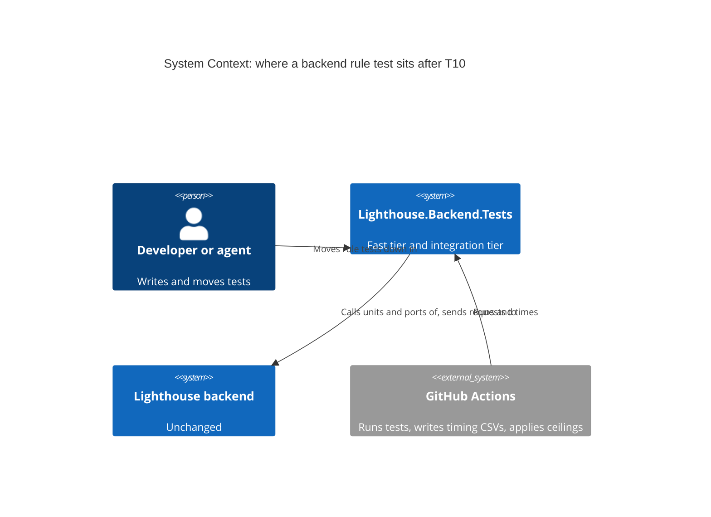
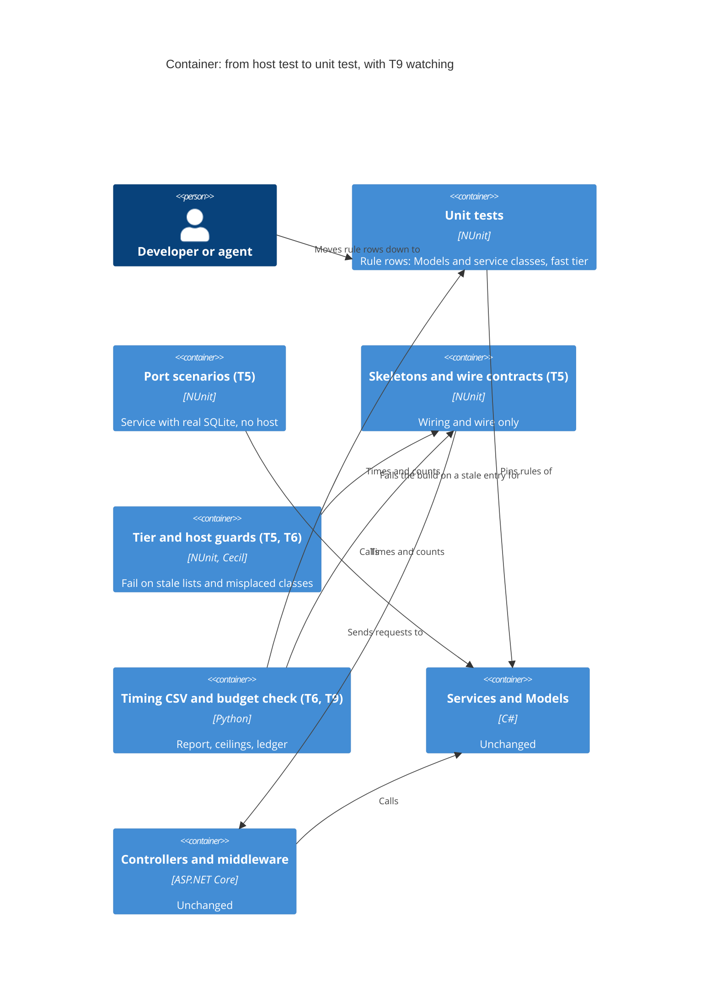

# Feature: story-6537-t10-backend-rules-at-unit-level

Story #6537 · T10 Backend rules pinned by unit tests, integration tests left to prove the wiring · part of Epic #6506 "Fast, reliable
test suites". Catalogue: [Epic workspace](../epic-6264-modular-monolith/feature-delta.md) ·
Brief: [slice-51](../epic-6264-modular-monolith/slices/slice-51-t10-backend-rules-at-unit-level.md).

DISCUSS: the brief, settled with the maintainer on 2026-11-07. Its sections "Maintainer decisions", "Test pyramid vision" and the
"Change from T5's DEVOPS" line override the text above them, and were not reopened. Waves start at DESIGN. Size M.

## Wave: DISCUSS / [REF] Inherited

- Epic decision D-6264-5. job_id: infrastructure-only. Hard dependencies: T5 #6469 and T6 #6512. Soft in the brief, required to start by the
  DESIGN dispatch: T9 #6536.
- Maintainer decisions kept as written: stop after the top two suites, or earlier if a suite would save under 1 % of `Integration` time, then
  ask; success is any measurable fall in the median summed `Integration` time, with a percentage set at DESIGN; T10 may take a high-ranking
  suite T5 left, once T5 is finished; T10 lowers T9's ceilings in its last commit, the total included.
- Test pyramid direction (about 90 / 9.5 / 0.5 by count) is a direction, not a gate. Time is the gate.
- **The brief says "move".** Rewriting a rule on a smaller input is an extension beyond the brief, proposed here, and **not a maintainer decision**. See "Scope and acceptance criteria".
- **"Top two by the ranking" in the brief becomes "top two by stage-3 saving" below.** That is a deviation from the brief, named in "For the maintainer" for confirmation.
- Read a host-to-port saving by class, not from the tier column (T5's DEVOPS change, 2026-11-07).
- RBAC, Lighthouse-Clients, website, usage-data event, UI sketch, Terminology, context map: N/A, answered below with reasons.

## Wave: DESIGN / [REF] Scope, mode and context

Application scope, propose mode, AFK: each engineering choice takes the recommended option and is recorded here. Paradigm OOP, as the project
states. No SPIKE, no wave-decisions file. No production file changes in any step, so there is no ADR; this delta is the record, as for T5 and T6.

Read: slice 51; T5's delta in full (convention, "What a move can actually save", the pilot's coverage and id tables, the guard, ranking rule and
addendum, DEVOPS "Budgets and T9's ceilings", "Proof that no test is lost", DISTILL "The guarantee" and review revision); T6's delta on the
`Integration` category, the guard and the timing CSV; T9's delta on the budget file, the figures, "Reading a run" and "A red on trunk";
`IntegrationFixture`, `TestTierGuardTest`, `TestHostScanning`, `TestHostPerFixtureGuardTest`, `trx_to_csv.py`, `check_budget.py`,
`test-time-budget.json`, `FixtureSetupTimer`, `FixtureTimingReporter`, T5's `measurement/fixture-setup-timings.csv`, and `ci_backend.yml`.

**Confirmed by reading.** CI's step names are `Test Backend`, `Extract backend per-test timings`, `Upload backend per-test timings` (artifact `test-timings-backend`),
`Test the budget check` and `Check test-time budget`. The 2.1 times headroom on a per-class budget is T4's rule (its headroom decision, in T4's delta). The 1.13 floor for `h` is T9's, taken from
T4's measured whole-backend runs of 2,556 to 2,883 s, a ratio of 1.128; that arithmetic is checked, T4's run list itself was not re-read.

**Nothing was run: this agent has no shell.** Every figure is read from a file and its source is named. Where a figure is an estimate, it
says so. **The baseline T10 needs does not exist yet** (see "What T10 cannot start until"), so this delta fixes rules and shapes, not numbers.

**What exists today, checked against the code, and what is planned.**

| Name used below | State |
|---|---|
| `IntegrationFixture`, `TestTierGuardTest`, `TestHostScanning`, `TestHostPerFixtureGuardTest` | On disk (T6 is in flight: the base and the tier guard are there) |
| `trx_to_csv.py` columns `fully_qualified_name, category, duration_ms, outcome` | On disk. The `category` column reads only a class's own attribute today; reading the whole base chain is **planned by T6, slice F** |
| `check_budget.py`: `class_of`, `seconds_per_unit`, `declared_classes`, stale and not-needed checks; `test-time-budget.json` per-class `allowlist` | On disk. These are the class-by-seconds join T10 reuses |
| `FixtureSetupTimer`, `FixtureTimingReporter`, `LIGHTHOUSE_FIXTURE_TIMING`, `LIGHTHOUSE_FIXTURE_TIMING_OUT` | On disk. T5's CSV from 2026-11-07 is in its `measurement/` folder |
| `ServicePortHarness`, `Tests/Acceptance/<Feature>/`, `WireContractTest`, `Tests/Contracts/`, `TestHostUseGuardTest` with its two lists | **Planned by T5.** None is in the tree yet |
| Per-tier counting, the three ledgers (fast limit, `Integration` mean, `Integration` total), the report, the calibration table, `--pyramid` | **Planned by T9.** `test-time-budget.json` holds no ledger yet |

## Wave: DESIGN / [REF] Project rules, answered

| Rule | Answer |
|---|---|
| Bounded contexts touched (context map ADR, `adr-270-...`) | **None changes.** No context, concept, edge or event is added. Each moved class pins a rule of whichever context it tests; the suite's note names it. The map and `ARCHITECTURE.md` §4 stay as they are |
| New terms | **None.** T5's words (*port scenario*, *skeleton*, *wire contract*, *user flow*) are reused. T10 adds two engineering words that stay out of the glossary: *rule row* (a row whose every assertion is a value a service or domain class computes) and *rewrite* (a rule row re-stated on a smaller input, as against a *move*, which keeps the assertions and the content of the Given and changes only the layer it runs at) |
| Domain events | None published or reacted to |
| RBAC | **N/A, because no authorization logic changes.** Every 401, 403 and RBAC 404 row stays at the host, in `Contracts`. A rule row that reaches `IRbacAdministrationService` in a shared step is read as wire and stays. No test re-implements RBAC |
| Lighthouse-Clients (CLI/MCP) | **N/A, because no contract, route or version changes.** The contract rows that stay pin them as today |
| Website marketing surface | **N/A, because nothing a user sees changes** |
| Usage-data event | **N/A, because this is test structure.** No user action is added to count, so no `UsageDataEventName` entry and no line in `docs/settings/usagedata.md` |
| UI surface, sketch, loading and failure looks, visualization skill | **N/A, because no screen, chart, copy or word changes.** T9 owns the report's wording |
| Terminology | **N/A, because no user-facing word is written.** Test names and comments that a moved row carries keep the seeded defaults (`Feature`, `Work Item`, `Team`), never a tracker's word |
| nWave scenario tags in code | None. No `@us-`, `@slice-`, `@kpi-` tag, as a comment or a title prefix. Classification lives in this workspace |
| Production code | None changes. **Mutation: N/A, kept.** The brief's acceptance criteria state it, and the maintainer accepted it on 2026-11-07 for this chain where only test files change. No Stryker run. The deliberate break of one production line per moved suite stands in. **Known limit:** moving a test can change which mutants die, because a rule pinned at the host and at the unit level are not the same checks; the break is one line per suite, not a kill rate, so a suite's gain or loss in killed mutants is not measured |
| Static checks | **Biome: N/A, because no TypeScript file changes.** The backend analyzers apply to every new or edited C# test: `dotnet build` must pass with zero warnings (`TreatWarningsAsErrors`, SonarAnalyzer and the promoted NUnit rules), run at the end of each suite's last refactor pass before the push |
| Docs prose, screenshots, demo data, website assets, release notes | **N/A, because no user-visible behaviour, copy or data changes.** No page of `docs/` describes test structure beyond T5's and T9's own amendments, which they own. Release notes are written at release, not at finalize |
| Shared contracts | No DTO, route or payload changes. Before editing a shared test step, builder or factory that rows other than the moved ones use, grep its usages and extend the builder first, so the blast radius is known |
| Epic ships alone | **Yes.** T10 depends one way on earlier Stories (T5, T6, T9). Finished, it lowers `Integration` seconds and the ceilings by itself, whether or not T11 ever ships |
| Ports and adapters | Production hexagon untouched. A rule with no extractable unit stays at the host and goes to the improvement Epic on structure (#6508), as T5 treats it. **T10 adds no port, moves no logic** |
| EF migrations, Stryker config, `ci*.yml`, csproj | None touched. A csproj or workflow edit forces every live suite on a key shared with CI |
| Improvement backlog check | **N/A, because this Story is itself an item of the Continuous Improvement Epic** |
| External integrations | None added, so no contract-test note |
| Comments | Rare, written for a stranger, no slice or Story id |

## Wave: DESIGN / [REF] Decisions

| ID | Decision | Why (one line) |
|---|---|---|
| D-6537-1 | **Rank classes by median seconds, from CI's `test-timings-backend` CSVs of at least 5 plain `main` runs after T5's last move push and T6's slice F.** Rows: `category` = `Integration`, outcome `Passed`, connector classes left out as T9 leaves them out. Class and seconds from `check_budget.py`'s `class_of` and `seconds_per_unit`, then the median per class over the runs | The median damps runner luck; the join already copes with dots in test arguments |
| D-6537-2 | **Seconds are the ceiling, not the saving.** The ranking is stage 1. Stage 2 is the screen on the top five; stage 3 is the saving per suite, as T5's ranking rule. **The top two are taken by stage-3 saving, not by the ranking. This deviates from the brief ("the top two suites by the ranking") and is for the maintainer to confirm** | The slowest tests are often body-bound; moving them as they are saves only set-up |
| D-6537-3 | Two destinations for a **move**, lowest that can prove the rule: a **unit test of the class that computes it** (no database, same assertions, same Given content), else a **port scenario** on T5's harness, or `new` for up to three collaborators | A unit test with no database costs milliseconds; a port scenario keeps the real database and the body |
| D-6537-4 | **Moves only is the default.** A *rewrite* (smaller input at the computing class) is an **extension beyond the brief, proposed for the maintainer's yes**. Until that yes is in this delta, no rewrite step runs. A rewrite then needs its own deliberate break and an id row per removed row | A rule that depends on a 20 s history fill cannot be moved cheaply, only restated; restating is not what the brief or the maintainer's decisions say |
| D-6537-5 | T10 builds no helper, script, base class or guard. It uses T5's harness, T5's guard lists, T6's category and T9's report. If a suite needs a helper T5 did not leave, T10 stops and asks | One mechanism per question; the brief says the same |
| D-6537-6 | **One stop rule, in three places:** stop and ask after the top two suites, or when a suite's saving is under 1 % of the baseline summed `Integration` seconds (the "1 % line", about 20.7 s on T9's stand-in of 2,068 s, an estimate until the baseline exists). The check is a **prediction** at step 1 (T5's priors only) and at step 2 (the pilot class measured, the rest of the suite projected), and **measured** at the close of each suite (the by-class sum). Under the line in any of the three means stop and ask | The maintainer's decision; the saving cannot be measured before a class has moved, so the early checks are marked as predictions |
| D-6537-7 | Success has a floor and a target, each defined in "The success number". A **provisional target `P` of 1.1 %** is written there now, from stated estimates, and replaced once at step 2 by a measured one | Time is the gate. The maintainer asked for a percentage at DESIGN |
| D-6537-8 | The last commit applies T9's rules to lower the mean and total ceilings, from 5 plain runs after the last move push. It is a data commit made **after** the after set is read. **Where the formula would not lower a ceiling, T10 writes nothing for it. That departs from "lowers the ceilings, total included" and needs the maintainer's ruling before the data commit** ("How the ceilings are lowered") | The maintainer's decision, with a part T9's rules cannot deliver; T9 expects both lowered |
| D-6537-9 | At most three pushes: suite 1, suite 2, the data commit. T5's push rules apply word for word: no `ci*.yml` edit, the path classifier answers `false` for every connector before each push, and the always-on list run before each push with the id table as its allowance | Each backend push runs the whole tail; a list run proves no test is lost |
| D-6537-10 | No ADR, no `brief.md` change, no CLAUDE.md change. T5's bullet already says where a new scenario lands | Test structure only |
| D-6537-11 | **Start condition: T5 finished, only.** If T5 stalls or stops short of finishing, T10 asks the maintainer and does not start | A suite T5 touches is closed to T10 until T5 finishes it; a stopped T5 leaves half-moved suites and lists |
| D-6537-12 | Rename the HTTP share to **`hop`**, so it cannot be read as T9's headroom `h`. `c`, `hop` and `m` are defined in "What is ranked" | One letter, one meaning |

## Wave: DESIGN / [REF] What is ranked, and from which runs

**Source.** The CSV CI uploads as `test-timings-backend` for each plain `main` run. A run counts by T9's reading rule, one job in one attempt:
the test step succeeded, no `Failed` row, every connector answer in Detect Changes is `false`, and after T6's slice F. Its run ids and artifact ids go
into a table in this workspace, as T9's calibration table does. **The five runs T9 uses to enforce its entries are the first choice** for
the before set, so T10 pays for no extra runs, provided no test moved between them. A run's `Integration` count is checked against T9's "since the total was
set" line, so a foreign test added or removed is seen, not guessed.

**Ranking.** Per class, the median over the runs of its summed seconds. Then the left-out list, per class, as T5 does it, because a family can
hold one class that stays:

| Left out | Why |
|---|---|
| T5's skeleton list, every class on `WireContractTest`, `Tests/Contracts/` | Meant to stay at the host |
| Classes T5 already moved | Closed to T10 until T5 finishes; after that they are on `Unit` and not in the column |
| Connector classes and `Integration.Containers` (Postgres) | They prove a provider, not a rule. T9 leaves the connector ones out of the count |
| `Architecture`, `Startup`, `Health`, `API.Security`, families that test the host itself | Their subject is the host |

**Where candidates are likely to come from (an expectation, the run decides).** T5's addendum read the top families and left: the rest of Refinement and
Reports (classes that mix rule and wire), `ConnectionDefaults` (about 15 rule rows of 105), `TaskManagerHarness` (about 14 of 188), and families it called
body-bound, such as the percentile and reconstruct-history families, where a fill of history takes most of the seconds. The decision on T5's leftovers is the
maintainer's: T10 may take one once T5 is finished. T10's own reach is the body-bound class, where a rewrite can drop the fill because the rule can be
pinned on a few in-memory samples. **That reach needs the maintainer's yes to rewrite; with moves only, a body-bound class saves only its set-up and is not a candidate.** The ranking shows which case the runs are in.

**Stage 1.** Top ten classes by median seconds, with the family of each (T5's grouping by abstract harness), run ids and spread (largest over smallest).
**Stage 2.** The top five go through the screen below, one table per class. `m` = rule rows that pass. **Stage 3.** Saving per suite:

- *Move rows:* `m x (u − c + hop)`.
  - `m` = the rule rows that pass the screen. Its source is the stage-2 reading of each suite, row by row, in the screen's tables: a reading of names and steps, so an expectation until the pilot class re-checks it (re-read it if it moves by more than 5 rows, as T5 does).
  - `u` = set-up per test at the host: `setup_total_ms / setup_count` for the fixture, from one local run with `LIGHTHOUSE_FIXTURE_TIMING=1` (T5's `measurement/fixture-setup-timings.csv` is the prior: 0.19 to 0.31 s for the acceptance families).
  - `c` = set-up per test at the lower layer, measured on the pilot class **after** it moved, by the same timer on the new fixture, on the same machine, quiet, no other test run.
  - `hop` = what the HTTP call itself cost, measured as the residual on the pilot class: (a row's TRX seconds at the host) − (the same row's TRX seconds at the lower layer) − (`u` − `c`), averaged over the class's rows. T5 took it as 0; here it is measured, and a negative value is reported as it is.
- *Rewrite rows (only after the maintainer's yes):* the removed row's seconds from the CSV, less the new row's measured seconds.
- Plus a host build per fixture that leaves, minus a host build per new host row, as T5 counts.

Take the top two by stage-3 saving, not by stage-1 seconds (the deviation named in D-6537-2). A class whose stage-3 saving is under the 1 % line is reported and not moved, and the stop rule in D-6537-6 applies: it is a prediction at this stage.

## Wave: DESIGN / [REF] The screen: what a unit test can pin

T5's three kinds stay the vocabulary. **The one question per assertion:** is this a business value that a service or domain class computes, and does it need
nothing about route, verb, status code, JSON member name, header, or 401, 403 or RBAC 404? If yes, it is a rule row. Everything else stays at the host.

| Case | Goes to |
|---|---|
| Assertion on a value computed in `Models/` or a pure calculation | **Unit test of that class**, no database. Lowest layer, first choice |
| Value computed in a service that needs stored data | **Port scenario** on `ServicePortHarness`, or `new` with up to three collaborators |
| Mixed row (value and wire) | **Split.** Value to the lower layer; one wiring row stays or joins `Contracts` |
| A walk over the whole JSON tree, enums as text, null members, date format | Wire. Stays or goes to `Contracts` |
| Logic in a controller or middleware (mapping, filtering, status choice) | **Stays.** No port; recorded for #6508 |
| A rule whose Given is built through the real save route | Stays unless the Given can be built on the model by a builder no save can contradict. T5's per-suite builder and its "one contract row sends every input through the real door" apply |
| Body over 2 s locally and not a rewrite | **Stays.** Moving it saves only set-up and would land a slow test in the fast tier |
| Needs the update queue, the lanes or hosted services | **Stays.** No wider port fixture, as T5 decided |

**Read the shared steps, not only the tests.** A rule can hide in a shared step (T5 found the history invariant in `ReadTheAnswer`) and a wire pin can hide
there too (`Field`, `AsDay`). Each suite has: a table of its shared steps (what each asserts, rule or wire, where it goes); the coverage table of what
the wire shows today and what pins it after; the id table (old id to new id or "stays"; a moved class keeps its name, so only changed rows are listed);
and a count that adds up to the suite's rows. These are T5's four tables, not new ones.

**Proof per moved suite, as T5 and FE7 did.** (1) Every removed assertion has a row in the id table. (2) One deliberate break of one production line the rule
depends on, in the working tree: the moved row goes red at its new layer and the output is kept; then it is reverted. The change must compile. (3) Line
coverage of the production files the coverage table names is not lower, from `Test-Coverage.ps1` before the first move and after the last, with
the live-connector categories out. This is a floor: other tests may cover the line, which is why the break is the real proof, one rule per suite. (4)
The id list: the always-on list run before each push, compared with the last, every line explained by the id table (T5's "Proof that no test is lost").

## Wave: DESIGN / [REF] Scope and acceptance criteria

**IN:** the ranking and its source runs; the screen, coverage, shared-step and id tables; **moves**, and **rewrites if the maintainer says yes**; the guard-list, budget-file and `MostTypesTheListMayHold` edits that a move needs; the ceiling commit.
**OUT:** production code (a rule with no extractable unit stays at the host and goes to #6508); live and container classes; the frontend; any new helper beyond T5's.

Acceptance criteria (the brief's, kept, plus one for rewrites):

- [ ] The ranking and its source runs are in the workspace; each moved suite has a coverage table, an id table and a deliberate-break proof.
- [ ] The median summed `Integration` seconds over the after runs is below the before runs', the fall is measurable as defined in "The success number", and it reaches `P`; coverage of the touched area is not lower.
- [ ] No production file changes (mutation N/A, accepted); T5's guard stays green and its lists do not grow.
- [ ] **Rewrites:** every rewritten row has its own deliberate break (red for the same production line the old row pinned), an id row for each removed row, and the maintainer's yes recorded in this delta before the first one. No yes, no rewrite.

**Moves only, what it does to the expected saving.** The estimate under "The success number" assumes moves only, and it already leaves out body-bound classes. If rewrites are allowed, the ceiling of what can be saved rises by roughly the body seconds of the rule rows in classes such as the history-fill families, which cannot be estimated until the ranking shows them. With moves only, the saving is about 1.1 to 1.6 % of the tier (estimate below), and the percentage families, with the largest body seconds, stay untouched.

## Wave: DESIGN / [REF] Steps per suite

A step is a commit. Days are estimates. Each leaves the suite green; no production file changes; a move never mixes with an edit.

| Step | Days | What it delivers | Proof |
|---|---|---|---|
| 1 | 0.25 | Baseline table (run ids, artifact ids, count, sum, spread), the ranking, the 1 % line | The table adds up; every run passes the reading rule |
| 2 | 0.75 | Screen of the top five, then **suite 1's first class** (the pilot, counted in suite 1 and in the sum for `P`): its tables, `u`, `c` and `hop` measured before and after on one machine, stage 3 re-run, the provisional `P` replaced once by a measured one | Id table, break, class seconds before and after. **Stop and ask** if the suite's saving, predicted from the pilot, is under the 1 % line |
| 3 | 1 | The rest of suite 1 | As step 2, plus the guard lines below |
| 4 | 1 | Suite 2, with its own checkpoint on its first class | As step 3. At the close of each suite the 1 % check is **measured**, by class |
| 5 | wait | **Stop and ask the maintainer** with the numbers (the top two are done), or earlier by the stop rule | |
| 6 | 0.25, after 5 runs | **In this order:** the after set (5 plain runs after the last move push), the success reading from it, then the ruling on the ceilings, then the data commit. The data commit starts runs of its own, which are not part of the after set | "The success number", "How the ceilings are lowered" |

About 3.25 days, so M, moves only; a rewrite step, if the maintainer says yes, is added after step 4 and sized then. Steps 2 to 4 are three commits per suite at most, each with its own id table.

**What a move touches in one commit, so no list goes stale.** (a) The class leaves the base, by T6's rule that a fixture without a host leaves
`IntegrationFixture`. (b) Its line goes from `HostUsersStillToMove` in T5's guard, whose rule on stale entries fails otherwise. (c) Any line in T2's list in `TestHostPerFixtureGuardTest.cs`, **and
`MostTypesTheListMayHold` there (53 today) goes down by the same amount in the same commit**, as that test's own message says; the test fails otherwise. (d) Its entry
in `test-time-budget.json`'s `allowlist`, if the class is gone or renamed: `check_budget.py` fails on a stale entry, and that is the only drop it enforces. For a class that stays and shrinks below the limit,
`check_budget.py` calls a backend entry idle only when its ceiling equals the 34 s budget, so **that drop is manual and reviewed**: the entry goes in the commit when the class's largest time over 5 plain
runs times 2.1 is at most 34 s (T5's rule), and nothing in the build asks for it. A moved row that lands in the fast tier must be under T9's fast limit; T5's
2 s own rule keeps every moved-as-is row well under it. **The guard's lists must not grow.**

## Wave: DESIGN / [REF] What T10 cannot start until

| Needs | Because | How it is read |
|---|---|---|
| **T5 finished.** If T5 stalls, T10 asks the maintainer and does not start | A suite T5 touches is closed to T10. T10 builds on T5's harness and deletes lines from T5's guard lists, so they must exist and be final. The ranking must be after T5's last move push | T5's delta shows its close; `ServicePortHarness`, `TestHostUseGuardTest` and `Tests/Acceptance/` are in the tree |
| **T6 finished** | The ranking reads the `category` column, and slice F makes it read the base chain; its check that the `Unit` rows equal the fast run's ids exactly is what makes `Integration` mean "hosted" | T6's slice F on `main`; one downloaded CSV shows hosted classes as `Integration` |
| **T9's ceilings live** | The before set, the report and the ledgers are T9's. The report must print the `Integration` tier (count, sum, mean) and the ledger must hold entries. **A provisional entry is enough to start**, as T9's own text allows; the ceiling commit needs enforced entries or its own 5 runs | T9's slices B and C on `main`; a CI step summary that shows the tier |
| **5 plain runs for the before set**, after T5's last move push | The median needs them, and so does the `P` arithmetic | Step 1's table |

**Today (2026-11-07) none of the four holds.** T5 has no helper, base or guard in the tree; T6's category column still reads class-level attributes only; T9's file
has no ledger. So T10 does nothing yet except this delta, and nothing in it is a number. If T9 is late, the ranking and screen (steps 1 to 2) can start on the report and
the CSVs; the ceiling commit waits.

## Wave: DESIGN / [REF] The success number

**Floor.** Median of the after runs' summed `Integration` seconds below the median of the before runs'. This is the maintainer's rule. **It may not be provable on its own.** Backend totals
swing 1.13 times from runner luck (T4), a 5-run median damps that, and the expected fall is about 1 to 2 % of the tier. T5 expected 1.2 to 1.6 % for the whole of its Story's moves (the pilot and the smaller option of its two suites). A fall
that size can sit inside the spread of the before set. So the floor is read with the spread printed beside it.

**"Measurable", defined.** The by-class fall is measurable when it is larger than the range (largest minus smallest) of the moved ids' own summed seconds across the 5 before runs. The tier median is the maintainer's named figure, so the **pass condition** is all three together: (1) the after median is below the before median; (2) the by-class fall is measurable; (3) it reaches `P`. If (1) fails but (2) holds and the tier's before spread is larger than the expected fall, the record says "inside runner noise on the tier column" and the Story **does not pass by itself: it goes to the maintainer**, with both figures.

**By-class fall.** Sum of the moved ids' seconds before (their rows as `Integration`, median over the before runs) minus the sum of their mapped ids after (new ids, wherever they landed, plus new
host rows), median over the after runs, read from the same CSVs with the id table. It covers tens of seconds, not two thousand, so runner noise is a small share of it. It is also the only figure that does not
fall just because rows left the `Integration` column.

**Provisional target `P` = 1.1 % (an estimate, written now).** Arithmetic, all inputs estimates already in this delta or in T5's:

- Rows: the likeliest top two are T5's leftovers, whose rule rows T5's addendum counts as `m` = 164 for Refinement and 132 for Reports, of which T5's smaller option takes 73 and 36. That leaves **91 and 96 rows**. This is a guess about which suites rank, and the ranking may pick others.
- Per row, `u − c + hop` with `u` = 0.189 s (Refinement) and 0.203 s (Reports) from T5's table, `c` = 0.05 s (T5's middle figure; its range was 0 to 0.1), `hop` = 0 (T5's assumption): 91 x 0.139 = 12.7 s and 96 x 0.153 = 14.7 s, so **27.3 s**.
- Less new host rows, T5's figure of about 12 at 0.29 s: **3.5 s**. Net **23.8 s**.
- Baseline stand-in: T9's 2,068 s. 23.8 / 2,068 = 1.15 %, rounded down to 0.1 point: **1.1 %**. At `c` = 0 the same sum is 33.2 s, 1.6 %. The figure is above the 1 % line (20.7 s), as it must be.
- The pilot's own saving is part of this sum, because the pilot is suite 1's first class.
- The baseline will be somewhat lower than 2,068 s once T5's moves (about 25 to 35 s, T5's own estimate) have left the column; that changes the percentage by about 0.02 point.

This `P` is a placeholder for the moves-only case. It is replaced **once**, at step 2, by the measured one below.

**Measured target `P`.** `P` = the by-class saving that stage 3 predicts for the two chosen suites, from the **measured** `u`, `c` and `hop` of the pilot class, as a percentage of the baseline
(median summed `Integration` seconds), rounded down to 0.1 point.

- **How:** at step 2, once the pilot has measured `u`, `c` and `hop`, stage 3 is re-run for the two suites and the measured `P` is written into this delta, replacing the provisional one, with the baseline it was divided by. It is not edited after that; only the maintainer lowers or raises it.
- **When:** after the baseline exists and the pilot class has moved, before suite 2 starts. The provisional one is written now only because the baseline does not exist, and T5's own estimates of `c` ranged from 0 to 100 ms, which moves a suite's saving by 40 % or more.
- **Reading:** the pass condition above. If the floor holds and the by-class fall is under `P`, the record says so and the maintainer decides; a fall under the floor is a fail. If wall time does not fall, the record says so, as FE7's did. The pyramid shares are reported beside it, never judged.
- **Guard against a flattering target:** `P` may not be set below the 1 % line. A suite under it is not moved, so a `P` below it would mean there is nothing to do, and the Story stops at step 2.

## Wave: DESIGN / [REF] How the ceilings are lowered

T9's rules apply as written; T10 invents no path.

**A departure for the maintainer's ruling, before the data commit.** The maintainer's decision is that T10 "lowers T9's ceilings in its last commit, the total included", and T9 expects both lowered. T9's rules cannot always deliver that: the mean ledger has no raise and takes an entry only if lower, and the total takes a re-derivation only "when lower". So where the formula would not lower a ceiling, T10 writes **nothing** for it, says so in the record, and does not force a number. Item 2 says why the mean is the likely case. This is a departure from the decision's wording, and the maintainer rules on it (open item 2) before the data commit is made.

1. **Sequence.** The last move push, then 5 plain runs that pass T9's reading rule (distinct run ids, green test step, no `Failed` row, connector answers `false`), then the success reading from those runs, then the ruling above, then the data commit. The five are the same runs as the after set for the success reading, so the two proofs read the same CSVs; the data commit's own runs are not among them.
2. **Mean.** Largest mean seen over the 5, times `h`, rounded up, where `h` is the measured largest over smallest of that figure with a floor of 1.13. The ledger has no raise, so the entry is written only if it is below the newest enforced one. **When the formula would not lower it, nothing is written for the mean.** That is the likely case: moved rows cost less than the tier's mean (about 0.5 s against about 0.75 s, T5's stand-in), so their leaving lifts the mean, by about 2 to 3 % for ~190 rows (T5's own figure was +0.7 % for 56 rows and +3 to +4 % for 250 to 300, scaled; an estimate), and a fresh derivation then sits above the entry from before the moves. The record says so, and the maintainer is told in the ruling above. A **mean ceiling breach during the work is not raised**: it stops and asks, as T9 says.
3. **Total.** The same formula, written as a lowering with a reason that names the moved suites. It may only be an entry lower than the current one; the count at derivation is stored beside it. The moved rows leave the tier whole, so the total is the ceiling most likely to fall (about 190 rows at 0.5 s is about 95 s, an estimate). **When the formula would not lower it, nothing is written for the total either**, under the same ruling.
4. **Fast limit.** Not touched: a moved-as-is row is under T5's 2 s own rule, far below T9's limit, and a rewrite is smaller still. If a moved row would exceed the limit, that row stays. N/A otherwise.
5. **A measured spread over 1.25 is never capped:** the entry stays provisional and the maintainer is asked. **The Story does not close while a limit it lowered is provisional.**
6. **A clean window.** The commit is a JSON-only plain push, read alone: no other Story pushing at the same time. A red on trunk is read by T9's table ("A red on trunk from a new ceiling"): count up, or one class far up, is a real cause and a fix; count unchanged is a slow runner and a re-run of the failed job; red twice stops and goes to the maintainer. T10 does not set `LIGHTHOUSE_BUDGET_WARN_ONLY`, which is the maintainer's. **Rollback is T9's:** the data commit is a plain `git revert` and goes first, before any revert of T9's enforcing commit; reverted moves go in reverse order after it, each with its guard-list lines, as T5's rollback says.
7. **Before each move push, a check by hand:** the predicted new mean and total, from the report's formula with the id table's counts and seconds taken out, against the ledger's room. A move that would breach the mean ceiling does not go in. The 5 runs must not be started while a foreign push is moving tests, or the control reading below is harder.

## Wave: DESIGN / [REF] What can lie, and what catches it

| Assumption | Could be false because | Caught by |
|---|---|---|
| Slowest means best to move | A body-bound row keeps its body at a port; the fall is only set-up | Ranking is stage 1 only; stage 3 picks. T5's "What a move can actually save" |
| The `Integration` column fell, so seconds fell | A moved row leaves the column whole and its time reappears as `Unit` | By-class sum over the id table, never the tier column alone |
| The median fall is real | A 1 to 2 % fall is inside runner spread | The spread printed beside it; the by-class figure; the same CSVs read before and after |
| A rule row moved loses no behaviour | A rule or a wire pin hid in a shared step or a Given | The shared-step table, the coverage table, the id table, the deliberate break, coverage not lower |
| A unit test passes for the wrong reason | Its Given is a state no save can produce; or the smaller input skips the edge | The per-suite builder and its one real-door row; a rewrite's own break; every removed row has a row |
| A rewrite equals the old test (only if the maintainer says yes) | Different input, different path | The deliberate break shows the new row red for the same production line; the old test is removed only after |
| The mean ceiling stays safe | Cheap rows leaving lift the mean | The pre-push hand check; no raise exists |
| No list goes stale | A class leaves the base but stays on a guard list, in T2's count, or in the budget file | The guards' stale rules, T2's count test and `check_budget.py`'s stale check fail the build in the same commit. The **drop of an entry for a class that merely shrinks is manual and reviewed**; nothing fails for forgetting it |
| A moved suite kills the same mutants | Pinning a rule at another layer changes which mutants die | **Not caught.** Mutation is N/A, accepted. The deliberate break is one line per suite, not a kill rate: a known limit |
| The baseline is clean | A foreign test moved between runs; a run that was red or live | T9's reading rule, the count line, run ids and artifact ids written down |
| `P` is honest | Stage-3 inputs are estimates until measured; the provisional `P` guesses which suites rank | The measured `P` replaces it once, from the pilot's `u`, `c` and `hop`; a 10 ms shift in `c` is about 1.1 s per 100 rows and is re-read |
| The 1 % check holds before anything moved | It is a prediction at steps 1 and 2 | Marked as a prediction in D-6537-6; measured by class at each suite's close |
| The rank is right | CSV class join mis-splits a name with dots | `class_of` is already tested for fixture and method arguments; where a class is ambiguous, the local TRX settles it |
| T5's finish is final | A suite T5 left half-moved | Start condition is T5 finished only; step 1 reads T5's own close note and its lists; if T5 stalls, T10 asks |

No new adapter, no new external call, so no probe is specified: the pieces T10 uses are T5's harness (its own probe is in T5's delta) and T9's reading rule.

## Wave: DESIGN / [REF] Reuse Analysis

| Existing or planned | Overlap | Decision | Contract shape, universe, assertion |
|---|---|---|---|
| T5's `ServicePortHarness`, planned | Real database for a port scenario | **REUSE**; no helper of T10's | Bounded-change, one temp database, none left after dispose |
| T5's `TestHostUseGuardTest` lists, planned | Which fixtures may still start a host | **REUSE**; lines only leave | Pure over a compiled module; stale line fails |
| T5's id table, shared-step table, coverage table, deliberate break | Proof per suite | **REUSE** | Reviewed tables; a break that compiles |
| T6's `IntegrationFixture`, `TestTierGuardTest`, `category` column | Tier and its reading | **REUSE** | The class leaves the base in the move's commit; the CSV shows `Unit` |
| T9's report, calibration table, ledgers, reading rule | Baseline, ceilings | **REUSE** | Pure judge; ledger edit is a data commit |
| `check_budget.py` `class_of`, `seconds_per_unit` | Class by seconds | **REUSE** | Pure, return-only; used by hand over downloaded CSVs |
| `FixtureSetupTimer`, `LIGHTHOUSE_FIXTURE_TIMING` | `u` and `c` | **REUSE** on the suite being moved | Env-gated; writes a CSV only |
| T2's `MostTypesTheListMayHold` in `TestHostPerFixtureGuardTest.cs` | Count of host-per-fixture list | **REUSE**: lowered by the same amount in each move's commit | Pure count assertion; fails if list and number differ |
| `Test-Coverage.ps1` | Coverage not lower | **REUSE**, twice per Story, for a specific reason | Read-only |
| Existing unit-test classes for services and Models | Home for a rule row | **EXTEND** by adding rows or a class beside them; no new base | Unit tier, no database or a harness |
| A script that ranks classes | Ranking | **No new script**: scratch tables, the delta is the record, as T5 did | n/a |

## Wave: DESIGN / [REF] C4





No L3: no subsystem has five components changing.

## Wave: DESIGN / [REF] For the maintainer

Decided in your absence; say if any is wrong. Nothing here blocks the wave.

1. **The percentage.** A provisional `P` of 1.1 % is written now from stated estimates (arithmetic in "The success number", labelled an estimate). Step 2 replaces it once with a measured one, never below the 1 % line. The pilot's own saving is part of the sum.
2. **The tier column cannot carry the proof alone.** A fall of 1 to 2 % of 2,000 s sits inside runner noise, and a moved row reappears as `Unit`. The floor is your rule; the by-class fall is the evidence.
3. **Seconds rank, saving picks.** The top two are chosen by stage 3, so a 20 s body-bound class is not first just because it is slow.
4. **Rewriting is an extension beyond the brief, not your decision yet.** It would reach rule rows in classes with a slow fill. Moves only is the default until you say yes; no rewrite step runs before that.
5. **T10 cannot start today.** T5, T6 and T9 are all unfinished in the tree. Start condition: T5 finished, only; if T5 stalls, T10 asks you.
6. **The top two are picked by stage-3 saving, not by the ranking.** That deviates from the brief; please confirm.
7. **The ceilings may not both be lowerable.** See open item 2.

## Wave: DESIGN / [REF] Open for the maintainer

None blocks DESIGN. Each has a recommendation already applied.

1. **Rewrite as well as move (decision 4).** An extension beyond the brief. Recommended yes, because the slowest classes are slow in the fill, not the set-up, but nothing runs until you say so; moves only is the default and the expected saving is then about 1.1 to 1.6 % of the tier.
2. **A ceiling the formula cannot lower (decision 8).** Your wording is "lowers the ceilings, total included", and T9 expects both. Where the formula would not lower one, T10 writes nothing for it. Likely for the mean, less so for the total. Needs your ruling before the data commit. Options: (a) write nothing and record, recommended; (b) hold the mean where it is and say so; (c) you set a figure by hand.
3. **The top two by stage-3 saving, not by the ranking.** A deviation from the brief; confirm.
4. **T9's pending ruling on the total (its point 1).** T10's ceiling commit is written for seconds only. If you choose the count line beside the total, T10 lowers that line in the same commit, as an at-most line.
5. **Which suite, when T5's leftovers rank high.** Decided in the brief (T10 may take one). Which one waits for the ranking.
6. **A ceiling that stays provisional.** If the measured spread is over 1.25, T10 cannot close on its own; it comes back to you.
7. **T5 stalls.** T10 does not start and asks you.

## Wave: DESIGN / [REF] Review

The first review came back NEEDS_REVISION. Changed in this file:

- A provisional `P` of 1.1 % with its arithmetic, labelled an estimate; step 2 replaces it once; the pilot's saving counts in the sum.
- Start condition is T5 finished only; if T5 stalls, ask. "Or stopped at its checkpoint" removed everywhere.
- Ceilings: what happens for the mean and for the total when the formula would not lower them, marked as a departure from "lowers the ceilings, total included", for the maintainer's ruling before the data commit.
- Rewrite labelled an extension beyond the brief; IN list, an acceptance criterion, a precondition (the maintainer's yes), moves only as the default, and what that does to the saving.
- One stop rule with its three places, prediction versus measured; the top two by stage-3 saving named as a deviation.
- `h` for the HTTP share renamed `hop`; `u`, `c`, `hop` and `m` defined with how each is measured or read.
- `check_budget.py` enforces the stale check only; the shrink-below-limit drop is manual and reviewed, in both places.
- T2's `MostTypesTheListMayHold` added to the one-commit list; the line about count constants fixed.
- "Measurable" and the pass condition defined; the after set comes before the data commit; static checks, docs, screenshots, demo data, shared-contract grep and Epic-ships-alone answered; "the whole of T5's Story's moves"; T9's rollback for the data commit; "one class far up"; T4's 2.1 and the CI step names confirmed by reading, T9's 1.13 checked by arithmetic.

**Not taken.** The request to run mutation: the N/A stays (the brief's criteria state it and the maintainer accepted it for this chain on 2026-11-07). The reviewer's point is recorded as a known limit instead. No Stryker run.

Not confirmed from any run: every figure, T6's slice F, T9's report shape, whether a class's name in the CSV can be ambiguous, and T4's own run list behind 1.13.

## Wave: DESIGN / [REF] Architecture summary for the maintainer

**The shape in hexagonal terms.** Production's hexagon does not change. T10 changes which layer pins a rule.

```
   TESTS (driving side)                       PRODUCTION (all unchanged)
 +-----------------------------+
 | Skeleton / wire contract    |--HTTP-->  +-------------+
 | (T5; rows STAY)             |           | Controllers |
 +-----------------------------+           | + RBAC guard|
                                           +------+------+
 +-----------------------------+                  |
 | Port scenario (T5)          |--call--> +-------v----------------+   +--------------------+
 |  + ServicePortHarness       |          | Application services   |-->| Models (domain)    |
 +-----------------------------+          | Services/Interfaces    |   +--------------------+
                                          +-------+----------------+          ^
 +-----------------------------+                  |                           |
 | Unit test of a rule [T10]   |------------------+---------------------------+
 | rows MOVE here (REWRITE only|
 | if the maintainer says yes) |          +-------v----------------+
 +-----------------------------+          | Driven adapters        |
                                          | EF on SQLite, trackers |
 +-----------------------------+          +------------------------+
 | Guards (T5, T6): lines leave|
 | Budget (T9): ceilings DOWN  |
 +-----------------------------+
```

- **Driving adapters:** controllers unchanged; fewer tests reach them, the ones left are wiring and wire. *Unchanged.*
- **Application services and ports:** unchanged. A rule with no port stays at the host. No port added. *Unchanged.*
- **Domain (Models):** unchanged. It gains tests that no longer need a database. *Test side modified.*
- **Driven adapters:** unchanged, no new external call. Port scenarios keep real SQLite; unit tests use none.
- **Test side:** *modified* only. Rule rows move down or are rewritten; lines leave T5's guard lists and the budget file; T9's `Integration` mean and total ceilings go down. Nothing new is created.

**The patterns weighed.**

| Pattern | Verdict | Why |
|---|---|---|
| Test pyramid: each fact pinned at the lowest layer that can prove it | **Chosen** | Rule at unit, wiring at skeleton, wire at contract |
| Functional core, imperative shell (pure rule in `Models/` pinned with no database) | **Chosen** where the rule is a pure calculation | No host and no DB makes it as cheap as a test can be |
| Ports and adapters, enter at the driving port (T5) | **Chosen** where the rule needs stored data | Reuses T5's convention and helper, no new one |
| Move (same assertions, lower layer) | **Chosen**, the default | It is what the brief and the maintainer's decisions say |
| Rewrite on a smaller input | **Proposed, not chosen: needs the maintainer's yes**, then its own break per row | A slow fill is the cost and a move would keep it, but it goes beyond the brief |
| Ratchet (T9 ledger, lowered at the end) | **Chosen** | A ceiling that only goes down keeps the gain |
| Deliberate break of one production line | **Chosen** | The only proof a moved test can still fail; mutation is N/A with no product change |
| Ranking by seconds alone (the brief's first proposal) | Rejected as the pick | Seconds include the body, which does not leave |
| Judging success by the tier column or wall time alone | Rejected | Moved rows reappear as `Unit`, and runner noise exceeds the fall |
| Characterization (golden master) tests to replace the old rows | Rejected | They would pin today's output, wrong parts included, at the same cost |
| A new helper or ranking script | Rejected | T5 left the helper; a script for one ranking is a second mechanism |
| In-memory SQLite or EF InMemory for the lower layer | Rejected, as T5 did | Foreign-key and file behaviour differ |
| Count constant on a new guard list | Rejected for any new guard, as T5 and T6 did. **T2's existing `MostTypesTheListMayHold` stays and is lowered with each move** | A second line in the same commit blocks nothing, but T2's constant exists and its test fails if the number is not lowered |
| Domain events, outbox, unit of work, value objects, JSON column, optimistic concurrency | N/A | No production model or persistence changes |
