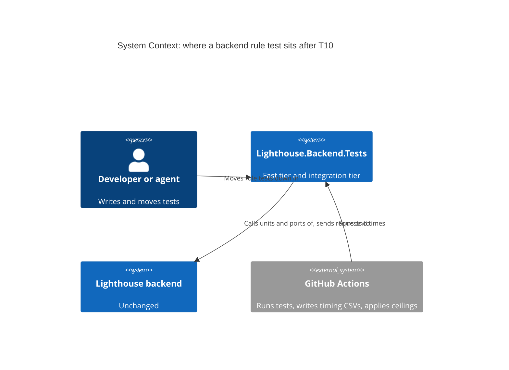
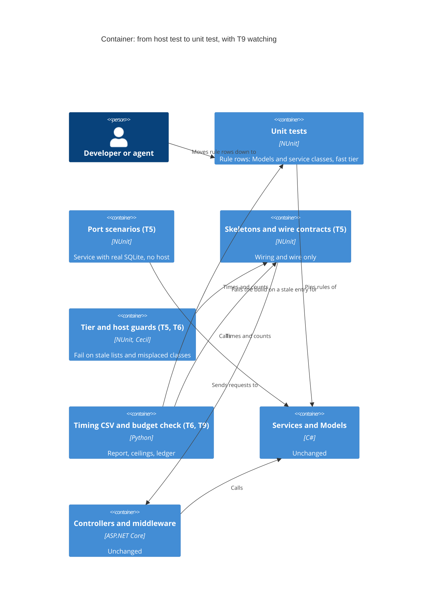

# Feature: story-6537-t10-backend-rules-at-unit-level

Story #6537 · T10 Backend rules pinned by unit tests, integration tests left to prove the wiring · part of Epic #6506 "Fast, reliable
test suites". Catalogue: [Epic workspace](../epic-6264-modular-monolith/feature-delta.md) ·
Brief: [slice-51](../epic-6264-modular-monolith/slices/slice-51-t10-backend-rules-at-unit-level.md).

DISCUSS: the brief, settled with the maintainer on 2026-11-07. Its sections "Maintainer decisions", "Test pyramid vision" and the
"Change from T5's DEVOPS" line override the text above them, and were not reopened. Waves start at DESIGN. Size M.

## Wave: DISCUSS / [REF] Inherited

- Epic decision D-6264-5. job_id: infrastructure-only. Hard dependencies: T5 #6469 and T6 #6512. Soft in the brief, required to start by the
  DESIGN dispatch: T9 #6536.
- Maintainer decisions kept as written: stop after the top two suites, or earlier if a suite would save under 1 % of `Integration` time, then
  ask; success is any measurable fall in the median summed `Integration` time, with a percentage set at DESIGN; T10 may take a high-ranking
  suite T5 left, once T5 is finished; T10 lowers T9's ceilings in its last commit, the total included.
- Test pyramid direction (about 90 / 9.5 / 0.5 by count) is a direction, not a gate. Time is the gate.
- **The brief says "move".** Rewriting a rule on a smaller input is an extension beyond the brief, proposed here, and **not a maintainer decision**. See "Scope and acceptance criteria".
- **"Top two by the ranking" in the brief becomes "top two by stage-3 saving" below.** That is a deviation from the brief, named in "For the maintainer" for confirmation.
- Read a host-to-port saving by class, not from the tier column (T5's DEVOPS change, 2026-11-07).
- RBAC, Lighthouse-Clients, website, usage-data event, UI sketch, Terminology, context map: N/A, answered below with reasons.

## Wave: DESIGN / [REF] Scope, mode and context

Application scope, propose mode, AFK: each engineering choice takes the recommended option and is recorded here. Paradigm OOP, as the project
states. No SPIKE, no wave-decisions file. No production file changes in any step, so there is no ADR; this delta is the record, as for T5 and T6.

Read: slice 51; T5's delta in full (convention, "What a move can actually save", the pilot's coverage and id tables, the guard, ranking rule and
addendum, DEVOPS "Budgets and T9's ceilings", "Proof that no test is lost", DISTILL "The guarantee" and review revision); T6's delta on the
`Integration` category, the guard and the timing CSV; T9's delta on the budget file, the figures, "Reading a run" and "A red on trunk";
`IntegrationFixture`, `TestTierGuardTest`, `TestHostScanning`, `TestHostPerFixtureGuardTest`, `trx_to_csv.py`, `check_budget.py`,
`test-time-budget.json`, `FixtureSetupTimer`, `FixtureTimingReporter`, T5's `measurement/fixture-setup-timings.csv`, and `ci_backend.yml`.

**Confirmed by reading.** CI's step names are `Test Backend`, `Extract backend per-test timings`, `Upload backend per-test timings` (artifact `test-timings-backend`),
`Test the budget check` and `Check test-time budget`. The 2.1 times headroom on a per-class budget is T4's rule (its headroom decision, in T4's delta). The 1.13 floor for `h` is T9's, taken from
T4's measured whole-backend runs of 2,556 to 2,883 s, a ratio of 1.128; that arithmetic is checked, T4's run list itself was not re-read.

**Nothing was run: this agent has no shell.** Every figure is read from a file and its source is named. Where a figure is an estimate, it
says so. **The baseline T10 needs does not exist yet** (see "What T10 cannot start until"), so this delta fixes rules and shapes, not numbers.

**What exists today, checked against the code, and what is planned.**

| Name used below | State |
|---|---|
| `IntegrationFixture`, `TestTierGuardTest`, `TestHostScanning`, `TestHostPerFixtureGuardTest` | On disk (T6 is in flight: the base and the tier guard are there) |
| `trx_to_csv.py` columns `fully_qualified_name, category, duration_ms, outcome` | On disk. The `category` column reads only a class's own attribute today; reading the whole base chain is **planned by T6, slice F** |
| `check_budget.py`: `class_of`, `seconds_per_unit`, `declared_classes`, stale and not-needed checks; `test-time-budget.json` per-class `allowlist` | On disk. These are the class-by-seconds join T10 reuses |
| `FixtureSetupTimer`, `FixtureTimingReporter`, `LIGHTHOUSE_FIXTURE_TIMING`, `LIGHTHOUSE_FIXTURE_TIMING_OUT` | On disk. T5's CSV from 2026-11-07 is in its `measurement/` folder |
| `ServicePortHarness`, `Tests/Acceptance/<Feature>/`, `WireContractTest`, `Tests/Contracts/`, `TestHostUseGuardTest` with its two lists | **Planned by T5.** None is in the tree yet |
| Per-tier counting, the three ledgers (fast limit, `Integration` mean, `Integration` total), the report, the calibration table, `--pyramid` | **Planned by T9.** `test-time-budget.json` holds no ledger yet |

## Wave: DESIGN / [REF] Project rules, answered

| Rule | Answer |
|---|---|
| Bounded contexts touched (context map ADR, `adr-270-...`) | **None changes.** No context, concept, edge or event is added. Each moved class pins a rule of whichever context it tests; the suite's note names it. The map and `ARCHITECTURE.md` §4 stay as they are |
| New terms | **None.** T5's words (*port scenario*, *skeleton*, *wire contract*, *user flow*) are reused. T10 adds two engineering words that stay out of the glossary: *rule row* (a row whose every assertion is a value a service or domain class computes) and *rewrite* (a rule row re-stated on a smaller input, as against a *move*, which keeps the assertions and the content of the Given and changes only the layer it runs at) |
| Domain events | None published or reacted to |
| RBAC | **N/A, because no authorization logic changes.** Every 401, 403 and RBAC 404 row stays at the host, in `Contracts`. A rule row that reaches `IRbacAdministrationService` in a shared step is read as wire and stays. No test re-implements RBAC |
| Lighthouse-Clients (CLI/MCP) | **N/A, because no contract, route or version changes.** The contract rows that stay pin them as today |
| Website marketing surface | **N/A, because nothing a user sees changes** |
| Usage-data event | **N/A, because this is test structure.** No user action is added to count, so no `UsageDataEventName` entry and no line in `docs/settings/usagedata.md` |
| UI surface, sketch, loading and failure looks, visualization skill | **N/A, because no screen, chart, copy or word changes.** T9 owns the report's wording |
| Terminology | **N/A, because no user-facing word is written.** Test names and comments that a moved row carries keep the seeded defaults (`Feature`, `Work Item`, `Team`), never a tracker's word |
| nWave scenario tags in code | None. No `@us-`, `@slice-`, `@kpi-` tag, as a comment or a title prefix. Classification lives in this workspace |
| Production code | None changes. **Mutation: N/A, kept.** The brief's acceptance criteria state it, and the maintainer accepted it on 2026-11-07 for this chain where only test files change. No Stryker run. The deliberate break of one production line per moved suite stands in. **Known limit:** moving a test can change which mutants die, because a rule pinned at the host and at the unit level are not the same checks; the break is one line per suite, not a kill rate, so a suite's gain or loss in killed mutants is not measured |
| Static checks | **Biome: N/A, because no TypeScript file changes.** The backend analyzers apply to every new or edited C# test: `dotnet build` must pass with zero warnings (`TreatWarningsAsErrors`, SonarAnalyzer and the promoted NUnit rules), run at the end of each suite's last refactor pass before the push |
| Docs prose, screenshots, demo data, website assets, release notes | **N/A, because no user-visible behaviour, copy or data changes.** No page of `docs/` describes test structure beyond T5's and T9's own amendments, which they own. Release notes are written at release, not at finalize |
| Shared contracts | No DTO, route or payload changes. Before editing a shared test step, builder or factory that rows other than the moved ones use, grep its usages and extend the builder first, so the blast radius is known |
| Epic ships alone | **Yes.** T10 depends one way on earlier Stories (T5, T6, T9). Finished, it lowers `Integration` seconds and the ceilings by itself, whether or not T11 ever ships |
| Ports and adapters | Production hexagon untouched. A rule with no extractable unit stays at the host and goes to the improvement Epic on structure (#6508), as T5 treats it. **T10 adds no port, moves no logic** |
| EF migrations, Stryker config, `ci*.yml`, csproj | None touched. A csproj or workflow edit forces every live suite on a key shared with CI |
| Improvement backlog check | **N/A, because this Story is itself an item of the Continuous Improvement Epic** |
| External integrations | None added, so no contract-test note |
| Comments | Rare, written for a stranger, no slice or Story id |

## Wave: DESIGN / [REF] Decisions

| ID | Decision | Why (one line) |
|---|---|---|
| D-6537-1 | **Rank classes by median seconds, from CI's `test-timings-backend` CSVs of at least 5 plain `main` runs after T5's last move push and T6's slice F.** Rows: `category` = `Integration`, outcome `Passed`, connector classes left out as T9 leaves them out. Class and seconds from `check_budget.py`'s `class_of` and `seconds_per_unit`, then the median per class over the runs | The median damps runner luck; the join already copes with dots in test arguments |
| D-6537-2 | **Seconds are the ceiling, not the saving.** The ranking is stage 1. Stage 2 is the screen on the top five; stage 3 is the saving per suite, as T5's ranking rule. **The top two are taken by stage-3 saving, not by the ranking. This deviates from the brief ("the top two suites by the ranking") and is for the maintainer to confirm** | The slowest tests are often body-bound; moving them as they are saves only set-up |
| D-6537-3 | Two destinations for a **move**, lowest that can prove the rule: a **unit test of the class that computes it** (no database, same assertions, same Given content), else a **port scenario** on T5's harness, or `new` for up to three collaborators | A unit test with no database costs milliseconds; a port scenario keeps the real database and the body |
| D-6537-4 | **Moves only is the default.** A *rewrite* (smaller input at the computing class) is an **extension beyond the brief, proposed for the maintainer's yes**. Until that yes is in this delta, no rewrite step runs. A rewrite then needs its own deliberate break and an id row per removed row | A rule that depends on a 20 s history fill cannot be moved cheaply, only restated; restating is not what the brief or the maintainer's decisions say |
| D-6537-5 | T10 builds no helper, script, base class or guard. It uses T5's harness, T5's guard lists, T6's category and T9's report. If a suite needs a helper T5 did not leave, T10 stops and asks | One mechanism per question; the brief says the same |
| D-6537-6 | **One stop rule, in three places:** stop and ask after the top two suites, or when a suite's saving is under 1 % of the baseline summed `Integration` seconds (the "1 % line", about 20.7 s on T9's stand-in of 2,068 s, an estimate until the baseline exists). The check is a **prediction** at step 1 (T5's priors only) and at step 2 (the pilot class measured, the rest of the suite projected), and **measured** at the close of each suite (the by-class sum). Under the line in any of the three means stop and ask. **On this delta's own arithmetic each candidate suite alone saves about 0.6 to 0.7 % (12.7 s and 14.7 s of 2,068 s, estimates), under the line, so the stop fires at step 2 for both. The target of 1.1 % is the sum of two suites that each fail the line. Whether the line applies to each suite or to the pair is the maintainer's question, first in DISTILL's "For the maintainer"** | The maintainer's decision; the saving cannot be measured before a class has moved, so the early checks are marked as predictions |
| D-6537-7 | Success has a floor and a target, each defined in "The success number". A **provisional target `P` of 1.1 %** is written there now, from stated estimates, and replaced once at step 2 by a measured one | Time is the gate. The maintainer asked for a percentage at DESIGN |
| D-6537-8 | The last commit applies T9's rules to lower the mean and total ceilings, from five plain eligible runs whose head is after the last move commit and before the data commit (the last move push's own run is the first of them if it is eligible). It is a data commit made **after** the after set is read. **Where the formula would not lower a ceiling, T10 writes nothing for it. That departs from "lowers the ceilings, total included" and needs the maintainer's ruling before the data commit** ("How the ceilings are lowered") | The maintainer's decision, with a part T9's rules cannot deliver; T9 expects both lowered |
| D-6537-9 | At most three pushes: suite 1, suite 2, the data commit. T5's push rules apply word for word: no `ci*.yml` edit, the path classifier answers `false` for every connector before each push, and the always-on list run before each push with the id table as its allowance | Each backend push runs the whole tail; a list run proves no test is lost |
| D-6537-10 | No ADR, no `brief.md` change, no CLAUDE.md change. T5's bullet already says where a new scenario lands | Test structure only |
| D-6537-11 | **Start condition: T5 finished, only.** If T5 stalls or stops short of finishing, T10 asks the maintainer and does not start | A suite T5 touches is closed to T10 until T5 finishes it; a stopped T5 leaves half-moved suites and lists |
| D-6537-12 | Rename the HTTP share to **`hop`**, so it cannot be read as T9's headroom `h`. `c`, `hop` and `m` are defined in "What is ranked" | One letter, one meaning |

## Wave: DESIGN / [REF] What is ranked, and from which runs

**Source.** The CSV CI uploads as `test-timings-backend` for each plain `main` run. A run counts by T9's reading rule, one job in one attempt:
the test step succeeded, no `Failed` row, every connector answer in Detect Changes is `false`, and after T6's slice F. Its run ids and artifact ids go
into a table in this workspace, as T9's calibration table does. **The five runs T9 uses to enforce its entries are the first choice** for
the before set, so T10 pays for no extra runs, provided no test moved between them. A run's `Integration` count is checked against T9's "since the total was
set" line, so a foreign test added or removed is seen, not guessed.

**Ranking.** Per class, the median over the runs of its summed seconds. Then the left-out list, per class, as T5 does it, because a family can
hold one class that stays:

| Left out | Why |
|---|---|
| T5's skeleton list, every class on `WireContractTest`, `Tests/Contracts/` | Meant to stay at the host |
| Classes T5 already moved | Closed to T10 until T5 finishes; after that they are on `Unit` and not in the column |
| Connector classes and `Integration.Containers` (Postgres) | They prove a provider, not a rule. T9 leaves the connector ones out of the count |
| `Architecture`, `Startup`, `Health`, `API.Security`, families that test the host itself | Their subject is the host |

**Where candidates are likely to come from (an expectation, the run decides).** T5's addendum read the top families and left: the rest of Refinement and
Reports (classes that mix rule and wire), `ConnectionDefaults` (about 15 rule rows of 105), `TaskManagerHarness` (about 14 of 188), and families it called
body-bound, such as the percentile and reconstruct-history families, where a fill of history takes most of the seconds. The decision on T5's leftovers is the
maintainer's: T10 may take one once T5 is finished. T10's own reach is the body-bound class, where a rewrite can drop the fill because the rule can be
pinned on a few in-memory samples. **That reach needs the maintainer's yes to rewrite; with moves only, a body-bound class saves only its set-up and is not a candidate.** The ranking shows which case the runs are in.

**Stage 1.** Top ten classes by median seconds, with the family of each (T5's grouping by abstract harness), run ids and spread (largest over smallest).
**Stage 2.** The top five go through the screen below, one table per class. `m` = rule rows that pass. **Stage 3.** Saving per suite:

- *Move rows:* `m x (u − c + hop)`.
  - `m` = the rule rows that pass the screen. Its source is the stage-2 reading of each suite, row by row, in the screen's tables: a reading of names and steps, so an expectation until the pilot class re-checks it (re-read it if it moves by more than 5 rows, as T5 does).
  - `u` = set-up per test at the host: `setup_total_ms / setup_count` for the fixture, from one local run with `LIGHTHOUSE_FIXTURE_TIMING=1` (T5's `measurement/fixture-setup-timings.csv` is the prior: 0.19 to 0.31 s for the acceptance families).
  - `c` = set-up per test at the lower layer, measured on the pilot class **after** it moved, by the same timer on the new fixture, on the same machine, quiet, no other test run.
  - `hop` = what the HTTP call itself cost, measured as the residual on the pilot class: (a row's TRX seconds at the host) − (the same row's TRX seconds at the lower layer) − (`u` − `c`), averaged over the class's rows. T5 took it as 0; here it is measured, and a negative value is reported as it is.
- *Rewrite rows (only after the maintainer's yes):* the removed row's seconds from the CSV, less the new row's measured seconds.
- Plus a host build per fixture that leaves, minus a host build per new host row, as T5 counts.

Take the top two by stage-3 saving, not by stage-1 seconds (the deviation named in D-6537-2). A class whose stage-3 saving is under the 1 % line is reported and not moved, and the stop rule in D-6537-6 applies: it is a prediction at this stage.

## Wave: DESIGN / [REF] The screen: what a unit test can pin

T5's three kinds stay the vocabulary. **The one question per assertion:** is this a business value that a service or domain class computes, and does it need
nothing about route, verb, status code, JSON member name, header, or 401, 403 or RBAC 404? If yes, it is a rule row. Everything else stays at the host.

| Case | Goes to |
|---|---|
| Assertion on a value computed in `Models/` or a pure calculation | **Unit test of that class**, no database. Lowest layer, first choice |
| Value computed in a service that needs stored data | **Port scenario** on `ServicePortHarness`, or `new` with up to three collaborators |
| Mixed row (value and wire) | **Split.** Value to the lower layer; one wiring row stays or joins `Contracts` |
| A walk over the whole JSON tree, enums as text, null members, date format | Wire. Stays or goes to `Contracts` |
| Logic in a controller or middleware (mapping, filtering, status choice) | **Stays.** No port; recorded for #6508 |
| A rule whose Given is built through the real save route | Stays unless the Given can be built on the model by a builder no save can contradict. T5's per-suite builder and its "one contract row sends every input through the real door" apply |
| Body over 2 s locally and not a rewrite | **Stays.** Moving it saves only set-up and would land a slow test in the fast tier |
| Needs the update queue, the lanes or hosted services | **Stays.** No wider port fixture, as T5 decided |

**Read the shared steps, not only the tests.** A rule can hide in a shared step (T5 found the history invariant in `ReadTheAnswer`) and a wire pin can hide
there too (`Field`, `AsDay`). Each suite has: a table of its shared steps (what each asserts, rule or wire, where it goes); the coverage table of what
the wire shows today and what pins it after; the id table (old id to new id or "stays"; a moved class keeps its name, so only changed rows are listed);
and a count that adds up to the suite's rows. These are T5's four tables, not new ones.

**Proof per moved suite, as T5 and FE7 did.** (1) Every removed assertion has a row in the id table. (2) One deliberate break of one production line the rule
depends on, in the working tree: the moved row goes red at its new layer and the output is kept; then it is reverted. The change must compile. (3) Line
coverage of the production files the coverage table names is not lower, from `Test-Coverage.ps1` before the first move and after the last, with
the live-connector categories out. This is a floor: other tests may cover the line, which is why the break is the real proof, one rule per suite. (4)
The id list: the always-on list run before each push, compared with the last, every line explained by the id table (T5's "Proof that no test is lost").

## Wave: DESIGN / [REF] Scope and acceptance criteria

**IN:** the ranking and its source runs; the screen, coverage, shared-step and id tables; **moves**, and **rewrites if the maintainer says yes**; the guard-list, budget-file and `MostTypesTheListMayHold` edits that a move needs; the ceiling commit.
**OUT:** production code (a rule with no extractable unit stays at the host and goes to #6508); live and container classes; the frontend; any new helper beyond T5's.

Acceptance criteria (the brief's, kept, plus one for rewrites):

- [ ] The ranking and its source runs are in the workspace; each moved suite has a coverage table, an id table and a deliberate-break proof.
- [ ] The median summed `Integration` seconds over the after runs is below the before runs', the fall is measurable as defined in "The success number", and it reaches `P`; coverage of the touched area is not lower.
- [ ] No production file changes (mutation N/A, accepted); T5's guard stays green and its lists do not grow.
- [ ] **Rewrites:** every rewritten row has its own deliberate break (red for the same production line the old row pinned), an id row for each removed row, and the maintainer's yes recorded in this delta before the first one. No yes, no rewrite.

**Moves only, what it does to the expected saving.** The estimate under "The success number" assumes moves only, and it already leaves out body-bound classes. If rewrites are allowed, the ceiling of what can be saved rises by roughly the body seconds of the rule rows in classes such as the history-fill families, which cannot be estimated until the ranking shows them. With moves only, the saving is about 1.1 to 1.6 % of the tier (estimate below), and the percentage families, with the largest body seconds, stay untouched.

## Wave: DESIGN / [REF] Steps per suite

A step is a commit. Days are estimates. Each leaves the suite green; no production file changes; a move never mixes with an edit.

| Step | Days | What it delivers | Proof |
|---|---|---|---|
| 1 | 0.25 | Baseline table (run ids, artifact ids, count, sum, spread), the ranking, the 1 % line | The table adds up; every run passes the reading rule |
| 2 | 0.75 | Screen of the top five, then **suite 1's first class** (the pilot, counted in suite 1 and in the sum for `P`): its tables, `u`, `c` and `hop` measured before and after on one machine, stage 3 re-run, the provisional `P` replaced once by a measured one | Id table, break, class seconds before and after. **Stop and ask** if the suite's saving, predicted from the pilot, is under the 1 % line |
| 3 | 1 | The rest of suite 1 | As step 2, plus the guard lines below |
| 4 | 1 | Suite 2, with its own checkpoint on its first class | As step 3. At the close of each suite the 1 % check is **measured**, by class |
| 5 | wait | **Stop and ask the maintainer** with the numbers (the top two are done), or earlier by the stop rule | |
| 6 | 0.25, after 5 runs | **In this order:** the after set (five plain eligible runs whose head is after the last move commit and before the data commit (the last move push's own run is the first of them if it is eligible)), the success reading from it, then the ruling on the ceilings, then the data commit. The data commit starts runs of its own, which are not part of the after set | "The success number", "How the ceilings are lowered" |

About 3.25 days, so M, moves only; a rewrite step, if the maintainer says yes, is added after step 4 and sized then. Steps 2 to 4 are three commits per suite at most, each with its own id table.

**What a move touches in one commit, so no list goes stale.** (a) The class leaves the base, by T6's rule that a fixture without a host leaves
`IntegrationFixture`. (b) Its line goes from `HostUsersStillToMove` in T5's guard, whose rule on stale entries fails otherwise. (c) Any line in T2's list in `TestHostPerFixtureGuardTest.cs`, **and
`MostTypesTheListMayHold` there (53 today) goes down by the same amount in the same commit**, as that test's own message says; the test fails otherwise. (d) Its entry
in `test-time-budget.json`'s `allowlist`, if the class is gone or renamed: `check_budget.py` fails on a stale entry, and that is the only drop it enforces. For a class that stays and shrinks below the limit,
`check_budget.py` calls a backend entry idle only when its ceiling equals the 34 s budget, so **that drop is manual and reviewed**: the entry goes in the commit when the class's largest time over 5 plain
runs times 2.1 is at most 34 s (T5's rule), and nothing in the build asks for it. A moved row that lands in the fast tier must be under T9's fast limit; T5's
2 s own rule keeps every moved-as-is row well under it. **The guard's lists must not grow.**

## Wave: DESIGN / [REF] What T10 cannot start until

| Needs | Because | How it is read |
|---|---|---|
| **T5 finished.** If T5 stalls, T10 asks the maintainer and does not start | A suite T5 touches is closed to T10. T10 builds on T5's harness and deletes lines from T5's guard lists, so they must exist and be final. The ranking must be after T5's last move push | T5's delta shows its close; `ServicePortHarness`, `TestHostUseGuardTest` and `Tests/Acceptance/` are in the tree |
| **T6 finished** | The ranking reads the `category` column, and slice F makes it read the base chain; its check that the `Unit` rows equal the fast run's ids exactly is what makes `Integration` mean "hosted" | T6's slice F on `main`; one downloaded CSV shows hosted classes as `Integration` |
| **T9's ceilings live** | The before set, the report and the ledgers are T9's. The report must print the `Integration` tier (count, sum, mean) and the ledger must hold entries. **A provisional entry is enough to start**, as T9's own text allows; the ceiling commit needs enforced entries or its own 5 runs | T9's slices B and C on `main`; a CI step summary that shows the tier |
| **5 plain runs for the before set**, after T5's last move push | The median needs them, and so does the `P` arithmetic | Step 1's table |

**Today (2026-11-07) none of the four holds.** T5 has no helper, base or guard in the tree; T6's category column still reads class-level attributes only; T9's file
has no ledger. So T10 does nothing yet except this delta, and nothing in it is a number. If T9 is late, the ranking and screen (steps 1 to 2) can start on the report and
the CSVs; the ceiling commit waits.

## Wave: DESIGN / [REF] The success number

**Floor.** Median of the after runs' summed `Integration` seconds below the median of the before runs'. This is the maintainer's rule. **It may not be provable on its own.** Backend totals
swing 1.13 times from runner luck (T4), a 5-run median damps that, and the expected fall is about 1 to 2 % of the tier (an estimate, not a measurement). T5 expected 1.2 to 1.6 % for the whole of its Story's moves (the pilot and the smaller option of its two suites). A fall
that size can sit inside the spread of the before set. So the floor is read with the spread printed beside it.

**"Measurable", defined.** The by-class fall is measurable when it is larger than the range (largest minus smallest) of the moved ids' own summed seconds across the 5 before runs. The tier median is the maintainer's named figure, so the **pass condition** is all three together: (1) the after median is below the before median; (2) the by-class fall is measurable; (3) it reaches `P`. If (1) fails but (2) holds and the tier's before spread is larger than the expected fall, the record says "inside runner noise on the tier column" and the Story **does not pass by itself: it goes to the maintainer**, with both figures.

**By-class fall.** Sum of the moved ids' seconds before (their rows as `Integration`, median over the before runs) minus the sum of their mapped ids after (new ids, wherever they landed, plus new
host rows), median over the after runs, read from the same CSVs with the id table. It covers tens of seconds, not two thousand, so runner noise is a small share of it. It is also the only figure that does not
fall just because rows left the `Integration` column.

**Provisional target `P` = 1.1 % (an estimate, written now).** Arithmetic, all inputs estimates already in this delta or in T5's:

- Rows: the likeliest top two are T5's leftovers, whose rule rows T5's addendum counts as `m` = 164 for Refinement and 132 for Reports, of which T5's smaller option takes 73 and 36. That leaves **91 and 96 rows**. This is a guess about which suites rank, and the ranking may pick others.
- Per row, `u − c + hop` with `u` = 0.189 s (Refinement) and 0.203 s (Reports) from T5's table, `c` = 0.05 s (T5's middle figure; its range was 0 to 0.1), `hop` = 0 (T5's assumption): 91 x 0.139 = 12.7 s and 96 x 0.153 = 14.7 s, so **27.3 s**.
- Less new host rows, T5's figure of about 12 at 0.29 s (borrowed from T5, an estimate): **3.5 s**. Net **23.8 s**.
- Baseline stand-in: T9's 2,068 s. 23.8 / 2,068 = 1.15 %, rounded down to 0.1 point: **1.1 %**. At `c` = 0 the same sum is 33.2 s, 1.6 %. The figure is above the 1 % line (20.7 s), as it must be.
- The pilot's own saving is part of this sum, because the pilot is suite 1's first class.
- The baseline will be somewhat lower than 2,068 s once T5's moves (about 25 to 35 s, T5's own estimate) have left the column; that changes the percentage by about 0.02 point.

This `P` is a placeholder for the moves-only case. It is replaced **once**, at step 2, by the measured one below.

**Measured target `P`.** `P` = the by-class saving that stage 3 predicts for the two chosen suites, from the **measured** `u`, `c` and `hop` of the pilot class, as a percentage of the baseline
(median summed `Integration` seconds), rounded down to 0.1 point.

- **How:** at step 2, once the pilot has measured `u`, `c` and `hop`, stage 3 is re-run for the two suites and the measured `P` is written into this delta as a **proposal**, with the baseline it was divided by. The maintainer ratifies it, in this delta, before suite 2 starts; the provisional one stands until then. After ratification only the maintainer changes it.
- **When:** after the baseline exists and the pilot class has moved, before suite 2 starts. The provisional one is written now only because the baseline does not exist, and T5's own estimates of `c` ranged from 0 to 100 ms, which moves a suite's saving by 40 % or more.
- **Reading:** the pass condition above. If the floor holds and the by-class fall is under `P`, the record says so and the maintainer decides; a fall under the floor is a fail. If wall time does not fall, the record says so, as FE7's did. The pyramid shares are reported beside it, never judged.
- **Guard against a flattering target:** `P` may not be set below the 1 % line. A suite under it is not moved, so a `P` below it would mean there is nothing to do, and the Story stops at step 2.

## Wave: DESIGN / [REF] How the ceilings are lowered

T9's rules apply as written; T10 invents no path.

**A departure for the maintainer's ruling, before the data commit.** The maintainer's decision is that T10 "lowers T9's ceilings in its last commit, the total included", and T9 expects both lowered. T9's rules cannot always deliver that: the mean ledger has no raise and takes an entry only if lower, and the total takes a re-derivation only "when lower". So where the formula would not lower a ceiling, T10 writes **nothing** for it, says so in the record, and does not force a number. Item 2 says why the mean is the likely case. This is a departure from the decision's wording, and the maintainer rules on it (open item 2) before the data commit is made.

1. **Sequence.** The last move push, then five plain eligible runs whose head is after the last move commit and before the data commit (the last move push's own run is the first of them if it is eligible); eligible means, in that attempt, the test step passed, no `Failed` row, every connector and `connector_shared` answer `false`, and after T6's slice F; then the success reading from those runs, then the ruling above, then the data commit. The five are the same runs as the after set for the success reading, so the two proofs read the same CSVs; the data commit's own runs are not among them.
2. **Mean.** Largest mean seen over the 5, times `h`, rounded up, where `h` is the measured largest over smallest of that figure with a floor of 1.13. The ledger has no raise, so the entry is written only if it is below the newest enforced one. **When the formula would not lower it, nothing is written for the mean.** That is the likely case: moved rows cost less than the tier's mean (about 0.5 s against about 0.75 s, T5's stand-in), so their leaving lifts the mean, by about 2 to 3 % for ~190 rows (T5's own figure was +0.7 % for 56 rows and +3 to +4 % for 250 to 300, scaled; an estimate), and a fresh derivation then sits above the entry from before the moves. The record says so, and the maintainer is told in the ruling above. A **mean ceiling breach during the work is not raised**: it stops and asks, as T9 says.
3. **Total.** The same formula, written as a lowering with a reason that names the moved suites. It may only be an entry lower than the current one; the count at derivation is stored beside it. The moved rows leave the tier whole, so the total is the ceiling most likely to fall (about 190 rows at 0.5 s is about 95 s, an estimate). **When the formula would not lower it, nothing is written for the total either**, under the same ruling.
4. **Fast limit.** Not touched: a moved-as-is row is under T5's 2 s own rule, far below T9's limit, and a rewrite is smaller still. If a moved row would exceed the limit, that row stays. N/A otherwise.
5. **A measured spread over 1.25 is never capped:** the entry stays provisional and the maintainer is asked. **The Story does not close while a limit it lowered is provisional.**
6. **A clean window.** The commit is a JSON-only plain push, read alone: no other Story pushing at the same time. A red on trunk is read by T9's table ("A red on trunk from a new ceiling"): count up, or one class far up, is a real cause and a fix; count unchanged is a slow runner and a re-run of the failed job; red twice stops and goes to the maintainer. T10 does not set `LIGHTHOUSE_BUDGET_WARN_ONLY`, which is the maintainer's. **Rollback is T9's:** the data commit is a plain `git revert` and goes first (it removes T10's lower entries, so the newest enforced ceiling goes up: see open item 8), before any revert of T9's enforcing commit; reverted moves go in reverse order after it, each with its guard-list lines, as T5's rollback says.
7. **Before each move push, a check by hand:** the predicted new mean and total, from the report's formula with the id table's counts and seconds taken out, against the ledger's room. A move that would breach the mean ceiling does not go in. The 5 runs must not be started while a foreign push is moving tests, or the control reading below is harder.

## Wave: DESIGN / [REF] What can lie, and what catches it

| Assumption | Could be false because | Caught by |
|---|---|---|
| Slowest means best to move | A body-bound row keeps its body at a port; the fall is only set-up | Ranking is stage 1 only; stage 3 picks. T5's "What a move can actually save" |
| The `Integration` column fell, so seconds fell | A moved row leaves the column whole and its time reappears as `Unit` | By-class sum over the id table, never the tier column alone |
| The median fall is real | A 1 to 2 % fall is inside runner spread | The spread printed beside it; the by-class figure; the same CSVs read before and after |
| A rule row moved loses no behaviour | A rule or a wire pin hid in a shared step or a Given | The shared-step table, the coverage table, the id table, the deliberate break, coverage not lower |
| A unit test passes for the wrong reason | Its Given is a state no save can produce; or the smaller input skips the edge | The per-suite builder and its one real-door row; a rewrite's own break; every removed row has a row |
| A rewrite equals the old test (only if the maintainer says yes) | Different input, different path | The deliberate break shows the new row red for the same production line; the old test is removed only after |
| The mean ceiling stays safe | Cheap rows leaving lift the mean | The pre-push hand check; no raise exists |
| No list goes stale | A class leaves the base but stays on a guard list, in T2's count, or in the budget file | The guards' stale rules, T2's count test and `check_budget.py`'s stale check fail the build in the same commit. The **drop of an entry for a class that merely shrinks is manual and reviewed**; nothing fails for forgetting it |
| A moved suite kills the same mutants | Pinning a rule at another layer changes which mutants die | **Not caught.** Mutation is N/A, accepted. The deliberate break is one line per suite, not a kill rate: a known limit |
| The baseline is clean | A foreign test moved between runs; a run that was red or live | T9's reading rule, the count line, run ids and artifact ids written down |
| `P` is honest | Stage-3 inputs are estimates until measured; the provisional `P` guesses which suites rank | The measured `P` replaces it once, from the pilot's `u`, `c` and `hop`; a 10 ms shift in `c` is about 1.1 s per 100 rows and is re-read |
| The 1 % check holds before anything moved | It is a prediction at steps 1 and 2 | Marked as a prediction in D-6537-6; measured by class at each suite's close |
| The rank is right | CSV class join mis-splits a name with dots | `class_of` is already tested for fixture and method arguments; where a class is ambiguous, the local TRX settles it |
| T5's finish is final | A suite T5 left half-moved | Start condition is T5 finished only; step 1 reads T5's own close note and its lists; if T5 stalls, T10 asks |

No new adapter, no new external call, so no probe is specified: the pieces T10 uses are T5's harness (its own probe is in T5's delta) and T9's reading rule.

## Wave: DESIGN / [REF] Reuse Analysis

| Existing or planned | Overlap | Decision | Contract shape, universe, assertion |
|---|---|---|---|
| T5's `ServicePortHarness`, planned | Real database for a port scenario | **REUSE**; no helper of T10's | Bounded-change, one temp database, none left after dispose |
| T5's `TestHostUseGuardTest` lists, planned | Which fixtures may still start a host | **REUSE**; lines only leave | Pure over a compiled module; stale line fails |
| T5's id table, shared-step table, coverage table, deliberate break | Proof per suite | **REUSE** | Reviewed tables; a break that compiles |
| T6's `IntegrationFixture`, `TestTierGuardTest`, `category` column | Tier and its reading | **REUSE** | The class leaves the base in the move's commit; the CSV shows `Unit` |
| T9's report, calibration table, ledgers, reading rule | Baseline, ceilings | **REUSE** | Pure judge; ledger edit is a data commit |
| `check_budget.py` `class_of`, `seconds_per_unit` | Class by seconds | **REUSE** | Pure, return-only; used by hand over downloaded CSVs |
| `FixtureSetupTimer`, `LIGHTHOUSE_FIXTURE_TIMING` | `u` and `c` | **REUSE** on the suite being moved | Env-gated; writes a CSV only |
| T2's `MostTypesTheListMayHold` in `TestHostPerFixtureGuardTest.cs` | Count of host-per-fixture list | **REUSE**: lowered by the same amount in each move's commit | Pure count assertion; fails if list and number differ |
| `Test-Coverage.ps1` | Coverage not lower | **REUSE**, twice per Story, for a specific reason | Read-only |
| Existing unit-test classes for services and Models | Home for a rule row | **EXTEND** by adding rows or a class beside them; no new base | Unit tier, no database or a harness |
| A script that ranks classes | Ranking | **No new script**: scratch tables, the delta is the record, as T5 did | n/a |

## Wave: DESIGN / [REF] C4





No L3: no subsystem has five components changing.

## Wave: DESIGN / [REF] For the maintainer

Decided in your absence; say if any is wrong. Nothing here blocks the wave.

1. **The percentage.** A provisional `P` of 1.1 % is written now from stated estimates (arithmetic in "The success number", labelled an estimate). Step 2 replaces it once with a measured one, never below the 1 % line. The pilot's own saving is part of the sum.
2. **The tier column cannot carry the proof alone.** A fall of 1 to 2 % of 2,000 s sits inside runner noise, and a moved row reappears as `Unit`. The floor is your rule; the by-class fall is the evidence.
3. **Seconds rank, saving picks.** The top two are chosen by stage 3, so a 20 s body-bound class is not first just because it is slow.
4. **Rewriting is an extension beyond the brief, not your decision yet.** It would reach rule rows in classes with a slow fill. Moves only is the default until you say yes; no rewrite step runs before that.
5. **T10 cannot start today.** T5, T6 and T9 are all unfinished in the tree. Start condition: T5 finished, only; if T5 stalls, T10 asks you.
6. **The top two are picked by stage-3 saving, not by the ranking.** That deviates from the brief; please confirm.
7. **The ceilings may not both be lowerable.** See open item 2.

## Wave: DESIGN / [REF] Open for the maintainer

None blocks DESIGN. Each has a recommendation already applied.

1. **Rewrite as well as move (decision 4).** An extension beyond the brief. Recommended yes, because the slowest classes are slow in the fill, not the set-up, but nothing runs until you say so; moves only is the default and the expected saving is then about 1.1 to 1.6 % of the tier.
2. **A ceiling the formula cannot lower (decision 8).** Your wording is "lowers the ceilings, total included", and T9 expects both. Where the formula would not lower one, T10 writes nothing for it. Likely for the mean, less so for the total. Needs your ruling before the data commit. Options: (a) write nothing and record, recommended; (b) hold the mean where it is and say so; (c) you set a figure by hand.
3. **The top two by stage-3 saving, not by the ranking.** A deviation from the brief; confirm.
4. **T9's pending ruling on the total (its point 1).** T10's ceiling commit is written for seconds only. If you choose the count line beside the total, T10 lowers that line in the same commit, as an at-most line.
5. **Which suite, when T5's leftovers rank high.** Decided in the brief (T10 may take one). Which one waits for the ranking.
6. **A ceiling that stays provisional.** If the measured spread is over 1.25, T10 cannot close on its own; it comes back to you.
7. **T5 stalls.** T10 does not start and asks you.
8. **Reverting the data commit raises the ceilings.** T9's ledger allows no raise. A revert is allowed only as T9's own rollback for a bad ceiling, and needs your ruling. Recommended: yes, that use only, each time asked.

## Wave: DESIGN / [REF] Review

The first review came back NEEDS_REVISION. Changed in this file:

- A provisional `P` of 1.1 % with its arithmetic, labelled an estimate; step 2 replaces it once; the pilot's saving counts in the sum.
- Start condition is T5 finished only; if T5 stalls, ask. "Or stopped at its checkpoint" removed everywhere.
- Ceilings: what happens for the mean and for the total when the formula would not lower them, marked as a departure from "lowers the ceilings, total included", for the maintainer's ruling before the data commit.
- Rewrite labelled an extension beyond the brief; IN list, an acceptance criterion, a precondition (the maintainer's yes), moves only as the default, and what that does to the saving.
- One stop rule with its three places, prediction versus measured; the top two by stage-3 saving named as a deviation.
- `h` for the HTTP share renamed `hop`; `u`, `c`, `hop` and `m` defined with how each is measured or read.
- `check_budget.py` enforces the stale check only; the shrink-below-limit drop is manual and reviewed, in both places.
- T2's `MostTypesTheListMayHold` added to the one-commit list; the line about count constants fixed.
- "Measurable" and the pass condition defined; the after set comes before the data commit; static checks, docs, screenshots, demo data, shared-contract grep and Epic-ships-alone answered; "the whole of T5's Story's moves"; T9's rollback for the data commit; "one class far up"; T4's 2.1 and the CI step names confirmed by reading, T9's 1.13 checked by arithmetic.

**Not taken.** The request to run mutation: the N/A stays (the brief's criteria state it and the maintainer accepted it for this chain on 2026-11-07). The reviewer's point is recorded as a known limit instead. No Stryker run.

Not confirmed from any run: every figure, T6's slice F, T9's report shape, whether a class's name in the CSV can be ambiguous, and T4's own run list behind 1.13.

## Wave: DESIGN / [REF] Architecture summary for the maintainer

**The shape in hexagonal terms.** Production's hexagon does not change. T10 changes which layer pins a rule.

```
   TESTS (driving side)                       PRODUCTION (all unchanged)
 +-----------------------------+
 | Skeleton / wire contract    |--HTTP-->  +-------------+
 | (T5; rows STAY)             |           | Controllers |
 +-----------------------------+           | + RBAC guard|
                                           +------+------+
 +-----------------------------+                  |
 | Port scenario (T5)          |--call--> +-------v----------------+   +--------------------+
 |  + ServicePortHarness       |          | Application services   |-->| Models (domain)    |
 +-----------------------------+          | Services/Interfaces    |   +--------------------+
                                          +-------+----------------+          ^
 +-----------------------------+                  |                           |
 | Unit test of a rule [T10]   |------------------+---------------------------+
 | rows MOVE here (REWRITE only|
 | if the maintainer says yes) |          +-------v----------------+
 +-----------------------------+          | Driven adapters        |
                                          | EF on SQLite, trackers |
 +-----------------------------+          +------------------------+
 | Guards (T5, T6): lines leave|
 | Budget (T9): ceilings DOWN  |
 +-----------------------------+
```

- **Driving adapters:** controllers unchanged; fewer tests reach them, the ones left are wiring and wire. *Unchanged.*
- **Application services and ports:** unchanged. A rule with no port stays at the host. No port added. *Unchanged.*
- **Domain (Models):** unchanged. It gains tests that no longer need a database. *Test side modified.*
- **Driven adapters:** unchanged, no new external call. Port scenarios keep real SQLite; unit tests use none.
- **Test side:** *modified* only. Rule rows move down or are rewritten; lines leave T5's guard lists and the budget file; T9's `Integration` mean and total ceilings go down. Nothing new is created.

**The patterns weighed.**

| Pattern | Verdict | Why |
|---|---|---|
| Test pyramid: each fact pinned at the lowest layer that can prove it | **Chosen** | Rule at unit, wiring at skeleton, wire at contract |
| Functional core, imperative shell (pure rule in `Models/` pinned with no database) | **Chosen** where the rule is a pure calculation | No host and no DB makes it as cheap as a test can be |
| Ports and adapters, enter at the driving port (T5) | **Chosen** where the rule needs stored data | Reuses T5's convention and helper, no new one |
| Move (same assertions, lower layer) | **Chosen**, the default | It is what the brief and the maintainer's decisions say |
| Rewrite on a smaller input | **Proposed, not chosen: needs the maintainer's yes**, then its own break per row | A slow fill is the cost and a move would keep it, but it goes beyond the brief |
| Ratchet (T9 ledger, lowered at the end) | **Chosen** | A ceiling that only goes down keeps the gain |
| Deliberate break of one production line | **Chosen** | The only proof a moved test can still fail; mutation is N/A with no product change |
| Ranking by seconds alone (the brief's first proposal) | Rejected as the pick | Seconds include the body, which does not leave |
| Judging success by the tier column or wall time alone | Rejected | Moved rows reappear as `Unit`, and runner noise exceeds the fall |
| Characterization (golden master) tests to replace the old rows | Rejected | They would pin today's output, wrong parts included, at the same cost |
| A new helper or ranking script | Rejected | T5 left the helper; a script for one ranking is a second mechanism |
| In-memory SQLite or EF InMemory for the lower layer | Rejected, as T5 did | Foreign-key and file behaviour differ |
| Count constant on a new guard list | Rejected for any new guard, as T5 and T6 did. **T2's existing `MostTypesTheListMayHold` stays and is lowered with each move** | A second line in the same commit blocks nothing, but T2's constant exists and its test fails if the number is not lowered |
| Domain events, outbox, unit of work, value objects, JSON column, optimistic concurrency | N/A | No production model or persistence changes |

## Wave: DEVOPS / [REF] Platform readiness

Existing platform; nothing is deployed. Written 2026-11-07 with the maintainer away, so each choice takes the recommended option and says why. **No test ran**, and no file but this one changed. Read: this delta, T5's and T9's DEVOPS sections, `ci.yml`, `ci_backend.yml`, `ci_changes.yml`, `path-classifier.sh`, `test-time-budget.json`. `environments.yaml` is not written, as in T5 and T9.

| Topic | Answer |
|---|---|
| Pipeline | **No `ci*.yml` edit, no new step, no new workflow.** T10 only edits test files under `Lighthouse.Backend/Lighthouse.Backend.Tests/` and, in its last commit, `Scripts/test-timings/test-time-budget.json`. The budget step, the Python tests of the budget check and the timing upload already run on every backend push |
| Environments | **Linux, local** and **CI, `ubuntu-latest`**. Nothing is deployed: no canary, no flag, no database step. The `release` job waits for the maintainer as ever. Windows and macOS jobs run no test |
| Branching | Trunk-based on `main`, as T5 and T9. A moved trunk means stop and report; nothing is rebased |
| Mutation | N/A, as DESIGN says: no product file changes. The deliberate break of one production line per suite stands in. It is made in the working tree and reverted before the commit. Before each push, `git log --oneline <base>..HEAD -- Lighthouse.Backend/Lighthouse.Backend/` must list no T10 commit, `<base>` being the parent of T10's first commit |
| Usage-data event | **N/A, because nobody using the product reaches a test or a CI budget check, so no event could show use.** `UsageDataEventName` and `docs/settings/usagedata.md` are unchanged |
| Observability | The CI log of `Test Backend` and `Check test-time budget`, the step summary, and the `test-timings-backend` CSV. No dashboard: a red run is the alert |
| Secrets | None added. Local runs remove seven token variables (see "Local commands") |
| Peer review | Not run: no new target, framework, stack or security change, and the review at the end of DISTILL covers this wave |

## Wave: DEVOPS / [REF] What each push triggers

Read from `ci.yml`, `ci_changes.yml` and `path-classifier.sh`.

- `ci.yml` starts on a push to `main` that touches `Lighthouse.Backend/**` or `Scripts/test-timings/**`. Both of T10's path sets are in that list.
- The backend answer is `true` for a path under `Lighthouse.Backend/Lighthouse.Backend.Tests/` and for a path under `Scripts/test-timings/`.
- **The budget JSON starts the frontend job too.** Change detection turns `frontend` on for `Scripts/test-timings/`, so that push runs backend, frontend and the tail. A test-only push leaves `frontend` off.
- **A push is force-full only when `connector_shared` is `true`.** That happens for a `ci*.yml` edit, a csproj, `Program.cs`, the solution file, or the shared connector paths. A foreign change not yet closed by a green run can bring it.
- **T10's own files are checked, not assumed.** The GitHub pattern also matches test files under `Services/` whose name holds `GitHubService` or `LighthouseReleaseService`, and the connector patterns match test folders under `WorkTrackingConnectors/`. Before each push, run `classify_jira`, `classify_ado`, `classify_linear`, `classify_servicenow`, `classify_github` and `classify_shared` on the names of the files the push changes, and on the window's list as below. Any `true` means that file is split out of the push or the suite stops and is reported.
- **"Plain, backend only" covers the test stage only.** The live suites stay out, and `Verify Frontend` stays off for a test-only push. Every job after the tests still runs: Sonar gates, version, SBOM, the package and Docker build, the three Playwright verifies (`verifysqlite`, `verifypostgres`, `verifyauth`) against an unchanged product, the standalone packages and the Windows and macOS checks. The `release` job parks at the maintainer's approval.
- Plain means the always-on clause only: everything that is not `Integration`, plus hosted `Integration` tests with no connector category. Force-full adds every live suite, on keys shared with CI.

| Push | Carries | Backend tests | Frontend | Live suites | Test jobs |
|---|---|---|---|---|---|
| Suite 1 | Test files, guard lines, T2's count; the budget entry only if a class is gone or renamed | Plain | No; **yes** if the JSON is in it | None | `Test Backend`, `Test the budget check`, `Check test-time budget`, then the tail above |
| Suite 2 | The same | Plain | As above | None | As above |
| Data commit | The JSON alone | Plain | **Yes** | None | As above, plus `Verify Frontend` |
| Baseline table, finalization | `docs/` only | **No run** | No run | None | Nothing: `docs/` is not in `ci.yml`'s `paths` |

**A window is clean only if it is checked.** Before each push, as T5 and T9 say: `git diff --name-only <last green> HEAD`, then each `classify_*` from `path-classifier.sh` on that list, and a grep for `^.github/workflows/ci.*\.yml`. Any `true` means wait for a green run, or tell the maintainer. Each push also waits for the one before to end, since `ci.yml` has no `concurrency`. The data commit goes alone, with no other Story pushing, so its verdict is read by itself.

**A move push is judged by the ceilings in force.** The budget step runs on every backend push. Cheap rows leaving lift the `Integration` mean. If T9's mean entry is enforced, a breach fails that push; if it is provisional, it only warns. DESIGN's hand check before each push (predicted mean and total against the ledger's room) is what keeps it from being the first sign. A mean breach during the work is never raised: stop and ask.

## Wave: DEVOPS / [REF] The runs needed

**Five plain runs before, five after.** Neither set can be asked for. A manual dispatch only skips the backend if no backend-path commit sits after the last green base; otherwise it runs, but for those commits and not as a fresh sample, and a re-run keeps its run id, so it is no new run. The runs come from real backend pushes, as T9 found.

**An eligible run** is one where, in that attempt, `Test Backend` passed, the CSV has no `Failed` row, every connector answer and `connector_shared` in Detect Changes is `false`, and the head is after T6's slice F. A green but slow run is never dropped. A force-full run never counts.

| Set | Where it comes from | Rule |
|---|---|---|
| Before | T9's five runs for its enforcing entries, if no test moved between them, else the five latest eligible runs after T5's last move push | **Complete before T10's first move push.** That push's own run already holds moved tests. If fewer than five exist, the first move push waits |
| After | **Five eligible runs whose head is after the last move commit and before the data commit.** The last move push's own run is the first of them if it is eligible | T9's own push counted in its set in the same way. The data commit and its runs are **not** in the set |

- **"No test moved between them", as a command.** For each of the five CSVs, `python3 -I -c 'import csv,sys; print("\n".join(sorted(r["fully_qualified_name"]+"|"+r["category"] for r in csv.DictReader(open(sys.argv[1])))))' <run>.csv > <run>.ids`, then `diff` each `.ids` file against the first. No output means the same ids with the same categories. Any line is a foreign test added, removed or moved; it is read, and the run is either explained or dropped from the set with the reason written.
- **The before wait has no limit.** If T9 is late or fewer than five eligible runs exist, the first move push waits; it is on the maintainer's list.
- T10 pushes nothing between the last move push and the data commit, so up to four of the five after runs depend on other Stories' pushes. With the maintainer away this may take a while. The data commit waits for them; no synthetic push is made.
- A docs-only push starts no CI. So the baseline table, the calibration rows and the finalization docs add no run.
- **A re-run:** a failed job re-run once that goes green counts, under the same run id. Its artifact id is written down in the table, since one id can hold two CSVs.

## Wave: DEVOPS / [REF] Reading the numbers

- **Eligibility, run ids and artifact ids:** the conditions above, and T9's "Reading a run, so the ledger does not learn a bad one" for the full table of cases.
- **The table:** the baseline table of step 1 and the after table hold run id, attempt, artifact id, commit, the connector answers, `Failed` rows, then `Integration` count, sum and mean. They sit in this workspace, as T9's calibration table does.
- **The count line:** each run's `Integration` count is checked against T9's "since the total was set" line, so a foreign test added or removed shows up. A run with a different foreign count is read, not guessed.
- **Same method both sides:** the same CSVs, the same `check_budget.py` join, CI with CI and local with local, never across.
- **The success number** is DESIGN's: the by-class fall over the id table, the tier median beside it with its spread, and `P`.
- **T5's timing method applies only to `u`, `c` and `hop` at step 2.** One local run on a quiet machine, before and after the pilot on the same machine, with the command under "Local commands". It does not feed the before and after sets, which come from CI.

## Wave: DEVOPS / [REF] Local commands

Every run removes seven token variables, and a count of them in the environment prints 0 first. Live connector categories are never in a filter. No run starts while another test run is active.

```
# the check: must print 0
env -u AzureDevOpsLighthouseIntegrationTestToken -u JiraLighthouseIntegrationTestToken -u JiraLighthouseRestrictedIntegrationTestToken -u JiraScopedTokenIntegrationTestToken -u ServiceNowLighthouseIntegrationTestToken -u LinearAPIKey -u AzureDevOpsLighthouseE2ETestToken env | grep -c 'IntegrationTestToken\|LinearAPIKey\|E2ETestToken'
```

In the commands below, `U` stands for that same `env -u ... -u AzureDevOpsLighthouseE2ETestToken` prefix, written out in full when run. All run from the repository root.

| When | Command |
|---|---|
| **While working** | A class filter with a stated count, for the moved class and its new home. `<Class>` is a placeholder: `U dotnet test Lighthouse.Backend/Lighthouse.Backend.Tests -c Release --filter "FullyQualifiedName~<Class>"`. `Lighthouse.Backend/Test-Fast.ps1 -NoBuild` once T6's slice F has put it in the tree (it is not there today). No unfiltered `dotnet test` |
| **Slice end, one full run** | `dotnet build Lighthouse.Backend/Lighthouse.Backend.Tests -c Release` with zero warnings, then `U LIGHTHOUSE_TEST_WORKERS=6 dotnet test Lighthouse.Backend/Lighthouse.Backend.Tests -c Release --no-build --filter "Category!=Integration|(Category!=JiraIntegration&Category!=AdoIntegration&Category!=LinearIntegration&Category!=ServiceNowIntegration&Category!=GithubIntegration)" --logger "trx;LogFileName=<name>.trx" --results-directory <dir>`. The `|` sits inside double quotes, so the shell passes it on. Its TRX is the list compared with the last one. Docker must be up |
| **Step 2 only, the timing run** | The same command with `LIGHTHOUSE_FIXTURE_TIMING=1 LIGHTHOUSE_FIXTURE_TIMING_OUT=$PWD/<dir>/fixture-setup-timings.csv` added after `LIGHTHOUSE_TEST_WORKERS=6`, and then `python3 Scripts/test-timings/trx_to_csv.py --trx <dir>/<name>.trx --output <dir>/<name>.csv` |
| Before each push | The window check, the production check and the classify check above, and the hand check of the mean and total |
| Coverage | From `Lighthouse.Backend/`: `pwsh ./Test-Coverage.ps1`, which leaves out the live categories unless given its own `-Filter`. Twice per Story, before the first move and after the last |

A worktree shows 2 Licensing failures until the licence file is copied from the main checkout. Pass absolute paths to subagents.

## Wave: DEVOPS / [REF] Rollback

Every step is a `git revert` and a plain push. No `ci*.yml`, no product file, nothing a user sees. Revert in reverse order.

| Commit | Revert | Constraint |
|---|---|---|
| Data commit (ceilings) | First, alone. A JSON-only push that starts backend, frontend and the tail. **Reverting it removes T10's lower entries, so the newest enforced ceiling goes back up.** T9's ledger forbids that in normal use: no path raises a ceiling. It is allowed only as T9's own rollback for a bad ceiling, and **it needs the maintainer's ruling** | If the data commit reds on trunk, read the report as T9's table says. T10 does not set `LIGHTHOUSE_BUDGET_WARN_ONLY`; it is the maintainer's. It goes before any revert of T9's enforcing commit |
| Suite 2 moves | Alone, its commits in reverse | Each move commit holds the class leaving the base, its guard line, T2's list line and `MostTypesTheListMayHold`, and any budget entry. Reverting restores all of them together, so the count goes back up with the line |
| Suite 1 moves | After suite 2, the same way. The pilot class last | Same |
| Baseline table, finalization docs | Any time, with what they describe | Starts no CI |

- A revert push takes a list run like any other push, and its diff shows the id table in reverse.
- **Fix forward** once a later Story's test depends on a file T10 added. One red test after a push is a fix, not a rollback.
- The deliberate break is never committed, so there is nothing of it to revert.

## Wave: DEVOPS / [REF] Decisions

| ID | Decision | Why (one line) |
|---|---|---|
| D-6537-13 | No `ci*.yml` edit, no new step | The existing steps already run the tests, time them and judge the ceilings |
| D-6537-14 | Both move pushes are plain for the test stage; the budget JSON also starts the frontend job, so the data commit carries `Verify Frontend`. The jobs after the tests run on every push | Read from change detection and `ci.yml` |
| D-6537-15 | The before set closes before the first move push. The after set is five eligible runs whose head is after the last move commit and before the data commit, the last move push's own run first if eligible | The first move push's run already holds moved tests; the data commit moves none |
| D-6537-16 | No synthetic push or dispatch to make runs; the data commit waits for the rest of the after set | A push costs a whole tail, and a dispatch is no fresh sample |
| D-6537-17 | T9's reading rule is used, with its conditions written out; T5's timing method only for `u`, `c` and `hop` | One rule per question |
| D-6537-18 | A file or suite whose name matches a connector or shared answer is split out or not moved in T10 | Its push would turn a connector answer `true` and spend the shared keys |
| D-6537-19 | Usage-data event N/A | Nobody using the product reaches a test |
| D-6537-20 | Local runs remove seven token variables and run clause A for the slice-end list | A token set would write to a real tracker |
| D-6537-21 | The production check is `git log` over the product folder since T10's base, not a diff against the last green | A diff against the last green shows other Stories' product commits |

## Wave: DEVOPS / [REF] For the maintainer

Nothing here blocks DISTILL.

1. **Both waits have no limit.** The before set waits for T9 or enough eligible runs, so T10's first move push waits too. Four of the five after runs need other backend pushes, so the data commit waits. If the chain goes quiet, say whether T10 may close without the ceilings, or push something small.
2. **Reverting the data commit raises the ceilings.** T9's ledger allows no raise. Using it as a rollback is T9's own rollback for a bad ceiling, and needs your ruling each time. Say if you want a standing answer.
3. **`Test-Fast.ps1` is not in the tree yet.** Until T6's slice F lands, the working loop is a class filter. No decision needed.
4. **Still pending from DESIGN, unchanged:** rewrite as well as move, the ruling on a ceiling the formula cannot lower, the top two by stage-3 saving, and T9's seconds-only or count-line choice.

## Wave: DEVOPS / [REF] Review

The first review came back NEEDS_REVISION. Changed in these DEVOPS sections and in the DESIGN lines named:

- Data commit rollback now says it removes T10's lower entries and raises the newest enforced ceiling, allowed only as T9's rollback with the maintainer's ruling. Added to the DEVOPS list and DESIGN's open list.
- The after set has one count everywhere: five eligible runs whose head is after the last move commit and before the data commit. DESIGN's decision 8, step 6 and "How the ceilings are lowered" say it, and the eligibility conditions are written out.
- Tokens: seven variables, and a wider count check.
- Commands are literal: the `-u` list, clause A, a timing run, and the working directory for coverage.
- The production check is a `git log` since T10's base.
- A push's trigger section lists the jobs after the tests and says "plain" covers the test stage only; each push's files are checked with every `classify_*`.
- The dispatch line is qualified; the before wait is on the maintainer's list, with a command for "no test moved between them"; a green re-run attempt counts with its artifact id.

## Wave: DISTILL / [REF] Scope, reconciliation and what is reused

Written 2026-11-07, maintainer away. Nothing ran, and no file but this one changed.

- **Specified, not scaffolded.** T10 cannot start until T5, T6 and T9's ceilings have landed, and which suites move is not known until the ranking exists. So this wave writes no test file and no production file. It names what each step must show. The "fails for the right reason" check moves to DELIVER: each step shows its red before its green.
- **Shape.** Test structure, no product behaviour. No Gherkin, so no feature files, no Tier B, no domain-types module, no state-delta port. A scenario is a Given, When and Then with what proves it, as in T5's DISTILL.
- **No UI, so no sketches.** Nothing a user sees changes. Loading and failure looks: N/A for the same reason. E2E is untouched.
- **No nWave scenario tag** in any test title, comment or file. An untagged scenario is correct here. The kind of each scenario (ok, sad, edge) is a plain column in this workspace only.
- **Rigor.** DELIVER proposes a profile to the maintainer at its start, as the project says. Not set here.
- **Reused by name from T5's DISTILL, unchanged:** "The guarantee" (its nine checks), "Proof that no test is lost" (the list run and its rules, tokens removed first, a stated count on every restricted run), the id table, the shared-step table, the coverage table, the deliberate break, and the push rules. This wave restates only what T10 changes.
- **How a DELIVER step works.** While working, the fast cycle: a class filter with a stated count for the moved class and its new home, and the fast-tier script once it is in the tree. At the end of each suite, one full run with the slice-end command in "Local commands". No unfiltered `dotnet test` at any other time.
- **Limits kept.** At most three pushes (suite 1, suite 2, the data commit). No TypeScript file changes. No ADR and no `CLAUDE.md` change. T10 builds no helper, base class or guard beyond T5's.
- **Positive case for T5's leftovers.** A class T5 left on its shrinking list that ranks in the top ten once T5 is finished is a candidate like any other, and the maintainer's decision allows it.
- **Read:** this delta in full, the brief, and T5's DISTILL sections "Scope, reconciliation and baseline", "What each slice must show", "The guarantee" and "Completeness audit and hold". Language C#, NUnit. Deliverable type: application. No outcome registered, because no typed contract is added.

**Reconciliation: 0 hard contradictions.** Soft points, resolved as recorded:

| Point | Resolved |
|---|---|
| The brief takes the top two by the ranking; DESIGN takes them by stage-3 saving | DESIGN stands. It is already marked a deviation awaiting the maintainer |
| The brief says "move"; a rewrite is not a decision of the maintainer's | Moves only. Rewrites appear below only as conditional scenarios |
| DESIGN says the working loop is a class filter until the fast-tier script exists | Stands. A step uses the script as soon as it is in the tree |
| DEVOPS says the after set is five runs from the last move push on | Stands. Scenario 6.1 reads it |
| The maintainer's stop is "a suite under 1 %", and the arithmetic puts each suite under it | Not settled here. It is the first question in "For the maintainer" |

## Wave: DISTILL / [REF] What each step must show

"Red" means a named failure for the reason given, never a build or set-up error. Every figure below is an estimate until the ranking exists; the scenarios fix the rules and the shape of the evidence. **Kept** is a file under `evidence/` in this workspace, written by DELIVER. Numbers in a Given are stand-ins for the run's own.

### Step 1: the ranking and its source runs

| # | Given, When, Then | Proof | Kept | Fails when | Kind |
|---|---|---|---|---|---|
| 1.1 | **Given** five eligible plain `main` runs after T5's last move push and T6's last slice, **when** the baseline table is built, **then** each run shows run id, attempt, artifact id, commit, its connector answers, `Failed` rows, and the `Integration` count, sum and mean. Each line of the id comparison is explained, or the run is dropped with the reason written, and the median sum and the spread are printed | The id comparison command in "The runs needed" prints nothing; each count agrees with T9's count line; the sum of the rows equals the run's sum | The baseline table | Fewer than five runs exist, so the first move push waits. A line in the id comparison means a foreign test moved: it is read, and the run is explained or dropped with the reason written | ok |
| 1.2 | **Given** the five runs, **when** classes are ranked, **then** the top ten by median seconds show family (T5's grouping by harness), run ids, and spread. The skeleton list, the wire-contract classes, connector classes, container classes and host-subject families are named in a left-out list, per class. A test name with dots in its arguments lands in one class | Class and seconds come from `class_of` and `seconds_per_unit`. The per-class sums add up to the tier sum. One ambiguous name is settled from a local TRX | The ranking and the left-out list | A left-out class appears in the top ten, a class's seconds differ from the TRX, or the sums do not add up | ok |
| 1.3 | **Given** T5, T6 or T9's ceilings are not on `main` (T5 has no harness or guard in the tree, T6's category column does not read the base chain, T9's report shows no `Integration` tier), **when** T10 is asked to start, **then** it does nothing and asks the maintainer. A T5 that stopped short counts as not finished | Each of the four needs in "What T10 cannot start until" is checked by its named reading | A line in the table of that section | A step starts anyway. A half-moved T5 suite reaches the ranking | sad |

The 1 % line is written here: **1 % of the baseline's median summed `Integration` seconds** from 1.1, which is 20.7 s on T9's stand-in of 2,068 s. Once the baseline exists, the line comes from it, not from the stand-in. **The first prediction is checked here, on T5's priors, for the two likeliest candidates, each alone:** the Refinement leftover (91 rows, about 12.7 s, about 0.6 %) and the Reports leftover (96 rows, about 14.7 s, about 0.7 %), until the ranking names the real suites. Both are under the line, so the question in "For the maintainer" is asked before step 2 starts, not found there.

### Step 2: the screen, and the pilot class of suite 1

| # | Given, When, Then | Proof | Kept | Fails when | Kind |
|---|---|---|---|---|---|
| 2.1 | **Given** the top five classes, **when** each is screened with the one question per assertion, **then** every row is a rule row or stays. A mixed row is split: the value goes down, one wiring row stays. A table lists each shared step, what it asserts, and where it goes | One table per class; rule rows plus staying rows equal the class's rows. A rule hidden in a shared step has a line | Screen tables, one per class | A row has no answer, a shared step is not read, or a rule row is counted that asserts a route, verb, status, JSON name, header or 401, 403 or RBAC 404 | ok |
| 2.2 | **Given** rows whose Given is built through the real save route, whose body is over 2 s locally, that need the update queue, lanes or hosted services, or whose logic is in a controller or middleware, **when** the screen reads them, **then** each stays at the host and the reason is written. Controller logic with no port is listed for the improvement Epic on structure | The screen table's reason column; the host test is untouched | The screen tables | A body-bound or queue-bound row is counted as movable, so a slow test lands in the fast tier or the saving is overstated | sad |
| 2.3 | **Given** the pilot class has moved, **when** `u`, `c` and `hop` are measured on one quiet machine, before and after (`hop` is T5's `h`, the HTTP share, renamed), **then** stage 3 is re-run for the top five and the top two are taken by saving, not by seconds. A measured target is written here as a **proposal**, with the baseline it was divided by, never below the 1 % line. The maintainer ratifies it in this delta before suite 2 starts | `u` and `c` from one timed run each, `hop` as the residual in "What is ranked"; the saving formula shown with its inputs; the id table for the pilot | The timing CSVs, the stage-3 table, the proposed target | A figure is measured under load or on two machines: stop and measure again. `m` moved by more than 5 rows and stage 3 was not re-run. The proposal is set under the line, or suite 2 starts before the maintainer's ratification is recorded, or the target is changed after it | ok |
| 2.4 | **Given** stage 3 predicts that a suite's saving is under the 1 % line (on this delta's arithmetic both candidates are, at about 0.6 and 0.7 %, while the target of 1.1 % is their sum), **when** the pilot's checkpoint is read, **then** T10 halts, writes the note with the figures in the workspace, and returns. It resumes only on a maintainer reply recorded in this delta. It does not move the rest of the suite | The stage-3 table against the line, marked a prediction; the maintainer's answer to the first question in "For the maintainer" | The stage-3 table and the note | Work goes on past a prediction under the line without a recorded reply | sad |

### Step 3: one suite's move (the pilot's class and the rest of suite 1; step 4 repeats it)

| # | Given, When, Then | Proof | Kept | Fails when | Kind |
|---|---|---|---|---|---|
| 3.1 | **Given** a screened suite, **when** its rule rows move, **then** each lands in the lowest place that proves it: a unit test of the computing class with the same assertions and the same Given content, else a port scenario on T5's harness, or direct construction with up to three collaborators. Three tables exist: what the wire showed and what pins it now, the shared steps, and old id to new id or "stays". They add up to the suite's rows | The tables; line coverage of the production files the coverage table names, from `Test-Coverage.ps1` before the first move and after the last, live categories out, is not lower | Coverage, shared-step and id tables; both coverage reports | A removed assertion has no id row, coverage falls, or the Given of a moved row builds a state no save can produce | ok |
| 3.2 | **Given** a moved suite, **when** one production line the rule depends on is broken in the working tree, **then** the moved row is red at its new layer and the output is kept. The line is put back and no production file is in the commit | The break compiles; the red names the moved row; `git log` on the product folder since T10's base lists no T10 commit | The red output of the moved row | The row stays green with the line broken, the break does not compile, or it is committed | sad |
| 3.3 | **Given** a class that has moved, **when** its commit is read, **then** that one commit holds: the class off the integration base, its line off T5's shrinking list, its line off T2's list with `MostTypesTheListMayHold` lowered by the same amount, and its budget entry if the class is gone or renamed. A class that only shrinks has its entry dropped by hand, by T5's rule | The guards' stale-line rules, T2's count test and the budget check go green in that commit. No list grows | The commit and the guard output | A line is left behind and the build names it, or `MostTypesTheListMayHold` is not lowered and T2's test fails. A forgotten drop for a merely shrunk class fails nothing, so the check is explicit: for each shrunk class, its largest time over five plain runs times 2.1 is compared with 34 s, and its entry is dropped in the commit when it is at most 34 s. The check is not run, or an entry that qualifies is left | edge |
| 3.4 | **Given** the always-on list run before a push, **when** it is compared with the last list, **then** every line that changed is on the id table. The run states its count, and the seven token variables (`AzureDevOpsLighthouseIntegrationTestToken`, `JiraLighthouseIntegrationTestToken`, `JiraLighthouseRestrictedIntegrationTestToken`, `JiraScopedTokenIntegrationTestToken`, `ServiceNowLighthouseIntegrationTestToken`, `LinearAPIKey`, `AzureDevOpsLighthouseE2ETestToken`) are removed, with the count of them printing 0 | The comparison command; the restricted count in the TRX | The two lists and their diff | A line is not explained by the table, the count is 0 or not the stated one, or a token was set | sad |
| 3.5 | **Given** a suite's commits, **when** the files they add are listed, **then** no new helper, base class or guard beyond T5's is among them. If a suite needs one, T10 stopped and asked | `git diff --name-only <parent of T10's first commit> HEAD` over the test folder, read against T5's files | The file list | A new helper, base or guard appears and the maintainer was not asked | sad |

### Step 4: suite 2

| # | Given, When, Then | Proof | Kept | Fails when | Kind |
|---|---|---|---|---|---|
| 4.1 | **Given** suite 1 is pushed, **when** suite 2 starts, **then** its first class is a checkpoint with its own `c` and `hop`, and stage 3 is re-run. At the close of the suite the 1 % check is **measured**: the by-class fall over the id table, median over runs, against the line | Scenarios 3.1 to 3.4 hold again; the by-class sum, not the tier column | Suite 2's tables, the checkpoint and close figures | The measured saving is under the line and work goes on, or the push goes out before suite 1's run ends | ok |

### Step 5: stop and ask

| # | Given, When, Then | Proof | Kept | Fails when | Kind |
|---|---|---|---|---|---|
| 5.1 | **Given** the top two suites are done (or, on the maintainer's answer (a) or (b), step 2 has stopped), **when** step 5 is reached, **then** T10 halts, writes a note in the workspace with the by-class fall of each suite, its days against the estimate, and the classes it did not move, and returns. It resumes only on a maintainer reply recorded in this delta. It never takes a third suite | The note exists; no move commit follows it without a recorded reply | The note to the maintainer | A third suite starts without a recorded reply | ok |
| 5.2 | **Given** a suite's predicted or measured saving is under the 1 % line, or the predicted mean after a push would pass the `Integration` mean ceiling, **when** that is found, **then** T10 stops and asks. A mean ceiling is never raised to let a move in | The hand check of the predicted mean and total against the ledger's room, before each push | The hand check and the note | A move goes in that would breach the mean, or a ceiling entry is raised | sad |
| 5.3 | **Given** the maintainer chose to accept a stop at step 2 (answer (b)), **when** the Story closes, **then** the record says: no suite moved beyond the pilot, the target was not reached, no ceilings were lowered and none is written, and the left-over classes are listed as backlog. It does not call the Story passed | The record lists what was and was not done, with the predicted figures against the line | The closing record | The Story is called done with a target it did not reach, or a ceiling entry is written without a measured after set | edge |

### Step 6: the after set, the success reading and the ceiling commit

| # | Given, When, Then | Proof | Kept | Fails when | Kind |
|---|---|---|---|---|---|
| 6.1 | **Given** five eligible runs whose head is after the last move commit and before the data commit, **when** the success reading is made, **then** three things hold together: the after median of summed `Integration` seconds is below the before median, the by-class fall is larger than the range of the moved ids' own seconds across the before runs, and the fall reaches the target. The tier spread is printed beside it, and the pyramid shares are reported, never judged. `P` is about the expected value, so a pass on the third thing needs the measured `c` at or under about 50 ms; above that the record says the fall may sit under `P` and the maintainer decides | Same CSVs and the same join both sides; the id table maps old ids to new ones; wall time is stated, and if it did not fall the record says so | The after table and the reading | A run in the set is red, live, or the data commit's own. The two sides use different methods | ok |
| 6.2 | **Given** the after median is not below the before median, the by-class fall is measurable, and the tier's before spread is larger than the expected fall, **when** the reading is made, **then** the record says "inside runner noise on the tier column", and the Story does not pass by itself. It goes to the maintainer with both figures | The tier spread and the by-class range printed together | The reading | The Story is closed on a tier median that sits inside the spread, or a fall under the floor is called a pass | sad |
| 6.3 | **Given** the maintainer has ruled on the ceilings and the formula gives an entry below the newest enforced one (for example, a derived total of 1,850 s against an entry of 2,000 s, invented figures), **when** the data commit is made, **then** the JSON alone is pushed, with a reason that names the moved suites and the count at derivation stored beside the total. The fast limit is not touched | The formula run by hand: largest total or mean over the five times the measured `h` (at least 1.13), rounded as T9 rounds; the JSON diff shows lower entries only | The ledger diff and the formula inputs | An entry is written above the old one, a spread over 1.25 is capped (it stays provisional and the Story does not close), or other files ride in the commit | ok |
| 6.4 | **Given** the formula for the mean or the total gives a figure at or above the newest enforced entry (for example, a derived mean of 0.93 s against an entry of 0.90 s, invented figures; likely for the mean, since cheap rows leaving lift it), **when** the data commit is prepared, **then** nothing is written for that ceiling, the record says so, and the maintainer's ruling is in this delta before the commit. No number is forced | The ledger has no raise path; the record states the derived and the enforced figures | The record line for each ceiling | A number is written anyway, the data commit is made before the ruling, or the ceiling stays as it was with no line in the record | edge |
| 6.5 | **Given** the data commit is pushed alone in a clean window, **when** its run ends red, **then** the report is read by T9's table: count up, or any class's seconds up, is stop and report, because T9 gives no threshold; count unchanged is a slow runner and the failed job is re-run once; red twice stops and goes to the maintainer. T10 never sets the warn-only switch. A revert of the data commit raises the ceilings, so it needs the maintainer's ruling | The report and the case table | The run's step summary | The warn-only switch is set, a foreign push shared the window, or a revert goes in without a ruling | sad |

### Rewrites: conditional on the maintainer's yes

A rewrite restates a rule on a smaller input at the computing class. It is beyond the brief. **No rewrite step is added to the plan, sized or run until the maintainer's yes is written in this delta.** These two scenarios are not counted in the six steps.

| # | Given, When, Then | Proof | Kept | Fails when | Kind |
|---|---|---|---|---|---|
| R1 | **Given** the maintainer's yes is in this delta and a screened class is slow in its fill, **when** a rule row is rewritten, **then** it has its own deliberate break (red for the same production line the old row pinned), an id row for each removed row, and the old row is removed only after the new one is shown red and green | The break output of the new row; the id table; the saving counted as the removed row's seconds less the new row's | Break output and id rows | The old row is removed first, a removed row has no id row, or the break pins a different line | ok |
| R2 | **Given** no yes is in this delta, **when** a step would rewrite a row, **then** it does not run, and the class stays or is listed as backlog | The delta has no yes; no commit changes an assertion's input | The backlog list | A rewrite lands without the yes | sad |

## Wave: DISTILL / [REF] The guarantee

T5's nine checks hold for T10 unchanged in rule: no production file changes, no nWave scenario tag, no test lost, no list run reaches a tracker, a push stays plain, every restricted run states a count, and no row left unexplained. T10 changes these:

| # | Check | Command or reading | Fails when |
|---|---|---|---|
| 1 | The production check | `git log --oneline <parent of T10's first commit>..HEAD -- Lighthouse.Backend/Lighthouse.Backend/` before each push | It lists a T10 commit |
| 2 | The tag check | T5's diff command, against T10's first commit | It prints a line |
| 3 | The seconds fall by class, not by tier | The by-class sum over the id table, before and after, same method | It does not fall. A tier sum would fall by itself as rows leave it |
| 4 | Host builds do not rise | T5's host-build count, read from the list run with the timer on, at the close of each suite | The count is above the last one without a new fixture explained in the id table |
| 5 | Each suite's table adds up | Rows in the screen table equal rows in the id table plus the rows that stay | It does not |

## Wave: DISTILL / [REF] Completeness audit and hold

| Item | Answer |
|---|---|
| C1a | Scenario 1.1 (fewer than five runs), 5.1 |
| C1b | 6.3 and 6.4 (a figure on either side of its entry), 2.4 (a suite just under the line) |
| C2a | The step order in "Steps per suite"; a ceiling's life from derived to written or not written, 6.3 and 6.4 |
| C2b | 1.3, 2.4, 3.3, 3.5, 5.2, 5.3, 6.4, 6.5 |
| C3 | 3.3 (one commit holds four lists); 1.1 (five runs, one of which must be dropped) |
| C4a | 3.4 (the same list run twice gives the same ids) |
| C4b | 6.5 (a run that goes red twice) |
| C5a | Debug and Release: T5's check for a class read under both is reused for any moved class the guard reads |
| C5b | N/A, because T10 adds no flag |
| C6a | 3.2, 2.2 |
| C6b | 1.3, 2.4, 5.2, 6.2, 6.4 |
| C6c | 6.4 shows no number is forced; 3.3 shows a list line can fail alone |
| C7a | No Docker needed beyond T5's: a move adds no new infrastructure |
| C7b | 6.5; 3.4 (a token set) |
| C7c | 6.5 (a foreign push in the window); T5's rule that no two list runs go together |

**15 of 15, COMPLETE, with 6.4 pending a maintainer ruling** (6.4 fails if the data commit is made before it), C5b N/A and C7a by reference. No `SPECIFICATION_AMBIGUITY` that blocks the wave. Scenarios: 21, plus 2 conditional rewrites. Sad and edge: 12 of 21, 57 %. Tier B: no, this is test structure. Driving adapters: none new. Walking skeletons: none, because no user flow changes.

Per step: 1: 3 (1 sad), 2: 4 (2 sad), 3: 5 (4 sad or edge), 4: 1, 5: 3 (2 sad or edge), 6: 5 (3 sad or edge).

**Hold.** DELIVER starts only when T5 is finished, T6's last slice and T9's ceilings are on `main`, and five eligible runs exist for the before set. Open for DELIVER: every figure (`u`, `c`, `hop`, the rank, the first list's size), the measured target, which suites are the top two, and whether the maintainer says yes to rewriting.

## Wave: DISTILL / [REF] For the maintainer

Question 1 must be answered before DELIVER starts. The rest do not block the wave and are unchanged from DESIGN and DEVOPS.

0. **The stop line against the estimate.** On this delta's own arithmetic each candidate suite saves about 0.6 to 0.7 % of the tier, under the 1 % line, so the stop fires at step 2 for both, and the target of 1.1 % is the sum of two suites that each fail it. Choose: **(a)** apply the line to the pair, so T10 stops only if the two together are predicted under it, each suite's saving still reported; or **(b)** accept a stop at step 2, which closes the Story with no ceilings and the target not reached (scenario 5.3). **Recommended: (a).** The figures behind 0.6 to 0.7 % are estimates, and the cost per moved row, `c`, ranges from 0 to 100 ms, which moves a suite's saving by 40 % or more; stopping on them would end the Story before anything is measured. The pilot's measured `u`, `c` and `hop` are what should settle it.

Still pending from DESIGN and DEVOPS, unchanged and yours to decide:

1. **Rewrite as well as move.** Scenarios R1 and R2 are specified so they are ready, and do nothing until you say yes.
2. **A ceiling the formula cannot lower.** Scenario 6.4 writes nothing for it and waits for your ruling before the data commit. Your options are in DESIGN's open list.
3. **The top two by stage-3 saving, not by the ranking.** Scenario 2.3 follows DESIGN. Please confirm.
4. **Both waits have no limit.** The before set holds the first move push; four of the five after runs hold the data commit. Say if the chain goes quiet and T10 may close without the ceilings.
5. **A revert of the data commit raises the ceilings.** Scenario 6.5 asks you each time. Say if you want a standing answer.
6. **Review.** Not run here. The consolidated review at the end of DISTILL is yours to dispatch; this section was written without a reviewer.

## Wave: DISTILL / [REF] Review

The first review came back NEEDS_REVISION. Changed:

- The stop line against the estimate is stated plainly in DESIGN's stop rule and in scenarios 2.4 and 5.1, and goes to the maintainer first, with a recommendation. Step 1 names the two candidates checked. Scenario 5.3 records what a stop at step 2 closes with.
- `P` is a proposal the maintainer ratifies before suite 2 starts (2.3, and DESIGN's "How" line). The line's base is fixed in step 1.
- Completeness reads "COMPLETE, with 6.4 pending a maintainer ruling".
- Stops an agent can act on: halt, write the note, return, resume on a recorded reply (2.4, 5.1); any class's rise stops and reports (6.5); the 2.1 times 34 s check (3.3); measured under load means stop and measure again (2.3).
- Borrowed and estimated figures labelled in DESIGN (T5's 12 new host rows at 0.29 s, the 1 to 2 % fall). 6.1 says `P` is about the expected value and needs `c` at or under about 50 ms. New 3.5: no helper, base or guard beyond T5's.
- Low points: 1.1's Then; 6.2 needs both conditions; lines for the three-push limit, no TypeScript change, no ADR or `CLAUDE.md` change, and the leftover positive case; `hop` is T5's `h` (2.3); 3.4 names the seven variables.

**Not settled.** Whether the line applies to a suite or to the pair. Scenario counts are now 21 plus 2 conditional, above the 15 to 20 asked for; each added row is a named review point.

## Wave: DELIVER / [REF] Inherited from T9 and T5 at their close (2026-11-08)

The maintainer decided on 2026-11-08 to close T9 #6536 with its backend ledger entries still provisional. They warn and do not fail. T10 takes over two items:
- **T9's enforcing commit (its step 03-02) becomes T10's first data commit.** It needs 5 distinct eligible runs counted after T5's last move push, which is push 5 of 2026-11-08. These are the same 5 runs T10 needs for its before set (see "What is ranked, and from which runs"). The recipe is in ADR-237 and in T9's delta: the calibration table, `h` from the largest and smallest values with a floor of 1.13, and the rounding.
- **T9's criterion 7, the first eligible run with connector tests,** is read from those runs.

T5 #6469 also closed, at its slice E checkpoint. The remaining host-to-port moves of the Refinement and report-window classes are in **Story 6602**. If T10's ranking puts a Refinement or report-window suite in its top two, settle with the maintainer which Story takes it before either starts, so the same class is not moved twice.

## Wave: DELIVER / [REF] Maintainer decisions before DELIVER (2026-11-13)

- **Question 0, the stop line: (a), the line applies to the pair.** T10 stops at step 2 only if the two chosen suites **together**
  are predicted under the 1 % line. Each suite's own saving is still reported beside it, and a suite under the line alone is named
  in the note, not stopped on. This settles scenarios 2.4 and 5.1 and the stop rule in D-6537-6 in the pair reading; scenario 5.3
  (a stop at step 2) now applies only when the pair is under the line. The pilot still runs first, and the measured target `P` is
  still ratified by the maintainer before suite 2 starts (scenario 2.3).
- **Story 6602's last move push has landed:** `b8c425ce6` on `main`, 2026-11-13 08:55 +01:00. The before set counts eligible runs
  whose head is after it. Story 6602 moved more Refinement and report-window classes, so the leftovers behind the 91 and 96 rows in
  "The success number" are probably smaller now (not counted); the ranking in step 1 decides the suites, not those estimates.
- **Open question 1, rewrite as well as move: YES** (maintainer, 2026-11-13, on entering AFK mode). Scenarios R1 and R2 are live. A rewrite is
  its own commit, after the moves of its suite, with its own deliberate break and an id row per removed row; body-bound classes are now
  candidates in stage 3 (their saving is the removed row's seconds less the new row's).
- **Rigor profile: `standard` for every step** (crafter and acceptance designer `sonnet`, reviewers and EXAMINE `haiku`).
- **AFK options:** slice wrap-up refactor + review (mutation once, at the end); nothing is pushed. So the run reaches at most the ranking,
  the screen and the pilot class, then holds: the after set and the data commit need pushed runs, and the measured `P` needs the
  maintainer's ratification before suite 2 (scenario 2.3).
- Still open, not blocking step 1: questions 2 to 5 in DISTILL's "For the maintainer". Question 3 (top two by stage-3 saving) is taken as
  DESIGN recommends, to be confirmed.

## Wave: DELIVER / [REF] Step 1 — the ranking and its source runs (2026-11-13, AFK)

**Source runs.** 38 `main` runs of `ci.yml` since 2026-11-09 whose `Verify Backend` job passed were downloaded. A run is eligible when its CSV
has no `Failed` row and it is not force-full. Force-full is read from the CSV itself: a force-full run holds the live connector classes
(`JiraWorkTrackingConnectorTest` and its siblings, +265 to +272 rows), a plain run does not. 23 are eligible, 15 are force-full; none had a
`Failed` row. Full table, with run id, commit, rows, `Integration` count, sum and mean: `evidence/step1/runs-and-class-ranking.txt`, made by
`evidence/step1/rank.py`.

**The ranking** uses the 10 newest eligible runs (`61cda4e8e` back to `7e4b6506d`, 2026-11-12 17:53 to 2026-11-13 08:12), all after T5's last
move push and T6's slice F, as D-6537-1 asks. A class is ranked only if it is `Integration` in the newest run, so the classes Story 6602
moved to the port are out. Per class: median over the runs of its summed seconds.

**Before set: 2 of 5.** The before set must start after Story 6602's last move push (`b8c425ce6`). Since then only `b8c425ce6` and
`61cda4e8e` are eligible; `6df820432` was force-full and four pushes ran no backend tests. **The first move push waits for 3 more** (scenario
1.1). Nothing is pushed in this AFK run, so local work goes on.

**Runner noise is larger than DESIGN assumed.** Over the 10 ranking runs the summed `Integration` seconds run from 1,403 s to 2,268 s: a
spread of 1.62, not the 1.13 of T4. The by-class fall, not the tier median, is what can show a saving.

**The 1 % line, provisional:** 1 % of the 10 runs' median summed `Integration` seconds, 2,031.7 s, is **20.3 s**. It is re-based on the
before set's median once that set has 5 runs.

**Top classes** (median s, rows, spread), left-out classes struck by reason:

| # | Class | s | rows | spread | In or out |
|---|---|---|---|---|---|
| 1 | `PercentilesOverTime.Slice05ReconstructCycleTimeHistoryTest` | 89.7 | 19 | 1.87 | in |
| 2 | `PercentilesOverTime.Slice07WhereTheLimitsActuallyMovedTest` | 88.3 | 10 | 1.91 | in |
| 3 | `Integration.Containers.CategoryListNormalisationSeederOnBothProvidersTests` | 69.0 | 18 | 1.84 | out: container |
| 4 | `PercentilesOverTime.Slice06EveryPercentileTabSpansTheSamePeriodTest` | 48.6 | 11 | 1.88 | in |
| 5 | `ConnectionFieldChange.Slice01FieldChangeUpdatesItsOwnersTest` | 40.8 | 13 | 1.74 | in |
| 6 | `FasterUpdates.Slice05FetchFingerprintTest` | 39.5 | 47 | 1.71 | in |
| 7 | `Integration.Containers.ConnectionDefaultsUpgradeMigrationTests` | 37.3 | 14 | 1.71 | out: container |

**By family** (`evidence/step1/family-ranking.txt`): containers 469.8 s (out); **`PercentilesOverTime` 282.1 s, 13.9 % of the tier, 12
classes, 111 rows**; the flat `API.Integration` namespace 211.4 s (86 unrelated classes, not a family); **`ConfigureOncePerConnection` 164.4 s,
8.1 %, 13 classes, 163 rows**; then `FasterUpdates` 74.0 s, `Refinement` 73.7 s, `Reports` 69.9 s, each about 3.5 %.

**What this changes against DESIGN's estimate.** DESIGN expected the Refinement and Reports leftovers to rank top, at about 0.6 to 0.7 % each.
They do not: after Story 6602 they are about 3.5 % each in total, and the two largest families are `PercentilesOverTime`, slow in its history
fill and reachable only by a rewrite (now allowed), and `ConfigureOncePerConnection`. The top five classes go to the screen (step 2).

## Wave: DELIVER / [REF] Step 2 — the screen, the pilot and its measurement (2026-11-13, AFK)

**Screen.** `evidence/step2/screen.md`, the top five non-container classes. Counts (move + rewrite + stays = rows): `Slice05Reconstruct…`
14 + 2 + 3 = 19; `Slice07WhereTheLimits…` 6 + 3 + 1 = 10; `Slice06EveryPercentileTab…` 9 + 1 + 1 = 11; `ConnectionFieldChange.Slice01…`
0 + 4 + 9 = 13 (update queue and Task Manager, mostly stays); `FasterUpdates.Slice05FetchFingerprint…` 42 + 0 + 5 = 47 (short rows; a saving
only of host and queue overhead, and it needs two `WorkItemService` unit rows and one `Contracts` row first).

**Suite 1 = the `PercentilesOverTime` family.** Its three slowest classes are slow in their history fill, and the rewrite the maintainer
allowed reaches them. **Pilot = `Slice07WhereTheLimitsActuallyMovedTest`**, nwdes feature `story-6537-a-percentiles-suite`, slice S1:
oracle `5f57ae64e` (10 unit rows, each red under its own deliberate break; RED = 9 host rows still present), oracle approved `c240f1e3c`,
GREEN `37922dfdb` (9 host rows and their steps removed, the limits-route row stays). No production file changed.

**Pilot measurement** (Release, 3 rounds each, quiet machine, `evidence/step2/timing/`):

| | Before | After |
|---|---|---|
| `Slice07…` class, summed | 33.2 s (33.21, 33.17, 33.20), 10 rows | 3.5 s, 1 row |
| New unit rows, summed | — | about 1.9 s, 10 rows; 1.7 s of it is the first EF in-memory model build in `ProcessBehaviorSnapshotWriterTest`, paid by whichever row touches the store first |
| Host set-up per row, `u` | 125 ms (1,251 / 10) | 606 ms for the one row left: the first row of a fixture carries the warm-up the others shared |
| Set-up per row at the lower layer, `c` | | about 0: plain unit rows, no fixture |
| `hop` | | **Not separable here.** Every moved row also lost its 200- to 250-day fill, so the residual is body, not HTTP. Reported as such, not as a number |

**By-class saving, local:** 33.2 s → about 5.4 s, so **about 27.8 s, 84 %**. CI runs this class 2.66 times slower than this machine
(88.3 s median against 33.2 s), so the predicted CI saving is **about 74 s, 3.6 % of the tier** (2,031.7 s), on the pilot alone. That is
above the 1 % line (20.3 s) by itself, so the stop rule (pair reading, question 0) does not fire.

**Stage 3, suite 1, projected from the pilot** (class median × share of rows leaving × the pilot's 84 %; a projection, not a measurement):
`Slice05` 89.7 × 16/19 × 0.84 ≈ 63 s; `Slice06` 48.6 × 10/11 × 0.84 ≈ 37 s; with the pilot ≈ 174 s. The other fill-base classes
(`Slice08`, `Slice09`, `Slice10`, `Story6084`) are not screened yet. **Suite 2 is not chosen:** `ConfigureOncePerConnection` (164 s) ranks
second by family but none of its classes was in the top five, so it has no screen. The next candidates by the screen
(`FasterUpdates`, `ConnectionFieldChange`) save little.

**Proposed measured target `P` = 5.0 %** of the baseline, for the maintainer to ratify before suite 2 starts (scenario 2.3). It is suite 1's
projected saving (about 174 s, 8.6 %) less a margin for the projection, rounded down, and it does not count on suite 2. It is above the 1 % line.
The baseline it divides is the 10 ranking runs' median, 2,031.7 s, until the before set has its 5 runs.

**Budget entry:** `Slice07…`'s allowlist entry (229 s) stays until five CI runs show its largest time × 2.1 at or under 34 s (scenario 3.3).
Its guard line stays: the class still starts a host.
