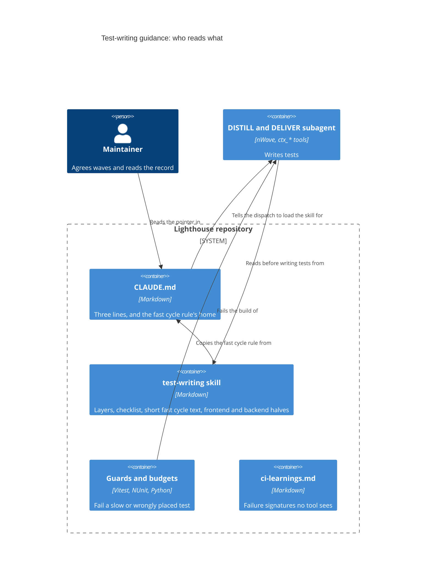

# Feature: story-6538-t11-test-writing-guidance

Story #6538 · T11 Test-writing guidance that the DISTILL and DELIVER agents follow · part of Epic #6506 "Fast, reliable test suites".
Catalogue: [Epic workspace](../epic-6264-modular-monolith/feature-delta.md) ·
Brief: [slice-52](../epic-6264-modular-monolith/slices/slice-52-t11-test-writing-guidance.md).

## Wave: DISCUSS / [REF] Inherited

The brief, settled with the maintainer on 2026-11-07. Its sections "Maintainer decisions", "Test pyramid vision", "Component test audit",
"Fast cycle in DELIVER" and "Change from T5's DEVOPS" override the proposals above them. Waves start at DESIGN.

- Job: infrastructure-only. Size S, two slices of at most a day. Hard dependency: T5 #6469. Soft: T10 #6537, T12 #6539, T9 #6536.
- Settled: the skill holds everything and `CLAUDE.md` keeps three lines. Close on the proxies and note when to read the next feature.
  One trial dispatch on a delivered feature runs. The audit touches no test.
- Pyramid, a direction and not a gate: about 90 % fast, 9.5 % integration, 0.5 % E2E by test count. Time is the hard rule.
- The fast cycle rule is T6's, put into `CLAUDE.md` by step 06-05. The brief says the skill and every DELIVER dispatch carry it.

## Wave: DESIGN / [REF] Scope, mode and context

Application scope, propose mode, maintainer away: each choice takes the recommended option and is recorded; what only the maintainer can
settle is under "Open for the maintainer". Paradigm OOP as the project states. No code, no test and no `CLAUDE.md` is changed by this
wave; the only file written is this one. Nothing was run: this agent has no shell.

Read: slice 52 in full, the T9 delta for shape, T5's convention, slices, "CLAUDE.md bullet" and "What can lie", T6's fast filter and the
roadmap step 06-05, T12's decisions, `docs/ci-learnings.md`, the Quality Gates section of `CLAUDE.md`, and
`.claude/skills/visualization/` for the layout.

**What exists and what a Story still has to build** (checked against the tree on 2026-11-07):

| Named thing | State | Planned by |
|---|---|---|
| `.claude/skills/visualization/SKILL.md` and `references/` | Exists, tracked | |
| `.claude/skills/test-writing/` | **Absent.** Slice A creates it, with `references/` | This Story |
| `vi.useFakeTimers({ shouldAdvanceTime: true })` in frontend tests (three files found, e.g. `ModifyTeamSettings.queryCommit.test.tsx`) | Exists | |
| `pnpm test:fast`, `src/tests/timeBudget/` (reporter, `slowTests.ts`), `actAndSettle.ts`, `inSequence.ts`, `waitPastTheDebounce.ts`, `pastTheAutosaveDelay.ts` | Exist | |
| `FakeLighthouseClock`, `TestToday`, `CapturedLogMessages`, `TestHostPerFixtureGuardTest`, `SharedHostsDrainTheUpdateQueueGuardTest`, `TestTierGuardTest` (edited, uncommitted), `IntegrationFixture` | Exist | |
| `Scripts/test-timings/check_budget.py`, `trx_to_csv.py`, `vitest_to_csv.py`; `ci_frontend.yml` uploads the `test-timings-frontend` artifact | Exist, as before T9 | |
| `nw-skill-reviewer` agent | Exists | |
| `ServicePortHarness`, `WireContractTest`, `Tests/Contracts`, `Tests/Acceptance/<Feature>`, `TestHostUseGuardTest`, T5's `CLAUDE.md` bullet | **Absent** | T5 #6469 |
| `Test-Fast.ps1`, the fast cycle rule in `CLAUDE.md` | **Absent** (`CLAUDE.md` has the `pnpm test:fast` lines only) | T6 #6512, steps 04 and 06-05 |
| Fast-limit ledger, `fast_allowlist`, `check_budget.py --pyramid` | **Absent** | T9 #6536 |
| T10's lessons on rule-versus-wiring | No workspace yet | T10 #6537 |

The skill may name only what exists on the day it is written. A thing in the last four rows goes in as "planned by Story N" or waits.

## Wave: DESIGN / [REF] Project rules, answered

| Rule | Answer |
|---|---|
| Contexts touched (context map) | **None.** No context, concept, edge or event is added. The context map and `ARCHITECTURE.md` section 4 stay as they are |
| New terms | **No domain term.** *Skill*, *fast tier*, *layer* are engineering words and stay out of the glossary |
| Domain events | None published or reacted to |
| RBAC | N/A, because no authorization code changes. The skill's examples may not show a test that re-implements `IRbacAdministrationService` rules |
| Lighthouse-Clients (CLI/MCP) | N/A, because no route, DTO or payload changes |
| Website | N/A, because nothing a user sees changes |
| Usage-data event | N/A, because nobody uses test guidance inside the product |
| UI surface, sketch, loading and failure looks, visualization skill | N/A, because no screen exists. The skill's frontend half carries one example of pinning both looks for a new view, which is test advice and not a screen |
| Terminology | N/A for the product. The skill's examples write `Feature` and `Work Item`, the seeded defaults, never a tracker's word |
| nWave scenario tags in code | None, and the skill says so. The trial's output is read for them |
| Production code | None. **Mutation: N/A.** Only test files and documents change, so Stryker has nothing to mutate; the deliberate-break rule in the skill stands in. The maintainer accepted this on 2026-11-07 for the Epic's chain where only test files change; the acceptance is recorded in the run's marker |
| Ports and adapters | Product hexagon untouched; see the summary |
| ADR | No new ADR: this is a process document, not a technical decision with a product impact. `brief.md` unchanged |
| External integrations | None added, so no contract-test note |
| Improvement backlog check | N/A, because this Story is itself an item of the Continuous Improvement Epic |
| Rigor profile | Not set in DESIGN. DELIVER proposes it per slice (likely `standard`) and passes `model` on every dispatch, see "Which model does what" |

**Quality gates (CLAUDE.md), one line each.**

| Gate | Answer |
|---|---|
| `pnpm test`, `pnpm test:fast` | N/A, because no frontend test or source file changes. The audit reads a Vitest listing only; that run is not a gate |
| `pnpm build`, Biome | N/A, because Biome checks `./src` and nothing in it changes |
| `dotnet build`, `dotnet test` | N/A, because no backend file changes |
| Coverage, local worker cap | N/A, because nothing is measured for coverage. The listing run keeps the default cap |
| SonarQube Cloud | N/A, because no code is added; Markdown is not analysed |
| CI | A docs-only push starts no CI run; none is expected |

**Finalize checklist, per item.** Docs prose: N/A, because the product docs describe the product and none changes; the skill is a developer
file. Per-feature screenshots: N/A, no screen. Demo data: N/A, no data shape changes. Website assets: N/A, because the website hot-links
product docs and images and none of those change. Release notes: none at finalize, they are written at release.

## Wave: DESIGN / [REF] Decisions

| ID | Decision | Why (one line) |
|---|---|---|
| D-6538-1 | **One home: `.claude/skills/test-writing/`.** `SKILL.md` (the layers, the can-it-fail rule, the checklist, the short fast cycle rule), `references/frontend.md`, `references/backend.md` (rules, one example each, the guards' messages). Slice A creates the folder and `references/` | A rule in one place cannot drift. A dispatch reads `SKILL.md` and its own half |
| D-6538-2 | **Files stay short and the checklist comes first.** Each file ends with a line "End of <file>". The dispatch wording tells the agent to read with `ctx_read` in full mode, fresh, and to quote that last line back | A subagent's `ctx_read` can cut a large file to a fraction. A cut that loses the end must be seen, not assumed away |
| D-6538-3 | **Rules cite the measured finding in words, not a Story number.** "A page test that renders a large list cost seconds; the same rule on the function cost milliseconds" | Story numbers archive. A stranger must get the point from the line alone |
| D-6538-4 | **The guards are named with their rule and quoted by message only where the guard exists.** Planned guards are named as planned | A quoted message that no tool reads goes stale; each quote is checked by a grep at DELIVER (below) |
| D-6538-5 | **`CLAUDE.md` gets three lines:** the service-port rule (new acceptance scenarios go to the port), the pointer to the skill, the load instruction. T5's longer bullet is cut to the rule and its body moves into `references/backend.md`. **No Story, slice or ADR number appears in the three lines** | Maintainer's decision. The convention appears once. Numbers archive |
| D-6538-6 | **The fast cycle rule is carried, not left as a pointer.** `CLAUDE.md` stays the rule's home (T6 step 06-05). A **short text** of the rule sits in `SKILL.md`, and the same short text sits in the DELIVER dispatch wording. DELIVER proves by `git grep` that the skill's text and the dispatch wording both contain the rule's distinctive phrases as `CLAUDE.md` words them | The brief says the skill and every DELIVER dispatch carry it. A copy is allowed here because a grep checks it |
| D-6538-7 | **The pyramid goes in once, as a layer rule and a direction:** "a test lands in the lowest layer that can prove it; moving down beats the share; time is the gate". The shares are stated as the direction only. **No dated counts in the skill**; the live ones come from T9's `--pyramid` once it exists | Counts go stale the week after they are written |
| D-6538-8 | **YES, answered by the maintainer 2026-11-08; in slice B:** the "Where to test" bullet in `docs/ci-learnings.md` becomes a one-line pointer to the skill. The brief did not list that file | One home is better, and the maintainer widened the file's scope on 2026-11-08, so slice B makes the bullet the pointer |
| D-6538-9 | **No new guard and no edit to an existing guard or its message.** A gap found while writing the skill goes to the list "Candidates for a tool" below | The brief's OUT list. A guard is its own Story |
| D-6538-10 | **The audit is read-only, sampled by a fixed rule, and its verdict rule is written before the numbers** ("The audit") | A rule fixed afterwards fits the answer |
| D-6538-11 | **Two slices.** A: audit and the frontend half. B: the backend half, `CLAUDE.md`, the trial, the record. Peer review of this design is left to the orchestrator, as T9 and T12 did | See "Slices" |
| D-6538-12 | **The trial prompt is the standard dispatch wording, no hint of the checklist.** The output is read against the checklist by a reviewer, not by the agent that wrote the skill | An agent handed the answer proves nothing |

## Wave: DESIGN / [REF] Where the guidance lives, and what enforces what

**Why one place.** Three homes exist today for parts of this: the ledger (`docs/ci-learnings.md`), T5's `CLAUDE.md` bullet, and the guards'
messages. Each has a different reader. The skill is the only one an agent loads *before* writing a test, so it is the only place that can
prevent the slow shape instead of reporting it. `CLAUDE.md` keeps the hard rule and the pointer, because every dispatch carries it.

**How a dispatch gets it.** nWave subagents have no skill loader, only the `ctx_*` tools. So the dispatch text names the files and says to
read them first. The three `CLAUDE.md` lines make the orchestrator write that sentence into every DISTILL and DELIVER dispatch, and tell
every reviewer that the skill is the standard. Nothing is placed in the nWave package, because a reinstall reverts it.

**What enforces which part.** A tool first; the ledger only where no tool can see it.

| Lesson in the skill | Enforced today by | Planned | Not enforced (convention only), and what to do |
|---|---|---|---|
| Logic on the function, one render per wiring, large lists only when rendering is the test | The frontend per-test limit (reporter, `slowTests.ts`) names a slow test after the fact | T9: a lower limit for files that are not `.test.tsx`; a backend fast limit | Where the logic belongs: no tool can tell |
| No order dependence | Frontend only: the shuffled CI run (T12). **The backend has no order check** | | Backend order dependence: none |
| No `testTimeout` or `retry` as the fix | **Nothing** | | Candidate 1 below |
| Fake clock, no real wait | Backend: `BannedSymbols.txt` bans the ambient clock (its reach into test code is read at DELIVER). Frontend: the time limits catch the cost only | | The skill names `FakeLighthouseClock` (backend) and `vi.useFakeTimers({ shouldAdvanceTime: true })` (frontend). A real wait is a convention; candidate 2 |
| No shared state across fixtures | Backend: `TestHostPerFixtureGuardTest` is the host-per-fixture ratchet only; `SharedHostsDrainTheUpdateQueueGuardTest` covers the update queue | | **Fixture size has no check** in either stack; frontend shared state has the shuffle only |
| Scenario at the port; host test only as a skeleton or in `Contracts` | | T5: `TestHostUseGuardTest` | Convention until T5 lands; named as planned |
| Tier is carried by the base class | `TestTierGuardTest` (T6) | | None |
| A check that cannot fail is not a check | Stryker, per feature, for product code. Ledger rule kept for copy, because StrykerJS does not mutate JSX text | | A test-only change has nothing to mutate: the deliberate break is a convention |
| A new view pins its loading and failure looks | | | **Documented in `CLAUDE.md`, not enforced.** E2E pages waiting for `data-widget-status="ready"` is a convention too |
| A Stryker config must name `Tests.Acceptance.<Feature>` | | | Nothing. Configs are written per feature, under that feature's `mutation/` folder. An unnamed folder shows as uncovered code in the report, late |
| Agents load the skill | | | Nothing. See candidate 3 |

**Candidates for a tool** (not built here, each its own Story; the maintainer picks):

1. A `LEDGER-CHECKS` pattern for `retry:` or `testTimeout:` in the Vitest config and for a real wait in a test file.
2. A Biome or GritQL rule against `await new Promise(... setTimeout ...)` in `*.test.ts(x)`, once the count of existing hits is known.
3. A `PreToolUse` hook that refuses a dispatch to `nw-acceptance-designer` or `nw-software-crafter` whose prompt does not name the skill.

## Wave: DESIGN / [REF] The audit

**Question.** How much of the `.tsx` test layer is really logic, and so could be a `.test.ts` over an extracted function? The answer
decides whether 9.5 % integration can be reached or is only a direction. It touches no test.

**Frame, counted.** Every `*.test.tsx` under `Lighthouse.Frontend/src`. Count on 2026-11-07 by `ctx_glob` with pattern
`<area>/**/*.test.tsx` from `Lighthouse.Frontend/src`, one run per area: **408 files**. A review glob over the whole tree found **410**. The
whole-tree glob output is cut before its count line, so the two are not reconciled here. The record at DELIVER takes the file and test
count from a Vitest listing run and uses that number in the quota below; 408 is used here.

| Group (path under `Lighthouse.Frontend/src`) | Files | Quota | Pick step |
|---|---|---|---|
| `components/Common/Charts` | 37 | 5 | 7.4 |
| `components/Common`, without `Charts` | 125 | 15 | 8.3 |
| `pages/Common/MetricsView` | 31 | 4 | 7.75 |
| `pages/Portfolios` | 54 | 7 | 7.7 |
| `pages/Common/Reports` and `pages/Reports` | 21 + 15 = 36 | 4 | 9 |
| `pages/Settings` | 28 | 3 | 9.3 |
| `pages/Teams` | 45 | 6 | 7.5 |
| the rest: `components/App`, the other `components/*`, `hooks`, `context`, `services`, `tests`, `pages/Common/AdvancedInputs`, `pages/Connections`, `pages/Features`, `pages/Overview` | 52 | 6 | 8.7 |
| **Total** | **408** | **50** | |

**Quota and rounding.** Quota = 50 x group files / total files, rounded half up; the rounded quotas here already add to 50. If a different
count changes that, the largest group takes or gives the difference.

**How the files are picked.** Sort the group's files by path. The i-th pick, for i = 1 to the quota, is the file at position
ceil(i x group files / quota), counting from 1. No random draw, so anyone can redo it. At about 14 tests a file, 50 files are about 715
tests (5,857 `.tsx` tests / 408 files x 50), not 1,000.

**The estimate weights each file by its test count**, because the share is by test and one big file would otherwise count like a small one.

**A second list, kept apart:** the ten files with the most test seconds in the `test-timings-frontend` artifact (the CSV that
`ci_frontend.yml` uploads) of one named, green `main` run. The record names that run. They say where a rewrite pays first and do not enter
the estimate, because they are chosen for being slow.

**What is decided per test.** One word each, by one rule: would the same assertion hold on the return value of a function that needs no
DOM?

- **Logic**: arithmetic, formatting, ordering, filtering, validation, a rule's branches, a state change, building a link.
- **UI**: needs the DOM. Role or name, focus, click wiring, layout, copy in place, a MUI control's behaviour, a view's loading or failure look, routing.
- **Mixed**: one render checks both. Counted apart.

**One example of each**, judged from the test title and to be confirmed on reading, so the rater sees the rule applied:

| Class | Example | Why |
|---|---|---|
| Logic | `ForecastLevel.test.tsx`, "should set the level, IconComponent, and color for probability <= 50" | A probability goes in, a level comes out. No click, no layout |
| UI | `AppErrorBoundary.test.tsx`, "reloads the page when the reload button is pressed" | Needs a rendered button and a click |
| Mixed | `DateRangePresets.test.tsx`, "offers a team every window it was given, in the order it was given them" | The ordering is a rule; it is proved through a render |

**Lookup steps per file (the same five, every file):**

1. List the file's test titles from the Vitest listing.
2. Read the file's imports and its first test to see what is rendered and what is mocked.
3. Find the unit under test, and any pure function or class it uses, in the component's folder and in `src/utils`, by `ctx_search`.
4. Look for a `.test.ts` for that function. One exists: the logic is **E0**. None: judge the extraction.
5. Label each test by the rule, give the file its cost class and call, and write the row.

**What is decided per file** (a row in the record, nothing edited): tests; logic, UI, mixed counts; whether the logic already lives in a
function with its own `.test.ts`; the extraction cost, **E0** the function exists, **E1** a pure function comes out of the component in one
sitting, **E2** it needs a hook or a context change; and the call, *move*, *keep*, or *duplicate of an existing `.test.ts`* (a candidate
to delete, not a move).

**Estimate and verdict rule (written now, before any number).**

- **Statistic.** Each share = logic tests in files of the stated cost classes / all tests in the sample, weighted by test count. **Low** =
  logic tests in E0 files. **Middle** = logic tests in E0 and E1 files, the headline. **High** = logic plus mixed tests in files of every
  class. Low <= Middle <= High by construction. Each has a 95 % interval from resampling files within their group. **Every comparison below
  uses the lower end of the interval**, so a lucky sample cannot declare it reachable. The point and the upper end are reported beside it.
- Also reported: the **seconds** in those tests from the CSV. A share moved is not seconds saved, and time is the hard rule.
- **Needed share N** = the share of `.tsx` tests that must move for the fast tier to reach 90 %. Frontend alone it is about 84 % (4,907 of
  5,857, from the brief's counts). For the whole suite it needs the backend labels from T6, so the record says which N it used.
- **Verdict, exhaustive:**

| Band | Rule | Verdict |
|---|---|---|
| 1 | Low (lower end) >= N | Reachable with the functions that already exist (E0) |
| 2 | Middle (lower end) >= N > Low (lower end) | Reachable with small extractions (E1) |
| 3 | High (lower end) >= N > Middle (lower end) | Needs the E2 work (hooks, context changes) |
| 4 | High (lower end) < N | A direction only; moving logic cannot reach it |

The number goes to the maintainer before any rewrite is planned.

**Which model does what.** The profile is `standard` (DELIVER confirms it with the maintainer). First-rater audit dispatches and the trial
dispatch use the profile's `agent_model`; the second rater, the skill review and the trial reviewer use its `reviewer_model`. `model` is
passed on each dispatch. The values are read from the profile at DELIVER, not written here. If `reviewer_model` equals `agent_model`, the
record says so.

**Cost and check on the audit.** About 715 tests to read: five batches of ten files. A second rater reads the same 10 files blind, the
5th, 10th, 15th and so on of the 50 picks.

- **Agreement** = the share of those tests, about 140, given the same label by both raters (logic, UI or mixed). Cohen's kappa is reported
  beside it and does not gate.
- **At 80 % or more:** the first rater's labels stand.
- **Below 80 %:** list the disagreeing tests, tighten the rule's wording with them as examples, and both raters redo those 10 files; the
  first rater also re-reads, in the other 40 files, every test of a kind that disagreed. One round only. If still below 80 %, report the
  figures to the maintainer and mark the headline "low confidence".

## Wave: DESIGN / [REF] What T11 cannot start until

| Waits for | State on 2026-11-07 | What it blocks |
|---|---|---|
| **T5 #6469** (hard, from the brief) | Not delivered: `ServicePortHarness`, `WireContractTest`, `TestHostUseGuardTest` and the bullet are absent | The backend half, and the cut of T5's bullet. Without it the skill would teach a convention that no guard backs |
| **T6 #6512 step 06-05** | Not done: no `Test-Fast.ps1`, no fast cycle rule in `CLAUDE.md` | The short rule text in `SKILL.md`, the DELIVER dispatch wording (nothing to copy yet) and the backend share in the audit |
| T12 #6539 | Closed or closing | **Soft**: the order-dependence lesson, and the frontend per-test numbers |
| T9 #6536, T10 #6537 | Not delivered | Soft: numbers to cite, the rule-versus-wiring lesson. The skill is written without them and takes a line when they land |
| DEVOPS and DISTILL of this Story | Not run | Waves go in order; nothing is skipped |

Only the backend half, the cut of the bullet and the fast cycle text need T5 or T6. The audit and the frontend half need none of them. **If the maintainer wants
slice A before T5, say so; the default stays the brief's order.** Answered 2026-11-08: slice A starts now, beside T5's DELIVER, provided it touches no file T5 touches.

## Wave: DESIGN / [REF] Slices

| Slice | Days (est.) | Delivers | Needs |
|---|---|---|---|
| A | 1 | The audit and its record; creates `.claude/skills/test-writing/` with `SKILL.md` and `references/frontend.md`; a `nw-skill-reviewer` pass | Nothing hard. T12 is soft. Starts now, beside T5 (2026-11-08), touching no file T5 touches |
| B | 1 | `references/backend.md`; the fast cycle text in `SKILL.md`; the three `CLAUDE.md` lines and the cut of T5's bullet; the trial; the closing record with the deferred check open. the ledger pointer (D-6538-8, yes on 2026-11-08): the "Where to test" bullet in `docs/ci-learnings.md` becomes a one-line pointer to the skill | T5 done; T6 step 06-05 done |

**Proof for each.**

- Every identifier the skill names is found by a search of the tree on the day, listed in the record; a planned one carries "planned by".
- Every quoted guard message is found in the guard's source by the same search.
- The T5 convention text has one home: a search for its distinctive phrase prints `references/backend.md` and `CLAUDE.md`'s one rule line only.
- The fast cycle rule: a search for its distinctive phrases in `CLAUDE.md`, `SKILL.md` and the DELIVER dispatch wording prints all three, and the three agree.
- The three `CLAUDE.md` lines hold no Story, slice or ADR number.
- Each file read as a subagent with `ctx_read` shows its last line.
- The trial: one `nw-acceptance-designer` dispatch on a small delivered feature (candidate: story 6501, ordered parent fields, **not checked for size**),
  with the standard wording and the skill named, writing **scenario text into the Story's workspace only**, not into the test project.
  Read by a reviewer against the checklist; the result, with any deviation, is written down.
- **The deferred check is recorded open:** the next feature's DISTILL writes "skill loaded: yes/no, deviations" in its
  `feature-delta.md`; the maintainer reads it after that DELIVER. T11 closes on that note, as decided.

## Wave: DESIGN / [REF] Reuse Analysis

| Existing | Overlap | Decision | Contract shape, universe |
|---|---|---|---|
| `.claude/skills/visualization/` layout | Skill with `references/` | REUSE the layout | Files only, no effect |
| Ledger "Where to test" bullet | Same how-to | **YES**, maintainer 2026-11-08 (D-6538-8), slice B | Documentation, no effect |
| T5's `CLAUDE.md` bullet | Same convention | MODIFY: cut to the rule, body moves | Documentation, no effect |
| T6's fast cycle rule | The cycle | CARRY a short text in skill and dispatch; home stays `CLAUDE.md`; a search checks the three agree | Documentation, no effect |
| `nw-skill-reviewer` | Skill structure and scope | REUSE | Read-only agent |
| Frontend `test-timings-frontend` CSV, Vitest listing | Counts and seconds for the audit | REUSE, read only | Reads existing files; writes the record only |

Nothing is CREATE NEW beyond the skill itself, which has no existing alternative: the rest are rules of a different reader.

## Wave: DESIGN / [REF] What can lie, and what catches it

| Could be false | Effect if unseen | Caught by |
|---|---|---|
| The skill is read whole | A cut file loses its end, and an agent follows half a rule | Last-line sentinel, quoted back; short files; the trial's agent reports it |
| The skill names what does not exist yet | Agents write against a missing harness | The search list; the "planned by" mark; T5 gates the backend half |
| A quoted guard message changes | The skill teaches a message nobody sees | The search of each quote at DELIVER. Not kept in step later: **not caught**, so quotes stay few |
| The carried fast cycle text drifts from `CLAUDE.md` | Two versions of the rule | The search at DELIVER. Later drift: **not caught**; the next DELIVER's dispatch check is the only reader |
| An agent follows the skill | Slow shapes return | The trial (one run); the guards and T9's limits fail the build on the next feature; the deferred read |
| The trial agrees because it was primed | A false pass | Standard wording only; a reviewer reads the output |
| The orchestrator forgets the load sentence | The skill is never read | The `CLAUDE.md` lines; the deferred "loaded: yes/no"; candidate 3 |
| The audit sample is biased or the call is generous | The pyramid looks reachable and is not | Fixed picking rule, weighting by test, lower interval ends in every comparison, the heavy files kept out of the estimate, a second rater, E-classes so a hard extraction is not counted as cheap |
| A share moved is read as time saved | A rewrite that saves nothing is planned | Seconds reported beside the share |
| The skill and `CLAUDE.md` drift on the convention | The convention exists twice | Cut in the same change; the search proof |
| A Stryker config misses `Tests.Acceptance.<Feature>` | A new scenario looks uncovered | In the backend half; the report shows it |
| "Fast" means a file name | The skill names the wrong tier | Fast is decided by time; the skill says so |

## Wave: DESIGN / [REF] C4



## Wave: DESIGN / [REF] Open for the maintainer

1. **Start of slice A before T5?** (Answered yes, 2026-11-08; points 1, 2, 3 and 4 below are answered in "Maintainer decisions (2026-11-08)".) The audit and the frontend half need nothing from T5. Recommend: keep the brief's order (T5 first); say so if you want the audit earlier.
2. **Candidate tools** (three, above). Recommend 1 and 3 as small Stories after T11; 2 only once the existing hits are counted. Candidate 3 touches your hook settings, which no agent changes unasked.
3. **The ledger pointer (D-6538-8) is pending.** It edits `docs/ci-learnings.md`, which the brief did not list. Recommend yes, to keep one home. It stays out of slice B until you answer; with no answer the bullet stays.
4. **The trial's feature.** Story 6501 is a candidate, not checked. Any small delivered feature with DISTILL scenarios will do.
5. **The audit's verdict** goes to you before any rewrite is planned, as the brief says. Nothing about it can be decided in your absence.
6. **The file count: settled.** `git ls-files 'Lighthouse.Frontend/src/**/*.test.tsx'` gave 410 on 2026-11-07, so the review's glob was right and the per-area count of 408 missed two files. The quotas above use 408; DELIVER takes the Vitest listing, as said, which moves a quota by at most one file. Nothing for the maintainer here.

## Wave: DESIGN / [REF] Review

The review came back NEEDS_REVISION. What changed:

- **Fast cycle (D-6538-6):** the brief says skill and dispatch carry the rule, so both now carry a short text; `CLAUDE.md` stays the home and DELIVER searches that the three agree. Reuse table, slices, risk table and C4 follow. The earlier remark about a user instruction is gone.
- **Verdict rule:** four exhaustive bands, each on the lower end of the 95 % interval of a named statistic (a test-count-weighted share).
- **Audit frame:** recounted by area on 2026-11-07, 408 files (the review's glob said 410, left open). Groups, quotas, rounding and pick step are in a table; the Reports group uses the exact paths `pages/Common/Reports` and `pages/Reports`. Read cost is about 715 tests, not 1,000. The redundant "start at the first" term is dropped.
- **Mutation:** N/A kept: nothing to mutate, the deliberate break standing in, the acceptance noted as recorded in the run's marker.
- **D-6538-8** was answered yes on 2026-11-08 and is in slice B.
- **"Enforced today" table** rebuilt with a "Planned" column and a "not enforced" column: the shuffle is frontend only, timeout and retry are unenforced, `TestHostPerFixtureGuardTest` is the host-per-fixture ratchet only, fixture size has no check, the loading and failure rule is documented and not enforced, and T9's limits and `TestHostUseGuardTest` moved to "planned".
- **Frontend fake** named: `vi.useFakeTimers({ shouldAdvanceTime: true })`, found in three test files, beside `FakeLighthouseClock`.
- **The CSV** is the `test-timings-frontend` artifact of a named green `main` run; the record names it.
- **T12** is soft in both places (slice A and the dependency table).
- **Models:** `agent_model` for the first-rater audit dispatches and the trial; `reviewer_model` for the second rater, the skill review and the trial reviewer; profile `standard`, values read at DELIVER.
- **Medium items:** agreement metric and the below-80 % path; one example per class and five lookup steps; `references/` created in slice A; one line per quality gate; the finalize checklist answered per item; no Story numbers in the `CLAUDE.md` lines.
- **Changed assumption.** Original, slice 52, pyramid vision: "about 90 % fast, 9.5 % integration, 0.5 % E2E ... as upper limits on the two upper layers." New: a direction only, nothing gates it, the shares are reported. Why: the same section says "Direction, not a gate" and "the hard rule stays time".

## Wave: DESIGN / [REF] Architecture summary for the maintainer

**The feature's shape in hexagonal terms.** There is no product hexagon to change. T11 works on the reader side of the tests, the agents
and their instructions.

```
  DRIVING SIDE                      APPLICATION / DOMAIN               DRIVEN SIDE
  (who triggers work)               (production code)                  (trackers, persistence)
  --------------------              ------------------------           ---------------------------
  controllers, routes   unchanged   services, ports   unchanged        trackers, database  unchanged
  hooks, pages          unchanged   domain Models     unchanged        no new external call

  THE TEST SIDE (where T11 works)
  dispatch -> reads CLAUDE.md [MODIFIED: 3 lines] -> loads test-writing skill [NEW]
                                                        |-- frontend half [NEW]
                                                        |-- backend half  [NEW, after T5]
  guards and budgets [unchanged] fail what the skill failed to prevent
  audit record [NEW, read-only] -> number to the maintainer
```

New: the skill (three files), the audit record, the trial record. Modified: `CLAUDE.md` (three lines, T5's bullet cut). The ledger's "Where to
test" bullet is modified in slice B (the maintainer said yes on 2026-11-08). Unchanged: every driving adapter, application service, port, domain Model and driven adapter, every guard, Playwright.
New external call: none.

**Patterns weighed.**

- **Single source of truth:** chosen for the convention. The skill holds how-to, `CLAUDE.md` the pointer. Rejected: repeating T5's full bullet in both (it drifts).
- **A checked copy:** chosen for the fast cycle rule only, because the brief wants it in skill and dispatch. Rejected: a bare pointer (an agent may not follow it) and an unchecked copy (it drifts).
- **Prevent early, detect late as a pair:** chosen. The skill prevents; the guards and T9's limits detect. Rejected: guidance only (nothing fails when ignored) or guards only (a slow test is named after it is written).
- **Functional core, imperative shell, as a test rule:** chosen. Logic on a function is a millisecond test; the render keeps the wiring. Rejected: making every page test cheaper, which keeps the logic hidden in the component.
- **Test the lowest layer that can prove it (pyramid) as a direction:** chosen. Rejected: a share gate, because a share is met by adding trivial tests; time stays the gate.
- **Ratchet with a named list (T9, T4):** reused, not new. Rejected: a count of "tests moved", which hides which test.
- **Dependency inversion for the clock:** chosen, as the guidance to inject a fake clock in both stacks. Rejected: real waits with longer timeouts.
- **Fail-fast probe of the dependency (earned trust):** applied to the skill itself: the last-line check and the trial prove it is read and followed, rather than assuming so.
- **Sampling with a fixed rule and a rule for the verdict set first:** chosen for the audit. Rejected: reading every file (hours, no extra decision) and a random draw (cannot be redone).
- **Domain events, outbox, unit of work, value objects, optimistic concurrency, JSON column against child table:** not applicable, no domain or persistence change.
- **Enforcement by hook on dispatch:** weighed, **not chosen**: it is a new mechanism with false hits, and the deferred read will show if it is needed.

## Wave: DEVOPS / [REF] Platform readiness

Existing platform; nothing is deployed. Written 2026-11-07 with the maintainer away, so each choice takes the recommended option and says why.
**No test ran and no file but this one changed.** Read: this delta, T9's DEVOPS sections for shape, `ci.yml`, `pages.yml`, `ci_changes.yml`,
`ci_frontend.yml`, `.githooks/`, `docs/_config.yml`, `package.json`. Read from GitHub, read-only: the runs of recent `main` pushes, and the artifact
lists of two runs. `environments.yaml` is not written: this wave may edit this file only.

| Topic | Answer |
|---|---|
| Environments | **Local only. Nothing is deployed.** The skill, the three `CLAUDE.md` lines and the two records are files in the repository, read by agents on the maintainer's machine. No CI job judges any of it. The one hosted effect is the documentation site (see the push table) |
| Pipeline | **No `ci*.yml` edit, no new step, no new workflow, no new tool.** T11 adds Markdown and edits Markdown |
| Deployment strategy | None: a trunk push to `main`, one commit per step. Rollback is below |
| Branching | Trunk-based, unchanged |
| Observability | None to add. The only signal is the deferred note: the next feature's DISTILL writes "skill loaded: yes/no, deviations" in its `feature-delta.md`, and the maintainer reads it |
| Mutation | N/A, because only documents change and Stryker has nothing to mutate. The deliberate-break rule in the skill stands in, as in DESIGN. `CLAUDE.md` keeps its strategy line |
| Usage-data event | **N/A, because nobody using the product reads a test-writing skill, so no event could show use.** `UsageDataEventName` and `docs/settings/usagedata.md` are unchanged |
| Peer review | Not run: no new target, framework, stack or security change. The review at the end of DISTILL covers this wave |

## Wave: DEVOPS / [REF] What each push triggers

Read from `ci.yml`, `pages.yml` and `docs/_config.yml`, and checked against real runs on 2026-11-07.

| Path pushed | Build And Deploy Lighthouse (`ci.yml`) | Deploy Documentation (`pages.yml`) |
|---|---|---|
| `.claude/skills/**` | **No run.** Not in the `paths` list | No run |
| `CLAUDE.md` | **No run** | No run |
| `docs/feature/**` (this delta, the audit record, the trial scenarios) | **No run** | **Runs**, about 40 seconds. The site excludes `feature`, so the build leaves it out, but the workflow still starts |
| `docs/ci-learnings.md` (the pointer was approved 2026-11-08) | **No run** | **Runs**, and the page is published |

`ci.yml`'s push `paths` are the backend, backend tests, E2E and frontend folders, `ci*.yml`, `.github/actions`, `.github/scripts`,
`Scripts/test-timings`, `examples/postgres`, `Dockerfile`, `.nvmrc`, `.dockerignore`, `LICENSE` and `NOTICE`. None of T11's paths is in it.
`ci.yml` also has a `pull_request` trigger with no paths filter, but this project pushes to `main` and opens no pull request.

**Confirmed, not assumed.** Commit 71e1d3cea changed only files under `docs/`. Its sha has one run, Deploy Documentation, and no Build And Deploy
Lighthouse run. The docs-titled commits that do show a Build And Deploy run are explained by the push: a push is judged on all its commits, and
those pushes also carried backend test files, so the docs commit was only the head. **So the one rule for each T11 push:** list the unpushed range
first (`git diff --name-only origin/main..HEAD`) and read it. Any file outside `docs/`, `.claude/` and `CLAUDE.md` is another session's code and
would start the full tail. If it is there, say so to the maintainer and do not push. Today the working tree holds an uncommitted edit of
`TestTierGuardTest.cs` that is not T11's.

**Hooks.** The commit hook scans staged files for secrets with `gitleaks`, so the skill's examples must hold no token-shaped string. The push hook
scans with the `sonar` CLI and skips itself when the CLI is absent. Neither is a CI step. Sonar's analysis excludes `.claude/**` and `docs/**`.

## Wave: DEVOPS / [REF] What needs a run, and what the checks run as

**Nothing needs a CI run or a test run.** No gate in `CLAUDE.md` applies, as DESIGN answered line by line. The proofs listed under DESIGN "Slices" are
**by-hand searches at DELIVER**, run once per slice and written into the record with their output. They are not a ledger rule and not a tool.

| Check | Runs as | Why not more |
|---|---|---|
| "End of <file>" on each file, read as a subagent would | By hand: a `ctx_read` of each file in full mode, fresh, and the last line quoted into the record. The trial agent reports it too | One reading per file; a tool would check a line that a human must also see in a subagent's cut output |
| Fast cycle rule: skill, dispatch wording and `CLAUDE.md` agree | By hand: `git grep` of the rule's distinctive phrases in `CLAUDE.md` and `SKILL.md`, output pasted, and the dispatch wording compared against the same phrases | The dispatch wording is text the orchestrator writes, not a file, so no tool can read it. A ledger rule would claim a check nobody runs |
| Every named identifier and every quoted guard message exists | By hand: `git grep` of each, list in the record, "planned by" marks left as they are | A quote is stale the day its guard changes, and a later check is not kept (DESIGN says so) |
| Convention has one home; no Story, slice or ADR number in the three lines | By hand: one `git grep` for the T5 phrase, one for the number patterns in `CLAUDE.md` | One-off at the cut |

**The drift after DELIVER is not caught**, as DESIGN says: the next DELIVER's dispatch check and the deferred read are the only readers. If the
maintainer wants it caught, that is DESIGN's candidate 3, its own Story.

## Wave: DEVOPS / [REF] The audit, local and read-only

Runs in `Lighthouse.Frontend` on Linux. It writes nothing but the record, edits no test and needs no Docker, no backend and no database.

| Input | How it is read | What the record keeps so it can be redone |
|---|---|---|
| The file population and counts | `git ls-files` for the `.test.tsx` files, and Vitest's listing command for the titles. The listing runs no test; DELIVER confirms its flags on the day | The commit it ran at; the counts per group; the sorted list of each group; the picked files, in pick order |
| Seconds per test | The `test-timings-frontend` artifact of one green `main` run, downloaded read-only with `gh`. Run 42372930241 holds it and does not expire until 2027-02-05 (checked today). DELIVER may pick a newer one and names it | The run id; the ten slowest files with their seconds, pasted, because the artifact expires after 90 days |
| Labels | Two raters per DESIGN's rule and five lookup steps | One row per file: tests, logic, UI and mixed counts, extraction class, call. The second rater's labels for its files. The agreement figure and, if used, the list of disagreeing tests |
| The estimate | Computed from the rows; resampling within groups | The seed or the resampled intervals as printed, the statistic named, the N used and where it came from |
| The models | Read from the profile at DELIVER | The `agent_model` and `reviewer_model` used, and a line saying so if they are the same |

A stranger with the commit, the pick list and the labelled rows can recompute every share. The CSV is the one input that expires, so its figures are
pasted. The audit needs no `LIGHTHOUSE_TEST_WORKERS` setting: listing is light. Runs elsewhere in the checkout (T6, T9) are not disturbed by it.

## Wave: DEVOPS / [REF] Rollback

Every step is a `git revert` and a plain push: no `ci*.yml`, no data, no product file, nothing a user sees. A docs revert starts Deploy Documentation
again and nothing else.

| Step | How | Constraint |
|---|---|---|
| Slice A, the audit record | Revert the commit. Nothing reads it | None |
| Slice A, the skill and `references/frontend.md` | Revert the commit | **Not while the three `CLAUDE.md` lines are in.** They point at the skill, so revert slice B's `CLAUDE.md` commit first |
| Slice B, `references/backend.md` and the fast cycle text | Revert the commit | If `CLAUDE.md`'s lines are still in, they point at a skill without a backend half; revert them in the same push |
| Slice B, the three `CLAUDE.md` lines and the cut of T5's bullet | Revert the commit: T5's bullet comes back whole, so the convention then also stands in the skill's backend half until that is reverted. State that in the revert message | Revert before the skill folder, never after |
| The dispatch wording | Not a file. The orchestrator stops writing it, and the next dispatch is without it | |
| The trial and record | Revert the docs commit | None |

A wrong rule in the skill needs no revert: it is a one-line edit of a Markdown file, with the same searches re-run.

## Wave: DEVOPS / [REF] Decisions

| ID | Decision | Why (one line) |
|---|---|---|
| D-6538-13 | No `ci*.yml` edit, no new step, no tool, no new workflow | Markdown has no build; each addition would be code to maintain for text |
| D-6538-14 | The "End of <file>" and fast-cycle agreement checks are **by-hand searches at DELIVER, output pasted in the record**. No ledger rule, no tool | The dispatch wording is not a file, so no tool reads all three; a ledger rule would promise a check nobody runs |
| D-6538-15 | Before each push, read the unpushed range; push only if it holds nothing outside `docs/`, `.claude/` and `CLAUDE.md` | A push is judged on all its commits. A stray code commit would start the whole tail for a docs change |
| D-6538-16 | Usage-data event: **N/A, because nobody using the product reads test guidance** | Nothing in the product changes |
| D-6538-17 | The audit's record keeps the commit, the pick list, the labelled rows and the pasted top ten seconds | The artifact expires; the record must stand without it |
| D-6538-18 | Rollback per commit; the `CLAUDE.md` commit goes before the skill's | The lines point at the skill |
| D-6538-19 | Environments: local only | Nothing is deployed |

## Wave: DEVOPS / [REF] Changed assumptions

| Was | Is | Why |
|---|---|---|
| DESIGN, quality gates: "A docs-only push starts no CI run; none is expected" | **Holds for the build and test workflow.** A push of `docs/**` does start Deploy Documentation, about 40 seconds, which publishes the site | `pages.yml` triggers on `docs/**`. It cannot fail on `docs/feature/**`, which the site excludes |
| The stored note that a docs-only push starts no run | Too wide: it holds for Build And Deploy Lighthouse only, and its path list is longer than the note says | Read from `ci.yml` today |

## Wave: DEVOPS / [REF] For the maintainer

Nothing new needs you here. DESIGN's list was answered on 2026-11-08 (see "Maintainer decisions (2026-11-08)"); what follows is the list as it stood: the ledger pointer, the order of slice A against T5, the three tool
candidates, the trial's feature, and the audit's verdict when it exists. One thing to know: a `docs/**` push redeploys the documentation site
whether or not any page changed.

## Wave: DEVOPS / [REF] Open for DISTILL and DELIVER

- DISTILL: the proofs under DESIGN "Slices" become the scenarios, each written as the by-hand search above. No tags in them.
- DELIVER: run the push check of D-6538-15 before each push; paste each search's output; name the CSV run; read the profile's models.
- The Vitest listing command's flags are confirmed on the day, because this wave ran nothing.

## Wave: DISTILL / [REF] Scope, reconciliation and baseline (2026-11-07, maintainer away)

AFK: each choice takes the recommended option and says why. Written as a specification only.

- **Shape.** T11 delivers a skill, three `CLAUDE.md` lines and two records. There is no test code to scaffold, so this wave writes no test file, no production file, no scaffold, no Tier B, no domain-types module and no state-delta port. The only file changed is this one. A scenario here is a Given-When-Then that a person can check by a search, by reading a record, or by a run, and each one says how it fails.
- **No nWave scenario tag goes anywhere,** not in these scenarios, not in the skill, not in the trial's output. An untagged scenario is correct here. The classification lives in the plain `Kind` column: `H` happy path, `B` boundary, `E` the check fires on a planted fault or refuses.
- **UI sketches: N/A,** because nothing a user of the product sees changes. Loading and failure looks: N/A, no screen. The skill's one example of a new view pinning both looks is test advice, and a scenario reads that it is there.
- **Language and policy.** Markdown and shell searches. Deliverable type: skill, so the reviewer is `nw-skill-reviewer`. Journey, KPI contract: none. Infrastructure policy read as inherited; no port is added. Outcome registry: not run, since no typed contract is introduced.
- **No test, build or search ran in this wave.** Every "then" below is a rule for reading what DELIVER runs, not a result.
- **Contract shape.** One row is bounded-change: the changed-path ranges (C-5), whose universe is the list of changed paths. Everything else is a pure check of text.

**Reconciliation: 0 hard contradictions** across DISCUSS, DESIGN and DEVOPS. Soft points:

| Point | Resolved |
|---|---|
| DESIGN "Slices" says slice A needs "nothing hard"; the brief says T5 is a hard dependency | DESIGN's open point 1 keeps the brief's order. B-1 gates slice B |
| DESIGN says a docs-only push starts no CI run; DEVOPS found Deploy Documentation starts for `docs/**` | DEVOPS's changed assumption stands. C-5 holds the push check |
| File count 408 (DESIGN) against 410 (`git ls-files`, DESIGN's own open point 6) | 410 is the count. Quotas are recomputed from it, and the listing is compared against it (A-1) |

## Wave: DISTILL / [REF] Decisions

| ID | Decision | Why (one line) |
|---|---|---|
| D-6538-20 | **Each scenario names its proof kind:** search, read, listing or run. A search prints its output into the record; a read quotes a line | A claim with no kept output cannot be checked later |
| D-6538-21 | **Every scenario names how it can fail. Where a check could pass by luck, a planted fault is run once:** a read cut short for the last-line check, a known-missing name for a names search, a known-present pattern for a search that must print nothing | A check never seen failing may be one that cannot fail |
| D-6538-22 | **The trial's wording is frozen here** and pasted unchanged in the record. The one sentence that is the project's own, the no-tags sentence, is named and exempt from the "no hint" check | A wording changed after the result fits the result |
| D-6538-23 | **The audit's band wording is fixed here,** before any number | Same reason as the verdict rule in DESIGN |
| D-6538-24 | **The trial reviewer is never the agent that wrote the skill or ran the trial,** and runs on the profile's `reviewer_model` | A writer reading its own output finds what it expects |
| D-6538-25 | **A deviation found by the trial changes the skill only by a separate edit,** after which the searches of the changed slice run again | A silent fix would leave the record saying the skill was followed as written |
| D-6538-26 | **A guard's message is quoted only from committed source. If the file differs from `HEAD`, the work stops.** No wait, no quoting of the working tree | `TestTierGuardTest.cs` is edited and uncommitted in this checkout today, and a quote from it can go stale in the next commit |
| D-6538-27 | **A planned name carries a role and never a number:** "planned: the per-tier report". The number search stays strict and has no exceptions | An exception in the search would let a number in |
| D-6538-28 | **One stop form.** A dated STOPPED block (see "Stop rules"). No other way of reporting a stop | The orchestrator reads one shape and takes it to the maintainer |
| D-6538-29 | **No control trial for the tags.** The trial does not measure the tag rule, and B-11 records that | The wording carries the project's sentence, so a clean result says nothing about the skill |

## Wave: DISTILL / [REF] The trial, as worded

The standard DISTILL wording as the three `CLAUDE.md` lines will make the orchestrator write it. Only the angle-bracket parts change. **The last sentence is the project's own no-tags sentence** and is the only part of the wording exempt from the "no hint of the checklist" check (B-9). The checklist is not in the wording.

```
You are the acceptance designer for <feature>, a feature that is already delivered. Its stories are in <feature workspace>/discuss/.
First read, with ctx_read in full mode and fresh=true, .claude/skills/test-writing/SKILL.md and the file in
.claude/skills/test-writing/references/ for your half (frontend.md or backend.md). Each file ends with a line "End of <file>".
Quote that last line back in your report, one per file. If you did not see it, say so and read the file again in pages.
Then write the acceptance scenarios for <feature> into <scratch workspace>/ and nowhere else. Write no test file and no production file.
Report: the files you read with their last lines, the scenarios you wrote, and any rule of the skill you did not follow and why.
No nWave scenario tags (@us-, @slice-, @kpi-, @contract-shape and the like) in anything you write.
```

Fixed for the trial: the feature (small, delivered, with DISTILL scenarios; story 6501 is the candidate, its size not checked, B-7), the scratch workspace (`docs/feature/story-6538-t11-test-writing-guidance/trial/`), the model (`agent_model`) and the reviewer (a different dispatch, `reviewer_model`).

## Wave: DISTILL / [REF] Scenarios

**Kinds:** `H` happy path, `B` boundary, `E` the check fires on a planted fault or refuses. **Proof kinds:** search, read, listing, run. A run is a Vitest listing or a `gh` download; no test is executed. Rows marked C run at the end of each slice, over what that slice changed.

### Slice A: the audit and the frontend half

| # | Scenario | Given / When / Then | Proof and output kept | Can fail when | Kind |
|---|---|---|---|---|---|
| A-1 | The population is counted and compared with the file list | Given the commit the audit runs at. When the test files are listed by `git ls-files` (410 on 2026-11-07) and the tests by Vitest's listing. Then the record holds the commit, the file count per group and quotas recomputed from 410 that add to 50, and any difference between the listing and `git ls-files` is named file by file. **Any difference left unexplained stops the audit** | Listing and `git ls-files`, both pasted with counts | The counts differ and no file is named, quotas add to 49 or 51, or labelling starts with an open difference | E |
| A-2 | The picks can be redone from the rule | Given a group sorted by path. When the i-th pick is taken at position ceil(i x files / quota). Then anyone gets the same files; for `pages/Settings` (28 files, quota 3) the positions are 10, 19 and 28 | Search: the smallest and largest group redone by hand, pasted beside the record's lists | A redone list differs, or the last pick is not the last file | B |
| A-3 | Every sampled file has a row and the rows add up | Given the 50 picks. When the rows are written. Then each file has tests, logic, UI and mixed counts, an extraction class and a call, the test counts add to the sample's total, and the record says the call is a label for the reader and plans nothing | Read: the table with its sum line and the sentence | A file has no row or call, the sum is off by one, or the sentence is absent | H |
| A-4 | Agreement decides whether the first rater's labels stand | Given a second rater read the same 10 files blind. When agreement is the unrounded share of tests given the same label. Then **80 % means the share is at least 0.80**: 0.80 stands with no redo and kappa is reported beside it, not gating; 0.7996 does not stand even though it prints as 80.0. Below 0.80, disagreeing tests are listed, the rule's wording is tightened with them, both raters redo those files, and a second result below 0.80 marks the headline "low confidence". One round only | Read: the share as a fraction, before and after, the list, the wording change | A redo at 0.80, no redo at 0.7996, a second round, or an unmarked headline after a second miss | B |
| A-5 | The verdict comes from the lower interval end by the bands written in design | Given Low, Middle and High, each with its interval, and N with its source. When the band is chosen. Then the lower end of the interval is compared. The interval is a percentile bootstrap: files resampled within their group, **10,000 resamples, seed 6538**, the 2.5th and 97.5th percentiles; count and seed are printed | Read: the statistic table and the method line. Search: `git diff` of the verdict rule's text against the DESIGN commit (3ad54cfa0) prints nothing | The point or the upper end picks the band, N has no source, the method line is missing, or the diff is not empty | E |
| A-6 | The heaviest files come from a named green `main` run and stay out of the estimate | Given the `test-timings-frontend` file of one green run. When the ten files with the most seconds are listed. Then the run id and ten rows with seconds are pasted and none enters the estimate unless the pick rule chose it. If the file has expired, another green run is named, and if none exists the seconds line reads "unavailable" and the headline stands on the shares | Run: the `gh` download or listing, pasted | The run id is missing, a failed run's file is used, or seconds are dropped with no mention | E |
| A-7 | The verdict reaches the maintainer before any rewrite is planned | Given the finished audit. When slice A closes. Then the record ends with the verdict block below, and no roadmap changed by this slice holds a step to rewrite or move a test | Search: the roadmap files in the slice's changed paths for "rewrite" and "move", pasted; read: the block is last | A changed roadmap holds such a step, or the block is not the last thing in the record | E |
| A-8 | The skill folder has its files and the checklist comes first | Given slice A done. When the folder is listed. Then `SKILL.md` and `references/frontend.md` exist and the checklist is the first section of `SKILL.md` | Search: listing; read: the first heading | A file is missing, or the checklist is below the rules | H |
| A-9 | Each frontend rule has a title, a measured finding in words and one example | Given `references/frontend.md`. When the rules named below are read. Then each has all three, and the three counts (titles, findings, examples) are equal | Read: the table below filled with the line of each | A rule is missing, has no finding or no example, or two rules share one example | H |
| A-10 | The deliberate break is in `SKILL.md` for both halves | Given `SKILL.md`. When it is read. Then "a check that cannot fail is not a check" has a title, a finding and an example: delete the production line and the test must go red; a test-only change has nothing to mutate, so the break is the proof | Read: the three lines quoted | The rule has no example, or says the break is optional | H |
| A-11 | The pyramid is a direction and a layer rule, with no dated count | Given the skill. When it is read. Then the shares appear once as a direction, "lowest layer that can prove it; time is the gate" appears, and no share is written as a gating limit. The counts are searched in C-4 | Read, quoted | A share is written as a limit that gates | E |

Rules A-9 reads, each with title, finding in words and example (the finding is a sentence, never a Story number):

| Rule | What the example shows |
|---|---|
| Logic on the function, not through a render | A rule asserted on a function, with the render kept for wiring |
| One render per wiring | Several checks sharing one render |
| Small fixtures | A short list where a long one is not the test |
| Fake clock, no real wait | `vi.useFakeTimers({ shouldAdvanceTime: true })`, never a sleep |
| No `testTimeout` or retry as the fix | A slow test made fast, not allowed more time |
| No order dependence | A test that passes alone and in a shuffled run |
| A new view pins its loading look and its failure look | Both looks, a failed load never shown as "no data", E2E waiting for `data-widget-status="ready"` |

### Checks at the end of each slice (rows C)

| # | Scenario | Given / When / Then | Proof and output kept | Can fail when | Kind |
|---|---|---|---|---|---|
| C-1 | Each file ends with its last line when read as a subagent would, after every edit | Given a file ending "End of <file>". When it is read with `ctx_read`, full mode, fresh. Then the last line is quoted. A read cut to a window shows no such line. Run after slice A for `SKILL.md` and `frontend.md`, after slice B for `SKILL.md` and `backend.md` | Read: a quote per file, and one deliberately short read pasted without the line | The line is absent in a full read (shorten the file and read again), or the cut read still seems to show it | E |
| C-2 | Every name the skill gives exists, or is marked planned with a role | Given the skill names identifiers, scripts, folders and tools. When each is searched for in the tree. Then each is found, or its line reads "planned: <role>" such as "planned: the per-tier report", never a number. After slice B the four T5 names (`ServicePortHarness`, `WireContractTest`, `TestHostUseGuardTest`, `Test-Fast.ps1`) carry no planned mark | Search: name, hits, and the marked ones; one known-missing name run to show an empty result | A name has no hit and no mark, a mark carries a number, or a T5 name is still marked | E |
| C-3 | Every quoted guard message is found in the guard it is attributed to | Given a message quoted in the skill, frontend (the per-test limit) or backend (`TestHostPerFixtureGuardTest`, `TestTierGuardTest`, `TestHostUseGuardTest`). When it is searched for in that guard's source at `HEAD`. Then it is found there. If the file differs from `HEAD`, the work stops | Search with `git grep` at `HEAD`, and `git diff --stat HEAD -- <file>` printing nothing | No hit, a hit in another guard, or the file differs from `HEAD` | E |
| C-4 | One search, three pattern lists, finds nothing | Given the skill's folder and, after slice B, the three `CLAUDE.md` lines. When searched for list 1, references: `#` and four digits, `Story`, `slice`, `ADR-`, task names such as `FE7`, `T5`; list 2, scenario tags: `@us-`, `@slice-`, `@kpi-`, `@contract-shape`, `@walking_skeleton`, `@driving_port`, `@real-io`, `@BUG-`; list 3, dated counts: 3,648; 5,857; 9,505; 22,600. Then nothing prints for any list. The skill says "no nWave scenario tags" in words | Search, with each list run once on a file known to hold one of its items (D-6538-21); the rule's own wording is not in the lists | Any hit, including inside an example | E |
| C-5 | Each range changes only the paths it may | Given the range. When `git diff --name-only` over it is read. Then it matches the row of the table below | Search: the diff and `git status --short`, pasted | A path outside the allowed set. At the push, another session's code in the range: do not push | E |
| C-6 | The examples hold nothing token-shaped | Given the examples. When the commit's secret scan runs. Then it passes with no bypass | Run: the hook's own result | The hook rejects: remove the string, never bypass it | E |
| C-7 | The skill review leaves no open critical point | Given `nw-skill-reviewer` on `reviewer_model`, told an untagged example is correct here. When it reviews the skill after each slice. Then no critical point is open after at most two rounds | Read: the verdict per round | A critical point stays open after round two: stop | E |

Ranges for C-5:

| Range | Allowed paths | Must not appear |
|---|---|---|
| The audit's commits (slice A) | `docs/feature/story-6538-t11-test-writing-guidance/` only | Anything under `Lighthouse.Frontend`, `Lighthouse.Backend`, `Lighthouse.EndToEndTests` |
| Slice A's commits | The above (the audit record is `docs/feature/story-6538-t11-test-writing-guidance/audit/frontend-audit.md`), `.claude/skills/test-writing/` | Any guard test, budget file, script under `Scripts/test-timings`, workflow, `docs/ci-learnings.md` |
| Slice B's commits | Slice A's, `CLAUDE.md`, `docs/ci-learnings.md` (the "Where to test" bullet only, answered yes 2026-11-08) | The same list as slice A's, minus those three paths |
| The trial | `docs/feature/story-6538-t11-test-writing-guidance/trial/` | Any test project or other workspace |
| The unpushed range | Under `docs/`, under `.claude/`, or `CLAUDE.md` | Anything else |

### Slice B: the backend half, `CLAUDE.md`, the trial and the record

| # | Scenario | Given / When / Then | Proof and output kept | Can fail when | Kind |
|---|---|---|---|---|---|
| B-1 | Slice B does not start until T5 and the fast cycle rule are on `main` | Given the working tree. When the four T5 names and the fast cycle rule in `CLAUDE.md` are searched for. Then each is found | Search, each name with its hit | A name has no hit: STOPPED, nothing is written for the backend half | E |
| B-2 | Each backend rule has a title, a measured finding in words and one example | Given `references/backend.md`. When the rules below are read. Then each has all three | Read: the table below filled with the line of each | A rule or its example is missing | H |
| B-3 | The T5 convention has one home | Given the distinctive phrase of T5's bullet, copied before it is cut and pasted first into the record. When the tree is searched for it. Then the hits are `references/backend.md` and the one rule line of `CLAUDE.md` | Search, with the phrase | A third file holds it, or `CLAUDE.md` keeps the long body | E |
| B-4 | `CLAUDE.md` gets three lines, in the right place, and T5's bullet is cut to the rule | Given `CLAUDE.md` before and after. When the diff is read. Then three lines are added: the service-port rule, the pointer, the load instruction; the load line sits in the Wave section and names DISTILL, DELIVER and reviewers; T5's bullet is the rule line | Search: `git diff` of `CLAUDE.md`; read: the section | A fourth line, the load line outside the Wave section, a missing name among the three, or the bullet left whole | B |
| B-5 | The DELIVER dispatch wording is written down with the fast cycle rule | Given the rule as `CLAUDE.md` words it. When the wording is written into the record section `## Wave: DELIVER / [REF] Dispatch wording` of this delta. Then it names the skill and the read instruction, and carries the fast cycle rule's distinctive phrases | Read: the section, pasted into the closing record | The section is absent, or lacks a phrase | H |
| B-6 | The fast cycle rule reads the same in three places, with its clause | Given the rule's distinctive phrases, chosen from `CLAUDE.md` and pasted first. When `CLAUDE.md`, `SKILL.md` and the B-5 section are searched for each. Then all three hold every phrase, including the clause that a step whose behaviour lives in a `.test.tsx` or an integration test also runs its own named test | Search, pasted, each phrase marked in each place | A phrase, or the clause, is missing from any one of the three | E |
| B-7 | The trial's feature is small and has scenarios to compare | Given the candidate. When its workspace is read. Then it has a DISTILL section and not more than about 20 scenarios; the count is written | Read, with the count | Larger, or no DISTILL: take the next; if none fits, STOPPED | B |
| B-8 | The checklist's minimum items are fixed before the trial runs | Given the skill's checklist. When its items are written into `## Wave: DELIVER / [REF] Skill checklist, minimum items` and committed. Then it holds at least one item for each rule of A-9, A-10 and B-2, the load-and-quote item and the fast cycle item | Read: each rule with its item. Search: `git log` shows this commit before the trial's output | A rule has no item, or the trial's output is older than the list | E |
| B-9 | The trial wording is the frozen one and gives no hint of the checklist | Given the wording pasted in the record. When it is read against the B-8 items. Then it equals "The trial, as worded" with only angle-bracket parts filled, and no item's phrase appears in it, **except the project's no-tags sentence, which is named and exempt** | Read: the wording, each item struck off | A changed wording, or a non-exempt item phrase in it | E |
| B-10 | The trial agent quotes the last line of each file it read | Given the report. When it is read. Then it quotes "End of SKILL.md" and the half's last line | Read | A line is missing: the trial is void; shorten the file and run once more | E |
| B-11 | A reviewer reads the output against the checklist item by item | Given a reviewer that wrote neither the skill nor the trial, on `reviewer_model`. When it reads the output and the trial writes only in the trial folder (C-5). Then each item is marked followed, not followed or not applicable, with a quoted line. **The tag item is recorded as not measured by the trial** | Read: the reviewer's table | An item has no mark or quote, the reviewer is the writer, or the tag item is marked followed | H |
| B-12 | A deviation is recorded, not fixed silently | Given an item not followed. When the record is written. Then the deviation is listed with the output's line, and any change to the skill is a separate edit after which C-1 to C-4 run again | Read: the list; search: the re-run outputs | The skill changes with no re-run | E |
| B-13 | The deferred check is recorded open, with where and who reads it | Given the closing record. When read. Then it says: the next feature's DISTILL writes "skill loaded: yes/no, deviations" in its `feature-delta.md`, the maintainer reads it after that DELIVER, status open | Read | Status reads passed or done, or no place or reader is named | E |

Rules B-2 reads, each with title, finding in words and example:

| Rule | What the example shows |
|---|---|
| New acceptance scenario goes to the service port | A scenario through the port harness |
| A host test only as a named skeleton or in `Contracts` | One skeleton test named as such |
| The rule by a unit test, the wiring by one host test | The same rule at both levels, one host test |
| No shared state across fixtures | A fixture that builds its own state |
| Fake clock, no real wait | `FakeLighthouseClock`, never the ambient clock |
| A feature's mutation config names `Tests.Acceptance.<Feature>`, with the reason | The folder is outside the integration filter, so unnamed code shows as uncovered |

## Wave: DISTILL / [REF] The audit verdict going to the maintainer

Closes slice A's record. It is the only thing the audit decides.

| Field | Content |
|---|---|
| Commit, file and test counts | From A-1, with any difference named |
| N used and where it came from | Frontend alone is about 84 %; the whole suite only once T6 has labelled the backend |
| Low, Middle, High | Point, lower end, upper end, weighted by test count; the method line of A-5 |
| Seconds | In the logic tests, from the named run (A-6), beside each share |
| Agreement and confidence | From A-4 |
| Band and verdict | One of the four below |
| What the maintainer decides | Whether to plan any rewrite |

| Band | Wording sent to the maintainer |
|---|---|
| 1 | "The logic tests could move to existing functions. Whether moving them pays is for you to decide; time is the rule." |
| 2 | "Small extractions would move the logic. The files are listed." |
| 3 | "Hook or context changes are needed before any move. That is design work." |
| 4 | "Moving logic cannot reach 90 %. Keep the shares as a direction and let time stay the rule." |

A "low confidence" mark from A-4 is printed above the band. No rewrite is planned in this Story under any band.

## Wave: DISTILL / [REF] Stop rules

One form. The record gets a block, and the orchestrator reads it and takes it to the maintainer:

```
STOPPED <date>, row <id>
Evidence: <the output, pasted>
Last completed row: <id>
```

| Stop when | The check that decides | Instead of |
|---|---|---|
| T5 or the fast cycle rule is not on `main` (B-1) | The B-1 search has an empty hit | Writing the backend half, the cut of T5's bullet, or the fast cycle text |
| The listing and `git ls-files` differ and the difference is not named file by file (A-1) | The A-1 comparison | Labelling, or running tests for a count |
| Agreement is below 0.80 after the one round (A-4) | The unrounded share after the redo | A second round; mark "low confidence" and go on |
| The verdict rule was edited after a number was seen (A-5) | `git diff 3ad54cfa0 -- docs/feature/story-6538-t11-test-writing-guidance/feature-delta.md` over the rule's text is not empty, and for the band wording the same diff against this wave's commit | Using the edited rule |
| The same row's check fails a **second** time, meaning the same row, the same pattern, after one fix of the text | The row's own search, run again | Editing the search |
| A quoted guard's file differs from `HEAD` (C-3) | `git diff --stat HEAD -- <file>` is not empty | Quoting it, or waiting |
| The commit hook rejects a file (C-6) | The hook's exit | Bypassing it |
| The skill review has a critical point open after round two (C-7) | The reviewer's second verdict | A third round |
| The trial agent did not see a last line (B-10) | The report lacks the quote | Reading its result. One rerun is allowed after shortening; a second miss is a stop |
| No trial feature fits (B-7) | The scenario count | Using a large one |
| The unpushed range holds a path outside the allowed set (C-5) | The range diff | Pushing |
| A gap in a guard or a budget is found while writing | Reading it | Editing the guard; it goes on the candidate list, and the work goes on |
| The ledger pointer: answered yes 2026-11-08, so this row no longer stops anything. The edit is limited to the "Where to test" bullet | `git diff` of `docs/ci-learnings.md` shows only that bullet | Editing any other line of the file |

## Wave: DISTILL / [REF] Coverage

| Slice | Scenarios | `H` | `B` | `E` |
|---|---|---|---|---|
| A | 11 | 5 | 2 | 4 |
| C (end of each slice) | 7 | 0 | 0 | 7 |
| B | 13 | 3 | 2 | 8 |
| **All** | **31** | **8** | **4** | **19** |

No share is given for errors: seven of the 31 rows are checks whose whole job is to fail on a planted fault, and a percentage over them would say nothing.

| Source | Covered by |
|---|---|
| Brief: the skill has both parts and a checklist; a reviewer pass leaves no open critical point | A-8, A-9, A-10, B-2, B-8, C-1, C-7 |
| Brief: `CLAUDE.md` names the skill and the load instruction, and the convention appears once | B-3, B-4, C-4 |
| Brief: the trial is read against the checklist and written down; the deferred check is recorded open | B-7 to B-13 |
| Brief: the audit's number to the maintainer before any rewrite | A-1 to A-7 and the verdict block |
| Brief: the fast cycle rule in the skill and every DELIVER dispatch | B-5, B-6 |
| Brief: the pyramid as a direction, time the hard rule | A-11 |
| Brief: rules per half, including the deliberate break | A-9, A-10, B-2 |
| DESIGN "what can lie" rows | C-1 (cut file), C-2 (missing names), C-3 (changed quotes), B-6 (drift), B-9 and B-11 (primed trial), B-13 (forgotten load), A-1 to A-6 (biased sample, seconds), B-2 (Stryker config) |
| DESIGN: no new guard; ledger pointer answered yes | C-5 |
| DEVOPS: by-hand searches with pasted output; push check; secret scan; expiring CSV | Every search row, C-5, C-6, A-6 |

**Driving ports.** The reader of the skill is a subagent with `ctx_read`: C-1, B-10. The orchestrator's dispatch: B-5, B-9. The maintainer's read of the record: A-7, B-13. Beyond files, `git`, `gh` and Vitest's listing, all read-only, there is no adapter with real I/O.

**Mandates, for this shape.** No state-delta port, property tests or step layer: there is no test code. Pillar 2: rows build on each other, with C-1 to C-4 reused by both slices and B-12 re-running them. Pillar 3: every proof reads the real tree.

## Wave: DISTILL / [REF] Completeness audit

| Item | Result |
|---|---|
| C1a empty or zero | Pass: A-6 (no file), C-4 |
| C1b each boundary | Pass: A-2, A-4, B-4, B-7 |
| C2a state machine documented | N/A, counted as passing: the only state is the deferred check, open or done (B-13) |
| C2b illegal event per state | Pass: B-13 refuses "passed" |
| C3 zero, one, many | Pass: A-2, B-4, B-7 |
| C4a apply twice | Pass: B-12 re-runs the searches after an edit |
| C4b inverse without prerequisite | Pass: B-1; rollback order is DEVOPS's |
| C5a mode combinations | N/A, counted as passing: no flags |
| C5b flag orthogonality | N/A, counted as passing: no flags |
| C6a malformed input | Pass: A-1, A-6, C-6 |
| C6b each declared error | Pass: every stop row has a row above |
| C6c closed error set | Pass: each row ends in a pass or the one STOPPED block |
| C7a degraded resource | Pass: A-6 |
| C7b interruption | Pass: B-10 voids a cut trial |
| C7c concurrent actors | Pass: C-5 and C-3 guard against other sessions' edits |

**15 of 15: COMPLETE.** No gap needs an upstream answer.

## Wave: DISTILL / [REF] Changed assumptions

Original, DESIGN, "The audit": 408 files, "the two are not reconciled", "408 is used here". New: **410** by `git ls-files` (DESIGN's own open point 6 said so). The listing is compared against 410 and quotas are recomputed from it (A-1).

Original, DESIGN: agreement "at 80 % or more". New: the unrounded share is at least 0.80 (A-4).

Original, DEVOPS "Open for DISTILL": the proofs become the scenarios. New: they do, with added rows for the audit, the rules per half, the dispatch wording, the checklist and the trial. Nothing here changes the architecture.

## Wave: DISTILL / [REF] Review

The first review came back NEEDS_REVISION. What changed:

- **Planted marks.** Carry a role, never a number; the number search stays strict (D-6538-27, C-2, C-4).
- **DELIVER dispatch wording.** B-5 writes it with the fast cycle rule into a named section; B-6 reads that text. The frozen trial wording is unchanged.
- **Content.** Rules per half as read rows with title, finding and example (A-9, B-2), the deliberate break (A-10), and one row fixing the checklist's minimum items before the trial (B-8).
- **Tags.** The project's no-tags sentence is named and exempt in B-9; B-11 records the tag item as not measured; no control trial (D-6538-29).
- **Stops.** One dated block, each row naming its deciding check; "the second time" defined; the edit-after-a-number check is a diff against the design commit. Guard messages: committed source only, and a stop if the file differs, in D-6538-26, C-3 and the stop table, which now agree.
- **Verdict wording.** The reviewer's text for bands 1 to 3; the interval method, 10,000 resamples and seed 6538 named.
- **A-1.** 410 against the listing, no 408 tolerance, any unexplained difference stops.
- **Merged to 31 rows** from 42: the changed-path family (C-5 with a table), names (C-2), last line (C-1), quotes (C-3), three pattern lists (C-4), agreement (A-4), fast cycle (B-6). Row ids were renumbered and every reference follows them.
- **A-7** scoped to roadmaps the slice changed; **A-3** says the call is a label. **80 %** means at least 0.80. **B-4** reads the load line's place and names. The error-share figure is dropped.

**Could not settle.**

- Two references in the review ("631 against 711", "row 635") are line numbers I could not map with certainty; I read them as the clash between "wait for the commit" and "quote nothing from the working tree" and made the quote rule one rule everywhere. If they meant something else, say so.
- The section names for the dispatch wording and the checklist items, and the seed 6538, are my choice.
- Quotas recomputed from 410 need the listing, so they are not in this wave.

**Not verified.** No search, listing or run was made, so none of the 31 scenarios has been seen to fail. The A-2 positions were computed by hand. Whether the trial candidate is small enough is untested.

## Wave: DISTILL / [REF] For the maintainer

Nothing here blocks DELIVER, apart from the order the brief already sets.

1. **Slice B cannot start** until T5 and T6's step 06-05 are on `main` (B-1). Slice A starts now, beside T5's DELIVER (answered 2026-11-08).
2. **The trial's feature is unchecked for size.** Story 6501 is a candidate; B-7 sets the limit and takes the next one if it does not fit.
3. **The trial does not measure the tag rule.** The wording carries your no-tags sentence, so a clean tag search says nothing about the skill (B-11).
4. **Answered 2026-11-08:** the ledger pointer is yes (slice B); the three tool candidates stay out of T11 and become small Stories after it. **Still yours:** the audit verdict when it exists.

## Wave: DISTILL / [REF] Open for DELIVER

- The Vitest listing flags are confirmed on the day. If they would run a test, use the file list and stop.
- Pick the CSV run on the day (A-6). Run 42372930241 was seen to hold it, with no expiry before 2027-02-05.
- Choose the fast cycle rule's phrases from `CLAUDE.md` once step 06-05 has written it, and T5's phrase from its bullet before the cut; paste both first (B-3, B-6).
- No title, comment or file carries a tag. Nothing in `ci*.yml` changes.

## Wave: DELIVER / [REF] Maintainer decisions (2026-11-08)

These answer DESIGN's open points and supersede any earlier line that waits on them.

| # | Question | Answer |
|---|---|---|
| 1 | Start slice A before T5 (DESIGN open point 1)? | **Yes.** Slice A starts now, beside T5's DELIVER. It touches no file T5 touches (T5 works under `Lighthouse.Backend/Lighthouse.Backend.Tests/`); its allowed paths are the feature workspace and `.claude/skills/test-writing/` |
| 2 | Ledger pointer (D-6538-8)? | **Yes.** Slice B makes the "Where to test" bullet in `docs/ci-learnings.md` a one-line pointer to the skill. One home. No other line of that file changes |
| 3 | The trial's feature? | **Story 6501** (ordered parent sources), subject to B-7's size check; the next feature that fits if it does not |
| 4 | Candidate tools? | **Out of T11.** Small Stories after it |
| 5 | Rigor | `standard` (agreed 2026-11-07, recorded in `.nwave/afk.json`): crafter model sonnet, reviewer model haiku |

Roadmap: `deliver/roadmap.json`, two steps, one per slice.
