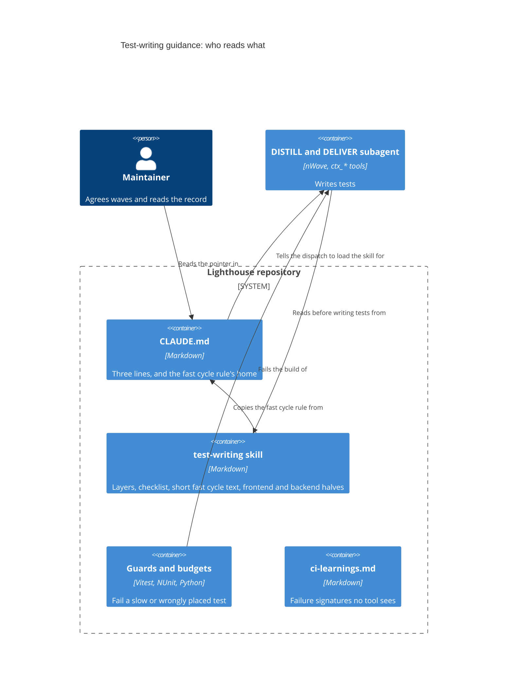

# Feature: story-6538-t11-test-writing-guidance

Story #6538 · T11 Test-writing guidance that the DISTILL and DELIVER agents follow · part of Epic #6506 "Fast, reliable test suites".
Catalogue: [Epic workspace](../epic-6264-modular-monolith/feature-delta.md) ·
Brief: [slice-52](../epic-6264-modular-monolith/slices/slice-52-t11-test-writing-guidance.md).

## Wave: DISCUSS / [REF] Inherited

The brief, settled with the maintainer on 2026-11-07. Its sections "Maintainer decisions", "Test pyramid vision", "Component test audit",
"Fast cycle in DELIVER" and "Change from T5's DEVOPS" override the proposals above them. Waves start at DESIGN.

- Job: infrastructure-only. Size S, two slices of at most a day. Hard dependency: T5 #6469. Soft: T10 #6537, T12 #6539, T9 #6536.
- Settled: the skill holds everything and `CLAUDE.md` keeps three lines. Close on the proxies and note when to read the next feature.
  One trial dispatch on a delivered feature runs. The audit touches no test.
- Pyramid, a direction and not a gate: about 90 % fast, 9.5 % integration, 0.5 % E2E by test count. Time is the hard rule.
- The fast cycle rule is T6's, put into `CLAUDE.md` by step 06-05. The brief says the skill and every DELIVER dispatch carry it.

## Wave: DESIGN / [REF] Scope, mode and context

Application scope, propose mode, maintainer away: each choice takes the recommended option and is recorded; what only the maintainer can
settle is under "Open for the maintainer". Paradigm OOP as the project states. No code, no test and no `CLAUDE.md` is changed by this
wave; the only file written is this one. Nothing was run: this agent has no shell.

Read: slice 52 in full, the T9 delta for shape, T5's convention, slices, "CLAUDE.md bullet" and "What can lie", T6's fast filter and the
roadmap step 06-05, T12's decisions, `docs/ci-learnings.md`, the Quality Gates section of `CLAUDE.md`, and
`.claude/skills/visualization/` for the layout.

**What exists and what a Story still has to build** (checked against the tree on 2026-11-07):

| Named thing | State | Planned by |
|---|---|---|
| `.claude/skills/visualization/SKILL.md` and `references/` | Exists, tracked | |
| `.claude/skills/test-writing/` | **Absent.** Slice A creates it, with `references/` | This Story |
| `vi.useFakeTimers({ shouldAdvanceTime: true })` in frontend tests (three files found, e.g. `ModifyTeamSettings.queryCommit.test.tsx`) | Exists | |
| `pnpm test:fast`, `src/tests/timeBudget/` (reporter, `slowTests.ts`), `actAndSettle.ts`, `inSequence.ts`, `waitPastTheDebounce.ts`, `pastTheAutosaveDelay.ts` | Exist | |
| `FakeLighthouseClock`, `TestToday`, `CapturedLogMessages`, `TestHostPerFixtureGuardTest`, `SharedHostsDrainTheUpdateQueueGuardTest`, `TestTierGuardTest` (edited, uncommitted), `IntegrationFixture` | Exist | |
| `Scripts/test-timings/check_budget.py`, `trx_to_csv.py`, `vitest_to_csv.py`; `ci_frontend.yml` uploads the `test-timings-frontend` artifact | Exist, as before T9 | |
| `nw-skill-reviewer` agent | Exists | |
| `ServicePortHarness`, `WireContractTest`, `Tests/Contracts`, `Tests/Acceptance/<Feature>`, `TestHostUseGuardTest`, T5's `CLAUDE.md` bullet | **Absent** | T5 #6469 |
| `Test-Fast.ps1`, the fast cycle rule in `CLAUDE.md` | **Absent** (`CLAUDE.md` has the `pnpm test:fast` lines only) | T6 #6512, steps 04 and 06-05 |
| Fast-limit ledger, `fast_allowlist`, `check_budget.py --pyramid` | **Absent** | T9 #6536 |
| T10's lessons on rule-versus-wiring | No workspace yet | T10 #6537 |

The skill may name only what exists on the day it is written. A thing in the last four rows goes in as "planned by Story N" or waits.

## Wave: DESIGN / [REF] Project rules, answered

| Rule | Answer |
|---|---|
| Contexts touched (context map) | **None.** No context, concept, edge or event is added. The context map and `ARCHITECTURE.md` section 4 stay as they are |
| New terms | **No domain term.** *Skill*, *fast tier*, *layer* are engineering words and stay out of the glossary |
| Domain events | None published or reacted to |
| RBAC | N/A, because no authorization code changes. The skill's examples may not show a test that re-implements `IRbacAdministrationService` rules |
| Lighthouse-Clients (CLI/MCP) | N/A, because no route, DTO or payload changes |
| Website | N/A, because nothing a user sees changes |
| Usage-data event | N/A, because nobody uses test guidance inside the product |
| UI surface, sketch, loading and failure looks, visualization skill | N/A, because no screen exists. The skill's frontend half carries one example of pinning both looks for a new view, which is test advice and not a screen |
| Terminology | N/A for the product. The skill's examples write `Feature` and `Work Item`, the seeded defaults, never a tracker's word |
| nWave scenario tags in code | None, and the skill says so. The trial's output is read for them |
| Production code | None. **Mutation: N/A.** Only test files and documents change, so Stryker has nothing to mutate; the deliberate-break rule in the skill stands in. The maintainer accepted this on 2026-11-07 for the Epic's chain where only test files change; the acceptance is recorded in the run's marker |
| Ports and adapters | Product hexagon untouched; see the summary |
| ADR | No new ADR: this is a process document, not a technical decision with a product impact. `brief.md` unchanged |
| External integrations | None added, so no contract-test note |
| Improvement backlog check | N/A, because this Story is itself an item of the Continuous Improvement Epic |
| Rigor profile | Not set in DESIGN. DELIVER proposes it per slice (likely `standard`) and passes `model` on every dispatch, see "Which model does what" |

**Quality gates (CLAUDE.md), one line each.**

| Gate | Answer |
|---|---|
| `pnpm test`, `pnpm test:fast` | N/A, because no frontend test or source file changes. The audit reads a Vitest listing only; that run is not a gate |
| `pnpm build`, Biome | N/A, because Biome checks `./src` and nothing in it changes |
| `dotnet build`, `dotnet test` | N/A, because no backend file changes |
| Coverage, local worker cap | N/A, because nothing is measured for coverage. The listing run keeps the default cap |
| SonarQube Cloud | N/A, because no code is added; Markdown is not analysed |
| CI | A docs-only push starts no CI run; none is expected |

**Finalize checklist, per item.** Docs prose: N/A, because the product docs describe the product and none changes; the skill is a developer
file. Per-feature screenshots: N/A, no screen. Demo data: N/A, no data shape changes. Website assets: N/A, because the website hot-links
product docs and images and none of those change. Release notes: none at finalize, they are written at release.

## Wave: DESIGN / [REF] Decisions

| ID | Decision | Why (one line) |
|---|---|---|
| D-6538-1 | **One home: `.claude/skills/test-writing/`.** `SKILL.md` (the layers, the can-it-fail rule, the checklist, the short fast cycle rule), `references/frontend.md`, `references/backend.md` (rules, one example each, the guards' messages). Slice A creates the folder and `references/` | A rule in one place cannot drift. A dispatch reads `SKILL.md` and its own half |
| D-6538-2 | **Files stay short and the checklist comes first.** Each file ends with a line "End of <file>". The dispatch wording tells the agent to read with `ctx_read` in full mode, fresh, and to quote that last line back | A subagent's `ctx_read` can cut a large file to a fraction. A cut that loses the end must be seen, not assumed away |
| D-6538-3 | **Rules cite the measured finding in words, not a Story number.** "A page test that renders a large list cost seconds; the same rule on the function cost milliseconds" | Story numbers archive. A stranger must get the point from the line alone |
| D-6538-4 | **The guards are named with their rule and quoted by message only where the guard exists.** Planned guards are named as planned | A quoted message that no tool reads goes stale; each quote is checked by a grep at DELIVER (below) |
| D-6538-5 | **`CLAUDE.md` gets three lines:** the service-port rule (new acceptance scenarios go to the port), the pointer to the skill, the load instruction. T5's longer bullet is cut to the rule and its body moves into `references/backend.md`. **No Story, slice or ADR number appears in the three lines** | Maintainer's decision. The convention appears once. Numbers archive |
| D-6538-6 | **The fast cycle rule is carried, not left as a pointer.** `CLAUDE.md` stays the rule's home (T6 step 06-05). A **short text** of the rule sits in `SKILL.md`, and the same short text sits in the DELIVER dispatch wording. DELIVER proves by `git grep` that the skill's text and the dispatch wording both contain the rule's distinctive phrases as `CLAUDE.md` words them | The brief says the skill and every DELIVER dispatch carry it. A copy is allowed here because a grep checks it |
| D-6538-7 | **The pyramid goes in once, as a layer rule and a direction:** "a test lands in the lowest layer that can prove it; moving down beats the share; time is the gate". The shares are stated as the direction only. **No dated counts in the skill**; the live ones come from T9's `--pyramid` once it exists | Counts go stale the week after they are written |
| D-6538-8 | **PENDING the maintainer, out of slice B until answered:** the "Where to test" bullet in `docs/ci-learnings.md` becomes a one-line pointer to the skill. The brief did not list that file | One home is better, but the file is the maintainer's to widen. Until then the bullet stays and the skill does not claim to replace it |
| D-6538-9 | **No new guard and no edit to an existing guard or its message.** A gap found while writing the skill goes to the list "Candidates for a tool" below | The brief's OUT list. A guard is its own Story |
| D-6538-10 | **The audit is read-only, sampled by a fixed rule, and its verdict rule is written before the numbers** ("The audit") | A rule fixed afterwards fits the answer |
| D-6538-11 | **Two slices.** A: audit and the frontend half. B: the backend half, `CLAUDE.md`, the trial, the record. Peer review of this design is left to the orchestrator, as T9 and T12 did | See "Slices" |
| D-6538-12 | **The trial prompt is the standard dispatch wording, no hint of the checklist.** The output is read against the checklist by a reviewer, not by the agent that wrote the skill | An agent handed the answer proves nothing |

## Wave: DESIGN / [REF] Where the guidance lives, and what enforces what

**Why one place.** Three homes exist today for parts of this: the ledger (`docs/ci-learnings.md`), T5's `CLAUDE.md` bullet, and the guards'
messages. Each has a different reader. The skill is the only one an agent loads *before* writing a test, so it is the only place that can
prevent the slow shape instead of reporting it. `CLAUDE.md` keeps the hard rule and the pointer, because every dispatch carries it.

**How a dispatch gets it.** nWave subagents have no skill loader, only the `ctx_*` tools. So the dispatch text names the files and says to
read them first. The three `CLAUDE.md` lines make the orchestrator write that sentence into every DISTILL and DELIVER dispatch, and tell
every reviewer that the skill is the standard. Nothing is placed in the nWave package, because a reinstall reverts it.

**What enforces which part.** A tool first; the ledger only where no tool can see it.

| Lesson in the skill | Enforced today by | Planned | Not enforced (convention only), and what to do |
|---|---|---|---|
| Logic on the function, one render per wiring, large lists only when rendering is the test | The frontend per-test limit (reporter, `slowTests.ts`) names a slow test after the fact | T9: a lower limit for files that are not `.test.tsx`; a backend fast limit | Where the logic belongs: no tool can tell |
| No order dependence | Frontend only: the shuffled CI run (T12). **The backend has no order check** | | Backend order dependence: none |
| No `testTimeout` or `retry` as the fix | **Nothing** | | Candidate 1 below |
| Fake clock, no real wait | Backend: `BannedSymbols.txt` bans the ambient clock (its reach into test code is read at DELIVER). Frontend: the time limits catch the cost only | | The skill names `FakeLighthouseClock` (backend) and `vi.useFakeTimers({ shouldAdvanceTime: true })` (frontend). A real wait is a convention; candidate 2 |
| No shared state across fixtures | Backend: `TestHostPerFixtureGuardTest` is the host-per-fixture ratchet only; `SharedHostsDrainTheUpdateQueueGuardTest` covers the update queue | | **Fixture size has no check** in either stack; frontend shared state has the shuffle only |
| Scenario at the port; host test only as a skeleton or in `Contracts` | | T5: `TestHostUseGuardTest` | Convention until T5 lands; named as planned |
| Tier is carried by the base class | `TestTierGuardTest` (T6) | | None |
| A check that cannot fail is not a check | Stryker, per feature, for product code. Ledger rule kept for copy, because StrykerJS does not mutate JSX text | | A test-only change has nothing to mutate: the deliberate break is a convention |
| A new view pins its loading and failure looks | | | **Documented in `CLAUDE.md`, not enforced.** E2E pages waiting for `data-widget-status="ready"` is a convention too |
| A Stryker config must name `Tests.Acceptance.<Feature>` | | | Nothing. Configs are written per feature, under that feature's `mutation/` folder. An unnamed folder shows as uncovered code in the report, late |
| Agents load the skill | | | Nothing. See candidate 3 |

**Candidates for a tool** (not built here, each its own Story; the maintainer picks):

1. A `LEDGER-CHECKS` pattern for `retry:` or `testTimeout:` in the Vitest config and for a real wait in a test file.
2. A Biome or GritQL rule against `await new Promise(... setTimeout ...)` in `*.test.ts(x)`, once the count of existing hits is known.
3. A `PreToolUse` hook that refuses a dispatch to `nw-acceptance-designer` or `nw-software-crafter` whose prompt does not name the skill.

## Wave: DESIGN / [REF] The audit

**Question.** How much of the `.tsx` test layer is really logic, and so could be a `.test.ts` over an extracted function? The answer
decides whether 9.5 % integration can be reached or is only a direction. It touches no test.

**Frame, counted.** Every `*.test.tsx` under `Lighthouse.Frontend/src`. Count on 2026-11-07 by `ctx_glob` with pattern
`<area>/**/*.test.tsx` from `Lighthouse.Frontend/src`, one run per area: **408 files**. A review glob over the whole tree found **410**. The
whole-tree glob output is cut before its count line, so the two are not reconciled here. The record at DELIVER takes the file and test
count from a Vitest listing run and uses that number in the quota below; 408 is used here.

| Group (path under `Lighthouse.Frontend/src`) | Files | Quota | Pick step |
|---|---|---|---|
| `components/Common/Charts` | 37 | 5 | 7.4 |
| `components/Common`, without `Charts` | 125 | 15 | 8.3 |
| `pages/Common/MetricsView` | 31 | 4 | 7.75 |
| `pages/Portfolios` | 54 | 7 | 7.7 |
| `pages/Common/Reports` and `pages/Reports` | 21 + 15 = 36 | 4 | 9 |
| `pages/Settings` | 28 | 3 | 9.3 |
| `pages/Teams` | 45 | 6 | 7.5 |
| the rest: `components/App`, the other `components/*`, `hooks`, `context`, `services`, `tests`, `pages/Common/AdvancedInputs`, `pages/Connections`, `pages/Features`, `pages/Overview` | 52 | 6 | 8.7 |
| **Total** | **408** | **50** | |

**Quota and rounding.** Quota = 50 x group files / total files, rounded half up; the rounded quotas here already add to 50. If a different
count changes that, the largest group takes or gives the difference.

**How the files are picked.** Sort the group's files by path. The i-th pick, for i = 1 to the quota, is the file at position
ceil(i x group files / quota), counting from 1. No random draw, so anyone can redo it. At about 14 tests a file, 50 files are about 715
tests (5,857 `.tsx` tests / 408 files x 50), not 1,000.

**The estimate weights each file by its test count**, because the share is by test and one big file would otherwise count like a small one.

**A second list, kept apart:** the ten files with the most test seconds in the `test-timings-frontend` artifact (the CSV that
`ci_frontend.yml` uploads) of one named, green `main` run. The record names that run. They say where a rewrite pays first and do not enter
the estimate, because they are chosen for being slow.

**What is decided per test.** One word each, by one rule: would the same assertion hold on the return value of a function that needs no
DOM?

- **Logic**: arithmetic, formatting, ordering, filtering, validation, a rule's branches, a state change, building a link.
- **UI**: needs the DOM. Role or name, focus, click wiring, layout, copy in place, a MUI control's behaviour, a view's loading or failure look, routing.
- **Mixed**: one render checks both. Counted apart.

**One example of each**, judged from the test title and to be confirmed on reading, so the rater sees the rule applied:

| Class | Example | Why |
|---|---|---|
| Logic | `ForecastLevel.test.tsx`, "should set the level, IconComponent, and color for probability <= 50" | A probability goes in, a level comes out. No click, no layout |
| UI | `AppErrorBoundary.test.tsx`, "reloads the page when the reload button is pressed" | Needs a rendered button and a click |
| Mixed | `DateRangePresets.test.tsx`, "offers a team every window it was given, in the order it was given them" | The ordering is a rule; it is proved through a render |

**Lookup steps per file (the same five, every file):**

1. List the file's test titles from the Vitest listing.
2. Read the file's imports and its first test to see what is rendered and what is mocked.
3. Find the unit under test, and any pure function or class it uses, in the component's folder and in `src/utils`, by `ctx_search`.
4. Look for a `.test.ts` for that function. One exists: the logic is **E0**. None: judge the extraction.
5. Label each test by the rule, give the file its cost class and call, and write the row.

**What is decided per file** (a row in the record, nothing edited): tests; logic, UI, mixed counts; whether the logic already lives in a
function with its own `.test.ts`; the extraction cost, **E0** the function exists, **E1** a pure function comes out of the component in one
sitting, **E2** it needs a hook or a context change; and the call, *move*, *keep*, or *duplicate of an existing `.test.ts`* (a candidate
to delete, not a move).

**Estimate and verdict rule (written now, before any number).**

- **Statistic.** Each share = logic tests in files of the stated cost classes / all tests in the sample, weighted by test count. **Low** =
  logic tests in E0 files. **Middle** = logic tests in E0 and E1 files, the headline. **High** = logic plus mixed tests in files of every
  class. Low <= Middle <= High by construction. Each has a 95 % interval from resampling files within their group. **Every comparison below
  uses the lower end of the interval**, so a lucky sample cannot declare it reachable. The point and the upper end are reported beside it.
- Also reported: the **seconds** in those tests from the CSV. A share moved is not seconds saved, and time is the hard rule.
- **Needed share N** = the share of `.tsx` tests that must move for the fast tier to reach 90 %. Frontend alone it is about 84 % (4,907 of
  5,857, from the brief's counts). For the whole suite it needs the backend labels from T6, so the record says which N it used.
- **Verdict, exhaustive:**

| Band | Rule | Verdict |
|---|---|---|
| 1 | Low (lower end) >= N | Reachable with the functions that already exist (E0) |
| 2 | Middle (lower end) >= N > Low (lower end) | Reachable with small extractions (E1) |
| 3 | High (lower end) >= N > Middle (lower end) | Needs the E2 work (hooks, context changes) |
| 4 | High (lower end) < N | A direction only; moving logic cannot reach it |

The number goes to the maintainer before any rewrite is planned.

**Which model does what.** The profile is `standard` (DELIVER confirms it with the maintainer). First-rater audit dispatches and the trial
dispatch use the profile's `agent_model`; the second rater, the skill review and the trial reviewer use its `reviewer_model`. `model` is
passed on each dispatch. The values are read from the profile at DELIVER, not written here. If `reviewer_model` equals `agent_model`, the
record says so.

**Cost and check on the audit.** About 715 tests to read: five batches of ten files. A second rater reads the same 10 files blind, the
5th, 10th, 15th and so on of the 50 picks.

- **Agreement** = the share of those tests, about 140, given the same label by both raters (logic, UI or mixed). Cohen's kappa is reported
  beside it and does not gate.
- **At 80 % or more:** the first rater's labels stand.
- **Below 80 %:** list the disagreeing tests, tighten the rule's wording with them as examples, and both raters redo those 10 files; the
  first rater also re-reads, in the other 40 files, every test of a kind that disagreed. One round only. If still below 80 %, report the
  figures to the maintainer and mark the headline "low confidence".

## Wave: DESIGN / [REF] What T11 cannot start until

| Waits for | State on 2026-11-07 | What it blocks |
|---|---|---|
| **T5 #6469** (hard, from the brief) | Not delivered: `ServicePortHarness`, `WireContractTest`, `TestHostUseGuardTest` and the bullet are absent | The backend half, and the cut of T5's bullet. Without it the skill would teach a convention that no guard backs |
| **T6 #6512 step 06-05** | Not done: no `Test-Fast.ps1`, no fast cycle rule in `CLAUDE.md` | The short rule text in `SKILL.md`, the DELIVER dispatch wording (nothing to copy yet) and the backend share in the audit |
| T12 #6539 | Closed or closing | **Soft**: the order-dependence lesson, and the frontend per-test numbers |
| T9 #6536, T10 #6537 | Not delivered | Soft: numbers to cite, the rule-versus-wiring lesson. The skill is written without them and takes a line when they land |
| DEVOPS and DISTILL of this Story | Not run | Waves go in order; nothing is skipped |

Only the backend half, the cut of the bullet and the fast cycle text need T5 or T6. The audit and the frontend half need none of them. **If the maintainer wants
slice A before T5, say so; the default stays the brief's order.**

## Wave: DESIGN / [REF] Slices

| Slice | Days (est.) | Delivers | Needs |
|---|---|---|---|
| A | 1 | The audit and its record; creates `.claude/skills/test-writing/` with `SKILL.md` and `references/frontend.md`; a `nw-skill-reviewer` pass | Nothing hard. T12 is soft; T5 per the brief's order |
| B | 1 | `references/backend.md`; the fast cycle text in `SKILL.md`; the three `CLAUDE.md` lines and the cut of T5's bullet; the trial; the closing record with the deferred check open. **Not** the ledger pointer (D-6538-8) until the maintainer answers | T5 done; T6 step 06-05 done |

**Proof for each.**

- Every identifier the skill names is found by a search of the tree on the day, listed in the record; a planned one carries "planned by".
- Every quoted guard message is found in the guard's source by the same search.
- The T5 convention text has one home: a search for its distinctive phrase prints `references/backend.md` and `CLAUDE.md`'s one rule line only.
- The fast cycle rule: a search for its distinctive phrases in `CLAUDE.md`, `SKILL.md` and the DELIVER dispatch wording prints all three, and the three agree.
- The three `CLAUDE.md` lines hold no Story, slice or ADR number.
- Each file read as a subagent with `ctx_read` shows its last line.
- The trial: one `nw-acceptance-designer` dispatch on a small delivered feature (candidate: story 6501, ordered parent fields, **not checked for size**),
  with the standard wording and the skill named, writing **scenario text into the Story's workspace only**, not into the test project.
  Read by a reviewer against the checklist; the result, with any deviation, is written down.
- **The deferred check is recorded open:** the next feature's DISTILL writes "skill loaded: yes/no, deviations" in its
  `feature-delta.md`; the maintainer reads it after that DELIVER. T11 closes on that note, as decided.

## Wave: DESIGN / [REF] Reuse Analysis

| Existing | Overlap | Decision | Contract shape, universe |
|---|---|---|---|
| `.claude/skills/visualization/` layout | Skill with `references/` | REUSE the layout | Files only, no effect |
| Ledger "Where to test" bullet | Same how-to | **PENDING** the maintainer (D-6538-8) | Documentation, no effect |
| T5's `CLAUDE.md` bullet | Same convention | MODIFY: cut to the rule, body moves | Documentation, no effect |
| T6's fast cycle rule | The cycle | CARRY a short text in skill and dispatch; home stays `CLAUDE.md`; a search checks the three agree | Documentation, no effect |
| `nw-skill-reviewer` | Skill structure and scope | REUSE | Read-only agent |
| Frontend `test-timings-frontend` CSV, Vitest listing | Counts and seconds for the audit | REUSE, read only | Reads existing files; writes the record only |

Nothing is CREATE NEW beyond the skill itself, which has no existing alternative: the rest are rules of a different reader.

## Wave: DESIGN / [REF] What can lie, and what catches it

| Could be false | Effect if unseen | Caught by |
|---|---|---|
| The skill is read whole | A cut file loses its end, and an agent follows half a rule | Last-line sentinel, quoted back; short files; the trial's agent reports it |
| The skill names what does not exist yet | Agents write against a missing harness | The search list; the "planned by" mark; T5 gates the backend half |
| A quoted guard message changes | The skill teaches a message nobody sees | The search of each quote at DELIVER. Not kept in step later: **not caught**, so quotes stay few |
| The carried fast cycle text drifts from `CLAUDE.md` | Two versions of the rule | The search at DELIVER. Later drift: **not caught**; the next DELIVER's dispatch check is the only reader |
| An agent follows the skill | Slow shapes return | The trial (one run); the guards and T9's limits fail the build on the next feature; the deferred read |
| The trial agrees because it was primed | A false pass | Standard wording only; a reviewer reads the output |
| The orchestrator forgets the load sentence | The skill is never read | The `CLAUDE.md` lines; the deferred "loaded: yes/no"; candidate 3 |
| The audit sample is biased or the call is generous | The pyramid looks reachable and is not | Fixed picking rule, weighting by test, lower interval ends in every comparison, the heavy files kept out of the estimate, a second rater, E-classes so a hard extraction is not counted as cheap |
| A share moved is read as time saved | A rewrite that saves nothing is planned | Seconds reported beside the share |
| The skill and `CLAUDE.md` drift on the convention | The convention exists twice | Cut in the same change; the search proof |
| A Stryker config misses `Tests.Acceptance.<Feature>` | A new scenario looks uncovered | In the backend half; the report shows it |
| "Fast" means a file name | The skill names the wrong tier | Fast is decided by time; the skill says so |

## Wave: DESIGN / [REF] C4



## Wave: DESIGN / [REF] Open for the maintainer

1. **Start of slice A before T5?** The audit and the frontend half need nothing from T5. Recommend: keep the brief's order (T5 first); say so if you want the audit earlier.
2. **Candidate tools** (three, above). Recommend 1 and 3 as small Stories after T11; 2 only once the existing hits are counted. Candidate 3 touches your hook settings, which no agent changes unasked.
3. **The ledger pointer (D-6538-8) is pending.** It edits `docs/ci-learnings.md`, which the brief did not list. Recommend yes, to keep one home. It stays out of slice B until you answer; with no answer the bullet stays.
4. **The trial's feature.** Story 6501 is a candidate, not checked. Any small delivered feature with DISTILL scenarios will do.
5. **The audit's verdict** goes to you before any rewrite is planned, as the brief says. Nothing about it can be decided in your absence.
6. **The file count: settled.** `git ls-files 'Lighthouse.Frontend/src/**/*.test.tsx'` gave 410 on 2026-11-07, so the review's glob was right and the per-area count of 408 missed two files. The quotas above use 408; DELIVER takes the Vitest listing, as said, which moves a quota by at most one file. Nothing for the maintainer here.

## Wave: DESIGN / [REF] Review

The review came back NEEDS_REVISION. What changed:

- **Fast cycle (D-6538-6):** the brief says skill and dispatch carry the rule, so both now carry a short text; `CLAUDE.md` stays the home and DELIVER searches that the three agree. Reuse table, slices, risk table and C4 follow. The earlier remark about a user instruction is gone.
- **Verdict rule:** four exhaustive bands, each on the lower end of the 95 % interval of a named statistic (a test-count-weighted share).
- **Audit frame:** recounted by area on 2026-11-07, 408 files (the review's glob said 410, left open). Groups, quotas, rounding and pick step are in a table; the Reports group uses the exact paths `pages/Common/Reports` and `pages/Reports`. Read cost is about 715 tests, not 1,000. The redundant "start at the first" term is dropped.
- **Mutation:** N/A kept: nothing to mutate, the deliberate break standing in, the acceptance noted as recorded in the run's marker.
- **D-6538-8** is pending and out of slice B; it is an open item.
- **"Enforced today" table** rebuilt with a "Planned" column and a "not enforced" column: the shuffle is frontend only, timeout and retry are unenforced, `TestHostPerFixtureGuardTest` is the host-per-fixture ratchet only, fixture size has no check, the loading and failure rule is documented and not enforced, and T9's limits and `TestHostUseGuardTest` moved to "planned".
- **Frontend fake** named: `vi.useFakeTimers({ shouldAdvanceTime: true })`, found in three test files, beside `FakeLighthouseClock`.
- **The CSV** is the `test-timings-frontend` artifact of a named green `main` run; the record names it.
- **T12** is soft in both places (slice A and the dependency table).
- **Models:** `agent_model` for the first-rater audit dispatches and the trial; `reviewer_model` for the second rater, the skill review and the trial reviewer; profile `standard`, values read at DELIVER.
- **Medium items:** agreement metric and the below-80 % path; one example per class and five lookup steps; `references/` created in slice A; one line per quality gate; the finalize checklist answered per item; no Story numbers in the `CLAUDE.md` lines.
- **Changed assumption.** Original, slice 52, pyramid vision: "about 90 % fast, 9.5 % integration, 0.5 % E2E ... as upper limits on the two upper layers." New: a direction only, nothing gates it, the shares are reported. Why: the same section says "Direction, not a gate" and "the hard rule stays time".

## Wave: DESIGN / [REF] Architecture summary for the maintainer

**The feature's shape in hexagonal terms.** There is no product hexagon to change. T11 works on the reader side of the tests, the agents
and their instructions.

```
  DRIVING SIDE                      APPLICATION / DOMAIN               DRIVEN SIDE
  (who triggers work)               (production code)                  (trackers, persistence)
  --------------------              ------------------------           ---------------------------
  controllers, routes   unchanged   services, ports   unchanged        trackers, database  unchanged
  hooks, pages          unchanged   domain Models     unchanged        no new external call

  THE TEST SIDE (where T11 works)
  dispatch -> reads CLAUDE.md [MODIFIED: 3 lines] -> loads test-writing skill [NEW]
                                                        |-- frontend half [NEW]
                                                        |-- backend half  [NEW, after T5]
  guards and budgets [unchanged] fail what the skill failed to prevent
  audit record [NEW, read-only] -> number to the maintainer
```

New: the skill (three files), the audit record, the trial record. Modified: `CLAUDE.md` (three lines, T5's bullet cut). The ledger's "Where to
test" bullet is modified only if the maintainer says yes. Unchanged: every driving adapter, application service, port, domain Model and driven adapter, every guard, Playwright.
New external call: none.

**Patterns weighed.**

- **Single source of truth:** chosen for the convention. The skill holds how-to, `CLAUDE.md` the pointer. Rejected: repeating T5's full bullet in both (it drifts).
- **A checked copy:** chosen for the fast cycle rule only, because the brief wants it in skill and dispatch. Rejected: a bare pointer (an agent may not follow it) and an unchecked copy (it drifts).
- **Prevent early, detect late as a pair:** chosen. The skill prevents; the guards and T9's limits detect. Rejected: guidance only (nothing fails when ignored) or guards only (a slow test is named after it is written).
- **Functional core, imperative shell, as a test rule:** chosen. Logic on a function is a millisecond test; the render keeps the wiring. Rejected: making every page test cheaper, which keeps the logic hidden in the component.
- **Test the lowest layer that can prove it (pyramid) as a direction:** chosen. Rejected: a share gate, because a share is met by adding trivial tests; time stays the gate.
- **Ratchet with a named list (T9, T4):** reused, not new. Rejected: a count of "tests moved", which hides which test.
- **Dependency inversion for the clock:** chosen, as the guidance to inject a fake clock in both stacks. Rejected: real waits with longer timeouts.
- **Fail-fast probe of the dependency (earned trust):** applied to the skill itself: the last-line check and the trial prove it is read and followed, rather than assuming so.
- **Sampling with a fixed rule and a rule for the verdict set first:** chosen for the audit. Rejected: reading every file (hours, no extra decision) and a random draw (cannot be redone).
- **Domain events, outbox, unit of work, value objects, optimistic concurrency, JSON column against child table:** not applicable, no domain or persistence change.
- **Enforcement by hook on dispatch:** weighed, **not chosen**: it is a new mechanism with false hits, and the deferred read will show if it is needed.
