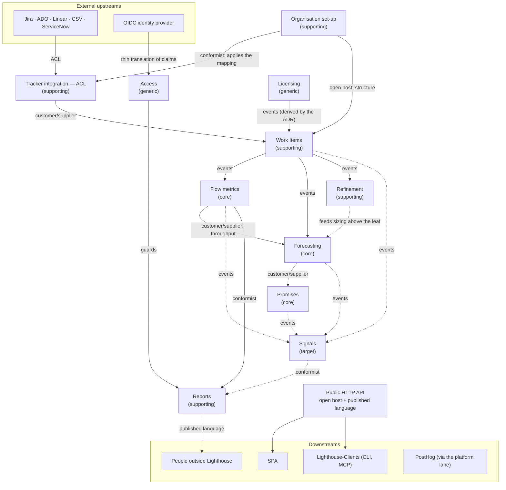

# ADR-270: Bounded contexts, context map and module layout

**Status**: Accepted (2026-11-01, maintainer; DESIGN of Story 6357, the first Story of Epic 6264 "path to a modular monolith"). The brief's acceptance criterion of "nine bounded contexts" is superseded by the eleven the storming found.
**Date**: 2026-11-01
**Feature**: `docs/feature/story-6357-s01-bounded-contexts-context-map/`
**Refines**: [ADR-027](adr-027-target-architecture-modular-monolith-domain-events-cqrs-lite.md) (its decision on module boundaries). ADR-027's single store, single binary, in-process dispatcher, no broker and no Event Sourcing all stand.
**Session board**: [`event-storming/board.md`](../../feature/story-6357-s01-bounded-contexts-context-map/event-storming/board.md) (the decisions), seeded from [`event-storming/board-seed.md`](../../feature/story-6357-s01-bounded-contexts-context-map/event-storming/board-seed.md) (today's code, every claim with a file reference).

> **Target, not today.** Everything below describes where the code is going, not what it is. The modular-monolith
> work moves towards it over the coming weeks, one behaviour-free Story at a time; until a context has been moved,
> [ARCHITECTURE.md §4](../../../ARCHITECTURE.md#4-the-nine-modules) describes the code as it stands. Every context and
> concept below is marked either **packaged from today's code** (it exists; a Story moves it into its new home without
> changing what it does) or **target only** (it does not exist yet). Target-only concepts are the language for future
> features (Epic 6455 "deeper hierarchies" first). They are **not** refactoring work: no packaging Story builds
> Signals, the promise lifecycle events, levels above the Feature, or organisation-wide defaults for SLE and staleness.
>
> **Moved so far (2026-11-25):** Flow metrics, by the pilot Story 6358, Forecasting, by Story 6361, Work Items,
> by Story 6360, Tracker integration, by Story 6359, Promises, by Story 6362, Access and Licensing, by Story 6363, Refinement (its leaf form), by Story 6365, Reports, by Story 6366, and Organisation set-up (its settings half), by Story 6468.
> The platform lane, which is not a context, was packaged on 2026-11-24 by Story 6364 (see the row *(Platform lane)*).
> For these nine contexts this ADR describes today's code, apart from what is still marked target only (per-level granularity, forecasts composed over
> more than one level above the leaf, the leaf unit's capacity inputs in Forecasting's own extension, the Team and
> Portfolio refresh pipelines that still sit in the update code, and the entities, events and DTOs that stay in `Models`
> and `API/DTO`). Every other context is still where §4 places it.

## Context

ADR-027 named seven logical modules; Refinement and Reports joined later, giving the nine in ARCHITECTURE.md §4. They
are namespace folders, drawn around the code as it grew. The modular-monolith Epic needs one written picture of the
domain that every later packaging Story moves towards, so that none of them has to re-decide where a class belongs.

The Story's brief assumed the answer would be the nine modules, renamed as bounded contexts. It asked for the answer
to come from a **Big Picture Event Storming** session instead. That session ran with the maintainer on 2026-11-01:

1. A draft wall was seeded from the code: the 14 domain event types and their handlers, the business facts that
   happen without an event type, the commands (controller actions), the policies (background updaters and handlers),
   the read models and the external systems.
2. The maintainer wrote their own list of what happens in Lighthouse before looking at the seed, and the two walls
   were merged.
3. The merged timeline was walked section by section (install, access, connecting a tracker, configuring Teams and
   Portfolios, sync, metrics, forecasting, Deliveries, refinement, reports, clients), marking hot spots and language
   shifts.
4. The walk ended with the pivotal events, the candidate contexts, a context map and the layout, each confirmed by
   the maintainer.

The storming found a different cut from the nine modules. Two things drove it:

- **Language divergence.** "Portfolio" means at least three things to users (a product with release tracking, a
  SAFe Agile Release Train, a value stream). "Forecast" means four things in code. "Delivery" is both an answer
  (when will this be done) and a commitment (we said it would be done by then). Where one word means two things, the
  model needs two contexts or two words.
- **Concepts with no home.** How an organisation is set up (its levels, their names, the terminology, how tracker
  states map onto Lighthouse's, the defaults its Teams follow) is spread over instance settings, connection defaults
  and per-Team and per-Portfolio settings. None of the nine modules owns it.

## Decision 1: the contexts

Nine modules become **eleven bounded contexts**. Platform/Persistence stops being a module and becomes the composition
root's infrastructure. Portfolio/Delivery splits: the Portfolio as a unit of the organisation goes to Organisation
set-up, the Deliveries go to Promises. RBAC/Identity splits into Access and Licensing. Signals is new and target only.

| Context | Type | Responsibility | Owns | From today's §4 module | Packaged or target |
|---|---|---|---|---|---|
| **Organisation set-up** | supporting; upstream of nearly all | How this organisation is structured and how it works by default. It holds the levels and their names (Terminology), the units on each level (the leaf unit that generates throughput, today's Team; the units above it, today's Portfolios), the mapping of tracker types, states and fields onto Lighthouse's concepts with its defaults, each unit's overrides, the calendar (blackout periods) and the cadence and priority rules (refresh cadence, Feature ordering policy). Structure and defaults only, no behaviour. | Terminology, blackout periods and recurring rules, refresh cadence, Feature ordering policy, the Team and Portfolio entities and their settings, connection defaults (until a decision on org default versus per-tracker default) | None. Spread over Platform/Persistence (seeding, settings), Portfolio/Delivery, the `Models` kernel and the connection settings | **Packaged** in `Modules/OrganisationSetup` by Story 6468 (2026-11-25): settings (`AppSettingService`), Terminology, blackout periods and recurring rules, Feature ordering and Feature ranking, optional features, connection defaults and connection usage. 27 types: `WeeklyRecurrence` and the recurring-rule extensions in `Domain`; the services above and their ports in `Application`, with `Application/Connections` (connection save and usage) and `Application/OptionalFeatures` (the optional feature appliers). Team, Portfolio and the mapping stay in the kernel (`Models`) and in the repositories until Epic 6474 and the repository Stories (S05c to S05e); their entities, the set-up events and the controllers also stay where they are. Levels and units above the leaf are target. Levels above the Feature, org-wide defaults with local override for SLE, staleness and similar, and per-level granularity are **target only** |
| **Tracker integration** | supporting | The anti-corruption layer in front of Jira (Cloud, Server, Data Center), Azure DevOps, Linear, CSV and ServiceNow. Connections, credentials and OAuth, connection health, and the **translation** of each tracker record into a Work Item or Feature during a fetch, applying the mapping it is given. Nobody outside it sees a tracker's model. | Connections and their credentials, connectors, connection health, the shared category-crossing rule that dates started and finished work | WorkTracking-Integration (minus the mapping, which moves to Organisation set-up) | **Packaged** in `Modules/TrackerIntegration` by Story 6359 (2026-11-17): the connector port and its factories, the five connectors with their auth strategies, OAuth, connection health and the translation rules (the parent and dependency source selectors included). Its entities (`WorkTrackingSystemConnection`, `OAuthCredential`, `ConnectionHealthVerdict`), the connection option types, `Models.WriteBack`, `ConnectionValidationResult` and its wire DTOs still sit in `Models` and `API/DTO`; only the four OAuth value types moved. Connection persistence stays with the platform repositories until S05e; the connection save and the connection usage stay for Organisation set-up (S03i); the write-back round stays with its publisher |
| **Work Items** | supporting | Owns Lighthouse's copy of the work mirrored from the trackers and keeps it current; the refresh process itself is still called sync. The items of every level, leaf and non-leaf alike, are **one item model with a level**, not separate contexts for leaf and non-leaf items. Refreshes (scheduled and forced), the sync mode (full or sweep), parent links (placing Work Items under Features), rolling work up onto Features including the default-size guess for a Feature with no children, dependencies, blocked and state-transition capture. Its outward facts are "this unit's data was refreshed" and "a refresh failed", not its internal steps. | The items (today's Work Items and Features), their state transitions, blocked periods, parent links, the roll-up and the default-size guess, the refresh log, the Team and Portfolio refresh pipelines | WorkItems/Sync, plus the refresh half of Portfolio/Delivery (the Team and Portfolio updaters) | **Packaged** in `Modules/WorkItems` by Story 6360 (2026-11-16). Its entities, rule types, parent and dependency value types, events and DTOs still sit in `Models` and `API/DTO`. The Team and Portfolio refresh pipelines stay in the update code until Epic 6474 slice 12 replaces them with one refresh per unit. The parent and dependency source selectors stay with Tracker integration, because the connectors call them |
| **Flow metrics** | **core** | One flow calculation at every level: throughput, cycle time, Work Item Age, WIP, percentiles, cumulative state time, process behaviour, blocked history, the day-keyed history snapshots. Granularity differs by level (a Team per day, a strategic level per week or month), which is a property of the level. SLE risk stays here until the first Signals feature. | The metric calculations and caches, the over-time snapshot tables and the history filler | Metrics / Time-in-state | **Packaged** in `Modules/FlowMetrics` by the pilot, Story 6358 (2026-11-09). Its entities and `Models/Metrics` DTOs still sit in `Models`. Per-level granularity is **target only** |
| **Forecasting** | **core** | Answers "when" and "how many" at every level. It forecasts the items directly above the leaf from the leaf unit's throughput (Monte Carlo), then composes "all children done" upwards level by level. It owns the forecasting inputs of the leaf unit (Feature WIP, throughput window): Organisation set-up owns the unit's identity, structure and way-of-working overrides, Forecasting owns how the leaf unit behaves as capacity, stored as Forecasting's own extension keyed by the unit's id (today both live on `Team`; Epic 6474 moves them in its slice 07, an expand-only schema change). A forecast is an answer that is recomputed and replaced; it is a planning aid, not a tracked promise. | Forecasts (completion and start), the forecast round and its fingerprint, manual forecasts, backtests and the reality check, the forecast filter rules | Forecasting, plus the forecast half of Portfolio/Delivery (the forecast updater) | **Packaged** in `Modules/Forecasting` by Story 6361 (2026-11-15). Its entities, the types the kernel entities reach and its wire DTOs still sit in `Models` and `API/DTO`. The leaf unit's capacity inputs move with Epic 6474, not with the packaging. Composing forecasts over more than one level above the leaf is target |
| **Promises** | **core** | A promise is a target date someone committed to for a set of items on one level, compared against the forecast, with a history of how it ended (kept, missed, renegotiated by moving the target or cutting scope). It includes planning: deciding what fits before committing ("what can we promise by the end of the PI?"). In the user's language one promise is a **Delivery**. A Delivery holds items of the level it hangs off; today's Deliveries are this rule on the Feature level. | Deliveries, their rules, sources (Jira Releases), notes, closure pins and metric snapshots | The Delivery half of Portfolio/Delivery | **Packaged** in `Modules/Promises` by Story 6362 (2026-11-17): the Delivery rule service, the source resolver and its preview, the source sync, forecast publishing, the forecast block and its renderer, the metric-values projector, and the two reactions to "forecasts updated" (snapshot recording, forecast publishing). Its entities (`Delivery`, `DeliveryClosureRecord`, `DeliveryMetricSnapshot`, `DeliveryNote`), the kernel Delivery types, the source types the connector port reads and its wire DTOs still sit in `Models` and `API/DTO`; only the forecast block's two types moved. Delivery persistence (the two repositories and `RecordableDeliveries`) stays with the platform repositories until S05d; the Portfolio refresh still calls the rule and sync services inline until Epic 6474 slice 12. Promise lifecycle events and Deliveries on levels above the Feature are **target only** |
| **Signals** | supporting | Turns state into attention: red, amber and green on two levels, the health of a unit or level (for example how many of its items are blocked or stale) and the promise (a Feature's or Delivery's likelihood of hitting its date). It owns thresholds, the current state and the history of when a signal changed, and it suggests when a promise should be renegotiated. One context so that the threshold-and-history mechanism is built once, not twice in Metrics and Promises. | Signal thresholds, current states, change history | None | **Target only.** Nothing to package; SLE risk stays in Flow metrics until the first Signals feature |
| **Refinement** | supporting | At the leaf, a way of working: which Work Items are in refinement, how many more the Team needs, sizing votes and stages. On levels above the leaf a different form may come, sizing items approximately for reference-class forecasting, where it would feed Forecasting. | The Refinement settings, the sizing log, stage resolution, the need band | Refinement | **Packaged** in `Modules/Refinement` by Story 6365 (2026-11-24), in its leaf form: `NeedBand` in `Domain`; the list, view query, need calculator, calendars, resolution, stage rules, SLE yardstick, voter identity, the sizing log commands and refusal, and their three ports in `Application`. Its entities, the sizing-log repository pair and its wire DTOs still sit in `Models`, `Services` and `API/DTO`, and the controllers stay in `API`. Refinement above the leaf is target |
| **Reports** | supporting | Turns live numbers into a frozen record for others. Then & Now is the first report type; more follow (metric charts, signals). It conforms to Flow metrics for numbers and is the outbound channel to people outside Lighthouse (PDF export today; scheduled delivery in future). | Reports and their notes, their frozen windows (Then), templates, the metric catalog | Reports | **Packaged** in `Modules/Reports` by Story 6366 (2026-11-25): `ReportCapPolicy`, `ReportSeriesReading` and `ReportWindowPolicy` in `Domain`; the queries, commands, bulk commands and remover, the Then & Now template, the owner lookup, the two series and their eleven ports in `Application`; the metric catalog and its metrics in `Application/Metrics`. The `Report` entity, its payload and read models (`Models/Reports`), `ReportRepository` and the three controllers still sit in `Models`, `Services` and `API`. Scheduled delivery and further report types are target |
| **Access** | generic | Who may do what: organisation-wide roles (System Admin, broad readers, Admin on all) plus membership per unit. It follows the units that exist and has no story of its own beyond that. *Not allowed* is Access; *not relevant* (which level a person sees by default) is not. | Users, roles, unit memberships, IdP group mappings, API keys, embed sessions | RBAC / Identity (minus licensing) | **Packaged** in `Modules/Access` by Story 6363 (2026-11-22): RBAC administration, the current user's profile, API keys, embed sessions, the OIDC group snapshot writer, the auth mode resolver and configuration validator, Feature move authorization, and the ASP.NET guards, markers and authentication handlers in `Adapters/Http`. Its entities, the types the controllers read or return, the six repositories, the two seeders and the controllers still sit in `Models`, `Services`, `Seeding` and `API`; only four small value types of `Models` moved. Membership per unit on any level is target |
| **Licensing** | generic | Whether Premium is available and how many units the free tier allows, published as facts the others react to: licence loaded, licence in its last 30 days, licence expired. | The licence, its verification, the free-tier limits | RBAC / Identity (`Services.*.Licensing`, the premium gate), as ARCHITECTURE.md §4 and the `Services.Implementation.Licensing` namespace show. The board's "inside Platform" was a slip | **Packaged** (small) in `Modules/Licensing` by Story 6363 (2026-11-22): the licence service and verifier with their ports, the public key beside the verifier, and the licence guard attribute in `Adapters/Http`. The licence entity and its DTOs stay in `Models` and `API/DTO`. The three licence events are **target**; today all three facts are derived on read |
| *(Platform lane)* | **not a context** | Composition-root infrastructure below the domain: the encryption key ring, backups and restore, demo data, version update, log level, usage-data consent and forwarding, start-up housekeeping, the `DbContext` and database management, the domain-event dispatcher, the update queue's mechanics, health and graceful shutdown. No user names any of it as part of the story. | The infrastructure the contexts run on | Platform / Persistence, and the host band | **Packaged** in `Lighthouse.Backend.Platform.<Area>` by Story 6364 (2026-11-24), still part of the composition root and not a context. Eleven areas, no layers: `Encryption`, `DatabaseManagement`, `DemoData`, `Seeding`, `Persistence` (the race-tolerant save), `UsageData`, `Logging`, `Releases`, `DomainEvents`, `Host` (the host facilities) and `UpdateQueue` (the queue's mechanics only). The lane has its own direction rules R-PL1 to R-PL4 and a placement rule (see "Edges measured by packaging the platform lane"). Still outside it, each with a named owner: `Data` and its migrations, every repository, the Team and Portfolio update pipelines (`TeamUpdater`, `PortfolioUpdater`, `UpdateServiceBase<T>`), the context seeders |

Nine modules therefore become **eleven contexts** (ten packaged from today's code, Signals target only), with Platform
taken out of the domain. The packaging catalogue of the Epic (one Story per module, S03a to S03h) was written for the
nine modules; it is revised at this Story's close-out to one packaging Story per packaged context.

Where a piece of today's Portfolio/Delivery or Platform module has no obvious owner, the packaging Story for that
context records its choice (see "Left open" at the end).

## Decision 2: the context map

```text
  Jira · ADO · Linear · CSV · ServiceNow                    OIDC IdP           PostHog
          │ (upstream, external)                               │                  ▲
          ▼                                                    ▼                  │ platform lane
  ┌────────────────────┐  mapping (conformist)   ┌─────────────────────────┐   ┌────────┐
  │ Tracker integration │◄────────────────────────│ Organisation set-up      │   │ Access │ generic, guards all
  │   (ACL)             │                         │ levels·names·units·      │   └────────┘
  └─────────┬──────────┘                         │ defaults·overrides       │   ┌───────────┐
            │ customer/supplier                   └───────────┬─────────────┘   │ Licensing │ generic,
            ▼                                                 │ open host:      └───────────┘ events → all
  ┌───────────────────┐  domain events                         │ everyone conforms to its structure
  │ Work Items        │──────────────┬─────────────┬───────────┼──────────────┐
  └───────────────────┘              ▼             ▼           ▼              ▼
                            ┌──────────────┐ ┌─────────────┐ ┌────────────┐ ┌─────────┐
                            │ Flow metrics │►│ Forecasting │◄│ Refinement │ │ Signals │ (target)
                            └──────┬───────┘ └──────┬──────┘ └────────────┘ └────▲────┘
                                   │ conformist     │ customer/supplier          │ events from Work Items,
                                   ▼                ▼                            │ Metrics, Forecasting,
                            ┌──────────────┐ ┌─────────────┐                     │ Promises
                            │ Reports      │ │ Promises    │─────────────────────┘
                            └──────┬───────┘ └─────────────┘
                                   │ published language (PDF, scheduled) → people outside Lighthouse
  Public HTTP API = open host / published language → SPA, Lighthouse-Clients (CLI, MCP)
```

An arrow points from upstream to downstream: the downstream context depends on the upstream one, never the other way.



Dashed arrows are target only. Licensing → Work Items is derived by this ADR, not drawn on the board, and was accepted with it.
Flow metrics → Forecasting was derived from the code by Story 6358 and made a legal edge by Story 6361 (2026-11-15),
which also removed the edges in the other direction.

**An acknowledged cycle: Organisation set-up and Tracker integration.** Today the two depend on each other. Set-up
validates a Team's or Portfolio's query and suggests types and states by asking the tracker, while the ACL conforms
to set-up's mapping when it translates. The cycle is broken like this: set-up uses the ACL's query port as a
**customer** for validation and suggestions, and the mapping is **handed to the translation as data with each fetch**
(Work Items passes it in), so Tracker integration never references Organisation set-up. The conformist relationship stays
one of meaning, not of code: there is no compile-time cycle.

### Every edge

The first column reads upstream → downstream (the downstream depends on the upstream). The "Legal today" column
uses §4's opposite, **depends-on** direction: it names the §4 edge "downstream module depends on upstream module" and
checks it against the cross-module edges ARCHITECTURE.md §4 draws (WorkItems/Sync depends on WorkTracking-Integration;
Portfolio/Delivery depends on WorkItems/Sync and Forecasting; Forecasting depends on WorkItems/Sync and Metrics (since Story 6361); Refinement depends on WorkItems/Sync,
Forecasting and Metrics; Reports depends on Metrics and RBAC; everything depends on the `Models` kernel), with each
context read as the §4 module it comes from. Edges marked **Derived** were not drawn on the board; this ADR derived
them from the code or the walk, and the maintainer accepted them with the ADR.

| Upstream → downstream | Relationship | How the downstream reaches it | Legal today? (depends-on, per §4) | Derived by the ADR (accepted with it) |
|---|---|---|---|---|
| Jira, ADO, Linear, CSV, ServiceNow (and the Jira and ADO OAuth providers) → Tracker integration | external upstream; anti-corruption layer | Connectors translate each record into Work Item or Feature | Yes (WorkTracking-Integration is a leaf input adapter). Since Story 6359 (2026-11-17) the module's own rules enforce it by namespace, with the one entry of the Tracker integration → Promises row below | |
| Organisation set-up → Tracker integration | conformist: the ACL applies the organisation's mapping as given | Mapping handed in as data with each fetch (see the acknowledged cycle above) | Today the mapping sits on Team, Portfolio and connection in the kernel; no module edge exists. New edge, in meaning only | |
| Tracker integration → Organisation set-up | customer/supplier: set-up is the customer of the ACL's query port | Validates queries and asks for suggested types and states | No module edge today (the API band calls the connectors). New edge | **Derived** (from the cycle above) |
| Tracker integration → Work Items | customer/supplier: Work Items is the customer, the connector port is the negotiated contract | Query through the connector port | Yes (WorkItems/Sync depends on WorkTracking-Integration) | |
| Promises → Tracker integration | customer/supplier: Promises is a customer of the connector port (Deliveries read their source, and publish forecasts back, through the factory and the capability interfaces) | **Through the ACL's port since Story 6359 (2026-11-17):** `DeliverySourceResolver` and `DeliveryForecastPublishingService` take `IWorkTrackingConnectorFactory` and type-test for `IDeliverySourceProvider` and `IDeliveryForecastPublisher`, all in `Modules.TrackerIntegration.Application`, never `Adapters`. Listed by name in the Application inbound list (R-T4) until Story 6362 (2026-11-17), which moved both callers into `Modules.Promises.Application`: Promises' `Application` now reaches Tracker integration's `Application` by namespace, and the two entries are gone from R-T4 | Yes, derived: the factory and the capability interfaces are the port (ADR-285), so a customer of the port is a legal edge. Ratchet candidate 3, answered | **Derived** (from code) |
| Organisation set-up → every other context | open host: everyone conforms to its structure (units, levels, names, defaults, calendar) | Queries through its contract; reactions to its events | Since Story 6468 (2026-11-25) the settings, Terminology, calendar, Feature ordering and ranking and connection defaults are reached through `Modules.OrganisationSetup` `Domain` and `Application`, legal by namespace for every downstream module; the structure itself (Team, Portfolio) is still reached through the kernel | |
| Work Items → Flow metrics | upstream publishes, downstream reacts (domain events) | Reacts to the refresh events; reads stored history through read ports. Since Story 6360 (2026-11-16) this includes updating a Team's metrics after its refresh: `TeamDataRefreshedTeamMetricsUpdateHandler` in Flow metrics' `Application/Policies` handles `TeamDataRefreshed`, registered first among that event's handlers so the later reactions read fresh metrics | Not drawn in §4. Works today only because the events sit in the kernel. Becomes a legal edge once event types move to Work Items | |
| Flow metrics → Work Items (Work Items calls Flow metrics, beyond the event) | none designed; a direct call | `WorkItemService` queries `IPortfolioMetricsService` and the Domain's `PercentileCalculator` for the default-size guess. The command is gone: since Story 6360 (2026-11-16) `TeamDataService` no longer calls `ITeamMetricsService.UpdateTeamMetrics`; it publishes `TeamDataRefreshed` and Flow metrics reacts (row above, ratchet candidate 1) | **Not legal** (WorkItems/Sync may not depend on Metrics). Measured 2026-11-09. The two query edges stay ratcheted, by name, in Flow metrics' R3 and R4 lists and in Work Items' own Application outbound list, until Flow metrics answers the default-size guess itself (Epic 6474 slice 10) or `WorkItemService` is split (S07a) | **Derived** (from code, Story 6358) |
| Forecasting → Flow metrics (Flow metrics calls Forecasting) | none | **Removed by Story 6361 (2026-11-15).** Flow metrics asks three ports of its own, in its Application: `IThroughputFilter`, `IForecastDataSufficiency` and `IHowManyForecaster`. Forecasting implements them (`ForecastFilterRuleService`, `ForecastingAnswersToFlowMetrics`), so Flow metrics names no Forecasting type | **Not legal** (Metrics may not depend on Forecasting). The R5 list is empty and stays, compared both ways, so a new edge fails | **Derived** (from code, Story 6358) |
| Flow metrics → Forecasting (Forecasting calls Flow metrics) | customer/supplier | Forecasting reads throughput and `ForecastThroughputStatus` through Flow metrics' Application (`ITeamMetricsService`), and implements Flow metrics' three ports (row above) | **Yes**, decided by Story 6361 (2026-11-15): a forecast is made from throughput, and throughput is a flow metric. Forecasting is a legal caller of Flow metrics' Application by namespace, so it left the R4 list | **Derived** (from code, Story 6358; made legal by Story 6361) |
| Flow metrics → Platform lane | none designed | `DatabaseMaintenanceGate` reaches the module's Application | Platform is the composition root's infrastructure, not a context. **Decided by Story 6364 (2026-11-24):** the edge stays listed in Flow metrics' R4 list, now naming `Platform.DatabaseManagement.DatabaseMaintenanceGate`, so Flow metrics' inbound rule governs it and the platform lane's rules do not list it a second time. Turning it round (Flow metrics owns a port that the gate implements) is a catalogue note only, not scheduled | **Derived** (from code, Story 6358) |
| Tracker integration → Forecasting (Forecasting calls Tracker integration) | customer/supplier: the write-back round is a customer of the connector port | `WriteBackService`, the one round type that talks to a tracker, reaches `IWorkTrackingConnector`, `IWorkTrackingConnectorFactory` and `IWriteBackTarget` | **Yes**, since Story 6657 (2026-11-26): a Forecasting type depends on Tracker integration, never the reverse. One caller type, 3 listed edges (R-WB2) | |
| Platform lane → Forecasting (the update queue holds round types) | none designed; a direct call | The update queue, its held update, `TeamUpdater` and `UpdateServiceBase<T>` name write-back types, and `PortfolioUpdater` calls Forecasting | Listed in Forecasting's R4 inbound list (5 entries) since Story 6657, so Forecasting's rules govern it and the platform lane's rules do not list it a second time. **Note for S09a:** inverting the queue flush removes these entries | |
| Work Items → Forecasting | customer/supplier, by events | Reacts to the refresh events; reads Features through Work Items' contract | Yes (Forecasting depends on WorkItems/Sync) | |
| Work Items → Refinement | customer/supplier | Reads Work Items in refinement | Yes (Refinement depends on WorkItems/Sync) | **Derived** |
| Forecasting → Refinement (today) | customer/supplier | Refinement reads the Team's manual How Many forecast | Yes (Refinement depends on Forecasting) | |
| Refinement → Forecasting (target, above the leaf) | supplier of sizes | Refinement above the leaf sizes items that Forecasting consumes | Target only. It would make Forecasting depend on Refinement, the reverse of today; see "Left open" | |
| Flow metrics → Refinement | customer/supplier | Reads the SLE yardstick and throughput | Yes (Refinement depends on Metrics) | **Derived** |
| Forecasting → Promises | customer/supplier | Reacts to "forecasts updated"; reads Feature forecasts for the joint "all done by" answer. Since Story 6362 (2026-11-17) the two reactions to `PortfolioForecastsUpdated` sit in Promises' `Application/Policies`, and a pin fixes their order: the Delivery snapshot is recorded before the forecasts are published | Yes (Portfolio/Delivery depends on Forecasting) | |
| Work Items → Promises | customer/supplier | Delivery rules match fetched Features | Yes (Portfolio/Delivery depends on WorkItems/Sync) | |
| Tracker integration → Promises | customer/supplier (Jira Releases as a Delivery's source, forecasts published back) | Through the connector, and **no code edge since Story 6362 (2026-11-17).** Story 6359 listed one entry, `JiraWorkTrackingConnector` → `IDeliveryForecastBlockRenderer`, which merged the forecast block into a Jira description. Story 6362 inverted it: the Jira connector takes Tracker integration's own port `IDescriptionBlockMerger` (in `Modules.TrackerIntegration.Application`), and Promises' forecast block renderer implements it. The text written to Jira is unchanged. R-T7 is empty, and `TrackerIntegrationReachesNoPromisesArchUnitTest` keeps it so | Legal: the dependency now points from Promises to Tracker integration's port, so Tracker integration stays a leaf | **Derived** (from code) |
| Work Items, Flow metrics, Forecasting, Promises → Signals | upstream publishes, downstream reacts | Domain events only | Target only | |
| Flow metrics → Reports | conformist ("a report and the tab never disagree") | Reads through the same metrics contract the tab uses | Yes (Reports depends on Metrics) | |
| Signals → Reports | conformist | Includes signals as they are | Target only | |
| Reports → people outside Lighthouse | published language | PDF export today; scheduled delivery in future | n/a (outbound) | |
| Access → every context except Organisation set-up | generic; guards | Guards at each context's API adapter; owner-scoped listing through `IRbacAdministrationService`. Since Story 6363 (2026-11-22) the guards live in `Modules.Access.Adapters.Http`, the service in `Modules.Access.Application`, and five outside types besides `API` and the composition root ask Access's `Application` (listed in R-A4) | Yes for Reports (depends on RBAC); elsewhere the guards sit in the API band | |
| Organisation set-up → Access | conformist: memberships follow the units that exist | Unit identifiers | Through the kernel today. New edge | **Derived** |
| OIDC identity provider → Access | external upstream; thin translation of claims (a small ACL) | Claims parsed into roles and groups (`GroupClaimParser` in `Modules.Access.Domain` since Story 6363, called from the composition root) | Yes | |
| Licensing → every context except Organisation set-up | generic; published events (loaded, last 30 days, expired) | Reacts to licence events; asks "is Premium available" through its contract. Since Story 6363 (2026-11-22) eleven outside types besides `API`, the composition root and Access's `Application` ask `ILicenseService`, each listed by name in R-L3 | Today checked on read; the refresh paths (Portfolio/Delivery) depend on RBAC/Identity, which §4 does not allow. Ratchet candidate | |
| Licensing → Work Items | generic; published events | Stops refreshing when the licence expires and more units exist than the free tier allows | Same ratchet candidate as above | **Derived** |
| Organisation set-up → Licensing | customer/supplier | Counts units against the free-tier limit | Through the kernel today | **Derived** |
| Public HTTP API → SPA, Lighthouse-Clients (CLI and MCP) | open host service with a published language | HTTP, the clients' contract | Yes (the API is the driving adapter) | |
| Platform lane → PostHog | external downstream | The usage-data pipe forwards events the clients hand in | n/a (composition root) | |
| GitHub Releases → Platform lane | external upstream | Version check and release notes | n/a (composition root) | |
| Forecasting → Work Items | customer/supplier, by events | Work Items reacts to `ForecastRoundFinished` (Forecasting's Contracts) and writes the round's entry in its own refresh log; Forecasting no longer calls Work Items to write it | Yes, by event only, through Contracts. The reverse of Work Items → Forecasting above; both run in one deployable | |

Since Story 6382 (feature D) every row between two packaged contexts is read through the context's `Contracts`: a
context reaches another context's code only in its `Contracts` (rule R-C1), and the per-module rules keep only the
direction of the edge (who may depend on whom). An edge into another context's `Contracts` is legal by namespace and
sits in no list. An edge outside `Contracts` sits in R-C1's list, which is the one owner of it (see "Ratchet
candidates").

### Edges measured by the Flow metrics pilot (2026-11-09)

Story 6358 measured every edge into and out of `Modules/FlowMetrics` from the compiled IL (`IlDependencies`, Debug and
Release builds identical) and fixed each list as an inline baseline that fails on a newcomer and on a stale entry
(ADR-268). The lists only shrink. The rules live in
`Lighthouse.Backend.Tests/Architecture/FlowMetricsInboundDomainAndAdaptersArchUnitTest.cs` (R3),
`FlowMetricsInboundApplicationArchUnitTest.cs` (R4) and `FlowMetricsApplicationOutboundArchUnitTest.cs` (R5).

| Rule | What it allows | Baseline (outside types, or edges) |
|---|---|---|
| R2 | The module's Domain depends only on the kernel (`Models`) and the .NET base library | empty |
| R3, Domain inbound | Outside types reach `Domain` only from the list | 6: `API.PortfolioController`, `API.PortfoliosController`, `API.TeamController`, `API.TeamsController` (they use `BaselineValidationService`), `Reports.Metrics.DailySeriesSummary`, `WorkItems.WorkItemService` |
| R3, Adapters inbound | Only the composition root reaches `Adapters` | `Program` only, no list |
| R4, Application inbound | `API`, the composition root, Reports and Refinement by namespace (legal), plus the list | 10 (the design expected 8): Forecasting `ForecastService`, `ForecastService+GatheredInputs`, `ForecastInputs`, `ForecastInputFingerprint`, `ForecastRealityCheckService`; Work Items `TeamData.TeamDataService`, `WorkItems.WorkItemService`; `WriteBackTriggerService` (write-back, see "Left open"); `FeatureListActiveWork`; Platform `Platform.DatabaseManagement.DatabaseMaintenanceGate` |
| R5, Application outbound | No EF Core, `Data`, module `Adapters` or `API` type; Forecasting only through the list | below the Application: empty. Forecasting: 3 edges (see the Forecasting → Flow metrics row) |

The legal R4 callers seen on 2026-11-09: the controllers `ForecastController`, `ForecastRealityCheckController`,
`PortfolioMetricsController`, `TeamFeatureSizeMetricsController`, `TeamMetricsController`; `Program`; Reports'
`PortfolioReportMetricSeries` and `TeamReportMetricSeries`; Refinement's `RefinementNeedCalculator` and
`SleYardstickResolver`.

### Edges measured by packaging Forecasting (2026-11-15)

Story 6361 moved Forecasting into `Modules/Forecasting` and measured every edge into and out of it from the compiled
IL, in the same way as the pilot. Each list is inline, fails on a newcomer and on a stale entry, and only shrinks
(ADR-268). The inbound rules and the Application and Adapters outbound rules live in
`Lighthouse.Backend.Tests/Architecture/ForecastingModuleBoundariesArchUnitTest.cs`, the Domain outbound rule in
`ForecastingDomainLayoutArchUnitTest.cs`, and the rule that Flow metrics reaches Forecasting only through its own
ports in `FlowMetricsDoesNotReachForecastingArchUnitTest.cs`. Both modules' rules call one shared class,
`ModuleRules`, with the module's namespaces as parameters. A `ModuleWording` parameter makes a failing rule name the
module it checked and the callers that module allows; Flow metrics' wording is the default.

| Rule | What it allows | Baseline (outside types, or edges) |
|---|---|---|
| Domain outbound | Forecasting's `Domain` depends only on the kernel (`Models`) and the .NET base library | empty |
| Domain inbound | Outside types reach `Domain` only from the list | 1: `Program` (it registers the draw-stream factory and the simulation) |
| Adapters inbound | Only the composition root reaches `Adapters` | `Program` only, no list |
| Application inbound | `API`, the composition root and Refinement by namespace (legal), plus the list | 1: `BackgroundServices.Update.PortfolioUpdater` (ratchet candidate 4) |
| Application outbound | No EF Core, `Data`, `API` or module `Adapters` type; the licence only through the list. Flow metrics' Application is a legal target | 1: `ForecastFilterRuleService` → `ILicenseService` (ratchet candidate 2) |
| Adapters into the shared update code | `Adapters` reach `Services.Implementation.BackgroundServices.Update`, which the Team and Portfolio updaters use too, only through the list | 5: `ForecastUpdater` → `UpdateServiceBase<T>` (still in `Services`) and, since Story 6364 (2026-11-24), `Platform.UpdateQueue.UpdateCancellationContext`, `UpdateKey`, `IUpdateQueueService` and `IUpdateStatusStore` (the last two existed before the move and became visible with it). It stays until the update code is split by module; a candidate for the context-contracts Story (S09a) |
| Flow metrics R4, Application inbound | Forecasting is now a legal caller by namespace | 10 → 12 → **5**: the port change first added `ForecastFilterRuleService` and `ForecastingAnswersToFlowMetrics`, then all seven Forecasting entries left. Left: `TeamDataService`, `WorkItemService`, `WriteBackTriggerService`, `FeatureListActiveWork`, `DatabaseMaintenanceGate` |
| Flow metrics R5, Application outbound to Forecasting | Forecasting only through the list | 3 → **0**. The list stays, empty and compared both ways |

How the cycle was removed, with the same objects answering the same calls:

- `IThroughputFilter` has the two members `TeamMetricsService` used before: `GetEffectiveRuleSet` and `Filter`.
  `ForecastFilterRuleService` implements it next to `IForecastFilterRuleService`.
- `ForecastingAnswersToFlowMetrics` answers `IForecastDataSufficiency` (it calls `ForecastDataSufficiencyPolicy`) and
  `IHowManyForecaster` (it calls `IForecastService`). It looks the forecast service up on first use, through the
  service provider, because taking it in the constructor closes a cycle in the container: the forecast service needs
  the team metrics service, which needs this answer. That service-locator call goes when the metrics services are
  composed differently (S07b).
- `Program.cs` registers each implementing class once and forwards its interfaces to it, so one instance per scope
  answers all of them, as before.
- The rules skip a generic parameter: a type built on a generic base would otherwise count its own type parameter
  as a second type of the base's namespace.
- Known gap of the IL reader: a type used only in a catch clause, an event or a named attribute argument is not seen.
  No current code depends on it.

### Edges measured by packaging Work Items (2026-11-16)

Story 6360 moved Work Items into `Modules/WorkItems` and measured every edge into and out of it from the compiled IL,
in the same way as the two Stories before it. Each list is inline, fails on a newcomer and on a stale entry, and only
shrinks (ADR-268). The rules live in `Lighthouse.Backend.Tests/Architecture/WorkItemsModuleBoundariesArchUnitTest.cs`
and call the shared `ModuleRules` with Work Items' namespaces and a `ModuleWording` of their own. The order of the
`TeamDataRefreshed` handlers is pinned in `DomainEventHandlerOrderPinTest`.

| Rule | What it allows | Baseline (outside types, or edges) |
|---|---|---|
| Layers | Every listed Work Items type lives in its layer, and none is left under `Services` | the list in the rule |
| Domain outbound | Work Items' `Domain` depends only on the kernel (`Models`) and the .NET base library | empty |
| Domain inbound | Outside types reach `Domain` only from the list | 3: `Program`, `Connections.ConnectionSaveService` (it compares fetch fingerprints) and `API.Helpers.WorkTrackingSystemOptionsOwnerExtensions` |
| Application inbound | `API`, the composition root, Flow metrics, Forecasting and Refinement by namespace (legal), plus the list | 7: the Team and Portfolio updaters and `UpdateNotificationHub` (the refresh pipelines that stay in the update code), `DeliveryRuleService` (Promises has no namespace of its own yet), `FeatureListService`, `FeatureListRead`, `Seeding.RefreshLogSeeder` |
| Application outbound | No EF Core, `Data`, `API` or module `Adapters` type | empty |
| Application outbound to Flow metrics | Only through the list | 2: `WorkItemService` → `IPortfolioMetricsService` and → `PercentileCalculator` (the default-size guess) |
| Application outbound to Access, Licensing, Organisation set-up and the update queue | Only through the list | 6: `DependencyDecision` → `ILicenseService`, `FeatureDependencyRendering` → `IRbacAdministrationService`, `WorkItemService` → `UpdateCancellationContext`, `IFeatureOrdering` and `ILighthouseClock`, `RefreshLogService` → `IAppSettingService`. Organisation set-up had no namespace of its own then, so these edges were listed too: stricter than the 4 the design expected, never looser. Since Story 6468 (2026-11-25) the two edges into Organisation set-up (`WorkItemService` → `IFeatureOrdering`, `RefreshLogService` → `IAppSettingService`) are legal by namespace and left the list |
| Policies | `Application/Policies` holds only domain-event handlers | the six Work Items reactions |
| Connectors | No connector reaches a Work Items type (Tracker integration stays a leaf) | empty. The three source selectors the connectors call stay outside the module for that reason |
| Flow metrics R3, Domain inbound | Unchanged | 6; the Work Items entry is now `Modules.WorkItems.Application.WorkItemService` |
| Flow metrics R4, Application inbound | Work Items no longer commands Flow metrics | 5 → **4**: `TeamDataService` left. Left: `WorkItemService`, `WriteBackTriggerService`, `FeatureListActiveWork`, `DatabaseMaintenanceGate` |

How the Team metrics update became a reaction, with the same metrics:

- `TeamDataService` saves the Team's items and publishes `TeamDataRefreshed`, and nothing more. The Flow metrics
  handler loads the Team the event names and calls `ITeamMetricsService.UpdateTeamMetrics`, the one update path that
  existed before; a Team that is gone by then is left alone.
- It is registered first among the `TeamDataRefreshed` handlers, because the forecast trigger and the snapshot
  recorders that follow read the Team's metrics. The order pin fails on a swapped registration.
- On success nothing a user sees changes: the metrics, refresh and forecast answers compared identical.
- On failure the behaviour changed, and the maintainer accepted it (2026-11-16). Before, a failing save of the Team's
  metrics failed the whole refresh, and no reaction ran. Now the dispatcher catches and logs the handler's error, as
  it does for every handler (Decision 3, ARCHITECTURE.md §5): the refresh is reported and logged as succeeded, the
  Team's `UpdateTime` and `FeatureWIP` keep their old values, so the Team looks due for a refresh again, and the other
  reactions run in order. The cached metrics were dropped before the save, so no reader sees stale metrics.
- `UpdateTeamMetrics` still saves through Work Items' `IWorkItemRepository`: Flow metrics writing through Work Items'
  repository. That goes when the metrics services are composed differently (S07b).

### Edges measured by packaging Tracker integration (2026-11-17)

Story 6359 moved Tracker integration into `Modules/TrackerIntegration` and measured every edge into and out of it from
the compiled IL, in the same way as the three Stories before it. Each list is inline, fails on a newcomer and on a
stale entry, and only shrinks (ADR-268). The rules live in
`Lighthouse.Backend.Tests/Architecture/TrackerIntegrationModuleBoundariesArchUnitTest.cs` and call the shared
`ModuleRules` with Tracker integration's namespaces and a `ModuleWording` of their own. That each type lives in its layer
is pinned by four layout tests, one per layer group. The design's expected lists were a guess from a text search; the
lists below are what the IL showed, and every difference is an edge that exists today, never a new one.

| Rule | What it allows | Baseline (outside types, or edges) |
|---|---|---|
| R-T1, layers | Every listed Tracker integration type lives in its layer, and none is left under `Services` or `Factories` | the lists in the four layout tests |
| R-T2, Domain outbound | Tracker integration's `Domain` depends only on the kernel (`Models`) and the .NET base library | empty |
| R-T3, Domain inbound | Outside types reach `Domain` only from the list | 1: `Modules.WorkItems.Application.WorkItemService` (it reads the parent source selector). `Program` does not reach `Domain` |
| R-T4, Application inbound | `API`, the composition root and Work Items by namespace (legal), plus the list | 7: `DeliverySourceResolver` and `DeliveryForecastPublishingService` (Promises reads the factory and the capabilities, ratchet candidate 3), `WriteBackService`, `TeamUpdater`, `PortfolioUpdater` and `UpdateServiceBase` (the refresh pipelines that stay in the update code), `DemoDataFactory` (it reads the system factory; the design did not expect it). `ConnectionSaveService` and the Encryption readers do not appear |
| R-T5, Adapters inbound | Only the composition root reaches `Adapters`, plus the list | 2: `WorkTrackingSystemConnectionController` and `WorkTrackingSystemConnectionsController` (both read `JiraSiteAddress`). The two demo backfill handlers of Flow metrics no longer reach a connector |
| R-T6, Application outbound | No EF Core, `Data`, `API` or module `Adapters` type; the stored records, the key ring and demo data only through the list | 11: five edges where `AuthenticationMethodSchema`, `WorkTrackingConnectorFactory` and `WorkTrackingSystemFactory` name a connector (the factory and the schema stay in `Application` until the composition root builds the connectors, S09a); `ConnectionHealthService` → `ConnectionSecrets`, `ConnectionHealthVerdictRepository`, `RepositoryBase<T>` and `IRepository<T>`; `OAuthService` → `UnreadableSecretException` and `IRepository<T>` (the repositories wait for S05e) |
| R-T7, leaf | The module reaches no other context | 1: `JiraWorkTrackingConnector` → `IDeliveryForecastBlockRenderer` (Promises), owner S03d |
| R-T8, repositories | No module type reaches a repository except the `Application` entries of R-T6 | 4: `ConnectionHealthService` three and `OAuthService` one, derived from R-T6 so the two lists cannot drift. No connector reaches a repository |
| Work Items, connectors | Work Items → Tracker integration is legal by namespace | its connector rule now reads the module namespace; the old `WorkTrackingIntegrationPattern` and the two old leaf rules are retired |

Two edges between Tracker integration and Promises, and what was decided about each (Story 6359 D-7):

- **Promises → Tracker integration is legal and listed.** `DeliverySourceResolver` and `DeliveryForecastPublishingService`
  take the connector factory and type-test for `IDeliverySourceProvider` and `IDeliveryForecastPublisher`. After the
  move they reach only `Modules.TrackerIntegration.Application`, never `Adapters`. The factory and the capability
  interfaces already are the anti-corruption layer's port (ADR-285), so a wrapper service would hide nothing. Promises
  has no namespace of its own yet, so the two callers are listed by name; they leave the list when S03d packages
  Promises.
- **Tracker integration → Promises is listed, with one entry.** The Jira connector merges the forecast block into a
  description through Promises' renderer. Handing it the merged text as data would change the publication contract, so
  it waits for S03d's design (its C2 slice). The list only shrinks.
  *Done (Story 6362, 2026-11-17):* both edges are settled. The two Promises callers left R-T4 when Promises got its
  namespace, and the Jira edge is inverted through `IDescriptionBlockMerger`, so R-T7 is empty (see "Edges measured
  by packaging Promises").

Placement decisions the measurement settled:

- The Domain rule rejected two translation types, because they call helpers in `Lighthouse.Backend.Extensions`:
  `WorkItemCategoryCrossing` and `DependencySourceSelector` live in `Application`. `WorkItemStateTransitionMapper`,
  `ParentSourceSelector` and `DependencyFieldReferences` live in `Domain`.
- Only the four OAuth value types (`OAuthFlowContext`, `OAuthRefreshContext`, `OAuthStateClaims`, `OAuthTokens`) moved
  out of `Models`. A type moves only if it is not an entity, not on the wire, not reached by a kernel type and not used
  by code that stays outside the module. So `ConnectionFetchShapeChanged` (the staying save service publishes it, Work
  Items handles it), the write-back vocabulary (the port's signatures use it) and `OAuthCompleteResult` (the staying
  `OAuthController` reads it) stay in `Models`.
- The two leaks that Story 6376 left (the board port naming implementation types, and the factory interface in a
  different namespace from its class) are closed by placement, with no signature change.
- The write-back round stays with its publisher (see "Left open").

### Edges measured by packaging Promises (2026-11-17)

Story 6362 moved Promises (today's Deliveries) into `Modules/Promises` and measured every edge into and out of it from
the compiled IL, in the same way as the four Stories before it. Each list is inline, fails on a newcomer and on a stale
entry, and only shrinks (ADR-268). The rules live in
`Lighthouse.Backend.Tests/Architecture/PromisesModuleBoundariesArchUnitTest.cs` and call the shared `ModuleRules` with
Promises' namespaces and a `ModuleWording` of their own. `PromisesMembershipArchUnitTest` fixes the membership (15
types in 13 files, and the two `Models` types admitted), and two layout tests pin each layer.

| Rule | What it allows | Baseline (outside types, or edges) |
|---|---|---|
| R-P1, layers | Every listed Promises type lives in its layer, and none is left in its former home (`Services` or `Models`) | `Domain` 2, `Application` 13, `Application/Policies` 2 |
| R-P2, Domain outbound | Promises' `Domain` depends only on the kernel (`Models`) and the .NET base library | empty |
| R-P3, Domain inbound | Outside types reach `Domain` only from the list | empty (only the renderer reads the forecast block, and it is inside the module) |
| R-P4, Application inbound | `API` and the composition root by namespace (legal), plus the list | 1: `PortfolioUpdater` (the Portfolio refresh calls the rule service and the sync service; ratchet candidate 4, owner Epic 6474 slice 12) |
| R-P5, Policies inbound | Only the composition root reaches `Application/Policies`, plus the list | empty |
| R-P6, Application outbound | No EF Core, `Data`, `API` or module `Adapters` type; Work Items' and Tracker integration's `Application` are legal by namespace; the platform only through the list | 19 edges into seven platform types: the clock (`ILighthouseClock`), the Delivery records (`IDeliveryRepository`, `IDeliveryMetricSnapshotRepository`, `IRepository<T>`, `RecordableDeliveries`), the blackout periods (`IBlackoutPeriodService`; the projector leaves blackout days out) and the domain event handler contract (`IDomainEventHandler<T>`). The repositories and the blackout periods have no module of their own yet |
| R-P7, upstream | The module reaches no other module's `Adapters`, no update code, no write-back round, no Access and no Licensing | empty |
| Work Items, Tracker integration | Promises' `Application` is a legal caller by namespace | their inbound lists lost 3 entries: `DeliveryRuleService` (Work Items, now 6 listed types), `DeliverySourceResolver` and `DeliveryForecastPublishingService` (Tracker integration R-T4, now 5) |
| R-T7, Tracker integration leaf | Tracker integration reaches no Promises type | empty since the C2 slice; `TrackerIntegrationReachesNoPromisesArchUnitTest` |

The one edit of the Story (its C2 slice) inverted the last edge from Tracker integration into Promises:

- `IDescriptionBlockMerger` is a new one-method port in `Modules.TrackerIntegration.Application`,
  `string MergeInto(string? existingDescription, string blockText)`. It belongs to the anti-corruption layer, because
  the connector alone holds the tracker item's current description.
- `DeliveryForecastBlockRenderer` in `Modules.Promises.Application` implements it; `IDeliveryForecastBlockRenderer` no
  longer declares `MergeInto`. The renderer is registered twice, as each interface; it is stateless, so two instances
  behave the same.
- `JiraWorkTrackingConnector` takes the port. The bytes written to a Jira description are unchanged: the renderer merge
  tests and the Jira publishing tests pass unchanged, and CI passed with every live suite on that push.

Placement decisions the measurement settled:

- The forecast block (`DeliveryForecastBlock`, `DeliveryForecastBlockPercentile`) is the only `Models` file that
  moved: it passes the four conditions of Story 6359 (not an entity, not on the wire, not reached by a kernel type, not
  used by code outside the module). `SourceOptionBlockReason` stays, because the kernel reaches it.
- The renderer and the projector live in `Application`, not `Domain`: the renderer implements a Tracker integration
  port, and the projector reads the blackout periods.
- Named exceptions stay in `Services`, each with an owner, and `PromisesUnitTestPlacementTest` names all 22: the five
  Delivery repository files (platform persistence, S05d), the eight files of the write-back round (#6657) and the nine
  ordering and ranking files (Organisation set-up). Story 6468 (2026-11-25) moved those nine files into `Modules/OrganisationSetup`, and Story 6657 (2026-11-26) moved the eight write-back files into `Modules/Forecasting`, so only the Delivery repository files stay.

### Edges measured by packaging Access and Licensing (2026-11-22)

Story 6363 moved Access into `Modules/Access` and Licensing into `Modules/Licensing` and measured every edge into and
out of both from the compiled IL, in the same way as the five Stories before it. Each list is inline, fails on a
newcomer and on a stale entry, and only shrinks (ADR-268). The rules live in
`Lighthouse.Backend.Tests/Architecture/AccessModuleBoundariesArchUnitTest.cs` and
`LicensingModuleBoundariesArchUnitTest.cs` and call the shared `ModuleRules`, each with a `ModuleWording` of its own.
`AccessAndLicensingMembershipArchUnitTest` fixes the membership, by short name so it held before and after the move.

| Rule | What it allows | Baseline (outside types, or edges) |
|---|---|---|
| R-A1, layers | Every listed Access type lives in its layer, and none is left in the old `Services` Auth and Authorization namespaces | `Domain` 8 types (4 from `Services`, 4 from `Models`), `Application` 16, `Adapters.Http` 8 |
| R-A2, Domain outbound | Access's `Domain` depends only on the kernel and the .NET base library | empty |
| R-A3, Domain inbound | `API` and the composition root (legal), plus the list | 1: `FeatureListService` (`FeatureReadability`) |
| R-A4, Application inbound | `API` and the composition root (legal), plus the list | 5: `FeatureDependencyRendering` (Work Items), `FeatureListActiveWork`, `FeatureListService`, `VoterIdentityResolver` (Refinement), `UsageDataInstanceProperties`. The report commands and queries and the usage-data consent service, expected from the design, do not reach Access |
| R-A5, Http adapters inbound | `API` and the composition root only | 1 listed: `Program` (it registers the authentication handlers, the scheme selector and the blocked-mode filter) |
| R-A6, Application outbound | No `API` or module `Adapters` type; Licensing's `Application` is legal; EF Core, the data layer and the platform only through the list | 21 edges: the API key repository and the generic repository, the embed session repository, the platform service (`AuthModeResolver`), and `LighthouseAppContext` with the EF Core types it brings, used directly by `RbacAdministrationService`, `CurrentUserProfileService` and `OidcGroupSnapshotWriter` (proposed owner: the repositories-by-role Epic 6507; no item filed) |
| R-A7, upstream | Access reaches no other context | empty |
| R-L1, layers | Every listed Licensing type lives in its layer, and none is left in the old `Services` Licensing namespaces | `Application` 4 types, `Adapters.Http` 1 |
| R-L2, outbound | Licensing reaches no Access type and no other context | empty |
| R-L3, Application inbound | `API`, the composition root and Access's `Application` (legal), plus the list | 11: `ForecastUpdater`, `ForecastFilterRuleService`, `DependencyDecision`, `PortfolioUpdater`, `TeamUpdater`, `UsageDataConsentPruningService`, `ReportCommands`, `ReportQueries`, `UsageDataConsentService`, `UsageDataInstanceProperties`, `WriteBackTriggerService` (ratchet candidate 2; owners Epic 6474 and #6657) |
| R-L4, Http adapters inbound | `API` only | empty |
| R-L5, Application outbound | The platform only through the list | 2: `LicenseService` to the clock and the generic repository |

What the Story changed in the neighbours' rules:

- One new shared rule, `ModuleRules.HttpAdaptersAreReachedFromOutsideOnlyBy`, guards who may reach a module's
  `Adapters.Http`, attributes included (a type that only applies a guard attribute still counts as reaching it). Both
  modules use it. `ModuleWording` now writes "Access's", because a name ending in "ss" takes an apostrophe and an s.
- Every rule that named Access or Licensing by the old namespaces, in the Work Items, Tracker integration, Forecasting
  and Promises rule files and in the module map, was widened to also see `Modules.Access` and `Modules.Licensing`
  before anything moved, each proven with a made-up type. When nothing old matched any more, the module map's
  `RbacIdentityPattern` was retired; its one assertion (the module is not empty) is carried by the new layer rules.
- The neighbours' lists keep their entries under the new names: Work Items' `DependencyDecision` to
  `ILicenseService` and `FeatureDependencyRendering` to `IRbacAdministrationService`, and Forecasting's
  `ForecastFilterRuleService` to `ILicenseService`. They are those modules' own outbound edges and only shrink with
  ratchet candidate 2.

Placement decisions the measurement settled:

- Four `Models` types moved into Access's `Domain`, the only ones that passed the four conditions of Story 6359:
  `ApiKeyOwnerResolutionState`, `ApiKeyValidationResult`, `AuthConfigurationValidationResult` and `EffectiveAccess`.
  `EmbedHandshakeOutcome`, declared in the embed-session file, became a file of its own in `Domain`.
  `AuthMode`, `UserRole`, the permission types and every type a controller reads or returns stay.
- The ASP.NET guards, markers, filters and authentication handlers live in a new `Adapters/Http` folder of each
  module: they are driving adapters of the ASP.NET pipeline, so they do not belong in `Application`, and the guards are
  each context's rule of entry, not one controller's. `Http` sits beside Tracker integration's `Adapters/Connectors`
  and `Adapters/OAuth`.
- The licence public key moved with `LicenseVerifier` into `Modules/Licensing/Application`; the verifier finds it by
  the end of its resource name, so only the two project-file paths changed.
- Access is allowed to ask Licensing by namespace; Licensing reaches no Access type.
- Stay outside, each with an owner: the six repositories (platform, the repositories-by-role work), the two seeders
  (start-up, S09a), the controllers and DTOs (S12), the embed configuration and `Program.cs` (composition root), the
  voter identity resolver (Refinement, S03g), and the three Access services that use the database context directly.
- The licence test data (`TestLicenseData`, the three licence files and `LicensingIntegrationTest`) moved with the
  Licensing tests to `Tests/Modules/Licensing`, at the maintainer's request, so the test tree mirrors the module tree.

### Edges measured by packaging the platform lane (2026-11-24)

Story 6364 moved every platform type out of `Services/{Interfaces,Implementation}` into `Lighthouse.Backend.Platform.<Area>`
and measured the lane's edges from the compiled IL, in the same way as the Stories before it. The lane is not a context, so
its rules say "the platform lane", not a module name. They sit in two oracle classes in
`Lighthouse.Backend.Tests/Architecture`: `PlatformLaneBoundariesArchUnitTest.cs` (R-PL1 to R-PL4, with a falsifier per rule and
per list position) and `PlatformLaneUnitTestPlacementTest.cs` (the placement rule). The lane keeps every rule it was under
before the move: the rule patterns that protect a context were widened first, by whole platform area (feature A), and the lane
stays under `ApplicationCore` and the kernel rules.

| Rule | What it allows | Baseline (outside types, or edges) |
|---|---|---|
| R-PL1, layout | Every type that the platform membership map (`PlatformLaneMembership.MovingTypes`) lists lives in its `Platform.<Area>` namespace, namespace equal to folder, and none is left under `Lighthouse.Backend.Services` | the 11 areas of the map |
| R-PL2, no API | No type under `Lighthouse.Backend.Platform` reaches an `API` type | empty |
| R-PL3, no module Adapters | No type under `Lighthouse.Backend.Platform` reaches a module's `Adapters` | empty |
| R-PL4, edges into `Services` | The lane reaches code still in `Services` only through one inline list, by full type name, compared both ways | 19 edges, listed in `PlatformLaneBoundariesArchUnitTest.cs` (`TheLanesEdgesIntoServices`): the repository ports of `DemoDataService`, `UpdateTaskNaming`, `UsageDataGate`, `UsageDataMasterSwitch`, `UsageDataConsentService` and `UsageDataConsentPruningService`; `IAppSettingService` from `SystemInfoService`, `InstallTimestampSeeder` and `UsageDataConsentService`; and the write-back types (`WriteBackCollector`, `WriteBackRound`, `WriteBackRoundContext`, `IWriteBackService`) from `UpdateQueueService` and its nested `HeldUpdate`. The update pipelines are reached only through dependency injection, which the IL does not show, so they are not edges |
| Placement | Every unit test of a platform type sits under `Tests/Platform/<Area>`, namespace equal to folder; no platform file is left in `Services/Interfaces` or `Services/Implementation`; each production file that stays there is named in the rule, with its owner | 151 staying production files, each with an owner (the repositories and their base types, the update pipelines and their interfaces, the context seeders, the Organisation set-up services). No platform test stays outside `Tests/Platform` |

What the Story changed in the neighbours' rules:

- The lane's edges into modules stay governed by those modules' inbound rules and are not listed twice:
  `DatabaseMaintenanceGate` to Flow metrics (R4), `UpdateNotificationHub` to Work Items, and the usage-data types to Access and
  Licensing (R-A4 and R-L3).
- Edges that existed before the move became visible once the moved types sat under a namespace the rules read, and were listed
  with that reason, without loosening any rule: Tracker integration's `ConnectionHealthService` and `OAuthService` to
  `Platform.Encryption.ICryptoService`, and Forecasting's `ForecastUpdater` to `Platform.UpdateQueue.IUpdateQueueService` and
  `IUpdateStatusStore`.
- Tracker integration's `PromisesAndTheUpdateCode` pattern did **not** widen to `Platform.Encryption`: the key-ring file watcher
  had matched it only through its old folder, and the maintainer decided that the pattern does not widen.

Placement decisions the measurement settled:

- Eleven areas and no layers: `Domain`, `Application` and `Adapters` have no meaning for infrastructure that has no domain.
- The update queue's mechanics (the queue, its status store and the round summary) are platform. The Team and Portfolio
  pipelines stay in the update code until Epic 6474 slice 12 replaces them.
- Stay outside, each with an owner: `Data` and the migrations, every repository with `IRepository<T>` and `RepositoryBase<T>`
  (the repositories-by-role work), the seven context seeders, the host band (`Program`, start-up, health) and the
  domain-event handlers (each context's own).

### Edges measured by packaging Refinement (2026-11-24)

Story 6365 moved the Refinement types out of `Services/{Interfaces,Implementation}/Refinement` into `Modules/Refinement`,
decided per file: a file that declares no port and whose types reach only the kernel went to `Domain` (only `NeedBand.cs`);
every other file, the three port files whole with their records, went to `Application`. Each moved file is identical to its
old self apart from its namespace and `using` lines. The rule patterns that protect a context were widened to the new
namespace before the move, kept their verdicts through it under a preservation law, and were narrowed to `Modules.Refinement`
alone after it; the law and its rename list then retired, because their old side no longer exists. The module's own rules
sit in `Lighthouse.Backend.Tests/Architecture/RefinementModuleBoundariesArchUnitTest.cs`, on `ModuleRules`, with a falsifier
per rule and per list position.

| Rule | What it allows | Baseline (outside types, or edges) |
|---|---|---|
| R-R1, layout | Every listed Refinement type lives in its layer, and none is left under `Services` | `NeedBand` in `Domain`; 40 top-level types in `Application` |
| R-R2, Domain outbound | `Domain` reaches only the kernel and the .NET base library | empty |
| R-R3, Domain inbound | Outside types reach `Domain` only from `API`, the composition root and Refinement's `Application` | empty |
| R-R4, Application inbound | Outside types reach `Application` only from `API` and the composition root | empty |
| R-R5, forbidden code | `Application` reaches no EF Core, `Data`, `API`, module `Adapters`, Tracker integration or update code (the update services' interfaces included) | empty |
| R-R6, listed edges | `Application` reaches Access, Organisation set-up, the platform and the repositories only through one inline list, by full type name, compared both ways; Work Items', Forecasting's and Flow metrics' `Application` are legal | 14 edges (the design expected 8): `VoterIdentityResolver` to Access's `CurrentUserProfileService` and `IAuthModeResolver`; `RefinementCalendar` to `ILighthouseClock` and `IBlackoutPeriodService`; `RefinementNeedCalculator` to `IBlackoutPeriodService`; `SleYardstickResolver` and `SizingLogCommands` to `ILighthouseClock`; `RefinementCadenceCalendar` to `WeeklyRecurrence`; `RefinementList` to `IWorkItemRepository` and `IRepository<T>`; `RefinementViewQuery` and `SizingLogCommands` to `ISizingLogRepository` and `IRepository<T>` |

What the Story changed in the neighbours' rules and checks:

- No rule constant or string literal in the test project still names Refinement by its former `Services` place, and no
  `Modules.Refinement` alternative matches a look-alike namespace (`RefinementRulesNameOnlyTheModuleArchUnitTest`, and the
  look-alike check in the module's rule class). Reports, which had not moved yet, kept its `Services` alternative in the Access,
  Licensing and Tracker integration lists; Story 6366 dropped it (see below).
- The unit tests of the moved types sit under `Tests/Modules/Refinement/{Domain,Application}`; the tests that stay in place
  (the sizing-log repository test, the controller and acceptance tests) are named with their owner.
- `RefinementModuleArchUnitTest` keeps its own guards (stateless services, the read path, the append-only sizing log), which
  the layer and edge rules do not cover.

### Edges measured by packaging Reports (2026-11-25)

Story 6366 moved 36 Reports types out of `Services/{Interfaces,Implementation}/Reports` into `Modules/Reports`, decided
per type from the compiled code: a type whose edges reach only the kernel, the .NET base library and other Reports
`Domain` types went to `Domain` (`ReportCapPolicy`, `ReportSeriesReading`, `ReportWindowPolicy`); the metrics went to
`Application/Metrics`; every other type, the ports beside their use cases, went to `Application`. Each of the 31 moved
production files is identical to its old self apart from its namespace and `using` lines. `Models/Reports` (7 types) and
`ReportRepository` stay where they are. The rule patterns were widened to the new namespace before the move, kept their
verdicts through it under a preservation law, and were narrowed to `Modules.Reports` alone after it. The module's own
rules sit in `Lighthouse.Backend.Tests/Architecture/ReportsModuleBoundariesArchUnitTest.cs`, on `ModuleRules`, with a
falsifier per rule and per list position.

| Rule | What it allows | Baseline (outside types, or edges) |
|---|---|---|
| R-RP1, layout | Every listed Reports type lives in its layer, and none is left under `Services` | 36 types: `Domain` 3 (`ReportCapPolicy`, `ReportSeriesReading`, `ReportWindowPolicy`), `Application` 25, `Application.Metrics` 8 |
| R-RP2, Domain outbound | `Domain` reaches only the kernel and the .NET base library | empty |
| R-RP3, Domain inbound | Outside types reach `Domain` only from `API`, the composition root and Reports' `Application` | empty |
| R-RP4, Application inbound | Outside types reach `Application` only from `API`, the composition root and the listed type | 1: `ReportRepository` (it implements `IReportReader` and `IReportWriter`) |
| R-RP5, forbidden code | `Application` reaches no EF Core, `Data`, `API`, module `Adapters`, Tracker integration, Access or update code, except the listed EF Core edges | 3 edges: `ReportBulkCommands` to `DbUpdateException`; `ReportBulkRemover` to `DbUpdateException` and `DbUpdateConcurrencyException`. The third sits in a `catch` clause and became visible when the IL reader learned to read catch clauses during this Story |
| R-RP6, listed edges | `Application` reaches Flow metrics' `Domain`, Licensing, Organisation set-up data and the platform only through one inline list, by full type name, compared both ways; Flow metrics' `Application` is legal | 12 edges: `DailySeriesSummary` to `PercentileCalculator`; `ReportCommands` and `ReportQueries` to `ILicenseService`; `PortfolioReportMetricSeries`, `ReportOwnerLookup` and `TeamReportMetricSeries` to `IRepository<T>`; and `ILighthouseClock` from `PortfolioReportMetricSeries`, `ReportBulkCommands`, `ReportCommands`, `ReportQueries`, `TeamReportMetricSeries` and `ThenAndNowTemplate` |

What the Story changed in the neighbours' rules and checks:

- Every rule names Reports by `Modules.Reports` alone; no rule constant or string literal in the test project still names
  Reports by its former `Services` place, and no alternative matches a look-alike namespace
  (`ReportsRulesNameOnlyTheModuleArchUnitTest`).
- The joint Tracker integration pattern drops Reports from its `Services` alternative, but keeps Auth, Authorization and
  Licensing there. This was a host decision in AFK mode, because two rows of the Access and Licensing rules demand that
  a Tracker integration type reaching the old places is still caught. Keeping them loosens nothing; revisit it if the old
  places are confirmed empty for good.
- The IL reader now sees the types named in `catch` clauses. Before, an edge that exists only in a `catch` was invisible
  to every rule that reads the IL.
- The unit tests of the moved types sit under `Tests/Modules/Reports/{Domain,Application,Application/Metrics}`; the tests
  that stay in place (the acceptance and host tests, the controller tests, the repository test) are named with their owner.
- The `ThenAndNowTemplate` logger category now carries the new namespace, so a log filter on the old category name no
  longer matches.
- `ReportsModuleArchUnitTest` keeps its own guards (the read and write ports, only the composition root names the
  repository), which the layer and edge rules do not cover.

### Edges measured by packaging Organisation set-up (2026-11-25)

Story 6468 moved 27 types out of `Services/{Interfaces,Implementation}` into `Modules/OrganisationSetup`, decided per type
from the compiled code: a type whose edges reach only the kernel, the .NET base library and other set-up `Domain` types went
to `Domain` (`WeeklyRecurrence` and `RecurringBlackoutRuleExtensions`); every other type, the ports beside their use cases,
went to `Application`, with the connection save and usage types in `Application/Connections` and the optional feature
appliers in `Application/OptionalFeatures`. Each moved production file is identical to its old self apart from its namespace
and `using` lines. Teams, Portfolios and levels did not move; they stay in the kernel and in the repositories until Epic 6474.
The rule patterns were widened to the new namespace before the move, kept their verdicts through it under a preservation law,
and were narrowed to `Modules.OrganisationSetup` alone after it. The module's own rules sit in
`Lighthouse.Backend.Tests/Architecture/OrganisationSetupModuleBoundariesArchUnitTest.cs`, on `ModuleRules`, with a falsifier per
rule and per list position. Set-up is an **open host**: it is upstream of every other context, so they reach it by right.

| Rule | What it allows | Baseline (outside types, or edges) |
|---|---|---|
| R-OS1, layout | Every listed set-up type lives in its layer, and none is left under `Services` | 27 production files: `Domain` 2, `Application` 16, `Application.Connections` 5, `Application.OptionalFeatures` 4 |
| R-OS2, Domain outbound | `Domain` reaches only the kernel and the .NET base library | empty |
| R-OS3, Application outbound | `Application` reaches no `API`, module `Adapters`, `Data`, EF Core or downstream context (Work Items, Flow metrics, Forecasting, Promises, Refinement, Reports) except along one inline list, by full type name, compared both ways | 16 edges: `ConnectionSaveService` to Work Items' `FetchFingerprint` and two EF Core query types; `FeatureRankingService` to `LighthouseAppContext` and eight EF Core types (the ranks are written in one transaction); `FeatureRankSeeder` to `LighthouseAppContext` and three EF Core types |
| R-OS4, Tracker integration inbound | Tracker integration reaches set-up only along one listed edge | 1: `ConnectionHealthCadence` to `IAppSettingService` (the health cadence reads its interval from the settings) |
| R-OS5, set-up events | `TeamDeleted`, `BlackoutConfigurationChanged`, `FeatureOrderingPolicyChanged` and `FeatureRankChanged` are constructed only in set-up's `Application`, except along one listed edge | 1: `API.TeamController` to `TeamDeleted`, which Epic 6474 empties |
| R-OS6, open host | Downstream modules (Work Items, Flow metrics, Forecasting, Promises, Refinement, Reports, Access, Licensing) reach set-up's `Domain`, `Application`, `Application.Connections` and `Application.OptionalFeatures` by right: their outbound rules no longer treat those namespaces as foreign, and no list of theirs names an edge into set-up | 14 downstream outbound rules checked, 2 edges from Work Items made legal |

What the Story changed in the neighbours' rules and checks:

- Every rule names Organisation set-up by `Modules.OrganisationSetup` alone; no rule constant or string literal in the test
  project still names a moved type by its former `Services` place, and no alternative matches a look-alike namespace
  (`OrganisationSetupRulesNameOnlyTheModuleArchUnitTest`).
- The two Work Items edges into set-up (`WorkItemService` to `IFeatureOrdering`, `RefreshLogService` to `IAppSettingService`)
  left that list, and Refinement's and Reports' lists lost their set-up edges, because set-up is open to them
  (`OrganisationSetupIsAnOpenHostArchUnitTest`).
- The unit tests of the moved types sit under `Tests/Modules/OrganisationSetup/{Domain,Application,Application/Connections}`,
  each class in the namespace of its folder (`OrganisationSetupUnitTestPlacementTest`).
- The `ConnectionSaveService` logger category now carries the new namespace, so a log filter on the old category name no
  longer matches.

### Edges measured by placing the write-back round (Story 6657, 2026-11-26)

The write-back round (the service, the collector, the round and its context, the trigger service and their interfaces)
moved from the loose `Services` namespaces into `Modules/Forecasting/Application/WriteBack`. The move changed no
behaviour. The edges below are read from the compiled IL after the move; they replace the earlier counts.

| Rule | Reads | After the move |
|---|---|---|
| Forecasting R4, Application inbound | `API`, the composition root, Refinement and Reports by namespace (legal), plus the list | 5: `PortfolioUpdater`, `UpdateQueueService`, `UpdateQueueService+HeldUpdate`, `TeamUpdater`, `UpdateServiceBase`1`. The last four hold round types until the update code is replaced (S09a) |
| Forecasting, licence | The licence only along the list | 2: `ForecastFilterRuleService` and `WriteBackTriggerService` → `ILicenseService` |
| R-WB2, Tracker integration | Only `WriteBackService` reaches Tracker integration from inside Forecasting | 3 listed edges: `IWorkTrackingConnector`, `IWorkTrackingConnectorFactory`, `IWriteBackTarget`; one caller type |
| Flow metrics R4, Application inbound | Forecasting is a legal caller by namespace | 4 → **3**: `WriteBackTriggerService` left. Left: `WorkItemService`, `FeatureListActiveWork`, `DatabaseMaintenanceGate` |
| R-WB1, R-WB3, R-WB4 | Every round type lives in `Application/WriteBack` and none is left under `Services`; Promises, Access and Licensing reach no round type; inside Forecasting only `ForecastUpdater` and the round reach the round | empty |

Every other rule now names the round by `Modules.Forecasting.Application.WriteBack` only. The Work Items rule keeps
the round's new full names as listed edges; that list is not changed here.

### Ratchet candidates

Each of these is an edge today's code takes that §4 does not allow, or one that points the wrong way once its two
ends are in their target contexts. The packaging Story of the context that holds the offender adds it to a ratchet
guard (ADR-268) or removes it.

1. **Work Items calls Flow metrics directly.** `Services/Implementation/TeamData/TeamDataService.cs:23` calls
   `ITeamMetricsService.UpdateTeamMetrics` inline after a Team refresh, while the Portfolio refresh does the same
   reaction in a handler. Metrics is not among WorkItems/Sync's legal dependencies; it should be a handler on the Team refresh event.
   *Since 2026-11-09 this edge is in the R4 list of the Flow metrics module, which only shrinks; Work Items'
   packaging Story (S03b) removes it from there.*
   *Done (Story 6360, 2026-11-16):* `TeamDataService` no longer calls `UpdateTeamMetrics`. Flow metrics updates the
   Team's metrics in a handler of `TeamDataRefreshed`, and `TeamDataService` left the R4 list. The metrics update
   still saves through `IWorkItemRepository`; that write stays until S07b.
2. **The refresh paths read the licence from RBAC/Identity.** `TeamUpdater.cs:31-34`, `PortfolioUpdater.cs:65-68` and
   `ForecastUpdater.cs:292` (all under `Services/Implementation/BackgroundServices/Update/`) resolve `ILicenseService`.
   Portfolio/Delivery → RBAC/Identity is not a legal edge. In the target these become Work Items and Forecasting reacting to
   Licensing's facts. The three different limits (2 at create, 3 Teams and 1 Portfolio in the updaters) belong to the
   same hot spot.
   *Since 2026-11-15 `ForecastUpdater` sits in `Modules/Forecasting/Adapters/Background` (the read is at
   `ForecastUpdater.cs:293`). `ForecastFilterRuleService` → `ILicenseService` is the one entry of the Forecasting
   Application's outbound list. The updater's own licence read is in no list: the Adapters rule checks only the
   shared update code.*
   *Story 6363 (2026-11-22):* left as it is. Licensing's `Application` is now a module, and all 11 outside types that
   ask `ILicenseService` (the three updaters among them, `ForecastUpdater` included) are listed by name in its inbound
   rule (R-L3). The list shrinks when Epic 6474 and #6657 turn the reads into reactions.
3. **Deliveries talk to the tracker without the ACL's contract.** `Services/Implementation/DeliverySources/DeliverySourceResolver.cs:9`
   and `DeliveryForecastPublishingService.cs:12` take `IWorkTrackingConnectorFactory`. Portfolio/Delivery →
   WorkTracking-Integration is not a legal edge, and the board's map has no edge from Tracker integration to Promises.
   *Answered (Story 6359, 2026-11-17):* through the ACL's port. The connector factory and the capability interfaces
   already are that port (ADR-285), so a wrapper service would only repeat them. Both callers now reach only
   `Modules.TrackerIntegration.Application`, are legal customers of it, and are listed by name in its Application
   inbound list until S03d packages Promises. The one edge the other way, the Jira connector merging the forecast block
   through Promises' renderer, is the one entry of the module's "reaches no other context" rule, owner S03d.
   *Done (Story 6362, 2026-11-17):* Promises' `Application` reaches Tracker integration's `Application` by namespace,
   so the two list entries are gone. The Jira edge is inverted through Tracker integration's `IDescriptionBlockMerger`,
   which Promises' renderer implements; Tracker integration reaches no Promises type.
4. **The Portfolio refresh pipeline reaches into Promises and Forecasting.** Inside the refresh, `PortfolioUpdater.cs:101`
   recomputes rule-based Deliveries and `PortfolioUpdater.cs:106` resyncs Deliveries from their source, and
   `PortfolioUpdater.cs:124` is a direct trigger of the forecast updater (it enqueues work), bypassing an event. Legal
   while the updater sits in Portfolio/Delivery; once it moves to Work Items, both point from upstream to downstream.
   *Since 2026-11-15 `PortfolioUpdater` is the one listed outside caller of the Forecasting Application (through
   `IForecastUpdater`).*
   *Story 6360 (2026-11-16):* left as it is. The updaters stay in the update code, and Epic 6474 slice 12 replaces
   them with one refresh per unit, built in `Modules/WorkItems`, with the cross-context steps as events and a test of
   their order. Moving the updaters now would have made Work Items reach Promises and Forecasting for a few weeks.
   *Story 6362 (2026-11-17):* left as it is. `PortfolioUpdater` is the one listed outside caller of the Promises
   Application (R-P4), through `IDeliveryRuleService` and `IDeliverySourceSyncService`.
5. **A domain event published by a controller.** `TeamDeleted` is published from `API/TeamController.cs:115`, not from
   the context that owns the Team. *Bug 6665 (2026-11-24):* Portfolio deletion now publishes `PortfolioDeleted` the
   same way, from `API/PortfolioController.cs` after the save, and Work Items runs the orphaned-Feature clean-up in a
   reaction; the refresh log is still cleaned inline.
6. **The kernel holds far more than the shared kernel may.** `Models` holds every entity and the DTOs the services
   return; `Feature` carries Forecasting's rows (`Models/Feature.cs:60,66`). Decision 7 narrows it.
7. **Service locator in the updaters.** The updaters resolve collaborators through
   `serviceProvider.GetRequiredService`, which hides their cross-context edges from the architecture tests.
   *Correction, 2026-11-09:* the generic call `GetRequiredService<T>()` is not hidden from the IL. `IlDependencies`
   reports `T` as a dependency of the caller, as the Flow metrics pilot found for `BaseMetricsService` →
   `IForecastService`. Whether the updaters' calls are all generic has not been checked; S03b and S03c measure them.
   *Story 6361:* every service-locator call in Forecasting (`ForecastUpdater`, `ForecastingAnswersToFlowMetrics`) is
   generic, so the IL shows each of them.
   *Story 6360:* the Team and Portfolio updaters did not move, so their calls were not measured; Epic 6474 slice 12
   replaces both updaters.

**The contracts rule's residue (Story 6382).** R-C1 (`ContextContractsArchUnitTest`) owns every edge from one packaged
context into another context's code outside its `Contracts`, and no other list may name such an edge. Eight edges
remain, each with the owner of its target, and the list only shrinks:

| Edge | Owner of the target |
|---|---|
| Set-up's connection save → Work Items' fetch fingerprint | Work Items |
| Promises' delivery rule service → Work Items' feature field provider and rule evaluator | Work Items |
| Refinement's cadence calendar → set-up's weekly recurrence | Organisation set-up |
| Refinement's voter identity resolver → Access' current user profile service | Access |
| Reports' daily series summary → Flow metrics' percentile calculator | Flow metrics |
| Work Items' work item service → Flow metrics' percentile calculator | Flow metrics |
| Work Items' work item service → Tracker integration's parent source selector | Tracker integration |

(The delivery rule service has two edges, so the table's seven rows are eight edges.) Each one is an implementation, not
a shape, so publishing it would freeze an algorithm for every caller; the owner of the target either moves the
behaviour behind a published interface or the caller stops needing it.

## Decision 3: domain events are the default way contexts react to each other

When something happens in one context and another context must react, the upstream **publishes a domain event** and
the downstream **handles it**, through the existing in-process dispatcher. That is ADR-027 unchanged: transport only,
after commit by default, no event store, no Event Sourcing, no broker, no outbox. Direct calls across contexts are for
**queries**, through the upstream's contract. A context does not call another context to make it do something.

Each event type moves to the context that **publishes** it. The shared kernel keeps only the base type.

**Events and pipelines.** An ordered pipeline may stay imperative inside one context, as ARCHITECTURE.md §5 says of
the Portfolio refresh. A step that crosses into another context becomes a domain event. Where order matters across
contexts, use a chain of events: for example, Promises recomputes rule-based Deliveries on "items refreshed" and
records its snapshot on "forecasts updated". The trade-off, accepted:

- **A pipeline** shows its order in one place and returns errors to its caller, but couples the caller to every
  reaction and blocks extracting or rewriting a context.
- **Events** let the publisher know nobody: dependencies point at contracts, which is what lets a context be extracted
  or rewritten.
- The cost of events: the flow is spread over handlers, and there is no order between handlers of one event.
- After commit and without an outbox, a crash loses a reaction. That is harmless while the next refresh repairs it, and
  not acceptable for target history (signals, the promise lifecycle), which needs its own decision when built.
- Readers see eventual consistency between contexts.

**The pivotal events are the backbone of the map.** A pivotal event is where the story hands over to a new phase and
a word changes meaning.

| Pivotal event | What changes meaning | Publisher | Today |
|---|---|---|---|
| Organisation set up / level introduced | Structure, names and mapping exist; everything downstream reads them | Organisation set-up | **Target.** Today's nearest: `BlackoutConfigurationChanged`, `FeatureOrderingPolicyChanged`, `TeamDeleted` |
| Items fetched (the connection works) | Tracker records become Lighthouse items (translation) | Tracker integration | **Target.** Today implicit; `ConnectionFetchShapeChanged` exists for one case |
| Unit data refreshed | Items become flow history | Work Items | **Exists** as `TeamDataRefreshed` and `PortfolioFeaturesRefreshed` |
| Forecasts updated | Throughput becomes dates | Forecasting | **Exists** as `PortfolioForecastsUpdated` |
| Promise made, kept, missed, renegotiated (target moved, scope cut) | A date becomes a commitment | Promises | **Target.** Today only the archive's frozen closure pin exists |
| Signal changed | State becomes attention | Signals | **Target** |
| Report created | Live numbers become a frozen record for others | Reports | **Target.** Today a usage-data name only |
| Licence expired (and loaded, in its last 30 days) | An upstream gate on everything | Licensing | **Target.** Today derived on read |

The other event types that existed before this decision now live in the `Contracts` of their publisher, as the
"Where each event lives" table below shows: `WorkItemTransitioned`, `WorkItemBlocked`, `WorkItemUnblocked`,
`WorkItemBecameStale`, `FeatureBlocked` and `FeatureUnblocked` in Work Items; `TeamDeleted`, `PortfolioDeleted`
(Bug 6665), `BlackoutConfigurationChanged`, `FeatureOrderingPolicyChanged`, `FeatureRankChanged` and
`ConnectionFetchShapeChanged` in Organisation set-up. Only `IDomainEvent` stays in the shared kernel.

**Gaps the board found.** They are recorded so the features that need them know where they start; closing them is
feature work, not packaging, unless a packaging Story needs one to remove a ratchet item.

- Events nobody listens to: `WorkItemTransitioned` and `WorkItemBecameStale` are published and have no handler. In
  the target they are inputs to Signals.
- Facts with no event: Feature transitioned (captured into its own table with no event), a
  connection stopped working (and started working again), licence expired, a Delivery created, rescheduled or
  archived, Team or Portfolio created, a refresh failed.
- The Portfolio refresh's forecast is a direct trigger of the forecast updater (it enqueues work), bypassing an event
  (ratchet candidate 4).
- Two event vocabularies: the browser's usage-data names (`TeamCreated`, `PortfolioDeleted`, `ReportCreated` and so on)
  name facts the backend has no event for. Usage data stays in the platform lane; the domain events are the model's.

**Where each event lives (Story 6382).** An event type belongs to the `Contracts` of the context that publishes it, and
`IDomainEvent` stays in the shared kernel. The owner follows this decision, even where today's publisher is a controller
or an updater that is not yet in a module.

| Events | Contracts of |
|---|---|
| `WorkItemTransitioned`, `WorkItemBlocked`, `WorkItemUnblocked`, `WorkItemBecameStale`, `FeatureBlocked`, `FeatureUnblocked`, `TeamDataRefreshed`, `PortfolioFeaturesRefreshed` | Work Items |
| `PortfolioForecastsUpdated`, `ForecastRoundFinished` | Forecasting |
| `TeamDeleted`, `PortfolioDeleted`, `BlackoutConfigurationChanged`, `FeatureOrderingPolicyChanged`, `FeatureRankChanged` | Organisation set-up |
| `ConnectionFetchShapeChanged` | Organisation set-up, because its publisher is the connection save there (this decision first named Tracker integration) |

`ForecastRoundFinished` turns the one command between modules into a reaction: Forecasting says a forecast round
finished, with the Portfolio, item count, duration, time and outcome, and Work Items writes the round's entry in its
refresh log. That adds the edge Forecasting → Work Items, by event only; Work Items → Forecasting stays as it was.
Other commands that cross contexts (the Portfolio refresh calling Promises and Forecasting, controllers publishing
set-up events, the refresh paths reading the licence) are not in a module and stay with their ratchet candidates.

## Decision 4: key distinctions in the language

- **Leaf versus non-leaf level, not Team versus Portfolio.** What is special is tied to whether a level is the leaf
  or not, never to a numbered level. Feature WIP only matters at the leaf, where throughput is generated. Refinement
  exists only at the leaf today; if it comes to non-leaf levels it must work for any number of them. Leaf is a code
  word: docs say **work level** and **levels above**, and users see "Where the work is done" and "Groups the level
  below" (2026-11-06).
- **The leaf unit is the unit that generates throughput.** Today it is the Team. Its role is fixed; its name is open
  (the maintainer: "unsure yet how best to solve this"), and so is how to model it generically. Everything above it
  is a generic unit on a level; the old Portfolio becomes one of those.
- **Levels are paired.** Each level pairs an owning unit (a group of people, a board) with the unit of work assigned
  to it. At level 1 the Team owns the items that roll up from its Work Items (today's Lighthouse Feature). Above it,
  for example, an ART or value stream owns Changes or Capabilities, and a programme or portfolio board owns strategic
  items. Target only.
- **Forecast is not Promise.** A forecast is an answer ("when, with what likelihood") that is recomputed and replaced.
  A promise is a target someone committed to, which forecasts are compared against, with history and signals.
  Forecasting owns the first, Promises the second. That a Feature's forecast moves matters little; change matters
  where a target exists.
- **Mapping is not Translation.** Mapping (which tracker types, states and fields count as Work Item, Feature, In
  Progress, Done, blocked) needs the user and describes how the organisation works: Organisation set-up. Translation
  (turning each tracker record into a Work Item or Feature during a fetch) is plumbing that just works once the
  mapping is known: Tracker integration. The mapping is keyed by **connection and level**, because the structure knows
  no tracker and two connections may use one word for different levels (2026-11-06, ADR-274).
- **Not allowed is not "not relevant".** "A C-level person should not see all the Team-level things" hides two needs:
  a permission (Access) and which level a person looks at by default (a read-model and navigation concern). Keep them
  apart.
- **Three setting buckets.** Who decides a setting, as sorted by the maintainer. Today these settings are split across
  instance settings, connection defaults and per-Team and per-Portfolio settings; moving them into the buckets is
  feature work (Epic 6455 or its own), not refactoring.

  | Bucket | Settings | Note |
  |---|---|---|
  | **Org-wide, fixed** (one per installation) | Terminology; hierarchy levels and their names; blackout periods; Feature ordering policy; refresh cadence | Calendar, cadence and priority rules for the whole organisation |
  | **Connection mapping, unit narrows** | Work Item types; Feature types | Keyed by connection and level. A type may sit on several levels of one connection, with a warning; a unit unticks, never adds (ADR-274) |
  | **Connection default, local override** | Parent sources; dependency field; estimation; Closed Items Cutoff; blocked rules; staleness threshold; SLE; default Feature size | The dominant pattern, keyed by connection and level. Lighthouse already has it at the connection (a Team follows the connection's default or owns its value, ADR-241). Revised 2026-11-06: anything the units on a connection and level share can default there. The earlier target, an organisation-wide default, comes only if someone asks for it |
  | **Local only** | Feature WIP; throughput window; a unit's To Do, Doing and Done states (a connection default may come later) | Forecasting's view of the leaf unit as a capacity. Interesting to *see* across units; set locally |

## Decision 5: glossary per context

Code uses the **seeded default terms** from `TerminologySeeder.cs` (Feature, Work Item, Team, Portfolio, Delivery,
Cycle Time, Throughput, WIP, Blocked, SLE, Refinement). Settings → Terminology renames only what users see, never a
class, table or wire field. The glossary lists only terms that matter or drift.

### Organisation set-up

| Term | Meaning | Code name today | Drift |
|---|---|---|---|
| Level | A tier of the organisation's structure, pairing an owning unit with a unit of work; the leaf is level 1 | none | Target only |
| Work level | The level where the work is done: the leaf, in docs and conversation | leaf | Target word; users read "Where the work is done" |
| Levels above | Every level above the work level. Each groups the level below | non-leaf | Target word; users read "Groups the level below" |
| Unit | A group of people or a board that owns work on a level | `Team`, `Portfolio` | Target word; today two unrelated types |
| Team (leaf unit) | The unit that generates throughput; the only one with forecasting inputs | `Team` | Name open; the role is fixed |
| Portfolio | Today's unit above the Team. Users model with it a product with release tracking, an ART or a value stream | `Portfolio` | **Overloaded** (three meanings). Becomes a unit on a non-leaf level |
| Project | No meaning of its own: an old name for Portfolio | `UpdateForecastForProject`, `ModifyProjectSettings`, the `/projects` suggestion routes, the wire field `Feature.projects`, the variable `project` in `PortfolioUpdater` | **Drift**: rename to Portfolio. The connector port is renamed (`GetFeaturesForPortfolio`, Story 6376) |
| Mapping | Which tracker types, states and fields count as Work Item, Feature, In Progress, Done, blocked, and the parent source order | Team, Portfolio and connection settings | Today split over three places |
| Parent sources | The ordered list of places a record's parent is read from, one to five entries. Each entry is the tracker's own parent or an Additional Field, which on Jira may name a link type. The first entry that yields a parent wins; the tracker's own parent is read only when it is in the list (ADR-279) | `ParentSources`, `ParentSourcesForTeams`, `ParentSourcesForPortfolios` | The source column and the wire members keep the old name: `ParentOverrideSource`, `parentOverride*` |
| Default Feature sizing | The Portfolio switch that decides whether a Feature without child Work Items gets an inferred size. A new Portfolio starts on when its connection names a Portfolio Size Estimate Field default, and off otherwise; a Portfolio created earlier keeps the value it stores. Off, the Feature counts as 0. Distinct from default Feature size, the number | `Portfolio.InfersDefaultFeatureSize` | None |
| Connection mapping | The mapping of one connection: per level, its item types and later its parent sources, dependencies and shared defaults | none | Target only; first step in Epic 6474 (ADR-274) |
| State mapping | A named group of a unit's tracker states, shown as one state on the settings page and in the charts. It never decides a category: the To Do, Doing and Done lists hold the tracker's states, and the group is derived from them on read | `StateMapping`, `DisplayStatesFor`, the `*DisplayStates` wire fields | Shares a word with Mapping above but is only a display grouping (ADR-277) |
| Terminology | The organisation's words for Lighthouse's concepts, one set per installation | `Terminology`, `TerminologySeeder` | Has one key pair per concept and no notion of a level |
| Owner | Overloaded in code: the Teams and Portfolios that use a connection ("N owners follow this default"), the Team or Portfolio a report belongs to (`ReportOwner`), a Portfolio's owning Team (`OwningTeamId`), and in the target the owning unit of a level | see meaning | **Drift.** "Users of a connection" is not ownership; the owner of a connection's credential is a different, still unnamed role |

### Tracker integration

| Term | Meaning | Code name today | Drift |
|---|---|---|---|
| Connection | Lighthouse's link to one tracker instance, with its credential | `WorkTrackingSystemConnection` (an entity, still in `Models`) | |
| Translation | Turning a tracker record into a Work Item or Feature during a fetch | `*WorkItemMapper`s (in `Modules/TrackerIntegration/Adapters/Connectors`), `WorkItemCategoryCrossing` (in `Modules/TrackerIntegration/Application`) | Code says "mapper" for translation; keep "mapping" for Organisation set-up's concept |
| Parent source | One place a connector can read a parent from: the tracker's own parent, a field, or on Jira a link type. Read per record and ordered by the shared selector | `ParentSourceEntry`, `ParentReading`, `ParentSourceSelector` (the selector in `Modules/TrackerIntegration/Domain`) | |
| Connection stopped working | One fact about the connection, whatever the cause | health verdict per refresh, `UnreadableSecretException` | Target event |
| Read refusal | A tracker read that failed, carrying the sentence the user reads, and never an empty answer | `WorkTrackingReadException` (in `Modules/TrackerIntegration/Application`), `JiraReadException`, `AzureDevOpsReadException` (in `Adapters/Connectors`) | |
| Capability | What a connector can do for a connection: read Features, sweep, write back. A connector that cannot do something does not offer it; where the answer depends on the connection, the capability asks the connection (ADR-285) | `IFeatureSource`, `IIncrementalSource` (its probe `SupportsIncrementalSync`), `IWriteBackTarget`, all in `Modules/TrackerIntegration/Application` | |
| Description block merge | Putting a block of text that a publisher owns into a tracker item's description: the earlier block is replaced, the rest of the description stays. The anti-corruption layer owns the port; the publisher supplies the merge | `IDescriptionBlockMerger` (in `Modules/TrackerIntegration/Application`, since Story 6362); Promises' `DeliveryForecastBlockRenderer` implements it | |
| Write consent | The connection's OAuth sign-in was granted the right to write work items. A connection needs it only once write-back is set up on it; without it, write-back sends nothing and logs why. A sign-in stored before Lighthouse recorded rights counts as write-consented | `OAuthCredential.GrantedRights` and `HasWriteConsent`, `WorkTrackingSystemConnection.NeededWorkItemRights`, `WorkItemRights` (in `Models/OAuth`) | |

### Work Items

The context is called Work Items because it owns the mirrored data, not only the process of refreshing it (accepted by
the maintainer). The refresh process itself is still called sync.

| Term | Meaning | Code name today | Drift |
|---|---|---|---|
| Item | One record mirrored from a tracker, on any level. One model with a level, whether leaf or not | `WorkItem`, `Feature` (both on `WorkItemBase`), parent `Feature` rows | Target: one model with a level instead of separate types per level |
| Work Item | An item the leaf unit works on | `WorkItem` (and `WorkItemBase`, also the base of `Feature`) | **Overloaded**: a Team's item, any tracker record, and the base type of a Feature. With one item model, "Work Item" in the model means an item on any level, so the leaf's item needs a name of its own: a naming decision for Epic 6455 |
| Feature | Lighthouse's level-1 unit of work: the item Work Items roll up into and that is forecast. Not SAFe's Feature, which sits a level higher (what Lighthouse calls a Feature, a SAFe customer may call an Epic) | `Feature` | A parent above it is stored as a `Feature` row flagged `IsParentFeature`: one type, two meanings. Since Bug 6665 the clean-up no longer reads the flag; a parent stays while a Feature in a Portfolio names it |
| Orphaned Feature | A Feature in no Portfolio that no Feature in a Portfolio names as its parent. The clean-up deletes it, after every Portfolio refresh, at start and when a Portfolio is deleted; a parent kept outside every Portfolio keeps only its name, with no remaining work | `OrphanedFeatureCleanupService` | Target: with one unit per item (Epic 6455), "in no Portfolio" becomes "has no unit" |
| Refresh | Bringing a unit's copy of the work up to date | `TeamUpdater`, `PortfolioUpdater`, `WorkItemService` | Users care that data is fresh and a failure is visible, not about the steps |
| Default-size guess | The remaining work assumed for a Feature with no children | `IsUsingDefaultFeatureSize` | |

### Flow metrics

| Term | Meaning | Code name today | Drift |
|---|---|---|---|
| Flow metric | Throughput, Cycle Time, Work Item Age, WIP and their percentiles, the same calculation at every level | `Modules/FlowMetrics` (namespace `Lighthouse.Backend.Modules.FlowMetrics.*`); the services are still named `*MetricsService` | No folder drift since Story 6358 (2026-11-09). The `*Service` role names are a later edit (see "Role names") |
| Snapshot day | The day a history row is recorded for | `RecordedAt` in four tables, another name in the Delivery snapshot | **Drift**: three names for one key |
| Outlier | A closed Work Item on the Cycle Time scatterplot whose Cycle Time is above the upper natural process limit of the Cycle Time process behaviour chart of the same Team or Portfolio and date range (its configured baseline included), compared unrounded; a named Cycle Time is judged over its named durations. Judged in the backend by a replaceable outlier definition; not drawn on the chart when outliers are hidden, still counted in every number and listed in View Data. Supersedes the 5 x median rule of [ADR-282](adr-282-outlier-is-a-per-chart-median-multiple.md) for the Cycle Time scatterplot | `ICycleTimeOutlierDefinition`, `UpperNaturalProcessLimitOutlierDefinition`, `OutlierVerdict` (`Modules/FlowMetrics/Application`); `findOutliers` (`utils/charts/outliers.ts`) partitions by the verdict | **Overloaded in prose**: "pace outlier" (Work Item Aging bands), a point beyond the limits of a Process Behaviour Chart, and this one are three different things. Qualify every use |
| Share within the SLE | Of the Work Items closed in a window, the part whose Cycle Time is at or below the SLE's days. Judged only with at least 5 closed; fewer is "too few to judge", and no SLE set is its own answer | `WithinSleShare` (`Modules/FlowMetrics/Domain`), counted by `ServiceLevelExpectation.CountWithin` | None |
| SLE in force on a day | The SLE stored with a day of the Within SLE daily record: the one set when the day was last recorded, or, for a day filled in afterwards, the one set at fill time. Changing the SLE never rewrites a stored day | `SlePercentile` and `SleDays` on `WithinSleSnapshot`, with `Origin` Recorded or FilledIn | None |
| Within SLE daily record | One row per owner, trailing window (30, 60 or 90 days) and day: how many Work Items closed in the window, how many within the SLE in force that day. Counts are stored, never a percentage | `WithinSleSnapshot` table, written only by `WithinSleSnapshotWriter`, recorded by `WithinSleRecordingHandler` on the refresh events | None; its day key is `RecordedAt`, like the other day-keyed tables but the Delivery snapshot |
| Upper natural process limit | The average plus 2.66 times the average moving range of a baseline's values: the upper limit a process behaviour chart draws (rounded to whole days on the chart) and, unrounded, the limit a Cycle Time outlier is above | `UpperNaturalProcessLimit`, `XmRCalculator.UpperNaturalProcessLimitOf` (`Modules/FlowMetrics/Domain`) | Also called UNPL; not the same as a percentile line or the SLE |

### Forecasting

| Term | Meaning | Code name today | Drift |
|---|---|---|---|
| Forecast | An answer to "when" or "how many" with a likelihood, recomputed and replaced | four meanings: the stored completion histogram per Feature (`WhenForecast`), the stored start histogram (`StartForecast`), the unstored manual Team answer, the replay of past forecasts (reality check, backtest) | **Overloaded.** Qualify every use: completion forecast, start forecast, manual forecast, reality check |
| Write-back round | One pass that decides which dates and fields are written back to the tracker, and when, from Forecasting's dates and Work Items' fields; the tracker-specific translation stays in Tracker integration (`IWriteBackTarget`) | `WriteBackService`, `WriteBackCollector`, `WriteBackRound`, `WriteBackTriggerService` in `Modules.Forecasting.Application.WriteBack` | None; named after the code since Story 6657 |
| Feature WIP | How many Features the leaf unit works on at once; the simulation's parallelism | `FeatureWIP` on `Team` | Leaf only. Moves to Forecasting's own extension keyed by the unit's id, with the throughput window, in Epic 6474 (its slice 07). Packaging Forecasting changed no schema |

### Promises

| Term | Meaning | Code name today | Drift |
|---|---|---|---|
| Promise | A target date committed to for a set of items on one level, with how it ended | none | Model word; target lifecycle |
| Delivery | The user's word for one promise | `Delivery` (an entity, still in `Models`); its services in `Modules/Promises/Application` | Stays the configurable, user-facing term |
| Renegotiation | A promise changed: target moved or scope cut. Normal, not a failure | `Change Delivery` (reschedule, re-select) | Today no history |

### Signals (target only)

| Term | Meaning | Code name today | Drift |
|---|---|---|---|
| Signal | Red, amber or green on a unit or level's health, or on a promise, with a history of changes | SLE risk and likelihood colours, computed on read | Target |

### Refinement, Reports, Access, Licensing

| Term | Meaning | Code name today | Drift |
|---|---|---|---|
| Refinement | Getting Work Items ready at the leaf; above the leaf, approximate sizing for Forecasting (target) | `Refinement*` | |
| Report | A frozen record of live numbers, kept for others | `Report`, `IReportTemplate` | |
| Report note | A short, dated text a person writes on one report to give its numbers context. It shows who wrote it when someone signed it, goes when its report goes, and is never printed | `ReportNote`, `IReportNoteCommands`, `IReportNoteQueries` | |
| Member | A person with a role on one unit | Team member, Portfolio member | Becomes per unit on any level |
| System-wide rule | A rule that gives a role on every unit at once, including units created later: an SSO group mapped to Viewer on all or Admin on all, or the everyone signed in switch. Only a System Admin changes it | A group mapping on the `AllUnits` scope; `EveryoneSignedInSetting` | |
| Everyone signed in | The opt-in switch that gives Viewer on all to every signed-in person. Off after install; it can only say view | `EveryoneSignedInSetting` | |
| Viewer on all | Read on every unit, and vote and comment on Refinement; no edit, create or delete | `Viewer` on the `AllUnits` scope | |
| Admin on all | The admin role on every unit: edit settings and manage the unit's members, but not create, clone or delete a unit, and not System Admin work | `UnitAdmin` on the `AllUnits` scope | |
| Applies to | The part of a rule that says which units it covers. "All Teams and Portfolios" is its first and only value, so another could be added without changing the read check | `PermissionScopeType`, `AppliesTo` | |
| Licence | Whether Premium is available and how many units are allowed | `License*` (American spelling in code) | |

### Context contract

The set of types a context publishes in its `Contracts` folder for other contexts to use: interfaces, enums, records,
constants and the domain events it publishes. It promises a shape, not an implementation. A change to a context's
`Contracts` is a change every consumer must hear about; a change to its `Domain`, `Application` or `Adapters` is not.

### Role names instead of `*Service`

A class name says which role it plays. The generic `*Service` suffix hides it: `WorkItemService` runs both the Team
and the Portfolio sync, and `TeamDataService`, `AppSettingService` and `LicenseService` say nothing about what they
do. New and moved classes take a role name; existing ones are renamed when their context is packaged.

| Role | What it is | Example today |
|---|---|---|
| use case | Carries out one user intent (a command) | `SizingLogCommands`, `ReportCommands` |
| policy | "Whenever X, then Y": an event handler or a decision rule | `TeamDataRefreshedForecastTriggerHandler` |
| calculator | A pure computation | `RefinementNeedCalculator`, `SleRiskCalculator` |
| projector | Records a read model from facts | the history recorders on the refresh events |
| query | Answers a question for a read path | `RefinementViewQuery` |
| reader | A persistence port that only reads | `IReportReader` |
| store | A persistence port that writes (`writer` where it only writes) | `IReportWriter` |

Other precise names that already say their role (`SyncModeResolver`, `StageRuleMatcher`) stay.

## Decision 6: layout

**Backend.** `Modules/<Context>/{Domain, Application, Adapters}`.

- `Domain`: the context's entities, value objects, domain events and rules. Depends on nothing but the shared kernel.
- `Application`: use cases, policies, queries, and the **ports they need, next to them**.
- `Adapters`: `Api` (controllers and their request and response types), `Persistence` (repositories, readers,
  stores), `Connectors` where a context talks to an outside system, `Http` (the ASP.NET pipeline pieces a context owns:
  guard and marker attributes, filters, authentication handlers; Story 6363), and so on.
- Interfaces are co-located: a port lives next to the use case that needs it, not in a global `Services/Interfaces`
  folder.
- ArchUnitNET enforces "Domain ↛ Adapters" and "Domain ↛ Application" per context, and the legal edges between
  contexts.

**Settled folder names (Story 6358, 2026-11-08 and 2026-11-09).**

- One folder per context, the glossary name in PascalCase as one word: `Modules/FlowMetrics`, `Modules/WorkItems`,
  `Modules/TrackerIntegration`, `Modules/OrganisationSetup`, `Modules/Forecasting`, `Modules/Promises`,
  `Modules/Refinement`, `Modules/Reports`, `Modules/Access`, `Modules/Licensing`. No folder for Signals (target only)
  or Platform (composition root). Existing identifiers keep their spelling (`License*`).
  The platform lane has a root of its own, `Lighthouse.Backend.Platform.<Area>` (Story 6364, 2026-11-24), with no layers.
- Namespace = folder: `Lighthouse.Backend.Modules.<Context>.<Layer>[.<Sub>]`.
- Sub-folders the pilot used, and the next contexts reuse: `Application/Policies` for domain-event handlers;
  `Adapters/Background` for hosted services; `Adapters/Persistence` for repositories. A repository's port sits in
  `Application`, next to the use case.
- Tests mirror the layout: `Lighthouse.Backend.Tests/Modules/<Context>/{Domain, Application, Adapters}`, each class in
  the namespace of its folder.
- The dependency rules are read from the compiled IL (`IlDependencies`), never from ArchUnitNET's graph alone.
- Flow metrics today: `Domain` (4 files), `Application` (27), `Application/Policies` (7), `Adapters/Background` (1),
  `Adapters/Persistence` (3). The entities and `Models/Metrics` DTOs stay in `Models` until S12c and S04b, because the
  EF model snapshots of both providers carry the entity names.
- Forecasting today (Story 6361, 2026-11-15; Story 6657, 2026-11-26): `Domain` (16 files), `Application` (10, with the class that answers
  Flow metrics' ports), `Application/WriteBack` (8, the write-back round), `Application/Policies` (4, the forecast triggers), `Adapters/Background` (2, the forecast
  updater and the start-up seeder). No `Adapters/Persistence`: Forecasting has no repository of its own yet. Its
  entities, the types the kernel entities reach and its wire DTOs stay in `Models` and `API/DTO`, for the same reason.
  Its unit tests: `Domain` (3), `Application` (15), `Application/Policies` (4), `Adapters/Background` (2).
- Work Items today (Story 6360, 2026-11-16): `Domain` (2 files, sync mode and the fetch fingerprint),
  `Domain/Dependencies` (4, the dependency honour policy, the cycle detector and the dependency facts), `Application`
  (14, the Work Item, Team data, blocked-item and refresh-log services and their ports, the rule evaluator and its
  field providers, parent placement), `Application/Dependencies` (9, the dependency decision, reconciler, refresh
  reporter, rendering and what the forecast waits for), `Application/Policies` (6, the Work Items reactions). The rule
  evaluator is in `Application`, not `Domain`, because its public signature takes a field-provider port. No `Adapters`
  yet: the Team and Portfolio updaters stay in the update code until Epic 6474 slice 12, and the parent and dependency
  source selectors stay with Tracker integration. Entities, rule types, events and DTOs stay in `Models` and `API/DTO`.
  Its unit tests: `Domain` (8), `Application` (17), `Application/Policies` (4), kept there by
  `WorkItemsUnitTestPlacementTest`.
- Tracker integration today (Story 6359, 2026-11-17, counted from the folders): `Domain` (3 files, the state-transition
  mapper and the parent and dependency field selectors), `Application` (25, the connector port with its capability
  interfaces, the factories, the auth schema, the Board types and the two translation rules that call a helper outside
  `Domain`), `Application/OAuth` (19, the OAuth service and its ports, the state tokens and the four OAuth value types),
  `Application/ConnectionHealth` (3), `Adapters/Connectors` (52 in seven sub-folders: `AzureDevOps` 6, `Csv` 2, `Jira`
  17, `Linear` 3, `ServiceNow` 14, `Auth` 8, `OAuth` 2), `Adapters/OAuth` (3, the Jira, Azure DevOps and stub
  providers), `Adapters/Background` (1, the connection health prober). 106 files in all. No `Adapters/Persistence`: the
  connection, OAuth credential and health verdict repositories stay with the platform until S05e, and the connection
  health service and the OAuth service take them. Its unit tests: `Domain` (5), `Application` (7), `Application/OAuth`
  (7), `Adapters/Connectors` (78), `Adapters/OAuth` (2), kept there by `TrackerIntegrationUnitTestPlacementTest`.
  Entities, the connection option types, `Models.WriteBack`, `ConnectionValidationResult` and the wire DTOs stay in
  `Models` and `API/DTO`.
- Promises today (Story 6362, 2026-11-17, counted from the folders): `Domain` (1 file, the forecast block and its
  percentile), `Application` (11, the Delivery rule service, the source resolver with `PortfolioSourcePreview`, the
  source sync, forecast publishing, the forecast block renderer, their five interfaces, and the metric-values projector
  with `DeliveryMetricValues`), `Application/Policies` (2, the snapshot-recording and forecast-publishing reactions to
  `PortfolioForecastsUpdated`). 14 files in all. No `Adapters`: the Delivery repositories and `RecordableDeliveries`
  stay with the platform until S05d. Its unit tests: `Application` (7), `Application/Policies` (2), kept there by
  `PromisesUnitTestPlacementTest`. Entities, the kernel Delivery types, the source types and the wire DTOs stay in
  `Models` and `API/DTO`.
- Access today (Story 6363, 2026-11-22, counted from the folders): `Domain` (8 files: `EffectiveAccess`, the API key
  principal factory, `FeatureReadability`, the OIDC group claim parser, `EmbedHandshakeOutcome` and three result and
  state value types), `Application` (16: RBAC administration, the current user's profile, API keys, embed sessions, the
  OIDC group snapshot writer, the auth mode resolver, the auth configuration validator and Feature move authorization,
  with their eight interfaces), `Adapters/Http` (8: the guard, access marker, signed-in-only and checked-in-handler
  attributes, the API key and disabled-authentication handlers, the scheme selector and the blocked-mode filter). 32
  files in all. No `Adapters/Persistence`: the six repositories stay with the platform and three services use the
  database context directly (listed). Its unit tests: `Domain` (2), `Application` (8), `Adapters/Http` (4), kept there
  by `AccessAndLicensingUnitTestPlacementTest`.
- Licensing today (Story 6363, 2026-11-22): `Application` (4 files and `public_key.pem`: the licence service and
  verifier and their interfaces), `Adapters/Http` (1, the licence guard attribute). No `Domain`: the free-tier limits
  live in the licence service and the guard. Its unit tests: `Application` (2), `Adapters/Http` (1); the licence test
  data and `LicensingIntegrationTest` sit in `Tests/Modules/Licensing` beside them.

Chosen over:
- **Flat, role-named folders** per module: the layers are not visible, so the dependency rule cannot be read off the
  tree or enforced per folder.
- **Vertical slices** (one folder per use case with its own adapter code): they conflict with the ports-and-adapters
  rules the backend follows.

**Frontend.** `src/modules/<context>/`, each with one public `index.ts`. Code outside a module imports only from that
entry. Chosen over `features/` (collides with the domain word Feature) and `contexts/` (collides with React Context and
the existing `src/context/`).

**Coexistence.** Old and new layouts live side by side until a context is fully moved. A context is moved in one
packaging Story, behaviour-free. The exact folder names were fixed by the Flow metrics pilot (see above).

**Contracts, the fourth layer (Story 6382).** Next to `Domain`, `Application` and `Adapters`, a context that another
context reaches has a `Contracts` folder: the types it publishes, and nothing else. A type is published when another
context reaches it and it is a shape rather than behaviour: an interface, an enum, a record or constants without injected
dependencies, or a domain event; the types named in the signature of a published type come along. A context nobody
reaches has no `Contracts` folder. Five rules, all in the architecture tests, hold it:

- **R-C1, surface.** A type in one context reaches a type in another only through that context's `Contracts`, except along
  the listed residue above. It is the one owner of every cross-context edge outside `Contracts`.
- **R-C2, Contracts point inward only.** A `Contracts` type reaches only the kernel, the base library, the Microsoft
  extension abstractions and `Contracts` of contexts.
- **R-C3, the enumerator.** The contexts are read from the compiled code and compared both ways with the list of the ten
  packaged contexts, so a new module folder fails until it is named.
- **R-C4, the composition root.** Only `Program` names a context's module class, and it names no type inside a module
  except the handlers and the host types measured for it.
- **R-C5, events.** Each domain event type lives in the `Contracts` of the context that publishes it.

Surface (R-C1) and direction (the per-module rules) are two laws with one owner each: a per-module rule never lists an edge
between two contexts, and R-C1 never says which context may depend on which.

## Decision 7: what the shared kernel may hold

Only:
- identifiers used across contexts (a Team's, a Portfolio's, a Feature's id),
- truly shared value objects (for example a date range, a likelihood),
- the domain-event base type.

Nothing else. Each event type lives with the context that publishes it. Entities, DTOs and settings live in the
context that owns them. Today's `Models` folder is far wider and shrinks one packaged context at a time.

**Status (2026-11-28, Story 6368).** The kernel is three base types today: `IDomainEvent`, `IEntity` and `IConcurrencyTokenEntity`. Lighthouse has no shared id or shared value object type (ids are plain integers), so none is listed. Every other `Models` type is a row in the kernel catalogue (`Lighthouse.Backend.Tests/Architecture/KernelCatalogue.cs`) with its owner and a blocker measured from the compiled code. Today the catalogue has 331 rows: 3 kernel and 328 owned. A row can carry more than one blocker. The rows by blocker are: 223 reachable from the wire (a controller action or a DTO), 193 held by a type that stays in `Models`, 75 reached by the data layer, a repository or the composition root, 73 shared by two or more contexts, 46 entities, 22 whose file is read by path, 12 reached from outside their owning module and 9 that share a file with a type that cannot move yet. The 12 reached types wait for their owner to publish them in its `Contracts` namespace. Two tests keep the catalogue true and shrinking: one compares it with the compiled code both ways, and one requires that every kernel row is used by two or more contexts. A type joins `Models` only when it is one of the three base types or has a catalogue row.

## Decision 8: who owns which data

The rule of source data plus per-context extension tables keyed by item id was raised by the maintainer in the
session and is recorded on the board under "Data ownership". It applies the Epic's earlier decision that data
ownership is logical only (no database per module).

- **Work Items owns the items mirrored from the trackers**, leaf and non-leaf alike, as **one item model with a
  level**: the items, their state transitions, blocked periods, parent links, and the roll-up and default-size guess.
  The maintainer's reasoning: once forecasts and other calculated data move to their owners, a Work Item and a Feature
  differ little. Of what `Feature` adds today, `Forecasts` and `StartForecasts` go to Forecasting; `FeatureWork`,
  `IsUsingDefaultFeatureSize` and `EstimatedSize` are Work Items' roll-up; `Portfolios` and `OwningTeam` go to
  Organisation set-up; `IsParentFeature` stays in Work Items; `ManualRank` is still open. Of what `WorkItem` adds,
  `Team`/`TeamId` go to Organisation set-up and `WasStaleAtLastSync` stays in Work Items.
- **Every downstream context owns the data it calculates**, in its own extension tables that reference items (or
  units) by ID only:

  | Context | Owns | Today |
  |---|---|---|
  | Forecasting | Forecasts (completion and start) | Still on the item: `Feature.Forecasts` and `Feature.StartForecasts`; the Story on aggregate boundaries in persistence (S13) moves them out, as its pilot |
  | Forecasting | The leaf unit's capacity inputs (Feature WIP, throughput window), keyed by the unit's id | On `Team`. Epic 6474 moves them in its slice 07 (expand-only schema change); packaging Forecasting changed no schema |
  | Flow metrics | Its daily snapshots | Already separate tables; their repositories sit in `Modules/FlowMetrics/Adapters/Persistence` since 2026-11-09, the entities still in `Models` |
  | Promises | Deliveries and their history (closure pins, metric snapshots, notes) | Already separate tables |
  | Signals | Signal history | Target only |
  | Reports | Frozen report windows | Already stored on the report, apart from the items |
  | Organisation set-up | Levels, units (identity, structure, way-of-working overrides) and settings | Teams, Portfolios and settings; levels are target |

- **No context writes another context's tables.** Reading goes through the owner's contract.
- **Ownership is logical.** One database stays; foreign keys and cascading deletes stay (a database per module was
  rejected, see Alternatives). The data-ownership Story (S10) enforces owner-only writes; S13 pilots the extension
  table with the Forecast.

## Answers to the brief's open questions

- **Is Platform/Persistence a module or composition-root infrastructure?** Composition-root infrastructure. Keys,
  backups, updates, consent and start-up housekeeping sit below the domain timeline: no user tells the story of
  Lighthouse through them. Each context owns its persistence adapters; the `DbContext`, database management and the
  dispatcher stay in the platform lane. Since Story 6364 (2026-11-24) the lane lives in `Lighthouse.Backend.Platform.<Area>`; the `DbContext` and the repositories stay in `Data` and the repository folders.
- **Domain/Application/Adapters, sub-folders, or vertical slices?** Domain/Application/Adapters, with `Api`,
  `Persistence` and `Connectors` as sub-folders of `Adapters`. Reasons in Decision 6.
- **Should the persistence-port and connector-capability Stories run before packaging?** Left to S02, the Story that
  pilots the layout on Flow metrics: it learns what moving one context costs and orders the rest.
  *Answer from S02 (D-12, 2026-11-09):* **no hard order.** The pilot moved the code without touching a query. The
  persistence-port Stories (S05*) and the connector-capability Story (S06) can land before or after each S03*; landing
  after puts the new ports straight into the module's `Application` folder. The one hard order S02 found is S12c
  before a context's DTOs move, because the entity and DTO names are part of the EF model.

## Consequences

**For Epic 6455 (deeper hierarchies).** Recorded here; 6455's own documents are not changed by this ADR and its
DISCUSS takes these up:
- Levels are defined **once per installation**, not per Portfolio. This reverses the DIVERGE recommendation (levels per
  Portfolio) and matches the dissent recorded there.
- Each level pairs an owning unit with its unit of work. The recommendation stacked levels of work only and kept Teams
  flat.
- Organisation set-up is the context that changes. Deliveries hang off any non-leaf level and hold that level's items.

**For the Epic's catalogue.** S02 pilots the layout on Flow metrics. The packaging list S03a to S03h changes at this
Story's close-out: Portfolio/Delivery becomes Organisation set-up and Promises, RBAC/Identity becomes Access and
Licensing, Platform/Persistence becomes a composition-root Story, and Signals has no packaging Story. The
"Aggregates and invariants" Story builds on this board per context.

**For every feature.** Each DISCUSS and DESIGN places the feature on this map: which context it changes, which events
it publishes or handles, which glossary terms it adds or changes. When a feature moves a boundary or adds a term, it
updates this ADR's map and glossary (or amends it) in the same feature.

**Risks.**
- *Organisation set-up becomes a god context.* It is upstream of nearly everything, so everything wants to live in it.
  It holds structure and defaults only; behaviour belongs to the context that acts on them.
- *After-commit events without an outbox lose a reaction when a handler throws.* ADR-027 accepts that because the next
  re-sync recovers every fact from the database. A target reaction whose loss the next re-sync cannot recover (a
  signal's or promise's history, for instance) needs its own decision when it is built.
- *Two layouts at once* for a while: the rule of which one a new class goes into is "the new one, if its context has
  started moving".

## Alternatives considered

- **Keep the nine modules as they are and call them bounded contexts.** Rejected: Portfolio/Delivery mixes a unit of
  the organisation with commitments, RBAC/Identity mixes permissions with licensing, Platform is not part of the domain,
  and how the organisation is set up has no home.
- **A database per module.** Rejected earlier in the Epic: sync writes Work Items and snapshots in one transaction,
  Standalone is a single file, backup and restore work on one store, and nothing inside one binary needs to scale
  alone. Ownership is logical only.
- **Levels per Portfolio.** Rejected in the session: an organisation that says "Initiative" says it across the whole
  instance, and one structure per installation is fair to support.

## Left open

These were not decided on the board; the packaging Story of the named context decides and records it.

- Where **Feature ranking** (a person dragging a Feature, `FeatureRankChanged`) lives: Forecasting, Promises
  (planning) or Organisation set-up.
  *Answered (Story 6362, 2026-11-17):* not Promises. The ordering policy is Organisation set-up's (cadence and
  priority rules), and the ranking service is applied together with it (`FeatureOrderingApplier`), so both go to
  Organisation set-up. In Promises, Work Items and Forecasting would reach Promises, which is upstream
  to downstream. The nine ordering and ranking files stayed in `Services` until then, named in
  `PromisesUnitTestPlacementTest`.
  *Placed (Story 6468, 2026-11-25):* the nine files sit in `Modules/OrganisationSetup/Application` (Feature ordering,
  its policy provider, Feature ranking, the rank seeder) and `Application/OptionalFeatures` (`FeatureOrderingApplier`).
- Where **write-back** lives: the translation into tracker fields is Tracker integration's; what is written comes from
  its publisher (Forecasting's dates, Work Items' fields).
  *Answered (Story 6359, 2026-11-17):* the translation stays with Tracker integration (`IWriteBackTarget` in
  `Modules/TrackerIntegration/Application`, each connector's implementation in its `Adapters/Connectors` folder). The
  round (`WriteBackService`, the collector, the round and its context, the trigger service) decides what is written and
  when, from Forecasting's dates and Work Items' fields, and reaches Flow metrics and Licensing. Moving it into Tracker
  integration would make the anti-corruption layer reach those contexts, so it stays where it is and is placed by the
  Story that packages its publisher (S03d). S03d files an ADO item for it.
  *Answered (Story 6657, 2026-11-26):* the round sits in Forecasting's `Application/WriteBack`, the 8 files moved by
  namespace and path only. Forecasting triggers the round and writes its dates, so every edge it holds is a legal
  Forecasting edge or a listed one: Forecasting reaches Tracker integration along 3 listed edges, all from
  `WriteBackService`, and the licence along 1 more listed edge (see "Edges measured by placing the write-back round").
  *Story 6362 (2026-11-17):* not Promises. Forecasting triggers the round and writes its dates, so in Promises
  Forecasting would reach Promises, the reverse of the legal edge. Delivery forecast publishing (a Delivery's answer
  written to a Jira release) is Promises' and moved. The round's eight files stayed in `Services` as a named exception
  until Story 6657 placed them in Forecasting's `Application/WriteBack`.
- Where the **update queue** lives: its mechanics look like platform-lane infrastructure, while scheduling a refresh is
  Work Items' and a forecast round is Forecasting's.
  *Story 6362 (2026-11-17):* not Promises. The queue and the Team and Portfolio updaters stay in the update code; the
  queue mechanics go with the platform lane (S03f) and Epic 6474 slice 12 replaces the updaters.
  *Story 6364 (2026-11-24):* the queue mechanics moved to `Platform.UpdateQueue`; the pipelines stay in the update code.
- **Mapping and the ACL.** The cycle is broken in Decision 2 (set-up is a customer of the ACL's query port; the
  mapping travels as data with each fetch). Decided: it is keyed by connection and level. Left open: the exact shape
  handed over.
- **Refinement above the leaf feeding Forecasting** reverses today's edge (Refinement reads Forecasting's manual
  forecast). Above the leaf it will need to come as an event or a separate contract.
- **The leaf unit's name** and how to model it generically.
- **The leaf item's name.** With one item model, "Work Item" means an item on any level, so the item at the leaf
  needs a name of its own. A naming decision for Epic 6455.
- Where `ManualRank` (a Feature's Lighthouse rank) lives, together with Feature ranking above. *Story 6362:* it
  follows Feature ranking to Organisation set-up. *Placed (Story 6468, 2026-11-25):* `ManualRank` stays a property of the
  Feature in the kernel; the code that writes it, `FeatureRankingService`, is in `Modules/OrganisationSetup/Application`.
- **Signals as a report type or as its own concept a report can include.**

## Note, 2026-11-08 (DESIGN of Story 6358, the Flow metrics pilot)

Two things fixed ahead of the pilot's lessons amendment, which is written when the pilot lands.

- **Folder and namespace spelling (settles Decision 6's "exact folder names").** One word per context, PascalCase, the
  glossary name: `Modules/FlowMetrics`, `Modules/WorkItems`, `Modules/TrackerIntegration`,
  `Modules/OrganisationSetup`, `Modules/Forecasting`, `Modules/Promises`, `Modules/Refinement`, `Modules/Reports`,
  `Modules/Access`, `Modules/Licensing`. Namespace: `Lighthouse.Backend.Modules.<Context>.<Layer>`. No folder for
  Signals (target only) or Platform (composition root). Existing identifiers keep their spelling (`License*`).
- **Known gaps, found by measuring the pilot's edges and settled in the lessons amendment.** The map above draws no
  edge for two dependencies that exist in today's code: **Flow metrics ↔ Forecasting** (Forecasting reads
  `ITeamMetricsService` and `ForecastThroughputStatus`; the metrics services take `IForecastFilterRuleService` and
  resolve `IForecastService` through the service locator) and **Work Items → Flow metrics** beyond the event reaction
  (`TeamDataService`, `WorkItemService`). The pilot names them in inline ratchet lists; whether the map or the code
  moves is decided in the amendment.

## Lessons from the Flow metrics pilot, 2026-11-09

Story 6358 moved Flow metrics into `Modules/FlowMetrics` in three nwdes features: A, the rules first
(`docs/feature/story-6358-s02a-rules-first/`); B, the move (`story-6358-s02b-flow-metrics-move/`); and C, the module rules
and the test move (`story-6358-s02c-flow-metrics-rules/`). The design and its decisions D-4 to D-12 are in
`docs/feature/story-6358-s02-metrics-pilot/feature-delta.md`; the full record is
`docs/evolution/story-6358-s02-metrics-pilot/evolution.md`.

**What the pilot measured.** 42 production files moved; 23 more production files outside the module changed, the
composition root among them. The loose files in `Services/Interfaces` and `Services/Implementation` went from 41 + 61
to 34 + 44. The behaviour capture of 366 metrics API answers and 3 snapshot tables was identical before and after the
move. The EF model is unchanged on SQLite and on Postgres. The mutation score of the moved files is 64.31 % before and
after, identical file by file. No behavioural assertion changed. 33 unit-test files moved under
`Lighthouse.Backend.Tests/Modules/FlowMetrics`.

Each lesson below says what to do differently in the next packaging Stories (S03*).

1. **Rules first.** The older rules found the application core by the `Services` namespace, or by a fragment such as
   `.Services.Implementation.DomainEvents`. A type that moved out of `Services` would have left those rules quietly.
   Feature A widened them to one `ApplicationCore` pattern (`Services` or `Modules`), found handlers by interface,
   and pinned the handler order of the two refresh events, all before any type moved. Repository recognition followed
   in feature B. *S03\*:* start with a rules-first feature. Search the rule files for every namespace or folder
   string of the context, widen each one, and prove with a made-up type under `Modules` that the rule still sees it.
2. **One oracle file per slice.** In feature B all five slices added tests to one shared oracle file. Each later
   slice changed bytes that an earlier slice's approval covered, so nwdes refused the whole-candidate close until an
   independent reviewer re-approved all five slices on the final bytes. Feature C used one oracle file per slice and
   had no such step. *S03\*:* give every slice its own oracle file; a later slice adds a file and never edits an
   earlier one.
3. **nwdes refuses a slice that is prose only, outside its own doc folders.** The documentation slice (DESIGN slice 9)
   could not be an nwdes slice. *S03\*:* plan the ADR, `ARCHITECTURE.md` and catalogue edits as part of the finalize
   checklist, not as a slice.
4. **Repository recognition must include a module's `Adapters/Persistence`.** The repository rules found
   repositories by the `Repositories` folder and namespace. A moved repository would have passed them unseen.
   `RepositoryRecognition` now gathers that logic in one place and also accepts a module's `Adapters.Persistence`
   layer, and an `I…Repository` type in a module's `Application`. *S03\*:* nothing more to widen for repositories;
   check that each moved repository is still recognised, as `FlowMetricsModuleLayoutArchUnitTest` does.
5. **Log categories change with the namespace.** A log category is the type's full name, so log lines of moved types
   now read `Lighthouse.Backend.Modules.FlowMetrics.*`. No configuration key named a moved type, so nothing broke.
   It is the one change a user of the logs can see. *S03\*:* search `appsettings*.json`, scripts and workflows for
   the context's namespaces before the move, and say in the record that log categories change.
6. **`Program.cs` edits force the full CI suite.** `Program.cs` is on the shared path list of the CI test selection, so
   the push that carries a move runs every backend test, the live tracker tests included. *S03\*:* expect the longer
   CI job, and push a context's moves together, so the full suite runs once.
7. **The service-locator edge is visible after all.** The design expected `BaseMetricsService` → `IForecastService`,
   resolved with `GetRequiredService<IForecastService>()`, to be invisible to every rule. The generic argument is in
   the IL, and `IlDependencies` reports it. *S03\*:* no source scan is needed for generic service-locator calls.
   Measure the edges from the IL before writing the baselines; the design's counts were low twice (R4 had 10 edges,
   not 8; R5 had 3, not 1 plus 1 invisible).
8. **The examiner needs public commands for "no behaviour change".** The source-blind EXAMINE can only run commands
   the candidate declares in `.nwave/examine.json`. Feature A had none for two of its expectations, and they came
   back indeterminate. Features B and C declared commands under `Scripts/examine` (architecture rules by name, the
   metrics answer comparison, the EF model check, the backend suite) and every expectation came back met. *S03\*:*
   reuse these commands and add a context's own answer comparison before its first EXAMINE.
9. **Mutation testing cannot raise a score in a move.** A behaviour-free move keeps every test and every mutant, so
   the score stays where it was: 64.31 % before and after, below the project's 80 %. Five files were below 80 % before
   the Story. *S03\*:* the bar for a move is "no file lower than its baseline", measured with the same test filter on
   the old and the new paths. Killing old survivors is its own improvement item.

### Gate decision: go-with-changes

**Decided by the maintainer on 2026-11-09: go-with-changes.** The S03* Stories go ahead with the changes below.

Read against the thresholds of D-10: no behavioural assertion changed; the edits outside the moved set were `using`
lines and rule and path files; the Domain inbound list (R3) names 6 outside types, fewer than 15. That meets "go". The
decision is **go-with-changes**, because lessons 1 to 8 change how the next contexts are packaged and two edges
of the map need a decision. The changes:

1. Every S03* starts with a rules-first feature (lesson 1) and measures its edges from the IL before writing its
   baselines (lesson 7).
2. One oracle file per slice (lesson 2), and the documentation edits in the finalize checklist, not in a slice
   (lesson 3).
3. The module rules become shared. The Domain and Adapters inbound rules already sit on `FlowMetricsModuleRules` with
   the namespaces as parameters; the Application inbound and outbound rules are still private to their oracle files.
   Lift them there too, and give the class a name that fits any module, before an S03* copies them.
   *Decided:* the next Story that touches these rules does the lift, as its first step.
   *Done (Story 6361, 2026-11-15):* the class is `ModuleRules`, with the Application inbound and outbound rules lifted
   into it and a `ModuleWording` parameter for the text of a failing rule. Flow metrics and Forecasting both use it.
4. Each S03* declares its EXAMINE commands up front (lesson 8), and uses "no file lower than its baseline" as the
   mutation bar of a move (lesson 9).
   *Changed (maintainer, 2026-11-14):* the bar of a move is "no survivor or no-coverage mutant added in the moved
   code". "No file lower than its baseline" fails when better-covered code moves out of a file, which Story 6374
   found.
5. The map decides the two undeclared edges: **Flow metrics ↔ Forecasting** is a cycle (R4 and R5), and **Work Items
   → Flow metrics** is a direct call beyond the event (R3 and R4). Both stay ratcheted. Which side moves is for S03b
   (Work Items, ratchet candidate 1) and S03c (Forecasting) to decide, and it must be decided before S09b.
   *Decided:* S03b decides the Work Items edge and S03c the Forecasting cycle, each in its own DESIGN.
   *Done for Forecasting (Story 6361, 2026-11-15):* the cycle is broken. Forecasting depends on Flow metrics; Flow
   metrics asks through three ports of its own, which Forecasting implements (see "Every edge" and "Edges measured by
   packaging Forecasting").
   *Done for Work Items (Story 6360, 2026-11-16):* Work Items no longer commands Flow metrics. The Team metrics update
   is a Flow metrics reaction to `TeamDataRefreshed`; the two queries `WorkItemService` makes for the default-size
   guess stay ratcheted by name (see "Every edge" and "Edges measured by packaging Work Items").

Changes 1, 2 and 4 apply to every S03* Story from its start.
