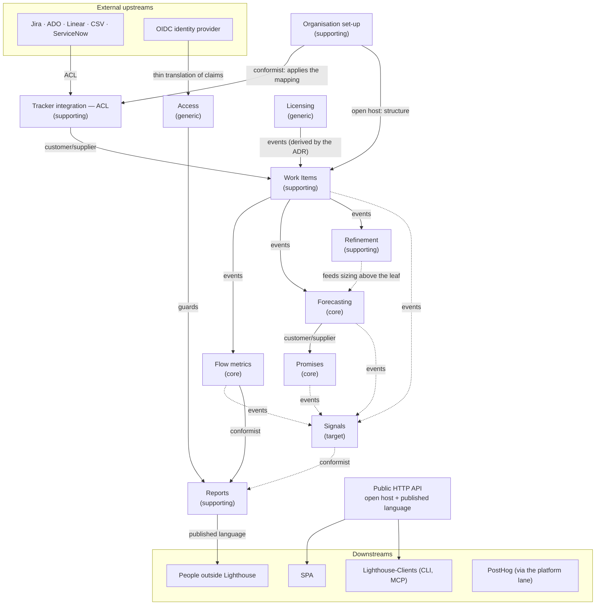

# ADR-270: Bounded contexts, context map and module layout

**Status**: Accepted (2026-11-01, maintainer; DESIGN of Story 6357, the first Story of Epic 6264 "path to a modular monolith"). The brief's acceptance criterion of "nine bounded contexts" is superseded by the eleven the storming found.
**Date**: 2026-11-01
**Feature**: `docs/feature/story-6357-s01-bounded-contexts-context-map/`
**Refines**: [ADR-027](adr-027-target-architecture-modular-monolith-domain-events-cqrs-lite.md) (its decision on module boundaries). ADR-027's single store, single binary, in-process dispatcher, no broker and no Event Sourcing all stand.
**Session board**: [`event-storming/board.md`](../../feature/story-6357-s01-bounded-contexts-context-map/event-storming/board.md) (the decisions), seeded from [`event-storming/board-seed.md`](../../feature/story-6357-s01-bounded-contexts-context-map/event-storming/board-seed.md) (today's code, every claim with a file reference).

> **Target, not today.** Everything below describes where the code is going, not what it is. The modular-monolith
> work moves towards it over the coming weeks, one behaviour-free Story at a time; until a context has been moved,
> [ARCHITECTURE.md §4](../../../ARCHITECTURE.md#4-the-nine-modules) describes the code as it stands. Every context and
> concept below is marked either **packaged from today's code** (it exists; a Story moves it into its new home without
> changing what it does) or **target only** (it does not exist yet). Target-only concepts are the language for future
> features (Epic 6455 "deeper hierarchies" first). They are **not** refactoring work: no packaging Story builds
> Signals, the promise lifecycle events, levels above the Feature, or organisation-wide defaults for SLE and staleness.
>
> **Moved so far (2026-11-09):** Flow metrics, by the pilot Story 6358. For Flow metrics this ADR describes today's
> code, apart from what is still marked target only (per-level granularity, and the entities and DTOs that stay in
> `Models`). Every other context is still where §4 places it.

## Context

ADR-027 named seven logical modules; Refinement and Reports joined later, giving the nine in ARCHITECTURE.md §4. They
are namespace folders, drawn around the code as it grew. The modular-monolith Epic needs one written picture of the
domain that every later packaging Story moves towards, so that none of them has to re-decide where a class belongs.

The Story's brief assumed the answer would be the nine modules, renamed as bounded contexts. It asked for the answer
to come from a **Big Picture Event Storming** session instead. That session ran with the maintainer on 2026-11-01:

1. A draft wall was seeded from the code: the 14 domain event types and their handlers, the business facts that
   happen without an event type, the commands (controller actions), the policies (background updaters and handlers),
   the read models and the external systems.
2. The maintainer wrote their own list of what happens in Lighthouse before looking at the seed, and the two walls
   were merged.
3. The merged timeline was walked section by section (install, access, connecting a tracker, configuring Teams and
   Portfolios, sync, metrics, forecasting, Deliveries, refinement, reports, clients), marking hot spots and language
   shifts.
4. The walk ended with the pivotal events, the candidate contexts, a context map and the layout, each confirmed by
   the maintainer.

The storming found a different cut from the nine modules. Two things drove it:

- **Language divergence.** "Portfolio" means at least three things to users (a product with release tracking, a
  SAFe Agile Release Train, a value stream). "Forecast" means four things in code. "Delivery" is both an answer
  (when will this be done) and a commitment (we said it would be done by then). Where one word means two things, the
  model needs two contexts or two words.
- **Concepts with no home.** How an organisation is set up (its levels, their names, the terminology, how tracker
  states map onto Lighthouse's, the defaults its Teams follow) is spread over instance settings, connection defaults
  and per-Team and per-Portfolio settings. None of the nine modules owns it.

## Decision 1: the contexts

Nine modules become **eleven bounded contexts**. Platform/Persistence stops being a module and becomes the composition
root's infrastructure. Portfolio/Delivery splits: the Portfolio as a unit of the organisation goes to Organisation
set-up, the Deliveries go to Promises. RBAC/Identity splits into Access and Licensing. Signals is new and target only.

| Context | Type | Responsibility | Owns | From today's §4 module | Packaged or target |
|---|---|---|---|---|---|
| **Organisation set-up** | supporting; upstream of nearly all | How this organisation is structured and how it works by default. It holds the levels and their names (Terminology), the units on each level (the leaf unit that generates throughput, today's Team; the units above it, today's Portfolios), the mapping of tracker types, states and fields onto Lighthouse's concepts with its defaults, each unit's overrides, the calendar (blackout periods) and the cadence and priority rules (refresh cadence, Feature ordering policy). Structure and defaults only, no behaviour. | Terminology, blackout periods and recurring rules, refresh cadence, Feature ordering policy, the Team and Portfolio entities and their settings, connection defaults (until a decision on org default versus per-tracker default) | None. Spread over Platform/Persistence (seeding, settings), Portfolio/Delivery, the `Models` kernel and the connection settings | **Packaged** from today's settings, Teams and Portfolios. Levels above the Feature, org-wide defaults with local override for SLE, staleness and similar, and per-level granularity are **target only** |
| **Tracker integration** | supporting | The anti-corruption layer in front of Jira (Cloud, Server, Data Center), Azure DevOps, Linear, CSV and ServiceNow. Connections, credentials and OAuth, connection health, and the **translation** of each tracker record into a Work Item or Feature during a fetch, applying the mapping it is given. Nobody outside it sees a tracker's model. | Connections and their credentials, connectors, connection health, the shared category-crossing rule that dates started and finished work | WorkTracking-Integration (minus the mapping, which moves to Organisation set-up) | **Packaged** |
| **Work Items** | supporting | Owns Lighthouse's copy of the work mirrored from the trackers and keeps it current; the refresh process itself is still called sync. The items of every level, leaf and non-leaf alike, are **one item model with a level**, not separate contexts for leaf and non-leaf items. Refreshes (scheduled and forced), the sync mode (full or sweep), parent links (placing Work Items under Features), rolling work up onto Features including the default-size guess for a Feature with no children, dependencies, blocked and state-transition capture. Its outward facts are "this unit's data was refreshed" and "a refresh failed", not its internal steps. | The items (today's Work Items and Features), their state transitions, blocked periods, parent links, the roll-up and the default-size guess, the refresh log, the Team and Portfolio refresh pipelines | WorkItems/Sync, plus the refresh half of Portfolio/Delivery (the Team and Portfolio updaters) | **Packaged** |
| **Flow metrics** | **core** | One flow calculation at every level: throughput, cycle time, Work Item Age, WIP, percentiles, cumulative state time, process behaviour, blocked history, the day-keyed history snapshots. Granularity differs by level (a Team per day, a strategic level per week or month), which is a property of the level. SLE risk stays here until the first Signals feature. | The metric calculations and caches, the over-time snapshot tables and the history filler | Metrics / Time-in-state | **Packaged** in `Modules/FlowMetrics` by the pilot, Story 6358 (2026-11-09). Its entities and `Models/Metrics` DTOs still sit in `Models`. Per-level granularity is **target only** |
| **Forecasting** | **core** | Answers "when" and "how many" at every level. It forecasts the items directly above the leaf from the leaf unit's throughput (Monte Carlo), then composes "all children done" upwards level by level. It owns the forecasting inputs of the leaf unit (Feature WIP, throughput window): Organisation set-up owns the unit's identity, structure and way-of-working overrides, Forecasting owns how the leaf unit behaves as capacity, stored as Forecasting's own extension keyed by the unit's id (today both live on `Team`; they move when Forecasting is packaged, an expand-only schema change). A forecast is an answer that is recomputed and replaced; it is a planning aid, not a tracked promise. | Forecasts (completion and start), the forecast round and its fingerprint, manual forecasts, backtests and the reality check, the forecast filter rules | Forecasting, plus the forecast half of Portfolio/Delivery (the forecast updater) | **Packaged**; composing forecasts over more than one level above the leaf is target |
| **Promises** | **core** | A promise is a target date someone committed to for a set of items on one level, compared against the forecast, with a history of how it ended (kept, missed, renegotiated by moving the target or cutting scope). It includes planning: deciding what fits before committing ("what can we promise by the end of the PI?"). In the user's language one promise is a **Delivery**. A Delivery holds items of the level it hangs off; today's Deliveries are this rule on the Feature level. | Deliveries, their rules, sources (Jira Releases), notes, closure pins and metric snapshots | The Delivery half of Portfolio/Delivery | **Packaged** (today's Deliveries). Promise lifecycle events and Deliveries on levels above the Feature are **target only** |
| **Signals** | supporting | Turns state into attention: red, amber and green on two levels, the health of a unit or level (for example how many of its items are blocked or stale) and the promise (a Feature's or Delivery's likelihood of hitting its date). It owns thresholds, the current state and the history of when a signal changed, and it suggests when a promise should be renegotiated. One context so that the threshold-and-history mechanism is built once, not twice in Metrics and Promises. | Signal thresholds, current states, change history | None | **Target only.** Nothing to package; SLE risk stays in Flow metrics until the first Signals feature |
| **Refinement** | supporting | At the leaf, a way of working: which Work Items are in refinement, how many more the Team needs, sizing votes and stages. On levels above the leaf a different form may come, sizing items approximately for reference-class forecasting, where it would feed Forecasting. | The Refinement settings, the sizing log, stage resolution, the need band | Refinement | **Packaged** (the leaf form). Refinement above the leaf is target |
| **Reports** | supporting | Turns live numbers into a frozen record for others. Then & Now is the first report type; more follow (metric charts, signals). It conforms to Flow metrics for numbers and is the outbound channel to people outside Lighthouse (PDF export today; scheduled delivery in future). | Reports and their frozen windows (Then), templates, the metric catalog | Reports | **Packaged**; scheduled delivery and further report types are target |
| **Access** | generic | Who may do what: organisation-wide roles (System Admin, broad readers) plus membership per unit. It follows the units that exist and has no story of its own beyond that. *Not allowed* is Access; *not relevant* (which level a person sees by default) is not. | Users, roles, unit memberships, IdP group mappings, API keys, embed sessions | RBAC / Identity (minus licensing) | **Packaged**; membership per unit on any level is target |
| **Licensing** | generic | Whether Premium is available and how many units the free tier allows, published as facts the others react to: licence loaded, licence in its last 30 days, licence expired. | The licence, its verification, the free-tier limits | RBAC / Identity (`Services.*.Licensing`, the premium gate), as ARCHITECTURE.md §4 and the `Services.Implementation.Licensing` namespace show. The board's "inside Platform" was a slip | **Packaged** (small). The three licence events are **target**; today all three facts are derived on read |
| *(Platform lane)* | **not a context** | Composition-root infrastructure below the domain: the encryption key ring, backups and restore, demo data, version update, log level, usage-data consent and forwarding, start-up housekeeping, the `DbContext` and database management, the domain-event dispatcher, the update queue's mechanics, health and graceful shutdown. No user names any of it as part of the story. | The infrastructure the contexts run on | Platform / Persistence, and the host band | Stays in the composition root |

Nine modules therefore become **eleven contexts** (ten packaged from today's code, Signals target only), with Platform
taken out of the domain. The packaging catalogue of the Epic (one Story per module, S03a to S03h) was written for the
nine modules; it is revised at this Story's close-out to one packaging Story per packaged context.

Where a piece of today's Portfolio/Delivery or Platform module has no obvious owner, the packaging Story for that
context records its choice (see "Left open" at the end).

## Decision 2: the context map

```text
  Jira · ADO · Linear · CSV · ServiceNow                    OIDC IdP           PostHog
          │ (upstream, external)                               │                  ▲
          ▼                                                    ▼                  │ platform lane
  ┌────────────────────┐  mapping (conformist)   ┌─────────────────────────┐   ┌────────┐
  │ Tracker integration │◄────────────────────────│ Organisation set-up      │   │ Access │ generic, guards all
  │   (ACL)             │                         │ levels·names·units·      │   └────────┘
  └─────────┬──────────┘                         │ defaults·overrides       │   ┌───────────┐
            │ customer/supplier                   └───────────┬─────────────┘   │ Licensing │ generic,
            ▼                                                 │ open host:      └───────────┘ events → all
  ┌───────────────────┐  domain events                         │ everyone conforms to its structure
  │ Work Items        │──────────────┬─────────────┬───────────┼──────────────┐
  └───────────────────┘              ▼             ▼           ▼              ▼
                            ┌──────────────┐ ┌─────────────┐ ┌────────────┐ ┌─────────┐
                            │ Flow metrics │ │ Forecasting │◄│ Refinement │ │ Signals │ (target)
                            └──────┬───────┘ └──────┬──────┘ └────────────┘ └────▲────┘
                                   │ conformist     │ customer/supplier          │ events from Work Items,
                                   ▼                ▼                            │ Metrics, Forecasting,
                            ┌──────────────┐ ┌─────────────┐                     │ Promises
                            │ Reports      │ │ Promises    │─────────────────────┘
                            └──────┬───────┘ └─────────────┘
                                   │ published language (PDF, scheduled) → people outside Lighthouse
  Public HTTP API = open host / published language → SPA, Lighthouse-Clients (CLI, MCP)
```

An arrow points from upstream to downstream: the downstream context depends on the upstream one, never the other way.



Dashed arrows are target only. Licensing → Work Items is derived by this ADR, not drawn on the board, and was accepted with it.

**An acknowledged cycle: Organisation set-up and Tracker integration.** Today the two depend on each other. Set-up
validates a Team's or Portfolio's query and suggests types and states by asking the tracker, while the ACL conforms
to set-up's mapping when it translates. The cycle is broken like this: set-up uses the ACL's query port as a
**customer** for validation and suggestions, and the mapping is **handed to the translation as data with each fetch**
(Work Items passes it in), so Tracker integration never references Organisation set-up. The conformist relationship stays
one of meaning, not of code: there is no compile-time cycle.

### Every edge

The first column reads upstream → downstream (the downstream depends on the upstream). The "Legal today" column
uses §4's opposite, **depends-on** direction: it names the §4 edge "downstream module depends on upstream module" and
checks it against the cross-module edges ARCHITECTURE.md §4 draws (WorkItems/Sync depends on WorkTracking-Integration;
Portfolio/Delivery depends on WorkItems/Sync and Forecasting; Forecasting depends on WorkItems/Sync; Refinement depends on WorkItems/Sync,
Forecasting and Metrics; Reports depends on Metrics and RBAC; everything depends on the `Models` kernel), with each
context read as the §4 module it comes from. Edges marked **Derived** were not drawn on the board; this ADR derived
them from the code or the walk, and the maintainer accepted them with the ADR.

| Upstream → downstream | Relationship | How the downstream reaches it | Legal today? (depends-on, per §4) | Derived by the ADR (accepted with it) |
|---|---|---|---|---|
| Jira, ADO, Linear, CSV, ServiceNow (and the Jira and ADO OAuth providers) → Tracker integration | external upstream; anti-corruption layer | Connectors translate each record into Work Item or Feature | Yes (WorkTracking-Integration is a leaf input adapter) | |
| Organisation set-up → Tracker integration | conformist: the ACL applies the organisation's mapping as given | Mapping handed in as data with each fetch (see the acknowledged cycle above) | Today the mapping sits on Team, Portfolio and connection in the kernel; no module edge exists. New edge, in meaning only | |
| Tracker integration → Organisation set-up | customer/supplier: set-up is the customer of the ACL's query port | Validates queries and asks for suggested types and states | No module edge today (the API band calls the connectors). New edge | **Derived** (from the cycle above) |
| Tracker integration → Work Items | customer/supplier: Work Items is the customer, the connector port is the negotiated contract | Query through the connector port | Yes (WorkItems/Sync depends on WorkTracking-Integration) | |
| Organisation set-up → every other context | open host: everyone conforms to its structure (units, levels, names, defaults, calendar) | Queries through its contract; reactions to its events | Today through the kernel. New edges | |
| Work Items → Flow metrics | upstream publishes, downstream reacts (domain events) | Reacts to the refresh events; reads stored history through read ports | Not drawn in §4. Works today only because the events sit in the kernel. Becomes a legal edge once event types move to Work Items | |
| Flow metrics → Work Items (Work Items calls Flow metrics, beyond the event) | none designed; a direct call | `TeamDataService` calls `ITeamMetricsService.UpdateTeamMetrics` after a Team refresh (ratchet candidate 1); `WorkItemService` uses `IPortfolioMetricsService` and the Domain's `PercentileCalculator` | **Not legal** (WorkItems/Sync may not depend on Metrics). Measured 2026-11-09 and ratcheted in the R3 and R4 lists | **Derived** (from code, Story 6358) |
| Forecasting → Flow metrics (Flow metrics calls Forecasting) | none designed | Three edges from the module's Application: `BaseMetricsService` → `IForecastService` (resolved through the service locator; the generic argument is visible in the IL), `TeamMetricsService` → `IForecastFilterRuleService`, `TeamMetricsService` → `ForecastDataSufficiencyPolicy` | **Not legal** (Metrics may not depend on Forecasting). Ratcheted in the R5 list, which only shrinks | **Derived** (from code, Story 6358) |
| Flow metrics → Forecasting (Forecasting calls Flow metrics) | customer/supplier, undeclared | `ForecastService`, `ForecastService+GatheredInputs`, `ForecastInputs`, `ForecastInputFingerprint` and `ForecastRealityCheckService` read `ITeamMetricsService` and `ForecastThroughputStatus` | **Not legal** (Forecasting depends only on WorkItems/Sync). Ratcheted in the R4 list. With the row above, the two contexts depend on each other: a cycle to break before S09b | **Derived** (from code, Story 6358) |
| Flow metrics → Platform lane | none designed | `DatabaseMaintenanceGate` reaches the module's Application | Platform is the composition root's infrastructure, not a context; ratcheted in the R4 list until S03f decides | **Derived** (from code, Story 6358) |
| Work Items → Forecasting | customer/supplier, by events | Reacts to the refresh events; reads Features and throughput through Work Items' contract | Yes (Forecasting depends on WorkItems/Sync) | |
| Work Items → Refinement | customer/supplier | Reads Work Items in refinement | Yes (Refinement depends on WorkItems/Sync) | **Derived** |
| Forecasting → Refinement (today) | customer/supplier | Refinement reads the Team's manual How Many forecast | Yes (Refinement depends on Forecasting) | |
| Refinement → Forecasting (target, above the leaf) | supplier of sizes | Refinement above the leaf sizes items that Forecasting consumes | Target only. It would make Forecasting depend on Refinement, the reverse of today; see "Left open" | |
| Flow metrics → Refinement | customer/supplier | Reads the SLE yardstick and throughput | Yes (Refinement depends on Metrics) | **Derived** |
| Forecasting → Promises | customer/supplier | Reacts to "forecasts updated"; reads Feature forecasts for the joint "all done by" answer | Yes (Portfolio/Delivery depends on Forecasting) | |
| Work Items → Promises | customer/supplier | Delivery rules match fetched Features | Yes (Portfolio/Delivery depends on WorkItems/Sync) | |
| Tracker integration → Promises | customer/supplier (Jira Releases as a Delivery's source, forecasts published back) | Through the connector | **Not legal** (Portfolio/Delivery depends on WorkTracking-Integration is not in §4), but present in code. Ratchet candidate | **Derived** (from code) |
| Work Items, Flow metrics, Forecasting, Promises → Signals | upstream publishes, downstream reacts | Domain events only | Target only | |
| Flow metrics → Reports | conformist ("a report and the tab never disagree") | Reads through the same metrics contract the tab uses | Yes (Reports depends on Metrics) | |
| Signals → Reports | conformist | Includes signals as they are | Target only | |
| Reports → people outside Lighthouse | published language | PDF export today; scheduled delivery in future | n/a (outbound) | |
| Access → every context except Organisation set-up | generic; guards | Guards at each context's API adapter; owner-scoped listing through `IRbacAdministrationService` | Yes for Reports (depends on RBAC); elsewhere the guards sit in the API band | |
| Organisation set-up → Access | conformist: memberships follow the units that exist | Unit identifiers | Through the kernel today. New edge | **Derived** |
| OIDC identity provider → Access | external upstream; thin translation of claims (a small ACL) | Claims parsed into roles and groups | Yes | |
| Licensing → every context except Organisation set-up | generic; published events (loaded, last 30 days, expired) | Reacts to licence events; asks "is Premium available" through its contract | Today checked on read; the refresh paths (Portfolio/Delivery) depend on RBAC/Identity, which §4 does not allow. Ratchet candidate | |
| Licensing → Work Items | generic; published events | Stops refreshing when the licence expires and more units exist than the free tier allows | Same ratchet candidate as above | **Derived** |
| Organisation set-up → Licensing | customer/supplier | Counts units against the free-tier limit | Through the kernel today | **Derived** |
| Public HTTP API → SPA, Lighthouse-Clients (CLI and MCP) | open host service with a published language | HTTP, the clients' contract | Yes (the API is the driving adapter) | |
| Platform lane → PostHog | external downstream | The usage-data pipe forwards events the clients hand in | n/a (composition root) | |
| GitHub Releases → Platform lane | external upstream | Version check and release notes | n/a (composition root) | |

### Edges measured by the Flow metrics pilot (2026-11-09)

Story 6358 measured every edge into and out of `Modules/FlowMetrics` from the compiled IL (`IlDependencies`, Debug and
Release builds identical) and fixed each list as an inline baseline that fails on a newcomer and on a stale entry
(ADR-268). The lists only shrink. The rules live in
`Lighthouse.Backend.Tests/Architecture/FlowMetricsInboundDomainAndAdaptersArchUnitTest.cs` (R3),
`FlowMetricsInboundApplicationArchUnitTest.cs` (R4) and `FlowMetricsApplicationOutboundArchUnitTest.cs` (R5).

| Rule | What it allows | Baseline (outside types, or edges) |
|---|---|---|
| R2 | The module's Domain depends only on the kernel (`Models`) and the .NET base library | empty |
| R3, Domain inbound | Outside types reach `Domain` only from the list | 6: `API.PortfolioController`, `API.PortfoliosController`, `API.TeamController`, `API.TeamsController` (they use `BaselineValidationService`), `Reports.Metrics.DailySeriesSummary`, `WorkItems.WorkItemService` |
| R3, Adapters inbound | Only the composition root reaches `Adapters` | `Program` only, no list |
| R4, Application inbound | `API`, the composition root, Reports and Refinement by namespace (legal), plus the list | 10 (the design expected 8): Forecasting `ForecastService`, `ForecastService+GatheredInputs`, `ForecastInputs`, `ForecastInputFingerprint`, `ForecastRealityCheckService`; Work Items `TeamData.TeamDataService`, `WorkItems.WorkItemService`; `WriteBackTriggerService` (write-back, see "Left open"); `FeatureListActiveWork`; Platform `DatabaseManagement.DatabaseMaintenanceGate` |
| R5, Application outbound | No EF Core, `Data`, module `Adapters` or `API` type; Forecasting only through the list | below the Application: empty. Forecasting: 3 edges (see the Forecasting → Flow metrics row) |

The legal R4 callers seen on 2026-11-09: the controllers `ForecastController`, `ForecastRealityCheckController`,
`PortfolioMetricsController`, `TeamFeatureSizeMetricsController`, `TeamMetricsController`; `Program`; Reports'
`PortfolioReportMetricSeries` and `TeamReportMetricSeries`; Refinement's `RefinementNeedCalculator` and
`SleYardstickResolver`.

### Ratchet candidates

Each of these is an edge today's code takes that §4 does not allow, or one that points the wrong way once its two
ends are in their target contexts. The packaging Story of the context that holds the offender adds it to a ratchet
guard (ADR-268) or removes it.

1. **Work Items calls Flow metrics directly.** `Services/Implementation/TeamData/TeamDataService.cs:23` calls
   `ITeamMetricsService.UpdateTeamMetrics` inline after a Team refresh, while the Portfolio refresh does the same
   reaction in a handler. Metrics is not among WorkItems/Sync's legal dependencies; it should be a handler on the Team refresh event.
   *Since 2026-11-09 this edge is in the R4 list of the Flow metrics module, which only shrinks; Work Items'
   packaging Story (S03b) removes it from there.*
2. **The refresh paths read the licence from RBAC/Identity.** `TeamUpdater.cs:31-34`, `PortfolioUpdater.cs:65-68` and
   `ForecastUpdater.cs:292` (all under `Services/Implementation/BackgroundServices/Update/`) resolve `ILicenseService`.
   Portfolio/Delivery → RBAC/Identity is not a legal edge. In the target these become Work Items and Forecasting reacting to
   Licensing's facts. The three different limits (2 at create, 3 Teams and 1 Portfolio in the updaters) belong to the
   same hot spot.
3. **Deliveries talk to the tracker without the ACL's contract.** `Services/Implementation/DeliverySources/DeliverySourceResolver.cs:9`
   and `DeliveryForecastPublishingService.cs:12` take `IWorkTrackingConnectorFactory`. Portfolio/Delivery →
   WorkTracking-Integration is not a legal edge, and the board's map has no edge from Tracker integration to Promises.
4. **The Portfolio refresh pipeline reaches into Promises and Forecasting.** Inside the refresh, `PortfolioUpdater.cs:101`
   recomputes rule-based Deliveries and `PortfolioUpdater.cs:106` resyncs Deliveries from their source, and
   `PortfolioUpdater.cs:124` is a direct trigger of the forecast updater (it enqueues work), bypassing an event. Legal
   while the updater sits in Portfolio/Delivery; once it moves to Work Items, both point from upstream to downstream.
5. **A domain event published by a controller.** `TeamDeleted` is published from `API/TeamController.cs:115`, not from
   the context that owns the Team; Portfolio deletion has no event and cleans the refresh log inline
   (`API/PortfolioController.cs:77-89`).
6. **The kernel holds far more than the shared kernel may.** `Models` holds every entity and the DTOs the services
   return; `Feature` carries Forecasting's rows (`Models/Feature.cs:60,66`). Decision 7 narrows it.
7. **Service locator in the updaters.** The updaters resolve collaborators through
   `serviceProvider.GetRequiredService`, which hides their cross-context edges from the architecture tests.
   *Correction, 2026-11-09:* the generic call `GetRequiredService<T>()` is not hidden from the IL. `IlDependencies`
   reports `T` as a dependency of the caller, as the Flow metrics pilot found for `BaseMetricsService` →
   `IForecastService`. Whether the updaters' calls are all generic has not been checked; S03b and S03c measure them.

## Decision 3: domain events are the default way contexts react to each other

When something happens in one context and another context must react, the upstream **publishes a domain event** and
the downstream **handles it**, through the existing in-process dispatcher. That is ADR-027 unchanged: transport only,
after commit by default, no event store, no Event Sourcing, no broker, no outbox. Direct calls across contexts are for
**queries**, through the upstream's contract. A context does not call another context to make it do something.

Each event type moves to the context that **publishes** it. The shared kernel keeps only the base type.

**Events and pipelines.** An ordered pipeline may stay imperative inside one context, as ARCHITECTURE.md §5 says of
the Portfolio refresh. A step that crosses into another context becomes a domain event. Where order matters across
contexts, use a chain of events: for example, Promises recomputes rule-based Deliveries on "items refreshed" and
records its snapshot on "forecasts updated". The trade-off, accepted:

- **A pipeline** shows its order in one place and returns errors to its caller, but couples the caller to every
  reaction and blocks extracting or rewriting a context.
- **Events** let the publisher know nobody: dependencies point at contracts, which is what lets a context be extracted
  or rewritten.
- The cost of events: the flow is spread over handlers, and there is no order between handlers of one event.
- After commit and without an outbox, a crash loses a reaction. That is harmless while the next refresh repairs it, and
  not acceptable for target history (signals, the promise lifecycle), which needs its own decision when built.
- Readers see eventual consistency between contexts.

**The pivotal events are the backbone of the map.** A pivotal event is where the story hands over to a new phase and
a word changes meaning.

| Pivotal event | What changes meaning | Publisher | Today |
|---|---|---|---|
| Organisation set up / level introduced | Structure, names and mapping exist; everything downstream reads them | Organisation set-up | **Target.** Today's nearest: `BlackoutConfigurationChanged`, `FeatureOrderingPolicyChanged`, `TeamDeleted` |
| Items fetched (the connection works) | Tracker records become Lighthouse items (translation) | Tracker integration | **Target.** Today implicit; `ConnectionFetchShapeChanged` exists for one case |
| Unit data refreshed | Items become flow history | Work Items | **Exists** as `TeamDataRefreshed` and `PortfolioFeaturesRefreshed` |
| Forecasts updated | Throughput becomes dates | Forecasting | **Exists** as `PortfolioForecastsUpdated` |
| Promise made, kept, missed, renegotiated (target moved, scope cut) | A date becomes a commitment | Promises | **Target.** Today only the archive's frozen closure pin exists |
| Signal changed | State becomes attention | Signals | **Target** |
| Report created | Live numbers become a frozen record for others | Reports | **Target.** Today a usage-data name only |
| Licence expired (and loaded, in its last 30 days) | An upstream gate on everything | Licensing | **Target.** Today derived on read |

The other event types that exist today and where they move: `WorkItemTransitioned`, `WorkItemBlocked`,
`WorkItemUnblocked`, `WorkItemBecameStale`, `FeatureBlocked`, `FeatureUnblocked` to Work Items; `ConnectionFetchShapeChanged`
to Tracker integration; `TeamDeleted`, `BlackoutConfigurationChanged`, `FeatureOrderingPolicyChanged` to Organisation
set-up. `FeatureRankChanged` follows wherever Feature ranking lands (see "Left open").

**Gaps the board found.** They are recorded so the features that need them know where they start; closing them is
feature work, not packaging, unless a packaging Story needs one to remove a ratchet item.

- Events nobody listens to: `WorkItemTransitioned` and `WorkItemBecameStale` are published and have no handler. In
  the target they are inputs to Signals.
- Facts with no event: Portfolio deleted, Feature transitioned (captured into its own table with no event), a
  connection stopped working (and started working again), licence expired, a Delivery created, rescheduled or
  archived, Team or Portfolio created, a refresh failed.
- The Portfolio refresh's forecast is a direct trigger of the forecast updater (it enqueues work), bypassing an event
  (ratchet candidate 4).
- Two event vocabularies: the browser's usage-data names (`TeamCreated`, `PortfolioDeleted`, `ReportCreated` and so on)
  name facts the backend has no event for. Usage data stays in the platform lane; the domain events are the model's.

## Decision 4: key distinctions in the language

- **Leaf versus non-leaf level, not Team versus Portfolio.** What is special is tied to whether a level is the leaf
  or not, never to a numbered level. Feature WIP only matters at the leaf, where throughput is generated. Refinement
  exists only at the leaf today; if it comes to non-leaf levels it must work for any number of them. Leaf is a code
  word: docs say **work level** and **levels above**, and users see "Where the work is done" and "Groups the level
  below" (2026-11-06).
- **The leaf unit is the unit that generates throughput.** Today it is the Team. Its role is fixed; its name is open
  (the maintainer: "unsure yet how best to solve this"), and so is how to model it generically. Everything above it
  is a generic unit on a level; the old Portfolio becomes one of those.
- **Levels are paired.** Each level pairs an owning unit (a group of people, a board) with the unit of work assigned
  to it. At level 1 the Team owns the items that roll up from its Work Items (today's Lighthouse Feature). Above it,
  for example, an ART or value stream owns Changes or Capabilities, and a programme or portfolio board owns strategic
  items. Target only.
- **Forecast is not Promise.** A forecast is an answer ("when, with what likelihood") that is recomputed and replaced.
  A promise is a target someone committed to, which forecasts are compared against, with history and signals.
  Forecasting owns the first, Promises the second. That a Feature's forecast moves matters little; change matters
  where a target exists.
- **Mapping is not Translation.** Mapping (which tracker types, states and fields count as Work Item, Feature, In
  Progress, Done, blocked) needs the user and describes how the organisation works: Organisation set-up. Translation
  (turning each tracker record into a Work Item or Feature during a fetch) is plumbing that just works once the
  mapping is known: Tracker integration. The mapping is keyed by **connection and level**, because the structure knows
  no tracker and two connections may use one word for different levels (2026-11-06, ADR-274).
- **Not allowed is not "not relevant".** "A C-level person should not see all the Team-level things" hides two needs:
  a permission (Access) and which level a person looks at by default (a read-model and navigation concern). Keep them
  apart.
- **Three setting buckets.** Who decides a setting, as sorted by the maintainer. Today these settings are split across
  instance settings, connection defaults and per-Team and per-Portfolio settings; moving them into the buckets is
  feature work (Epic 6455 or its own), not refactoring.

  | Bucket | Settings | Note |
  |---|---|---|
  | **Org-wide, fixed** (one per installation) | Terminology; hierarchy levels and their names; blackout periods; Feature ordering policy; refresh cadence | Calendar, cadence and priority rules for the whole organisation |
  | **Connection mapping, unit narrows** | Work Item types; Feature types | Keyed by connection and level. A type sits on one level per connection; a unit unticks, never adds (ADR-274) |
  | **Connection default, local override** | Parent sources; dependency field; estimation; Closed Items Cutoff; blocked rules; staleness threshold; SLE; default Feature size | The dominant pattern, keyed by connection and level. Lighthouse already has it at the connection (a Team follows the connection's default or owns its value, ADR-241). Revised 2026-11-06: anything the units on a connection and level share can default there. The earlier target, an organisation-wide default, comes only if someone asks for it |
  | **Local only** | Feature WIP; throughput window; a unit's To Do, Doing and Done states (a connection default may come later) | Forecasting's view of the leaf unit as a capacity. Interesting to *see* across units; set locally |

## Decision 5: glossary per context

Code uses the **seeded default terms** from `TerminologySeeder.cs` (Feature, Work Item, Team, Portfolio, Delivery,
Cycle Time, Throughput, WIP, Blocked, SLE, Refinement). Settings → Terminology renames only what users see, never a
class, table or wire field. The glossary lists only terms that matter or drift.

### Organisation set-up

| Term | Meaning | Code name today | Drift |
|---|---|---|---|
| Level | A tier of the organisation's structure, pairing an owning unit with a unit of work; the leaf is level 1 | none | Target only |
| Work level | The level where the work is done: the leaf, in docs and conversation | leaf | Target word; users read "Where the work is done" |
| Levels above | Every level above the work level. Each groups the level below | non-leaf | Target word; users read "Groups the level below" |
| Unit | A group of people or a board that owns work on a level | `Team`, `Portfolio` | Target word; today two unrelated types |
| Team (leaf unit) | The unit that generates throughput; the only one with forecasting inputs | `Team` | Name open; the role is fixed |
| Portfolio | Today's unit above the Team. Users model with it a product with release tracking, an ART or a value stream | `Portfolio` | **Overloaded** (three meanings). Becomes a unit on a non-leaf level |
| Project | No meaning of its own: an old name for Portfolio | `GetFeaturesForProject`, `UpdateForecastForProject`, `ModifyProjectSettings`, the `/projects` suggestion routes, the wire field `Feature.projects`, the variable `project` in `PortfolioUpdater` | **Drift**: rename to Portfolio (the connector port rename is planned with the connector-capability Story) |
| Mapping | Which tracker types, states and fields count as Work Item, Feature, In Progress, Done, blocked, and the parent source order | Team, Portfolio and connection settings | Today split over three places |
| Parent sources | The ordered list of places a record's parent is read from, one to five entries. Each entry is the tracker's own parent or an Additional Field, which on Jira may name a link type. The first entry that yields a parent wins; the tracker's own parent is read only when it is in the list (ADR-279) | `ParentSources`, `ParentSourcesForTeams`, `ParentSourcesForPortfolios` | The source column and the wire members keep the old name: `ParentOverrideSource`, `parentOverride*` |
| Connection mapping | The mapping of one connection: per level, its item types and later its parent sources, dependencies and shared defaults | none | Target only; first step in Epic 6474 (ADR-274) |
| State mapping | A named group of a unit's tracker states, shown as one state on the settings page and in the charts. It never decides a category: the To Do, Doing and Done lists hold the tracker's states, and the group is derived from them on read | `StateMapping`, `DisplayStatesFor`, the `*DisplayStates` wire fields | Shares a word with Mapping above but is only a display grouping (ADR-277) |
| Terminology | The organisation's words for Lighthouse's concepts, one set per installation | `Terminology`, `TerminologySeeder` | Has one key pair per concept and no notion of a level |
| Owner | Overloaded in code: the Teams and Portfolios that use a connection ("N owners follow this default"), the Team or Portfolio a report belongs to (`ReportOwner`), a Portfolio's owning Team (`OwningTeamId`), and in the target the owning unit of a level | see meaning | **Drift.** "Users of a connection" is not ownership; the owner of a connection's credential is a different, still unnamed role |

### Tracker integration

| Term | Meaning | Code name today | Drift |
|---|---|---|---|
| Connection | Lighthouse's link to one tracker instance, with its credential | `WorkTrackingSystemConnection` | |
| Translation | Turning a tracker record into a Work Item or Feature during a fetch | `*WorkItemMapper`s, `WorkItemCategoryCrossing` | Code says "mapper" for translation; keep "mapping" for Organisation set-up's concept |
| Parent source | One place a connector can read a parent from: the tracker's own parent, a field, or on Jira a link type. Read per record and ordered by the shared selector | `ParentSourceEntry`, `ParentReading`, `ParentSourceSelector` | |
| Connection stopped working | One fact about the connection, whatever the cause | health verdict per refresh, `UnreadableSecretException` | Target event |
| Read refusal | A tracker read that failed, carrying the sentence the user reads, and never an empty answer | `WorkTrackingReadException`, `JiraReadException`, `AzureDevOpsReadException` | |

### Work Items

The context is called Work Items because it owns the mirrored data, not only the process of refreshing it (accepted by
the maintainer). The refresh process itself is still called sync.

| Term | Meaning | Code name today | Drift |
|---|---|---|---|
| Item | One record mirrored from a tracker, on any level. One model with a level, whether leaf or not | `WorkItem`, `Feature` (both on `WorkItemBase`), parent `Feature` rows | Target: one model with a level instead of separate types per level |
| Work Item | An item the leaf unit works on | `WorkItem` (and `WorkItemBase`, also the base of `Feature`) | **Overloaded**: a Team's item, any tracker record, and the base type of a Feature. With one item model, "Work Item" in the model means an item on any level, so the leaf's item needs a name of its own: a naming decision for Epic 6455 |
| Feature | Lighthouse's level-1 unit of work: the item Work Items roll up into and that is forecast. Not SAFe's Feature, which sits a level higher (what Lighthouse calls a Feature, a SAFe customer may call an Epic) | `Feature` | A parent above it is stored as a `Feature` row flagged `IsParentFeature`: one type, two meanings |
| Refresh | Bringing a unit's copy of the work up to date | `TeamUpdater`, `PortfolioUpdater`, `WorkItemService` | Users care that data is fresh and a failure is visible, not about the steps |
| Default-size guess | The remaining work assumed for a Feature with no children | `IsUsingDefaultFeatureSize` | |

### Flow metrics

| Term | Meaning | Code name today | Drift |
|---|---|---|---|
| Flow metric | Throughput, Cycle Time, Work Item Age, WIP and their percentiles, the same calculation at every level | `Modules/FlowMetrics` (namespace `Lighthouse.Backend.Modules.FlowMetrics.*`); the services are still named `*MetricsService` | No folder drift since Story 6358 (2026-11-09). The `*Service` role names are a later edit (see "Role names") |
| Snapshot day | The day a history row is recorded for | `RecordedAt` in three tables, another name in the Delivery snapshot | **Drift**: three names for one key |

### Forecasting

| Term | Meaning | Code name today | Drift |
|---|---|---|---|
| Forecast | An answer to "when" or "how many" with a likelihood, recomputed and replaced | four meanings: the stored completion histogram per Feature (`WhenForecast`), the stored start histogram (`StartForecast`), the unstored manual Team answer, the replay of past forecasts (reality check, backtest) | **Overloaded.** Qualify every use: completion forecast, start forecast, manual forecast, reality check |
| Feature WIP | How many Features the leaf unit works on at once; the simulation's parallelism | `FeatureWIP` on `Team` | Leaf only. Moves to Forecasting's own extension keyed by the unit's id, with the throughput window, when Forecasting is packaged |

### Promises

| Term | Meaning | Code name today | Drift |
|---|---|---|---|
| Promise | A target date committed to for a set of items on one level, with how it ended | none | Model word; target lifecycle |
| Delivery | The user's word for one promise | `Delivery` | Stays the configurable, user-facing term |
| Renegotiation | A promise changed: target moved or scope cut. Normal, not a failure | `Change Delivery` (reschedule, re-select) | Today no history |

### Signals (target only)

| Term | Meaning | Code name today | Drift |
|---|---|---|---|
| Signal | Red, amber or green on a unit or level's health, or on a promise, with a history of changes | SLE risk and likelihood colours, computed on read | Target |

### Refinement, Reports, Access, Licensing

| Term | Meaning | Code name today | Drift |
|---|---|---|---|
| Refinement | Getting Work Items ready at the leaf; above the leaf, approximate sizing for Forecasting (target) | `Refinement*` | |
| Report | A frozen record of live numbers, kept for others | `Report`, `IReportTemplate` | |
| Member | A person with a role on one unit | Team member, Portfolio member | Becomes per unit on any level |
| Licence | Whether Premium is available and how many units are allowed | `License*` (American spelling in code) | |

### Role names instead of `*Service`

A class name says which role it plays. The generic `*Service` suffix hides it: `WorkItemService` runs both the Team
and the Portfolio sync, and `TeamDataService`, `AppSettingService` and `LicenseService` say nothing about what they
do. New and moved classes take a role name; existing ones are renamed when their context is packaged.

| Role | What it is | Example today |
|---|---|---|
| use case | Carries out one user intent (a command) | `SizingLogCommands`, `ReportCommands` |
| policy | "Whenever X, then Y": an event handler or a decision rule | `TeamDataRefreshedForecastTriggerHandler` |
| calculator | A pure computation | `RefinementNeedCalculator`, `SleRiskCalculator` |
| projector | Records a read model from facts | the history recorders on the refresh events |
| query | Answers a question for a read path | `RefinementViewQuery` |
| reader | A persistence port that only reads | `IReportReader` |
| store | A persistence port that writes (`writer` where it only writes) | `IReportWriter` |

Other precise names that already say their role (`SyncModeResolver`, `StageRuleMatcher`) stay.

## Decision 6: layout

**Backend.** `Modules/<Context>/{Domain, Application, Adapters}`.

- `Domain`: the context's entities, value objects, domain events and rules. Depends on nothing but the shared kernel.
- `Application`: use cases, policies, queries, and the **ports they need, next to them**.
- `Adapters`: `Api` (controllers and their request and response types), `Persistence` (repositories, readers,
  stores), `Connectors` where a context talks to an outside system, and so on.
- Interfaces are co-located: a port lives next to the use case that needs it, not in a global `Services/Interfaces`
  folder.
- ArchUnitNET enforces "Domain ↛ Adapters" and "Domain ↛ Application" per context, and the legal edges between
  contexts.

**Settled folder names (Story 6358, 2026-11-08 and 2026-11-09).**

- One folder per context, the glossary name in PascalCase as one word: `Modules/FlowMetrics`, `Modules/WorkItems`,
  `Modules/TrackerIntegration`, `Modules/OrganisationSetup`, `Modules/Forecasting`, `Modules/Promises`,
  `Modules/Refinement`, `Modules/Reports`, `Modules/Access`, `Modules/Licensing`. No folder for Signals (target only)
  or Platform (composition root). Existing identifiers keep their spelling (`License*`).
- Namespace = folder: `Lighthouse.Backend.Modules.<Context>.<Layer>[.<Sub>]`.
- Sub-folders the pilot used, and the next contexts reuse: `Application/Policies` for domain-event handlers;
  `Adapters/Background` for hosted services; `Adapters/Persistence` for repositories. A repository's port sits in
  `Application`, next to the use case.
- Tests mirror the layout: `Lighthouse.Backend.Tests/Modules/<Context>/{Domain, Application, Adapters}`, each class in
  the namespace of its folder.
- The dependency rules are read from the compiled IL (`IlDependencies`), never from ArchUnitNET's graph alone.
- Flow metrics today: `Domain` (4 files), `Application` (27), `Application/Policies` (7), `Adapters/Background` (1),
  `Adapters/Persistence` (3). The entities and `Models/Metrics` DTOs stay in `Models` until S12c and S04b, because the
  EF model snapshots of both providers carry the entity names.

Chosen over:
- **Flat, role-named folders** per module: the layers are not visible, so the dependency rule cannot be read off the
  tree or enforced per folder.
- **Vertical slices** (one folder per use case with its own adapter code): they conflict with the ports-and-adapters
  rules the backend follows.

**Frontend.** `src/modules/<context>/`, each with one public `index.ts`. Code outside a module imports only from that
entry. Chosen over `features/` (collides with the domain word Feature) and `contexts/` (collides with React Context and
the existing `src/context/`).

**Coexistence.** Old and new layouts live side by side until a context is fully moved. A context is moved in one
packaging Story, behaviour-free. The exact folder names were fixed by the Flow metrics pilot (see above).

## Decision 7: what the shared kernel may hold

Only:
- identifiers used across contexts (a Team's, a Portfolio's, a Feature's id),
- truly shared value objects (for example a date range, a likelihood),
- the domain-event base type.

Nothing else. Each event type lives with the context that publishes it. Entities, DTOs and settings live in the
context that owns them. Today's `Models` folder is far wider and shrinks one packaged context at a time.

## Decision 8: who owns which data

The rule of source data plus per-context extension tables keyed by item id was raised by the maintainer in the
session and is recorded on the board under "Data ownership". It applies the Epic's earlier decision that data
ownership is logical only (no database per module).

- **Work Items owns the items mirrored from the trackers**, leaf and non-leaf alike, as **one item model with a
  level**: the items, their state transitions, blocked periods, parent links, and the roll-up and default-size guess.
  The maintainer's reasoning: once forecasts and other calculated data move to their owners, a Work Item and a Feature
  differ little. Of what `Feature` adds today, `Forecasts` and `StartForecasts` go to Forecasting; `FeatureWork`,
  `IsUsingDefaultFeatureSize` and `EstimatedSize` are Work Items' roll-up; `Portfolios` and `OwningTeam` go to
  Organisation set-up; `IsParentFeature` stays in Work Items; `ManualRank` is still open. Of what `WorkItem` adds,
  `Team`/`TeamId` go to Organisation set-up and `WasStaleAtLastSync` stays in Work Items.
- **Every downstream context owns the data it calculates**, in its own extension tables that reference items (or
  units) by ID only:

  | Context | Owns | Today |
  |---|---|---|
  | Forecasting | Forecasts (completion and start) | Still on the item: `Feature.Forecasts` and `Feature.StartForecasts`; the Story on aggregate boundaries in persistence (S13) moves them out, as its pilot |
  | Forecasting | The leaf unit's capacity inputs (Feature WIP, throughput window), keyed by the unit's id | On `Team`. Moves when Forecasting is packaged (expand-only schema change) |
  | Flow metrics | Its daily snapshots | Already separate tables; their repositories sit in `Modules/FlowMetrics/Adapters/Persistence` since 2026-11-09, the entities still in `Models` |
  | Promises | Deliveries and their history (closure pins, metric snapshots, notes) | Already separate tables |
  | Signals | Signal history | Target only |
  | Reports | Frozen report windows | Already stored on the report, apart from the items |
  | Organisation set-up | Levels, units (identity, structure, way-of-working overrides) and settings | Teams, Portfolios and settings; levels are target |

- **No context writes another context's tables.** Reading goes through the owner's contract.
- **Ownership is logical.** One database stays; foreign keys and cascading deletes stay (a database per module was
  rejected, see Alternatives). The data-ownership Story (S10) enforces owner-only writes; S13 pilots the extension
  table with the Forecast.

## Answers to the brief's open questions

- **Is Platform/Persistence a module or composition-root infrastructure?** Composition-root infrastructure. Keys,
  backups, updates, consent and start-up housekeeping sit below the domain timeline: no user tells the story of
  Lighthouse through them. Each context owns its persistence adapters; the `DbContext`, database management and the
  dispatcher stay in the platform lane.
- **Domain/Application/Adapters, sub-folders, or vertical slices?** Domain/Application/Adapters, with `Api`,
  `Persistence` and `Connectors` as sub-folders of `Adapters`. Reasons in Decision 6.
- **Should the persistence-port and connector-capability Stories run before packaging?** Left to S02, the Story that
  pilots the layout on Flow metrics: it learns what moving one context costs and orders the rest.
  *Answer from S02 (D-12, 2026-11-09):* **no hard order.** The pilot moved the code without touching a query. The
  persistence-port Stories (S05*) and the connector-capability Story (S06) can land before or after each S03*; landing
  after puts the new ports straight into the module's `Application` folder. The one hard order S02 found is S12c
  before a context's DTOs move, because the entity and DTO names are part of the EF model.

## Consequences

**For Epic 6455 (deeper hierarchies).** Recorded here; 6455's own documents are not changed by this ADR and its
DISCUSS takes these up:
- Levels are defined **once per installation**, not per Portfolio. This reverses the DIVERGE recommendation (levels per
  Portfolio) and matches the dissent recorded there.
- Each level pairs an owning unit with its unit of work. The recommendation stacked levels of work only and kept Teams
  flat.
- Organisation set-up is the context that changes. Deliveries hang off any non-leaf level and hold that level's items.

**For the Epic's catalogue.** S02 pilots the layout on Flow metrics. The packaging list S03a to S03h changes at this
Story's close-out: Portfolio/Delivery becomes Organisation set-up and Promises, RBAC/Identity becomes Access and
Licensing, Platform/Persistence becomes a composition-root Story, and Signals has no packaging Story. The
"Aggregates and invariants" Story builds on this board per context.

**For every feature.** Each DISCUSS and DESIGN places the feature on this map: which context it changes, which events
it publishes or handles, which glossary terms it adds or changes. When a feature moves a boundary or adds a term, it
updates this ADR's map and glossary (or amends it) in the same feature.

**Risks.**
- *Organisation set-up becomes a god context.* It is upstream of nearly everything, so everything wants to live in it.
  It holds structure and defaults only; behaviour belongs to the context that acts on them.
- *After-commit events without an outbox lose a reaction when a handler throws.* ADR-027 accepts that because the next
  re-sync recovers every fact from the database. A target reaction whose loss the next re-sync cannot recover (a
  signal's or promise's history, for instance) needs its own decision when it is built.
- *Two layouts at once* for a while: the rule of which one a new class goes into is "the new one, if its context has
  started moving".

## Alternatives considered

- **Keep the nine modules as they are and call them bounded contexts.** Rejected: Portfolio/Delivery mixes a unit of
  the organisation with commitments, RBAC/Identity mixes permissions with licensing, Platform is not part of the domain,
  and how the organisation is set up has no home.
- **A database per module.** Rejected earlier in the Epic: sync writes Work Items and snapshots in one transaction,
  Standalone is a single file, backup and restore work on one store, and nothing inside one binary needs to scale
  alone. Ownership is logical only.
- **Levels per Portfolio.** Rejected in the session: an organisation that says "Initiative" says it across the whole
  instance, and one structure per installation is fair to support.

## Left open

These were not decided on the board; the packaging Story of the named context decides and records it.

- Where **Feature ranking** (a person dragging a Feature, `FeatureRankChanged`) lives: Forecasting, Promises
  (planning) or Organisation set-up.
- Where **write-back** lives: the translation into tracker fields is Tracker integration's; what is written comes from
  its publisher (Forecasting's dates, Work Items' fields).
- Where the **update queue** lives: its mechanics look like platform-lane infrastructure, while scheduling a refresh is
  Work Items' and a forecast round is Forecasting's.
- **Mapping and the ACL.** The cycle is broken in Decision 2 (set-up is a customer of the ACL's query port; the
  mapping travels as data with each fetch). Decided: it is keyed by connection and level. Left open: the exact shape
  handed over.
- **Refinement above the leaf feeding Forecasting** reverses today's edge (Refinement reads Forecasting's manual
  forecast). Above the leaf it will need to come as an event or a separate contract.
- **The leaf unit's name** and how to model it generically.
- **The leaf item's name.** With one item model, "Work Item" means an item on any level, so the item at the leaf
  needs a name of its own. A naming decision for Epic 6455.
- Where `ManualRank` (a Feature's Lighthouse rank) lives, together with Feature ranking above.
- **Signals as a report type or as its own concept a report can include.**

## Note, 2026-11-08 (DESIGN of Story 6358, the Flow metrics pilot)

Two things fixed ahead of the pilot's lessons amendment, which is written when the pilot lands.

- **Folder and namespace spelling (settles Decision 6's "exact folder names").** One word per context, PascalCase, the
  glossary name: `Modules/FlowMetrics`, `Modules/WorkItems`, `Modules/TrackerIntegration`,
  `Modules/OrganisationSetup`, `Modules/Forecasting`, `Modules/Promises`, `Modules/Refinement`, `Modules/Reports`,
  `Modules/Access`, `Modules/Licensing`. Namespace: `Lighthouse.Backend.Modules.<Context>.<Layer>`. No folder for
  Signals (target only) or Platform (composition root). Existing identifiers keep their spelling (`License*`).
- **Known gaps, found by measuring the pilot's edges and settled in the lessons amendment.** The map above draws no
  edge for two dependencies that exist in today's code: **Flow metrics ↔ Forecasting** (Forecasting reads
  `ITeamMetricsService` and `ForecastThroughputStatus`; the metrics services take `IForecastFilterRuleService` and
  resolve `IForecastService` through the service locator) and **Work Items → Flow metrics** beyond the event reaction
  (`TeamDataService`, `WorkItemService`). The pilot names them in inline ratchet lists; whether the map or the code
  moves is decided in the amendment.

## Lessons from the Flow metrics pilot, 2026-11-09

Story 6358 moved Flow metrics into `Modules/FlowMetrics` in three nwdes features: A, the rules first
(`docs/feature/story-6358-s02a-rules-first/`); B, the move (`story-6358-s02b-flow-metrics-move/`); and C, the module rules
and the test move (`story-6358-s02c-flow-metrics-rules/`). The design and its decisions D-4 to D-12 are in
`docs/feature/story-6358-s02-metrics-pilot/feature-delta.md`; the full record is
`docs/evolution/story-6358-s02-metrics-pilot/evolution.md`.

**What the pilot measured.** 42 production files moved; 23 more production files outside the module changed, the
composition root among them. The loose files in `Services/Interfaces` and `Services/Implementation` went from 41 + 61
to 34 + 44. The behaviour capture of 366 metrics API answers and 3 snapshot tables was identical before and after the
move. The EF model is unchanged on SQLite and on Postgres. The mutation score of the moved files is 64.31 % before and
after, identical file by file. No behavioural assertion changed. 33 unit-test files moved under
`Lighthouse.Backend.Tests/Modules/FlowMetrics`.

Each lesson below says what to do differently in the next packaging Stories (S03*).

1. **Rules first.** The older rules found the application core by the `Services` namespace, or by a fragment such as
   `.Services.Implementation.DomainEvents`. A type that moved out of `Services` would have left those rules quietly.
   Feature A widened them to one `ApplicationCore` pattern (`Services` or `Modules`), found handlers by interface,
   and pinned the handler order of the two refresh events, all before any type moved. Repository recognition followed
   in feature B. *S03\*:* start with a rules-first feature. Search the rule files for every namespace or folder
   string of the context, widen each one, and prove with a made-up type under `Modules` that the rule still sees it.
2. **One oracle file per slice.** In feature B all five slices added tests to one shared oracle file. Each later
   slice changed bytes that an earlier slice's approval covered, so nwdes refused the whole-candidate close until an
   independent reviewer re-approved all five slices on the final bytes. Feature C used one oracle file per slice and
   had no such step. *S03\*:* give every slice its own oracle file; a later slice adds a file and never edits an
   earlier one.
3. **nwdes refuses a slice that is prose only, outside its own doc folders.** The documentation slice (DESIGN slice 9)
   could not be an nwdes slice. *S03\*:* plan the ADR, `ARCHITECTURE.md` and catalogue edits as part of the finalize
   checklist, not as a slice.
4. **Repository recognition must include a module's `Adapters/Persistence`.** The repository rules found
   repositories by the `Repositories` folder and namespace. A moved repository would have passed them unseen.
   `RepositoryRecognition` now gathers that logic in one place and also accepts a module's `Adapters.Persistence`
   layer, and an `I…Repository` type in a module's `Application`. *S03\*:* nothing more to widen for repositories;
   check that each moved repository is still recognised, as `FlowMetricsModuleLayoutArchUnitTest` does.
5. **Log categories change with the namespace.** A log category is the type's full name, so log lines of moved types
   now read `Lighthouse.Backend.Modules.FlowMetrics.*`. No configuration key named a moved type, so nothing broke.
   It is the one change a user of the logs can see. *S03\*:* search `appsettings*.json`, scripts and workflows for
   the context's namespaces before the move, and say in the record that log categories change.
6. **`Program.cs` edits force the full CI suite.** `Program.cs` is on the shared path list of the CI test selection, so
   the push that carries a move runs every backend test, the live tracker tests included. *S03\*:* expect the longer
   CI job, and push a context's moves together, so the full suite runs once.
7. **The service-locator edge is visible after all.** The design expected `BaseMetricsService` → `IForecastService`,
   resolved with `GetRequiredService<IForecastService>()`, to be invisible to every rule. The generic argument is in
   the IL, and `IlDependencies` reports it. *S03\*:* no source scan is needed for generic service-locator calls.
   Measure the edges from the IL before writing the baselines; the design's counts were low twice (R4 had 10 edges,
   not 8; R5 had 3, not 1 plus 1 invisible).
8. **The examiner needs public commands for "no behaviour change".** The source-blind EXAMINE can only run commands
   the candidate declares in `.nwave/examine.json`. Feature A had none for two of its expectations, and they came
   back indeterminate. Features B and C declared commands under `Scripts/examine` (architecture rules by name, the
   metrics answer comparison, the EF model check, the backend suite) and every expectation came back met. *S03\*:*
   reuse these commands and add a context's own answer comparison before its first EXAMINE.
9. **Mutation testing cannot raise a score in a move.** A behaviour-free move keeps every test and every mutant, so
   the score stays where it was: 64.31 % before and after, below the project's 80 %. Five files were below 80 % before
   the Story. *S03\*:* the bar for a move is "no file lower than its baseline", measured with the same test filter on
   the old and the new paths. Killing old survivors is its own improvement item.

### Gate decision: go-with-changes

**Decided by the maintainer on 2026-11-09: go-with-changes.** The S03* Stories go ahead with the changes below.

Read against the thresholds of D-10: no behavioural assertion changed; the edits outside the moved set were `using`
lines and rule and path files; the Domain inbound list (R3) names 6 outside types, fewer than 15. That meets "go". The
decision is **go-with-changes**, because lessons 1 to 8 change how the next contexts are packaged and two edges
of the map need a decision. The changes:

1. Every S03* starts with a rules-first feature (lesson 1) and measures its edges from the IL before writing its
   baselines (lesson 7).
2. One oracle file per slice (lesson 2), and the documentation edits in the finalize checklist, not in a slice
   (lesson 3).
3. The module rules become shared. The Domain and Adapters inbound rules already sit on `FlowMetricsModuleRules` with
   the namespaces as parameters; the Application inbound and outbound rules are still private to their oracle files.
   Lift them there too, and give the class a name that fits any module, before an S03* copies them.
   *Decided:* the next Story that touches these rules does the lift, as its first step.
4. Each S03* declares its EXAMINE commands up front (lesson 8), and uses "no file lower than its baseline" as the
   mutation bar of a move (lesson 9).
5. The map decides the two undeclared edges: **Flow metrics ↔ Forecasting** is a cycle (R4 and R5), and **Work Items
   → Flow metrics** is a direct call beyond the event (R3 and R4). Both stay ratcheted. Which side moves is for S03b
   (Work Items, ratchet candidate 1) and S03c (Forecasting) to decide, and it must be decided before S09b.
   *Decided:* S03b decides the Work Items edge and S03c the Forecasting cycle, each in its own DESIGN.

Changes 1, 2 and 4 apply to every S03* Story from its start.
