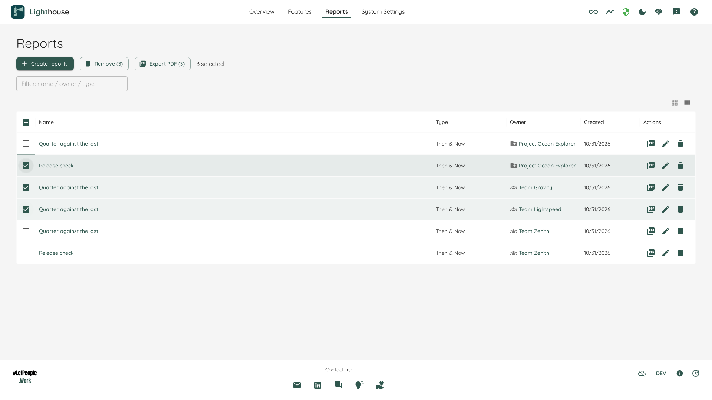
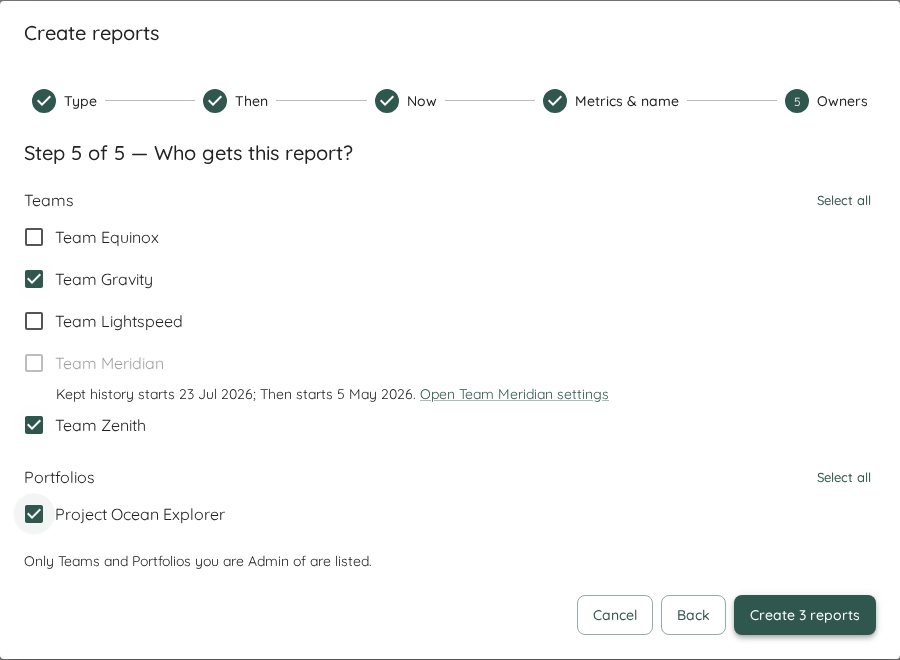
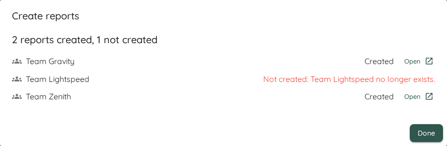

Metrics show how a Team or Portfolio is doing right now. A **report** keeps a view of those metrics you want to come back to, and to show to others: for example, how flow has changed since a coach joined or since the Team started an experiment.

Every Team and every Portfolio has a **Reports** tab, between *Metrics* and *Settings*. Each report has a **Type**, which decides what it shows and how it is created. The available types are:

- [Then & Now](./thenandnow.html): compares a frozen window from the past with the most recent days, metric by metric. It answers "did our flow change since…?"

More types will be added over time. Everything on this page applies to all of them.

To see every report in one place, or to create or remove reports for many Teams and Portfolios at once, use the [Reports page](#the-reports-page).

- TOC
{:toc}

# The Reports Tab

The tab lists the reports of this Team or Portfolio in a table with the columns **Name**, **Type** and **Created**. Click a name to open the report. Everyone who can see the Team or Portfolio can open the tab and read its reports.

When there are no reports yet, the tab says so. If you can edit the Team or Portfolio, it offers *Create Report*. Otherwise it tells you that a Team Admin (or Portfolio Admin) can create one.

# Creating a Report

Click **Create Report** above the list. A wizard opens, and its first step is **Type**: choose the kind of report you want. The steps after that belong to the Type you chose. For a Then & Now report, see [Creating a Then & Now Report](./thenandnow.html#creating-a-then--now-report).

When you click *Create* on the last step, the new report opens. If it could not be created, the wizard says so and keeps everything you entered, so you can try again.

# Editing a Report

Open the report and click **Edit report** next to its name, or click the ✏️ icon in its row on the Reports tab. The same wizard opens, in edit mode. Some choices cannot be changed once a report exists, for example the Type. They are shown, but locked. Click *Save* on the last step.

If someone else changed the report while you were editing it, Lighthouse does not overwrite their change. It tells you to reload so you can see what they changed.

# Deleting a Report

Click **Delete** next to the report's name, or the 🗑️ icon in its row on the Reports tab, and confirm. Deleting a report cannot be undone.

A report belongs to its Team or Portfolio. When you [delete a Team](../teams/teams.html#delete-a-team) or [a Portfolio](../portfolios/portfolios.html#delete-a-portfolio), its reports are deleted with it. The confirmation dialog tells you how many reports go too.

# Export PDF

A report often has to reach people who never open Lighthouse: a sponsor, a steering meeting, a slide deck. **Export PDF** turns the report into a dated, branded file you can send to them.

There are two ways to start it:

- Open the report and click **Export PDF**, the first button next to its name.
- On the Reports tab, click the PDF icon in the report's row. It is the first icon in the *Actions* column.

Lighthouse prepares the report and then opens your browser's print dialog. Choose **Save as PDF** as the destination, and save the file. You stay on the page you started from. Whether you save or cancel, nothing else changes.

While the PDF is being prepared, the button (or the row's icon) shows a small spinner and ignores further clicks. On the Reports tab, you can export one report at a time.

## What the PDF Holds

- **A line at the top of every page** with the Team or Portfolio, the report's name, its windows, and when the PDF was produced, for example "Produced 20 Oct 2026, 12:21". The time is your local time.
- **The report itself**, with its name as the title on the first page, followed by its summary and panels, as on screen.
- **A footer on every page** with the Lighthouse mark and "Made with Lighthouse by LetPeopleWork · letpeople.work".

The PDF is always light, whatever theme you use in Lighthouse. Your browser usually suggests the report's name and its Team or Portfolio as the file name.

What a Then & Now report looks like on paper is described in [Then & Now](./thenandnow.html#in-the-pdf).

## A Fresh Read, Nothing Stored

When you export, Lighthouse reads the report again, so the PDF shows the values as they are at that moment. While it reads, the report on screen dims for a moment. Afterwards it shows the same values as the PDF. The "Produced" time says when they were read.

Nothing is stored. Lighthouse keeps no copy of the PDF and no record of what you exported. If you need the PDF again later, export it again.

## When No PDF Can Be Made

If the report or part of the page could not be loaded, no print dialog opens. A message at the bottom of the screen says why, for example "This report couldn't be loaded, so no PDF was made.", with a **Retry** button. Retry tries the export again. If the report itself could not be read and you exported from the report, the report on screen says so too. If preparing the PDF takes longer than 30 seconds, the export stops with the same message and Retry.

If the report no longer exists, or was made by a newer version of Lighthouse, the message says so and offers no Retry.

## Tips for Printing

- **Turn off the browser's own headers and footers.** Most browsers add the date, the page title and the address to every page. The PDF already has its own header and footer, so switch the browser's off in the print dialog (in Chrome under *More settings* → *Headers and footers*).
- **Paper size and orientation** are your choice in the print dialog. The PDF is laid out for A4 portrait, and Letter works as well.

## Browsers and the Standalone App

Export PDF works in Chrome, Firefox and the [Standalone app](../Installation/standalone.html) on Windows and Linux.

In the Standalone app on macOS, Export PDF is not available: the button and the row's icon are greyed out, because the macOS desktop app cannot open the print dialog for a report. To export PDFs on a Mac, run Lighthouse with [Docker](../Installation/server.html#docker) and open it in your browser.

If printing does not work for you, please let us know in our [Slack community](https://join.slack.com/t/let-people-work/shared_invite/zt-38df4z4sy-iqJEo6S8kmIgIfsgsV0J1A).

# The Reports Page

**Reports** in the top navigation, between *Features* and *System Settings*, opens one table with every report you can read, across all Teams and Portfolios. Use it when you want to find a report without knowing which Team or Portfolio holds it, or to act on several reports at once.

The table has the columns **Name**, **Type**, **Owner**, **Created** and *Actions*. The **Owner** column shows the name of the Team or Portfolio the report belongs to, with an icon for which of the two it is. Click the name to open that Team or Portfolio. Portfolios are listed first, then Teams, each sorted by name. Click a column header to sort the table differently.

The row icons are the same as on a Reports tab: export as PDF, edit and delete. Edit and delete show only on rows of Teams and Portfolios you may change.

## Finding Reports

Type in the **Filter: name / owner / type** box above the table. A report stays in the list when what you typed appears in its name, in its owner's name, in the word for the owner's kind (for example *Team*), or in its Type. Changing the filter clears the rows you had selected.

## Selecting Reports

Tick the checkbox at the start of a row to select a report, or the checkbox in the header to select the whole list. Above the table, the buttons **Create reports**, **Remove** and **Export PDF** act on the selection. Next to them, the page counts the rows you picked, for example "3 selected".

- **Remove (n)** and **Export PDF (n)** show how many reports are selected.
- A button that cannot be used right now says why when you hover over it.
- One run acts on at most **50** reports. With more selected, **Remove** and **Export PDF** are held back, and their hint reads "Pick at most 50 reports."

While the list is loading, it is dimmed under a small spinner. If it cannot be loaded, the page says "The reports couldn't be loaded." and offers a retry. If there are no reports yet, it tells you that they are created on a Team's or Portfolio's Reports tab, or here with **Create reports**.

# Creating Reports for Many Teams and Portfolios

{: .note}
Creating reports for several Teams and Portfolios at once is a [Premium](../licensing/licensing.html#licensed-features) feature.

When several Teams or Portfolios need the same report, for example a Then & Now before and after a change you rolled out everywhere, you do not have to create it once per Team or Portfolio. On the Reports page, click **Create reports**. The wizard asks for the report's settings once and creates one report on every Team and Portfolio you pick.

The steps are the ones of [creating a single report](#creating-a-report): **Type**, then the steps of the Type you chose, then a last step, **Owners**. For a Then & Now report, see [Creating Then & Now Reports for Many Owners](./thenandnow.html#creating-reports-for-many-teams-and-portfolios).

## Choosing the Teams and Portfolios

The last step is titled "Who gets this report?". It lists your Teams and your Portfolios in two groups, each with a **Select all** button. Only the Teams and Portfolios you are Admin of are listed, and the step says so.

A Team or Portfolio whose kept history is too short for the windows you chose cannot be picked. Its checkbox is disabled, and under its name the wizard tells you why, for example "Kept history starts 15 Oct 2025; Then starts 3 Jun 2025.", with a link **Open *name* settings**. The link opens that Team's or Portfolio's settings in a new browser tab, so what you entered in the wizard stays. In the Standalone app, which has no tabs, it opens in the same window. If you change the windows so that an owner can no longer hold them, it is removed from your picks.

You can pick at most **50** Teams and Portfolios in one run. With more, the step says "Pick at most 50 Teams and Portfolios." and **Create** stays disabled. Create several rounds if you need more.

When you are ready, click **Create *n* reports**. The button shows how many Teams and Portfolios you picked.

## The Result

While Lighthouse works, the dialog says, for example, "Creating 3 reports…". Then it lists every Team and Portfolio you picked on its own line, by name, with an icon for whether it is a Team or a Portfolio (the same icons as the **Owner** column), under a headline such as "2 reports created, 1 not created".

- **Created**: the report exists. Click **Open** to see it. It opens in a new browser tab, and the dialog stays open, so you can open the others one after the other. In the Standalone app, which has no tabs, **Open** opens the report in the same window.
- **Not created**: the line says why, for example:
  - "Not created: its kept history starts 15 Oct 2025. Keep more history under Closed Items Cutoff in its settings."
  - "Not created: *name* already has its one Then & Now report; Premium lifts this limit."
  - "Not created: you are no longer Admin of *name*."
  - "Not created: *name* no longer exists."
  - "Not created: it couldn't be saved. Try again."

One owner that is not created never stops the others. Lighthouse checks every Team and Portfolio on its own, on the server, so a refusal for one does not undo the reports made for the rest. Click **Done** to close the dialog.

If Lighthouse cannot tell what happened, the dialog says "It could not be confirmed which reports were created." and offers **Go to Reports**. Look at the Reports page to see which reports exist.

# Removing Several Reports

Select the reports on the Reports page and click **Remove (n)**. A dialog lists each report with its name and its Team or Portfolio. Nothing is removed until you click **Remove *n* reports** there. Removing cannot be undone.

If a Then & Now report's Then can no longer be rebuilt from the history Lighthouse keeps, the dialog warns you first that removing it loses that Then for good.

**Remove** is available only when you may edit every selected report. If you may not, it is disabled and its hint reads, for example, "2 of the 3 selected reports are on a Team or Portfolio you are not Admin of." Unselect those rows and try again. If your permissions could not be loaded, the hint says "Your permissions couldn't be loaded. Reload the page to try again."

The result lists "*n* reports removed" and, for each report that stayed, a line starting "Not removed:" with the reason, for example that you are no longer Admin of its Team or Portfolio. A report someone else removed first counts as removed. Click **Done** to close the dialog and clear the selection.

# A PDF of Several Reports

Select two or more reports and click **Export PDF (n)** above the table. Lighthouse prepares them as one PDF and opens your browser's print dialog, as for [a single report](#export-pdf). Choose **Save as PDF** as the destination.

- **The reports follow the order of the table**, as sorted and filtered when you click.
- **Every report starts on a page of its own**, with its own line at the top of each page: the Team or Portfolio, the report's name, its windows and when the PDF was produced.
- **There is one footer** with the Lighthouse mark and "Made with Lighthouse by LetPeopleWork · letpeople.work". It closes the whole document.
- Your browser suggests the file name "Lighthouse reports", rather than the name of one report.

Everyone who can read the reports can export them. You can select up to **50** reports. With none selected the button's hint reads "Select at least one report.", and with more than 50 it reads "Pick at most 50 reports." With exactly one report selected, **Export PDF (1)** gives the report's own PDF, as its row's icon does.

While the PDF is prepared, the button shows a small spinner, and the PDF icons in the rows wait. Lighthouse reads every report again, so the PDF shows the values as they are at that moment. Nothing is stored.

## When No PDF Can Be Made

If a report cannot be read, no print dialog opens. Instead, a dialog titled **No PDF was made** names each report that could not be read, for example: Team Zenith's report "Then & Now — 90 days to 15 Oct 2026" couldn't be loaded. If a part of the page failed rather than a report, it says "Part of the page couldn't be loaded, so no PDF was made." It offers:

- **Cancel**: close the dialog and change nothing.
- **Leave it out**: unselect the reports that failed and print the rest. It is offered only when something is left to print.
- **Retry**: try all the selected reports again.

## The Standalone App on macOS

As for a single report, **Export PDF (n)** is greyed out in the [Standalone app](../Installation/standalone.html) on macOS, and its hint says "PDF export is not available in the macOS desktop app. To export PDFs on a Mac, run Lighthouse with Docker and open it in your browser." Elsewhere it works in Chrome, Firefox and the Standalone app on Windows and Linux.

# Who Can Do What

| | Can do it |
|---|---|
| Read the Reports tab and open a report | Everyone who can see the Team or Portfolio |
| See a report on the Reports page | Everyone who can read the report. Rows of Teams and Portfolios you cannot read are not listed |
| Export a report, or several, as a PDF | Everyone who can read the reports |
| Create, edit and delete reports | System Admins, and the Team Admins or Portfolio Admins of that Team or Portfolio |
| Create reports for several Teams and Portfolios | The same people, for each Team or Portfolio they are Admin of. The wizard lists only those, and Lighthouse checks every one again when it creates (Premium) |
| Remove several reports | Only when you may delete every selected report |

Without [role-based access control](../settings/rbac.html), everyone can create, edit and delete reports.

# Reports on the Overview

The *Teams* and *Portfolios* tables on the Overview have a **Reports** column. It shows each Team's or Portfolio's reports by name, at most two of them, sorted A to Z as on the Reports tab. Click a name to open that report. If there are more, a **+N more** link under them opens the Reports tab with the full list. A Team or Portfolio without reports shows *No Reports*.

While the reports are loading, the cell shows a small spinner. If they cannot be loaded, it says *Couldn't load Reports*, rather than *No Reports*. You can hide the column through the table's column menu.

# Community and Premium

Community includes **one report of each Type per Team and per Portfolio**: one Then & Now report for each Team and each Portfolio. With [Premium](../licensing/licensing.html#licensed-features), there is no limit.

Once a Team or Portfolio has its report of a Type, *Create Report* is disabled, and the message under it says what to do: "Community includes 1 Then & Now report per Team. Delete it, or use Premium for unlimited reports."

[Export PDF](#export-pdf), the [Reports page](#the-reports-page), [removing several reports](#removing-several-reports) and [a PDF of several reports](#a-pdf-of-several-reports) are part of Community and need no licence. Exporting does not count against the limit: you can export any report as often as you like.

[Creating reports for many Teams and Portfolios](#creating-reports-for-many-teams-and-portfolios) at once is part of Premium. Without Premium, **Create reports** on the Reports page is disabled. You can still create each Team's or Portfolio's one report from its own Reports tab. In a bulk run on Premium there is no limit per Team or Portfolio, but one run takes at most 50 Teams and Portfolios.

{: .note}
If your licence expires, nothing is deleted. Every report stays readable, and you can still edit and delete it. You can create new reports again once a Team or Portfolio is below the limit.
