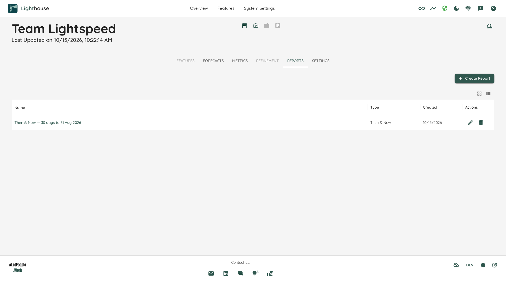
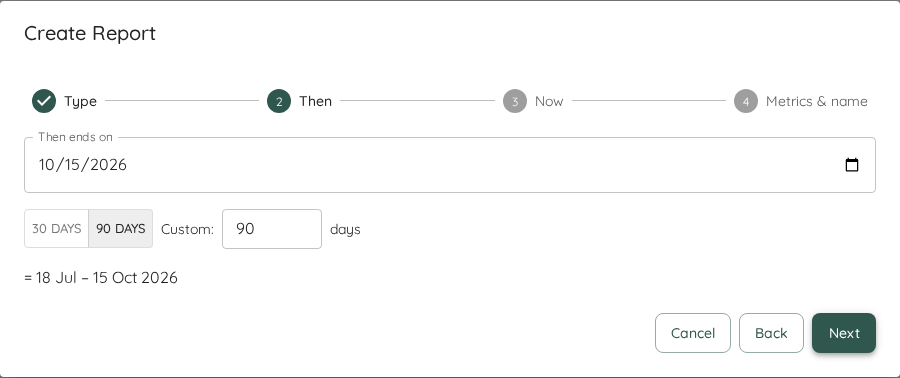
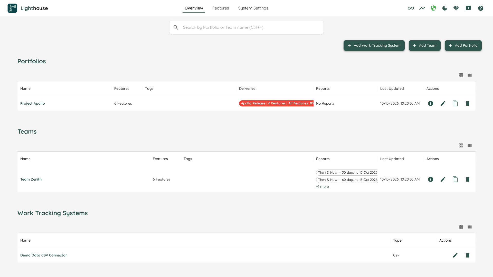

Metrics show how a Team or Portfolio is doing right now. A **report** keeps a view of those metrics you want to come back to, and to show to others: for example, how flow has changed since a coach joined or since the Team started an experiment.

Every Team and every Portfolio has a **Reports** tab, between *Metrics* and *Settings*. Each report has a **Type**, which decides what it shows and how it is created. The available types are:

- [Then & Now](./thenandnow.html): compares a frozen window from the past with the most recent days, metric by metric. It answers "did our flow change since…?"

More types will be added over time. Everything on this page applies to all of them.

- TOC
{:toc}

# The Reports Tab

The tab lists the reports of this Team or Portfolio in a table with the columns **Name**, **Type** and **Created**. Click a name to open the report. Everyone who can see the Team or Portfolio can open the tab and read its reports.

When there are no reports yet, the tab says so. If you can edit the Team or Portfolio, it offers *Create Report*. Otherwise it tells you that a Team Admin (or Portfolio Admin) can create one.

# Creating a Report

Click **Create Report** above the list. A wizard opens, and its first step is **Type**: choose the kind of report you want. The steps after that belong to the Type you chose. For a Then & Now report, see [Creating a Then & Now Report](./thenandnow.html#creating-a-then--now-report).

When you click *Create* on the last step, the new report opens. If it could not be created, the wizard says so and keeps everything you entered, so you can try again.

# Editing a Report

Open the report and click **Edit report** next to its name, or click the ✏️ icon in its row on the Reports tab. The same wizard opens, in edit mode. Some choices cannot be changed once a report exists, for example the Type. They are shown, but locked. Click *Save* on the last step.

If someone else changed the report while you were editing it, Lighthouse does not overwrite their change. It tells you to reload so you can see what they changed.

# Deleting a Report

Click **Delete** next to the report's name, or the 🗑️ icon in its row on the Reports tab, and confirm. Deleting a report cannot be undone.

A report belongs to its Team or Portfolio. When you [delete a Team](../teams/teams.html#delete-a-team) or [a Portfolio](../portfolios/portfolios.html#delete-a-portfolio), its reports are deleted with it. The confirmation dialog tells you how many reports go too.

# Export PDF

A report often has to reach people who never open Lighthouse: a sponsor, a steering meeting, a slide deck. **Export PDF** turns the report into a dated, branded file you can send to them.

There are two ways to start it:

- Open the report and click **Export PDF**, the first button next to its name.
- On the Reports tab, click the PDF icon in the report's row. It is the first icon in the *Actions* column.

Lighthouse prepares the report and then opens your browser's print dialog. Choose **Save as PDF** as the destination, and save the file. You stay on the page you started from. Whether you save or cancel, nothing else changes.

While the PDF is being prepared, the button (or the row's icon) shows a small spinner and ignores further clicks. On the Reports tab, you can export one report at a time.

## What the PDF Holds

- **A line at the top of every page** with the Team or Portfolio, the report's name, its windows, and when the PDF was produced, for example "Produced 20 Oct 2026, 12:21". The time is your local time.
- **The report itself**, with its name as the title on the first page, followed by its summary and panels, as on screen.
- **A footer on every page** with the Lighthouse mark and "Made with Lighthouse by LetPeopleWork · letpeople.work".

The PDF is always light, whatever theme you use in Lighthouse. Your browser usually suggests the report's name and its Team or Portfolio as the file name.

What a Then & Now report looks like on paper is described in [Then & Now](./thenandnow.html#in-the-pdf).

## A Fresh Read, Nothing Stored

When you export, Lighthouse reads the report again, so the PDF shows the values as they are at that moment. While it reads, the report on screen dims for a moment. Afterwards it shows the same values as the PDF. The "Produced" time says when they were read.

Nothing is stored. Lighthouse keeps no copy of the PDF and no record of what you exported. If you need the PDF again later, export it again.

## When No PDF Can Be Made

If the report or part of the page could not be loaded, no print dialog opens. A message at the bottom of the screen says why, for example "This report couldn't be loaded, so no PDF was made.", with a **Retry** button. Retry tries the export again. If the report itself could not be read and you exported from the report, the report on screen says so too. If preparing the PDF takes longer than 30 seconds, the export stops with the same message and Retry.

If the report no longer exists, or was made by a newer version of Lighthouse, the message says so and offers no Retry.

## Tips for Printing

- **Turn off the browser's own headers and footers.** Most browsers add the date, the page title and the address to every page. The PDF already has its own header and footer, so switch the browser's off in the print dialog (in Chrome under *More settings* → *Headers and footers*).
- **Paper size and orientation** are your choice in the print dialog. The PDF is laid out for A4 portrait, and Letter works as well.

## Browsers and the Standalone App

Export PDF works in Chrome, Firefox and the [Standalone app](../Installation/standalone.html). If printing does not work for you, please let us know in our [Slack community](https://join.slack.com/t/let-people-work/shared_invite/zt-38df4z4sy-iqJEo6S8kmIgIfsgsV0J1A).

# Who Can Do What

| | Can do it |
|---|---|
| Read the Reports tab and open a report | Everyone who can see the Team or Portfolio |
| Export a report as a PDF | Everyone who can read the report |
| Create, edit and delete reports | System Admins, and the Team Admins or Portfolio Admins of that Team or Portfolio |

Without [role-based access control](../settings/rbac.html), everyone can create, edit and delete reports.

# Reports on the Overview

The *Teams* and *Portfolios* tables on the Overview have a **Reports** column. It shows each Team's or Portfolio's reports by name, at most two of them, sorted A to Z as on the Reports tab. Click a name to open that report. If there are more, a **+N more** link under them opens the Reports tab with the full list. A Team or Portfolio without reports shows *No Reports*.

While the reports are loading, the cell shows a small spinner. If they cannot be loaded, it says *Couldn't load Reports*, rather than *No Reports*. You can hide the column through the table's column menu.

# Community and Premium

Community includes **one report of each Type per Team and per Portfolio**: one Then & Now report for each Team and each Portfolio. With [Premium](../licensing/licensing.html#licensed-features), there is no limit.

Once a Team or Portfolio has its report of a Type, *Create Report* is disabled, and the message under it says what to do: "Community includes 1 Then & Now report per Team. Delete it, or use Premium for unlimited reports."

[Export PDF](#export-pdf) is part of Community and needs no licence. Exporting does not count against the limit: you can export any report as often as you like.

{: .note}
If your licence expires, nothing is deleted. Every report stays readable, and you can still edit and delete it. You can create new reports again once a Team or Portfolio is below the limit.
