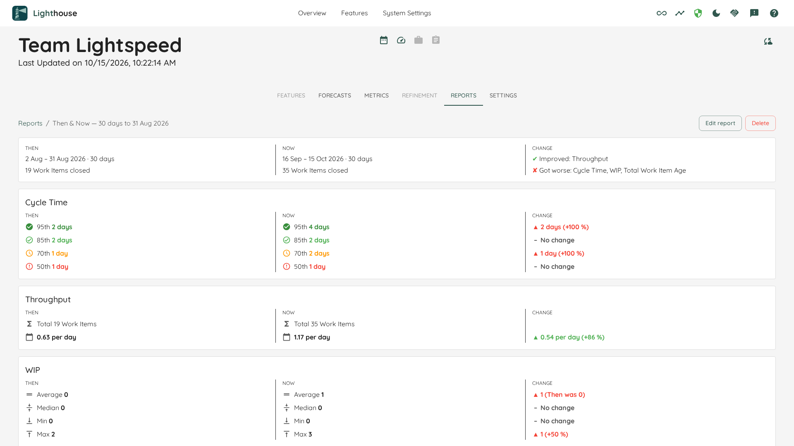

You changed something about how a Team or Portfolio works: a coach joined, the Team limited its WIP, a new way of slicing work began. Weeks later, someone asks: *did our flow change since then?* The metrics on the Metrics tab only show the most recent days, and the days before the change slowly drop out of view.

A **Then & Now** report keeps the "before". It freezes the flow metrics of one window, **Then**, the moment you create the report. Every time you open the report, it compares Then with **Now**, the most recent days, metric by metric.

- TOC
{:toc}

# Then and Now

**Then** is frozen when you create the report. It can end today or on any day in the past, for example the day before the coach came in. Lighthouse rebuilds Then once from the history it keeps, stores the values, and never computes them again. Whatever happens afterwards, including changes to the Team's settings, Then shows the same numbers.

**Now** is a sliding window. It always ends today, so every time you open the report it covers the latest days. Now is computed with today's settings.

Then and Now may overlap. A report whose Then ends today and whose Now has the same length compares the same days, and so shows no change until time moves on.

# Creating a Then & Now Report

On the Reports tab, click **Create Report**. The wizard has four steps:

1. **Type**: choose *Then & Now*. It is selected already.
2. **Then**: choose the day Then ends on (today by default) and its length. A Team offers 30 or 90 days, a Portfolio 90 or 180 days, or you can type any number of days. Below, the wizard shows the days Then covers, for example "= 18 Jul – 15 Oct 2026".
3. **Now**: choose Now's length, with the same choices. It starts as long as Then. The wizard shows the days Now covers today, with the note "Sliding window, always ending today".
4. **Metrics & name**: choose which metrics the report shows. All four are selected by default. The report's name follows the window, for example "Then & Now — 90 days to 15 Oct 2026", until you type your own.

Both windows need at least 14 days. Lighthouse keeps finished Work Items only for a limited time (365 days by default), so a window cannot start earlier than that. The wizard tells you the earliest day it may start on, for example: "The Then window must start on or after 15 Oct 2025 — older finished Work Items are no longer kept."

{: .note}
Every metric's Then values are frozen, even for metrics you do not show. If you show a metric later, its Then values are already there.

# Reading the Report

The page starts with the report's name, then a summary, then one panel per metric.

## The Summary

The summary has three parts:

- **THEN** and **NOW** each name their window, its length, and how many Work Items were closed in it, for example "2 Aug – 31 Aug 2026 · 30 days" and "19 Work Items closed". If the two windows differ in length, this is where you see why one side has fewer Work Items.
- **CHANGE** sums up which way each metric moved:
  - **✔ Improved**: at least one of the metric's lines got better, and none got worse.
  - **✘ Got worse**: at least one line got worse, and none got better.
  - **± Mixed**: some lines got better and some got worse. For example, the 85th percentile of Cycle Time grew while the 50th shrank: the spread widened.
  - **– Unchanged**: no line changed.

Every change counts, however small. The summary only adds up what the panels show. Whether a change is meaningful is for you to judge.

## The Panels

Each panel shows **THEN**, **NOW** and **CHANGE** side by side, one line per value:

| Panel | Lines | Better is |
|---|---|---|
| **Cycle Time** | The 95th, 85th, 70th and 50th percentile, with the same icons as on the Metrics tab | Lower |
| **Throughput** | The total number of Work Items closed, and the average per day | Higher |
| **WIP** | Average, Median, Min and Max of the daily WIP | Lower |
| **Total Work Item Age** | Average, Median, Min and Max of the daily total age of all Work Items in progress | Lower |

The CHANGE column shows the difference and the percentage, with an arrow, for example "▲ 2 days (+100 %)". A change for the better is green, a change for the worse red. The arrow and the sign carry the same meaning, so you can read it without colour. A line that did not change reads *No change*. When Then was 0, there is no percentage: the line reads, for example, "▲ 1 (Then was 0)".

Some lines cannot be compared:

- A **—** means there was nothing to measure, for example no Work Item was closed in the window.
- **Not captured for this report** means the value did not exist when the report was created, because it was added to Lighthouse later.

# In the PDF

You can [export a Then & Now report as a PDF](./reports.html#export-pdf) to share it. On paper, it reads like this:

- **Every page starts with one line**: the Team or Portfolio, the report's name, both windows, for example "Then 3 Jun – 31 Aug 2026 · Now 23 Jul – 20 Oct 2026", and when the PDF was produced. So a page that gets separated from the rest still says what it shows.
- **The first page** carries the report's name as its title, then the summary and the panels, as on screen.
- **Every panel keeps THEN, NOW and CHANGE side by side**, even on paper narrower than your screen, so each CHANGE stays on the same line as the values it compares.
- **The summary and each panel stay whole.** A panel that does not fit at the bottom of a page moves to the next one. A report with all four panels usually takes two A4 pages.
- **Every page ends with the Lighthouse mark** and "Made with Lighthouse by LetPeopleWork · letpeople.work". There are no page numbers.

The PDF is laid out for A4 portrait, and it is always light, even if you use Lighthouse in the dark theme. The green and red of the CHANGE column print as on screen. The arrows and signs carry the same meaning, so a black-and-white printout still reads correctly.

# Editing a Then & Now Report

In edit mode, the wizard shows **Type** and **Then** locked: Then is frozen and cannot be changed. You can change Now's length, which metrics are shown, and the name. A metric that was not captured when the report was created cannot be selected.

To compare with a different Then, create a new report.

# Deleting a Then & Now Report

Deleting works as for [every report](./reports.html#deleting-a-report). If Then starts earlier than the history Lighthouse still keeps, the confirmation adds: "This Then window can no longer be rebuilt." A report you create again could not have the same Then.
