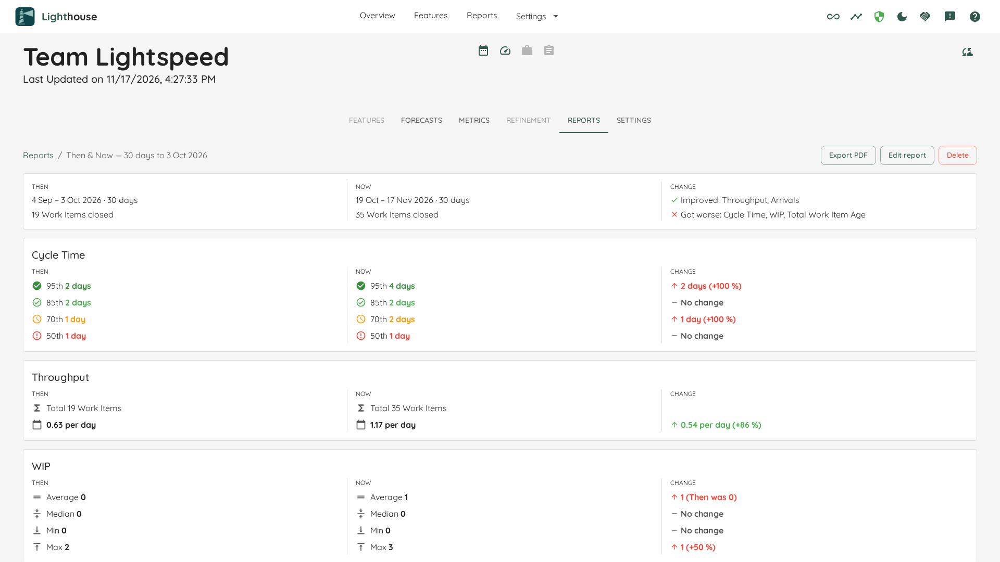

You changed something about how a Team or Portfolio works: a coach joined, the Team limited its WIP, a new way of slicing work began. Weeks later, someone asks: *did our flow change since then?* The metrics on the Metrics tab only show the most recent days, and the days before the change slowly drop out of view.

A **Then & Now** report keeps the "before". It freezes the flow metrics of one window, **Then**, the moment you create the report. Every time you open the report, it compares Then with **Now**, the most recent days, metric by metric.

- TOC
{:toc}

# Then and Now

**Then** is frozen when you create the report. It can end today or on any day in the past, for example the day before the coach came in. Lighthouse rebuilds Then once from the history it keeps, stores the values, and never computes them again. Whatever happens afterwards, including changes to the Team's settings, Then shows the same numbers.

**Now** is a sliding window, always as long as Then. It always ends today, so every time you open the report it covers the latest days. Now is computed with today's settings.

Because both windows have the same length, the two sides compare like with like: the same number of days, so totals and averages can be read side by side.

Then and Now may overlap. A report whose Then ends today compares the same days, and so shows no change until time moves on.

# Creating a Then & Now Report

On the Reports tab, click **Create Report**. The wizard has three steps:

1. **Type**: choose *Then & Now*. It is selected already.
2. **Then**: choose Then's length and the day it ends on. A Team offers 30 or 90 days, a Portfolio 90 or 180 days, or you can type any number of days. By default Then ends the day before Now starts, so the two windows sit back to back. Below, the wizard shows both windows by date, for example "Then 17 Sep – 16 Oct 2026 (30 days)" and "Now 17 Oct – 15 Nov 2026 (30 days, ends today)". There is no separate question for Now: it is always as long as Then.
3. **Metrics & name**: choose which metrics the report shows: Cycle Time, Throughput, WIP, Total Work Item Age and Arrivals. All are selected by default. The report's name follows the window, for example "Then & Now — 90 days to 15 Oct 2026", until you type your own.

If you move Then's end into Now, the Then step says so: "Now overlaps Then until 31 Oct 2026" names the last day both windows share, and a Then ending today reads "Now and Then are the same days today. Now moves forward from tomorrow; the comparison becomes meaningful as days pass."

Then needs at least 14 days. Lighthouse keeps finished Work Items only for a limited time (365 days by default), set by the Team's or Portfolio's **Closed Items Cutoff**, so neither window can start earlier than that. When the kept history is too short, the Then step names the Team or Portfolio and the way out, for example: "Lightspeed keeps history from 18 Sep 2026: too little for a 30-day Then and Now. Pick a shorter length or a later end date."

{: .note}
Every metric's Then values are frozen, even for metrics you do not show. If you show a metric later, its Then values are already there.

# Creating Reports for Many Teams and Portfolios

With Premium you can create the same Then & Now report for many Teams and Portfolios at once, with **Create reports** on the [Reports page](./reports.html#creating-reports-for-many-teams-and-portfolios). The steps **Then** and **Metrics & name** are asked once, and a last step, **Owners**, picks who gets the report.

- **The windows are the same for every owner.** You choose the day Then ends on and its length (30, 90 or 180 days, or any number of days from 14); Now is as long as Then. Each owner's Then is frozen from its own history, as for a single report.
- **Every owner must hold both windows.** Each Team and Portfolio keeps finished Work Items for as long as its own **Closed Items Cutoff** says. An owner whose kept history starts after the first day of Then or Now cannot be picked, and the Owners step shows when its history starts. To include it, shorten the windows, or keep more history under Closed Items Cutoff in that owner's settings first.
- **The report's name and metrics are the ones you chose.** Every owner gets a report with these settings.

On Community, a Team or Portfolio holds one Then & Now report. An owner that already has its one report is not created, and the result says so.

# Reading the Report

The page starts with the report's name, then a summary, then one panel per metric.

## The Summary

The summary has three parts:

- **THEN** and **NOW** each name their window, its length, and how many Work Items were closed in it, for example "2 Aug – 31 Aug 2026 · 30 days" and "19 Work Items closed".
- **CHANGE** sums up which way each metric moved:
  - **✔ Improved**: at least one of the metric's lines got better, and none got worse.
  - **✘ Got worse**: at least one line got worse, and none got better.
  - **± Mixed**: some lines got better and some got worse. For example, the 85th percentile of Cycle Time grew while the 50th shrank: the spread widened.
  - **– Unchanged**: no line changed.

Every change counts, however small. The summary only adds up what the panels show. Whether a change is meaningful is for you to judge.

## The Panels

Each panel shows **THEN**, **NOW** and **CHANGE** side by side, one line per value:

| Panel | Lines | Better is |
|---|---|---|
| **Cycle Time** | The 95th, 85th, 70th and 50th percentile, with the same icons as on the Metrics tab | Lower |
| **Throughput** | The total number of Work Items closed, and the average per day, each with its own change, for example "▲ 13 (+25 %)" and "▲ 0.44 per day (+25 %)" | Higher |
| **WIP** | Average, Median, Min and Max of the daily WIP | Lower |
| **Total Work Item Age** | Average, Median, Min and Max of the daily total age of all Work Items in progress | Lower |
| **Arrivals** | How many Work Items were started in the window, how many per day, the Throughput per day beside it, and the gap between the two in words, for example "0.30 more started than finished per day" | A smaller gap |

**Arrivals** answers whether work comes in faster than it goes out. The gap is the Work Items started per day minus the Work Items finished per day: more started than finished means work piles up. A gap that rounds to 0.00 reads "as many started as finished per day". The ⓘ next to the panel's title explains the gap in one sentence.

The CHANGE column shows the difference and the percentage, with an arrow, for example "▲ 2 days (+100 %)". A change for the better is green, a change for the worse red. The arrow and the sign carry the same meaning, so you can read it without colour. A line that did not change reads *No change*, and a line that is 0 on both sides reads *No change (both 0)*. The change is taken between the values as shown, so the THEN value plus the change gives the NOW value on screen. When Then was 0, there is no percentage: the line reads, for example, "▲ 1 (Then was 0)". The Arrivals gap never shows a percentage, because the gap can be negative or cross zero; its change reads in Work Items per day, for example "0.40 per day".

Some lines cannot be compared:

- A **—** means there was nothing to measure, for example no Work Item was closed in the window.
- **Not captured for this report** means the value did not exist when the report was created, because it was added to Lighthouse later.

# In the PDF

You can [export a Then & Now report as a PDF](./reports.html#export-pdf) to share it. On paper, it reads like this:

- **Every page starts with one line**: the Team or Portfolio, the report's name, both windows, for example "Then 3 Jun – 31 Aug 2026 · Now 23 Jul – 20 Oct 2026", and when the PDF was produced. So a page that gets separated from the rest still says what it shows.
- **The first page** carries the report's name as its title, then the summary and the panels, as on screen.
- **Every panel keeps THEN, NOW and CHANGE side by side**, even on paper narrower than your screen, so each CHANGE stays on the same line as the values it compares.
- **The summary and each panel stay whole.** A panel that does not fit at the bottom of a page moves to the next one. A report with every panel shown takes two or more A4 pages.
- **Every page ends with the Lighthouse mark** and "Made with Lighthouse by LetPeopleWork · letpeople.work". There are no page numbers.

The PDF is laid out for A4 portrait, and it is always light, even if you use Lighthouse in the dark theme. The green and red of the CHANGE column print as on screen. The arrows and signs carry the same meaning, so a black-and-white printout still reads correctly.

# Editing a Then & Now Report

In edit mode, the wizard opens on **Metrics & name**, with **Type** and **Then** locked: Then is frozen and cannot be changed, and Now follows it. You can change which metrics are shown and the name. A metric that was not captured when the report was created cannot be selected.

A report created before Now always matched Then may have stored a different Now length. It now reads a Now as long as its Then, ending today, without a notice; its frozen Then and any PDF you exported earlier stay as they are.

To compare with a different Then, create a new report.

# Deleting a Then & Now Report

Deleting works as for [every report](./reports.html#deleting-a-report). If Then starts earlier than the history Lighthouse still keeps, the confirmation adds: "This Then window can no longer be rebuilt." A report you create again could not have the same Then.
