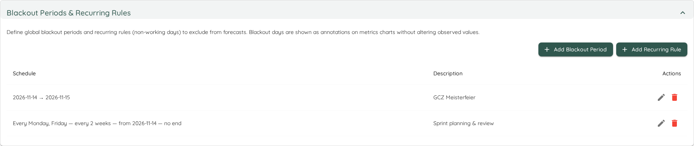
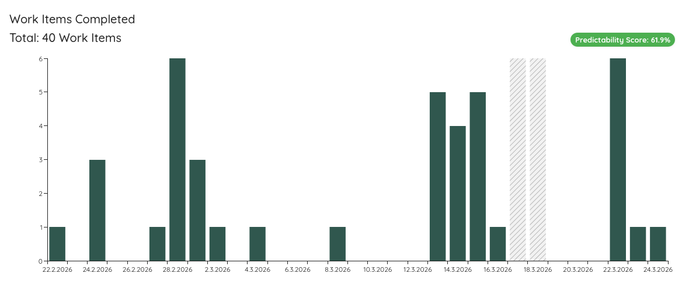
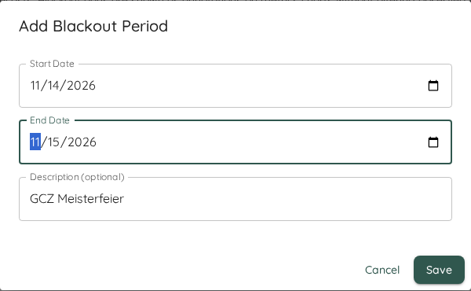
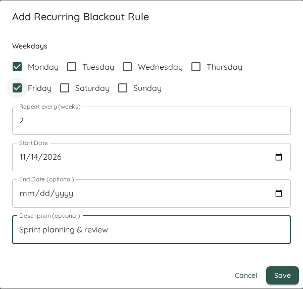

# Calendar
Found on **Settings → Organization → Calendar**. Only System Administrators open it.

Blackout periods let you mark specific dates or date ranges as *non-working days* — for example, public holidays, company off-days, or planned shutdowns. **Recurring rules** cover the days that come back on a schedule — weekends, a fixed no-meeting Friday, or a sprint-review day every two weeks — without you having to add each occurrence by hand.

Both one-off periods and recurring rules feed the same forecasting and metrics behaviour described below — Lighthouse simply expands each recurring rule into the concrete days it covers and treats them exactly like a manually-entered blackout day.

Lighthouse uses this information in two ways:

- **Forecasting**: When running Monte Carlo Simulations, days that fall within a blackout period are skipped entirely. The simulation treats those days as if your team did no work, which means they do not count against the forecast duration and are not sampled for throughput. This keeps your forecasts accurate even when the future contains known non-working periods.
- **Metrics charts**: Blackout days are visually highlighted with a hatched overlay in run charts, Process Behaviour Charts, and the Cycle Time Scatterplot, so you can immediately see which dips or gaps in your data were expected rather than a sign of a problem.

## Blackout Periods
1. Navigate to *Settings* → *Organization* → *Calendar*.
2. Locate the *Blackout Periods* section.
3. Click *Add Blackout Period* and provide:
   - **Start date** — the first day of the blackout.
   - **End date** — the last day of the blackout (can be the same as the start date for a single day).
   - **Description** — a short label such as "Christmas" or "Bank Holiday".
4. Click *Save* to confirm. The period will take effect immediately for new forecasts and metric views.

You can add multiple blackout periods, edit existing ones, or delete them at any time. Changes apply globally across all teams and portfolios.

{: .note}
Blackout periods are a global configuration and apply to every team and portfolio in your Lighthouse instance.

## Recurring Blackout Rules (Premium)
When a non-working day repeats on a schedule, add a *Recurring Rule* instead of entering each date individually. Click *Add Recurring Rule* and define:

- **Weekdays** — one or more days of the week the rule applies to (for example *Saturday* and *Sunday* for weekends, or just *Friday*).
- **Repeat every (weeks)** — the cadence. Use `1` for every week, `2` for every other week, and so on. The interval is counted from the start date.
- **Start date** — the first date from which the rule is active.
- **End date** *(optional)* — leave it empty for an open-ended rule that keeps applying indefinitely, or set a date to stop the recurrence.
- **Description** — a short label such as "Weekends" or "Sprint Review".

Recurring rules and one-off periods are listed together in the same section, each with its own schedule summary. Edit or delete them at any time; the change takes effect immediately for new forecasts and metric views.

{: .recommendation}
Use a recurring rule for weekends or any regularly repeating closure, and reserve one-off periods for exceptions such as a single public holiday. This keeps the list short and your intent obvious.

{: .note}
Managing blackout periods and recurring rules requires a [Premium license](../licensing/licensing.html#licensed-features). Existing entries remain active for forecasting and metrics even if a license lapses — only the ability to add, edit, or delete them is gated.
