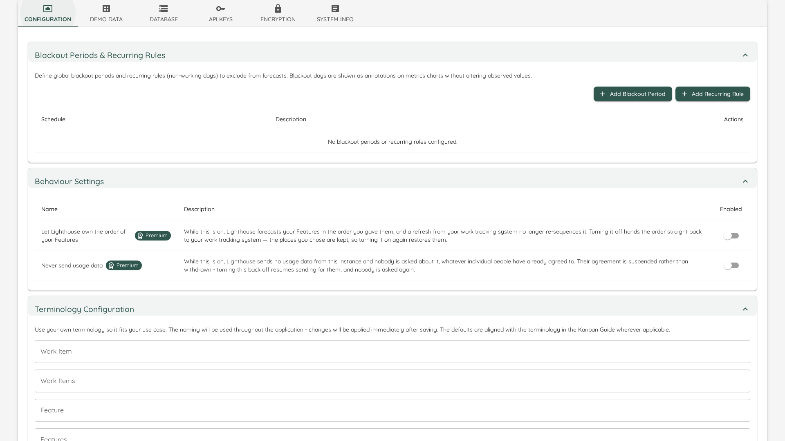

# Organization

*Settings › Organization* holds how your organization works in Lighthouse. Only System Administrators open it.

| Tab | What it holds |
|-----|---------------|
| **Terminology** | Your own words for Feature, Work Item, Team and the rest: [Terminology](terminology.html) |
| **Calendar** | Blackout Periods and Recurring Rules: [Calendar](calendar.html) |
| **Refresh & ordering** | How often Teams and Portfolios refresh, and who owns the order of your Features: [Refresh & ordering](refresh.html) |
