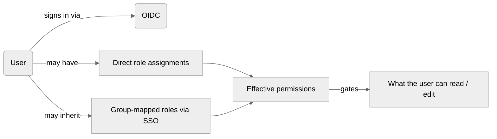
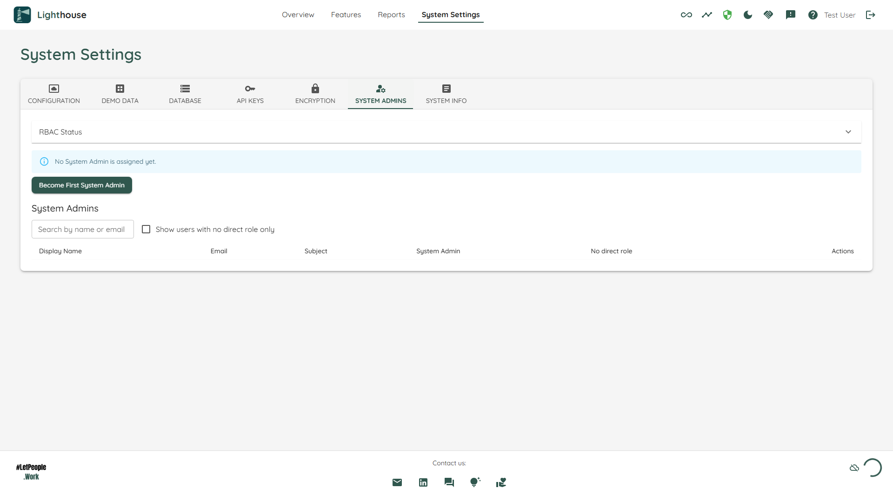
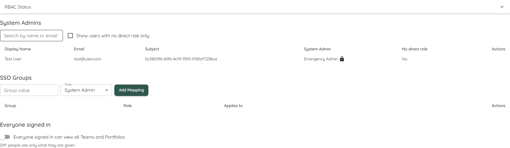

Lighthouse supports **Role-Based Access Control (RBAC)** for fine-grained control over who can read and edit teams and portfolios. RBAC builds on top of [Authentication](../Installation/authentication.html) and is configured under **Settings → Access → System-wide access**.

{: .note}
RBAC is a **Premium** feature. A valid Premium license is required, [OIDC authentication](../Installation/authentication.html) must be enabled first, and RBAC itself is switched off until you [enable it](#enabling-rbac).

- TOC
{:toc}

---

## Overview

By default — with authentication enabled but RBAC not enabled or not yet bootstrapped — every signed-in user has full access. RBAC narrows that down: each user holds one or more **role assignments**, and each role grants a specific set of capabilities scoped to a specific entity (the whole system, a single team, a single portfolio, or every team and portfolio at once through a [system-wide rule](#system-wide-rules)).



A user's **effective permissions** are the merged set of their direct assignments and any roles inherited from SSO group memberships. When the two overlap on the same team or portfolio, a role given directly to a person replaces a role from a group. A [system-wide rule](#system-wide-rules) is never replaced: where it reaches, the person gets the higher of the two.



---

## Roles

Lighthouse defines four roles. Each role is scoped to the whole system, to a single team, or to a single portfolio. Viewer and Admin can also be given for every team and portfolio at once, through a [system-wide rule](#system-wide-rules).

| Role | Scope | What it grants |
|---|---|---|
| **System Admin** | System-wide | Full read / edit / delete on every team and portfolio, plus management of users, group mappings, work tracking system connections, and system settings. **Creates new teams and portfolios.** Clones and deletes existing ones. |
| **Team Admin** | A specific team. As **Admin on all**: every team and portfolio | Read and **edit** the team's settings, throughput, features, and metrics. Cannot create, clone, or delete teams; cannot manage any portfolio. |
| **Portfolio Admin** | A specific portfolio. As **Admin on all**: every team and portfolio | Read and **edit** the portfolio's features, settings, and metrics. Cannot create, clone, or delete portfolios; cannot manage any team. |
| **Viewer** | A specific team **or** a specific portfolio. As **Viewer on all**: every team and portfolio | Read-only access to the assigned entity, or to every team and portfolio. Cannot edit, delete, or create. Can still vote and comment in a team's Refinement. |

A single user can hold multiple role assignments — for example, *Team Admin on Team Alpha*, *Viewer on Portfolio Vision*, and *Portfolio Admin on Portfolio Horizon* at the same time.

{: .important}
System Admin is the only role that gives access to the whole system. Without a system-wide rule, every other role is bound to exactly one team or portfolio. With one, Viewer and Admin reach every team and portfolio, but never the system itself.

### Capability matrix at a glance

Read "own scope" as the team or portfolio the role was given for, or every team and portfolio when the role comes from a system-wide rule. **Admin on all** has the same rights as Team Admin and Portfolio Admin here, on every team and portfolio. **Viewer on all** has the same rights as Viewer.

|  | System Admin | Team Admin (scope) | Portfolio Admin (scope) | Viewer (scope) |
|---|---|---|---|---|
| Create a new team | ✅ | ❌ | ❌ | ❌ |
| Create a new portfolio | ✅ † | ❌ | ❌ | ❌ |
| Clone a team / portfolio | ✅ | ❌ | ❌ | ❌ |
| Delete a team / portfolio | ✅ | ❌ | ❌ | ❌ |
| See who the [license](../licensing/licensing.html) belongs to (name, email, organization, license number) | ✅ | ❌ | ❌ | ❌ |
| Edit settings on assigned team / portfolio | ✅ | ✅ (own scope) | ✅ (own scope) | ❌ |
| Read assigned team / portfolio (metrics, features, etc.) | ✅ | ✅ (own scope) | ✅ (own scope) | ✅ (own scope) |
| Create, edit and delete [reports](../reports/reports.html) on assigned team / portfolio | ✅ | ✅ (own scope) | ✅ (own scope) | ❌ |
| Read [reports](../reports/reports.html) on assigned team / portfolio | ✅ | ✅ (own scope) | ✅ (own scope) | ✅ (own scope) |
| [Export a report as a PDF](../reports/reports.html#export-pdf): anyone who can read the report | ✅ | ✅ (own scope) | ✅ (own scope) | ✅ (own scope) |
| See a report on the [Reports page](../reports/reports.html#the-reports-page) | ✅ | ✅ (own scope) | ✅ (own scope) | ✅ (own scope) |
| [Create reports for several Teams and Portfolios](../reports/reports.html#creating-reports-for-many-teams-and-portfolios) at once (Premium) | ✅ | ✅ (own scope) | ✅ (own scope) | ❌ |
| [Remove several reports](../reports/reports.html#removing-several-reports): only when you may delete every selected report | ✅ | ✅ (own scope) | ✅ (own scope) | ❌ |
| [Export several reports as one PDF](../reports/reports.html#a-pdf-of-several-reports): anyone who can read the reports | ✅ | ✅ (own scope) | ✅ (own scope) | ✅ (own scope) |
| Manage users / group mappings | ✅ | ❌ | ❌ | ❌ |
| Add or remove a [system-wide rule](#system-wide-rules), and turn **Everyone signed in** on or off | ✅ | ❌ | ❌ | ❌ |
| See which system-wide rules also reach a team or portfolio (read-only) | ✅ | ✅ (own scope) | ✅ (own scope) | ❌ |
| Manage work tracking system connections | ✅ | ❌ | ❌ | ❌ |
| Read connection names and the fields the settings need (never secrets or credentials) | ✅ | ✅ | ✅ | ❌ |
| Install a Lighthouse update from within the app | ✅ | ❌ | ❌ | ❌ |

† **Portfolio creation also requires at least one team to exist in the system.** This applies even to System Admin: a portfolio without any team to roll up is structurally meaningless, so the **Add Portfolio** button stays hidden until the first team is created.

---

## Prerequisites for creating teams and portfolios

Authorization (System Admin role) is necessary but not sufficient — Lighthouse also enforces functional prerequisites:

| To create… | You must have | You must also have |
|---|---|---|
| A team | System Admin role | At least one **work tracking system connection** (e.g. Jira, Azure DevOps, Linear, CSV) |
| A portfolio | System Admin role | At least one **team** in the system, and at least one work tracking system connection |

The team-existence check is **system-wide**, not visibility-filtered: even if you only have read access to some teams, the gate considers every team in the database. (Under v1 this only matters for the connection-availability case; widening creation rights to scoped admins is a future possibility.)

---

## Enabling RBAC

RBAC is off by default, even with authentication enabled and a Premium license in place. While it is off, every signed-in user has full access and **Settings → Access** shows only API Keys: the **System-wide access** tab appears once RBAC is on.

Turn it on under the `Authorization` key in `appsettings.json`:

```json
{
  "Authorization": {
    "Enabled": true
  }
}
```

Or with an environment variable:

```bash
Authorization__Enabled=true
```

Restart Lighthouse, then follow the bootstrap flow below to claim the first System Admin role.

| Property | Type | Default | Description |
|---|---|---|---|
| `Enabled` | `bool` | `false` | Turns RBAC on. |
| `EmergencySystemAdminSubjects` | `string[]` | `[]` | IdP `sub` claims of users who always keep System Admin access. See [Emergency Admin](#emergency-admin). |
| `GroupClaimName` | `string` | `groups` | The token claim Lighthouse reads group memberships from. See [SSO group mappings](#sso-group-mappings). |

{: .note}
`EmergencySystemAdminSubjects` is a list, so set through environment variables it needs an index per entry: `Authorization__EmergencySystemAdminSubjects__0=…`, `Authorization__EmergencySystemAdminSubjects__1=…`.

---

## Bootstrap: becoming the first System Admin

When RBAC is enabled for the first time on a fresh database, **no System Admin exists yet**. Lighthouse handles this with a one-time bootstrap flow:

1. Make sure RBAC is [enabled](#enabling-rbac).
2. Sign in to Lighthouse as the user you want to become the first System Admin. (Note: license upload is allowed in bootstrap mode — see below.)
3. Go to **Settings → Access**.
4. A yellow banner shows **You have not been granted a System Admin role yet**. Click **Become First System Admin**.
5. You are now the first System Admin. The banner disappears and the Users table and SSO Groups become editable.

### Bootstrap flow on a fresh install

Greenfield install with auth enabled, in order:

1. Sign in as the first user (any user authorised by your IdP).
2. On the **Premium License Required** screen, upload your Premium license. *(In bootstrap mode — i.e. before any System Admin has been granted — license upload is open to any authenticated user. Once a System Admin exists, only the System Admin or an Emergency Admin can upload / replace the license.)*
3. Set `Authorization__Enabled=true` and restart Lighthouse (see [Enabling RBAC](#enabling-rbac)).
4. Sign in as the user you want to become the first System Admin.
5. Go to **Settings → Access → System-wide access** and select **Become First System Admin**.
6. Add at least one **work tracking system connection** (Settings → System → Connections).
7. Create your first **team** on the Overview.
8. The **Add Portfolio** button becomes visible once a team exists.

{: .note}
Until the first System Admin is bootstrapped, **every authenticated user** is treated as a System Admin by Lighthouse — they can manage RBAC and upload the license. Once the bootstrap is complete, the unconditional access goes away.

---

## Emergency Admin

Lighthouse provides a configuration-driven safety net so you cannot accidentally lock yourself out. Users listed under `Authorization.EmergencySystemAdminSubjects` in `appsettings.json` always retain System Admin access, even if their database role is removed.

```json
{
  "Authorization": {
    "Enabled": true,
    "EmergencySystemAdminSubjects": [
      "auth0|emergency-admin-1",
      "azure|2f5e8a47-..."
    ]
  }
}
```

The subject value must match the `sub` claim issued by your identity provider for that user.

{: .recommendation}
Keep at least one Emergency Admin entry for your production environments. The Access tab marks these users with an **Emergency Admin** badge and prevents their System Admin role from being revoked through the UI.

{: .important}
For the **license-upload bootstrap path**, the Emergency Admin does NOT count as a "real" System Admin. A fresh install with only an emergency admin configured still counts as bootstrap mode — any authenticated user can upload the license. Once a real System Admin has been bootstrapped through **Become First System Admin**, the bootstrap mode ends and the license endpoint locks down to the System Admin and Emergency Admin only.

---

## Granting roles to users

Once you are a System Admin, you can grant roles from two places.

**System Admin** is granted in **Settings → Access → System-wide access**, in the Users table:

1. Sign-in events automatically create a user row the first time someone authenticates. If a user has not signed in yet, ask them to sign in once so their row appears.
2. Click **Grant** next to the user's row. **Revoke** takes the role away again.

**Team Admin, Portfolio Admin and Viewer** are granted on the team or portfolio itself, on its **Access** tab:

1. Open the team or portfolio and choose the **Access** tab. Only an admin of that team or portfolio (and a System Admin) sees it.
2. Find the person in the list, and choose their role. Role changes apply immediately — there is no separate Save step.

To take a role away, remove the person from that **Access** tab. To remove a user from Lighthouse altogether, click **Remove** in the Users table in **Settings → Access**. A user who has lost every role can still sign in, but Lighthouse shows them no teams or portfolios, unless a [system-wide rule](#system-wide-rules) reaches them.

{: .note}
You cannot revoke your own System Admin role if you are the only System Admin remaining. Lighthouse keeps at least one System Admin at all times.

---

## SSO group mappings

If your identity provider issues group claims, you can grant roles to entire groups instead of one user at a time. Group-derived roles merge into the user's effective permissions on every request. No database row is created for the user: the role is computed from the claim.

A group can get a role in three ways:

- **System Admin**, in **Settings → Access → System-wide access → SSO Groups**.
- **Viewer on all** or **Admin on all**, also in **SSO Groups**. These are [system-wide rules](#system-wide-rules).
- **Team Admin, Portfolio Admin or Viewer on one team or portfolio**, on that team's or portfolio's **Access** tab, under **Add Group Mapping**. Only a System Admin can add or remove these. A team or portfolio admin sees the list but not the form.

To add a group in **SSO Groups**:

1. Go to **Settings → Access → System-wide access** and find **SSO Groups**.
2. Enter the **Group value** as it appears in the user's token claims (case-sensitive — copy/paste from your IdP).
3. Choose the **Role**: **System Admin**, **Viewer on all** or **Admin on all**.
4. Click **Add Mapping**. The mapping applies immediately.



The next time a user from that group signs in (or refreshes their session), they will automatically have the mapped role.

{: .important}
The group claim name Lighthouse reads is the IdP-configured claim that lists group memberships. For most providers this is `groups`, but Keycloak, Entra ID, and Auth0 may require a mapper / claim configuration step in the IdP to actually include the groups in the token. See your IdP's documentation if Lighthouse does not recognise a user's group membership.

---

## System-wide rules

Without a system-wide rule, a person sees a team or portfolio only when someone gave them a role on it. A **system-wide rule** gives a role on **every** team and portfolio at once, including ones created later. Only a System Admin adds or removes one, in **Settings → Access**. Rules need RBAC [enabled](#enabling-rbac) and a first System Admin in place.

There are three kinds:

| Rule | Who gets it | What it grants |
|---|---|---|
| **Viewer on all** | The members of one SSO group | Read access to every team and portfolio, like Viewer on each of them. They can also vote and comment in a team's Refinement. |
| **Admin on all** | The members of one SSO group | The admin role on every team and portfolio: edit their settings and manage who has access to each. |
| **Everyone signed in** | Every person who can sign in, now and later | Viewer on all. It can only give read access. |

### Viewer on all and Admin on all

Add them under **Settings → Access → System-wide access → SSO Groups**: enter the group value, choose **Viewer on all** or **Admin on all**, and click **Add Mapping**. The table lists each rule with the group, the role, and **Applies to**, which reads *All Teams and Portfolios*. Click **Remove** to take a rule away.

**Admin on all** is for someone who looks after every team's settings and should not run the instance. It can **not**:

- create, clone or delete a team or portfolio;
- edit work tracking system connections, system settings or terminology;
- install a Lighthouse update, or update all teams at once;
- upload or clear the license;
- manage **Settings → Access**, add or remove a system-wide rule, or turn **Everyone signed in** on.

All of that stays with System Admin.

### Everyone signed in

Under **Settings → Access**, the **Everyone signed in** section holds one switch, **Everyone signed in can view all Teams and Portfolios**. It is **off** after install. While it is off, people see only what they are given.

When you turn it on, Lighthouse asks first: *Let everyone signed in view all Teams and Portfolios?* Everyone who can sign in, now and later, can read every team and portfolio, and can vote and comment in Refinement. Click **Turn on** to confirm. Turning it off does not ask.

{: .important}
Turn this on only if everyone who can sign in to Lighthouse may see all your teams and portfolios. A person removed from Lighthouse who signs in again gets a new profile and, with the switch on, sees everything. To keep someone out, block them in your identity provider.

### Where people see a rule

A team's or portfolio's **Access** tab shows, read-only, under **Also reachable through access to all Teams and Portfolios**, every rule that also reaches it: the role and the group, or *everyone signed in*. Removing someone from the list below does not take away what these rules give, and only a System Admin changes them. While the tab checks, it shows *Checking access to all Teams and Portfolios…*. If the check fails, it says more people may reach the team than listed, and asks you to reload.

In **Settings → Access**, the Users table column and filter **No direct role** mean a person has no role of their own. Such a person may still read through a system-wide rule.

### When a change takes effect

- **A rule you remove** stops working at once.
- **A person who leaves the group** in your identity provider keeps their rule in a browser session until the token refreshes or they sign in again. Their [API key](#api-keys-interplay) keeps it until their next sign-in. To cut a person off sooner, remove the rule, or remove the user.
- **Turning Everyone signed in on or off** takes effect for the next request.

{: .note}
With authentication or RBAC off, everyone has full access and rules are stored but do nothing.

---

## What each user sees in the UI

Behaviour of the buttons and row actions on the Overview page:

| State | Add Team / Add Portfolio | Edit / Delete / Clone on a row |
|---|---|---|
| Bootstrap mode (no System Admin configured yet) | Both shown; Add Portfolio hidden until a team exists | Bootstrap user is system-admin-equivalent |
| RBAC disabled | Both shown; Add Portfolio hidden until a team exists | Every action available |
| System Admin | Both shown; Add Portfolio hidden until a team exists | Edit + Clone + Delete on every team and portfolio |
| Team Admin on Team X | Both hidden | Edit on Team X only; no Delete / Clone anywhere |
| Portfolio Admin on Portfolio Y | Both hidden | Edit on Portfolio Y only; no Delete / Clone anywhere |
| Viewer on Team X (or Portfolio Y) | Both hidden | Detail action only on the assigned entity |
| Viewer on all, or everyone signed in | Both hidden | Detail action on every team and portfolio |
| Admin on all | Both hidden | Edit on every team and portfolio; no Delete / Clone anywhere |

---

## API Keys interplay

[API Keys](./apikeys.html) are an alternative authentication path for non-browser clients (CLI, MCP servers). When RBAC is enabled, an API key inherits the role assignments of the user who created it, including what the owner reaches through a [system-wide rule](#system-wide-rules). Treat API keys as a credential for that user: an unrestricted key can do exactly what the owning user can do, no more and no less.

To restrict what a key can reach, give it [scopes](./apikeys.html) when you create it. A key can never do more than its owner, whatever its scopes say. A key limited to one team keeps working when its owner reads that team through a rule, and reaches only that team. A key cannot be limited to "all teams and portfolios". A key stops following a rule when its owner no longer has it, as described under [When a change takes effect](#when-a-change-takes-effect). A key with scopes cannot create a key without them, so it cannot be used to widen its own access.

---

## Common Tasks

### Grant Team Admin to a specific user

1. Ask the user to sign in once (so their row appears in the Users table).
2. Open the team, choose the **Access** tab, find the user, and choose **Team Admin**. Change applies immediately.

### Map an SSO group to Portfolio Admin

1. Open the portfolio and choose the **Access** tab. You must be a System Admin to add a mapping.
2. Under **Add Group Mapping**, enter the group value (case-sensitive, as it appears in the user's IdP token).
3. Choose **Portfolio Admin** and add the mapping.

### Let a group read every team and portfolio

1. **Settings → Access → System-wide access → SSO Groups**.
2. Enter the group value, choose **Viewer on all**, and click **Add Mapping**.

### Revoke a user's access entirely

1. Remove the user from the **Access** tab of each team and portfolio where they have a role.
2. Check that no [system-wide rule](#system-wide-rules) reaches them: their group, or **Everyone signed in**. The user can still sign in, but Lighthouse shows them no teams or portfolios unless a rule reaches them.

### Recover access when locked out

1. Add the locked-out user's IdP `sub` claim to `Authorization.EmergencySystemAdminSubjects` in `appsettings.json` (or set `Authorization__EmergencySystemAdminSubjects__0`).
2. Restart Lighthouse.
3. Sign in as that user — they will now have unconditional System Admin access via the emergency configuration.

---

## Troubleshooting

### The **Add Portfolio** button is missing even though I'm a System Admin

Portfolios require at least one team to exist anywhere in the system. Create a team first and the button will appear. This applies even to System Admin and during first-time bootstrap.

### I'm a Team Admin and can't see Add Team / Add Portfolio

Under v1 of RBAC, only System Admin can create teams or portfolios. Team Admin, Portfolio Admin and Admin on all can edit their scope but not create new entities. Ask your System Admin to create the team or portfolio and grant you the corresponding role.

### A user signed in but does not appear in the Users table

The user row is created on first sign-in. If the user is still missing, check the **Logs** in System Info for sign-in errors — most often the OIDC token is missing the configured `sub` claim or the `Authority` URL is unreachable. See [Authentication Troubleshooting](../Installation/authentication.html#troubleshooting).

### A user's SSO group does not seem to grant the role

Lighthouse only sees groups your identity provider actually includes in the token. The fix is on the IdP side:

- **Keycloak**: add a *Group Membership* mapper to the client scope; ensure **Add to ID token** and **Add to access token** are enabled.
- **Microsoft Entra ID**: under **Token configuration**, add the **groups** optional claim. For large directories, restrict to *Groups assigned to the application* to stay under the token-size limit.
- **Auth0**: add an Action / Rule that copies the user's groups into a custom claim, and configure Lighthouse to read that claim.

Compare the value Lighthouse sees (visible in the browser's token after sign-in, or in the Lighthouse logs at Debug level) with the group value you entered in the mapping — group values are case-sensitive.

### I can no longer revoke a user — the Revoke button is missing

That user is configured as an Emergency Admin in `appsettings.json`. To revoke their access you must remove them from `Authorization.EmergencySystemAdminSubjects` and restart Lighthouse. The badge on their row explains why the button is hidden.

### A team or portfolio admin sees the team/portfolio but the Edit settings tab won't load

Up to and including v26.11.1.2, the Settings tab stays blank for a Team Admin or Portfolio Admin who is not a System Admin. Later versions fix this, so update Lighthouse. A scoped admin can then read each connection's name and the fields the settings form needs, but never its secrets or credentials. Editing a connection still requires System Admin.

If you cannot update yet, a Team Admin can still change the SLE, WIP and forecast settings through the Quick Settings at the top of the team page. For anything else, ask a System Admin to make the change.

### Settings → Access has no System-wide access tab

RBAC has its own switch, separate from authentication and the license. Set `Authorization__Enabled=true` and restart Lighthouse — see [Enabling RBAC](#enabling-rbac).

### The bootstrap banner does not appear for the first user

If **Settings → Access** has no **System-wide access** tab, RBAC is off: [enable it](#enabling-rbac) first. Otherwise: the bootstrap flow only triggers when **no** System Admin exists in the database. If you have already bootstrapped (or restored a database that contains a System Admin), the banner is correctly hidden. To recover, either sign in as that System Admin or use the Emergency Admin path described above.

### I uploaded the license but it says "License could not be loaded"

Verify the license file is a JSON file produced by Lighthouse's licensing service and that the system clock is correct (the license has both a `validFrom` and `expiryDate`). On a fresh install (no System Admin bootstrapped yet), any authenticated user can upload — but the file itself must be valid.
