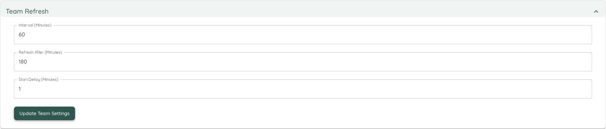
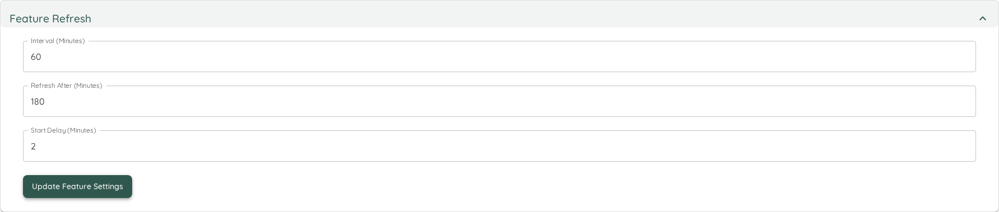
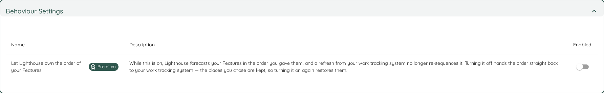

# Refresh & ordering
Found on **Settings → Organization → Refresh & ordering**. Only System Administrators open it. It holds how often Teams and Portfolios refresh, and who owns the order of your Features. *Never send usage data* is on [Usage Data](usagedata.html), under **Settings → System**.

## Periodic Refresh Settings
One of the main advantages of Lighthouse is the fact that it's not only offering to run the forecasts on demand, but also **continuously**. To fine-tune this, you can adjust the several settings:

### Refresh Types
There are two types of refreshes:
- Team
- Feature

The Team refresh fetches all items related to your team, and is equivalent to clicking the update icon on the Team page, while the Feature refresh updates portfolio data and is equivalent to using the refresh icon on the Portfolio page.

Each refresh is followed by a forecast of the Portfolios it touched. When a background refresh changed nothing that forecast reads, Lighthouse confirms the existing forecast instead of recalculating it, so a short interval costs little while your data is quiet. A refresh you start yourself recalculates, with one exception described under [Forecasts that were confirmed, not recalculated](refreshhistory.html#forecasts-that-were-confirmed-not-recalculated).

### Setting Details
Each refresh type contains three different settings. All settings are specified in minutes. After adjusting the setting, the *Update Settings* button must be pressed for the changes to become effective.

| Name | Description |
|------|-------------|
| Interval (Minutes) | The time between checks if the data should be updated. This means, after *x minutes* Lighthouse will check if the last update was older than what was defined in *Refresh After*. |
| Refresh After (Minutes) | The time after which a refresh will be triggered if the last one was more than this time ago. |
| Start Delay (Minutes) | The delay before the background task is started when the application starts. This can be useful as you may not want to trigger updates just after startup. |

## Behaviour Settings
Some behaviour does not make sense to have on in every situation. And occasionally some new features will be deployed with the latest version of Lighthouse that we deem not ready for general use. Both are *Behaviour Settings*: instance-wide switches, each with its own row, that you can selectively enable or disable.

Eventually, the Features in preview will be integrated into the regular functionality, and the preview flag will be removed. In rare cases, a preview feature might get removed.

{: .recommendation}
While preview features should be relatively stable, it can be that they will not work perfectly yet. If you enable them and encounter issues, please let us know about it. We're looking forward to your feedback!

{: .note}
The rows read in your own words. If you renamed *Feature* under [Terminology](terminology.html), a row that talks about your Features says your word for them instead of ours.

### Faster Updates

On Jira Cloud, Jira Data Center and Azure DevOps, every update runs in two steps. It first asks your work tracking system for nothing but the identity of each Work Item and the date the tracker says it last changed, then downloads the full details only for the ones whose date moved. A Work Item nobody has touched in weeks is not downloaded again — and on a large query, downloading those is most of the time an update would otherwise spend, and most of the load Lighthouse would put on your tracker.

- **Nothing about your data changes.** The whole query is still read on every update, so a Work Item that leaves the query still disappears from Lighthouse on the very next update.
- **ServiceNow, Linear and CSV always download everything.** Every update reads the full details of every Work Item they return, as it always has.
- **A setting that changes what an update asks for costs you one full update.** Change the query, the Work Item types, the states, the state mapping, the Done cutoff, the Parent sources or the additional fields, and the next update downloads everything again — the Work Items you already have were read under the old settings, so they cannot be trusted to still be right. The update after that is fast again.
- **A failed first step falls back to downloading everything.** If asking for the change dates fails, the update writes a warning to the log and downloads the whole query instead, so it costs you time, never data.
- **Editing a query does not throw away what Lighthouse already stored.** Before, changing anything about how a Team or Portfolio is fetched discarded its Work Items along with the state transitions recorded for them. Now only pointing a Team or Portfolio at a *different* work tracking connection does that, because that is the one edit where the same ID genuinely means a different Work Item.
- **What each update did is in the log**: `Update completed | Team 'X' | mode=Delta | scanned=250 | fetched=3 | …`. `scanned` is how much of the query was read, `fetched` how much was actually downloaded. A line that reads `mode=Full` with the two numbers equal is an update that downloaded everything: the first update of a Team or Portfolio, the one after a setting that changes what an update asks for, a connector that cannot run the first step, or a first step that failed. See [What an Update Writes](logs.html#what-an-update-writes).

{: .note}
There is no setting for this any more. An instance that had *Faster Updates* switched off uses it too after upgrading, and there is no way to turn it off.

### Feature Order (Premium)
By default, Lighthouse forecasts your Features in the order your work tracking system gives them — the rank or backlog order they already carry there. Every refresh re-reads that order, so a rank someone changes in Azure DevOps, Jira, or Linear re-sequences your forecast without anyone on your team deciding it. On connectors that have no meaningful rank at all, such as ServiceNow, the sequence was never yours to begin with.

Turn *Let Lighthouse own the order of your Features* on and Lighthouse takes ownership instead.

- **Nothing moves when you turn it on.** Lighthouse records the order you are already looking at, exactly as it stands. The list is identical the instant the switch flips — if it reshuffled, that would be indistinguishable from a bug.
- **Refreshes stop re-sequencing it.** Your work tracking system keeps updating its own rank, and Lighthouse keeps ignoring it. Only the order it recorded decides what the forecast draws from.
- **The `#` column heading changes to *Manual***, on the [Features page](../features/features.html) and on the Portfolio Feature list, so it is always visible which order you are reading.
- **Features that arrive later go to the end** and stay there until you move them. They are not announced.

#### Turning it back off
Turning the switch off hands the order straight back to your work tracking system, immediately and without a refresh. The places you chose are **kept** — turn it on again and they come back, rather than being re-read from the tracker. That makes the switch something you can try on a live instance instead of a decision you have to commit to.

{: .note}
Owning the order requires a [Premium license](../licensing/licensing.html#licensed-features). The Features page itself, and the `#` column on it, are available on every instance regardless.

{: .recommendation}
Changing who owns the order changes every forecasted date, because the order is what the simulation draws from. Expect the dates on your Portfolios to be recalculated shortly after you flip the switch either way.

### Fill in past days on over-time charts
[Percentiles Over Time](../metrics/predictability.html#percentiles-over-time) and [PBC Over Time](../metrics/predictability.html#pbc-over-time) always fill in the days Lighthouse missed, working them out in the background from the Work Items it already stores. [Filling in past days](../metrics/predictability.html#filling-in-past-days) describes how the fill proceeds and which days it can and cannot fill.

{: .note}
There is no setting for this any more. It used to be a Preview under Behaviour Settings; an instance that had it switched off fills in past days too after upgrading, and there is no way to turn it off. A script that still reads or switches `/api/latest/optionalfeatures/OverTimeHistoryFill` as a System Admin is told there is no such setting (`404`); anyone else is turned away as before (`403`). If you might want your unfilled history back, [take a backup](databasemanagement.html#backup) before you upgrade: filled days cannot be told apart from recorded ones afterwards.

If you are enabling Lighthouse features for AI clients, MCP, or automation workflows, continue with [AI and Automation](../aiintegration.html). If the target instance requires authentication, create credentials in [API Keys](apikeys.html).
