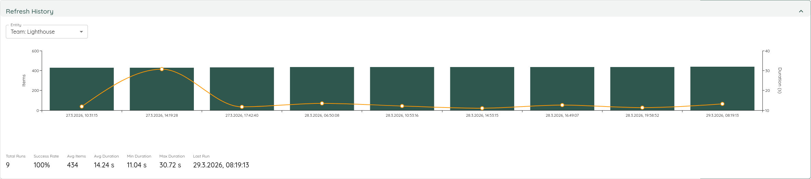

# Refresh History
Found on **Settings → System → Refresh History**, open to everyone.

In order to observe the refresh times of your teams and portfolios, Lighthouse is tracking the last 30 runs and visualizing them:

You can see when you refreshed, how many items (Work Items or Features) were fetched, and how long it took.

## Forecasts that were confirmed, not recalculated
When a background update finds that nothing a Portfolio's forecast reads has changed since its last forecast, Lighthouse confirms the existing forecast instead of recalculating it. That takes seconds rather than minutes on a large Portfolio. The Features keep their forecasted dates, and their forecast's "last updated" time moves to that update, so it says when the forecast was last known to be current.

Refresh History tells these runs apart from the ones that recalculated:

- The *Last Run* of such a run reads, for example, *23/10/2026, 10:15:02 · skipped (nothing changed)*.
- A line *Skipped (nothing changed): 3 of the last 30 runs* counts them. It only shows when there is at least one.
- *Avg*, *Min* and *Max Duration*, and the duration line in the chart, count only the runs that recalculated, so they keep telling you how long a real forecast takes. The chart leaves a gap where a run was skipped, and the three figures read *—* when none of the runs in the history recalculated.

Only background updates confirm a forecast this way. Whatever you start yourself recalculates:

- Saving a Team's throughput or Feature WIP quick setting, on a Team's or a Portfolio's page, asks for a new forecast straight away, and that forecast is always recalculated in full. So is a forecast asked for through the API.
- A refresh you start, on a Team or a Portfolio or with one of the refresh-all buttons, recalculates the forecasts it leads to, unless another forecast of that Portfolio ran in between. That one recalculates instead, and the refresh's own forecast then recalculates only if the refresh changed something the forecast reads.
- The first forecast of each Portfolio after Lighthouse starts is always recalculated.

See [Periodic Refresh Settings](refresh.html#periodic-refresh-settings) for when background updates run.

On a Jira connection whose Parent sources name an issue link type, two more figures can appear: the most Work Items or Features a single refresh placed although their links named more than one parent, and the most it could not place. Each figure shows only when it is above zero. They are the highest count in any one refresh, not a total, because every refresh reads the same untidy records again. How such a record is placed is described for [Teams](../teams/edit.html#when-a-work-items-links-name-more-than-one-issue) and [Portfolios](../portfolios/edit.html#when-a-features-links-name-more-than-one-issue).

Under a Portfolio's figures, Refresh History also lists what its latest full download could not read as configured in the Dependency Field. Each sentence names the setting and what to change, for example:

- *The Dependency Field names "depends on", and no Feature carries that link. Links seen: is blocked by, relates to.*
- *The Dependency Field names "Blocks", which points both ways. Name one end: "blocks" or "is blocked by".*
- *The Dependency Field names "System.LinkTypes.Related", which has no direction. Name a relation type with two ends, such as "System.LinkTypes.Dependency-Reverse".*
- *The Dependency Field names "Contoso.DependsOn" without its end. Name one end: "Contoso.DependsOn-Forward" or "Contoso.DependsOn-Reverse".*

The line beneath them gives the day of the full download they come from. A Portfolio that ignores dependencies shows none, and nothing is listed when the Dependency Field reads what it should.

For a Team and for a Portfolio on Jira or Azure DevOps, the same place lists every one of the [Parent sources](../teams/edit.html#parent-sources) that could not be read, one sentence each:

- *Parent source "Program Ref" matched no field and no link type. The next source in the list was read instead.* The second sentence is left out when that source is the last in the list.
- *One of the Parent sources points at an Azure DevOps relation type, which only the Dependency Field reads.*

Such a source is skipped, and the update carries on with the next one. A source that simply holds no value on a Work Item is ordinary and is not listed. A full download whose query returned nothing has no Work Item to report on, so it lists nothing about the Parent sources, and neither does one that could not ask the tracker for its link or relation types.

While the history is loading, a spinner shows in its place. If it cannot be loaded, the section says *Could not load refresh history.*
