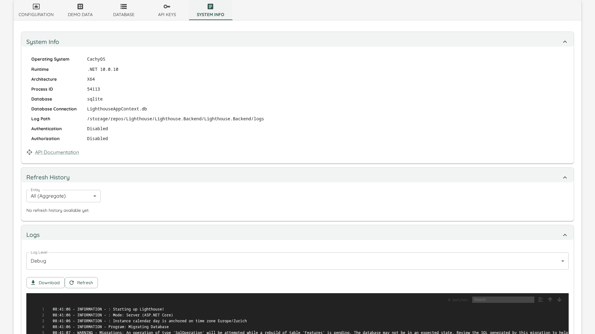
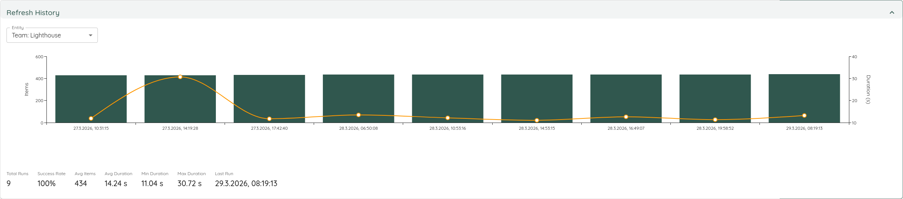

# System Info
The *System Info* tab gives you an overview over your system:


## System Info
Here you can see details about the Lighthouse instance you are running.

{: .note}
You can click on any of the values, and it will copy them.

You also have a link to the API documentation, which will bring you to a swagger page detailing all the API endpoints of Lighthouse.

One of the rows is **Encryption**, and it answers who owns the key your stored credentials are encrypted with — this instance, or you. It is the fastest way to tell whether an instance still needs a key of its own; what to do about the answer is on the [Secret Encryption Key](encryption.html) page. Like every value here, the row names the key, never the key material.

## Refresh History
In order to observe the refresh times of your teams and portfolios, Lighthouse is tracking the last 30 runs and visualizing them:



You can see when you refreshed, how many items (Work Items or Features) were fetched, and how long it took.

### Forecasts that were confirmed, not recalculated
When a background update finds that nothing a Portfolio's forecast reads has changed since its last forecast, Lighthouse confirms the existing forecast instead of recalculating it. That takes seconds rather than minutes on a large Portfolio. The Features keep their forecasted dates, and their forecast's "last updated" time moves to that update, so it says when the forecast was last known to be current.

Refresh History tells these runs apart from the ones that recalculated:

- The *Last Run* of such a run reads, for example, *23/10/2026, 10:15:02 · skipped (nothing changed)*.
- A line *Skipped (nothing changed): 3 of the last 30 runs* counts them. It only shows when there is at least one.
- *Avg*, *Min* and *Max Duration*, and the duration line in the chart, count only the runs that recalculated, so they keep telling you how long a real forecast takes. The chart leaves a gap where a run was skipped, and the three figures read *—* when none of the runs in the history recalculated.

Only background updates confirm a forecast this way. Whatever you start yourself recalculates:

- Saving a Team's throughput or Feature WIP quick setting, on a Team's or a Portfolio's page, asks for a new forecast straight away, and that forecast is always recalculated in full. So is a forecast asked for through the API.
- A refresh you start, on a Team or a Portfolio or with one of the refresh-all buttons, recalculates the forecasts it leads to, unless another forecast of that Portfolio ran in between. That one recalculates instead, and the refresh's own forecast then recalculates only if the refresh changed something the forecast reads.
- The first forecast of each Portfolio after Lighthouse starts is always recalculated.

See [Periodic Refresh Settings](configuration.html#periodic-refresh-settings) for when background updates run.

On a Jira connection whose parent setting names an issue link type, two more figures can appear: the most Work Items or Features a single refresh placed although their links named more than one parent, and the most it could not place. Each figure shows only when it is above zero. They are the highest count in any one refresh, not a total, because every refresh reads the same untidy records again. How such a record is placed is described for [Teams](../teams/edit.html#when-a-work-items-links-name-more-than-one-issue) and [Portfolios](../portfolios/edit.html#when-a-features-links-name-more-than-one-issue).

Under a Portfolio's figures, Refresh History also lists what its latest full download could not read as configured in the Dependency Field. Each sentence names the setting and what to change, for example:

- *The Dependency Field names "depends on", and no Feature carries that link. Links seen: is blocked by, relates to.*
- *The Dependency Field names "Blocks", which points both ways. Name one end: "blocks" or "is blocked by".*
- *The Dependency Field names "System.LinkTypes.Related", which has no direction. Name a relation type with two ends, such as "System.LinkTypes.Dependency-Reverse".*
- *The Dependency Field names "Contoso.DependsOn" without its end. Name one end: "Contoso.DependsOn-Forward" or "Contoso.DependsOn-Reverse".*

The line beneath them gives the day of the full download they come from. A Portfolio that ignores dependencies shows none, and nothing is listed when the Dependency Field reads what it should.

While the history is loading, a spinner shows in its place. If it cannot be loaded, the section says *Could not load refresh history.*


## Logs
We really hope you don't need this...but then again, Software is complex and it's very possible that once you run into a problem and need some more details on what was going on (or we ask for this info to better find the problem).  
For this case, you can check the *Logs*.

{: .note}
If you are here because something looks wrong *right now*, the [Task Manager](taskmanager.html) in the header lists the recent warnings and errors on their own, without the rest of the log around them — and it links back to this page when you need the full picture.

### Connection default changes
When a save changes a default that Teams or Portfolios follow, the log gets one Information entry for each changed default. It names the connection, the default, the field before and after, the Teams or Portfolios that follow it, and how many updates the save queued:

```
Connection "Jira Cloud" changed the Teams' Parent Override Field default from "Caused by" to "Epic Link"; 3 Teams follow it: Payments, Platform, Checkout; 3 updates queued.
```

An Estimation change queues no update, so its entry says *no update queued*. See [Defaults for Teams and Portfolios](worktrackingsystems.html#defaults-for-teams-and-portfolios).

### Jira Release sweeps
To offer or follow a Jira Release, Lighthouse reads the Releases of every project the connection can see. Each of these reads (a *sweep*) writes one Information entry with how long Jira took and how much it read, so you can tell whether a slow Delivery dialog or a slow refresh is waiting on Jira:

```
Jira Release sweep for the Picker took 3912 ms on this DataCenter connection: kept 48 of 1260 versions read over 31 pages from 27 projects; complete: True, projects skipped: 0
```

| Figure | Meaning |
|--------|---------|
| *for the …* | Why the Releases were read (see below) |
| *took … ms* | How long the whole sweep took, from connecting to Jira to the last page of versions |
| *on this … connection* | `Cloud` or `DataCenter`, or `Unknown` when Jira could not be reached before that was known |
| *kept … of … versions read* | How many Releases were kept as choices, out of all the versions Jira returned |
| *over … pages* | How many pages of versions Jira was asked for |
| *from … projects* | How many projects the connection can see |
| *complete* | `True` when every project was read; `False` when the list is missing something |
| *projects skipped* | How many projects could not be read, for example because Jira refused them |

The sweep is named for what asked for it:

| Purpose | What asked for it |
|---------|-------------------|
| Picker | The list of Releases offered when you choose one in the Delivery dialog. A list read in the last few minutes is reused, and then no entry is written. |
| Preview | The preview shown once you pick a Release, with its date and the Features it carries |
| Save | Saving a Delivery that follows a Release, when it is created or changed |
| Refresh | The regular Portfolio refresh that keeps Deliveries following a Release up to date |

The entry names no host, connection, project or Release, so it can be shared as it is. Find it in the [Log Viewer](#view-logs) by searching for *Jira Release sweep*, or in the [downloaded log](#download). It is written at *Information* level, so it only shows while the [Log Level](#log-level) is *Information* or more detailed.

## Log Level
Log levels describe the level of detail that should end up in the log. The more "sensitive", the more messages will be added. Following *Log Levels* can be selected:

| Level | Description |
|-------|-------------|
| Verbose | Most detailed logging level, includes all messages |
| Debug | Includes detailed information useful for debugging |
| Information | General information about application flow |
| Warning | Potentially harmful situations that aren't errors |
| Error | Error events that might still allow the application to continue |
| Fatal | Very severe errors that will terminate the application |

{: .recommendation}
For normal operations, we recommend to keep the log level at *Warning* or *Information*. *Debug* and *Verbose* should only be used selectively to analyze errors, as otherwise the log will grow a lot, and most likely you'll have too much information in there for it to be truly useful.

## What an Update Writes

At *Information*, every completed update writes a single summary line that says what it did:

```
Update completed | Team 'Zenith' | mode=Full | scanned=4013 | fetched=4013 | duration=291043ms | success=True
```

| Field | Meaning |
|-------|---------|
| `mode` | How much had to be fetched. `Full` downloads every record the query returned; `Delta` downloads only the ones that changed since the last update. See [Faster Updates](configuration.html#faster-updates) |
| `scanned` | How many records the work tracking system returned |
| `fetched` | How many of those were downloaded in full |
| `duration` | How long the update took, in milliseconds |
| `success` | Whether it completed. A failed update still writes this line, followed by the error |
| `forecast` | Only when the update led to a forecast: how long it took, in milliseconds. `skipped after 850ms (inputs unchanged)` means nothing the forecast reads had changed, so the existing forecast was confirmed rather than recalculated. `cancelled after` and `failed after` say how a forecast that did not finish ended |

This is the line to read if you want to know whether your refresh interval is affordable, or which Team or Portfolio is the expensive one.

{: .note}
The detail of *what* an update touched — every Work Item added, updated or removed, every Feature it extrapolated — is written at *Debug*, not *Information*. Nothing was removed; if you are chasing a specific Work Item through an update, switch to *Debug* and you will find it. An update that is skipped because it is not due yet writes nothing at *Information* at all.

## View Logs
You can check the *Live Logs* in the built-in Log View. This also supports a *Search* with syntax highlighting, for example if you want to find a specific feature by name or ID.

{: .note}
The latest logs are the **bottom** of the Log Viewer. So for newer things you have to scroll down

The logs won't be updated automatically. If you want to get the latest ones, hit the *Refresh* button and the viewer will reload the latest ones.

## Download
For a quick glance, the built-in [Log Viewer](#view-logs) is nice. However, for some extended analysis or to provide Logs to other people (for example as part of a bug report), you can download the full Log file. Simply hit the *Download* button, and the file will be downloaded to your computer.