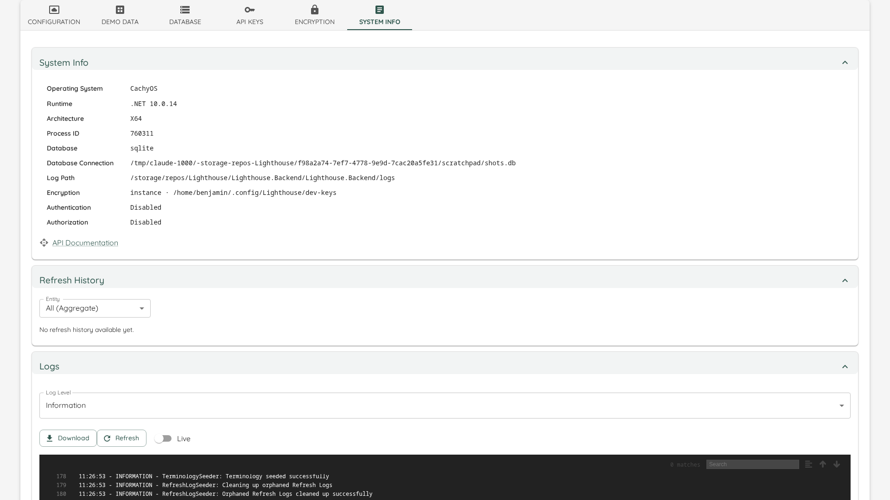

# System Info
The *System Info* tab under **Settings → System** shows the Lighthouse instance you are running. [Logs](logs.html) and [Refresh History](refreshhistory.html) are tabs and pages of their own.

{: .note}
You can click on any of the values, and it will copy them.

You also have a link to the API documentation, which will bring you to a swagger page detailing all the API endpoints of Lighthouse.

One of the rows is **Encryption**, and it answers who owns the key your stored credentials are encrypted with — this instance, or you. It is the fastest way to tell whether an instance still needs a key of its own; what to do about the answer is on the [Secret Encryption Key](encryption.html) page. Like every value here, the row names the key, never the key material.
