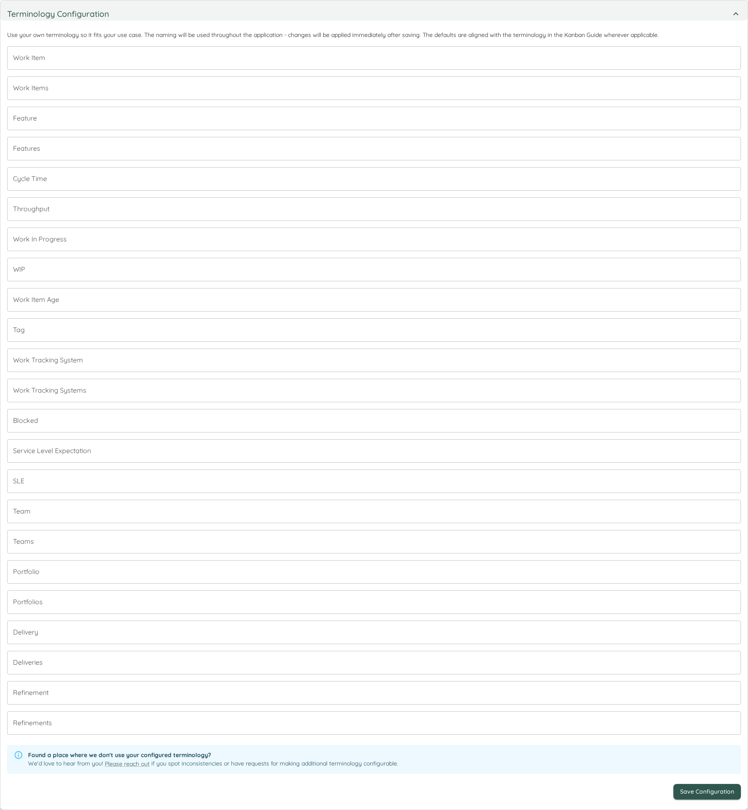

# Terminology
Found on **Settings → Organization → Terminology**. Only System Administrators open it.

Lighthouse allows you to customize the terminology used throughout the application to better align with your organization's language and workflow conventions. This feature helps eliminate confusion by ensuring consistent terminology that matches how your team and organization refers to work items and concepts.

## Configurable Terms
The terminology configuration allows you to customize the following terms:

| Term Category | Default Value | Description | Example Alternatives |
|---------------|---------------|-------------|---------------------|
| **Work Item** | Work Item | Individual units of work tracked in your system | Story, Task, Issue, Ticket, Item |
| **Work Items** | Work Items | Plural form of work item | Stories, Tasks, Issues, Tickets, Items |
| **Feature** | Feature | Larger units of work that contain multiple work items | Epic, Initiative, Theme, Component |
| **Features** | Features | Plural form of feature | Epics, Initiatives, Themes, Components |
| **Cycle Time** | Cycle Time | Time from when work starts until completion | Lead Time, Flow Time, Delivery Time |
| **Throughput** | Throughput | Number of items completed in a given time period | Velocity, Delivery Rate, Completion Rate |
| **Work In Progress** | Work In Progress | Items currently being worked on | WIP, In Progress, Active Work |
| **WIP** | WIP | Abbreviated form of Work In Progress | IP, Active, Current |
| **Work Item Age** | Work Item Age | How long an item has been in progress | Item Age, Story Age, Task Age |
| **Tag** | Tag | Labels or categories applied to work items | Label, Category, Type, Keyword |
| **Work Tracking System** | Work Tracking System | The external system that stores your work items | Issue Tracker, Project Management Tool, ALM Tool |
| **Work Tracking Systems** | Work Tracking Systems | Plural form of work tracking system | Issue Trackers, Project Management Tools, ALM Tools |
| **Blocked** | Blocked | Items that cannot progress due to impediments | Impediment, Stuck, On Hold, Waiting |
| **Service Level Expectation** | Service Level Expectation | Expected time for work completion | SLE, Target Time, Goal, Commitment |
| **SLE** | SLE | Abbreviated form of Service Level Expectation | Target, Goal, Expectation |
| **Team** | Team | Groups of people working together | Squad, Crew, Group, Department |
| **Teams** | Teams | Plural form of team | Squads, Crews, Groups, Departments |
| **Portfolio** | Portfolio | A collection of features that belong together and are managed as a unit | Project, Initiative, Program |
| **Portfolios** | Portfolios | Plural form of portfolio | Projects, Initiatives, Programs |
| **Delivery** | Delivery | A point in time by which a defined list of features should be done | Milestone, Checkpoint, Release |
| **Deliveries** | Deliveries | Plural form of delivery | Milestones, Checkpoints, Releases |
| **Refinement** | Refinement | The stage where Work Items are clarified and prepared before work on them starts | Grooming, Preparation |
| **Refinements** | Refinements | Plural form of refinement | Groomings, Preparations |

## How to Configure
1. Navigate to *Settings* → *Organization* → *Terminology*
2. Locate the *Terminology Configuration* section
3. For each term you want to customize:
   - View the current default value and description
   - Enter your preferred terminology in the input field
   - Leave blank to use the default value
4. Click *Save* to apply your changes

## Benefits of Customization
- **Consistency**: Eliminates confusion from mixed terminology throughout the application
- **Familiarity**: Use terms that your team already knows and understands
- **Alignment**: Match existing organizational vocabulary and processes
- **Adoption**: Reduce the learning curve for new users by using familiar language
- **Communication**: Improve clarity when discussing metrics and workflows with stakeholders

## Best Practices
{: .recommendation}
- **Team Alignment**: Involve your team in deciding on terminology to ensure everyone understands and agrees with the chosen terms
- **Organizational Standards**: Align with existing terminology used in your organization's other tools and processes
- **Documentation**: Update any team documentation or training materials to reflect the customized terminology
- **Consistency**: Use the same terms consistently across all teams and portfolios in your Lighthouse instance

{: .note}
Changes to terminology are applied immediately throughout the entire application interface. All existing data and configurations remain unchanged - only the display labels are updated.
